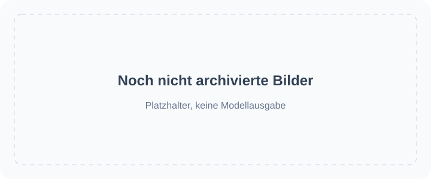

<!-- Generated by scripts/build_readme.py. Edit source data, locale catalogs and generator scripts. -->

# 🎨 Awesome GPT Image 2.6

Eine offene Sammlung von Prompts, visuellen Beispielen und Originalquellen für GPT Image 2.6.

    

⚠️ **Urheberrechtshinweis**: Die Prompts und Medien in dieser Sammlung stammen aus öffentlichen Quellen und dienen ausschließlich Bildungszwecken. Wenn du der Meinung bist, dass Inhalte deine Rechte verletzen, [öffne bitte ein Issue](https://github.com/RaphaelAI-OpenLab/awesome-gpt-image-2-6/issues/new), und wir werden sie umgehend entfernen.

    
    
    
   

---

Diese Sprachversion übersetzt die Repository-Oberfläche. Vollständige Beispieldetails sind derzeit auf Englisch und vereinfachtem Chinesisch verfügbar.

Titel, Beschreibungen und Detailseiten der Beispiele werden auf Englisch angezeigt, wenn keine Übersetzung verfügbar ist. Original-Prompts und Quellenzitate werden nicht übersetzt.

**Schnellzugriff** · [🖼️ Beispiele durchstöbern](#all-cases) · [🆕 Kürzlich hinzugefügt](#latest) · [📝 Beispiel hinzufügen](https://github.com/RaphaelAI-OpenLab/awesome-gpt-image-2-6/issues/new?template=submit-case.yml) · [🐞 Problem melden](https://github.com/RaphaelAI-OpenLab/awesome-gpt-image-2-6/issues/new?template=report-problem.yml) · [📚 Leitfaden lesen](CONTRIBUTING.md)

## 🌐 Sammlung durchstöbern

**[Alle Beispiele in diesem Repository ansehen →](#all-cases)**

Jedes Beispiel unten öffnet eine interne Detailseite mit Nachweisen zum Modell, Quellenangaben und Informationen zur Verfügbarkeit des Prompts.

**PLATZHALTER · URL der externen Webgalerie: nicht konfiguriert.**

**PLATZHALTER · Link zur Generierung mit einem Klick: nicht überprüft.**

PLATZHALTER · Link zu verwandter Sammlung / Kampagne: noch hinzuzufügen.

[Raphael besuchen (Startseite)](https://raphael.app/?utm_source=github&utm_medium=repository&utm_campaign=gpt_image_2_6_launch&utm_content=top_nav&utm_term=de-DE)

## 🏷️ Nach Kategorie durchstöbern

| Kategorie | Beispiele mit Quellenverweisen | Vollständige Prompts |
| --- | ---: | ---: |
| [Marken- & Produktvisualisierungen](#category-brand-products) | 68 | 0 |
| [Poster & Typografie](#category-posters-typography) | 47 | 0 |
| [Infografiken](#category-infographics) | 16 | 0 |
| [Innenräume & Architektur](#category-interiors-architecture) | 11 | 0 |
| [Figuren & Konsistenz](#category-characters-consistency) | 57 | 0 |
| [Markierungen & gezielte Bearbeitungen](#category-markup-edits) | 39 | 0 |
| [SVG & Designressourcen](#category-svg-design-assets) | 13 | 0 |
| [GIF & Animation](#category-gif-animation) | 132 | 0 |

## 📖 Inhalt

- [Was ist GPT Image 2.6?](#about)
- [Statistiken](#statistics)
- [Ausgewählte Beispiele](#featured)
- [Kürzlich hinzugefügt](#latest)
- [Alle Beispiele](#all-cases)
- [Vollständige Prompts](#collection)
- [Verwendung](#using)
- [Mitwirken](#contribute)
- [Lizenz](#license)
- [Danksagung](#acknowledgements)
- [Verlauf der Sterne](#star-history)

## 🤔 Was ist GPT Image 2.6?

OpenAI hat Images 2.6 am 4. November 2026 vorgestellt. Diese Sammlung umfasst die Modellvarianten Sunburst und Flare, Bilderstellung und -bearbeitung sowie dokumentierte SVG- und GIF-Workflows. Die Unterstützung einer Variante wird für jedes Beispiel dokumentiert und nicht vorausgesetzt.

[Offizielle Ankündigung](https://openai.com/index/introducing-images-2-6/) · [Modelldokumentation](https://developers.openai.com/api/docs/guides/image-generation)

## 📊 Statistiken

| Kennzahl | Anzahl / Datum |
| --- | ---: |
| Beispiele mit Quellenverweisen | **383** |
| Offizielle Beispiele | **37** |
| Von Erstellern gemeldete Beispiele | **346** |
| An der Quelle verfügbare Original-Prompts | **237** |
| Hier veröffentlichte vollständige Prompts | **0** |
| Lokal archivierte Mediendateien | **560** |
| Letzte Quellenprüfung (UTC) | **2026-11-09** |

Quellenzahlen sind keine Aussagen über eine Reproduktion. Noch ungeprüfte Hinweise sind ausgeschlossen; unterschiedliche Ausgaben innerhalb eines Workflows zählen als ein Beispiel.

## 🔥 Ausgewählte Beispiele

<table>
<tr>
<td width="33%" align="center"><a href="cases/docs-bakery-svg/README.md"> <strong>Bakery SVG logo</strong></a> Offizielle Dokumentation</td>
<td width="33%" align="center"><a href="cases/docs-lantern-gif/README.md"> <strong>Lantern-carrying monkey loop</strong></a> Offizielle Dokumentation</td>
<td width="33%" align="center"><a href="cases/launch-fal/README.md"> <strong>Living-room markup edit</strong></a> Offizielle Demo zur Einführung</td>
</tr>
<tr>
<td width="33%" align="center"><a href="cases/launch-sable/README.md"> <strong>Miniature brand product world</strong></a> Offizielle Demo zur Einführung</td>
<td width="33%" align="center"><a href="cases/launch-higgsfield/README.md"> <strong>Knight scene and clothing edit sequence</strong></a> Offizielle Demo zur Einführung</td>
<td width="33%" align="center"><a href="cases/community-malfoid/README.md"> <strong>Summer character illustration animation</strong></a> Vom Ersteller angegebenes Modell</td>
</tr>
</table>

Platzhalterkarten sind keine generierten Ergebnisse. Alle angezeigten Mediendateien befinden sich in diesem Repository; noch nicht archivierte Medien bleiben auf den Detailseiten verlinkt.

## 🆕 Kürzlich hinzugefügt

| Hinzugefügt | Beispiel | Nachweis |
| --- | --- | --- |
| 2026-11-06 | [Ofox three-mug markup targeting test](cases/ofox-three-mug-markup-target-test/README.md) | Vom Ersteller angegebenes Modell |
| 2026-11-06 | [Flixly: six GIF generation and editing tests](cases/flixly-six-gif-tests/README.md) | Vom Ersteller angegebenes Modell |
| 2026-11-06 | [CubistAI paper-cut forest cabin](cases/community-cubistai-paper-cut-cabin/README.md) | Vom Ersteller angegebenes Modell |
| 2026-11-06 | [CubistAI Botanical Forms poster](cases/community-cubistai-botanical-poster/README.md) | Vom Ersteller angegebenes Modell |
| 2026-11-06 | [CubistAI espresso-cup still life](cases/community-cubistai-espresso-cup/README.md) | Vom Ersteller angegebenes Modell |
| 2026-11-06 | [Borrow the Style of a Reference Image](cases/yepshot-compose-style-transfer/README.md) | Vom Ersteller angegebenes Modell |

## 📋 Alle Beispiele

### Marken- & Produktvisualisierungen

| Beispiel · interne Detailseite | Quelle | Prompt |
| --- | --- | --- |
| [Transparent bakery raster logo](cases/docs-bakery-raster/README.md) | Offizielle Dokumentation | Original-Prompt an der Quelle |
| [Transparent product cutout](cases/docs-product-cutout/README.md) | Offizielle Dokumentation | Original-Prompt an der Quelle |
| [Toy airplane packaging](cases/docs-toy-package/README.md) | Offizielle Dokumentation | Original-Prompt an der Quelle |
| [Miniature brand product world](cases/launch-sable/README.md) | Offizielle Demo zur Einführung | Original-Prompt an der Quelle |
| [Travel visual generation speed comparison](cases/launch-travel/README.md) | Offizielle Demo zur Einführung | Prompt nicht öffentlich |
| [Laptop GIF-creation workspace illustration](cases/techrepublic-gif-workspace-illustration/README.md) | Vom Ersteller angegebenes Modell | Prompt nicht öffentlich |
| [Tovalin serum scene comparison](cases/productai-tovalin-serum-comparison/README.md) | Vom Ersteller angegebenes Modell | Prompt nicht öffentlich |
| [Quillhaven coffee scenes and precise edits](cases/productai-quillhaven-coffee-comparison/README.md) | Vom Ersteller angegebenes Modell | Prompt nicht öffentlich |
| [Running-shoe scenes and precise edits](cases/productai-running-shoe-comparison/README.md) | Vom Ersteller angegebenes Modell | Prompt nicht öffentlich |
| [Cable-knit cardigan on a model](cases/productai-cable-knit-cardigan-comparison/README.md) | Vom Ersteller angegebenes Modell | Prompt nicht öffentlich |
| [Oaken Mile Coffee label: Flare and Sunburst](cases/community-moss-coffee-label/README.md) | Vom Ersteller angegebenes Modell | Original-Prompt an der Quelle |
| [Cafe latte: Flare and Sunburst](cases/community-lightlyn-latte-variants/README.md) | Vom Ersteller angegebenes Modell | Original-Prompt an der Quelle |
| [Earbud product-ad comparison](cases/community-lightlyn-earbuds-ad-variants/README.md) | Vom Ersteller angegebenes Modell | Original-Prompt an der Quelle |
| [Made Takeaway box](cases/made-flare-dumpling-box/README.md) | Vom Ersteller angegebenes Modell | Original-Prompt an der Quelle |
| [Made Stylus macro](cases/made-sunburst-stylus-macro/README.md) | Vom Ersteller angegebenes Modell | Original-Prompt an der Quelle |
| [Three-flavor soda lineup](cases/yir-flavor-lineup/README.md) | Vom Ersteller angegebenes Modell | Original-Prompt an der Quelle |
| [French press product photos and background-edit continuation](cases/community-gptimagehub-french-press-edit/README.md) | Vom Ersteller angegebenes Modell | Original-Prompt an der Quelle |
| [SUMMIT ROAST coffee-bag product shot](cases/zzo-flare-summit-roast-bag/README.md) | Vom Ersteller angegebenes Modell | Original-Prompt an der Quelle |
| [Nowrap logo motion comparison](cases/nowrap-logo-motion/README.md) | Vom Ersteller angegebenes Modell | Original-Prompt an der Quelle |
| [Flat fox mascot badge](cases/toonderly-fox-badge/README.md) | Vom Ersteller angegebenes Modell | Original-Prompt an der Quelle |
| [Watch four-round editing](cases/yir-watch-edit-sequence/README.md) | Vom Ersteller angegebenes Modell | Prompt nicht öffentlich |
| [Vase four-round editing](cases/yir-vase-edit-sequence/README.md) | Vom Ersteller angegebenes Modell | Prompt nicht öffentlich |
| [Soup photograph with recipe card](cases/joinoasis-tomato-soup/README.md) | Vom Ersteller angegebenes Modell | Original-Prompt an der Quelle |
| [Blazer and boots reference composition](cases/joinoasis-blazer-boots-composition/README.md) | Vom Ersteller angegebenes Modell | Original-Prompt an der Quelle |
| [Rainbow cups and cat](cases/community-flixly-rainbow-teacups/README.md) | Vom Ersteller angegebenes Modell | Original-Prompt an der Quelle |
| [Sage-green to terracotta bottle edit](cases/omniakey-bottle-color-edit/README.md) | Vom Ersteller angegebenes Modell | Prompt nicht öffentlich |
| [Watchmaker underwater macro test](cases/community-hn-watchmaker/README.md) | Vom Ersteller angegebenes Modell | Original-Prompt an der Quelle |
| [Perfume bottle on wet coastal rock](cases/chatimage2-seaside-perfume-edit/README.md) | Vom Ersteller angegebenes Modell | Original-Prompt an der Quelle |
| [Sunburst Roasters ceramic coffee canister](cases/replicate-sunburst-coffee-canister/README.md) | Vom Ersteller angegebenes Modell | Original-Prompt an der Quelle |
| [Brushed-titanium espresso tamper: Flare and Sunburst](cases/csuite-tamper/README.md) | Vom Ersteller angegebenes Modell | Verfügbarkeit des Prompts ungeprüft |
| [Ceramic mug: 2K background-setting test](cases/iskragen-mug-2k-background-test/README.md) | Vom Ersteller angegebenes Modell | Original-Prompt an der Quelle |
| [SUNNY POP sparkling-water poster](cases/framemux-sunny-pop-poster/README.md) | Vom Ersteller angegebenes Modell | Original-Prompt an der Quelle |
| [Sage-green speaker on travertine](cases/gptimagehub-sage-speaker/README.md) | Vom Ersteller angegebenes Modell | Original-Prompt an der Quelle |
| [LUMIÈRE jewelry portrait at a car window](cases/302-lumiere-jewelry-portrait/README.md) | Vom Ersteller angegebenes Modell | Original-Prompt an der Quelle |
| [VHS-style night racing scene](cases/302-vhs-drift-race/README.md) | Vom Ersteller angegebenes Modell | Original-Prompt an der Quelle |
| [Pure White Marketplace Packshot](cases/yepshot-studio-pure-white-amazon/README.md) | Vom Ersteller angegebenes Modell | Verfügbarkeit des Prompts ungeprüft |
| [Black Acrylic Mirror Reflection](cases/yepshot-studio-acrylic-reflection/README.md) | Vom Ersteller angegebenes Modell | Verfügbarkeit des Prompts ungeprüft |
| [Floating Hero Shot](cases/yepshot-studio-floating-ambient-shadow/README.md) | Vom Ersteller angegebenes Modell | Verfügbarkeit des Prompts ungeprüft |
| [Overhead Flat Lay on Light Gray](cases/yepshot-studio-overhead-flat-lay/README.md) | Vom Ersteller angegebenes Modell | Verfügbarkeit des Prompts ungeprüft |
| [Three-Quarter Catalog Angle](cases/yepshot-studio-three-quarter-angle/README.md) | Vom Ersteller angegebenes Modell | Verfügbarkeit des Prompts ungeprüft |
| [Material Close-Up for Detail Images](cases/yepshot-studio-material-detail-closeup/README.md) | Vom Ersteller angegebenes Modell | Verfügbarkeit des Prompts ungeprüft |
| [Preview Colorways Side by Side](cases/yepshot-studio-colorway-lineup/README.md) | Vom Ersteller angegebenes Modell | Verfügbarkeit des Prompts ungeprüft |
| [Travertine Block in Morning Light](cases/yepshot-lifestyle-travertine-stone/README.md) | Vom Ersteller angegebenes Modell | Verfügbarkeit des Prompts ungeprüft |
| [Marble Vanity with Water Droplets](cases/yepshot-lifestyle-marble-bathroom-dew/README.md) | Vom Ersteller angegebenes Modell | Verfügbarkeit des Prompts ungeprüft |
| [Oak Table with Kitchen Props](cases/yepshot-lifestyle-scandinavian-wood-kitchen/README.md) | Vom Ersteller angegebenes Modell | Verfügbarkeit des Prompts ungeprüft |
| [Concrete Podium, Tech Style](cases/yepshot-lifestyle-industrial-concrete-podium/README.md) | Vom Ersteller angegebenes Modell | Verfügbarkeit des Prompts ungeprüft |
| [Bright Modern Living Room](cases/yepshot-lifestyle-bright-living-room/README.md) | Vom Ersteller angegebenes Modell | Verfügbarkeit des Prompts ungeprüft |
| [Sunny Picnic Blanket](cases/yepshot-lifestyle-outdoor-picnic/README.md) | Vom Ersteller angegebenes Modell | Verfügbarkeit des Prompts ungeprüft |
| [Neon Gaming Desk](cases/yepshot-lifestyle-neon-gaming-desk/README.md) | Vom Ersteller angegebenes Modell | Verfügbarkeit des Prompts ungeprüft |
| [Remove Glare on Shiny Surfaces](cases/yepshot-cleanup-remove-glare-reflections/README.md) | Vom Ersteller angegebenes Modell | Verfügbarkeit des Prompts ungeprüft |
| [Erase Barcode and Price Sticker](cases/yepshot-cleanup-erase-barcode-watermark/README.md) | Vom Ersteller angegebenes Modell | Verfügbarkeit des Prompts ungeprüft |
| [Remove Dust and Fingerprints](cases/yepshot-cleanup-dust-fingerprints/README.md) | Vom Ersteller angegebenes Modell | Verfügbarkeit des Prompts ungeprüft |
| [Place a Product into Your Scene](cases/yepshot-compose-product-into-scene/README.md) | Vom Ersteller angegebenes Modell | Verfügbarkeit des Prompts ungeprüft |
| [Bundle Two Products into One Shot](cases/yepshot-compose-bundle-group-shot/README.md) | Vom Ersteller angegebenes Modell | Verfügbarkeit des Prompts ungeprüft |
| [Match Your Existing Catalog Look](cases/yepshot-compose-match-catalog-style/README.md) | Vom Ersteller angegebenes Modell | Verfügbarkeit des Prompts ungeprüft |
| [Smooth Out Fabric Wrinkles](cases/yepshot-cleanup-smooth-fabric-wrinkles/README.md) | Vom Ersteller angegebenes Modell | Verfügbarkeit des Prompts ungeprüft |
| [Christmas Pine and Warm Bokeh](cases/yepshot-seasonal-christmas-pine-bokeh/README.md) | Vom Ersteller angegebenes Modell | Verfügbarkeit des Prompts ungeprüft |
| [Summer Pool Water and Caustics](cases/yepshot-seasonal-summer-pool-water-ripples/README.md) | Vom Ersteller angegebenes Modell | Verfügbarkeit des Prompts ungeprüft |
| [Black Friday Black-and-Gold Pedestal](cases/yepshot-seasonal-black-friday-gold-geometry/README.md) | Vom Ersteller angegebenes Modell | Verfügbarkeit des Prompts ungeprüft |
| [Lunar New Year Red and Gold](cases/yepshot-seasonal-lunar-new-year/README.md) | Vom Ersteller angegebenes Modell | Verfügbarkeit des Prompts ungeprüft |
| [Turn Your Pet into a Collectible Figure](cases/yepshot-creative-collectible-figure/README.md) | Vom Ersteller angegebenes Modell | Verfügbarkeit des Prompts ungeprüft |
| [Photo to Watercolor Illustration](cases/yepshot-creative-watercolor-illustration/README.md) | Vom Ersteller angegebenes Modell | Verfügbarkeit des Prompts ungeprüft |
| [Sketch to Product Render](cases/yepshot-creative-sketch-to-render/README.md) | Vom Ersteller angegebenes Modell | Verfügbarkeit des Prompts ungeprüft |
| [Borrow the Style of a Reference Image](cases/yepshot-compose-style-transfer/README.md) | Vom Ersteller angegebenes Modell | Verfügbarkeit des Prompts ungeprüft |
| [CubistAI espresso-cup still life](cases/community-cubistai-espresso-cup/README.md) | Vom Ersteller angegebenes Modell | Original-Prompt an der Quelle |
| [Saved mug reference across three scenes](cases/weel-saved-mug-scenes/README.md) | Vom Ersteller angegebenes Modell | Original-Prompt an der Quelle |
| [AURORA orange perfume product image](cases/community-struggle-aurora-perfume/README.md) | Vom Ersteller angegebenes Modell | Original-Prompt an der Quelle |
| [Orange KINGY LAB product graphic](cases/kingy-sunburst-orange-bottle/README.md) | Vom Ersteller angegebenes Modell | Verfügbarkeit des Prompts ungeprüft |

### Poster & Typografie

| Beispiel · interne Detailseite | Quelle | Prompt |
| --- | --- | --- |
| [Streetwear advertisement typography](cases/docs-streetwear/README.md) | Offizielle Dokumentation | Original-Prompt an der Quelle |
| [Roadside shampoo billboard](cases/docs-billboard/README.md) | Offizielle Dokumentation | Original-Prompt an der Quelle |
| [Nostalgic holiday card](cases/docs-holiday-card/README.md) | Offizielle Dokumentation | Original-Prompt an der Quelle |
| [Shiba ramen shop: two quality comparison runs](cases/ai-garage-ramen-quality-series/README.md) | Vom Ersteller angegebenes Modell | Prompt nicht öffentlich |
| [Autumn café menu announcement comparison](cases/ai-garage-autumn-cafe/README.md) | Vom Ersteller angegebenes Modell | Prompt nicht öffentlich |
| [Flare 4K test, published previews](cases/aivideos-flare-4k-comparison/README.md) | Vom Ersteller angegebenes Modell | Prompt nicht öffentlich |
| [Flare quality and planning comparison](cases/aivideos-flare-quality-planning/README.md) | Vom Ersteller angegebenes Modell | Prompt nicht öffentlich |
| [Retro diner menu board](cases/dreamega-retro-diner/README.md) | Vom Ersteller angegebenes Modell | Original-Prompt an der Quelle |
| [Lantern Row Night Market flyer: Flare and Sunburst](cases/community-moss-night-market-flyer/README.md) | Vom Ersteller angegebenes Modell | Original-Prompt an der Quelle |
| [Café breakfast menu: Flare and Sunburst](cases/community-moss-breakfast-menu/README.md) | Vom Ersteller angegebenes Modell | Original-Prompt an der Quelle |
| [Pottery event banner layout: Flare and Sunburst](cases/community-moss-pottery-banner-layout/README.md) | Vom Ersteller angegebenes Modell | Original-Prompt an der Quelle |
| [Night market poster comparison](cases/community-lightlyn-night-market-variants/README.md) | Vom Ersteller angegebenes Modell | Original-Prompt an der Quelle |
| [Made Lightbox menu](cases/made-flare-noodle-menu/README.md) | Vom Ersteller angegebenes Modell | Original-Prompt an der Quelle |
| [Made Sleeve typography](cases/made-sunburst-record-sleeve/README.md) | Vom Ersteller angegebenes Modell | Original-Prompt an der Quelle |
| [Made Window lettering](cases/made-sunburst-shop-window/README.md) | Vom Ersteller angegebenes Modell | Original-Prompt an der Quelle |
| [Hot-sauce launch and speed-test posters](cases/yir-hot-sauce-posters/README.md) | Vom Ersteller angegebenes Modell | Original-Prompt an der Quelle |
| [End-of-season bicycle sale ad](cases/yir-bicycle-sale-ad/README.md) | Vom Ersteller angegebenes Modell | Original-Prompt an der Quelle |
| [Blue Hour jazz posters and date-edit continuation](cases/community-gptimagehub-jazz-poster-edit/README.md) | Vom Ersteller angegebenes Modell | Original-Prompt an der Quelle |
| [Winter Night Market poster](cases/veevid-holiday-market-poster/README.md) | Vom Ersteller angegebenes Modell | Original-Prompt an der Quelle |
| [English–Hindi evening menu from a document brief](cases/analyticsvidhya-bilingual-evening-menu/README.md) | Vom Ersteller angegebenes Modell | Original-Prompt an der Quelle |
| [NIGHT TIDE wave concert poster](cases/zzo-flare-night-tide-poster/README.md) | Vom Ersteller angegebenes Modell | Original-Prompt an der Quelle |
| [NIGHT MARKET typography comparison](cases/cellcog-night-market-poster/README.md) | Vom Ersteller angegebenes Modell | Prompt nicht öffentlich |
| [Café neon text comparison](cases/nowrap-cafe-sign-motion/README.md) | Vom Ersteller angegebenes Modell | Original-Prompt an der Quelle |
| [BOUNCE balloon-letter poster](cases/toonderly-bounce-poster/README.md) | Vom Ersteller angegebenes Modell | Prompt nicht öffentlich |
| [OPEN LATE neon storefront](cases/kavel-open-late/README.md) | Vom Ersteller angegebenes Modell | Prompt nicht öffentlich |
| [Lemon cake recipe card](cases/community-flixly-lemon-recipe/README.md) | Vom Ersteller angegebenes Modell | Original-Prompt an der Quelle |
| [FIELD & FLOUR bakery poster](cases/sogni-flare-bakery-poster/README.md) | Vom Ersteller angegebenes Modell | Prompt nicht öffentlich |
| [NORTHLIGHT TEA poster layout comparison](cases/sandbase-northlight-tea-posters/README.md) | Vom Ersteller angegebenes Modell | Prompt nicht öffentlich |
| [Port Calder poster complexity comparison](cases/omniakey-port-calder-comparison/README.md) | Vom Ersteller angegebenes Modell | Original-Prompt an der Quelle |
| [Birthday cake without extra slogan cards](cases/community-flare-slogan-comparison/README.md) | Vom Ersteller angegebenes Modell | Original-Prompt an der Quelle |
| [NIGHT SIGNAL concert poster: Flare and Sunburst](cases/csuite-poster/README.md) | Vom Ersteller angegebenes Modell | Verfügbarkeit des Prompts ungeprüft |
| [The Daily Pour coffee poster](cases/apixo-daily-pour-poster/README.md) | Vom Ersteller angegebenes Modell | Prompt nicht öffentlich |
| [Coffee poster: vague prompt versus structured brief](cases/gptimagehub-structured-coffee-poster/README.md) | Vom Ersteller angegebenes Modell | Original-Prompt an der Quelle |
| [AMALFI travel poster](cases/gptimagehub-amalfi-poster/README.md) | Vom Ersteller angegebenes Modell | Original-Prompt an der Quelle |
| [Block-world comparison cover redesign](cases/302-block-world-cover/README.md) | Vom Ersteller angegebenes Modell | Original-Prompt an der Quelle |
| [Five-view concept-car poster collage](cases/302-flying-car-collage/README.md) | Vom Ersteller angegebenes Modell | Original-Prompt an der Quelle |
| [Change the Name on a Product Label](cases/yepshot-text-label-name-swap/README.md) | Vom Ersteller angegebenes Modell | Verfügbarkeit des Prompts ungeprüft |
| [Translate the Text on Packaging](cases/yepshot-text-translate-packaging/README.md) | Vom Ersteller angegebenes Modell | Verfügbarkeit des Prompts ungeprüft |
| [Turn a Product Photo into a Sale Poster](cases/yepshot-campaign-sale-poster-text/README.md) | Vom Ersteller angegebenes Modell | Verfügbarkeit des Prompts ungeprüft |
| [Update the Discount on a Promo Graphic](cases/yepshot-text-promo-discount-update/README.md) | Vom Ersteller angegebenes Modell | Verfügbarkeit des Prompts ungeprüft |
| [CubistAI Botanical Forms poster](cases/community-cubistai-botanical-poster/README.md) | Vom Ersteller angegebenes Modell | Original-Prompt an der Quelle |
| [AI evolution poster revised to Image 2.6](cases/community-struggle-poster-edit/README.md) | Vom Ersteller angegebenes Modell | Original-Prompt an der Quelle |
| [Spring Health Fair 2027 flyer comparison](cases/nyle-health-fair/README.md) | Vom Ersteller angegebenes Modell | Prompt nicht öffentlich |
| [Sensitive-skin lotion advertisement comparison](cases/nyle-skincare-ad/README.md) | Vom Ersteller angegebenes Modell | Prompt nicht öffentlich |
| [Dense Japanese business cover comparison](cases/nyle-kanji-cover/README.md) | Vom Ersteller angegebenes Modell | Prompt nicht öffentlich |
| [KINGY LAB bottle-and-type thumbnail](cases/kingy-sunburst-bottle-thumbnail/README.md) | Vom Ersteller angegebenes Modell | Verfügbarkeit des Prompts ungeprüft |
| [Sunburst bakery quality comparison](cases/quantslant-sunburst-bakery-quality-ladder/README.md) | Vom Ersteller angegebenes Modell | Verfügbarkeit des Prompts ungeprüft |

### Infografiken

| Beispiel · interne Detailseite | Quelle | Prompt |
| --- | --- | --- |
| [Coffee-machine process diagram](cases/docs-coffee-diagram/README.md) | Offizielle Dokumentation | Original-Prompt an der Quelle |
| [Cellular respiration teaching visual](cases/docs-cell-respiration/README.md) | Offizielle Dokumentation | Original-Prompt an der Quelle |
| [Market-size presentation slide](cases/docs-pitch-slide/README.md) | Offizielle Dokumentation | Original-Prompt an der Quelle |
| [Northfield Design Summit agenda: Flare and Sunburst](cases/community-moss-design-summit-agenda/README.md) | Vom Ersteller angegebenes Modell | Original-Prompt an der Quelle |
| [Honeybee scientific scale layouts](cases/community-lightlyn-bee-scale-variants/README.md) | Vom Ersteller angegebenes Modell | Original-Prompt an der Quelle |
| [Made Illustrated map](cases/made-flare-market-map/README.md) | Vom Ersteller angegebenes Modell | Original-Prompt an der Quelle |
| [Made Exploded diagram](cases/made-sunburst-turntable-diagram/README.md) | Vom Ersteller angegebenes Modell | Original-Prompt an der Quelle |
| [Lisbon weather screen: matched Flare and Sunburst test](cases/community-gptimagehub-weather-ui/README.md) | Vom Ersteller angegebenes Modell | Original-Prompt an der Quelle |
| [Six-step bill-to-law infographic comparison](cases/community-gptimagehub-law-infographic/README.md) | Vom Ersteller angegebenes Modell | Original-Prompt an der Quelle |
| [Monarch butterfly life-cycle field-guide plate](cases/analyticsvidhya-monarch-life-cycle/README.md) | Vom Ersteller angegebenes Modell | Original-Prompt an der Quelle |
| [Automatic coffee-machine flow infographic](cases/zzo-flare-coffee-machine-diagram/README.md) | Vom Ersteller angegebenes Modell | Original-Prompt an der Quelle |
| [Quarterly revenue chart animation](cases/nowrap-chart-motion/README.md) | Vom Ersteller angegebenes Modell | Original-Prompt an der Quelle |
| [Five-step coffee process infographic](cases/replicate-flare-coffee-process-infographic/README.md) | Vom Ersteller angegebenes Modell | Original-Prompt an der Quelle |
| [Labeled sunflower botanical plate](cases/replicate-sunburst-sunflower-botanical/README.md) | Vom Ersteller angegebenes Modell | Original-Prompt an der Quelle |
| [The Life of a Coffee Bean infographic](cases/gptimagehub-coffee-bean-infographic/README.md) | Vom Ersteller angegebenes Modell | Original-Prompt an der Quelle |
| [The Ember Isles fantasy map](cases/gptimagehub-ember-isles-map/README.md) | Vom Ersteller angegebenes Modell | Original-Prompt an der Quelle |

### Innenräume & Architektur

| Beispiel · interne Detailseite | Quelle | Prompt |
| --- | --- | --- |
| [Replace chairs in an interior](cases/docs-room-chairs/README.md) | Offizielle Dokumentation | Original-Prompt an der Quelle |
| [Living-room markup edit](cases/launch-fal/README.md) | Offizielle Demo zur Einführung | Original-Prompt an der Quelle |
| [Made Ultra-wide aisle](cases/made-flare-market-aerial/README.md) | Vom Ersteller angegebenes Modell | Original-Prompt an der Quelle |
| [Snowy mountain greenhouse at blue hour](cases/analyticsvidhya-snowy-greenhouse/README.md) | Vom Ersteller angegebenes Modell | Original-Prompt an der Quelle |
| [Red tram in a foggy city](cases/kavel-tram/README.md) | Vom Ersteller angegebenes Modell | Prompt nicht öffentlich |
| [Four-room doorway layout](cases/joinoasis-four-room-floorplan/README.md) | Vom Ersteller angegebenes Modell | Original-Prompt an der Quelle |
| [Kitchen hanging-light replacement](cases/joinoasis-kitchen-pendant-edit/README.md) | Vom Ersteller angegebenes Modell | Original-Prompt an der Quelle |
| [Dusty warehouse prompt-detail comparison](cases/community-sunburst-dust-detail/README.md) | Vom Ersteller angegebenes Modell | Verfügbarkeit des Prompts ungeprüft |
| [Rainy-window reading nook](cases/chatimage2-rainy-reading-nook/README.md) | Vom Ersteller angegebenes Modell | Original-Prompt an der Quelle |
| [Waterfall landscape with a red-jacket hiker](cases/zhidx-waterfall-landscape/README.md) | Vom Ersteller angegebenes Modell | Prompt nicht öffentlich |
| [CubistAI paper-cut forest cabin](cases/community-cubistai-paper-cut-cabin/README.md) | Vom Ersteller angegebenes Modell | Original-Prompt an der Quelle |

### Figuren & Konsistenz

| Beispiel · interne Detailseite | Quelle | Prompt |
| --- | --- | --- |
| [Paper-cut championship scene: complexity comparison](cases/docs-complexity/README.md) | Offizielle Dokumentation | Original-Prompt an der Quelle |
| [Realistic fishing-boat sailor portrait](cases/docs-sailor/README.md) | Offizielle Dokumentation | Original-Prompt an der Quelle |
| [1969 historical crowd scene](cases/docs-historical-crowd/README.md) | Offizielle Dokumentation | Original-Prompt an der Quelle |
| [Four-panel pet comic](cases/docs-pet-comic/README.md) | Offizielle Dokumentation | Original-Prompt an der Quelle |
| [Change clothing while preserving identity](cases/docs-outfit/README.md) | Offizielle Dokumentation | Original-Prompt an der Quelle |
| [Place a person into a camping escape scene](cases/docs-person-scene/README.md) | Offizielle Dokumentation | Original-Prompt an der Quelle |
| [Establish a storybook character](cases/docs-character-start/README.md) | Offizielle Dokumentation | Original-Prompt an der Quelle |
| [Continue the same character’s story](cases/docs-character-story/README.md) | Offizielle Dokumentation | Original-Prompt an der Quelle |
| [Stained-glass whale](cases/launch-picsart/README.md) | Offizielle Demo zur Einführung | Prompt nicht öffentlich |
| [Knight scene and clothing edit sequence](cases/launch-higgsfield/README.md) | Offizielle Demo zur Einführung | Original-Prompt an der Quelle |
| [Ophanim-inspired still: The Coastal Lookout](cases/community-ophanim-coastal-lookout/README.md) | Vom Ersteller angegebenes Modell | Original-Prompt an der Quelle |
| [Ophanim-inspired still: The Mountain Reservoir](cases/community-ophanim-mountain-reservoir/README.md) | Vom Ersteller angegebenes Modell | Original-Prompt an der Quelle |
| [Ophanim-inspired still: The Village in the Rain](cases/community-ophanim-village-rain/README.md) | Vom Ersteller angegebenes Modell | Original-Prompt an der Quelle |
| [Ophanim-inspired still: The Subway Entrance](cases/community-ophanim-subway-entrance/README.md) | Vom Ersteller angegebenes Modell | Original-Prompt an der Quelle |
| [Fisherman at dawn: Flare and Sunburst](cases/community-moss-fisherman-dawn/README.md) | Vom Ersteller angegebenes Modell | Original-Prompt an der Quelle |
| [Made Vendor portrait](cases/made-flare-vendor-flash/README.md) | Vom Ersteller angegebenes Modell | Original-Prompt an der Quelle |
| [Made Rainy night](cases/made-flare-rain-stall/README.md) | Vom Ersteller angegebenes Modell | Original-Prompt an der Quelle |
| [Made Crate digger](cases/made-sunburst-crate-digger/README.md) | Vom Ersteller angegebenes Modell | Original-Prompt an der Quelle |
| [Made Listening booth](cases/made-sunburst-listening-booth/README.md) | Vom Ersteller angegebenes Modell | Original-Prompt an der Quelle |
| [Ferry at blue hour](cases/yir-ferry-blue-hour/README.md) | Vom Ersteller angegebenes Modell | Original-Prompt an der Quelle |
| [Night market noodle stall](cases/yir-noodle-stall/README.md) | Vom Ersteller angegebenes Modell | Original-Prompt an der Quelle |
| [Raincoat animation storyboard](cases/yir-raincoat-storyboard/README.md) | Vom Ersteller angegebenes Modell | Original-Prompt an der Quelle |
| [Fox raincoat consistency test](cases/nowrap-fox-motion/README.md) | Vom Ersteller angegebenes Modell | Original-Prompt an der Quelle |
| [Robot learning to fly storyboard](cases/toonderly-robot-storyboard/README.md) | Vom Ersteller angegebenes Modell | Prompt nicht öffentlich |
| [Portrait four-round editing](cases/yir-portrait-edit-sequence/README.md) | Vom Ersteller angegebenes Modell | Prompt nicht öffentlich |
| [1990s-style flash portrait](cases/kavel-90s-snapshot/README.md) | Vom Ersteller angegebenes Modell | Original-Prompt an der Quelle |
| [Mira lighthouse keyframes](cases/community-flixly-mira-keyframes/README.md) | Vom Ersteller angegebenes Modell | Original-Prompt an der Quelle |
| [Fisherman repairing a net](cases/community-flixly-fisherman-portrait/README.md) | Vom Ersteller angegebenes Modell | Original-Prompt an der Quelle |
| [Fox and badger in rain](cases/community-flixly-rainy-bridge-friends/README.md) | Vom Ersteller angegebenes Modell | Original-Prompt an der Quelle |
| [The Last Reel: Flare and Sunburst scene variants](cases/maxvideo-gpt26-last-reel-generation/README.md) | Vom Ersteller angegebenes Modell | Original-Prompt an der Quelle |
| [Curly-haired editorial portrait: Flare and Sunburst](cases/csuite-portrait/README.md) | Vom Ersteller angegebenes Modell | Verfügbarkeit des Prompts ungeprüft |
| [Paladin: background and armor edit sequence](cases/overchat-paladin-edits/README.md) | Vom Ersteller angegebenes Modell | Original-Prompt an der Quelle |
| [Astronaut cat sticker with jetpack](cases/replicate-flare-astronaut-cat-sticker/README.md) | Vom Ersteller angegebenes Modell | Original-Prompt an der Quelle |
| [Nine-panel workplace AI comic](cases/zhidx-nine-panel-comic/README.md) | Vom Ersteller angegebenes Modell | Prompt nicht öffentlich |
| [Photoreal basketball game image](cases/zhidx-basketball-photo/README.md) | Vom Ersteller angegebenes Modell | Prompt nicht öffentlich |
| [Orange Y2K fashion in a blue studio](cases/302-y2k-orange-fashion/README.md) | Vom Ersteller angegebenes Modell | Original-Prompt an der Quelle |
| [Ink illustration of wolves in snow](cases/302-ink-wolves-snow/README.md) | Vom Ersteller angegebenes Modell | Original-Prompt an der Quelle |
| [Reference-led courtyard photo board](cases/community-marco-reference-photo-board/README.md) | Vom Ersteller angegebenes Modell | Prompt nicht öffentlich |
| [Sunburst courtyard comparison](cases/community-marco-sunburst-courtyard-comparison/README.md) | Vom Ersteller angegebenes Modell | Prompt nicht öffentlich |
| [Mushroom-lit fashion portrait](cases/community-marco-mushroom-fashion-portrait/README.md) | Vom Ersteller angegebenes Modell | Prompt nicht öffentlich |
| [Ghost Mannequin to Street Model](cases/yepshot-apparel-ghost-mannequin-to-street-model/README.md) | Vom Ersteller angegebenes Modell | Verfügbarkeit des Prompts ungeprüft |
| [Virtual Try-On](cases/yepshot-compose-virtual-try-on/README.md) | Vom Ersteller angegebenes Modell | Verfügbarkeit des Prompts ungeprüft |
| [Upgrade Fabric to Silk](cases/yepshot-apparel-silk-texture-upgrade/README.md) | Vom Ersteller angegebenes Modell | Verfügbarkeit des Prompts ungeprüft |
| [Recolor a Garment](cases/yepshot-fashion-garment-recolor/README.md) | Vom Ersteller angegebenes Modell | Verfügbarkeit des Prompts ungeprüft |
| [Clean Studio Backdrop for Model Shots](cases/yepshot-fashion-model-studio-backdrop/README.md) | Vom Ersteller angegebenes Modell | Verfügbarkeit des Prompts ungeprüft |
| [Change Hair to Platinum Blonde](cases/yepshot-portrait-platinum-blonde-hair/README.md) | Vom Ersteller angegebenes Modell | Verfügbarkeit des Prompts ungeprüft |
| [Natural Skin Retouch](cases/yepshot-portrait-skin-texture-refinement/README.md) | Vom Ersteller angegebenes Modell | Verfügbarkeit des Prompts ungeprüft |
| [Casual Photo to Business Headshot](cases/yepshot-portrait-business-headshot/README.md) | Vom Ersteller angegebenes Modell | Verfügbarkeit des Prompts ungeprüft |
| [ID Photo with White Background](cases/yepshot-portrait-id-photo/README.md) | Vom Ersteller angegebenes Modell | Verfügbarkeit des Prompts ungeprüft |
| [Remove People from the Background](cases/yepshot-portrait-remove-photobomber/README.md) | Vom Ersteller angegebenes Modell | Verfügbarkeit des Prompts ungeprüft |
| [Restore a Faded Old Photo](cases/yepshot-restore-vintage-photo-reconstruction/README.md) | Vom Ersteller angegebenes Modell | Verfügbarkeit des Prompts ungeprüft |
| [Colorize a Black-and-White Photo](cases/yepshot-restore-colorize-bw/README.md) | Vom Ersteller angegebenes Modell | Verfügbarkeit des Prompts ungeprüft |
| [Fix Blur and Noise](cases/yepshot-restore-deblur-sharpen/README.md) | Vom Ersteller angegebenes Modell | Verfügbarkeit des Prompts ungeprüft |
| [Brighten an Underexposed Photo](cases/yepshot-restore-low-light-fix/README.md) | Vom Ersteller angegebenes Modell | Verfügbarkeit des Prompts ungeprüft |
| [Photo to 3D Clay Character](cases/yepshot-creative-3d-clay/README.md) | Vom Ersteller angegebenes Modell | Verfügbarkeit des Prompts ungeprüft |
| [Sunburst six-style sample gallery](cases/nyle-sunburst-style-gallery/README.md) | Vom Ersteller angegebenes Modell | Prompt nicht öffentlich |
| [Sunburst calico cat by a window](cases/community-kokone-sunburst-calico/README.md) | Vom Ersteller angegebenes Modell | Prompt nicht öffentlich |

### Markierungen & gezielte Bearbeitungen

| Beispiel · interne Detailseite | Quelle | Prompt |
| --- | --- | --- |
| [Recolor a marked vase](cases/docs-vase-markup/README.md) | Offizielle Dokumentation | Original-Prompt an der Quelle |
| [Translate an infographic into Spanish](cases/docs-spanish-edit/README.md) | Offizielle Dokumentation | Original-Prompt an der Quelle |
| [Transfer a pixel-art style](cases/docs-pixel-style/README.md) | Offizielle Dokumentation | Original-Prompt an der Quelle |
| [Combine pets across images](cases/docs-dog-composite/README.md) | Offizielle Dokumentation | Original-Prompt an der Quelle |
| [Turn a sketch into a realistic scene](cases/docs-sketch-render/README.md) | Offizielle Dokumentation | Original-Prompt an der Quelle |
| [Remove a held flower](cases/docs-remove-flower/README.md) | Offizielle Dokumentation | Original-Prompt an der Quelle |
| [Change the billboard scene to a snowy night](cases/docs-snow-edit/README.md) | Offizielle Dokumentation | Original-Prompt an der Quelle |
| [Shiba chef festival background edit](cases/ai-garage-festival-background/README.md) | Vom Ersteller angegebenes Modell | Original-Prompt an der Quelle |
| [Red chef hat despite conflicting markup](cases/ai-garage-red-chef-hat/README.md) | Vom Ersteller angegebenes Modell | Original-Prompt an der Quelle |
| [Mirror reflection costume edit](cases/dreamega-mirror-reflection/README.md) | Vom Ersteller angegebenes Modell | Prompt nicht öffentlich |
| [Miniature city inside a piano](cases/dreamega-piano-city/README.md) | Vom Ersteller angegebenes Modell | Prompt nicht öffentlich |
| [Recolor a sofa in a living room](cases/community-lightlyn-sofa-edit-variants/README.md) | Vom Ersteller angegebenes Modell | Original-Prompt an der Quelle |
| [Sneaker recolored to forest green suede](cases/veevid-sneaker-suede-recolor/README.md) | Vom Ersteller angegebenes Modell | Original-Prompt an der Quelle |
| [Markup-guided forest-green armchair edit](cases/analyticsvidhya-markup-green-armchair/README.md) | Vom Ersteller angegebenes Modell | Original-Prompt an der Quelle |
| [LUMA 02 bottle on a forest river stone](cases/zzo-flare-luma-forest-stone/README.md) | Vom Ersteller angegebenes Modell | Original-Prompt an der Quelle |
| [Owl doodle watercolor edit](cases/toonderly-owl-watercolor/README.md) | Vom Ersteller angegebenes Modell | Prompt nicht öffentlich |
| [Sparrow added to a ramen shop](cases/toonderly-ramen-sparrow-edit/README.md) | Vom Ersteller angegebenes Modell | Prompt nicht öffentlich |
| [Golden retriever photo to cartoon](cases/toonderly-dog-photo-cartoon/README.md) | Vom Ersteller angegebenes Modell | Prompt nicht öffentlich |
| [Sunny mansion transformation](cases/community-flixly-sunny-mansion-edit/README.md) | Vom Ersteller angegebenes Modell | Original-Prompt an der Quelle |
| [NORTHLIGHT TEA color and date edits](cases/sandbase-northlight-tea-edits/README.md) | Vom Ersteller angegebenes Modell | Prompt nicht öffentlich |
| [Rabbit storybook day-to-dusk edit](cases/community-flare-day-dusk-edit/README.md) | Vom Ersteller angegebenes Modell | Verfügbarkeit des Prompts ungeprüft |
| [The Last Reel: shared-input wardrobe edits](cases/maxvideo-gpt26-last-reel-edit/README.md) | Vom Ersteller angegebenes Modell | Original-Prompt an der Quelle |
| [GEN202 astronaut cat-to-dog edit comparison](cases/gen202-astronaut-cat-dog-variant-workflow/README.md) | Vom Ersteller angegebenes Modell | Original-Prompt an der Quelle |
| [Living-room markup: Flare and Sunburst comparisons](cases/overchat-room-markup/README.md) | Vom Ersteller angegebenes Modell | Original-Prompt an der Quelle |
| [Food court: evening scene and rainy neon edit](cases/iskragen-food-court-weather-edit/README.md) | Vom Ersteller angegebenes Modell | Original-Prompt an der Quelle |
| [Schoolyard: autumn scene and snow edit](cases/iskragen-schoolyard-season-edit/README.md) | Vom Ersteller angegebenes Modell | Original-Prompt an der Quelle |
| [Family pancakes: original and sunny-light edit](cases/iskragen-pancake-kitchen-light-edit/README.md) | Vom Ersteller angegebenes Modell | Original-Prompt an der Quelle |
| [Paper-cut lighthouse sky changed from sunset to stars](cases/replicate-flare-lighthouse-sky-edit/README.md) | Vom Ersteller angegebenes Modell | Original-Prompt an der Quelle |
| [Watchmaker workbench, golden hour to moonlight](cases/replicate-sunburst-watchmaker-moonlight/README.md) | Vom Ersteller angegebenes Modell | Original-Prompt an der Quelle |
| [Clearly labeled fictional GPT-6.2 announcement edit](cases/zhidx-fictional-release-post/README.md) | Vom Ersteller angegebenes Modell | Prompt nicht öffentlich |
| [Museum photograph: marked-person removal comparison](cases/zhidx-museum-person-removal/README.md) | Vom Ersteller angegebenes Modell | Prompt nicht öffentlich |
| [Coral vase markup comparison](cases/apixo-coral-vase-comparison/README.md) | Vom Ersteller angegebenes Modell | Original-Prompt an der Quelle |
| [Ramen shop: rain-to-snow reference edit](cases/gptimagehub-ramen-rain-snow/README.md) | Vom Ersteller angegebenes Modell | Original-Prompt an der Quelle |
| [MOONLEAF tea tin: jasmine-to-rose label edit](cases/gptimagehub-moonleaf-tea-edit/README.md) | Vom Ersteller angegebenes Modell | Original-Prompt an der Quelle |
| [AI-edited group-photo environment transfer](cases/302-group-photo-environment-edit/README.md) | Vom Ersteller angegebenes Modell | Original-Prompt an der Quelle |
| [Flare STUDIO NIGHTS headline edit](cases/aivideos-flare-headline-edit/README.md) | Vom Ersteller angegebenes Modell | Original-Prompt an der Quelle |
| [Webinar date replacement comparison](cases/nyle-webinar-date-edit/README.md) | Vom Ersteller angegebenes Modell | Original-Prompt an der Quelle |
| [KINGY LAB bottle recolor and price edit](cases/kingy-sunburst-turquoise-edit/README.md) | Vom Ersteller angegebenes Modell | Verfügbarkeit des Prompts ungeprüft |
| [Ofox three-mug markup targeting test](cases/ofox-three-mug-markup-target-test/README.md) | Vom Ersteller angegebenes Modell | Original-Prompt an der Quelle |

### SVG & Designressourcen

| Beispiel · interne Detailseite | Quelle | Prompt |
| --- | --- | --- |
| [Bakery SVG logo](cases/docs-bakery-svg/README.md) | Offizielle Dokumentation | Original-Prompt an der Quelle |
| [Farmers market mobile interface](cases/docs-market-ui/README.md) | Offizielle Dokumentation | Original-Prompt an der Quelle |
| [Bear mascot: SVG versus PNG previews](cases/community-bear-svg-comparison/README.md) | Vom Ersteller angegebenes Modell | Prompt nicht öffentlich |
| [Harbor Roast vector logo](cases/community-lightlyn-coffee-logo-svg/README.md) | Vom Ersteller angegebenes Modell | Original-Prompt an der Quelle |
| [Six weather icons as SVG](cases/community-lightlyn-weather-icons-svg/README.md) | Vom Ersteller angegebenes Modell | Original-Prompt an der Quelle |
| [Turn a cafe photo into vector art](cases/community-lightlyn-latte-vector-svg/README.md) | Vom Ersteller angegebenes Modell | Original-Prompt an der Quelle |
| [Teal and amber hourglass pictogram comparison](cases/cellcog-hourglass-icon/README.md) | Vom Ersteller angegebenes Modell | Prompt nicht öffentlich |
| [Six vector-test comparison renders](cases/cellcog-vector-comparison-renders/README.md) | Vom Ersteller angegebenes Modell | Prompt nicht öffentlich |
| [Purple fox and news-panel SVG](cases/ai-garage-fox-news-vector/README.md) | Vom Ersteller angegebenes Modell | Prompt nicht öffentlich |
| [Ember & Rye logo: raster preview of SVG workflow](cases/overchat-ember-rye-logo/README.md) | Vom Ersteller angegebenes Modell | Original-Prompt an der Quelle |
| [Coffee-cup SVG icon](cases/apixo-coffee-cup-svg/README.md) | Vom Ersteller angegebenes Modell | Original-Prompt an der Quelle |
| [Clapperboard play-button SVG](cases/aivideos-clapperboard-svg/README.md) | Vom Ersteller angegebenes Modell | Prompt nicht öffentlich |
| [Code Lightning vector logo](cases/community-struggle-code-lightning-svg/README.md) | Vom Ersteller angegebenes Modell | Original-Prompt an der Quelle |

### GIF & Animation

| Beispiel · interne Detailseite | Quelle | Prompt |
| --- | --- | --- |
| [Lantern-carrying monkey loop](cases/docs-lantern-gif/README.md) | Offizielle Dokumentation | Original-Prompt an der Quelle |
| [Office character: falling stock GIF](cases/launch-openart-down/README.md) | Offizielle Demo zur Einführung | Original-Prompt an der Quelle |
| [Office character: rising stock GIF](cases/launch-openart-up/README.md) | Offizielle Demo zur Einführung | Original-Prompt an der Quelle |
| [Owl sketch to animation](cases/launch-owl/README.md) | Offizielle Demo zur Einführung | Prompt nicht öffentlich |
| [Monty typing indicator animation](cases/launch-town/README.md) | Offizielle Demo zur Einführung | Prompt nicht öffentlich |
| [Summer character illustration animation](cases/community-malfoid/README.md) | Vom Ersteller angegebenes Modell | Prompt nicht öffentlich |
| [Images 2.6 brings GIF(T)S :D](cases/community-gifts/README.md) | Vom Ersteller angegebenes Modell | Prompt nicht öffentlich |
| [Boxing tiger animation](cases/community-boxing-tiger/README.md) | Vom Ersteller angegebenes Modell | Prompt nicht öffentlich |
| [Hummingbird and kingfisher animation variants](cases/community-hummingbird-variants/README.md) | Vom Ersteller angegebenes Modell | Prompt nicht öffentlich |
| [Rosebud animation](cases/community-rosebud-animation/README.md) | Vom Ersteller angegebenes Modell | Prompt nicht öffentlich |
| [Shiba chef waving loop](cases/ai-garage-shiba-wave/README.md) | Vom Ersteller angegebenes Modell | Prompt nicht öffentlich |
| [Stock-market kitten meme: three GIF iterations](cases/community-greta-stock-kitten-iterations/README.md) | Vom Ersteller angegebenes Modell | Original-Prompt an der Quelle |
| [Morphed: bubblegum pop and reset loop](cases/morphed-bubblegum-loop/README.md) | Vom Ersteller angegebenes Modell | Original-Prompt an der Quelle |
| [Rocking KINGY LAB bottle GIF](cases/kingy-sunburst-bottle-rocking/README.md) | Vom Ersteller angegebenes Modell | Verfügbarkeit des Prompts ungeprüft |
| [Cartoon snowman waving loop](cases/veevid-snowman-wave/README.md) | Vom Ersteller angegebenes Modell | Original-Prompt an der Quelle |
| [Selfie to sunglasses reaction loop](cases/yepshot-sunglasses-reaction/README.md) | Vom Ersteller angegebenes Modell | Original-Prompt an der Quelle |
| [Puppy head-tilt loop](cases/yepshot-pet-head-tilt/README.md) | Vom Ersteller angegebenes Modell | Original-Prompt an der Quelle |
| [Photo to waving chibi sticker loop](cases/yepshot-chibi-sticker-wave/README.md) | Vom Ersteller angegebenes Modell | Original-Prompt an der Quelle |
| [Owl sketch comes alive](cases/yepshot-drawing-comes-alive/README.md) | Vom Ersteller angegebenes Modell | Original-Prompt an der Quelle |
| [OPEN neon animation preview](cases/zzo-neon-open-sign/README.md) | Vom Ersteller angegebenes Modell | Original-Prompt an der Quelle |
| [Good-night sticker animation preview](cases/zzo-goodnight-girl-from-reference/README.md) | Vom Ersteller angegebenes Modell | Original-Prompt an der Quelle |
| [Thank-you shiba animation preview](cases/zzo-thank-you-shiba/README.md) | Vom Ersteller angegebenes Modell | Verfügbarkeit des Prompts ungeprüft |
| [LOL bean animation preview](cases/zzo-lol-bean/README.md) | Vom Ersteller angegebenes Modell | Verfügbarkeit des Prompts ungeprüft |
| [Oops reaction animation preview](cases/zzo-oops-facepalm/README.md) | Vom Ersteller angegebenes Modell | Verfügbarkeit des Prompts ungeprüft |
| [Got-it robot animation preview](cases/zzo-got-it-robot/README.md) | Vom Ersteller angegebenes Modell | Verfügbarkeit des Prompts ungeprüft |
| [Morning coffee animation preview](cases/zzo-good-morning-coffee/README.md) | Vom Ersteller angegebenes Modell | Verfügbarkeit des Prompts ungeprüft |
| [Birthday cake animation preview](cases/zzo-birthday-cake/README.md) | Vom Ersteller angegebenes Modell | Verfügbarkeit des Prompts ungeprüft |
| [Thanksgiving turkey animation preview](cases/zzo-thanksgiving-turkey/README.md) | Vom Ersteller angegebenes Modell | Verfügbarkeit des Prompts ungeprüft |
| [Black Friday animation preview](cases/zzo-black-friday-sale/README.md) | Vom Ersteller angegebenes Modell | Verfügbarkeit des Prompts ungeprüft |
| [Christmas tree animation preview](cases/zzo-christmas-tree/README.md) | Vom Ersteller angegebenes Modell | Verfügbarkeit des Prompts ungeprüft |
| [New Year 2027 animation preview](cases/zzo-new-year-2027/README.md) | Vom Ersteller angegebenes Modell | Verfügbarkeit des Prompts ungeprüft |
| [Snowy-window cat animation preview](cases/zzo-window-cat-snow/README.md) | Vom Ersteller angegebenes Modell | Original-Prompt an der Quelle |
| [Glasses-wearing fox mascot wave](cases/cellcog-mascot-wave/README.md) | Vom Ersteller angegebenes Modell | Prompt nicht öffentlich |
| [SCOUT ANALYSE PATCH animation](cases/cellcog-labelled-workflow/README.md) | Vom Ersteller angegebenes Modell | Prompt nicht öffentlich |
| [Office worker surprise reaction](cases/cellcog-office-reaction/README.md) | Vom Ersteller angegebenes Modell | Prompt nicht öffentlich |
| [Bouncing ball frame-control comparison](cases/nowrap-ball-motion/README.md) | Vom Ersteller angegebenes Modell | Original-Prompt an der Quelle |
| [Paper boat seamless-loop test](cases/nowrap-boat-motion/README.md) | Vom Ersteller angegebenes Modell | Original-Prompt an der Quelle |
| [Night-market crowd animation](cases/nowrap-night-market-motion/README.md) | Vom Ersteller angegebenes Modell | Original-Prompt an der Quelle |
| [Bouncing fox pup loop](cases/toonderly-fox-bounce/README.md) | Vom Ersteller angegebenes Modell | Prompt nicht öffentlich |
| [Penguin chef pancake-flip loop](cases/toonderly-penguin-pancake/README.md) | Vom Ersteller angegebenes Modell | Original-Prompt an der Quelle |
| [LUCKY neon sign flicker](cases/kavel-neon-lucky/README.md) | Vom Ersteller angegebenes Modell | Prompt nicht öffentlich |
| [Corgi chasing its tail](cases/kavel-corgi/README.md) | Vom Ersteller angegebenes Modell | Prompt nicht öffentlich |
| [Flat character stretch routine](cases/kavel-stretch/README.md) | Vom Ersteller angegebenes Modell | Original-Prompt an der Quelle |
| [Jelly bear wobble](cases/ailingqu-jelly-bear-wobble/README.md) | Vom Ersteller angegebenes Modell | Original-Prompt an der Quelle |
| [White bunny reaction sticker set](cases/ailingqu-bunny-reaction-set/README.md) | Vom Ersteller angegebenes Modell | Original-Prompt an der Quelle |
| [Cartoon cat waving hello](cases/ailingqu-cat-waving-hello/README.md) | Vom Ersteller angegebenes Modell | Original-Prompt an der Quelle |
| [Confused shiba head tilt](cases/ailingqu-shiba-head-tilt/README.md) | Vom Ersteller angegebenes Modell | Original-Prompt an der Quelle |
| [Cat typing furiously](cases/ailingqu-cat-typing-laptop/README.md) | Vom Ersteller angegebenes Modell | Original-Prompt an der Quelle |
| [Frog blowing a heart](cases/ailingqu-frog-heart-bubble/README.md) | Vom Ersteller angegebenes Modell | Original-Prompt an der Quelle |
| [Penguin facepalm](cases/ailingqu-penguin-facepalm/README.md) | Vom Ersteller angegebenes Modell | Original-Prompt an der Quelle |
| [Basketball shot celebration](cases/ailingqu-basketball-shot-sticker/README.md) | Vom Ersteller angegebenes Modell | Original-Prompt an der Quelle |
| [Cat chef tossing fried rice](cases/ailingqu-cat-chef-fried-rice/README.md) | Vom Ersteller angegebenes Modell | Original-Prompt an der Quelle |
| [Black cat punch](cases/ailingqu-black-cat-punch/README.md) | Vom Ersteller angegebenes Modell | Original-Prompt an der Quelle |
| [Office cat workday reaction set](cases/ailingqu-office-cat-workday-set/README.md) | Vom Ersteller angegebenes Modell | Original-Prompt an der Quelle |
| [Roaring duck](cases/ailingqu-roaring-duck/README.md) | Vom Ersteller angegebenes Modell | Original-Prompt an der Quelle |
| [Flower macro flash cut](cases/ailingqu-flower-macro-flash/README.md) | Vom Ersteller angegebenes Modell | Original-Prompt an der Quelle |
| [Cat-head logo brand reel](cases/ailingqu-cat-brand-reel/README.md) | Vom Ersteller angegebenes Modell | Original-Prompt an der Quelle |
| [Sneaker colorway flash](cases/ailingqu-sneaker-colorway-flash/README.md) | Vom Ersteller angegebenes Modell | Original-Prompt an der Quelle |
| [One tree, four seasons](cases/ailingqu-four-seasons-tree/README.md) | Vom Ersteller angegebenes Modell | Original-Prompt an der Quelle |
| [Magazine collage panels pop in](cases/ailingqu-magazine-panels-pop/README.md) | Vom Ersteller angegebenes Modell | Original-Prompt an der Quelle |
| [Reading by the window, day to night](cases/ailingqu-window-day-to-night/README.md) | Vom Ersteller angegebenes Modell | Original-Prompt an der Quelle |
| [Steaming coffee loop](cases/ailingqu-steaming-coffee/README.md) | Vom Ersteller angegebenes Modell | Original-Prompt an der Quelle |
| [Rainy window and plant](cases/ailingqu-rain-on-window/README.md) | Vom Ersteller angegebenes Modell | Original-Prompt an der Quelle |
| [Goldfish in a bowl](cases/ailingqu-goldfish-bowl/README.md) | Vom Ersteller angegebenes Modell | Original-Prompt an der Quelle |
| [Lighthouse at night](cases/ailingqu-lighthouse-night/README.md) | Vom Ersteller angegebenes Modell | Original-Prompt an der Quelle |
| [Cat sleeping by the fireplace](cases/ailingqu-cat-by-fireplace/README.md) | Vom Ersteller angegebenes Modell | Original-Prompt an der Quelle |
| [Lantern monkey in the snow](cases/ailingqu-lantern-monkey-snow/README.md) | Vom Ersteller angegebenes Modell | Original-Prompt an der Quelle |
| [Sleepy fox on a mossy rock](cases/ailingqu-sleepy-fox-rock/README.md) | Vom Ersteller angegebenes Modell | Original-Prompt an der Quelle |
| [Lo-fi study loop](cases/ailingqu-lofi-study-loop/README.md) | Vom Ersteller angegebenes Modell | Original-Prompt an der Quelle |
| [Café cinemagraph](cases/ailingqu-cafe-cinemagraph/README.md) | Vom Ersteller angegebenes Modell | Original-Prompt an der Quelle |
| [Ink-wash galloping horse](cases/ailingqu-ink-wash-horse/README.md) | Vom Ersteller angegebenes Modell | Original-Prompt an der Quelle |
| [Doodle monster comes alive](cases/ailingqu-doodle-monster/README.md) | Vom Ersteller angegebenes Modell | Original-Prompt an der Quelle |
| [Pixel art campfire](cases/ailingqu-pixel-campfire/README.md) | Vom Ersteller angegebenes Modell | Original-Prompt an der Quelle |
| [Bouncing dots loader](cases/ailingqu-bouncing-dots-loader/README.md) | Vom Ersteller angegebenes Modell | Original-Prompt an der Quelle |
| [Pixel knight run cycle](cases/ailingqu-pixel-knight-run/README.md) | Vom Ersteller angegebenes Modell | Original-Prompt an der Quelle |
| [Like button heart burst](cases/ailingqu-like-heart-burst/README.md) | Vom Ersteller angegebenes Modell | Original-Prompt an der Quelle |
| [Hourglass loading](cases/ailingqu-hourglass-flip/README.md) | Vom Ersteller angegebenes Modell | Original-Prompt an der Quelle |
| [Arcade VS screen](cases/ailingqu-arcade-vs-screen/README.md) | Vom Ersteller angegebenes Modell | Original-Prompt an der Quelle |
| [8-bit slime boss battle](cases/ailingqu-pixel-slime-boss/README.md) | Vom Ersteller angegebenes Modell | Original-Prompt an der Quelle |
| [Love-burst skill animation](cases/ailingqu-love-burst-skill/README.md) | Vom Ersteller angegebenes Modell | Original-Prompt an der Quelle |
| [Junkyard robot walk cycle](cases/ailingqu-junkyard-robot-walk/README.md) | Vom Ersteller angegebenes Modell | Original-Prompt an der Quelle |
| [Orange fox mascot waving](cases/veevid-fox-wave/README.md) | Vom Ersteller angegebenes Modell | Original-Prompt an der Quelle |
| [Heart-latte steam loop](cases/veevid-coffee-steam/README.md) | Vom Ersteller angegebenes Modell | Original-Prompt an der Quelle |
| [Potted cactus mascot waving](cases/veevid-cactus-wave/README.md) | Vom Ersteller angegebenes Modell | Original-Prompt an der Quelle |
| [Holiday retriever tail-wag loop](cases/veevid-dog-tail-loop/README.md) | Vom Ersteller angegebenes Modell | Original-Prompt an der Quelle |
| [Ink robot sketch waving](cases/veevid-robot-sketch-wave/README.md) | Vom Ersteller angegebenes Modell | Original-Prompt an der Quelle |
| [Perfume bottle light sweep](cases/veevid-perfume-light-loop/README.md) | Vom Ersteller angegebenes Modell | Original-Prompt an der Quelle |
| [Sunburst monkey lantern loop](cases/sogni-sunburst-lantern-loop/README.md) | Vom Ersteller angegebenes Modell | Original-Prompt an der Quelle |
| [Flare monkey lantern loop](cases/sogni-flare-lantern-loop/README.md) | Vom Ersteller angegebenes Modell | Prompt nicht öffentlich |
| [Paper-cut fox waving loop](cases/omniakey-paper-fox-loop/README.md) | Vom Ersteller angegebenes Modell | Original-Prompt an der Quelle |
| [Copper teapot with heart-shaped steam loop](cases/analyticsvidhya-copper-teapot-heart-gif/README.md) | Vom Ersteller angegebenes Modell | Original-Prompt an der Quelle |
| [Robin cat wink and falling name hat](cases/community-ozan-robin-wink-hat/README.md) | Vom Ersteller angegebenes Modell | Original-Prompt an der Quelle |
| [Blue-haired maid dialogue prototype](cases/community-mirochill-anime-dialogue-prototype/README.md) | Vom Ersteller angegebenes Modell | Prompt nicht öffentlich |
| [Ram Altman memory-stick parody](cases/community-mirochill-ram-altman-animation/README.md) | Vom Ersteller angegebenes Modell | Prompt nicht öffentlich |
| [Windmill turning-sails GIF](cases/community-hn-windmill/README.md) | Vom Ersteller angegebenes Modell | Verfügbarkeit des Prompts ungeprüft |
| [Eagle wingbeat GIF](cases/community-hn-eagle/README.md) | Vom Ersteller angegebenes Modell | Verfügbarkeit des Prompts ungeprüft |
| [Chess opening GIF test](cases/community-hn-chess/README.md) | Vom Ersteller angegebenes Modell | Verfügbarkeit des Prompts ungeprüft |
| [Howling husky snowglobe GIF](cases/community-hn-husky/README.md) | Vom Ersteller angegebenes Modell | Verfügbarkeit des Prompts ungeprüft |
| [Paper-cut lighthouse at night: animated loop](cases/replicate-flare-lighthouse-loop/README.md) | Vom Ersteller angegebenes Modell | Original-Prompt an der Quelle |
| [Flying Aruru polar-bear mascot](cases/aruru-flying-polar-bear/README.md) | Vom Ersteller angegebenes Modell | Prompt nicht öffentlich |
| [Stationary coffee cup with moving steam](cases/aruru-coffee-steam/README.md) | Vom Ersteller angegebenes Modell | Verfügbarkeit des Prompts ungeprüft |
| [Crying chef: direct GIF versus sprite-sheet method](cases/overchat-chef-gif/README.md) | Vom Ersteller angegebenes Modell | Original-Prompt an der Quelle |
| [Short-prompt loops: orange mascot and rotating sneakers](cases/overchat-short-prompt-animation-pair/README.md) | Vom Ersteller angegebenes Modell | Original-Prompt an der Quelle |
| [Paper plane: four-frame animated WebP](cases/iskragen-paper-plane-animation/README.md) | Vom Ersteller angegebenes Modell | Original-Prompt an der Quelle |
| [Clay robot waters and observes a plant](cases/zhidx-clay-robot-garden/README.md) | Vom Ersteller angegebenes Modell | Prompt nicht öffentlich |
| [TV-scene reconciliation dialogue GIF](cases/zhidx-rv-reconciliation/README.md) | Vom Ersteller angegebenes Modell | Prompt nicht öffentlich |
| [Vintage street checkpoint photo animation](cases/zhidx-vintage-checkpoint/README.md) | Vom Ersteller angegebenes Modell | Prompt nicht öffentlich |
| [Cat barista: sprite sheet and assembled animation](cases/framemux-cat-barista/README.md) | Vom Ersteller angegebenes Modell | Original-Prompt an der Quelle |
| [Waving dinosaur: assembled sprite animation](cases/framemux-dinosaur-wave/README.md) | Vom Ersteller angegebenes Modell | Original-Prompt an der Quelle |
| [Pixel knight: assembled sword animation](cases/framemux-pixel-knight/README.md) | Vom Ersteller angegebenes Modell | Original-Prompt an der Quelle |
| [Window cat: reference-to-animation workflow](cases/framemux-window-cat/README.md) | Vom Ersteller angegebenes Modell | Original-Prompt an der Quelle |
| [Moon bounce: reference-to-animation workflow](cases/framemux-moon-bounce/README.md) | Vom Ersteller angegebenes Modell | Original-Prompt an der Quelle |
| [Steaming ramen: reference-to-animation workflow](cases/framemux-ramen-steam/README.md) | Vom Ersteller angegebenes Modell | Original-Prompt an der Quelle |
| [Fox greeting GIF workflow](cases/apixo-fox-wave-workflow/README.md) | Vom Ersteller angegebenes Modell | Original-Prompt an der Quelle |
| [Halftone cat meow animation pair](cases/302-halftone-meow-loop/README.md) | Vom Ersteller angegebenes Modell | Original-Prompt an der Quelle |
| [Neon film-reel GIF comparison](cases/aivideos-neon-reel-gif-comparison/README.md) | Vom Ersteller angegebenes Modell | Prompt nicht öffentlich |
| [Chibi greeting sticker wave](cases/opusly-hi-loop/README.md) | Vom Ersteller angegebenes Modell | Original-Prompt an der Quelle |
| [TGIF top-hat cat dance](cases/opusly-cat-loop/README.md) | Vom Ersteller angegebenes Modell | Original-Prompt an der Quelle |
| [Party-hat corgi dance](cases/opusly-corgi-loop/README.md) | Vom Ersteller angegebenes Modell | Original-Prompt an der Quelle |
| [Anime portrait blink loop](cases/opusly-anime-loop/README.md) | Vom Ersteller angegebenes Modell | Original-Prompt an der Quelle |
| [Red-cape knight walk cycle](cases/opusly-knight-loop/README.md) | Vom Ersteller angegebenes Modell | Original-Prompt an der Quelle |
| [Rainy-window coffee steam loop](cases/opusly-coffee-loop/README.md) | Vom Ersteller angegebenes Modell | Original-Prompt an der Quelle |
| [Flixly: six GIF generation and editing tests](cases/flixly-six-gif-tests/README.md) | Vom Ersteller angegebenes Modell | Original-Prompt an der Quelle |
| [Moonlit magical-girl dance](cases/community-struggle-sailor-dance/README.md) | Vom Ersteller angegebenes Modell | Original-Prompt an der Quelle |
| [Clay orange cat typing](cases/community-struggle-cat-programmer/README.md) | Vom Ersteller angegebenes Modell | Original-Prompt an der Quelle |
| [Desk photograph cleanup and animation](cases/community-struggle-desk-animation/README.md) | Vom Ersteller angegebenes Modell | Original-Prompt an der Quelle |
| [Ten parody web-ad GIFs: a Japanese creator test](cases/community-zunbeho-parody-ad-gifs/README.md) | Vom Ersteller angegebenes Modell | Verfügbarkeit des Prompts ungeprüft |
| [Pixel♡Love: swimming-character animation contact sheet](cases/community-temae-pixel-love-swimming-sheet/README.md) | Vom Ersteller angegebenes Modell | Prompt nicht öffentlich |
| [Orange bird native GIF loop](cases/ofox-native-bird/README.md) | Vom Ersteller angegebenes Modell | Original-Prompt an der Quelle |
| [Tanjiro pixel-art water-slash loop](cases/community-kiki-tanjiro-pixel-loop/README.md) | Vom Ersteller angegebenes Modell | Original-Prompt an der Quelle |
| [Heartbeat dance modes: source poster](cases/community-kiki-heartbeat-dance-comparison/README.md) | Vom Ersteller angegebenes Modell | Verfügbarkeit des Prompts ungeprüft |
| [Six Miss Malfoid mood sticker loops](cases/community-kiki-malfoid-mood-stickers/README.md) | Vom Ersteller angegebenes Modell | Verfügbarkeit des Prompts ungeprüft |

[Suchprotokoll, Medienbericht und ungeklärte Recherchehinweise](docs/CASE_GALLERY.md)

## 📝 Vollständige Prompts

Hier wurden noch keine vollständigen Prompts erneut veröffentlicht. Die Beispielseiten verlinken die tatsächlichen Original-Prompts, sofern diese öffentlich verfügbar sind, und kennzeichnen fehlende Prompts ausdrücklich. Ein Eintrag mit Quellenlink ist kein Eintrag mit kopierbarem Prompt.

## 📚 Verwendung

1. Öffne ein Beispiel aus einer Kategorie oder einer Karte mit einem ausgewählten Beispiel.
2. Lies die Nachweise zum Modell, die erforderlichen Eingaben, die Quelle und die Einschränkungen der Weiterverwendung.
3. Folge dem Link zum Original-Prompt, sofern verfügbar. Ein fehlender Prompt bleibt fehlend; leite ihn nicht aus einem Bild ab.

## 🤝 So kannst du mitwirken

Füge Beispiele mit Quellenverweisen zu content/source-cases.json hinzu. Füge vollständige, wiederverwendbare Prompts zu content/prompts.json hinzu. Der Generator erstellt aus diesen Datensätzen beide Sprachversionen und die internen Seiten.

[Leitfaden für Beiträge](CONTRIBUTING.md) · [Leitfaden für Quellenbeispiele und Medien](docs/SOURCE_CASES.md) · [Leitfaden für Maintainer (Chinesisch)](docs/FILLING_GUIDE.zh-CN.md)

## 📄 Lizenz

Code, Originaldokumentation und dekorative SVG-Platzhalter stehen unter MIT. Für Prompts und Medien Dritter gelten weiterhin deren eigene Bedingungen; Herkunft und Weiterverwendungsstatus sind pro Eintrag dokumentiert. Die Quelle des angepassten README-Layouts wird weiter unten gesondert genannt.

[Repository-Lizenz](LICENSE)

## 🙏 Danksagung

Die README-Struktur wurde aus YouMind OpenLabs awesome-nano-banana-pro-prompts unter CC BY 4.0 übernommen und angepasst. Für GPT Image 2.6 wurden neue Texte, Daten, lokale Detailseiten und ausdrücklich gekennzeichnete Platzhalter hinzugefügt; kreative Beispiele oder Medien wurden nicht kopiert.

[YouMind README](https://github.com/YouMind-OpenLab/awesome-nano-banana-pro-prompts/blob/main/README_zh.md) · [CC BY 4.0](https://creativecommons.org/licenses/by/4.0/) · [Hinweise zur Urhebernennung](docs/ATTRIBUTION.md)

Vielen Dank an OpenAI und die auf jeder Beispielseite genannten ursprünglichen Ersteller.

## ⭐ Verlauf der Sterne

[Verlauf der Sterne](https://star-history.com/#RaphaelAI-OpenLab/awesome-gpt-image-2-6&Date) · [Personen ansehen, die einen Stern vergeben haben](https://github.com/RaphaelAI-OpenLab/awesome-gpt-image-2-6/stargazers)

[Diesem Repository einen Stern geben / folgen](https://github.com/RaphaelAI-OpenLab/awesome-gpt-image-2-6)

[↑ Nach oben](#top)

---

Kuratiert von Raphael. [Startseite](https://raphael.app/?utm_source=github&utm_medium=repository&utm_campaign=gpt_image_2_6_launch&utm_content=footer&utm_term=de-DE)

Aus strukturierten Quelldaten generiert. Bearbeite die Datensätze und generiere die Datei neu; bearbeite diese Datei nicht direkt.
