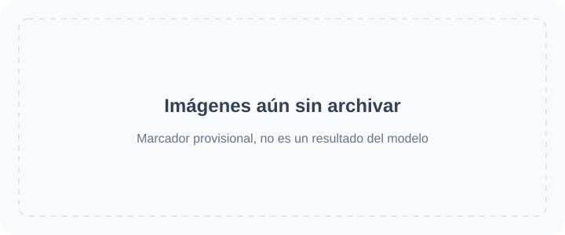

<!-- Generated by scripts/build_readme.py. Edit source data, locale catalogs and generator scripts. -->

<a id="top"></a>

[](https://raphael.app/?utm_source=github&utm_medium=repository&utm_campaign=gpt_image_2_6_launch&utm_content=hero&utm_term=es-ES)

# 🎨 Awesome GPT Image 2.6

Una colección abierta de prompts, ejemplos visuales y fuentes originales para GPT Image 2.6.

<a href="LICENSE"></a> <a href="docs/ATTRIBUTION.md"></a> <a href="CONTRIBUTING.md"></a> <a href="https://github.com/RaphaelAI-OpenLab/awesome-gpt-image-2-6/actions/workflows/validate.yml"></a> <a href="https://github.com/RaphaelAI-OpenLab/awesome-gpt-image-2-6"></a>

⚠️ **Aviso de derechos de autor**: Los prompts y el material multimedia de esta colección se recopilan de fuentes públicas exclusivamente con fines educativos. Si consideras que algún contenido infringe tus derechos, por favor, [abre una incidencia](https://github.com/RaphaelAI-OpenLab/awesome-gpt-image-2-6/issues/new), y lo retiraremos de inmediato.

<a href="README.md"></a> <a href="README.zh-CN.md"></a> <a href="README.zh-TW.md"></a> <a href="README.ja-JP.md"></a><br />
<a href="README.ko-KR.md"></a> <a href="README.th-TH.md"></a> <a href="README.vi-VN.md"></a> <a href="README.hi-IN.md"></a><br />
<a href="README.es-ES.md"></a> <a href="README.es-419.md"></a> <a href="README.de-DE.md"></a> <a href="README.fr-FR.md"></a><br />
<a href="README.it-IT.md"></a> <a href="README.pt-BR.md"></a> <a href="README.pt-PT.md"></a> <a href="README.tr-TR.md"></a>

---

Esta versión lingüística traduce la interfaz del repositorio. Los detalles completos de los casos están disponibles actualmente en inglés y chino simplificado.

Los títulos, las descripciones y las páginas de detalles de los casos se muestran en inglés cuando no hay traducción disponible. Los prompts originales y las citas de las fuentes no se traducen.

**Enlaces rápidos** · [🖼️ Explorar casos](#all-cases) · [🆕 Añadido recientemente](#latest) · [📝 Añadir un ejemplo](https://github.com/RaphaelAI-OpenLab/awesome-gpt-image-2-6/issues/new?template=submit-case.yml) · [🐞 Informar de una incidencia](https://github.com/RaphaelAI-OpenLab/awesome-gpt-image-2-6/issues/new?template=report-problem.yml) · [📚 Leer la guía](CONTRIBUTING.md)

<a id="gallery"></a>

## 🌐 Explorar la colección

**[Ver todos los casos de este repositorio →](#all-cases)**

Cada caso de la lista abre una página interna de detalles con la evidencia del modelo, los créditos de las fuentes y la disponibilidad del prompt.

[Archivo de materiales de sitios externos (excluido de categorías y estadísticas)](external-sites/README.md)

**MARCADOR PROVISIONAL · URL de la galería web externa: sin configurar.**

**MARCADOR PROVISIONAL · Enlace de generación con un clic: sin verificar.**

MARCADOR PROVISIONAL · Enlace a una colección o campaña relacionada: pendiente de añadir.

[Visitar Raphael (página de inicio)](https://raphael.app/?utm_source=github&utm_medium=repository&utm_campaign=gpt_image_2_6_launch&utm_content=top_nav&utm_term=es-ES)

<a id="categories"></a>

## 🏷️ Explorar por categoría

| Categoría | Casos con enlace a la fuente | Prompts completos |
| --- | ---: | ---: |
| [Imágenes de marca y producto](#category-brand-products) | 7 | 0 |
| [Carteles y tipografía](#category-posters-typography) | 8 | 0 |
| [Infografías](#category-infographics) | 3 | 0 |
| [Interiores y arquitectura](#category-interiors-architecture) | 3 | 0 |
| [Personajes y coherencia](#category-characters-consistency) | 15 | 0 |
| [Anotaciones y ediciones específicas](#category-markup-edits) | 9 | 0 |
| [SVG y recursos de diseño](#category-svg-design-assets) | 4 | 0 |
| [GIF y animación](#category-gif-animation) | 64 | 5 |

<a id="contents"></a>

## 📖 Índice

- [¿Qué es GPT Image 2.6?](#about)
- [Estadísticas](#statistics)
- [Casos destacados](#featured)
- [Añadido recientemente](#latest)
- [Todos los casos](#all-cases)
- [Prompts completos](#collection)
- [Cómo usar](#using)
- [Colaborar](#contribute)
- [Licencia](#license)
- [Agradecimientos](#acknowledgements)
- [Historial de estrellas](#star-history)

<a id="about"></a>

## 🤔 ¿Qué es GPT Image 2.6?

OpenAI presentó Images 2.6 el 4 de noviembre de 2026. Esta colección abarca las variantes Sunburst y Flare del modelo, la creación y edición de imágenes, y los flujos de trabajo documentados con SVG y GIF. La compatibilidad con cada variante se registra por caso, en lugar de darse por supuesta.

[Anuncio oficial](https://openai.com/index/introducing-images-2-6/) · [Documentación del modelo](https://developers.openai.com/api/docs/guides/image-generation)

<a id="statistics"></a>

## 📊 Estadísticas

| Métrica | Recuento / fecha |
| --- | ---: |
| Casos con enlace a la fuente | **113** |
| Ejemplos oficiales | **37** |
| Ejemplos según sus creadores | **76** |
| Prompts originales disponibles en la fuente | **87** |
| Prompts completos publicados aquí | **5** |
| Archivos multimedia archivados localmente | **188** |
| Última comprobación de fuentes (UTC) | **2026-11-09** |

Los recuentos de fuentes no implican una reproducción de los resultados. Se excluyen las pistas pendientes; los distintos resultados de un mismo flujo de trabajo cuentan como un solo caso.

<a id="featured"></a>

## 🔥 Casos destacados

<table>
<tr>
<td width="33%" align="center"><a href="cases/docs-bakery-svg/README.md"><br /><strong>Bakery SVG logo</strong></a><br />Documentación oficial</td>
<td width="33%" align="center"><a href="cases/docs-lantern-gif/README.md"><br /><strong>Lantern-carrying monkey loop</strong></a><br />Documentación oficial</td>
<td width="33%" align="center"><a href="cases/launch-fal/README.md"><br /><strong>Living-room markup edit</strong></a><br />Demostración oficial de lanzamiento</td>
</tr>
<tr>
<td width="33%" align="center"><a href="cases/launch-sable/README.md"><br /><strong>Miniature brand product world</strong></a><br />Demostración oficial de lanzamiento</td>
<td width="33%" align="center"><a href="cases/launch-higgsfield/README.md"><br /><strong>Knight scene and clothing edit sequence</strong></a><br />Demostración oficial de lanzamiento</td>
<td width="33%" align="center"><a href="cases/community-malfoid/README.md"><br /><strong>Summer character illustration animation</strong></a><br />Modelo indicado por el creador</td>
</tr>
</table>

Las tarjetas provisionales no son resultados generados. Todos los archivos multimedia mostrados se encuentran en este repositorio; el material aún sin archivar mantiene sus enlaces en las páginas de detalles.

<a id="latest"></a>

## 🆕 Añadido recientemente

| Añadido | Caso | Evidencia |
| --- | --- | --- |
| 2026-11-09 | [Cartoon bee posts to X for daily check-in](cases/social-diligent-bee-daily-checkin-gif/README.md) | Modelo indicado por el creador |
| 2026-11-09 | [Flip phone shows Heisei decomail animation in Tokyo street](cases/social-heisei-flip-phone-decomail-gif/README.md) | Modelo indicado por el creador |
| 2026-11-09 | [Dancing cartoon frog in a top hat](cases/social-dancing-frog-top-hat/README.md) | Modelo indicado por el creador |
| 2026-11-09 | [Chibi cheongsam girl performs a cute jump sequence](cases/social-chibi-cheongsam-girl-gif/README.md) | Modelo indicado por el creador |
| 2026-11-09 | [Chibi character eating rice with chopsticks](cases/social-blue-hair-chibi-eating-rice-gif/README.md) | Modelo indicado por el creador |
| 2026-11-06 | [Junkyard robot walk cycle](cases/ailingqu-junkyard-robot-walk/README.md) | Modelo indicado por el creador |

<a id="all-cases"></a>

## 📋 Todos los casos

<a id="category-brand-products"></a>

### Imágenes de marca y producto

| Caso · página interna de detalles | Fuente | Prompt |
| --- | --- | --- |
| [Transparent bakery raster logo](cases/docs-bakery-raster/README.md) | Documentación oficial | Prompt original en la fuente |
| [Transparent product cutout](cases/docs-product-cutout/README.md) | Documentación oficial | Prompt original en la fuente |
| [Toy airplane packaging](cases/docs-toy-package/README.md) | Documentación oficial | Prompt original en la fuente |
| [Miniature brand product world](cases/launch-sable/README.md) | Demostración oficial de lanzamiento | Prompt original en la fuente |
| [Travel visual generation speed comparison](cases/launch-travel/README.md) | Demostración oficial de lanzamiento | Prompt no público |
| [Watchmaker underwater macro test](cases/community-hn-watchmaker/README.md) | Modelo indicado por el creador | Prompt original en la fuente |
| [AURORA orange perfume product image](cases/community-struggle-aurora-perfume/README.md) | Modelo indicado por el creador | Prompt original en la fuente |

<a id="category-posters-typography"></a>

### Carteles y tipografía

| Caso · página interna de detalles | Fuente | Prompt |
| --- | --- | --- |
| [Streetwear advertisement typography](cases/docs-streetwear/README.md) | Documentación oficial | Prompt original en la fuente |
| [Roadside shampoo billboard](cases/docs-billboard/README.md) | Documentación oficial | Prompt original en la fuente |
| [Nostalgic holiday card](cases/docs-holiday-card/README.md) | Documentación oficial | Prompt original en la fuente |
| [Birthday cake without extra slogan cards](cases/community-flare-slogan-comparison/README.md) | Modelo indicado por el creador | Prompt original en la fuente |
| [AI evolution poster revised to Image 2.6](cases/community-struggle-poster-edit/README.md) | Modelo indicado por el creador | Prompt original en la fuente |
| [Spring Health Fair 2027 flyer comparison](cases/nyle-health-fair/README.md) | Modelo indicado por el creador | Prompt no público |
| [Sensitive-skin lotion advertisement comparison](cases/nyle-skincare-ad/README.md) | Modelo indicado por el creador | Prompt no público |
| [Dense Japanese business cover comparison](cases/nyle-kanji-cover/README.md) | Modelo indicado por el creador | Prompt no público |

<a id="category-infographics"></a>

### Infografías

| Caso · página interna de detalles | Fuente | Prompt |
| --- | --- | --- |
| [Coffee-machine process diagram](cases/docs-coffee-diagram/README.md) | Documentación oficial | Prompt original en la fuente |
| [Cellular respiration teaching visual](cases/docs-cell-respiration/README.md) | Documentación oficial | Prompt original en la fuente |
| [Market-size presentation slide](cases/docs-pitch-slide/README.md) | Documentación oficial | Prompt original en la fuente |

<a id="category-interiors-architecture"></a>

### Interiores y arquitectura

| Caso · página interna de detalles | Fuente | Prompt |
| --- | --- | --- |
| [Replace chairs in an interior](cases/docs-room-chairs/README.md) | Documentación oficial | Prompt original en la fuente |
| [Living-room markup edit](cases/launch-fal/README.md) | Demostración oficial de lanzamiento | Prompt original en la fuente |
| [Dusty warehouse prompt-detail comparison](cases/community-sunburst-dust-detail/README.md) | Modelo indicado por el creador | Disponibilidad del prompt sin verificar |

<a id="category-characters-consistency"></a>

### Personajes y coherencia

| Caso · página interna de detalles | Fuente | Prompt |
| --- | --- | --- |
| [Paper-cut championship scene: complexity comparison](cases/docs-complexity/README.md) | Documentación oficial | Prompt original en la fuente |
| [Realistic fishing-boat sailor portrait](cases/docs-sailor/README.md) | Documentación oficial | Prompt original en la fuente |
| [1969 historical crowd scene](cases/docs-historical-crowd/README.md) | Documentación oficial | Prompt original en la fuente |
| [Four-panel pet comic](cases/docs-pet-comic/README.md) | Documentación oficial | Prompt original en la fuente |
| [Change clothing while preserving identity](cases/docs-outfit/README.md) | Documentación oficial | Prompt original en la fuente |
| [Place a person into a camping escape scene](cases/docs-person-scene/README.md) | Documentación oficial | Prompt original en la fuente |
| [Establish a storybook character](cases/docs-character-start/README.md) | Documentación oficial | Prompt original en la fuente |
| [Continue the same character’s story](cases/docs-character-story/README.md) | Documentación oficial | Prompt original en la fuente |
| [Stained-glass whale](cases/launch-picsart/README.md) | Demostración oficial de lanzamiento | Prompt no público |
| [Knight scene and clothing edit sequence](cases/launch-higgsfield/README.md) | Demostración oficial de lanzamiento | Prompt original en la fuente |
| [Reference-led courtyard photo board](cases/community-marco-reference-photo-board/README.md) | Modelo indicado por el creador | Prompt no público |
| [Sunburst courtyard comparison](cases/community-marco-sunburst-courtyard-comparison/README.md) | Modelo indicado por el creador | Prompt no público |
| [Mushroom-lit fashion portrait](cases/community-marco-mushroom-fashion-portrait/README.md) | Modelo indicado por el creador | Prompt no público |
| [Sunburst six-style sample gallery](cases/nyle-sunburst-style-gallery/README.md) | Modelo indicado por el creador | Prompt no público |
| [Sunburst calico cat by a window](cases/community-kokone-sunburst-calico/README.md) | Modelo indicado por el creador | Prompt no público |

<a id="category-markup-edits"></a>

### Anotaciones y ediciones específicas

| Caso · página interna de detalles | Fuente | Prompt |
| --- | --- | --- |
| [Recolor a marked vase](cases/docs-vase-markup/README.md) | Documentación oficial | Prompt original en la fuente |
| [Translate an infographic into Spanish](cases/docs-spanish-edit/README.md) | Documentación oficial | Prompt original en la fuente |
| [Transfer a pixel-art style](cases/docs-pixel-style/README.md) | Documentación oficial | Prompt original en la fuente |
| [Combine pets across images](cases/docs-dog-composite/README.md) | Documentación oficial | Prompt original en la fuente |
| [Turn a sketch into a realistic scene](cases/docs-sketch-render/README.md) | Documentación oficial | Prompt original en la fuente |
| [Remove a held flower](cases/docs-remove-flower/README.md) | Documentación oficial | Prompt original en la fuente |
| [Change the billboard scene to a snowy night](cases/docs-snow-edit/README.md) | Documentación oficial | Prompt original en la fuente |
| [Rabbit storybook day-to-dusk edit](cases/community-flare-day-dusk-edit/README.md) | Modelo indicado por el creador | Disponibilidad del prompt sin verificar |
| [Webinar date replacement comparison](cases/nyle-webinar-date-edit/README.md) | Modelo indicado por el creador | Prompt original en la fuente |

<a id="category-svg-design-assets"></a>

### SVG y recursos de diseño

| Caso · página interna de detalles | Fuente | Prompt |
| --- | --- | --- |
| [Bakery SVG logo](cases/docs-bakery-svg/README.md) | Documentación oficial | Prompt original en la fuente |
| [Farmers market mobile interface](cases/docs-market-ui/README.md) | Documentación oficial | Prompt original en la fuente |
| [Bear mascot: SVG versus PNG previews](cases/community-bear-svg-comparison/README.md) | Modelo indicado por el creador | Prompt no público |
| [Code Lightning vector logo](cases/community-struggle-code-lightning-svg/README.md) | Modelo indicado por el creador | Prompt original en la fuente |

<a id="category-gif-animation"></a>

### GIF y animación

| Caso · página interna de detalles | Fuente | Prompt |
| --- | --- | --- |
| [Lantern-carrying monkey loop](cases/docs-lantern-gif/README.md) | Documentación oficial | Prompt original en la fuente |
| [Office character: falling stock GIF](cases/launch-openart-down/README.md) | Demostración oficial de lanzamiento | Prompt original en la fuente |
| [Office character: rising stock GIF](cases/launch-openart-up/README.md) | Demostración oficial de lanzamiento | Prompt original en la fuente |
| [Owl sketch to animation](cases/launch-owl/README.md) | Demostración oficial de lanzamiento | Prompt no público |
| [Monty typing indicator animation](cases/launch-town/README.md) | Demostración oficial de lanzamiento | Prompt no público |
| [Summer character illustration animation](cases/community-malfoid/README.md) | Modelo indicado por el creador | Prompt no público |
| [Images 2.6 brings GIF(T)S :D](cases/community-gifts/README.md) | Modelo indicado por el creador | Prompt no público |
| [Boxing tiger animation](cases/community-boxing-tiger/README.md) | Modelo indicado por el creador | Prompt no público |
| [Hummingbird and kingfisher animation variants](cases/community-hummingbird-variants/README.md) | Modelo indicado por el creador | Prompt no público |
| [Rosebud animation](cases/community-rosebud-animation/README.md) | Modelo indicado por el creador | Prompt no público |
| [Jelly bear wobble](cases/ailingqu-jelly-bear-wobble/README.md) | Modelo indicado por el creador | Prompt original en la fuente |
| [White bunny reaction sticker set](cases/ailingqu-bunny-reaction-set/README.md) | Modelo indicado por el creador | Prompt original en la fuente |
| [Cartoon cat waving hello](cases/ailingqu-cat-waving-hello/README.md) | Modelo indicado por el creador | Prompt original en la fuente |
| [Confused shiba head tilt](cases/ailingqu-shiba-head-tilt/README.md) | Modelo indicado por el creador | Prompt original en la fuente |
| [Cat typing furiously](cases/ailingqu-cat-typing-laptop/README.md) | Modelo indicado por el creador | Prompt original en la fuente |
| [Frog blowing a heart](cases/ailingqu-frog-heart-bubble/README.md) | Modelo indicado por el creador | Prompt original en la fuente |
| [Penguin facepalm](cases/ailingqu-penguin-facepalm/README.md) | Modelo indicado por el creador | Prompt original en la fuente |
| [Basketball shot celebration](cases/ailingqu-basketball-shot-sticker/README.md) | Modelo indicado por el creador | Prompt original en la fuente |
| [Cat chef tossing fried rice](cases/ailingqu-cat-chef-fried-rice/README.md) | Modelo indicado por el creador | Prompt original en la fuente |
| [Black cat punch](cases/ailingqu-black-cat-punch/README.md) | Modelo indicado por el creador | Prompt original en la fuente |
| [Office cat workday reaction set](cases/ailingqu-office-cat-workday-set/README.md) | Modelo indicado por el creador | Prompt original en la fuente |
| [Roaring duck](cases/ailingqu-roaring-duck/README.md) | Modelo indicado por el creador | Prompt original en la fuente |
| [Flower macro flash cut](cases/ailingqu-flower-macro-flash/README.md) | Modelo indicado por el creador | Prompt original en la fuente |
| [Cat-head logo brand reel](cases/ailingqu-cat-brand-reel/README.md) | Modelo indicado por el creador | Prompt original en la fuente |
| [Sneaker colorway flash](cases/ailingqu-sneaker-colorway-flash/README.md) | Modelo indicado por el creador | Prompt original en la fuente |
| [One tree, four seasons](cases/ailingqu-four-seasons-tree/README.md) | Modelo indicado por el creador | Prompt original en la fuente |
| [Magazine collage panels pop in](cases/ailingqu-magazine-panels-pop/README.md) | Modelo indicado por el creador | Prompt original en la fuente |
| [Reading by the window, day to night](cases/ailingqu-window-day-to-night/README.md) | Modelo indicado por el creador | Prompt original en la fuente |
| [Steaming coffee loop](cases/ailingqu-steaming-coffee/README.md) | Modelo indicado por el creador | Prompt original en la fuente |
| [Rainy window and plant](cases/ailingqu-rain-on-window/README.md) | Modelo indicado por el creador | Prompt original en la fuente |
| [Goldfish in a bowl](cases/ailingqu-goldfish-bowl/README.md) | Modelo indicado por el creador | Prompt original en la fuente |
| [Lighthouse at night](cases/ailingqu-lighthouse-night/README.md) | Modelo indicado por el creador | Prompt original en la fuente |
| [Cat sleeping by the fireplace](cases/ailingqu-cat-by-fireplace/README.md) | Modelo indicado por el creador | Prompt original en la fuente |
| [Lantern monkey in the snow](cases/ailingqu-lantern-monkey-snow/README.md) | Modelo indicado por el creador | Prompt original en la fuente |
| [Sleepy fox on a mossy rock](cases/ailingqu-sleepy-fox-rock/README.md) | Modelo indicado por el creador | Prompt original en la fuente |
| [Lo-fi study loop](cases/ailingqu-lofi-study-loop/README.md) | Modelo indicado por el creador | Prompt original en la fuente |
| [Café cinemagraph](cases/ailingqu-cafe-cinemagraph/README.md) | Modelo indicado por el creador | Prompt original en la fuente |
| [Ink-wash galloping horse](cases/ailingqu-ink-wash-horse/README.md) | Modelo indicado por el creador | Prompt original en la fuente |
| [Doodle monster comes alive](cases/ailingqu-doodle-monster/README.md) | Modelo indicado por el creador | Prompt original en la fuente |
| [Pixel art campfire](cases/ailingqu-pixel-campfire/README.md) | Modelo indicado por el creador | Prompt original en la fuente |
| [Bouncing dots loader](cases/ailingqu-bouncing-dots-loader/README.md) | Modelo indicado por el creador | Prompt original en la fuente |
| [Pixel knight run cycle](cases/ailingqu-pixel-knight-run/README.md) | Modelo indicado por el creador | Prompt original en la fuente |
| [Like button heart burst](cases/ailingqu-like-heart-burst/README.md) | Modelo indicado por el creador | Prompt original en la fuente |
| [Hourglass loading](cases/ailingqu-hourglass-flip/README.md) | Modelo indicado por el creador | Prompt original en la fuente |
| [Arcade VS screen](cases/ailingqu-arcade-vs-screen/README.md) | Modelo indicado por el creador | Prompt original en la fuente |
| [8-bit slime boss battle](cases/ailingqu-pixel-slime-boss/README.md) | Modelo indicado por el creador | Prompt original en la fuente |
| [Love-burst skill animation](cases/ailingqu-love-burst-skill/README.md) | Modelo indicado por el creador | Prompt original en la fuente |
| [Junkyard robot walk cycle](cases/ailingqu-junkyard-robot-walk/README.md) | Modelo indicado por el creador | Prompt original en la fuente |
| [Robin cat wink and falling name hat](cases/community-ozan-robin-wink-hat/README.md) | Modelo indicado por el creador | Prompt original en la fuente |
| [Blue-haired maid dialogue prototype](cases/community-mirochill-anime-dialogue-prototype/README.md) | Modelo indicado por el creador | Prompt no público |
| [Ram Altman memory-stick parody](cases/community-mirochill-ram-altman-animation/README.md) | Modelo indicado por el creador | Prompt no público |
| [Moonlit magical-girl dance](cases/community-struggle-sailor-dance/README.md) | Modelo indicado por el creador | Prompt original en la fuente |
| [Clay orange cat typing](cases/community-struggle-cat-programmer/README.md) | Modelo indicado por el creador | Prompt original en la fuente |
| [Desk photograph cleanup and animation](cases/community-struggle-desk-animation/README.md) | Modelo indicado por el creador | Prompt original en la fuente |
| [Ten parody web-ad GIFs: a Japanese creator test](cases/community-zunbeho-parody-ad-gifs/README.md) | Modelo indicado por el creador | Disponibilidad del prompt sin verificar |
| [Pixel♡Love: swimming-character animation contact sheet](cases/community-temae-pixel-love-swimming-sheet/README.md) | Modelo indicado por el creador | Prompt no público |
| [Tanjiro pixel-art water-slash loop](cases/community-kiki-tanjiro-pixel-loop/README.md) | Modelo indicado por el creador | Prompt original en la fuente |
| [Heartbeat dance modes: source poster](cases/community-kiki-heartbeat-dance-comparison/README.md) | Modelo indicado por el creador | Disponibilidad del prompt sin verificar |
| [Six Miss Malfoid mood sticker loops](cases/community-kiki-malfoid-mood-stickers/README.md) | Modelo indicado por el creador | Disponibilidad del prompt sin verificar |
| [Chibi character eating rice with chopsticks](cases/social-blue-hair-chibi-eating-rice-gif/README.md) | Modelo indicado por el creador | Original prompt included |
| [Chibi cheongsam girl performs a cute jump sequence](cases/social-chibi-cheongsam-girl-gif/README.md) | Modelo indicado por el creador | Original prompt included |
| [Dancing cartoon frog in a top hat](cases/social-dancing-frog-top-hat/README.md) | Modelo indicado por el creador | Original prompt included |
| [Flip phone shows Heisei decomail animation in Tokyo street](cases/social-heisei-flip-phone-decomail-gif/README.md) | Modelo indicado por el creador | Original prompt included |
| [Cartoon bee posts to X for daily check-in](cases/social-diligent-bee-daily-checkin-gif/README.md) | Modelo indicado por el creador | Original prompt included |

[Registro de búsquedas, informe de material multimedia y pistas sin resolver](docs/CASE_GALLERY.md)

<a id="collection"></a>

## 📝 Prompts completos

<a id="prompt-social-blue-hair-chibi-eating-rice-gif"></a>

### [Chibi character eating rice with chopsticks](cases/social-blue-hair-chibi-eating-rice-gif/README.md)

[Gorden_Sun](https://x.com/Gorden_Sun/status/2118166046175908016)

<a href="cases/social-blue-hair-chibi-eating-rice-gif/README.md"></a>

[Original animation file](assets/examples/social-blue-hair-chibi-eating-rice-gif/source-01.mp4)

<details>
<summary>Copy the original prompt</summary>

```text
使用这个角色，生成一张GIF图，内容是她吃大白米饭，图片里有文字：真香！
```

</details>

[Prompt text file](cases/social-blue-hair-chibi-eating-rice-gif/prompt.txt) · [Source and model evidence](cases/social-blue-hair-chibi-eating-rice-gif/README.md)

---

<a id="prompt-social-chibi-cheongsam-girl-gif"></a>

### [Chibi cheongsam girl performs a cute jump sequence](cases/social-chibi-cheongsam-girl-gif/README.md)

[shinshin86](https://x.com/shinshin86/status/2118225428976705908)

<a href="cases/social-chibi-cheongsam-girl-gif/README.md"></a>

[Original animation file](assets/examples/social-chibi-cheongsam-girl-gif/source-01.mp4)

<details>
<summary>Copy the original prompt</summary>

```text
このキャラクターをちびキャラ化して、何か可愛らしい動きをしているところをGIF画像にしてください。
```

</details>

[Prompt text file](cases/social-chibi-cheongsam-girl-gif/prompt.txt) · [Source and model evidence](cases/social-chibi-cheongsam-girl-gif/README.md)

---

<a id="prompt-social-dancing-frog-top-hat"></a>

### [Dancing cartoon frog in a top hat](cases/social-dancing-frog-top-hat/README.md)

[princess414141](https://x.com/princess414141/status/2118144125354877152)

<a href="cases/social-dancing-frog-top-hat/README.md"></a>

[Original animation file](assets/examples/social-dancing-frog-top-hat/source-01.mp4)

<details>
<summary>Copy the original prompt</summary>

```text
dancing frog with a top hat on, with ego be gone! written at the top
```

</details>

[Prompt text file](cases/social-dancing-frog-top-hat/prompt.txt) · [Source and model evidence](cases/social-dancing-frog-top-hat/README.md)

---

<a id="prompt-social-heisei-flip-phone-decomail-gif"></a>

### [Flip phone shows Heisei decomail animation in Tokyo street](cases/social-heisei-flip-phone-decomail-gif/README.md)

[rem_rev](https://x.com/rem_rev/status/2118252486360498485)

<a href="cases/social-heisei-flip-phone-decomail-gif/README.md"></a>

[Original animation file](assets/examples/social-heisei-flip-phone-decomail-gif/source-01.mp4)

<details>
<summary>Copy the original prompt</summary>

```text
平成を象徴する何か。SNS向けのGIF画像を生成して下さい。
```

</details>

[Prompt text file](cases/social-heisei-flip-phone-decomail-gif/prompt.txt) · [Source and model evidence](cases/social-heisei-flip-phone-decomail-gif/README.md)

---

<a id="prompt-social-diligent-bee-daily-checkin-gif"></a>

### [Cartoon bee posts to X for daily check-in](cases/social-diligent-bee-daily-checkin-gif/README.md)

[MrGafish](https://x.com/MrGafish/status/2118217749680025722)

<a href="cases/social-diligent-bee-daily-checkin-gif/README.md"></a>

[Original animation file](assets/examples/social-diligent-bee-daily-checkin-gif/source-01.mp4)

<details>
<summary>Copy the original prompt</summary>

```text
生成一个GIF，用于在𝕏 平台每日签到打卡，寓意我是一个发贴的勤劳小蜜蜂
```

</details>

[Prompt text file](cases/social-diligent-bee-daily-checkin-gif/prompt.txt) · [Source and model evidence](cases/social-diligent-bee-daily-checkin-gif/README.md)

---

<a id="using"></a>

## 📚 Cómo usar

1. Abre un caso desde una categoría o una tarjeta destacada.
2. Consulta la evidencia del modelo, las entradas necesarias, la fuente y los límites de reutilización.
3. Sigue el enlace al prompt original cuando esté disponible. Si falta un prompt, se deja como no disponible; no lo deduzcas de una imagen.

<a id="contribute"></a>

## 🤝 Cómo colaborar

Añade los casos de la colección principal a content/source-cases.json y los de sitios externos a external-sites/source-cases.json. Añade los prompts completos a content/prompts.json. El generador crea índices separados y páginas de detalle en inglés y chino.

[Guía de colaboración](CONTRIBUTING.md) · [Guía de casos de fuentes y material multimedia](docs/SOURCE_CASES.md) · [Guía de mantenimiento (chino)](docs/FILLING_GUIDE.zh-CN.md)

<a id="license"></a>

## 📄 Licencia

El código, la documentación original y los marcadores SVG decorativos usan la licencia MIT. Los prompts y el material multimedia de terceros conservan sus propios términos, con la procedencia y el estado de reutilización registrados para cada elemento. El diseño adaptado del README se acredita por separado más abajo.

[Licencia del repositorio](LICENSE)

<a id="acknowledgements"></a>

## 🙏 Agradecimientos

Estructura del README adaptada de awesome-nano-banana-pro-prompts de YouMind OpenLab bajo CC BY 4.0. Adaptada para GPT Image 2.6 con nuevos textos, datos, páginas de detalles locales y marcadores provisionales explícitos; no se han copiado ejemplos creativos ni material multimedia.

[YouMind README](https://github.com/YouMind-OpenLab/awesome-nano-banana-pro-prompts/blob/main/README_zh.md) · [CC BY 4.0](https://creativecommons.org/licenses/by/4.0/) · [Notas de atribución](docs/ATTRIBUTION.md)

Gracias a OpenAI y a los creadores originales acreditados en la página de cada caso.

<a id="star-history"></a>

## ⭐ Historial de estrellas

[Historial de estrellas](https://star-history.com/#RaphaelAI-OpenLab/awesome-gpt-image-2-6&Date) · [Ver quién ha dado una estrella](https://github.com/RaphaelAI-OpenLab/awesome-gpt-image-2-6/stargazers)

[Dar una estrella / seguir este repositorio](https://github.com/RaphaelAI-OpenLab/awesome-gpt-image-2-6)

[↑ Volver arriba](#top)

---

Selección de Raphael. [Página de inicio](https://raphael.app/?utm_source=github&utm_medium=repository&utm_campaign=gpt_image_2_6_launch&utm_content=footer&utm_term=es-ES)

Generado a partir de datos estructurados de las fuentes. Edita los conjuntos de datos y vuelve a generar el archivo; no lo edites directamente.
