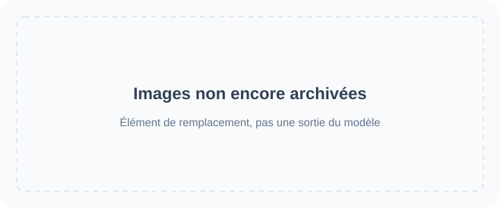

<!-- Generated by scripts/build_readme.py. Edit source data, locale catalogs and generator scripts. -->

# 🎨 Awesome GPT Image 2.6

Une collection ouverte de prompts, d’exemples visuels et de sources originales pour GPT Image 2.6.

    

⚠️ **Avis relatif aux droits d’auteur**: Les prompts et médias de cette collection sont recueillis auprès de sources publiques à des fins exclusivement pédagogiques. Si vous estimez qu’un contenu porte atteinte à vos droits, veuillez [ouvrir un ticket](https://github.com/RaphaelAI-OpenLab/awesome-gpt-image-2-6/issues/new), et nous le supprimerons immédiatement.

    
    
    
   

---

Cette version linguistique traduit l’interface du dépôt. Les détails complets des cas sont actuellement disponibles en anglais et en chinois simplifié.

Les titres, descriptions et pages détaillées des cas sont affichés en anglais lorsqu’aucune traduction n’est disponible. Les prompts originaux et les citations des sources ne sont pas traduits.

**Liens rapides** · [🖼️ Parcourir les cas](#all-cases) · [🆕 Ajouts récents](#latest) · [📝 Ajouter un exemple](https://github.com/RaphaelAI-OpenLab/awesome-gpt-image-2-6/issues/new?template=submit-case.yml) · [🐞 Signaler un problème](https://github.com/RaphaelAI-OpenLab/awesome-gpt-image-2-6/issues/new?template=report-problem.yml) · [📚 Lire le guide](CONTRIBUTING.md)

## 🌐 Parcourir la collection

**[Parcourir tous les cas de ce dépôt →](#all-cases)**

Chaque cas ci-dessous ouvre une page détaillée interne indiquant les preuves relatives au modèle, les crédits des sources et la disponibilité du prompt.

**ESPACE RÉSERVÉ · URL de la galerie web externe : non configurée.**

**ESPACE RÉSERVÉ · Lien de génération en un clic : non vérifié.**

ESPACE RÉSERVÉ · Lien vers une collection / campagne associée : à ajouter.

[Visiter Raphael (page d’accueil)](https://raphael.app/?utm_source=github&utm_medium=repository&utm_campaign=gpt_image_2_6_launch&utm_content=top_nav&utm_term=fr-FR)

## 🏷️ Parcourir par catégorie

| Catégorie | Cas avec liens vers les sources | Prompts complets |
| --- | ---: | ---: |
| [Visuels de marque et de produit](#category-brand-products) | 68 | 0 |
| [Affiches et typographie](#category-posters-typography) | 47 | 0 |
| [Infographies](#category-infographics) | 16 | 0 |
| [Intérieurs et architecture](#category-interiors-architecture) | 11 | 0 |
| [Personnages et cohérence](#category-characters-consistency) | 57 | 0 |
| [Annotations et retouches ciblées](#category-markup-edits) | 39 | 0 |
| [SVG et ressources graphiques](#category-svg-design-assets) | 13 | 0 |
| [GIF et animation](#category-gif-animation) | 132 | 0 |

## 📖 Sommaire

- [Qu’est-ce que GPT Image 2.6 ?](#about)
- [Statistiques](#statistics)
- [Cas à la une](#featured)
- [Ajouts récents](#latest)
- [Tous les cas](#all-cases)
- [Prompts complets](#collection)
- [Mode d’emploi](#using)
- [Contribuer](#contribute)
- [Licence](#license)
- [Remerciements](#acknowledgements)
- [Historique des étoiles](#star-history)

## 🤔 Qu’est-ce que GPT Image 2.6 ?

OpenAI a présenté Images 2.6 le 4 novembre 2026. Cette collection couvre les variantes de modèle Sunburst et Flare, la création et la retouche d’images, ainsi que les workflows SVG et GIF documentés. La prise en charge des variantes est consignée pour chaque cas plutôt que supposée.

[Annonce officielle](https://openai.com/index/introducing-images-2-6/) · [Documentation du modèle](https://developers.openai.com/api/docs/guides/image-generation)

## 📊 Statistiques

| Indicateur | Nombre / date |
| --- | ---: |
| Cas avec liens vers les sources | **383** |
| Exemples officiels | **37** |
| Exemples déclarés par leurs créateurs | **346** |
| Prompts originaux disponibles à la source | **237** |
| Prompts complets publiés ici | **0** |
| Fichiers multimédias archivés localement | **560** |
| Dernière vérification des sources (UTC) | **2026-11-09** |

Le nombre de sources n’atteste pas d’une reproduction. Les pistes en attente sont exclues ; différentes sorties d’un même workflow comptent pour un seul cas.

## 🔥 Cas à la une

<table>
<tr>
<td width="33%" align="center"><a href="cases/docs-bakery-svg/README.md"> <strong>Bakery SVG logo</strong></a> Documentation officielle</td>
<td width="33%" align="center"><a href="cases/docs-lantern-gif/README.md"> <strong>Lantern-carrying monkey loop</strong></a> Documentation officielle</td>
<td width="33%" align="center"><a href="cases/launch-fal/README.md"> <strong>Living-room markup edit</strong></a> Démonstration officielle de lancement</td>
</tr>
<tr>
<td width="33%" align="center"><a href="cases/launch-sable/README.md"> <strong>Miniature brand product world</strong></a> Démonstration officielle de lancement</td>
<td width="33%" align="center"><a href="cases/launch-higgsfield/README.md"> <strong>Knight scene and clothing edit sequence</strong></a> Démonstration officielle de lancement</td>
<td width="33%" align="center"><a href="cases/community-malfoid/README.md"> <strong>Summer character illustration animation</strong></a> Modèle déclaré par le créateur</td>
</tr>
</table>

Les fiches de remplacement ne sont pas des résultats générés. Tous les fichiers multimédias affichés se trouvent dans ce dépôt ; les médias non encore archivés restent accessibles par des liens sur les pages détaillées.

## 🆕 Ajouts récents

| Ajouté le | Cas | Preuves |
| --- | --- | --- |
| 2026-11-06 | [Ofox three-mug markup targeting test](cases/ofox-three-mug-markup-target-test/README.md) | Modèle déclaré par le créateur |
| 2026-11-06 | [Flixly: six GIF generation and editing tests](cases/flixly-six-gif-tests/README.md) | Modèle déclaré par le créateur |
| 2026-11-06 | [CubistAI paper-cut forest cabin](cases/community-cubistai-paper-cut-cabin/README.md) | Modèle déclaré par le créateur |
| 2026-11-06 | [CubistAI Botanical Forms poster](cases/community-cubistai-botanical-poster/README.md) | Modèle déclaré par le créateur |
| 2026-11-06 | [CubistAI espresso-cup still life](cases/community-cubistai-espresso-cup/README.md) | Modèle déclaré par le créateur |
| 2026-11-06 | [Borrow the Style of a Reference Image](cases/yepshot-compose-style-transfer/README.md) | Modèle déclaré par le créateur |

## 📋 Tous les cas

### Visuels de marque et de produit

| Cas · page détaillée interne | Source | Prompt |
| --- | --- | --- |
| [Transparent bakery raster logo](cases/docs-bakery-raster/README.md) | Documentation officielle | Prompt original à la source |
| [Transparent product cutout](cases/docs-product-cutout/README.md) | Documentation officielle | Prompt original à la source |
| [Toy airplane packaging](cases/docs-toy-package/README.md) | Documentation officielle | Prompt original à la source |
| [Miniature brand product world](cases/launch-sable/README.md) | Démonstration officielle de lancement | Prompt original à la source |
| [Travel visual generation speed comparison](cases/launch-travel/README.md) | Démonstration officielle de lancement | Prompt non public |
| [Laptop GIF-creation workspace illustration](cases/techrepublic-gif-workspace-illustration/README.md) | Modèle déclaré par le créateur | Prompt non public |
| [Tovalin serum scene comparison](cases/productai-tovalin-serum-comparison/README.md) | Modèle déclaré par le créateur | Prompt non public |
| [Quillhaven coffee scenes and precise edits](cases/productai-quillhaven-coffee-comparison/README.md) | Modèle déclaré par le créateur | Prompt non public |
| [Running-shoe scenes and precise edits](cases/productai-running-shoe-comparison/README.md) | Modèle déclaré par le créateur | Prompt non public |
| [Cable-knit cardigan on a model](cases/productai-cable-knit-cardigan-comparison/README.md) | Modèle déclaré par le créateur | Prompt non public |
| [Oaken Mile Coffee label: Flare and Sunburst](cases/community-moss-coffee-label/README.md) | Modèle déclaré par le créateur | Prompt original à la source |
| [Cafe latte: Flare and Sunburst](cases/community-lightlyn-latte-variants/README.md) | Modèle déclaré par le créateur | Prompt original à la source |
| [Earbud product-ad comparison](cases/community-lightlyn-earbuds-ad-variants/README.md) | Modèle déclaré par le créateur | Prompt original à la source |
| [Made Takeaway box](cases/made-flare-dumpling-box/README.md) | Modèle déclaré par le créateur | Prompt original à la source |
| [Made Stylus macro](cases/made-sunburst-stylus-macro/README.md) | Modèle déclaré par le créateur | Prompt original à la source |
| [Three-flavor soda lineup](cases/yir-flavor-lineup/README.md) | Modèle déclaré par le créateur | Prompt original à la source |
| [French press product photos and background-edit continuation](cases/community-gptimagehub-french-press-edit/README.md) | Modèle déclaré par le créateur | Prompt original à la source |
| [SUMMIT ROAST coffee-bag product shot](cases/zzo-flare-summit-roast-bag/README.md) | Modèle déclaré par le créateur | Prompt original à la source |
| [Nowrap logo motion comparison](cases/nowrap-logo-motion/README.md) | Modèle déclaré par le créateur | Prompt original à la source |
| [Flat fox mascot badge](cases/toonderly-fox-badge/README.md) | Modèle déclaré par le créateur | Prompt original à la source |
| [Watch four-round editing](cases/yir-watch-edit-sequence/README.md) | Modèle déclaré par le créateur | Prompt non public |
| [Vase four-round editing](cases/yir-vase-edit-sequence/README.md) | Modèle déclaré par le créateur | Prompt non public |
| [Soup photograph with recipe card](cases/joinoasis-tomato-soup/README.md) | Modèle déclaré par le créateur | Prompt original à la source |
| [Blazer and boots reference composition](cases/joinoasis-blazer-boots-composition/README.md) | Modèle déclaré par le créateur | Prompt original à la source |
| [Rainbow cups and cat](cases/community-flixly-rainbow-teacups/README.md) | Modèle déclaré par le créateur | Prompt original à la source |
| [Sage-green to terracotta bottle edit](cases/omniakey-bottle-color-edit/README.md) | Modèle déclaré par le créateur | Prompt non public |
| [Watchmaker underwater macro test](cases/community-hn-watchmaker/README.md) | Modèle déclaré par le créateur | Prompt original à la source |
| [Perfume bottle on wet coastal rock](cases/chatimage2-seaside-perfume-edit/README.md) | Modèle déclaré par le créateur | Prompt original à la source |
| [Sunburst Roasters ceramic coffee canister](cases/replicate-sunburst-coffee-canister/README.md) | Modèle déclaré par le créateur | Prompt original à la source |
| [Brushed-titanium espresso tamper: Flare and Sunburst](cases/csuite-tamper/README.md) | Modèle déclaré par le créateur | Disponibilité du prompt non vérifiée |
| [Ceramic mug: 2K background-setting test](cases/iskragen-mug-2k-background-test/README.md) | Modèle déclaré par le créateur | Prompt original à la source |
| [SUNNY POP sparkling-water poster](cases/framemux-sunny-pop-poster/README.md) | Modèle déclaré par le créateur | Prompt original à la source |
| [Sage-green speaker on travertine](cases/gptimagehub-sage-speaker/README.md) | Modèle déclaré par le créateur | Prompt original à la source |
| [LUMIÈRE jewelry portrait at a car window](cases/302-lumiere-jewelry-portrait/README.md) | Modèle déclaré par le créateur | Prompt original à la source |
| [VHS-style night racing scene](cases/302-vhs-drift-race/README.md) | Modèle déclaré par le créateur | Prompt original à la source |
| [Pure White Marketplace Packshot](cases/yepshot-studio-pure-white-amazon/README.md) | Modèle déclaré par le créateur | Disponibilité du prompt non vérifiée |
| [Black Acrylic Mirror Reflection](cases/yepshot-studio-acrylic-reflection/README.md) | Modèle déclaré par le créateur | Disponibilité du prompt non vérifiée |
| [Floating Hero Shot](cases/yepshot-studio-floating-ambient-shadow/README.md) | Modèle déclaré par le créateur | Disponibilité du prompt non vérifiée |
| [Overhead Flat Lay on Light Gray](cases/yepshot-studio-overhead-flat-lay/README.md) | Modèle déclaré par le créateur | Disponibilité du prompt non vérifiée |
| [Three-Quarter Catalog Angle](cases/yepshot-studio-three-quarter-angle/README.md) | Modèle déclaré par le créateur | Disponibilité du prompt non vérifiée |
| [Material Close-Up for Detail Images](cases/yepshot-studio-material-detail-closeup/README.md) | Modèle déclaré par le créateur | Disponibilité du prompt non vérifiée |
| [Preview Colorways Side by Side](cases/yepshot-studio-colorway-lineup/README.md) | Modèle déclaré par le créateur | Disponibilité du prompt non vérifiée |
| [Travertine Block in Morning Light](cases/yepshot-lifestyle-travertine-stone/README.md) | Modèle déclaré par le créateur | Disponibilité du prompt non vérifiée |
| [Marble Vanity with Water Droplets](cases/yepshot-lifestyle-marble-bathroom-dew/README.md) | Modèle déclaré par le créateur | Disponibilité du prompt non vérifiée |
| [Oak Table with Kitchen Props](cases/yepshot-lifestyle-scandinavian-wood-kitchen/README.md) | Modèle déclaré par le créateur | Disponibilité du prompt non vérifiée |
| [Concrete Podium, Tech Style](cases/yepshot-lifestyle-industrial-concrete-podium/README.md) | Modèle déclaré par le créateur | Disponibilité du prompt non vérifiée |
| [Bright Modern Living Room](cases/yepshot-lifestyle-bright-living-room/README.md) | Modèle déclaré par le créateur | Disponibilité du prompt non vérifiée |
| [Sunny Picnic Blanket](cases/yepshot-lifestyle-outdoor-picnic/README.md) | Modèle déclaré par le créateur | Disponibilité du prompt non vérifiée |
| [Neon Gaming Desk](cases/yepshot-lifestyle-neon-gaming-desk/README.md) | Modèle déclaré par le créateur | Disponibilité du prompt non vérifiée |
| [Remove Glare on Shiny Surfaces](cases/yepshot-cleanup-remove-glare-reflections/README.md) | Modèle déclaré par le créateur | Disponibilité du prompt non vérifiée |
| [Erase Barcode and Price Sticker](cases/yepshot-cleanup-erase-barcode-watermark/README.md) | Modèle déclaré par le créateur | Disponibilité du prompt non vérifiée |
| [Remove Dust and Fingerprints](cases/yepshot-cleanup-dust-fingerprints/README.md) | Modèle déclaré par le créateur | Disponibilité du prompt non vérifiée |
| [Place a Product into Your Scene](cases/yepshot-compose-product-into-scene/README.md) | Modèle déclaré par le créateur | Disponibilité du prompt non vérifiée |
| [Bundle Two Products into One Shot](cases/yepshot-compose-bundle-group-shot/README.md) | Modèle déclaré par le créateur | Disponibilité du prompt non vérifiée |
| [Match Your Existing Catalog Look](cases/yepshot-compose-match-catalog-style/README.md) | Modèle déclaré par le créateur | Disponibilité du prompt non vérifiée |
| [Smooth Out Fabric Wrinkles](cases/yepshot-cleanup-smooth-fabric-wrinkles/README.md) | Modèle déclaré par le créateur | Disponibilité du prompt non vérifiée |
| [Christmas Pine and Warm Bokeh](cases/yepshot-seasonal-christmas-pine-bokeh/README.md) | Modèle déclaré par le créateur | Disponibilité du prompt non vérifiée |
| [Summer Pool Water and Caustics](cases/yepshot-seasonal-summer-pool-water-ripples/README.md) | Modèle déclaré par le créateur | Disponibilité du prompt non vérifiée |
| [Black Friday Black-and-Gold Pedestal](cases/yepshot-seasonal-black-friday-gold-geometry/README.md) | Modèle déclaré par le créateur | Disponibilité du prompt non vérifiée |
| [Lunar New Year Red and Gold](cases/yepshot-seasonal-lunar-new-year/README.md) | Modèle déclaré par le créateur | Disponibilité du prompt non vérifiée |
| [Turn Your Pet into a Collectible Figure](cases/yepshot-creative-collectible-figure/README.md) | Modèle déclaré par le créateur | Disponibilité du prompt non vérifiée |
| [Photo to Watercolor Illustration](cases/yepshot-creative-watercolor-illustration/README.md) | Modèle déclaré par le créateur | Disponibilité du prompt non vérifiée |
| [Sketch to Product Render](cases/yepshot-creative-sketch-to-render/README.md) | Modèle déclaré par le créateur | Disponibilité du prompt non vérifiée |
| [Borrow the Style of a Reference Image](cases/yepshot-compose-style-transfer/README.md) | Modèle déclaré par le créateur | Disponibilité du prompt non vérifiée |
| [CubistAI espresso-cup still life](cases/community-cubistai-espresso-cup/README.md) | Modèle déclaré par le créateur | Prompt original à la source |
| [Saved mug reference across three scenes](cases/weel-saved-mug-scenes/README.md) | Modèle déclaré par le créateur | Prompt original à la source |
| [AURORA orange perfume product image](cases/community-struggle-aurora-perfume/README.md) | Modèle déclaré par le créateur | Prompt original à la source |
| [Orange KINGY LAB product graphic](cases/kingy-sunburst-orange-bottle/README.md) | Modèle déclaré par le créateur | Disponibilité du prompt non vérifiée |

### Affiches et typographie

| Cas · page détaillée interne | Source | Prompt |
| --- | --- | --- |
| [Streetwear advertisement typography](cases/docs-streetwear/README.md) | Documentation officielle | Prompt original à la source |
| [Roadside shampoo billboard](cases/docs-billboard/README.md) | Documentation officielle | Prompt original à la source |
| [Nostalgic holiday card](cases/docs-holiday-card/README.md) | Documentation officielle | Prompt original à la source |
| [Shiba ramen shop: two quality comparison runs](cases/ai-garage-ramen-quality-series/README.md) | Modèle déclaré par le créateur | Prompt non public |
| [Autumn café menu announcement comparison](cases/ai-garage-autumn-cafe/README.md) | Modèle déclaré par le créateur | Prompt non public |
| [Flare 4K test, published previews](cases/aivideos-flare-4k-comparison/README.md) | Modèle déclaré par le créateur | Prompt non public |
| [Flare quality and planning comparison](cases/aivideos-flare-quality-planning/README.md) | Modèle déclaré par le créateur | Prompt non public |
| [Retro diner menu board](cases/dreamega-retro-diner/README.md) | Modèle déclaré par le créateur | Prompt original à la source |
| [Lantern Row Night Market flyer: Flare and Sunburst](cases/community-moss-night-market-flyer/README.md) | Modèle déclaré par le créateur | Prompt original à la source |
| [Café breakfast menu: Flare and Sunburst](cases/community-moss-breakfast-menu/README.md) | Modèle déclaré par le créateur | Prompt original à la source |
| [Pottery event banner layout: Flare and Sunburst](cases/community-moss-pottery-banner-layout/README.md) | Modèle déclaré par le créateur | Prompt original à la source |
| [Night market poster comparison](cases/community-lightlyn-night-market-variants/README.md) | Modèle déclaré par le créateur | Prompt original à la source |
| [Made Lightbox menu](cases/made-flare-noodle-menu/README.md) | Modèle déclaré par le créateur | Prompt original à la source |
| [Made Sleeve typography](cases/made-sunburst-record-sleeve/README.md) | Modèle déclaré par le créateur | Prompt original à la source |
| [Made Window lettering](cases/made-sunburst-shop-window/README.md) | Modèle déclaré par le créateur | Prompt original à la source |
| [Hot-sauce launch and speed-test posters](cases/yir-hot-sauce-posters/README.md) | Modèle déclaré par le créateur | Prompt original à la source |
| [End-of-season bicycle sale ad](cases/yir-bicycle-sale-ad/README.md) | Modèle déclaré par le créateur | Prompt original à la source |
| [Blue Hour jazz posters and date-edit continuation](cases/community-gptimagehub-jazz-poster-edit/README.md) | Modèle déclaré par le créateur | Prompt original à la source |
| [Winter Night Market poster](cases/veevid-holiday-market-poster/README.md) | Modèle déclaré par le créateur | Prompt original à la source |
| [English–Hindi evening menu from a document brief](cases/analyticsvidhya-bilingual-evening-menu/README.md) | Modèle déclaré par le créateur | Prompt original à la source |
| [NIGHT TIDE wave concert poster](cases/zzo-flare-night-tide-poster/README.md) | Modèle déclaré par le créateur | Prompt original à la source |
| [NIGHT MARKET typography comparison](cases/cellcog-night-market-poster/README.md) | Modèle déclaré par le créateur | Prompt non public |
| [Café neon text comparison](cases/nowrap-cafe-sign-motion/README.md) | Modèle déclaré par le créateur | Prompt original à la source |
| [BOUNCE balloon-letter poster](cases/toonderly-bounce-poster/README.md) | Modèle déclaré par le créateur | Prompt non public |
| [OPEN LATE neon storefront](cases/kavel-open-late/README.md) | Modèle déclaré par le créateur | Prompt non public |
| [Lemon cake recipe card](cases/community-flixly-lemon-recipe/README.md) | Modèle déclaré par le créateur | Prompt original à la source |
| [FIELD & FLOUR bakery poster](cases/sogni-flare-bakery-poster/README.md) | Modèle déclaré par le créateur | Prompt non public |
| [NORTHLIGHT TEA poster layout comparison](cases/sandbase-northlight-tea-posters/README.md) | Modèle déclaré par le créateur | Prompt non public |
| [Port Calder poster complexity comparison](cases/omniakey-port-calder-comparison/README.md) | Modèle déclaré par le créateur | Prompt original à la source |
| [Birthday cake without extra slogan cards](cases/community-flare-slogan-comparison/README.md) | Modèle déclaré par le créateur | Prompt original à la source |
| [NIGHT SIGNAL concert poster: Flare and Sunburst](cases/csuite-poster/README.md) | Modèle déclaré par le créateur | Disponibilité du prompt non vérifiée |
| [The Daily Pour coffee poster](cases/apixo-daily-pour-poster/README.md) | Modèle déclaré par le créateur | Prompt non public |
| [Coffee poster: vague prompt versus structured brief](cases/gptimagehub-structured-coffee-poster/README.md) | Modèle déclaré par le créateur | Prompt original à la source |
| [AMALFI travel poster](cases/gptimagehub-amalfi-poster/README.md) | Modèle déclaré par le créateur | Prompt original à la source |
| [Block-world comparison cover redesign](cases/302-block-world-cover/README.md) | Modèle déclaré par le créateur | Prompt original à la source |
| [Five-view concept-car poster collage](cases/302-flying-car-collage/README.md) | Modèle déclaré par le créateur | Prompt original à la source |
| [Change the Name on a Product Label](cases/yepshot-text-label-name-swap/README.md) | Modèle déclaré par le créateur | Disponibilité du prompt non vérifiée |
| [Translate the Text on Packaging](cases/yepshot-text-translate-packaging/README.md) | Modèle déclaré par le créateur | Disponibilité du prompt non vérifiée |
| [Turn a Product Photo into a Sale Poster](cases/yepshot-campaign-sale-poster-text/README.md) | Modèle déclaré par le créateur | Disponibilité du prompt non vérifiée |
| [Update the Discount on a Promo Graphic](cases/yepshot-text-promo-discount-update/README.md) | Modèle déclaré par le créateur | Disponibilité du prompt non vérifiée |
| [CubistAI Botanical Forms poster](cases/community-cubistai-botanical-poster/README.md) | Modèle déclaré par le créateur | Prompt original à la source |
| [AI evolution poster revised to Image 2.6](cases/community-struggle-poster-edit/README.md) | Modèle déclaré par le créateur | Prompt original à la source |
| [Spring Health Fair 2027 flyer comparison](cases/nyle-health-fair/README.md) | Modèle déclaré par le créateur | Prompt non public |
| [Sensitive-skin lotion advertisement comparison](cases/nyle-skincare-ad/README.md) | Modèle déclaré par le créateur | Prompt non public |
| [Dense Japanese business cover comparison](cases/nyle-kanji-cover/README.md) | Modèle déclaré par le créateur | Prompt non public |
| [KINGY LAB bottle-and-type thumbnail](cases/kingy-sunburst-bottle-thumbnail/README.md) | Modèle déclaré par le créateur | Disponibilité du prompt non vérifiée |
| [Sunburst bakery quality comparison](cases/quantslant-sunburst-bakery-quality-ladder/README.md) | Modèle déclaré par le créateur | Disponibilité du prompt non vérifiée |

### Infographies

| Cas · page détaillée interne | Source | Prompt |
| --- | --- | --- |
| [Coffee-machine process diagram](cases/docs-coffee-diagram/README.md) | Documentation officielle | Prompt original à la source |
| [Cellular respiration teaching visual](cases/docs-cell-respiration/README.md) | Documentation officielle | Prompt original à la source |
| [Market-size presentation slide](cases/docs-pitch-slide/README.md) | Documentation officielle | Prompt original à la source |
| [Northfield Design Summit agenda: Flare and Sunburst](cases/community-moss-design-summit-agenda/README.md) | Modèle déclaré par le créateur | Prompt original à la source |
| [Honeybee scientific scale layouts](cases/community-lightlyn-bee-scale-variants/README.md) | Modèle déclaré par le créateur | Prompt original à la source |
| [Made Illustrated map](cases/made-flare-market-map/README.md) | Modèle déclaré par le créateur | Prompt original à la source |
| [Made Exploded diagram](cases/made-sunburst-turntable-diagram/README.md) | Modèle déclaré par le créateur | Prompt original à la source |
| [Lisbon weather screen: matched Flare and Sunburst test](cases/community-gptimagehub-weather-ui/README.md) | Modèle déclaré par le créateur | Prompt original à la source |
| [Six-step bill-to-law infographic comparison](cases/community-gptimagehub-law-infographic/README.md) | Modèle déclaré par le créateur | Prompt original à la source |
| [Monarch butterfly life-cycle field-guide plate](cases/analyticsvidhya-monarch-life-cycle/README.md) | Modèle déclaré par le créateur | Prompt original à la source |
| [Automatic coffee-machine flow infographic](cases/zzo-flare-coffee-machine-diagram/README.md) | Modèle déclaré par le créateur | Prompt original à la source |
| [Quarterly revenue chart animation](cases/nowrap-chart-motion/README.md) | Modèle déclaré par le créateur | Prompt original à la source |
| [Five-step coffee process infographic](cases/replicate-flare-coffee-process-infographic/README.md) | Modèle déclaré par le créateur | Prompt original à la source |
| [Labeled sunflower botanical plate](cases/replicate-sunburst-sunflower-botanical/README.md) | Modèle déclaré par le créateur | Prompt original à la source |
| [The Life of a Coffee Bean infographic](cases/gptimagehub-coffee-bean-infographic/README.md) | Modèle déclaré par le créateur | Prompt original à la source |
| [The Ember Isles fantasy map](cases/gptimagehub-ember-isles-map/README.md) | Modèle déclaré par le créateur | Prompt original à la source |

### Intérieurs et architecture

| Cas · page détaillée interne | Source | Prompt |
| --- | --- | --- |
| [Replace chairs in an interior](cases/docs-room-chairs/README.md) | Documentation officielle | Prompt original à la source |
| [Living-room markup edit](cases/launch-fal/README.md) | Démonstration officielle de lancement | Prompt original à la source |
| [Made Ultra-wide aisle](cases/made-flare-market-aerial/README.md) | Modèle déclaré par le créateur | Prompt original à la source |
| [Snowy mountain greenhouse at blue hour](cases/analyticsvidhya-snowy-greenhouse/README.md) | Modèle déclaré par le créateur | Prompt original à la source |
| [Red tram in a foggy city](cases/kavel-tram/README.md) | Modèle déclaré par le créateur | Prompt non public |
| [Four-room doorway layout](cases/joinoasis-four-room-floorplan/README.md) | Modèle déclaré par le créateur | Prompt original à la source |
| [Kitchen hanging-light replacement](cases/joinoasis-kitchen-pendant-edit/README.md) | Modèle déclaré par le créateur | Prompt original à la source |
| [Dusty warehouse prompt-detail comparison](cases/community-sunburst-dust-detail/README.md) | Modèle déclaré par le créateur | Disponibilité du prompt non vérifiée |
| [Rainy-window reading nook](cases/chatimage2-rainy-reading-nook/README.md) | Modèle déclaré par le créateur | Prompt original à la source |
| [Waterfall landscape with a red-jacket hiker](cases/zhidx-waterfall-landscape/README.md) | Modèle déclaré par le créateur | Prompt non public |
| [CubistAI paper-cut forest cabin](cases/community-cubistai-paper-cut-cabin/README.md) | Modèle déclaré par le créateur | Prompt original à la source |

### Personnages et cohérence

| Cas · page détaillée interne | Source | Prompt |
| --- | --- | --- |
| [Paper-cut championship scene: complexity comparison](cases/docs-complexity/README.md) | Documentation officielle | Prompt original à la source |
| [Realistic fishing-boat sailor portrait](cases/docs-sailor/README.md) | Documentation officielle | Prompt original à la source |
| [1969 historical crowd scene](cases/docs-historical-crowd/README.md) | Documentation officielle | Prompt original à la source |
| [Four-panel pet comic](cases/docs-pet-comic/README.md) | Documentation officielle | Prompt original à la source |
| [Change clothing while preserving identity](cases/docs-outfit/README.md) | Documentation officielle | Prompt original à la source |
| [Place a person into a camping escape scene](cases/docs-person-scene/README.md) | Documentation officielle | Prompt original à la source |
| [Establish a storybook character](cases/docs-character-start/README.md) | Documentation officielle | Prompt original à la source |
| [Continue the same character’s story](cases/docs-character-story/README.md) | Documentation officielle | Prompt original à la source |
| [Stained-glass whale](cases/launch-picsart/README.md) | Démonstration officielle de lancement | Prompt non public |
| [Knight scene and clothing edit sequence](cases/launch-higgsfield/README.md) | Démonstration officielle de lancement | Prompt original à la source |
| [Ophanim-inspired still: The Coastal Lookout](cases/community-ophanim-coastal-lookout/README.md) | Modèle déclaré par le créateur | Prompt original à la source |
| [Ophanim-inspired still: The Mountain Reservoir](cases/community-ophanim-mountain-reservoir/README.md) | Modèle déclaré par le créateur | Prompt original à la source |
| [Ophanim-inspired still: The Village in the Rain](cases/community-ophanim-village-rain/README.md) | Modèle déclaré par le créateur | Prompt original à la source |
| [Ophanim-inspired still: The Subway Entrance](cases/community-ophanim-subway-entrance/README.md) | Modèle déclaré par le créateur | Prompt original à la source |
| [Fisherman at dawn: Flare and Sunburst](cases/community-moss-fisherman-dawn/README.md) | Modèle déclaré par le créateur | Prompt original à la source |
| [Made Vendor portrait](cases/made-flare-vendor-flash/README.md) | Modèle déclaré par le créateur | Prompt original à la source |
| [Made Rainy night](cases/made-flare-rain-stall/README.md) | Modèle déclaré par le créateur | Prompt original à la source |
| [Made Crate digger](cases/made-sunburst-crate-digger/README.md) | Modèle déclaré par le créateur | Prompt original à la source |
| [Made Listening booth](cases/made-sunburst-listening-booth/README.md) | Modèle déclaré par le créateur | Prompt original à la source |
| [Ferry at blue hour](cases/yir-ferry-blue-hour/README.md) | Modèle déclaré par le créateur | Prompt original à la source |
| [Night market noodle stall](cases/yir-noodle-stall/README.md) | Modèle déclaré par le créateur | Prompt original à la source |
| [Raincoat animation storyboard](cases/yir-raincoat-storyboard/README.md) | Modèle déclaré par le créateur | Prompt original à la source |
| [Fox raincoat consistency test](cases/nowrap-fox-motion/README.md) | Modèle déclaré par le créateur | Prompt original à la source |
| [Robot learning to fly storyboard](cases/toonderly-robot-storyboard/README.md) | Modèle déclaré par le créateur | Prompt non public |
| [Portrait four-round editing](cases/yir-portrait-edit-sequence/README.md) | Modèle déclaré par le créateur | Prompt non public |
| [1990s-style flash portrait](cases/kavel-90s-snapshot/README.md) | Modèle déclaré par le créateur | Prompt original à la source |
| [Mira lighthouse keyframes](cases/community-flixly-mira-keyframes/README.md) | Modèle déclaré par le créateur | Prompt original à la source |
| [Fisherman repairing a net](cases/community-flixly-fisherman-portrait/README.md) | Modèle déclaré par le créateur | Prompt original à la source |
| [Fox and badger in rain](cases/community-flixly-rainy-bridge-friends/README.md) | Modèle déclaré par le créateur | Prompt original à la source |
| [The Last Reel: Flare and Sunburst scene variants](cases/maxvideo-gpt26-last-reel-generation/README.md) | Modèle déclaré par le créateur | Prompt original à la source |
| [Curly-haired editorial portrait: Flare and Sunburst](cases/csuite-portrait/README.md) | Modèle déclaré par le créateur | Disponibilité du prompt non vérifiée |
| [Paladin: background and armor edit sequence](cases/overchat-paladin-edits/README.md) | Modèle déclaré par le créateur | Prompt original à la source |
| [Astronaut cat sticker with jetpack](cases/replicate-flare-astronaut-cat-sticker/README.md) | Modèle déclaré par le créateur | Prompt original à la source |
| [Nine-panel workplace AI comic](cases/zhidx-nine-panel-comic/README.md) | Modèle déclaré par le créateur | Prompt non public |
| [Photoreal basketball game image](cases/zhidx-basketball-photo/README.md) | Modèle déclaré par le créateur | Prompt non public |
| [Orange Y2K fashion in a blue studio](cases/302-y2k-orange-fashion/README.md) | Modèle déclaré par le créateur | Prompt original à la source |
| [Ink illustration of wolves in snow](cases/302-ink-wolves-snow/README.md) | Modèle déclaré par le créateur | Prompt original à la source |
| [Reference-led courtyard photo board](cases/community-marco-reference-photo-board/README.md) | Modèle déclaré par le créateur | Prompt non public |
| [Sunburst courtyard comparison](cases/community-marco-sunburst-courtyard-comparison/README.md) | Modèle déclaré par le créateur | Prompt non public |
| [Mushroom-lit fashion portrait](cases/community-marco-mushroom-fashion-portrait/README.md) | Modèle déclaré par le créateur | Prompt non public |
| [Ghost Mannequin to Street Model](cases/yepshot-apparel-ghost-mannequin-to-street-model/README.md) | Modèle déclaré par le créateur | Disponibilité du prompt non vérifiée |
| [Virtual Try-On](cases/yepshot-compose-virtual-try-on/README.md) | Modèle déclaré par le créateur | Disponibilité du prompt non vérifiée |
| [Upgrade Fabric to Silk](cases/yepshot-apparel-silk-texture-upgrade/README.md) | Modèle déclaré par le créateur | Disponibilité du prompt non vérifiée |
| [Recolor a Garment](cases/yepshot-fashion-garment-recolor/README.md) | Modèle déclaré par le créateur | Disponibilité du prompt non vérifiée |
| [Clean Studio Backdrop for Model Shots](cases/yepshot-fashion-model-studio-backdrop/README.md) | Modèle déclaré par le créateur | Disponibilité du prompt non vérifiée |
| [Change Hair to Platinum Blonde](cases/yepshot-portrait-platinum-blonde-hair/README.md) | Modèle déclaré par le créateur | Disponibilité du prompt non vérifiée |
| [Natural Skin Retouch](cases/yepshot-portrait-skin-texture-refinement/README.md) | Modèle déclaré par le créateur | Disponibilité du prompt non vérifiée |
| [Casual Photo to Business Headshot](cases/yepshot-portrait-business-headshot/README.md) | Modèle déclaré par le créateur | Disponibilité du prompt non vérifiée |
| [ID Photo with White Background](cases/yepshot-portrait-id-photo/README.md) | Modèle déclaré par le créateur | Disponibilité du prompt non vérifiée |
| [Remove People from the Background](cases/yepshot-portrait-remove-photobomber/README.md) | Modèle déclaré par le créateur | Disponibilité du prompt non vérifiée |
| [Restore a Faded Old Photo](cases/yepshot-restore-vintage-photo-reconstruction/README.md) | Modèle déclaré par le créateur | Disponibilité du prompt non vérifiée |
| [Colorize a Black-and-White Photo](cases/yepshot-restore-colorize-bw/README.md) | Modèle déclaré par le créateur | Disponibilité du prompt non vérifiée |
| [Fix Blur and Noise](cases/yepshot-restore-deblur-sharpen/README.md) | Modèle déclaré par le créateur | Disponibilité du prompt non vérifiée |
| [Brighten an Underexposed Photo](cases/yepshot-restore-low-light-fix/README.md) | Modèle déclaré par le créateur | Disponibilité du prompt non vérifiée |
| [Photo to 3D Clay Character](cases/yepshot-creative-3d-clay/README.md) | Modèle déclaré par le créateur | Disponibilité du prompt non vérifiée |
| [Sunburst six-style sample gallery](cases/nyle-sunburst-style-gallery/README.md) | Modèle déclaré par le créateur | Prompt non public |
| [Sunburst calico cat by a window](cases/community-kokone-sunburst-calico/README.md) | Modèle déclaré par le créateur | Prompt non public |

### Annotations et retouches ciblées

| Cas · page détaillée interne | Source | Prompt |
| --- | --- | --- |
| [Recolor a marked vase](cases/docs-vase-markup/README.md) | Documentation officielle | Prompt original à la source |
| [Translate an infographic into Spanish](cases/docs-spanish-edit/README.md) | Documentation officielle | Prompt original à la source |
| [Transfer a pixel-art style](cases/docs-pixel-style/README.md) | Documentation officielle | Prompt original à la source |
| [Combine pets across images](cases/docs-dog-composite/README.md) | Documentation officielle | Prompt original à la source |
| [Turn a sketch into a realistic scene](cases/docs-sketch-render/README.md) | Documentation officielle | Prompt original à la source |
| [Remove a held flower](cases/docs-remove-flower/README.md) | Documentation officielle | Prompt original à la source |
| [Change the billboard scene to a snowy night](cases/docs-snow-edit/README.md) | Documentation officielle | Prompt original à la source |
| [Shiba chef festival background edit](cases/ai-garage-festival-background/README.md) | Modèle déclaré par le créateur | Prompt original à la source |
| [Red chef hat despite conflicting markup](cases/ai-garage-red-chef-hat/README.md) | Modèle déclaré par le créateur | Prompt original à la source |
| [Mirror reflection costume edit](cases/dreamega-mirror-reflection/README.md) | Modèle déclaré par le créateur | Prompt non public |
| [Miniature city inside a piano](cases/dreamega-piano-city/README.md) | Modèle déclaré par le créateur | Prompt non public |
| [Recolor a sofa in a living room](cases/community-lightlyn-sofa-edit-variants/README.md) | Modèle déclaré par le créateur | Prompt original à la source |
| [Sneaker recolored to forest green suede](cases/veevid-sneaker-suede-recolor/README.md) | Modèle déclaré par le créateur | Prompt original à la source |
| [Markup-guided forest-green armchair edit](cases/analyticsvidhya-markup-green-armchair/README.md) | Modèle déclaré par le créateur | Prompt original à la source |
| [LUMA 02 bottle on a forest river stone](cases/zzo-flare-luma-forest-stone/README.md) | Modèle déclaré par le créateur | Prompt original à la source |
| [Owl doodle watercolor edit](cases/toonderly-owl-watercolor/README.md) | Modèle déclaré par le créateur | Prompt non public |
| [Sparrow added to a ramen shop](cases/toonderly-ramen-sparrow-edit/README.md) | Modèle déclaré par le créateur | Prompt non public |
| [Golden retriever photo to cartoon](cases/toonderly-dog-photo-cartoon/README.md) | Modèle déclaré par le créateur | Prompt non public |
| [Sunny mansion transformation](cases/community-flixly-sunny-mansion-edit/README.md) | Modèle déclaré par le créateur | Prompt original à la source |
| [NORTHLIGHT TEA color and date edits](cases/sandbase-northlight-tea-edits/README.md) | Modèle déclaré par le créateur | Prompt non public |
| [Rabbit storybook day-to-dusk edit](cases/community-flare-day-dusk-edit/README.md) | Modèle déclaré par le créateur | Disponibilité du prompt non vérifiée |
| [The Last Reel: shared-input wardrobe edits](cases/maxvideo-gpt26-last-reel-edit/README.md) | Modèle déclaré par le créateur | Prompt original à la source |
| [GEN202 astronaut cat-to-dog edit comparison](cases/gen202-astronaut-cat-dog-variant-workflow/README.md) | Modèle déclaré par le créateur | Prompt original à la source |
| [Living-room markup: Flare and Sunburst comparisons](cases/overchat-room-markup/README.md) | Modèle déclaré par le créateur | Prompt original à la source |
| [Food court: evening scene and rainy neon edit](cases/iskragen-food-court-weather-edit/README.md) | Modèle déclaré par le créateur | Prompt original à la source |
| [Schoolyard: autumn scene and snow edit](cases/iskragen-schoolyard-season-edit/README.md) | Modèle déclaré par le créateur | Prompt original à la source |
| [Family pancakes: original and sunny-light edit](cases/iskragen-pancake-kitchen-light-edit/README.md) | Modèle déclaré par le créateur | Prompt original à la source |
| [Paper-cut lighthouse sky changed from sunset to stars](cases/replicate-flare-lighthouse-sky-edit/README.md) | Modèle déclaré par le créateur | Prompt original à la source |
| [Watchmaker workbench, golden hour to moonlight](cases/replicate-sunburst-watchmaker-moonlight/README.md) | Modèle déclaré par le créateur | Prompt original à la source |
| [Clearly labeled fictional GPT-6.2 announcement edit](cases/zhidx-fictional-release-post/README.md) | Modèle déclaré par le créateur | Prompt non public |
| [Museum photograph: marked-person removal comparison](cases/zhidx-museum-person-removal/README.md) | Modèle déclaré par le créateur | Prompt non public |
| [Coral vase markup comparison](cases/apixo-coral-vase-comparison/README.md) | Modèle déclaré par le créateur | Prompt original à la source |
| [Ramen shop: rain-to-snow reference edit](cases/gptimagehub-ramen-rain-snow/README.md) | Modèle déclaré par le créateur | Prompt original à la source |
| [MOONLEAF tea tin: jasmine-to-rose label edit](cases/gptimagehub-moonleaf-tea-edit/README.md) | Modèle déclaré par le créateur | Prompt original à la source |
| [AI-edited group-photo environment transfer](cases/302-group-photo-environment-edit/README.md) | Modèle déclaré par le créateur | Prompt original à la source |
| [Flare STUDIO NIGHTS headline edit](cases/aivideos-flare-headline-edit/README.md) | Modèle déclaré par le créateur | Prompt original à la source |
| [Webinar date replacement comparison](cases/nyle-webinar-date-edit/README.md) | Modèle déclaré par le créateur | Prompt original à la source |
| [KINGY LAB bottle recolor and price edit](cases/kingy-sunburst-turquoise-edit/README.md) | Modèle déclaré par le créateur | Disponibilité du prompt non vérifiée |
| [Ofox three-mug markup targeting test](cases/ofox-three-mug-markup-target-test/README.md) | Modèle déclaré par le créateur | Prompt original à la source |

### SVG et ressources graphiques

| Cas · page détaillée interne | Source | Prompt |
| --- | --- | --- |
| [Bakery SVG logo](cases/docs-bakery-svg/README.md) | Documentation officielle | Prompt original à la source |
| [Farmers market mobile interface](cases/docs-market-ui/README.md) | Documentation officielle | Prompt original à la source |
| [Bear mascot: SVG versus PNG previews](cases/community-bear-svg-comparison/README.md) | Modèle déclaré par le créateur | Prompt non public |
| [Harbor Roast vector logo](cases/community-lightlyn-coffee-logo-svg/README.md) | Modèle déclaré par le créateur | Prompt original à la source |
| [Six weather icons as SVG](cases/community-lightlyn-weather-icons-svg/README.md) | Modèle déclaré par le créateur | Prompt original à la source |
| [Turn a cafe photo into vector art](cases/community-lightlyn-latte-vector-svg/README.md) | Modèle déclaré par le créateur | Prompt original à la source |
| [Teal and amber hourglass pictogram comparison](cases/cellcog-hourglass-icon/README.md) | Modèle déclaré par le créateur | Prompt non public |
| [Six vector-test comparison renders](cases/cellcog-vector-comparison-renders/README.md) | Modèle déclaré par le créateur | Prompt non public |
| [Purple fox and news-panel SVG](cases/ai-garage-fox-news-vector/README.md) | Modèle déclaré par le créateur | Prompt non public |
| [Ember & Rye logo: raster preview of SVG workflow](cases/overchat-ember-rye-logo/README.md) | Modèle déclaré par le créateur | Prompt original à la source |
| [Coffee-cup SVG icon](cases/apixo-coffee-cup-svg/README.md) | Modèle déclaré par le créateur | Prompt original à la source |
| [Clapperboard play-button SVG](cases/aivideos-clapperboard-svg/README.md) | Modèle déclaré par le créateur | Prompt non public |
| [Code Lightning vector logo](cases/community-struggle-code-lightning-svg/README.md) | Modèle déclaré par le créateur | Prompt original à la source |

### GIF et animation

| Cas · page détaillée interne | Source | Prompt |
| --- | --- | --- |
| [Lantern-carrying monkey loop](cases/docs-lantern-gif/README.md) | Documentation officielle | Prompt original à la source |
| [Office character: falling stock GIF](cases/launch-openart-down/README.md) | Démonstration officielle de lancement | Prompt original à la source |
| [Office character: rising stock GIF](cases/launch-openart-up/README.md) | Démonstration officielle de lancement | Prompt original à la source |
| [Owl sketch to animation](cases/launch-owl/README.md) | Démonstration officielle de lancement | Prompt non public |
| [Monty typing indicator animation](cases/launch-town/README.md) | Démonstration officielle de lancement | Prompt non public |
| [Summer character illustration animation](cases/community-malfoid/README.md) | Modèle déclaré par le créateur | Prompt non public |
| [Images 2.6 brings GIF(T)S :D](cases/community-gifts/README.md) | Modèle déclaré par le créateur | Prompt non public |
| [Boxing tiger animation](cases/community-boxing-tiger/README.md) | Modèle déclaré par le créateur | Prompt non public |
| [Hummingbird and kingfisher animation variants](cases/community-hummingbird-variants/README.md) | Modèle déclaré par le créateur | Prompt non public |
| [Rosebud animation](cases/community-rosebud-animation/README.md) | Modèle déclaré par le créateur | Prompt non public |
| [Shiba chef waving loop](cases/ai-garage-shiba-wave/README.md) | Modèle déclaré par le créateur | Prompt non public |
| [Stock-market kitten meme: three GIF iterations](cases/community-greta-stock-kitten-iterations/README.md) | Modèle déclaré par le créateur | Prompt original à la source |
| [Morphed: bubblegum pop and reset loop](cases/morphed-bubblegum-loop/README.md) | Modèle déclaré par le créateur | Prompt original à la source |
| [Rocking KINGY LAB bottle GIF](cases/kingy-sunburst-bottle-rocking/README.md) | Modèle déclaré par le créateur | Disponibilité du prompt non vérifiée |
| [Cartoon snowman waving loop](cases/veevid-snowman-wave/README.md) | Modèle déclaré par le créateur | Prompt original à la source |
| [Selfie to sunglasses reaction loop](cases/yepshot-sunglasses-reaction/README.md) | Modèle déclaré par le créateur | Prompt original à la source |
| [Puppy head-tilt loop](cases/yepshot-pet-head-tilt/README.md) | Modèle déclaré par le créateur | Prompt original à la source |
| [Photo to waving chibi sticker loop](cases/yepshot-chibi-sticker-wave/README.md) | Modèle déclaré par le créateur | Prompt original à la source |
| [Owl sketch comes alive](cases/yepshot-drawing-comes-alive/README.md) | Modèle déclaré par le créateur | Prompt original à la source |
| [OPEN neon animation preview](cases/zzo-neon-open-sign/README.md) | Modèle déclaré par le créateur | Prompt original à la source |
| [Good-night sticker animation preview](cases/zzo-goodnight-girl-from-reference/README.md) | Modèle déclaré par le créateur | Prompt original à la source |
| [Thank-you shiba animation preview](cases/zzo-thank-you-shiba/README.md) | Modèle déclaré par le créateur | Disponibilité du prompt non vérifiée |
| [LOL bean animation preview](cases/zzo-lol-bean/README.md) | Modèle déclaré par le créateur | Disponibilité du prompt non vérifiée |
| [Oops reaction animation preview](cases/zzo-oops-facepalm/README.md) | Modèle déclaré par le créateur | Disponibilité du prompt non vérifiée |
| [Got-it robot animation preview](cases/zzo-got-it-robot/README.md) | Modèle déclaré par le créateur | Disponibilité du prompt non vérifiée |
| [Morning coffee animation preview](cases/zzo-good-morning-coffee/README.md) | Modèle déclaré par le créateur | Disponibilité du prompt non vérifiée |
| [Birthday cake animation preview](cases/zzo-birthday-cake/README.md) | Modèle déclaré par le créateur | Disponibilité du prompt non vérifiée |
| [Thanksgiving turkey animation preview](cases/zzo-thanksgiving-turkey/README.md) | Modèle déclaré par le créateur | Disponibilité du prompt non vérifiée |
| [Black Friday animation preview](cases/zzo-black-friday-sale/README.md) | Modèle déclaré par le créateur | Disponibilité du prompt non vérifiée |
| [Christmas tree animation preview](cases/zzo-christmas-tree/README.md) | Modèle déclaré par le créateur | Disponibilité du prompt non vérifiée |
| [New Year 2027 animation preview](cases/zzo-new-year-2027/README.md) | Modèle déclaré par le créateur | Disponibilité du prompt non vérifiée |
| [Snowy-window cat animation preview](cases/zzo-window-cat-snow/README.md) | Modèle déclaré par le créateur | Prompt original à la source |
| [Glasses-wearing fox mascot wave](cases/cellcog-mascot-wave/README.md) | Modèle déclaré par le créateur | Prompt non public |
| [SCOUT ANALYSE PATCH animation](cases/cellcog-labelled-workflow/README.md) | Modèle déclaré par le créateur | Prompt non public |
| [Office worker surprise reaction](cases/cellcog-office-reaction/README.md) | Modèle déclaré par le créateur | Prompt non public |
| [Bouncing ball frame-control comparison](cases/nowrap-ball-motion/README.md) | Modèle déclaré par le créateur | Prompt original à la source |
| [Paper boat seamless-loop test](cases/nowrap-boat-motion/README.md) | Modèle déclaré par le créateur | Prompt original à la source |
| [Night-market crowd animation](cases/nowrap-night-market-motion/README.md) | Modèle déclaré par le créateur | Prompt original à la source |
| [Bouncing fox pup loop](cases/toonderly-fox-bounce/README.md) | Modèle déclaré par le créateur | Prompt non public |
| [Penguin chef pancake-flip loop](cases/toonderly-penguin-pancake/README.md) | Modèle déclaré par le créateur | Prompt original à la source |
| [LUCKY neon sign flicker](cases/kavel-neon-lucky/README.md) | Modèle déclaré par le créateur | Prompt non public |
| [Corgi chasing its tail](cases/kavel-corgi/README.md) | Modèle déclaré par le créateur | Prompt non public |
| [Flat character stretch routine](cases/kavel-stretch/README.md) | Modèle déclaré par le créateur | Prompt original à la source |
| [Jelly bear wobble](cases/ailingqu-jelly-bear-wobble/README.md) | Modèle déclaré par le créateur | Prompt original à la source |
| [White bunny reaction sticker set](cases/ailingqu-bunny-reaction-set/README.md) | Modèle déclaré par le créateur | Prompt original à la source |
| [Cartoon cat waving hello](cases/ailingqu-cat-waving-hello/README.md) | Modèle déclaré par le créateur | Prompt original à la source |
| [Confused shiba head tilt](cases/ailingqu-shiba-head-tilt/README.md) | Modèle déclaré par le créateur | Prompt original à la source |
| [Cat typing furiously](cases/ailingqu-cat-typing-laptop/README.md) | Modèle déclaré par le créateur | Prompt original à la source |
| [Frog blowing a heart](cases/ailingqu-frog-heart-bubble/README.md) | Modèle déclaré par le créateur | Prompt original à la source |
| [Penguin facepalm](cases/ailingqu-penguin-facepalm/README.md) | Modèle déclaré par le créateur | Prompt original à la source |
| [Basketball shot celebration](cases/ailingqu-basketball-shot-sticker/README.md) | Modèle déclaré par le créateur | Prompt original à la source |
| [Cat chef tossing fried rice](cases/ailingqu-cat-chef-fried-rice/README.md) | Modèle déclaré par le créateur | Prompt original à la source |
| [Black cat punch](cases/ailingqu-black-cat-punch/README.md) | Modèle déclaré par le créateur | Prompt original à la source |
| [Office cat workday reaction set](cases/ailingqu-office-cat-workday-set/README.md) | Modèle déclaré par le créateur | Prompt original à la source |
| [Roaring duck](cases/ailingqu-roaring-duck/README.md) | Modèle déclaré par le créateur | Prompt original à la source |
| [Flower macro flash cut](cases/ailingqu-flower-macro-flash/README.md) | Modèle déclaré par le créateur | Prompt original à la source |
| [Cat-head logo brand reel](cases/ailingqu-cat-brand-reel/README.md) | Modèle déclaré par le créateur | Prompt original à la source |
| [Sneaker colorway flash](cases/ailingqu-sneaker-colorway-flash/README.md) | Modèle déclaré par le créateur | Prompt original à la source |
| [One tree, four seasons](cases/ailingqu-four-seasons-tree/README.md) | Modèle déclaré par le créateur | Prompt original à la source |
| [Magazine collage panels pop in](cases/ailingqu-magazine-panels-pop/README.md) | Modèle déclaré par le créateur | Prompt original à la source |
| [Reading by the window, day to night](cases/ailingqu-window-day-to-night/README.md) | Modèle déclaré par le créateur | Prompt original à la source |
| [Steaming coffee loop](cases/ailingqu-steaming-coffee/README.md) | Modèle déclaré par le créateur | Prompt original à la source |
| [Rainy window and plant](cases/ailingqu-rain-on-window/README.md) | Modèle déclaré par le créateur | Prompt original à la source |
| [Goldfish in a bowl](cases/ailingqu-goldfish-bowl/README.md) | Modèle déclaré par le créateur | Prompt original à la source |
| [Lighthouse at night](cases/ailingqu-lighthouse-night/README.md) | Modèle déclaré par le créateur | Prompt original à la source |
| [Cat sleeping by the fireplace](cases/ailingqu-cat-by-fireplace/README.md) | Modèle déclaré par le créateur | Prompt original à la source |
| [Lantern monkey in the snow](cases/ailingqu-lantern-monkey-snow/README.md) | Modèle déclaré par le créateur | Prompt original à la source |
| [Sleepy fox on a mossy rock](cases/ailingqu-sleepy-fox-rock/README.md) | Modèle déclaré par le créateur | Prompt original à la source |
| [Lo-fi study loop](cases/ailingqu-lofi-study-loop/README.md) | Modèle déclaré par le créateur | Prompt original à la source |
| [Café cinemagraph](cases/ailingqu-cafe-cinemagraph/README.md) | Modèle déclaré par le créateur | Prompt original à la source |
| [Ink-wash galloping horse](cases/ailingqu-ink-wash-horse/README.md) | Modèle déclaré par le créateur | Prompt original à la source |
| [Doodle monster comes alive](cases/ailingqu-doodle-monster/README.md) | Modèle déclaré par le créateur | Prompt original à la source |
| [Pixel art campfire](cases/ailingqu-pixel-campfire/README.md) | Modèle déclaré par le créateur | Prompt original à la source |
| [Bouncing dots loader](cases/ailingqu-bouncing-dots-loader/README.md) | Modèle déclaré par le créateur | Prompt original à la source |
| [Pixel knight run cycle](cases/ailingqu-pixel-knight-run/README.md) | Modèle déclaré par le créateur | Prompt original à la source |
| [Like button heart burst](cases/ailingqu-like-heart-burst/README.md) | Modèle déclaré par le créateur | Prompt original à la source |
| [Hourglass loading](cases/ailingqu-hourglass-flip/README.md) | Modèle déclaré par le créateur | Prompt original à la source |
| [Arcade VS screen](cases/ailingqu-arcade-vs-screen/README.md) | Modèle déclaré par le créateur | Prompt original à la source |
| [8-bit slime boss battle](cases/ailingqu-pixel-slime-boss/README.md) | Modèle déclaré par le créateur | Prompt original à la source |
| [Love-burst skill animation](cases/ailingqu-love-burst-skill/README.md) | Modèle déclaré par le créateur | Prompt original à la source |
| [Junkyard robot walk cycle](cases/ailingqu-junkyard-robot-walk/README.md) | Modèle déclaré par le créateur | Prompt original à la source |
| [Orange fox mascot waving](cases/veevid-fox-wave/README.md) | Modèle déclaré par le créateur | Prompt original à la source |
| [Heart-latte steam loop](cases/veevid-coffee-steam/README.md) | Modèle déclaré par le créateur | Prompt original à la source |
| [Potted cactus mascot waving](cases/veevid-cactus-wave/README.md) | Modèle déclaré par le créateur | Prompt original à la source |
| [Holiday retriever tail-wag loop](cases/veevid-dog-tail-loop/README.md) | Modèle déclaré par le créateur | Prompt original à la source |
| [Ink robot sketch waving](cases/veevid-robot-sketch-wave/README.md) | Modèle déclaré par le créateur | Prompt original à la source |
| [Perfume bottle light sweep](cases/veevid-perfume-light-loop/README.md) | Modèle déclaré par le créateur | Prompt original à la source |
| [Sunburst monkey lantern loop](cases/sogni-sunburst-lantern-loop/README.md) | Modèle déclaré par le créateur | Prompt original à la source |
| [Flare monkey lantern loop](cases/sogni-flare-lantern-loop/README.md) | Modèle déclaré par le créateur | Prompt non public |
| [Paper-cut fox waving loop](cases/omniakey-paper-fox-loop/README.md) | Modèle déclaré par le créateur | Prompt original à la source |
| [Copper teapot with heart-shaped steam loop](cases/analyticsvidhya-copper-teapot-heart-gif/README.md) | Modèle déclaré par le créateur | Prompt original à la source |
| [Robin cat wink and falling name hat](cases/community-ozan-robin-wink-hat/README.md) | Modèle déclaré par le créateur | Prompt original à la source |
| [Blue-haired maid dialogue prototype](cases/community-mirochill-anime-dialogue-prototype/README.md) | Modèle déclaré par le créateur | Prompt non public |
| [Ram Altman memory-stick parody](cases/community-mirochill-ram-altman-animation/README.md) | Modèle déclaré par le créateur | Prompt non public |
| [Windmill turning-sails GIF](cases/community-hn-windmill/README.md) | Modèle déclaré par le créateur | Disponibilité du prompt non vérifiée |
| [Eagle wingbeat GIF](cases/community-hn-eagle/README.md) | Modèle déclaré par le créateur | Disponibilité du prompt non vérifiée |
| [Chess opening GIF test](cases/community-hn-chess/README.md) | Modèle déclaré par le créateur | Disponibilité du prompt non vérifiée |
| [Howling husky snowglobe GIF](cases/community-hn-husky/README.md) | Modèle déclaré par le créateur | Disponibilité du prompt non vérifiée |
| [Paper-cut lighthouse at night: animated loop](cases/replicate-flare-lighthouse-loop/README.md) | Modèle déclaré par le créateur | Prompt original à la source |
| [Flying Aruru polar-bear mascot](cases/aruru-flying-polar-bear/README.md) | Modèle déclaré par le créateur | Prompt non public |
| [Stationary coffee cup with moving steam](cases/aruru-coffee-steam/README.md) | Modèle déclaré par le créateur | Disponibilité du prompt non vérifiée |
| [Crying chef: direct GIF versus sprite-sheet method](cases/overchat-chef-gif/README.md) | Modèle déclaré par le créateur | Prompt original à la source |
| [Short-prompt loops: orange mascot and rotating sneakers](cases/overchat-short-prompt-animation-pair/README.md) | Modèle déclaré par le créateur | Prompt original à la source |
| [Paper plane: four-frame animated WebP](cases/iskragen-paper-plane-animation/README.md) | Modèle déclaré par le créateur | Prompt original à la source |
| [Clay robot waters and observes a plant](cases/zhidx-clay-robot-garden/README.md) | Modèle déclaré par le créateur | Prompt non public |
| [TV-scene reconciliation dialogue GIF](cases/zhidx-rv-reconciliation/README.md) | Modèle déclaré par le créateur | Prompt non public |
| [Vintage street checkpoint photo animation](cases/zhidx-vintage-checkpoint/README.md) | Modèle déclaré par le créateur | Prompt non public |
| [Cat barista: sprite sheet and assembled animation](cases/framemux-cat-barista/README.md) | Modèle déclaré par le créateur | Prompt original à la source |
| [Waving dinosaur: assembled sprite animation](cases/framemux-dinosaur-wave/README.md) | Modèle déclaré par le créateur | Prompt original à la source |
| [Pixel knight: assembled sword animation](cases/framemux-pixel-knight/README.md) | Modèle déclaré par le créateur | Prompt original à la source |
| [Window cat: reference-to-animation workflow](cases/framemux-window-cat/README.md) | Modèle déclaré par le créateur | Prompt original à la source |
| [Moon bounce: reference-to-animation workflow](cases/framemux-moon-bounce/README.md) | Modèle déclaré par le créateur | Prompt original à la source |
| [Steaming ramen: reference-to-animation workflow](cases/framemux-ramen-steam/README.md) | Modèle déclaré par le créateur | Prompt original à la source |
| [Fox greeting GIF workflow](cases/apixo-fox-wave-workflow/README.md) | Modèle déclaré par le créateur | Prompt original à la source |
| [Halftone cat meow animation pair](cases/302-halftone-meow-loop/README.md) | Modèle déclaré par le créateur | Prompt original à la source |
| [Neon film-reel GIF comparison](cases/aivideos-neon-reel-gif-comparison/README.md) | Modèle déclaré par le créateur | Prompt non public |
| [Chibi greeting sticker wave](cases/opusly-hi-loop/README.md) | Modèle déclaré par le créateur | Prompt original à la source |
| [TGIF top-hat cat dance](cases/opusly-cat-loop/README.md) | Modèle déclaré par le créateur | Prompt original à la source |
| [Party-hat corgi dance](cases/opusly-corgi-loop/README.md) | Modèle déclaré par le créateur | Prompt original à la source |
| [Anime portrait blink loop](cases/opusly-anime-loop/README.md) | Modèle déclaré par le créateur | Prompt original à la source |
| [Red-cape knight walk cycle](cases/opusly-knight-loop/README.md) | Modèle déclaré par le créateur | Prompt original à la source |
| [Rainy-window coffee steam loop](cases/opusly-coffee-loop/README.md) | Modèle déclaré par le créateur | Prompt original à la source |
| [Flixly: six GIF generation and editing tests](cases/flixly-six-gif-tests/README.md) | Modèle déclaré par le créateur | Prompt original à la source |
| [Moonlit magical-girl dance](cases/community-struggle-sailor-dance/README.md) | Modèle déclaré par le créateur | Prompt original à la source |
| [Clay orange cat typing](cases/community-struggle-cat-programmer/README.md) | Modèle déclaré par le créateur | Prompt original à la source |
| [Desk photograph cleanup and animation](cases/community-struggle-desk-animation/README.md) | Modèle déclaré par le créateur | Prompt original à la source |
| [Ten parody web-ad GIFs: a Japanese creator test](cases/community-zunbeho-parody-ad-gifs/README.md) | Modèle déclaré par le créateur | Disponibilité du prompt non vérifiée |
| [Pixel♡Love: swimming-character animation contact sheet](cases/community-temae-pixel-love-swimming-sheet/README.md) | Modèle déclaré par le créateur | Prompt non public |
| [Orange bird native GIF loop](cases/ofox-native-bird/README.md) | Modèle déclaré par le créateur | Prompt original à la source |
| [Tanjiro pixel-art water-slash loop](cases/community-kiki-tanjiro-pixel-loop/README.md) | Modèle déclaré par le créateur | Prompt original à la source |
| [Heartbeat dance modes: source poster](cases/community-kiki-heartbeat-dance-comparison/README.md) | Modèle déclaré par le créateur | Disponibilité du prompt non vérifiée |
| [Six Miss Malfoid mood sticker loops](cases/community-kiki-malfoid-mood-stickers/README.md) | Modèle déclaré par le créateur | Disponibilité du prompt non vérifiée |

[Journal de recherche, rapport sur les médias et pistes non résolues](docs/CASE_GALLERY.md)

## 📝 Prompts complets

Aucun prompt complet n’est encore republié ici. Les pages des cas renvoient aux véritables prompts originaux lorsqu’ils sont publics et signalent explicitement les prompts manquants. Une entrée avec un lien source n’est pas une entrée contenant un prompt à copier.

## 📚 Mode d’emploi

1. Ouvrez un cas depuis une catégorie ou une fiche à la une.
2. Consultez les preuves relatives au modèle, les entrées requises, la source et les limites de réutilisation.
3. Suivez le lien du prompt original lorsqu’il est disponible. Un prompt manquant reste manquant ; ne le déduisez pas d’une image.

## 🤝 Comment contribuer

Ajoutez des cas avec liens vers leurs sources à content/source-cases.json. Ajoutez des prompts complets et réutilisables à content/prompts.json. Le générateur crée les deux versions linguistiques et les pages internes à partir de ces jeux de données.

[Guide de contribution](CONTRIBUTING.md) · [Guide des cas sourcés et des médias](docs/SOURCE_CASES.md) · [Guide de maintenance (chinois)](docs/FILLING_GUIDE.zh-CN.md)

## 📄 Licence

Le code, la documentation originale et les éléments SVG décoratifs de remplacement sont sous licence MIT. Les prompts et médias de tiers conservent leurs propres conditions ; leur provenance et leur statut de réutilisation sont consignés pour chaque élément. L’adaptation de la mise en page du README est créditée séparément ci-dessous.

[Licence du dépôt](LICENSE)

## 🙏 Remerciements

La structure du README est adaptée du dépôt awesome-nano-banana-pro-prompts de YouMind OpenLab, sous licence CC BY 4.0. Elle a été adaptée à GPT Image 2.6 avec de nouveaux textes, des données, des pages détaillées locales et des espaces réservés explicites ; aucun exemple créatif ni média n’a été copié.

[YouMind README](https://github.com/YouMind-OpenLab/awesome-nano-banana-pro-prompts/blob/main/README_zh.md) · [CC BY 4.0](https://creativecommons.org/licenses/by/4.0/) · [Notes d’attribution](docs/ATTRIBUTION.md)

Merci à OpenAI et aux créateurs originaux crédités sur chaque page de cas.

## ⭐ Historique des étoiles

[Historique des étoiles](https://star-history.com/#RaphaelAI-OpenLab/awesome-gpt-image-2-6&Date) · [Voir les personnes ayant ajouté une étoile](https://github.com/RaphaelAI-OpenLab/awesome-gpt-image-2-6/stargazers)

[Ajouter une étoile / suivre ce dépôt](https://github.com/RaphaelAI-OpenLab/awesome-gpt-image-2-6)

[↑ Retour en haut](#top)

---

Sélection réalisée par Raphael. [Page d’accueil](https://raphael.app/?utm_source=github&utm_medium=repository&utm_campaign=gpt_image_2_6_launch&utm_content=footer&utm_term=fr-FR)

Généré à partir de données sources structurées. Modifiez les jeux de données, puis relancez la génération ; ne modifiez pas directement ce fichier.
