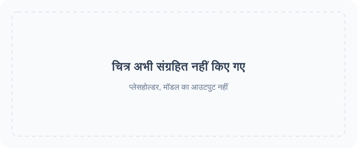

<!-- Generated by scripts/build_readme.py. Edit source data, locale catalogs and generator scripts. -->

# 🎨 Awesome GPT Image 2.6

GPT Image 2.6 के प्रॉम्प्ट, दृश्य उदाहरणों और मूल स्रोतों का एक खुला संग्रह।

    

⚠️ **कॉपीराइट सूचना**: इस संग्रह के प्रॉम्प्ट और मीडिया केवल शैक्षिक उद्देश्यों के लिए सार्वजनिक स्रोतों से एकत्र किए गए हैं। यदि आपको लगता है कि कोई सामग्री आपके अधिकारों का उल्लंघन करती है, तो कृपया [एक इश्यू खोलें](https://github.com/RaphaelAI-OpenLab/awesome-gpt-image-2-6/issues/new), और हम उसे तुरंत हटा देंगे।

    
    
    
   

---

इस भाषा संस्करण में रिपॉज़िटरी के इंटरफ़ेस का अनुवाद किया गया है। उदाहरणों का पूरा विवरण फिलहाल अंग्रेज़ी और सरलीकृत चीनी में उपलब्ध है।

अनुवाद उपलब्ध न होने पर उदाहरणों के शीर्षक, विवरण और विस्तृत पेज अंग्रेज़ी में दिखाए जाते हैं। मूल प्रॉम्प्ट और स्रोत से लिए गए उद्धरणों का अनुवाद नहीं किया जाता।

**त्वरित लिंक** · [🖼️ उदाहरण देखें](#all-cases) · [🆕 हाल में जोड़े गए](#latest) · [📝 एक उदाहरण जोड़ें](https://github.com/RaphaelAI-OpenLab/awesome-gpt-image-2-6/issues/new?template=submit-case.yml) · [🐞 समस्या की रिपोर्ट करें](https://github.com/RaphaelAI-OpenLab/awesome-gpt-image-2-6/issues/new?template=report-problem.yml) · [📚 मार्गदर्शिका पढ़ें](CONTRIBUTING.md)

## 🌐 संग्रह देखें

**[इस रिपॉज़िटरी के सभी उदाहरण देखें →](#all-cases)**

नीचे दिया गया हर उदाहरण एक आंतरिक विवरण पेज खोलता है, जिसमें मॉडल के साक्ष्य, स्रोत का श्रेय और प्रॉम्प्ट की उपलब्धता दी गई है।

**प्लेसहोल्डर · बाहरी वेब गैलरी URL: कॉन्फ़िगर नहीं किया गया।**

**प्लेसहोल्डर · एक क्लिक में जनरेशन का लिंक: सत्यापित नहीं है।**

प्लेसहोल्डर · संबंधित संग्रह / अभियान का लिंक: जोड़ा जाना है।

[Raphael के मुखपृष्ठ पर जाएँ](https://raphael.app/?utm_source=github&utm_medium=repository&utm_campaign=gpt_image_2_6_launch&utm_content=top_nav&utm_term=hi-IN)

## 🏷️ श्रेणी के अनुसार देखें

| श्रेणी | स्रोत से जुड़े उदाहरण | पूर्ण प्रॉम्प्ट |
| --- | ---: | ---: |
| [ब्रांड और उत्पाद के दृश्य](#category-brand-products) | 67 | 0 |
| [पोस्टर और टाइपोग्राफ़ी](#category-posters-typography) | 42 | 0 |
| [इन्फ़ोग्राफ़िक्स](#category-infographics) | 16 | 0 |
| [आंतरिक सज्जा और वास्तुकला](#category-interiors-architecture) | 11 | 0 |
| [पात्र और एकरूपता](#category-characters-consistency) | 55 | 0 |
| [चिह्नांकन और लक्षित संपादन](#category-markup-edits) | 36 | 0 |
| [SVG और डिज़ाइन संसाधन](#category-svg-design-assets) | 13 | 0 |
| [GIF और ऐनिमेशन](#category-gif-animation) | 126 | 0 |

## 📖 विषय-सूची

- [GPT Image 2.6 क्या है?](#about)
- [आँकड़े](#statistics)
- [चुनिंदा उदाहरण](#featured)
- [हाल में जोड़े गए](#latest)
- [सभी उदाहरण](#all-cases)
- [पूर्ण प्रॉम्प्ट](#collection)
- [उपयोग कैसे करें](#using)
- [योगदान दें](#contribute)
- [लाइसेंस](#license)
- [आभार](#acknowledgements)
- [स्टार इतिहास](#star-history)

## 🤔 GPT Image 2.6 क्या है?

OpenAI ने 4 नवंबर 2026 को Images 2.6 पेश किया। इस संग्रह में Sunburst और Flare मॉडल संस्करण, चित्र बनाना और संपादन करना, तथा दस्तावेज़ों में दिए गए SVG और GIF वर्कफ़्लो शामिल हैं। किसी संस्करण का समर्थन मान लेने के बजाय उसे हर उदाहरण के लिए दर्ज किया जाता है।

[आधिकारिक घोषणा](https://openai.com/index/introducing-images-2-6/) · [मॉडल के दस्तावेज़](https://developers.openai.com/api/docs/guides/image-generation)

## 📊 आँकड़े

| मापदंड | संख्या / तारीख |
| --- | ---: |
| स्रोत से जुड़े उदाहरण | **366** |
| आधिकारिक उदाहरण | **37** |
| रचनाकारों द्वारा बताए गए उदाहरण | **329** |
| स्रोत पर उपलब्ध मूल प्रॉम्प्ट | **233** |
| यहाँ प्रकाशित पूर्ण प्रॉम्प्ट | **0** |
| स्थानीय रूप से संग्रहित मीडिया फ़ाइलें | **536** |
| स्रोत की पिछली जाँच (UTC) | **2026-11-09** |

स्रोतों की संख्या परिणाम दोहराने का दावा नहीं करती। लंबित शोध संकेत शामिल नहीं हैं; एक वर्कफ़्लो के अलग-अलग आउटपुट को एक ही उदाहरण गिना जाता है।

## 🔥 चुनिंदा उदाहरण

<table>
<tr>
<td width="33%" align="center"><a href="cases/docs-bakery-svg/README.md"> <strong>Bakery SVG logo</strong></a> आधिकारिक दस्तावेज़</td>
<td width="33%" align="center"><a href="cases/docs-lantern-gif/README.md"> <strong>Lantern-carrying monkey loop</strong></a> आधिकारिक दस्तावेज़</td>
<td width="33%" align="center"><a href="cases/launch-fal/README.md"> <strong>Living-room markup edit</strong></a> आधिकारिक लॉन्च डेमो</td>
</tr>
<tr>
<td width="33%" align="center"><a href="cases/launch-sable/README.md"> <strong>Miniature brand product world</strong></a> आधिकारिक लॉन्च डेमो</td>
<td width="33%" align="center"><a href="cases/launch-higgsfield/README.md"> <strong>Knight scene and clothing edit sequence</strong></a> आधिकारिक लॉन्च डेमो</td>
<td width="33%" align="center"><a href="cases/community-malfoid/README.md"> <strong>Summer character illustration animation</strong></a> रचनाकार द्वारा बताया गया मॉडल</td>
</tr>
</table>

प्लेसहोल्डर कार्ड जनरेट किए गए परिणाम नहीं हैं। दिखाई गई सभी मीडिया फ़ाइलें इसी रिपॉज़िटरी में हैं; जो मीडिया अभी संग्रहित नहीं है, उसके लिंक विवरण पेज पर बने रहते हैं।

## 🆕 हाल में जोड़े गए

| जोड़े जाने की तारीख | उदाहरण | साक्ष्य |
| --- | --- | --- |
| 2026-11-06 | [Flixly: six GIF generation and editing tests](cases/flixly-six-gif-tests/README.md) | रचनाकार द्वारा बताया गया मॉडल |
| 2026-11-06 | [CubistAI paper-cut forest cabin](cases/community-cubistai-paper-cut-cabin/README.md) | रचनाकार द्वारा बताया गया मॉडल |
| 2026-11-06 | [CubistAI Botanical Forms poster](cases/community-cubistai-botanical-poster/README.md) | रचनाकार द्वारा बताया गया मॉडल |
| 2026-11-06 | [CubistAI espresso-cup still life](cases/community-cubistai-espresso-cup/README.md) | रचनाकार द्वारा बताया गया मॉडल |
| 2026-11-06 | [Borrow the Style of a Reference Image](cases/yepshot-compose-style-transfer/README.md) | रचनाकार द्वारा बताया गया मॉडल |
| 2026-11-06 | [Sketch to Product Render](cases/yepshot-creative-sketch-to-render/README.md) | रचनाकार द्वारा बताया गया मॉडल |

## 📋 सभी उदाहरण

### ब्रांड और उत्पाद के दृश्य

| उदाहरण · आंतरिक विवरण पेज | स्रोत | प्रॉम्प्ट |
| --- | --- | --- |
| [Transparent bakery raster logo](cases/docs-bakery-raster/README.md) | आधिकारिक दस्तावेज़ | स्रोत पर मूल प्रॉम्प्ट |
| [Transparent product cutout](cases/docs-product-cutout/README.md) | आधिकारिक दस्तावेज़ | स्रोत पर मूल प्रॉम्प्ट |
| [Toy airplane packaging](cases/docs-toy-package/README.md) | आधिकारिक दस्तावेज़ | स्रोत पर मूल प्रॉम्प्ट |
| [Miniature brand product world](cases/launch-sable/README.md) | आधिकारिक लॉन्च डेमो | स्रोत पर मूल प्रॉम्प्ट |
| [Travel visual generation speed comparison](cases/launch-travel/README.md) | आधिकारिक लॉन्च डेमो | प्रॉम्प्ट सार्वजनिक नहीं है |
| [Laptop GIF-creation workspace illustration](cases/techrepublic-gif-workspace-illustration/README.md) | रचनाकार द्वारा बताया गया मॉडल | प्रॉम्प्ट सार्वजनिक नहीं है |
| [Tovalin serum scene comparison](cases/productai-tovalin-serum-comparison/README.md) | रचनाकार द्वारा बताया गया मॉडल | प्रॉम्प्ट सार्वजनिक नहीं है |
| [Quillhaven coffee scenes and precise edits](cases/productai-quillhaven-coffee-comparison/README.md) | रचनाकार द्वारा बताया गया मॉडल | प्रॉम्प्ट सार्वजनिक नहीं है |
| [Running-shoe scenes and precise edits](cases/productai-running-shoe-comparison/README.md) | रचनाकार द्वारा बताया गया मॉडल | प्रॉम्प्ट सार्वजनिक नहीं है |
| [Cable-knit cardigan on a model](cases/productai-cable-knit-cardigan-comparison/README.md) | रचनाकार द्वारा बताया गया मॉडल | प्रॉम्प्ट सार्वजनिक नहीं है |
| [Oaken Mile Coffee label: Flare and Sunburst](cases/community-moss-coffee-label/README.md) | रचनाकार द्वारा बताया गया मॉडल | स्रोत पर मूल प्रॉम्प्ट |
| [Cafe latte: Flare and Sunburst](cases/community-lightlyn-latte-variants/README.md) | रचनाकार द्वारा बताया गया मॉडल | स्रोत पर मूल प्रॉम्प्ट |
| [Earbud product-ad comparison](cases/community-lightlyn-earbuds-ad-variants/README.md) | रचनाकार द्वारा बताया गया मॉडल | स्रोत पर मूल प्रॉम्प्ट |
| [Made Takeaway box](cases/made-flare-dumpling-box/README.md) | रचनाकार द्वारा बताया गया मॉडल | स्रोत पर मूल प्रॉम्प्ट |
| [Made Stylus macro](cases/made-sunburst-stylus-macro/README.md) | रचनाकार द्वारा बताया गया मॉडल | स्रोत पर मूल प्रॉम्प्ट |
| [Three-flavor soda lineup](cases/yir-flavor-lineup/README.md) | रचनाकार द्वारा बताया गया मॉडल | स्रोत पर मूल प्रॉम्प्ट |
| [French press product photos and background-edit continuation](cases/community-gptimagehub-french-press-edit/README.md) | रचनाकार द्वारा बताया गया मॉडल | स्रोत पर मूल प्रॉम्प्ट |
| [SUMMIT ROAST coffee-bag product shot](cases/zzo-flare-summit-roast-bag/README.md) | रचनाकार द्वारा बताया गया मॉडल | स्रोत पर मूल प्रॉम्प्ट |
| [Nowrap logo motion comparison](cases/nowrap-logo-motion/README.md) | रचनाकार द्वारा बताया गया मॉडल | स्रोत पर मूल प्रॉम्प्ट |
| [Flat fox mascot badge](cases/toonderly-fox-badge/README.md) | रचनाकार द्वारा बताया गया मॉडल | स्रोत पर मूल प्रॉम्प्ट |
| [Watch four-round editing](cases/yir-watch-edit-sequence/README.md) | रचनाकार द्वारा बताया गया मॉडल | प्रॉम्प्ट सार्वजनिक नहीं है |
| [Vase four-round editing](cases/yir-vase-edit-sequence/README.md) | रचनाकार द्वारा बताया गया मॉडल | प्रॉम्प्ट सार्वजनिक नहीं है |
| [Soup photograph with recipe card](cases/joinoasis-tomato-soup/README.md) | रचनाकार द्वारा बताया गया मॉडल | स्रोत पर मूल प्रॉम्प्ट |
| [Blazer and boots reference composition](cases/joinoasis-blazer-boots-composition/README.md) | रचनाकार द्वारा बताया गया मॉडल | स्रोत पर मूल प्रॉम्प्ट |
| [Rainbow cups and cat](cases/community-flixly-rainbow-teacups/README.md) | रचनाकार द्वारा बताया गया मॉडल | स्रोत पर मूल प्रॉम्प्ट |
| [Sage-green to terracotta bottle edit](cases/omniakey-bottle-color-edit/README.md) | रचनाकार द्वारा बताया गया मॉडल | प्रॉम्प्ट सार्वजनिक नहीं है |
| [Watchmaker underwater macro test](cases/community-hn-watchmaker/README.md) | रचनाकार द्वारा बताया गया मॉडल | स्रोत पर मूल प्रॉम्प्ट |
| [Perfume bottle on wet coastal rock](cases/chatimage2-seaside-perfume-edit/README.md) | रचनाकार द्वारा बताया गया मॉडल | स्रोत पर मूल प्रॉम्प्ट |
| [Sunburst Roasters ceramic coffee canister](cases/replicate-sunburst-coffee-canister/README.md) | रचनाकार द्वारा बताया गया मॉडल | स्रोत पर मूल प्रॉम्प्ट |
| [Brushed-titanium espresso tamper: Flare and Sunburst](cases/csuite-tamper/README.md) | रचनाकार द्वारा बताया गया मॉडल | प्रॉम्प्ट की उपलब्धता सत्यापित नहीं |
| [Ceramic mug: 2K background-setting test](cases/iskragen-mug-2k-background-test/README.md) | रचनाकार द्वारा बताया गया मॉडल | स्रोत पर मूल प्रॉम्प्ट |
| [SUNNY POP sparkling-water poster](cases/framemux-sunny-pop-poster/README.md) | रचनाकार द्वारा बताया गया मॉडल | स्रोत पर मूल प्रॉम्प्ट |
| [Sage-green speaker on travertine](cases/gptimagehub-sage-speaker/README.md) | रचनाकार द्वारा बताया गया मॉडल | स्रोत पर मूल प्रॉम्प्ट |
| [LUMIÈRE jewelry portrait at a car window](cases/302-lumiere-jewelry-portrait/README.md) | रचनाकार द्वारा बताया गया मॉडल | स्रोत पर मूल प्रॉम्प्ट |
| [VHS-style night racing scene](cases/302-vhs-drift-race/README.md) | रचनाकार द्वारा बताया गया मॉडल | स्रोत पर मूल प्रॉम्प्ट |
| [Pure White Marketplace Packshot](cases/yepshot-studio-pure-white-amazon/README.md) | रचनाकार द्वारा बताया गया मॉडल | प्रॉम्प्ट की उपलब्धता सत्यापित नहीं |
| [Black Acrylic Mirror Reflection](cases/yepshot-studio-acrylic-reflection/README.md) | रचनाकार द्वारा बताया गया मॉडल | प्रॉम्प्ट की उपलब्धता सत्यापित नहीं |
| [Floating Hero Shot](cases/yepshot-studio-floating-ambient-shadow/README.md) | रचनाकार द्वारा बताया गया मॉडल | प्रॉम्प्ट की उपलब्धता सत्यापित नहीं |
| [Overhead Flat Lay on Light Gray](cases/yepshot-studio-overhead-flat-lay/README.md) | रचनाकार द्वारा बताया गया मॉडल | प्रॉम्प्ट की उपलब्धता सत्यापित नहीं |
| [Three-Quarter Catalog Angle](cases/yepshot-studio-three-quarter-angle/README.md) | रचनाकार द्वारा बताया गया मॉडल | प्रॉम्प्ट की उपलब्धता सत्यापित नहीं |
| [Material Close-Up for Detail Images](cases/yepshot-studio-material-detail-closeup/README.md) | रचनाकार द्वारा बताया गया मॉडल | प्रॉम्प्ट की उपलब्धता सत्यापित नहीं |
| [Preview Colorways Side by Side](cases/yepshot-studio-colorway-lineup/README.md) | रचनाकार द्वारा बताया गया मॉडल | प्रॉम्प्ट की उपलब्धता सत्यापित नहीं |
| [Travertine Block in Morning Light](cases/yepshot-lifestyle-travertine-stone/README.md) | रचनाकार द्वारा बताया गया मॉडल | प्रॉम्प्ट की उपलब्धता सत्यापित नहीं |
| [Marble Vanity with Water Droplets](cases/yepshot-lifestyle-marble-bathroom-dew/README.md) | रचनाकार द्वारा बताया गया मॉडल | प्रॉम्प्ट की उपलब्धता सत्यापित नहीं |
| [Oak Table with Kitchen Props](cases/yepshot-lifestyle-scandinavian-wood-kitchen/README.md) | रचनाकार द्वारा बताया गया मॉडल | प्रॉम्प्ट की उपलब्धता सत्यापित नहीं |
| [Concrete Podium, Tech Style](cases/yepshot-lifestyle-industrial-concrete-podium/README.md) | रचनाकार द्वारा बताया गया मॉडल | प्रॉम्प्ट की उपलब्धता सत्यापित नहीं |
| [Bright Modern Living Room](cases/yepshot-lifestyle-bright-living-room/README.md) | रचनाकार द्वारा बताया गया मॉडल | प्रॉम्प्ट की उपलब्धता सत्यापित नहीं |
| [Sunny Picnic Blanket](cases/yepshot-lifestyle-outdoor-picnic/README.md) | रचनाकार द्वारा बताया गया मॉडल | प्रॉम्प्ट की उपलब्धता सत्यापित नहीं |
| [Neon Gaming Desk](cases/yepshot-lifestyle-neon-gaming-desk/README.md) | रचनाकार द्वारा बताया गया मॉडल | प्रॉम्प्ट की उपलब्धता सत्यापित नहीं |
| [Remove Glare on Shiny Surfaces](cases/yepshot-cleanup-remove-glare-reflections/README.md) | रचनाकार द्वारा बताया गया मॉडल | प्रॉम्प्ट की उपलब्धता सत्यापित नहीं |
| [Erase Barcode and Price Sticker](cases/yepshot-cleanup-erase-barcode-watermark/README.md) | रचनाकार द्वारा बताया गया मॉडल | प्रॉम्प्ट की उपलब्धता सत्यापित नहीं |
| [Remove Dust and Fingerprints](cases/yepshot-cleanup-dust-fingerprints/README.md) | रचनाकार द्वारा बताया गया मॉडल | प्रॉम्प्ट की उपलब्धता सत्यापित नहीं |
| [Place a Product into Your Scene](cases/yepshot-compose-product-into-scene/README.md) | रचनाकार द्वारा बताया गया मॉडल | प्रॉम्प्ट की उपलब्धता सत्यापित नहीं |
| [Bundle Two Products into One Shot](cases/yepshot-compose-bundle-group-shot/README.md) | रचनाकार द्वारा बताया गया मॉडल | प्रॉम्प्ट की उपलब्धता सत्यापित नहीं |
| [Match Your Existing Catalog Look](cases/yepshot-compose-match-catalog-style/README.md) | रचनाकार द्वारा बताया गया मॉडल | प्रॉम्प्ट की उपलब्धता सत्यापित नहीं |
| [Smooth Out Fabric Wrinkles](cases/yepshot-cleanup-smooth-fabric-wrinkles/README.md) | रचनाकार द्वारा बताया गया मॉडल | प्रॉम्प्ट की उपलब्धता सत्यापित नहीं |
| [Christmas Pine and Warm Bokeh](cases/yepshot-seasonal-christmas-pine-bokeh/README.md) | रचनाकार द्वारा बताया गया मॉडल | प्रॉम्प्ट की उपलब्धता सत्यापित नहीं |
| [Summer Pool Water and Caustics](cases/yepshot-seasonal-summer-pool-water-ripples/README.md) | रचनाकार द्वारा बताया गया मॉडल | प्रॉम्प्ट की उपलब्धता सत्यापित नहीं |
| [Black Friday Black-and-Gold Pedestal](cases/yepshot-seasonal-black-friday-gold-geometry/README.md) | रचनाकार द्वारा बताया गया मॉडल | प्रॉम्प्ट की उपलब्धता सत्यापित नहीं |
| [Lunar New Year Red and Gold](cases/yepshot-seasonal-lunar-new-year/README.md) | रचनाकार द्वारा बताया गया मॉडल | प्रॉम्प्ट की उपलब्धता सत्यापित नहीं |
| [Turn Your Pet into a Collectible Figure](cases/yepshot-creative-collectible-figure/README.md) | रचनाकार द्वारा बताया गया मॉडल | प्रॉम्प्ट की उपलब्धता सत्यापित नहीं |
| [Photo to Watercolor Illustration](cases/yepshot-creative-watercolor-illustration/README.md) | रचनाकार द्वारा बताया गया मॉडल | प्रॉम्प्ट की उपलब्धता सत्यापित नहीं |
| [Sketch to Product Render](cases/yepshot-creative-sketch-to-render/README.md) | रचनाकार द्वारा बताया गया मॉडल | प्रॉम्प्ट की उपलब्धता सत्यापित नहीं |
| [Borrow the Style of a Reference Image](cases/yepshot-compose-style-transfer/README.md) | रचनाकार द्वारा बताया गया मॉडल | प्रॉम्प्ट की उपलब्धता सत्यापित नहीं |
| [CubistAI espresso-cup still life](cases/community-cubistai-espresso-cup/README.md) | रचनाकार द्वारा बताया गया मॉडल | स्रोत पर मूल प्रॉम्प्ट |
| [Saved mug reference across three scenes](cases/weel-saved-mug-scenes/README.md) | रचनाकार द्वारा बताया गया मॉडल | स्रोत पर मूल प्रॉम्प्ट |
| [AURORA orange perfume product image](cases/community-struggle-aurora-perfume/README.md) | रचनाकार द्वारा बताया गया मॉडल | स्रोत पर मूल प्रॉम्प्ट |

### पोस्टर और टाइपोग्राफ़ी

| उदाहरण · आंतरिक विवरण पेज | स्रोत | प्रॉम्प्ट |
| --- | --- | --- |
| [Streetwear advertisement typography](cases/docs-streetwear/README.md) | आधिकारिक दस्तावेज़ | स्रोत पर मूल प्रॉम्प्ट |
| [Roadside shampoo billboard](cases/docs-billboard/README.md) | आधिकारिक दस्तावेज़ | स्रोत पर मूल प्रॉम्प्ट |
| [Nostalgic holiday card](cases/docs-holiday-card/README.md) | आधिकारिक दस्तावेज़ | स्रोत पर मूल प्रॉम्प्ट |
| [Shiba ramen shop: two quality comparison runs](cases/ai-garage-ramen-quality-series/README.md) | रचनाकार द्वारा बताया गया मॉडल | प्रॉम्प्ट सार्वजनिक नहीं है |
| [Autumn café menu announcement comparison](cases/ai-garage-autumn-cafe/README.md) | रचनाकार द्वारा बताया गया मॉडल | प्रॉम्प्ट सार्वजनिक नहीं है |
| [Flare 4K test, published previews](cases/aivideos-flare-4k-comparison/README.md) | रचनाकार द्वारा बताया गया मॉडल | प्रॉम्प्ट सार्वजनिक नहीं है |
| [Flare quality and planning comparison](cases/aivideos-flare-quality-planning/README.md) | रचनाकार द्वारा बताया गया मॉडल | प्रॉम्प्ट सार्वजनिक नहीं है |
| [Retro diner menu board](cases/dreamega-retro-diner/README.md) | रचनाकार द्वारा बताया गया मॉडल | स्रोत पर मूल प्रॉम्प्ट |
| [Lantern Row Night Market flyer: Flare and Sunburst](cases/community-moss-night-market-flyer/README.md) | रचनाकार द्वारा बताया गया मॉडल | स्रोत पर मूल प्रॉम्प्ट |
| [Café breakfast menu: Flare and Sunburst](cases/community-moss-breakfast-menu/README.md) | रचनाकार द्वारा बताया गया मॉडल | स्रोत पर मूल प्रॉम्प्ट |
| [Pottery event banner layout: Flare and Sunburst](cases/community-moss-pottery-banner-layout/README.md) | रचनाकार द्वारा बताया गया मॉडल | स्रोत पर मूल प्रॉम्प्ट |
| [Night market poster comparison](cases/community-lightlyn-night-market-variants/README.md) | रचनाकार द्वारा बताया गया मॉडल | स्रोत पर मूल प्रॉम्प्ट |
| [Made Lightbox menu](cases/made-flare-noodle-menu/README.md) | रचनाकार द्वारा बताया गया मॉडल | स्रोत पर मूल प्रॉम्प्ट |
| [Made Sleeve typography](cases/made-sunburst-record-sleeve/README.md) | रचनाकार द्वारा बताया गया मॉडल | स्रोत पर मूल प्रॉम्प्ट |
| [Made Window lettering](cases/made-sunburst-shop-window/README.md) | रचनाकार द्वारा बताया गया मॉडल | स्रोत पर मूल प्रॉम्प्ट |
| [Hot-sauce launch and speed-test posters](cases/yir-hot-sauce-posters/README.md) | रचनाकार द्वारा बताया गया मॉडल | स्रोत पर मूल प्रॉम्प्ट |
| [End-of-season bicycle sale ad](cases/yir-bicycle-sale-ad/README.md) | रचनाकार द्वारा बताया गया मॉडल | स्रोत पर मूल प्रॉम्प्ट |
| [Blue Hour jazz posters and date-edit continuation](cases/community-gptimagehub-jazz-poster-edit/README.md) | रचनाकार द्वारा बताया गया मॉडल | स्रोत पर मूल प्रॉम्प्ट |
| [Winter Night Market poster](cases/veevid-holiday-market-poster/README.md) | रचनाकार द्वारा बताया गया मॉडल | स्रोत पर मूल प्रॉम्प्ट |
| [English–Hindi evening menu from a document brief](cases/analyticsvidhya-bilingual-evening-menu/README.md) | रचनाकार द्वारा बताया गया मॉडल | स्रोत पर मूल प्रॉम्प्ट |
| [NIGHT TIDE wave concert poster](cases/zzo-flare-night-tide-poster/README.md) | रचनाकार द्वारा बताया गया मॉडल | स्रोत पर मूल प्रॉम्प्ट |
| [NIGHT MARKET typography comparison](cases/cellcog-night-market-poster/README.md) | रचनाकार द्वारा बताया गया मॉडल | प्रॉम्प्ट सार्वजनिक नहीं है |
| [Café neon text comparison](cases/nowrap-cafe-sign-motion/README.md) | रचनाकार द्वारा बताया गया मॉडल | स्रोत पर मूल प्रॉम्प्ट |
| [BOUNCE balloon-letter poster](cases/toonderly-bounce-poster/README.md) | रचनाकार द्वारा बताया गया मॉडल | प्रॉम्प्ट सार्वजनिक नहीं है |
| [OPEN LATE neon storefront](cases/kavel-open-late/README.md) | रचनाकार द्वारा बताया गया मॉडल | प्रॉम्प्ट सार्वजनिक नहीं है |
| [Lemon cake recipe card](cases/community-flixly-lemon-recipe/README.md) | रचनाकार द्वारा बताया गया मॉडल | स्रोत पर मूल प्रॉम्प्ट |
| [FIELD & FLOUR bakery poster](cases/sogni-flare-bakery-poster/README.md) | रचनाकार द्वारा बताया गया मॉडल | प्रॉम्प्ट सार्वजनिक नहीं है |
| [NORTHLIGHT TEA poster layout comparison](cases/sandbase-northlight-tea-posters/README.md) | रचनाकार द्वारा बताया गया मॉडल | प्रॉम्प्ट सार्वजनिक नहीं है |
| [Port Calder poster complexity comparison](cases/omniakey-port-calder-comparison/README.md) | रचनाकार द्वारा बताया गया मॉडल | स्रोत पर मूल प्रॉम्प्ट |
| [Birthday cake without extra slogan cards](cases/community-flare-slogan-comparison/README.md) | रचनाकार द्वारा बताया गया मॉडल | स्रोत पर मूल प्रॉम्प्ट |
| [NIGHT SIGNAL concert poster: Flare and Sunburst](cases/csuite-poster/README.md) | रचनाकार द्वारा बताया गया मॉडल | प्रॉम्प्ट की उपलब्धता सत्यापित नहीं |
| [The Daily Pour coffee poster](cases/apixo-daily-pour-poster/README.md) | रचनाकार द्वारा बताया गया मॉडल | प्रॉम्प्ट सार्वजनिक नहीं है |
| [Coffee poster: vague prompt versus structured brief](cases/gptimagehub-structured-coffee-poster/README.md) | रचनाकार द्वारा बताया गया मॉडल | स्रोत पर मूल प्रॉम्प्ट |
| [AMALFI travel poster](cases/gptimagehub-amalfi-poster/README.md) | रचनाकार द्वारा बताया गया मॉडल | स्रोत पर मूल प्रॉम्प्ट |
| [Block-world comparison cover redesign](cases/302-block-world-cover/README.md) | रचनाकार द्वारा बताया गया मॉडल | स्रोत पर मूल प्रॉम्प्ट |
| [Five-view concept-car poster collage](cases/302-flying-car-collage/README.md) | रचनाकार द्वारा बताया गया मॉडल | स्रोत पर मूल प्रॉम्प्ट |
| [Change the Name on a Product Label](cases/yepshot-text-label-name-swap/README.md) | रचनाकार द्वारा बताया गया मॉडल | प्रॉम्प्ट की उपलब्धता सत्यापित नहीं |
| [Translate the Text on Packaging](cases/yepshot-text-translate-packaging/README.md) | रचनाकार द्वारा बताया गया मॉडल | प्रॉम्प्ट की उपलब्धता सत्यापित नहीं |
| [Turn a Product Photo into a Sale Poster](cases/yepshot-campaign-sale-poster-text/README.md) | रचनाकार द्वारा बताया गया मॉडल | प्रॉम्प्ट की उपलब्धता सत्यापित नहीं |
| [Update the Discount on a Promo Graphic](cases/yepshot-text-promo-discount-update/README.md) | रचनाकार द्वारा बताया गया मॉडल | प्रॉम्प्ट की उपलब्धता सत्यापित नहीं |
| [CubistAI Botanical Forms poster](cases/community-cubistai-botanical-poster/README.md) | रचनाकार द्वारा बताया गया मॉडल | स्रोत पर मूल प्रॉम्प्ट |
| [AI evolution poster revised to Image 2.6](cases/community-struggle-poster-edit/README.md) | रचनाकार द्वारा बताया गया मॉडल | स्रोत पर मूल प्रॉम्प्ट |

### इन्फ़ोग्राफ़िक्स

| उदाहरण · आंतरिक विवरण पेज | स्रोत | प्रॉम्प्ट |
| --- | --- | --- |
| [Coffee-machine process diagram](cases/docs-coffee-diagram/README.md) | आधिकारिक दस्तावेज़ | स्रोत पर मूल प्रॉम्प्ट |
| [Cellular respiration teaching visual](cases/docs-cell-respiration/README.md) | आधिकारिक दस्तावेज़ | स्रोत पर मूल प्रॉम्प्ट |
| [Market-size presentation slide](cases/docs-pitch-slide/README.md) | आधिकारिक दस्तावेज़ | स्रोत पर मूल प्रॉम्प्ट |
| [Northfield Design Summit agenda: Flare and Sunburst](cases/community-moss-design-summit-agenda/README.md) | रचनाकार द्वारा बताया गया मॉडल | स्रोत पर मूल प्रॉम्प्ट |
| [Honeybee scientific scale layouts](cases/community-lightlyn-bee-scale-variants/README.md) | रचनाकार द्वारा बताया गया मॉडल | स्रोत पर मूल प्रॉम्प्ट |
| [Made Illustrated map](cases/made-flare-market-map/README.md) | रचनाकार द्वारा बताया गया मॉडल | स्रोत पर मूल प्रॉम्प्ट |
| [Made Exploded diagram](cases/made-sunburst-turntable-diagram/README.md) | रचनाकार द्वारा बताया गया मॉडल | स्रोत पर मूल प्रॉम्प्ट |
| [Lisbon weather screen: matched Flare and Sunburst test](cases/community-gptimagehub-weather-ui/README.md) | रचनाकार द्वारा बताया गया मॉडल | स्रोत पर मूल प्रॉम्प्ट |
| [Six-step bill-to-law infographic comparison](cases/community-gptimagehub-law-infographic/README.md) | रचनाकार द्वारा बताया गया मॉडल | स्रोत पर मूल प्रॉम्प्ट |
| [Monarch butterfly life-cycle field-guide plate](cases/analyticsvidhya-monarch-life-cycle/README.md) | रचनाकार द्वारा बताया गया मॉडल | स्रोत पर मूल प्रॉम्प्ट |
| [Automatic coffee-machine flow infographic](cases/zzo-flare-coffee-machine-diagram/README.md) | रचनाकार द्वारा बताया गया मॉडल | स्रोत पर मूल प्रॉम्प्ट |
| [Quarterly revenue chart animation](cases/nowrap-chart-motion/README.md) | रचनाकार द्वारा बताया गया मॉडल | स्रोत पर मूल प्रॉम्प्ट |
| [Five-step coffee process infographic](cases/replicate-flare-coffee-process-infographic/README.md) | रचनाकार द्वारा बताया गया मॉडल | स्रोत पर मूल प्रॉम्प्ट |
| [Labeled sunflower botanical plate](cases/replicate-sunburst-sunflower-botanical/README.md) | रचनाकार द्वारा बताया गया मॉडल | स्रोत पर मूल प्रॉम्प्ट |
| [The Life of a Coffee Bean infographic](cases/gptimagehub-coffee-bean-infographic/README.md) | रचनाकार द्वारा बताया गया मॉडल | स्रोत पर मूल प्रॉम्प्ट |
| [The Ember Isles fantasy map](cases/gptimagehub-ember-isles-map/README.md) | रचनाकार द्वारा बताया गया मॉडल | स्रोत पर मूल प्रॉम्प्ट |

### आंतरिक सज्जा और वास्तुकला

| उदाहरण · आंतरिक विवरण पेज | स्रोत | प्रॉम्प्ट |
| --- | --- | --- |
| [Replace chairs in an interior](cases/docs-room-chairs/README.md) | आधिकारिक दस्तावेज़ | स्रोत पर मूल प्रॉम्प्ट |
| [Living-room markup edit](cases/launch-fal/README.md) | आधिकारिक लॉन्च डेमो | स्रोत पर मूल प्रॉम्प्ट |
| [Made Ultra-wide aisle](cases/made-flare-market-aerial/README.md) | रचनाकार द्वारा बताया गया मॉडल | स्रोत पर मूल प्रॉम्प्ट |
| [Snowy mountain greenhouse at blue hour](cases/analyticsvidhya-snowy-greenhouse/README.md) | रचनाकार द्वारा बताया गया मॉडल | स्रोत पर मूल प्रॉम्प्ट |
| [Red tram in a foggy city](cases/kavel-tram/README.md) | रचनाकार द्वारा बताया गया मॉडल | प्रॉम्प्ट सार्वजनिक नहीं है |
| [Four-room doorway layout](cases/joinoasis-four-room-floorplan/README.md) | रचनाकार द्वारा बताया गया मॉडल | स्रोत पर मूल प्रॉम्प्ट |
| [Kitchen hanging-light replacement](cases/joinoasis-kitchen-pendant-edit/README.md) | रचनाकार द्वारा बताया गया मॉडल | स्रोत पर मूल प्रॉम्प्ट |
| [Dusty warehouse prompt-detail comparison](cases/community-sunburst-dust-detail/README.md) | रचनाकार द्वारा बताया गया मॉडल | प्रॉम्प्ट की उपलब्धता सत्यापित नहीं |
| [Rainy-window reading nook](cases/chatimage2-rainy-reading-nook/README.md) | रचनाकार द्वारा बताया गया मॉडल | स्रोत पर मूल प्रॉम्प्ट |
| [Waterfall landscape with a red-jacket hiker](cases/zhidx-waterfall-landscape/README.md) | रचनाकार द्वारा बताया गया मॉडल | प्रॉम्प्ट सार्वजनिक नहीं है |
| [CubistAI paper-cut forest cabin](cases/community-cubistai-paper-cut-cabin/README.md) | रचनाकार द्वारा बताया गया मॉडल | स्रोत पर मूल प्रॉम्प्ट |

### पात्र और एकरूपता

| उदाहरण · आंतरिक विवरण पेज | स्रोत | प्रॉम्प्ट |
| --- | --- | --- |
| [Paper-cut championship scene: complexity comparison](cases/docs-complexity/README.md) | आधिकारिक दस्तावेज़ | स्रोत पर मूल प्रॉम्प्ट |
| [Realistic fishing-boat sailor portrait](cases/docs-sailor/README.md) | आधिकारिक दस्तावेज़ | स्रोत पर मूल प्रॉम्प्ट |
| [1969 historical crowd scene](cases/docs-historical-crowd/README.md) | आधिकारिक दस्तावेज़ | स्रोत पर मूल प्रॉम्प्ट |
| [Four-panel pet comic](cases/docs-pet-comic/README.md) | आधिकारिक दस्तावेज़ | स्रोत पर मूल प्रॉम्प्ट |
| [Change clothing while preserving identity](cases/docs-outfit/README.md) | आधिकारिक दस्तावेज़ | स्रोत पर मूल प्रॉम्प्ट |
| [Place a person into a camping escape scene](cases/docs-person-scene/README.md) | आधिकारिक दस्तावेज़ | स्रोत पर मूल प्रॉम्प्ट |
| [Establish a storybook character](cases/docs-character-start/README.md) | आधिकारिक दस्तावेज़ | स्रोत पर मूल प्रॉम्प्ट |
| [Continue the same character’s story](cases/docs-character-story/README.md) | आधिकारिक दस्तावेज़ | स्रोत पर मूल प्रॉम्प्ट |
| [Stained-glass whale](cases/launch-picsart/README.md) | आधिकारिक लॉन्च डेमो | प्रॉम्प्ट सार्वजनिक नहीं है |
| [Knight scene and clothing edit sequence](cases/launch-higgsfield/README.md) | आधिकारिक लॉन्च डेमो | स्रोत पर मूल प्रॉम्प्ट |
| [Ophanim-inspired still: The Coastal Lookout](cases/community-ophanim-coastal-lookout/README.md) | रचनाकार द्वारा बताया गया मॉडल | स्रोत पर मूल प्रॉम्प्ट |
| [Ophanim-inspired still: The Mountain Reservoir](cases/community-ophanim-mountain-reservoir/README.md) | रचनाकार द्वारा बताया गया मॉडल | स्रोत पर मूल प्रॉम्प्ट |
| [Ophanim-inspired still: The Village in the Rain](cases/community-ophanim-village-rain/README.md) | रचनाकार द्वारा बताया गया मॉडल | स्रोत पर मूल प्रॉम्प्ट |
| [Ophanim-inspired still: The Subway Entrance](cases/community-ophanim-subway-entrance/README.md) | रचनाकार द्वारा बताया गया मॉडल | स्रोत पर मूल प्रॉम्प्ट |
| [Fisherman at dawn: Flare and Sunburst](cases/community-moss-fisherman-dawn/README.md) | रचनाकार द्वारा बताया गया मॉडल | स्रोत पर मूल प्रॉम्प्ट |
| [Made Vendor portrait](cases/made-flare-vendor-flash/README.md) | रचनाकार द्वारा बताया गया मॉडल | स्रोत पर मूल प्रॉम्प्ट |
| [Made Rainy night](cases/made-flare-rain-stall/README.md) | रचनाकार द्वारा बताया गया मॉडल | स्रोत पर मूल प्रॉम्प्ट |
| [Made Crate digger](cases/made-sunburst-crate-digger/README.md) | रचनाकार द्वारा बताया गया मॉडल | स्रोत पर मूल प्रॉम्प्ट |
| [Made Listening booth](cases/made-sunburst-listening-booth/README.md) | रचनाकार द्वारा बताया गया मॉडल | स्रोत पर मूल प्रॉम्प्ट |
| [Ferry at blue hour](cases/yir-ferry-blue-hour/README.md) | रचनाकार द्वारा बताया गया मॉडल | स्रोत पर मूल प्रॉम्प्ट |
| [Night market noodle stall](cases/yir-noodle-stall/README.md) | रचनाकार द्वारा बताया गया मॉडल | स्रोत पर मूल प्रॉम्प्ट |
| [Raincoat animation storyboard](cases/yir-raincoat-storyboard/README.md) | रचनाकार द्वारा बताया गया मॉडल | स्रोत पर मूल प्रॉम्प्ट |
| [Fox raincoat consistency test](cases/nowrap-fox-motion/README.md) | रचनाकार द्वारा बताया गया मॉडल | स्रोत पर मूल प्रॉम्प्ट |
| [Robot learning to fly storyboard](cases/toonderly-robot-storyboard/README.md) | रचनाकार द्वारा बताया गया मॉडल | प्रॉम्प्ट सार्वजनिक नहीं है |
| [Portrait four-round editing](cases/yir-portrait-edit-sequence/README.md) | रचनाकार द्वारा बताया गया मॉडल | प्रॉम्प्ट सार्वजनिक नहीं है |
| [1990s-style flash portrait](cases/kavel-90s-snapshot/README.md) | रचनाकार द्वारा बताया गया मॉडल | स्रोत पर मूल प्रॉम्प्ट |
| [Mira lighthouse keyframes](cases/community-flixly-mira-keyframes/README.md) | रचनाकार द्वारा बताया गया मॉडल | स्रोत पर मूल प्रॉम्प्ट |
| [Fisherman repairing a net](cases/community-flixly-fisherman-portrait/README.md) | रचनाकार द्वारा बताया गया मॉडल | स्रोत पर मूल प्रॉम्प्ट |
| [Fox and badger in rain](cases/community-flixly-rainy-bridge-friends/README.md) | रचनाकार द्वारा बताया गया मॉडल | स्रोत पर मूल प्रॉम्प्ट |
| [The Last Reel: Flare and Sunburst scene variants](cases/maxvideo-gpt26-last-reel-generation/README.md) | रचनाकार द्वारा बताया गया मॉडल | स्रोत पर मूल प्रॉम्प्ट |
| [Curly-haired editorial portrait: Flare and Sunburst](cases/csuite-portrait/README.md) | रचनाकार द्वारा बताया गया मॉडल | प्रॉम्प्ट की उपलब्धता सत्यापित नहीं |
| [Paladin: background and armor edit sequence](cases/overchat-paladin-edits/README.md) | रचनाकार द्वारा बताया गया मॉडल | स्रोत पर मूल प्रॉम्प्ट |
| [Astronaut cat sticker with jetpack](cases/replicate-flare-astronaut-cat-sticker/README.md) | रचनाकार द्वारा बताया गया मॉडल | स्रोत पर मूल प्रॉम्प्ट |
| [Nine-panel workplace AI comic](cases/zhidx-nine-panel-comic/README.md) | रचनाकार द्वारा बताया गया मॉडल | प्रॉम्प्ट सार्वजनिक नहीं है |
| [Photoreal basketball game image](cases/zhidx-basketball-photo/README.md) | रचनाकार द्वारा बताया गया मॉडल | प्रॉम्प्ट सार्वजनिक नहीं है |
| [Orange Y2K fashion in a blue studio](cases/302-y2k-orange-fashion/README.md) | रचनाकार द्वारा बताया गया मॉडल | स्रोत पर मूल प्रॉम्प्ट |
| [Ink illustration of wolves in snow](cases/302-ink-wolves-snow/README.md) | रचनाकार द्वारा बताया गया मॉडल | स्रोत पर मूल प्रॉम्प्ट |
| [Reference-led courtyard photo board](cases/community-marco-reference-photo-board/README.md) | रचनाकार द्वारा बताया गया मॉडल | प्रॉम्प्ट सार्वजनिक नहीं है |
| [Sunburst courtyard comparison](cases/community-marco-sunburst-courtyard-comparison/README.md) | रचनाकार द्वारा बताया गया मॉडल | प्रॉम्प्ट सार्वजनिक नहीं है |
| [Mushroom-lit fashion portrait](cases/community-marco-mushroom-fashion-portrait/README.md) | रचनाकार द्वारा बताया गया मॉडल | प्रॉम्प्ट सार्वजनिक नहीं है |
| [Ghost Mannequin to Street Model](cases/yepshot-apparel-ghost-mannequin-to-street-model/README.md) | रचनाकार द्वारा बताया गया मॉडल | प्रॉम्प्ट की उपलब्धता सत्यापित नहीं |
| [Virtual Try-On](cases/yepshot-compose-virtual-try-on/README.md) | रचनाकार द्वारा बताया गया मॉडल | प्रॉम्प्ट की उपलब्धता सत्यापित नहीं |
| [Upgrade Fabric to Silk](cases/yepshot-apparel-silk-texture-upgrade/README.md) | रचनाकार द्वारा बताया गया मॉडल | प्रॉम्प्ट की उपलब्धता सत्यापित नहीं |
| [Recolor a Garment](cases/yepshot-fashion-garment-recolor/README.md) | रचनाकार द्वारा बताया गया मॉडल | प्रॉम्प्ट की उपलब्धता सत्यापित नहीं |
| [Clean Studio Backdrop for Model Shots](cases/yepshot-fashion-model-studio-backdrop/README.md) | रचनाकार द्वारा बताया गया मॉडल | प्रॉम्प्ट की उपलब्धता सत्यापित नहीं |
| [Change Hair to Platinum Blonde](cases/yepshot-portrait-platinum-blonde-hair/README.md) | रचनाकार द्वारा बताया गया मॉडल | प्रॉम्प्ट की उपलब्धता सत्यापित नहीं |
| [Natural Skin Retouch](cases/yepshot-portrait-skin-texture-refinement/README.md) | रचनाकार द्वारा बताया गया मॉडल | प्रॉम्प्ट की उपलब्धता सत्यापित नहीं |
| [Casual Photo to Business Headshot](cases/yepshot-portrait-business-headshot/README.md) | रचनाकार द्वारा बताया गया मॉडल | प्रॉम्प्ट की उपलब्धता सत्यापित नहीं |
| [ID Photo with White Background](cases/yepshot-portrait-id-photo/README.md) | रचनाकार द्वारा बताया गया मॉडल | प्रॉम्प्ट की उपलब्धता सत्यापित नहीं |
| [Remove People from the Background](cases/yepshot-portrait-remove-photobomber/README.md) | रचनाकार द्वारा बताया गया मॉडल | प्रॉम्प्ट की उपलब्धता सत्यापित नहीं |
| [Restore a Faded Old Photo](cases/yepshot-restore-vintage-photo-reconstruction/README.md) | रचनाकार द्वारा बताया गया मॉडल | प्रॉम्प्ट की उपलब्धता सत्यापित नहीं |
| [Colorize a Black-and-White Photo](cases/yepshot-restore-colorize-bw/README.md) | रचनाकार द्वारा बताया गया मॉडल | प्रॉम्प्ट की उपलब्धता सत्यापित नहीं |
| [Fix Blur and Noise](cases/yepshot-restore-deblur-sharpen/README.md) | रचनाकार द्वारा बताया गया मॉडल | प्रॉम्प्ट की उपलब्धता सत्यापित नहीं |
| [Brighten an Underexposed Photo](cases/yepshot-restore-low-light-fix/README.md) | रचनाकार द्वारा बताया गया मॉडल | प्रॉम्प्ट की उपलब्धता सत्यापित नहीं |
| [Photo to 3D Clay Character](cases/yepshot-creative-3d-clay/README.md) | रचनाकार द्वारा बताया गया मॉडल | प्रॉम्प्ट की उपलब्धता सत्यापित नहीं |

### चिह्नांकन और लक्षित संपादन

| उदाहरण · आंतरिक विवरण पेज | स्रोत | प्रॉम्प्ट |
| --- | --- | --- |
| [Recolor a marked vase](cases/docs-vase-markup/README.md) | आधिकारिक दस्तावेज़ | स्रोत पर मूल प्रॉम्प्ट |
| [Translate an infographic into Spanish](cases/docs-spanish-edit/README.md) | आधिकारिक दस्तावेज़ | स्रोत पर मूल प्रॉम्प्ट |
| [Transfer a pixel-art style](cases/docs-pixel-style/README.md) | आधिकारिक दस्तावेज़ | स्रोत पर मूल प्रॉम्प्ट |
| [Combine pets across images](cases/docs-dog-composite/README.md) | आधिकारिक दस्तावेज़ | स्रोत पर मूल प्रॉम्प्ट |
| [Turn a sketch into a realistic scene](cases/docs-sketch-render/README.md) | आधिकारिक दस्तावेज़ | स्रोत पर मूल प्रॉम्प्ट |
| [Remove a held flower](cases/docs-remove-flower/README.md) | आधिकारिक दस्तावेज़ | स्रोत पर मूल प्रॉम्प्ट |
| [Change the billboard scene to a snowy night](cases/docs-snow-edit/README.md) | आधिकारिक दस्तावेज़ | स्रोत पर मूल प्रॉम्प्ट |
| [Shiba chef festival background edit](cases/ai-garage-festival-background/README.md) | रचनाकार द्वारा बताया गया मॉडल | स्रोत पर मूल प्रॉम्प्ट |
| [Red chef hat despite conflicting markup](cases/ai-garage-red-chef-hat/README.md) | रचनाकार द्वारा बताया गया मॉडल | स्रोत पर मूल प्रॉम्प्ट |
| [Mirror reflection costume edit](cases/dreamega-mirror-reflection/README.md) | रचनाकार द्वारा बताया गया मॉडल | प्रॉम्प्ट सार्वजनिक नहीं है |
| [Miniature city inside a piano](cases/dreamega-piano-city/README.md) | रचनाकार द्वारा बताया गया मॉडल | प्रॉम्प्ट सार्वजनिक नहीं है |
| [Recolor a sofa in a living room](cases/community-lightlyn-sofa-edit-variants/README.md) | रचनाकार द्वारा बताया गया मॉडल | स्रोत पर मूल प्रॉम्प्ट |
| [Sneaker recolored to forest green suede](cases/veevid-sneaker-suede-recolor/README.md) | रचनाकार द्वारा बताया गया मॉडल | स्रोत पर मूल प्रॉम्प्ट |
| [Markup-guided forest-green armchair edit](cases/analyticsvidhya-markup-green-armchair/README.md) | रचनाकार द्वारा बताया गया मॉडल | स्रोत पर मूल प्रॉम्प्ट |
| [LUMA 02 bottle on a forest river stone](cases/zzo-flare-luma-forest-stone/README.md) | रचनाकार द्वारा बताया गया मॉडल | स्रोत पर मूल प्रॉम्प्ट |
| [Owl doodle watercolor edit](cases/toonderly-owl-watercolor/README.md) | रचनाकार द्वारा बताया गया मॉडल | प्रॉम्प्ट सार्वजनिक नहीं है |
| [Sparrow added to a ramen shop](cases/toonderly-ramen-sparrow-edit/README.md) | रचनाकार द्वारा बताया गया मॉडल | प्रॉम्प्ट सार्वजनिक नहीं है |
| [Golden retriever photo to cartoon](cases/toonderly-dog-photo-cartoon/README.md) | रचनाकार द्वारा बताया गया मॉडल | प्रॉम्प्ट सार्वजनिक नहीं है |
| [Sunny mansion transformation](cases/community-flixly-sunny-mansion-edit/README.md) | रचनाकार द्वारा बताया गया मॉडल | स्रोत पर मूल प्रॉम्प्ट |
| [NORTHLIGHT TEA color and date edits](cases/sandbase-northlight-tea-edits/README.md) | रचनाकार द्वारा बताया गया मॉडल | प्रॉम्प्ट सार्वजनिक नहीं है |
| [Rabbit storybook day-to-dusk edit](cases/community-flare-day-dusk-edit/README.md) | रचनाकार द्वारा बताया गया मॉडल | प्रॉम्प्ट की उपलब्धता सत्यापित नहीं |
| [The Last Reel: shared-input wardrobe edits](cases/maxvideo-gpt26-last-reel-edit/README.md) | रचनाकार द्वारा बताया गया मॉडल | स्रोत पर मूल प्रॉम्प्ट |
| [GEN202 astronaut cat-to-dog edit comparison](cases/gen202-astronaut-cat-dog-variant-workflow/README.md) | रचनाकार द्वारा बताया गया मॉडल | स्रोत पर मूल प्रॉम्प्ट |
| [Living-room markup: Flare and Sunburst comparisons](cases/overchat-room-markup/README.md) | रचनाकार द्वारा बताया गया मॉडल | स्रोत पर मूल प्रॉम्प्ट |
| [Food court: evening scene and rainy neon edit](cases/iskragen-food-court-weather-edit/README.md) | रचनाकार द्वारा बताया गया मॉडल | स्रोत पर मूल प्रॉम्प्ट |
| [Schoolyard: autumn scene and snow edit](cases/iskragen-schoolyard-season-edit/README.md) | रचनाकार द्वारा बताया गया मॉडल | स्रोत पर मूल प्रॉम्प्ट |
| [Family pancakes: original and sunny-light edit](cases/iskragen-pancake-kitchen-light-edit/README.md) | रचनाकार द्वारा बताया गया मॉडल | स्रोत पर मूल प्रॉम्प्ट |
| [Paper-cut lighthouse sky changed from sunset to stars](cases/replicate-flare-lighthouse-sky-edit/README.md) | रचनाकार द्वारा बताया गया मॉडल | स्रोत पर मूल प्रॉम्प्ट |
| [Watchmaker workbench, golden hour to moonlight](cases/replicate-sunburst-watchmaker-moonlight/README.md) | रचनाकार द्वारा बताया गया मॉडल | स्रोत पर मूल प्रॉम्प्ट |
| [Clearly labeled fictional GPT-6.2 announcement edit](cases/zhidx-fictional-release-post/README.md) | रचनाकार द्वारा बताया गया मॉडल | प्रॉम्प्ट सार्वजनिक नहीं है |
| [Museum photograph: marked-person removal comparison](cases/zhidx-museum-person-removal/README.md) | रचनाकार द्वारा बताया गया मॉडल | प्रॉम्प्ट सार्वजनिक नहीं है |
| [Coral vase markup comparison](cases/apixo-coral-vase-comparison/README.md) | रचनाकार द्वारा बताया गया मॉडल | स्रोत पर मूल प्रॉम्प्ट |
| [Ramen shop: rain-to-snow reference edit](cases/gptimagehub-ramen-rain-snow/README.md) | रचनाकार द्वारा बताया गया मॉडल | स्रोत पर मूल प्रॉम्प्ट |
| [MOONLEAF tea tin: jasmine-to-rose label edit](cases/gptimagehub-moonleaf-tea-edit/README.md) | रचनाकार द्वारा बताया गया मॉडल | स्रोत पर मूल प्रॉम्प्ट |
| [AI-edited group-photo environment transfer](cases/302-group-photo-environment-edit/README.md) | रचनाकार द्वारा बताया गया मॉडल | स्रोत पर मूल प्रॉम्प्ट |
| [Flare STUDIO NIGHTS headline edit](cases/aivideos-flare-headline-edit/README.md) | रचनाकार द्वारा बताया गया मॉडल | स्रोत पर मूल प्रॉम्प्ट |

### SVG और डिज़ाइन संसाधन

| उदाहरण · आंतरिक विवरण पेज | स्रोत | प्रॉम्प्ट |
| --- | --- | --- |
| [Bakery SVG logo](cases/docs-bakery-svg/README.md) | आधिकारिक दस्तावेज़ | स्रोत पर मूल प्रॉम्प्ट |
| [Farmers market mobile interface](cases/docs-market-ui/README.md) | आधिकारिक दस्तावेज़ | स्रोत पर मूल प्रॉम्प्ट |
| [Bear mascot: SVG versus PNG previews](cases/community-bear-svg-comparison/README.md) | रचनाकार द्वारा बताया गया मॉडल | प्रॉम्प्ट सार्वजनिक नहीं है |
| [Harbor Roast vector logo](cases/community-lightlyn-coffee-logo-svg/README.md) | रचनाकार द्वारा बताया गया मॉडल | स्रोत पर मूल प्रॉम्प्ट |
| [Six weather icons as SVG](cases/community-lightlyn-weather-icons-svg/README.md) | रचनाकार द्वारा बताया गया मॉडल | स्रोत पर मूल प्रॉम्प्ट |
| [Turn a cafe photo into vector art](cases/community-lightlyn-latte-vector-svg/README.md) | रचनाकार द्वारा बताया गया मॉडल | स्रोत पर मूल प्रॉम्प्ट |
| [Teal and amber hourglass pictogram comparison](cases/cellcog-hourglass-icon/README.md) | रचनाकार द्वारा बताया गया मॉडल | प्रॉम्प्ट सार्वजनिक नहीं है |
| [Six vector-test comparison renders](cases/cellcog-vector-comparison-renders/README.md) | रचनाकार द्वारा बताया गया मॉडल | प्रॉम्प्ट सार्वजनिक नहीं है |
| [Purple fox and news-panel SVG](cases/ai-garage-fox-news-vector/README.md) | रचनाकार द्वारा बताया गया मॉडल | प्रॉम्प्ट सार्वजनिक नहीं है |
| [Ember & Rye logo: raster preview of SVG workflow](cases/overchat-ember-rye-logo/README.md) | रचनाकार द्वारा बताया गया मॉडल | स्रोत पर मूल प्रॉम्प्ट |
| [Coffee-cup SVG icon](cases/apixo-coffee-cup-svg/README.md) | रचनाकार द्वारा बताया गया मॉडल | स्रोत पर मूल प्रॉम्प्ट |
| [Clapperboard play-button SVG](cases/aivideos-clapperboard-svg/README.md) | रचनाकार द्वारा बताया गया मॉडल | प्रॉम्प्ट सार्वजनिक नहीं है |
| [Code Lightning vector logo](cases/community-struggle-code-lightning-svg/README.md) | रचनाकार द्वारा बताया गया मॉडल | स्रोत पर मूल प्रॉम्प्ट |

### GIF और ऐनिमेशन

| उदाहरण · आंतरिक विवरण पेज | स्रोत | प्रॉम्प्ट |
| --- | --- | --- |
| [Lantern-carrying monkey loop](cases/docs-lantern-gif/README.md) | आधिकारिक दस्तावेज़ | स्रोत पर मूल प्रॉम्प्ट |
| [Office character: falling stock GIF](cases/launch-openart-down/README.md) | आधिकारिक लॉन्च डेमो | स्रोत पर मूल प्रॉम्प्ट |
| [Office character: rising stock GIF](cases/launch-openart-up/README.md) | आधिकारिक लॉन्च डेमो | स्रोत पर मूल प्रॉम्प्ट |
| [Owl sketch to animation](cases/launch-owl/README.md) | आधिकारिक लॉन्च डेमो | प्रॉम्प्ट सार्वजनिक नहीं है |
| [Monty typing indicator animation](cases/launch-town/README.md) | आधिकारिक लॉन्च डेमो | प्रॉम्प्ट सार्वजनिक नहीं है |
| [Summer character illustration animation](cases/community-malfoid/README.md) | रचनाकार द्वारा बताया गया मॉडल | प्रॉम्प्ट सार्वजनिक नहीं है |
| [Images 2.6 brings GIF(T)S :D](cases/community-gifts/README.md) | रचनाकार द्वारा बताया गया मॉडल | प्रॉम्प्ट सार्वजनिक नहीं है |
| [Boxing tiger animation](cases/community-boxing-tiger/README.md) | रचनाकार द्वारा बताया गया मॉडल | प्रॉम्प्ट सार्वजनिक नहीं है |
| [Hummingbird and kingfisher animation variants](cases/community-hummingbird-variants/README.md) | रचनाकार द्वारा बताया गया मॉडल | प्रॉम्प्ट सार्वजनिक नहीं है |
| [Rosebud animation](cases/community-rosebud-animation/README.md) | रचनाकार द्वारा बताया गया मॉडल | प्रॉम्प्ट सार्वजनिक नहीं है |
| [Shiba chef waving loop](cases/ai-garage-shiba-wave/README.md) | रचनाकार द्वारा बताया गया मॉडल | प्रॉम्प्ट सार्वजनिक नहीं है |
| [Stock-market kitten meme: three GIF iterations](cases/community-greta-stock-kitten-iterations/README.md) | रचनाकार द्वारा बताया गया मॉडल | स्रोत पर मूल प्रॉम्प्ट |
| [Morphed: bubblegum pop and reset loop](cases/morphed-bubblegum-loop/README.md) | रचनाकार द्वारा बताया गया मॉडल | स्रोत पर मूल प्रॉम्प्ट |
| [Rocking KINGY LAB bottle GIF](cases/kingy-sunburst-bottle-rocking/README.md) | रचनाकार द्वारा बताया गया मॉडल | प्रॉम्प्ट की उपलब्धता सत्यापित नहीं |
| [Cartoon snowman waving loop](cases/veevid-snowman-wave/README.md) | रचनाकार द्वारा बताया गया मॉडल | स्रोत पर मूल प्रॉम्प्ट |
| [Selfie to sunglasses reaction loop](cases/yepshot-sunglasses-reaction/README.md) | रचनाकार द्वारा बताया गया मॉडल | स्रोत पर मूल प्रॉम्प्ट |
| [Puppy head-tilt loop](cases/yepshot-pet-head-tilt/README.md) | रचनाकार द्वारा बताया गया मॉडल | स्रोत पर मूल प्रॉम्प्ट |
| [Photo to waving chibi sticker loop](cases/yepshot-chibi-sticker-wave/README.md) | रचनाकार द्वारा बताया गया मॉडल | स्रोत पर मूल प्रॉम्प्ट |
| [Owl sketch comes alive](cases/yepshot-drawing-comes-alive/README.md) | रचनाकार द्वारा बताया गया मॉडल | स्रोत पर मूल प्रॉम्प्ट |
| [OPEN neon animation preview](cases/zzo-neon-open-sign/README.md) | रचनाकार द्वारा बताया गया मॉडल | स्रोत पर मूल प्रॉम्प्ट |
| [Good-night sticker animation preview](cases/zzo-goodnight-girl-from-reference/README.md) | रचनाकार द्वारा बताया गया मॉडल | स्रोत पर मूल प्रॉम्प्ट |
| [Thank-you shiba animation preview](cases/zzo-thank-you-shiba/README.md) | रचनाकार द्वारा बताया गया मॉडल | प्रॉम्प्ट की उपलब्धता सत्यापित नहीं |
| [LOL bean animation preview](cases/zzo-lol-bean/README.md) | रचनाकार द्वारा बताया गया मॉडल | प्रॉम्प्ट की उपलब्धता सत्यापित नहीं |
| [Oops reaction animation preview](cases/zzo-oops-facepalm/README.md) | रचनाकार द्वारा बताया गया मॉडल | प्रॉम्प्ट की उपलब्धता सत्यापित नहीं |
| [Got-it robot animation preview](cases/zzo-got-it-robot/README.md) | रचनाकार द्वारा बताया गया मॉडल | प्रॉम्प्ट की उपलब्धता सत्यापित नहीं |
| [Morning coffee animation preview](cases/zzo-good-morning-coffee/README.md) | रचनाकार द्वारा बताया गया मॉडल | प्रॉम्प्ट की उपलब्धता सत्यापित नहीं |
| [Birthday cake animation preview](cases/zzo-birthday-cake/README.md) | रचनाकार द्वारा बताया गया मॉडल | प्रॉम्प्ट की उपलब्धता सत्यापित नहीं |
| [Thanksgiving turkey animation preview](cases/zzo-thanksgiving-turkey/README.md) | रचनाकार द्वारा बताया गया मॉडल | प्रॉम्प्ट की उपलब्धता सत्यापित नहीं |
| [Black Friday animation preview](cases/zzo-black-friday-sale/README.md) | रचनाकार द्वारा बताया गया मॉडल | प्रॉम्प्ट की उपलब्धता सत्यापित नहीं |
| [Christmas tree animation preview](cases/zzo-christmas-tree/README.md) | रचनाकार द्वारा बताया गया मॉडल | प्रॉम्प्ट की उपलब्धता सत्यापित नहीं |
| [New Year 2027 animation preview](cases/zzo-new-year-2027/README.md) | रचनाकार द्वारा बताया गया मॉडल | प्रॉम्प्ट की उपलब्धता सत्यापित नहीं |
| [Snowy-window cat animation preview](cases/zzo-window-cat-snow/README.md) | रचनाकार द्वारा बताया गया मॉडल | स्रोत पर मूल प्रॉम्प्ट |
| [Glasses-wearing fox mascot wave](cases/cellcog-mascot-wave/README.md) | रचनाकार द्वारा बताया गया मॉडल | प्रॉम्प्ट सार्वजनिक नहीं है |
| [SCOUT ANALYSE PATCH animation](cases/cellcog-labelled-workflow/README.md) | रचनाकार द्वारा बताया गया मॉडल | प्रॉम्प्ट सार्वजनिक नहीं है |
| [Office worker surprise reaction](cases/cellcog-office-reaction/README.md) | रचनाकार द्वारा बताया गया मॉडल | प्रॉम्प्ट सार्वजनिक नहीं है |
| [Bouncing ball frame-control comparison](cases/nowrap-ball-motion/README.md) | रचनाकार द्वारा बताया गया मॉडल | स्रोत पर मूल प्रॉम्प्ट |
| [Paper boat seamless-loop test](cases/nowrap-boat-motion/README.md) | रचनाकार द्वारा बताया गया मॉडल | स्रोत पर मूल प्रॉम्प्ट |
| [Night-market crowd animation](cases/nowrap-night-market-motion/README.md) | रचनाकार द्वारा बताया गया मॉडल | स्रोत पर मूल प्रॉम्प्ट |
| [Bouncing fox pup loop](cases/toonderly-fox-bounce/README.md) | रचनाकार द्वारा बताया गया मॉडल | प्रॉम्प्ट सार्वजनिक नहीं है |
| [Penguin chef pancake-flip loop](cases/toonderly-penguin-pancake/README.md) | रचनाकार द्वारा बताया गया मॉडल | स्रोत पर मूल प्रॉम्प्ट |
| [LUCKY neon sign flicker](cases/kavel-neon-lucky/README.md) | रचनाकार द्वारा बताया गया मॉडल | प्रॉम्प्ट सार्वजनिक नहीं है |
| [Corgi chasing its tail](cases/kavel-corgi/README.md) | रचनाकार द्वारा बताया गया मॉडल | प्रॉम्प्ट सार्वजनिक नहीं है |
| [Flat character stretch routine](cases/kavel-stretch/README.md) | रचनाकार द्वारा बताया गया मॉडल | स्रोत पर मूल प्रॉम्प्ट |
| [Jelly bear wobble](cases/ailingqu-jelly-bear-wobble/README.md) | रचनाकार द्वारा बताया गया मॉडल | स्रोत पर मूल प्रॉम्प्ट |
| [White bunny reaction sticker set](cases/ailingqu-bunny-reaction-set/README.md) | रचनाकार द्वारा बताया गया मॉडल | स्रोत पर मूल प्रॉम्प्ट |
| [Cartoon cat waving hello](cases/ailingqu-cat-waving-hello/README.md) | रचनाकार द्वारा बताया गया मॉडल | स्रोत पर मूल प्रॉम्प्ट |
| [Confused shiba head tilt](cases/ailingqu-shiba-head-tilt/README.md) | रचनाकार द्वारा बताया गया मॉडल | स्रोत पर मूल प्रॉम्प्ट |
| [Cat typing furiously](cases/ailingqu-cat-typing-laptop/README.md) | रचनाकार द्वारा बताया गया मॉडल | स्रोत पर मूल प्रॉम्प्ट |
| [Frog blowing a heart](cases/ailingqu-frog-heart-bubble/README.md) | रचनाकार द्वारा बताया गया मॉडल | स्रोत पर मूल प्रॉम्प्ट |
| [Penguin facepalm](cases/ailingqu-penguin-facepalm/README.md) | रचनाकार द्वारा बताया गया मॉडल | स्रोत पर मूल प्रॉम्प्ट |
| [Basketball shot celebration](cases/ailingqu-basketball-shot-sticker/README.md) | रचनाकार द्वारा बताया गया मॉडल | स्रोत पर मूल प्रॉम्प्ट |
| [Cat chef tossing fried rice](cases/ailingqu-cat-chef-fried-rice/README.md) | रचनाकार द्वारा बताया गया मॉडल | स्रोत पर मूल प्रॉम्प्ट |
| [Black cat punch](cases/ailingqu-black-cat-punch/README.md) | रचनाकार द्वारा बताया गया मॉडल | स्रोत पर मूल प्रॉम्प्ट |
| [Office cat workday reaction set](cases/ailingqu-office-cat-workday-set/README.md) | रचनाकार द्वारा बताया गया मॉडल | स्रोत पर मूल प्रॉम्प्ट |
| [Roaring duck](cases/ailingqu-roaring-duck/README.md) | रचनाकार द्वारा बताया गया मॉडल | स्रोत पर मूल प्रॉम्प्ट |
| [Flower macro flash cut](cases/ailingqu-flower-macro-flash/README.md) | रचनाकार द्वारा बताया गया मॉडल | स्रोत पर मूल प्रॉम्प्ट |
| [Cat-head logo brand reel](cases/ailingqu-cat-brand-reel/README.md) | रचनाकार द्वारा बताया गया मॉडल | स्रोत पर मूल प्रॉम्प्ट |
| [Sneaker colorway flash](cases/ailingqu-sneaker-colorway-flash/README.md) | रचनाकार द्वारा बताया गया मॉडल | स्रोत पर मूल प्रॉम्प्ट |
| [One tree, four seasons](cases/ailingqu-four-seasons-tree/README.md) | रचनाकार द्वारा बताया गया मॉडल | स्रोत पर मूल प्रॉम्प्ट |
| [Magazine collage panels pop in](cases/ailingqu-magazine-panels-pop/README.md) | रचनाकार द्वारा बताया गया मॉडल | स्रोत पर मूल प्रॉम्प्ट |
| [Reading by the window, day to night](cases/ailingqu-window-day-to-night/README.md) | रचनाकार द्वारा बताया गया मॉडल | स्रोत पर मूल प्रॉम्प्ट |
| [Steaming coffee loop](cases/ailingqu-steaming-coffee/README.md) | रचनाकार द्वारा बताया गया मॉडल | स्रोत पर मूल प्रॉम्प्ट |
| [Rainy window and plant](cases/ailingqu-rain-on-window/README.md) | रचनाकार द्वारा बताया गया मॉडल | स्रोत पर मूल प्रॉम्प्ट |
| [Goldfish in a bowl](cases/ailingqu-goldfish-bowl/README.md) | रचनाकार द्वारा बताया गया मॉडल | स्रोत पर मूल प्रॉम्प्ट |
| [Lighthouse at night](cases/ailingqu-lighthouse-night/README.md) | रचनाकार द्वारा बताया गया मॉडल | स्रोत पर मूल प्रॉम्प्ट |
| [Cat sleeping by the fireplace](cases/ailingqu-cat-by-fireplace/README.md) | रचनाकार द्वारा बताया गया मॉडल | स्रोत पर मूल प्रॉम्प्ट |
| [Lantern monkey in the snow](cases/ailingqu-lantern-monkey-snow/README.md) | रचनाकार द्वारा बताया गया मॉडल | स्रोत पर मूल प्रॉम्प्ट |
| [Sleepy fox on a mossy rock](cases/ailingqu-sleepy-fox-rock/README.md) | रचनाकार द्वारा बताया गया मॉडल | स्रोत पर मूल प्रॉम्प्ट |
| [Lo-fi study loop](cases/ailingqu-lofi-study-loop/README.md) | रचनाकार द्वारा बताया गया मॉडल | स्रोत पर मूल प्रॉम्प्ट |
| [Café cinemagraph](cases/ailingqu-cafe-cinemagraph/README.md) | रचनाकार द्वारा बताया गया मॉडल | स्रोत पर मूल प्रॉम्प्ट |
| [Ink-wash galloping horse](cases/ailingqu-ink-wash-horse/README.md) | रचनाकार द्वारा बताया गया मॉडल | स्रोत पर मूल प्रॉम्प्ट |
| [Doodle monster comes alive](cases/ailingqu-doodle-monster/README.md) | रचनाकार द्वारा बताया गया मॉडल | स्रोत पर मूल प्रॉम्प्ट |
| [Pixel art campfire](cases/ailingqu-pixel-campfire/README.md) | रचनाकार द्वारा बताया गया मॉडल | स्रोत पर मूल प्रॉम्प्ट |
| [Bouncing dots loader](cases/ailingqu-bouncing-dots-loader/README.md) | रचनाकार द्वारा बताया गया मॉडल | स्रोत पर मूल प्रॉम्प्ट |
| [Pixel knight run cycle](cases/ailingqu-pixel-knight-run/README.md) | रचनाकार द्वारा बताया गया मॉडल | स्रोत पर मूल प्रॉम्प्ट |
| [Like button heart burst](cases/ailingqu-like-heart-burst/README.md) | रचनाकार द्वारा बताया गया मॉडल | स्रोत पर मूल प्रॉम्प्ट |
| [Hourglass loading](cases/ailingqu-hourglass-flip/README.md) | रचनाकार द्वारा बताया गया मॉडल | स्रोत पर मूल प्रॉम्प्ट |
| [Arcade VS screen](cases/ailingqu-arcade-vs-screen/README.md) | रचनाकार द्वारा बताया गया मॉडल | स्रोत पर मूल प्रॉम्प्ट |
| [8-bit slime boss battle](cases/ailingqu-pixel-slime-boss/README.md) | रचनाकार द्वारा बताया गया मॉडल | स्रोत पर मूल प्रॉम्प्ट |
| [Love-burst skill animation](cases/ailingqu-love-burst-skill/README.md) | रचनाकार द्वारा बताया गया मॉडल | स्रोत पर मूल प्रॉम्प्ट |
| [Junkyard robot walk cycle](cases/ailingqu-junkyard-robot-walk/README.md) | रचनाकार द्वारा बताया गया मॉडल | स्रोत पर मूल प्रॉम्प्ट |
| [Orange fox mascot waving](cases/veevid-fox-wave/README.md) | रचनाकार द्वारा बताया गया मॉडल | स्रोत पर मूल प्रॉम्प्ट |
| [Heart-latte steam loop](cases/veevid-coffee-steam/README.md) | रचनाकार द्वारा बताया गया मॉडल | स्रोत पर मूल प्रॉम्प्ट |
| [Potted cactus mascot waving](cases/veevid-cactus-wave/README.md) | रचनाकार द्वारा बताया गया मॉडल | स्रोत पर मूल प्रॉम्प्ट |
| [Holiday retriever tail-wag loop](cases/veevid-dog-tail-loop/README.md) | रचनाकार द्वारा बताया गया मॉडल | स्रोत पर मूल प्रॉम्प्ट |
| [Ink robot sketch waving](cases/veevid-robot-sketch-wave/README.md) | रचनाकार द्वारा बताया गया मॉडल | स्रोत पर मूल प्रॉम्प्ट |
| [Perfume bottle light sweep](cases/veevid-perfume-light-loop/README.md) | रचनाकार द्वारा बताया गया मॉडल | स्रोत पर मूल प्रॉम्प्ट |
| [Sunburst monkey lantern loop](cases/sogni-sunburst-lantern-loop/README.md) | रचनाकार द्वारा बताया गया मॉडल | स्रोत पर मूल प्रॉम्प्ट |
| [Flare monkey lantern loop](cases/sogni-flare-lantern-loop/README.md) | रचनाकार द्वारा बताया गया मॉडल | प्रॉम्प्ट सार्वजनिक नहीं है |
| [Paper-cut fox waving loop](cases/omniakey-paper-fox-loop/README.md) | रचनाकार द्वारा बताया गया मॉडल | स्रोत पर मूल प्रॉम्प्ट |
| [Copper teapot with heart-shaped steam loop](cases/analyticsvidhya-copper-teapot-heart-gif/README.md) | रचनाकार द्वारा बताया गया मॉडल | स्रोत पर मूल प्रॉम्प्ट |
| [Robin cat wink and falling name hat](cases/community-ozan-robin-wink-hat/README.md) | रचनाकार द्वारा बताया गया मॉडल | स्रोत पर मूल प्रॉम्प्ट |
| [Blue-haired maid dialogue prototype](cases/community-mirochill-anime-dialogue-prototype/README.md) | रचनाकार द्वारा बताया गया मॉडल | प्रॉम्प्ट सार्वजनिक नहीं है |
| [Ram Altman memory-stick parody](cases/community-mirochill-ram-altman-animation/README.md) | रचनाकार द्वारा बताया गया मॉडल | प्रॉम्प्ट सार्वजनिक नहीं है |
| [Windmill turning-sails GIF](cases/community-hn-windmill/README.md) | रचनाकार द्वारा बताया गया मॉडल | प्रॉम्प्ट की उपलब्धता सत्यापित नहीं |
| [Eagle wingbeat GIF](cases/community-hn-eagle/README.md) | रचनाकार द्वारा बताया गया मॉडल | प्रॉम्प्ट की उपलब्धता सत्यापित नहीं |
| [Chess opening GIF test](cases/community-hn-chess/README.md) | रचनाकार द्वारा बताया गया मॉडल | प्रॉम्प्ट की उपलब्धता सत्यापित नहीं |
| [Howling husky snowglobe GIF](cases/community-hn-husky/README.md) | रचनाकार द्वारा बताया गया मॉडल | प्रॉम्प्ट की उपलब्धता सत्यापित नहीं |
| [Paper-cut lighthouse at night: animated loop](cases/replicate-flare-lighthouse-loop/README.md) | रचनाकार द्वारा बताया गया मॉडल | स्रोत पर मूल प्रॉम्प्ट |
| [Flying Aruru polar-bear mascot](cases/aruru-flying-polar-bear/README.md) | रचनाकार द्वारा बताया गया मॉडल | प्रॉम्प्ट सार्वजनिक नहीं है |
| [Stationary coffee cup with moving steam](cases/aruru-coffee-steam/README.md) | रचनाकार द्वारा बताया गया मॉडल | प्रॉम्प्ट की उपलब्धता सत्यापित नहीं |
| [Crying chef: direct GIF versus sprite-sheet method](cases/overchat-chef-gif/README.md) | रचनाकार द्वारा बताया गया मॉडल | स्रोत पर मूल प्रॉम्प्ट |
| [Short-prompt loops: orange mascot and rotating sneakers](cases/overchat-short-prompt-animation-pair/README.md) | रचनाकार द्वारा बताया गया मॉडल | स्रोत पर मूल प्रॉम्प्ट |
| [Paper plane: four-frame animated WebP](cases/iskragen-paper-plane-animation/README.md) | रचनाकार द्वारा बताया गया मॉडल | स्रोत पर मूल प्रॉम्प्ट |
| [Clay robot waters and observes a plant](cases/zhidx-clay-robot-garden/README.md) | रचनाकार द्वारा बताया गया मॉडल | प्रॉम्प्ट सार्वजनिक नहीं है |
| [TV-scene reconciliation dialogue GIF](cases/zhidx-rv-reconciliation/README.md) | रचनाकार द्वारा बताया गया मॉडल | प्रॉम्प्ट सार्वजनिक नहीं है |
| [Vintage street checkpoint photo animation](cases/zhidx-vintage-checkpoint/README.md) | रचनाकार द्वारा बताया गया मॉडल | प्रॉम्प्ट सार्वजनिक नहीं है |
| [Cat barista: sprite sheet and assembled animation](cases/framemux-cat-barista/README.md) | रचनाकार द्वारा बताया गया मॉडल | स्रोत पर मूल प्रॉम्प्ट |
| [Waving dinosaur: assembled sprite animation](cases/framemux-dinosaur-wave/README.md) | रचनाकार द्वारा बताया गया मॉडल | स्रोत पर मूल प्रॉम्प्ट |
| [Pixel knight: assembled sword animation](cases/framemux-pixel-knight/README.md) | रचनाकार द्वारा बताया गया मॉडल | स्रोत पर मूल प्रॉम्प्ट |
| [Window cat: reference-to-animation workflow](cases/framemux-window-cat/README.md) | रचनाकार द्वारा बताया गया मॉडल | स्रोत पर मूल प्रॉम्प्ट |
| [Moon bounce: reference-to-animation workflow](cases/framemux-moon-bounce/README.md) | रचनाकार द्वारा बताया गया मॉडल | स्रोत पर मूल प्रॉम्प्ट |
| [Steaming ramen: reference-to-animation workflow](cases/framemux-ramen-steam/README.md) | रचनाकार द्वारा बताया गया मॉडल | स्रोत पर मूल प्रॉम्प्ट |
| [Fox greeting GIF workflow](cases/apixo-fox-wave-workflow/README.md) | रचनाकार द्वारा बताया गया मॉडल | स्रोत पर मूल प्रॉम्प्ट |
| [Halftone cat meow animation pair](cases/302-halftone-meow-loop/README.md) | रचनाकार द्वारा बताया गया मॉडल | स्रोत पर मूल प्रॉम्प्ट |
| [Neon film-reel GIF comparison](cases/aivideos-neon-reel-gif-comparison/README.md) | रचनाकार द्वारा बताया गया मॉडल | प्रॉम्प्ट सार्वजनिक नहीं है |
| [Chibi greeting sticker wave](cases/opusly-hi-loop/README.md) | रचनाकार द्वारा बताया गया मॉडल | स्रोत पर मूल प्रॉम्प्ट |
| [TGIF top-hat cat dance](cases/opusly-cat-loop/README.md) | रचनाकार द्वारा बताया गया मॉडल | स्रोत पर मूल प्रॉम्प्ट |
| [Party-hat corgi dance](cases/opusly-corgi-loop/README.md) | रचनाकार द्वारा बताया गया मॉडल | स्रोत पर मूल प्रॉम्प्ट |
| [Anime portrait blink loop](cases/opusly-anime-loop/README.md) | रचनाकार द्वारा बताया गया मॉडल | स्रोत पर मूल प्रॉम्प्ट |
| [Red-cape knight walk cycle](cases/opusly-knight-loop/README.md) | रचनाकार द्वारा बताया गया मॉडल | स्रोत पर मूल प्रॉम्प्ट |
| [Rainy-window coffee steam loop](cases/opusly-coffee-loop/README.md) | रचनाकार द्वारा बताया गया मॉडल | स्रोत पर मूल प्रॉम्प्ट |
| [Flixly: six GIF generation and editing tests](cases/flixly-six-gif-tests/README.md) | रचनाकार द्वारा बताया गया मॉडल | स्रोत पर मूल प्रॉम्प्ट |
| [Moonlit magical-girl dance](cases/community-struggle-sailor-dance/README.md) | रचनाकार द्वारा बताया गया मॉडल | स्रोत पर मूल प्रॉम्प्ट |
| [Clay orange cat typing](cases/community-struggle-cat-programmer/README.md) | रचनाकार द्वारा बताया गया मॉडल | स्रोत पर मूल प्रॉम्प्ट |
| [Desk photograph cleanup and animation](cases/community-struggle-desk-animation/README.md) | रचनाकार द्वारा बताया गया मॉडल | स्रोत पर मूल प्रॉम्प्ट |

[खोज लॉग, मीडिया रिपोर्ट और अनसुलझे शोध संकेत](docs/CASE_GALLERY.md)

## 📝 पूर्ण प्रॉम्प्ट

यहाँ अभी तक कोई पूर्ण प्रॉम्प्ट पुनः प्रकाशित नहीं किया गया है। उदाहरणों के पेज सार्वजनिक रूप से उपलब्ध वास्तविक मूल प्रॉम्प्ट से लिंक करते हैं और अनुपलब्ध प्रॉम्प्ट को स्पष्ट रूप से चिह्नित करते हैं। स्रोत लिंक वाली प्रविष्टि, कॉपी किए जा सकने वाले प्रॉम्प्ट की प्रविष्टि नहीं है।

## 📚 उपयोग कैसे करें

1. किसी श्रेणी या चुनिंदा कार्ड से उदाहरण खोलें।
2. इसके मॉडल के साक्ष्य, आवश्यक इनपुट, स्रोत और पुनः उपयोग की सीमाएँ पढ़ें।
3. उपलब्ध होने पर मूल प्रॉम्प्ट का लिंक खोलें। अनुपलब्ध प्रॉम्प्ट को अनुपलब्ध ही रहने दें; चित्र से उसका अनुमान न लगाएँ।

## 🤝 योगदान कैसे दें

स्रोत से जुड़े उदाहरण content/source-cases.json में जोड़ें। पूर्ण, दोबारा उपयोग किए जा सकने वाले प्रॉम्प्ट content/prompts.json में जोड़ें। जनरेटर इन डेटासेट से दोनों भाषाओं के संस्करण और आंतरिक पेज बनाता है।

[योगदान मार्गदर्शिका](CONTRIBUTING.md) · [स्रोत उदाहरणों और मीडिया की मार्गदर्शिका](docs/SOURCE_CASES.md) · [रखरखाव मार्गदर्शिका (चीनी)](docs/FILLING_GUIDE.zh-CN.md)

## 📄 लाइसेंस

कोड, मूल दस्तावेज़ और सजावटी SVG प्लेसहोल्डर MIT लाइसेंस के अंतर्गत हैं। तृतीय पक्ष के प्रॉम्प्ट और मीडिया की अपनी शर्तें बनी रहती हैं और हर आइटम के लिए उत्पत्ति व पुनः उपयोग की स्थिति दर्ज है। अनुकूलित README लेआउट का श्रेय नीचे अलग से दिया गया है।

[रिपॉज़िटरी का लाइसेंस](LICENSE)

## 🙏 आभार

README की संरचना YouMind OpenLab के awesome-nano-banana-pro-prompts से CC BY 4.0 के अंतर्गत अनुकूलित की गई है। GPT Image 2.6 के लिए नया पाठ, डेटा, स्थानीय विवरण पेज और स्पष्ट प्लेसहोल्डर जोड़े गए हैं; कोई रचनात्मक उदाहरण या मीडिया कॉपी नहीं किया गया है।

[YouMind README](https://github.com/YouMind-OpenLab/awesome-nano-banana-pro-prompts/blob/main/README_zh.md) · [CC BY 4.0](https://creativecommons.org/licenses/by/4.0/) · [श्रेय संबंधी टिप्पणियाँ](docs/ATTRIBUTION.md)

OpenAI और हर उदाहरण के पेज पर श्रेय दिए गए मूल रचनाकारों का धन्यवाद।

## ⭐ स्टार इतिहास

[स्टार इतिहास](https://star-history.com/#RaphaelAI-OpenLab/awesome-gpt-image-2-6&Date) · [स्टार देने वाले लोग देखें](https://github.com/RaphaelAI-OpenLab/awesome-gpt-image-2-6/stargazers)

[इस रिपॉज़िटरी को स्टार दें / फ़ॉलो करें](https://github.com/RaphaelAI-OpenLab/awesome-gpt-image-2-6)

[↑ शीर्ष पर वापस जाएँ](#top)

---

Raphael द्वारा चुना और संकलित। [मुखपृष्ठ](https://raphael.app/?utm_source=github&utm_medium=repository&utm_campaign=gpt_image_2_6_launch&utm_content=footer&utm_term=hi-IN)

संरचित स्रोत डेटा से बनाया गया। डेटासेट में बदलाव करके फिर से जनरेट करें; इस फ़ाइल को सीधे संपादित न करें।
