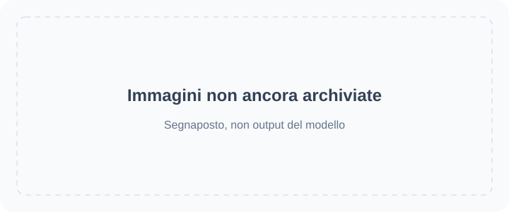

<!-- Generated by scripts/build_readme.py. Edit source data, locale catalogs and generator scripts. -->

# 🎨 Awesome GPT Image 2.6

Una raccolta aperta di prompt, esempi visivi e fonti originali per GPT Image 2.6.

    

⚠️ **Avviso sul copyright**: I prompt e i contenuti multimediali di questa raccolta provengono da fonti pubbliche e sono raccolti esclusivamente a fini educativi. Se ritieni che un contenuto violi i tuoi diritti, per favore [apri una segnalazione](https://github.com/RaphaelAI-OpenLab/awesome-gpt-image-2-6/issues/new), e lo rimuoveremo immediatamente.

    
    
    
   

---

Questa versione linguistica traduce l’interfaccia del repository. I dettagli completi dei casi sono attualmente disponibili in inglese e in cinese semplificato.

I titoli, le descrizioni e le pagine di dettaglio dei casi vengono mostrati in inglese quando non è disponibile una traduzione. I prompt originali e le citazioni delle fonti non vengono tradotti.

**Collegamenti rapidi** · [🖼️ Sfoglia i casi](#all-cases) · [🆕 Aggiunti di recente](#latest) · [📝 Aggiungi un esempio](https://github.com/RaphaelAI-OpenLab/awesome-gpt-image-2-6/issues/new?template=submit-case.yml) · [🐞 Segnala un problema](https://github.com/RaphaelAI-OpenLab/awesome-gpt-image-2-6/issues/new?template=report-problem.yml) · [📚 Leggi la guida](CONTRIBUTING.md)

## 🌐 Sfoglia la raccolta

**[Sfoglia tutti i casi di questo repository →](#all-cases)**

Ogni caso qui sotto apre una pagina di dettaglio interna con riscontri sul modello, attribuzione delle fonti e disponibilità del prompt.

**SEGNAPOSTO · URL della galleria web esterna: non configurato.**

**SEGNAPOSTO · Collegamento alla generazione con un clic: non verificato.**

SEGNAPOSTO · Collegamento a raccolta / campagna correlata: da aggiungere.

[Visita Raphael (pagina iniziale)](https://raphael.app/?utm_source=github&utm_medium=repository&utm_campaign=gpt_image_2_6_launch&utm_content=top_nav&utm_term=it-IT)

## 🏷️ Sfoglia per categoria

| Categoria | Casi con collegamenti alle fonti | Prompt completi |
| --- | ---: | ---: |
| [Immagini per marchi e prodotti](#category-brand-products) | 15 | 0 |
| [Poster e tipografia](#category-posters-typography) | 15 | 0 |
| [Infografiche](#category-infographics) | 7 | 0 |
| [Interni e architettura](#category-interiors-architecture) | 3 | 0 |
| [Personaggi e coerenza](#category-characters-consistency) | 19 | 0 |
| [Annotazioni e modifiche mirate](#category-markup-edits) | 12 | 0 |
| [SVG e risorse grafiche](#category-svg-design-assets) | 6 | 0 |
| [GIF e animazione](#category-gif-animation) | 14 | 0 |

## 📖 Indice

- [Che cos’è GPT Image 2.6?](#about)
- [Statistiche](#statistics)
- [Casi in evidenza](#featured)
- [Aggiunti di recente](#latest)
- [Tutti i casi](#all-cases)
- [Prompt completi](#collection)
- [Come si usa](#using)
- [Contribuisci](#contribute)
- [Licenza](#license)
- [Ringraziamenti](#acknowledgements)
- [Cronologia delle stelle](#star-history)

## 🤔 Che cos’è GPT Image 2.6?

OpenAI ha presentato Images 2.6 il 4 novembre 2026. Questa raccolta comprende le varianti del modello Sunburst e Flare, la creazione e la modifica di immagini, oltre ai workflow SVG e GIF documentati. Il supporto delle varianti viene documentato per ogni caso, anziché dato per scontato.

[Annuncio ufficiale](https://openai.com/index/introducing-images-2-6/) · [Documentazione del modello](https://developers.openai.com/api/docs/guides/image-generation)

## 📊 Statistiche

| Metrica | Conteggio / data |
| --- | ---: |
| Casi con collegamenti alle fonti | **91** |
| Esempi ufficiali | **37** |
| Esempi dichiarati dai creatori | **54** |
| Prompt originali disponibili alla fonte | **68** |
| Prompt completi pubblicati qui | **0** |
| File multimediali archiviati localmente | **153** |
| Ultima verifica delle fonti (UTC) | **2026-11-06** |

I conteggi delle fonti non attestano una riproduzione. Le piste in sospeso sono escluse; output diversi all’interno di un singolo workflow contano come un solo caso.

## 🔥 Casi in evidenza

<table>
<tr>
<td width="33%" align="center"><a href="cases/docs-bakery-svg/README.md"> <strong>Bakery SVG logo</strong></a> Documentazione ufficiale</td>
<td width="33%" align="center"><a href="cases/docs-lantern-gif/README.md"> <strong>Lantern-carrying monkey loop</strong></a> Documentazione ufficiale</td>
<td width="33%" align="center"><a href="cases/launch-fal/README.md"> <strong>Living-room markup edit</strong></a> Demo ufficiale di lancio</td>
</tr>
<tr>
<td width="33%" align="center"><a href="cases/launch-sable/README.md"> <strong>Miniature brand product world</strong></a> Demo ufficiale di lancio</td>
<td width="33%" align="center"><a href="cases/launch-higgsfield/README.md"> <strong>Knight scene and clothing edit sequence</strong></a> Demo ufficiale di lancio</td>
<td width="33%" align="center"><a href="cases/community-malfoid/README.md"> <strong>Summer character illustration animation</strong></a> Modello dichiarato dal creatore</td>
</tr>
</table>

Le schede segnaposto non sono risultati generati. Tutti i file multimediali visualizzati si trovano in questo repository; i contenuti non ancora archiviati rimangono collegati nelle pagine di dettaglio.

## 🆕 Aggiunti di recente

| Aggiunto il | Caso | Riscontri |
| --- | --- | --- |
| 2026-11-06 | [Morphed: bubblegum pop and reset loop](cases/morphed-bubblegum-loop/README.md) | Modello dichiarato dal creatore |
| 2026-11-06 | [Stock-market kitten meme: three GIF iterations](cases/community-greta-stock-kitten-iterations/README.md) | Modello dichiarato dal creatore |
| 2026-11-05 | [Rocking KINGY LAB bottle GIF](cases/kingy-sunburst-bottle-rocking/README.md) | Modello dichiarato dal creatore |
| 2026-11-05 | [Made Window lettering](cases/made-sunburst-shop-window/README.md) | Modello dichiarato dal creatore |
| 2026-11-05 | [Made Listening booth](cases/made-sunburst-listening-booth/README.md) | Modello dichiarato dal creatore |
| 2026-11-05 | [Made Exploded diagram](cases/made-sunburst-turntable-diagram/README.md) | Modello dichiarato dal creatore |

## 📋 Tutti i casi

### Immagini per marchi e prodotti

| Caso · pagina di dettaglio interna | Fonte | Prompt |
| --- | --- | --- |
| [Transparent bakery raster logo](cases/docs-bakery-raster/README.md) | Documentazione ufficiale | Prompt originale alla fonte |
| [Transparent product cutout](cases/docs-product-cutout/README.md) | Documentazione ufficiale | Prompt originale alla fonte |
| [Toy airplane packaging](cases/docs-toy-package/README.md) | Documentazione ufficiale | Prompt originale alla fonte |
| [Miniature brand product world](cases/launch-sable/README.md) | Demo ufficiale di lancio | Prompt originale alla fonte |
| [Travel visual generation speed comparison](cases/launch-travel/README.md) | Demo ufficiale di lancio | Prompt non pubblico |
| [Laptop GIF-creation workspace illustration](cases/techrepublic-gif-workspace-illustration/README.md) | Modello dichiarato dal creatore | Prompt non pubblico |
| [Tovalin serum scene comparison](cases/productai-tovalin-serum-comparison/README.md) | Modello dichiarato dal creatore | Prompt non pubblico |
| [Quillhaven coffee scenes and precise edits](cases/productai-quillhaven-coffee-comparison/README.md) | Modello dichiarato dal creatore | Prompt non pubblico |
| [Running-shoe scenes and precise edits](cases/productai-running-shoe-comparison/README.md) | Modello dichiarato dal creatore | Prompt non pubblico |
| [Cable-knit cardigan on a model](cases/productai-cable-knit-cardigan-comparison/README.md) | Modello dichiarato dal creatore | Prompt non pubblico |
| [Oaken Mile Coffee label: Flare and Sunburst](cases/community-moss-coffee-label/README.md) | Modello dichiarato dal creatore | Prompt originale alla fonte |
| [Cafe latte: Flare and Sunburst](cases/community-lightlyn-latte-variants/README.md) | Modello dichiarato dal creatore | Prompt originale alla fonte |
| [Earbud product-ad comparison](cases/community-lightlyn-earbuds-ad-variants/README.md) | Modello dichiarato dal creatore | Prompt originale alla fonte |
| [Made Takeaway box](cases/made-flare-dumpling-box/README.md) | Modello dichiarato dal creatore | Prompt originale alla fonte |
| [Made Stylus macro](cases/made-sunburst-stylus-macro/README.md) | Modello dichiarato dal creatore | Prompt originale alla fonte |

### Poster e tipografia

| Caso · pagina di dettaglio interna | Fonte | Prompt |
| --- | --- | --- |
| [Streetwear advertisement typography](cases/docs-streetwear/README.md) | Documentazione ufficiale | Prompt originale alla fonte |
| [Roadside shampoo billboard](cases/docs-billboard/README.md) | Documentazione ufficiale | Prompt originale alla fonte |
| [Nostalgic holiday card](cases/docs-holiday-card/README.md) | Documentazione ufficiale | Prompt originale alla fonte |
| [Shiba ramen shop: two quality comparison runs](cases/ai-garage-ramen-quality-series/README.md) | Modello dichiarato dal creatore | Prompt non pubblico |
| [Autumn café menu announcement comparison](cases/ai-garage-autumn-cafe/README.md) | Modello dichiarato dal creatore | Prompt non pubblico |
| [Flare 4K test, published previews](cases/aivideos-flare-4k-comparison/README.md) | Modello dichiarato dal creatore | Prompt non pubblico |
| [Flare quality and planning comparison](cases/aivideos-flare-quality-planning/README.md) | Modello dichiarato dal creatore | Prompt non pubblico |
| [Retro diner menu board](cases/dreamega-retro-diner/README.md) | Modello dichiarato dal creatore | Prompt originale alla fonte |
| [Lantern Row Night Market flyer: Flare and Sunburst](cases/community-moss-night-market-flyer/README.md) | Modello dichiarato dal creatore | Prompt originale alla fonte |
| [Café breakfast menu: Flare and Sunburst](cases/community-moss-breakfast-menu/README.md) | Modello dichiarato dal creatore | Prompt originale alla fonte |
| [Pottery event banner layout: Flare and Sunburst](cases/community-moss-pottery-banner-layout/README.md) | Modello dichiarato dal creatore | Prompt originale alla fonte |
| [Night market poster comparison](cases/community-lightlyn-night-market-variants/README.md) | Modello dichiarato dal creatore | Prompt originale alla fonte |
| [Made Lightbox menu](cases/made-flare-noodle-menu/README.md) | Modello dichiarato dal creatore | Prompt originale alla fonte |
| [Made Sleeve typography](cases/made-sunburst-record-sleeve/README.md) | Modello dichiarato dal creatore | Prompt originale alla fonte |
| [Made Window lettering](cases/made-sunburst-shop-window/README.md) | Modello dichiarato dal creatore | Prompt originale alla fonte |

### Infografiche

| Caso · pagina di dettaglio interna | Fonte | Prompt |
| --- | --- | --- |
| [Coffee-machine process diagram](cases/docs-coffee-diagram/README.md) | Documentazione ufficiale | Prompt originale alla fonte |
| [Cellular respiration teaching visual](cases/docs-cell-respiration/README.md) | Documentazione ufficiale | Prompt originale alla fonte |
| [Market-size presentation slide](cases/docs-pitch-slide/README.md) | Documentazione ufficiale | Prompt originale alla fonte |
| [Northfield Design Summit agenda: Flare and Sunburst](cases/community-moss-design-summit-agenda/README.md) | Modello dichiarato dal creatore | Prompt originale alla fonte |
| [Honeybee scientific scale layouts](cases/community-lightlyn-bee-scale-variants/README.md) | Modello dichiarato dal creatore | Prompt originale alla fonte |
| [Made Illustrated map](cases/made-flare-market-map/README.md) | Modello dichiarato dal creatore | Prompt originale alla fonte |
| [Made Exploded diagram](cases/made-sunburst-turntable-diagram/README.md) | Modello dichiarato dal creatore | Prompt originale alla fonte |

### Interni e architettura

| Caso · pagina di dettaglio interna | Fonte | Prompt |
| --- | --- | --- |
| [Replace chairs in an interior](cases/docs-room-chairs/README.md) | Documentazione ufficiale | Prompt originale alla fonte |
| [Living-room markup edit](cases/launch-fal/README.md) | Demo ufficiale di lancio | Prompt originale alla fonte |
| [Made Ultra-wide aisle](cases/made-flare-market-aerial/README.md) | Modello dichiarato dal creatore | Prompt originale alla fonte |

### Personaggi e coerenza

| Caso · pagina di dettaglio interna | Fonte | Prompt |
| --- | --- | --- |
| [Paper-cut championship scene: complexity comparison](cases/docs-complexity/README.md) | Documentazione ufficiale | Prompt originale alla fonte |
| [Realistic fishing-boat sailor portrait](cases/docs-sailor/README.md) | Documentazione ufficiale | Prompt originale alla fonte |
| [1969 historical crowd scene](cases/docs-historical-crowd/README.md) | Documentazione ufficiale | Prompt originale alla fonte |
| [Four-panel pet comic](cases/docs-pet-comic/README.md) | Documentazione ufficiale | Prompt originale alla fonte |
| [Change clothing while preserving identity](cases/docs-outfit/README.md) | Documentazione ufficiale | Prompt originale alla fonte |
| [Place a person into a camping escape scene](cases/docs-person-scene/README.md) | Documentazione ufficiale | Prompt originale alla fonte |
| [Establish a storybook character](cases/docs-character-start/README.md) | Documentazione ufficiale | Prompt originale alla fonte |
| [Continue the same character’s story](cases/docs-character-story/README.md) | Documentazione ufficiale | Prompt originale alla fonte |
| [Stained-glass whale](cases/launch-picsart/README.md) | Demo ufficiale di lancio | Prompt non pubblico |
| [Knight scene and clothing edit sequence](cases/launch-higgsfield/README.md) | Demo ufficiale di lancio | Prompt originale alla fonte |
| [Ophanim-inspired still: The Coastal Lookout](cases/community-ophanim-coastal-lookout/README.md) | Modello dichiarato dal creatore | Prompt originale alla fonte |
| [Ophanim-inspired still: The Mountain Reservoir](cases/community-ophanim-mountain-reservoir/README.md) | Modello dichiarato dal creatore | Prompt originale alla fonte |
| [Ophanim-inspired still: The Village in the Rain](cases/community-ophanim-village-rain/README.md) | Modello dichiarato dal creatore | Prompt originale alla fonte |
| [Ophanim-inspired still: The Subway Entrance](cases/community-ophanim-subway-entrance/README.md) | Modello dichiarato dal creatore | Prompt originale alla fonte |
| [Fisherman at dawn: Flare and Sunburst](cases/community-moss-fisherman-dawn/README.md) | Modello dichiarato dal creatore | Prompt originale alla fonte |
| [Made Vendor portrait](cases/made-flare-vendor-flash/README.md) | Modello dichiarato dal creatore | Prompt originale alla fonte |
| [Made Rainy night](cases/made-flare-rain-stall/README.md) | Modello dichiarato dal creatore | Prompt originale alla fonte |
| [Made Crate digger](cases/made-sunburst-crate-digger/README.md) | Modello dichiarato dal creatore | Prompt originale alla fonte |
| [Made Listening booth](cases/made-sunburst-listening-booth/README.md) | Modello dichiarato dal creatore | Prompt originale alla fonte |

### Annotazioni e modifiche mirate

| Caso · pagina di dettaglio interna | Fonte | Prompt |
| --- | --- | --- |
| [Recolor a marked vase](cases/docs-vase-markup/README.md) | Documentazione ufficiale | Prompt originale alla fonte |
| [Translate an infographic into Spanish](cases/docs-spanish-edit/README.md) | Documentazione ufficiale | Prompt originale alla fonte |
| [Transfer a pixel-art style](cases/docs-pixel-style/README.md) | Documentazione ufficiale | Prompt originale alla fonte |
| [Combine pets across images](cases/docs-dog-composite/README.md) | Documentazione ufficiale | Prompt originale alla fonte |
| [Turn a sketch into a realistic scene](cases/docs-sketch-render/README.md) | Documentazione ufficiale | Prompt originale alla fonte |
| [Remove a held flower](cases/docs-remove-flower/README.md) | Documentazione ufficiale | Prompt originale alla fonte |
| [Change the billboard scene to a snowy night](cases/docs-snow-edit/README.md) | Documentazione ufficiale | Prompt originale alla fonte |
| [Shiba chef festival background edit](cases/ai-garage-festival-background/README.md) | Modello dichiarato dal creatore | Prompt originale alla fonte |
| [Red chef hat despite conflicting markup](cases/ai-garage-red-chef-hat/README.md) | Modello dichiarato dal creatore | Prompt originale alla fonte |
| [Mirror reflection costume edit](cases/dreamega-mirror-reflection/README.md) | Modello dichiarato dal creatore | Prompt non pubblico |
| [Miniature city inside a piano](cases/dreamega-piano-city/README.md) | Modello dichiarato dal creatore | Prompt non pubblico |
| [Recolor a sofa in a living room](cases/community-lightlyn-sofa-edit-variants/README.md) | Modello dichiarato dal creatore | Prompt originale alla fonte |

### SVG e risorse grafiche

| Caso · pagina di dettaglio interna | Fonte | Prompt |
| --- | --- | --- |
| [Bakery SVG logo](cases/docs-bakery-svg/README.md) | Documentazione ufficiale | Prompt originale alla fonte |
| [Farmers market mobile interface](cases/docs-market-ui/README.md) | Documentazione ufficiale | Prompt originale alla fonte |
| [Bear mascot: SVG versus PNG previews](cases/community-bear-svg-comparison/README.md) | Modello dichiarato dal creatore | Prompt non pubblico |
| [Harbor Roast vector logo](cases/community-lightlyn-coffee-logo-svg/README.md) | Modello dichiarato dal creatore | Prompt originale alla fonte |
| [Six weather icons as SVG](cases/community-lightlyn-weather-icons-svg/README.md) | Modello dichiarato dal creatore | Prompt originale alla fonte |
| [Turn a cafe photo into vector art](cases/community-lightlyn-latte-vector-svg/README.md) | Modello dichiarato dal creatore | Prompt originale alla fonte |

### GIF e animazione

| Caso · pagina di dettaglio interna | Fonte | Prompt |
| --- | --- | --- |
| [Lantern-carrying monkey loop](cases/docs-lantern-gif/README.md) | Documentazione ufficiale | Prompt originale alla fonte |
| [Office character: falling stock GIF](cases/launch-openart-down/README.md) | Demo ufficiale di lancio | Prompt originale alla fonte |
| [Office character: rising stock GIF](cases/launch-openart-up/README.md) | Demo ufficiale di lancio | Prompt originale alla fonte |
| [Owl sketch to animation](cases/launch-owl/README.md) | Demo ufficiale di lancio | Prompt non pubblico |
| [Monty typing indicator animation](cases/launch-town/README.md) | Demo ufficiale di lancio | Prompt non pubblico |
| [Summer character illustration animation](cases/community-malfoid/README.md) | Modello dichiarato dal creatore | Prompt non pubblico |
| [Images 2.6 brings GIF(T)S :D](cases/community-gifts/README.md) | Modello dichiarato dal creatore | Prompt non pubblico |
| [Boxing tiger animation](cases/community-boxing-tiger/README.md) | Modello dichiarato dal creatore | Prompt non pubblico |
| [Hummingbird and kingfisher animation variants](cases/community-hummingbird-variants/README.md) | Modello dichiarato dal creatore | Prompt non pubblico |
| [Rosebud animation](cases/community-rosebud-animation/README.md) | Modello dichiarato dal creatore | Prompt non pubblico |
| [Shiba chef waving loop](cases/ai-garage-shiba-wave/README.md) | Modello dichiarato dal creatore | Prompt non pubblico |
| [Stock-market kitten meme: three GIF iterations](cases/community-greta-stock-kitten-iterations/README.md) | Modello dichiarato dal creatore | Prompt originale alla fonte |
| [Morphed: bubblegum pop and reset loop](cases/morphed-bubblegum-loop/README.md) | Modello dichiarato dal creatore | Prompt originale alla fonte |
| [Rocking KINGY LAB bottle GIF](cases/kingy-sunburst-bottle-rocking/README.md) | Modello dichiarato dal creatore | Disponibilità del prompt non verificata |

[Registro delle ricerche, rapporto sui contenuti multimediali e piste non risolte](docs/CASE_GALLERY.md)

## 📝 Prompt completi

Qui non sono ancora stati ripubblicati prompt completi. Le pagine dei casi rimandano ai veri prompt originali quando sono pubblici e segnalano esplicitamente quelli mancanti. Una voce con un collegamento alla fonte non è una voce con un prompt da copiare.

## 📚 Come si usa

1. Apri un caso da una categoria o da una scheda in evidenza.
2. Consulta i riscontri sul modello, gli input richiesti, la fonte e i limiti di riutilizzo.
3. Segui il collegamento al prompt originale quando è disponibile. Un prompt mancante rimane tale; non dedurlo da un’immagine.

## 🤝 Come contribuire

Aggiungi casi con collegamenti alle fonti a content/source-cases.json. Aggiungi prompt completi e riutilizzabili a content/prompts.json. Il generatore crea entrambe le versioni linguistiche e le pagine interne a partire da questi set di dati.

[Guida ai contributi](CONTRIBUTING.md) · [Guida ai casi documentati e ai contenuti multimediali](docs/SOURCE_CASES.md) · [Guida per i manutentori (cinese)](docs/FILLING_GUIDE.zh-CN.md)

## 📄 Licenza

Il codice, la documentazione originale e i segnaposto SVG decorativi sono distribuiti con licenza MIT. I prompt e i contenuti multimediali di terzi mantengono i propri termini, con provenienza e stato di riutilizzo documentati per ogni elemento. L’attribuzione del layout README adattato è riportata separatamente di seguito.

[Licenza del repository](LICENSE)

## 🙏 Ringraziamenti

La struttura del README è adattata da awesome-nano-banana-pro-prompts di YouMind OpenLab, con licenza CC BY 4.0. È stata adattata per GPT Image 2.6 con nuovi testi, dati, pagine di dettaglio locali e segnaposto espliciti; non sono stati copiati esempi creativi né contenuti multimediali.

[YouMind README](https://github.com/YouMind-OpenLab/awesome-nano-banana-pro-prompts/blob/main/README_zh.md) · [CC BY 4.0](https://creativecommons.org/licenses/by/4.0/) · [Note sull’attribuzione](docs/ATTRIBUTION.md)

Grazie a OpenAI e ai creatori originali citati in ogni pagina dei casi.

## ⭐ Cronologia delle stelle

[Cronologia delle stelle](https://star-history.com/#RaphaelAI-OpenLab/awesome-gpt-image-2-6&Date) · [Visualizza chi ha aggiunto una stella](https://github.com/RaphaelAI-OpenLab/awesome-gpt-image-2-6/stargazers)

[Aggiungi una stella / segui questo repository](https://github.com/RaphaelAI-OpenLab/awesome-gpt-image-2-6)

[↑ Torna in alto](#top)

---

A cura di Raphael. [Pagina iniziale](https://raphael.app/?utm_source=github&utm_medium=repository&utm_campaign=gpt_image_2_6_launch&utm_content=footer&utm_term=it-IT)

Generato da dati di origine strutturati. Modifica i set di dati e rigenera il file; non modificare direttamente questo file.
