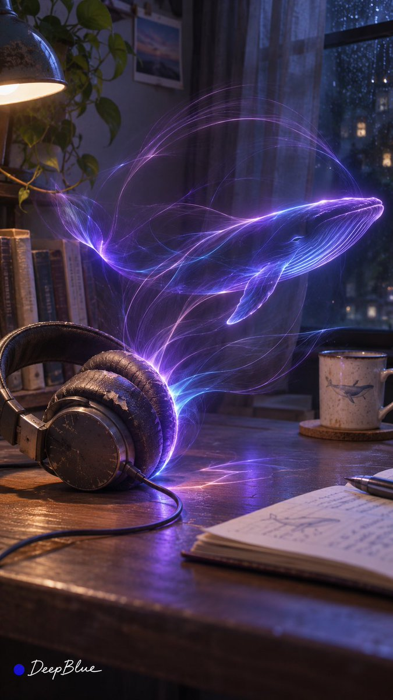
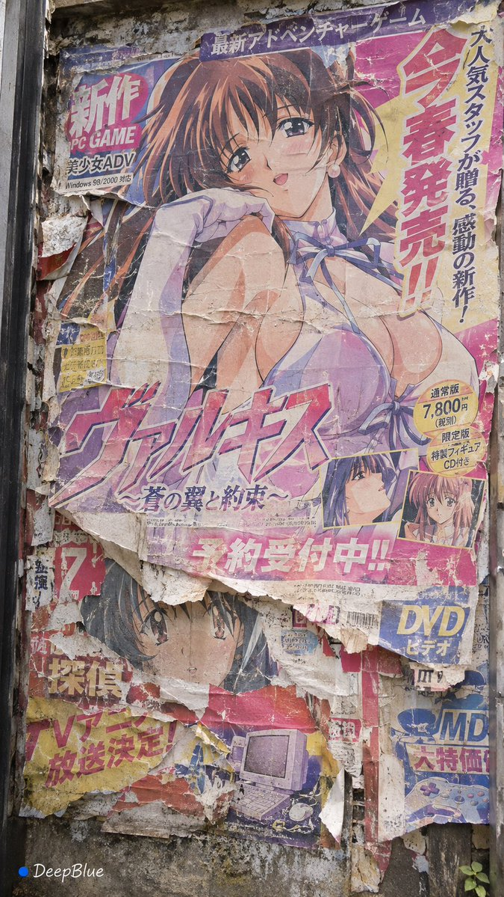
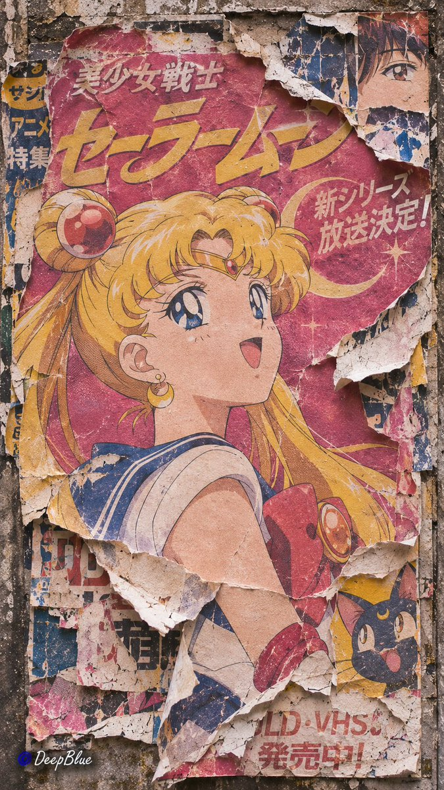
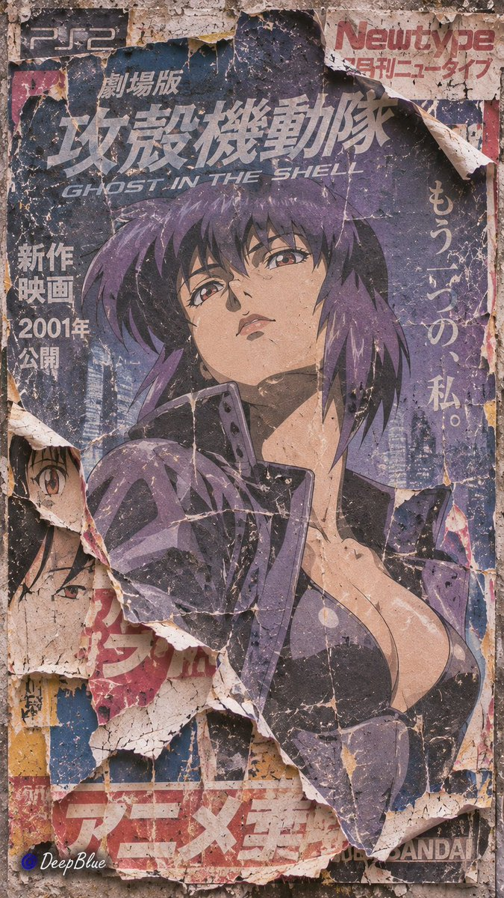
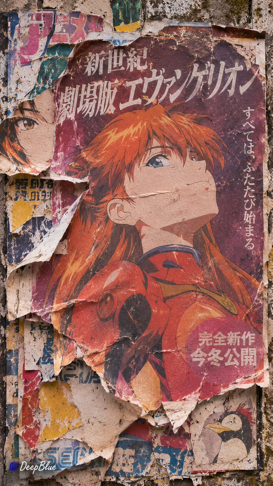
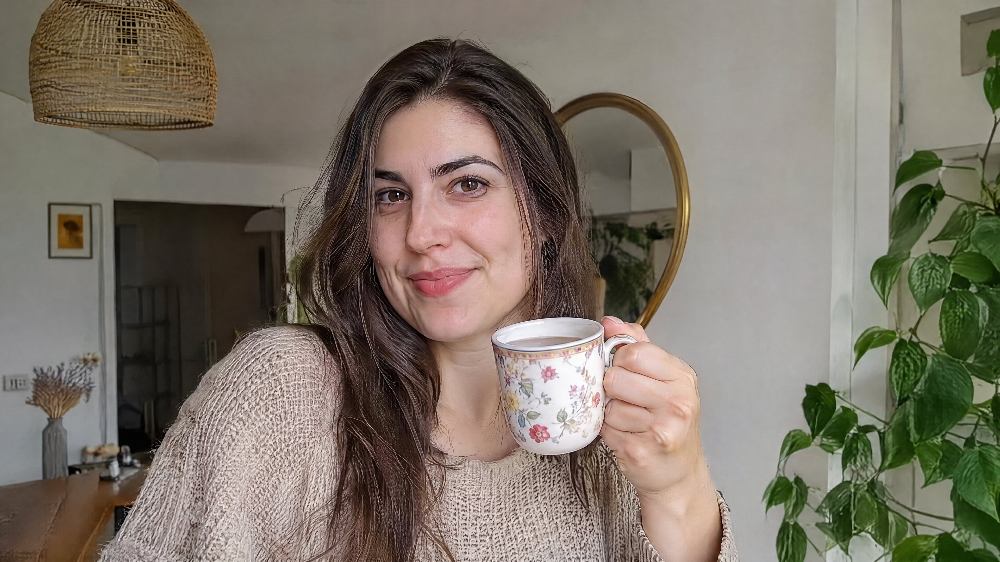
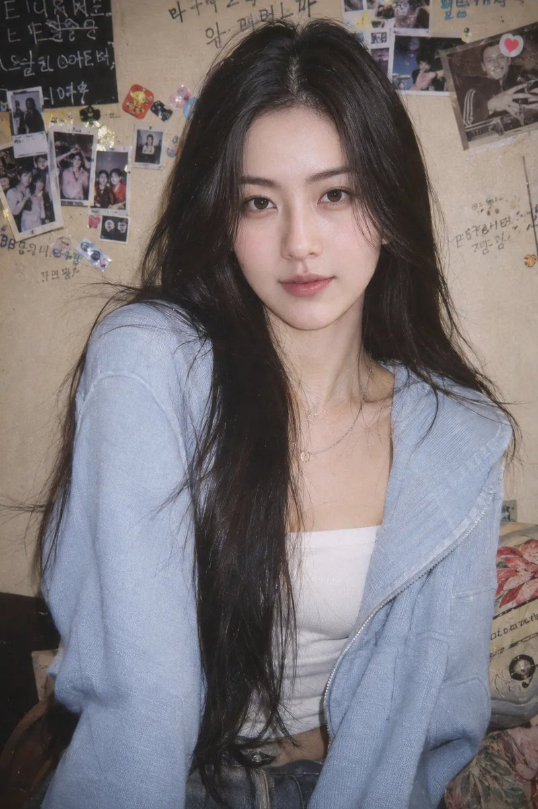
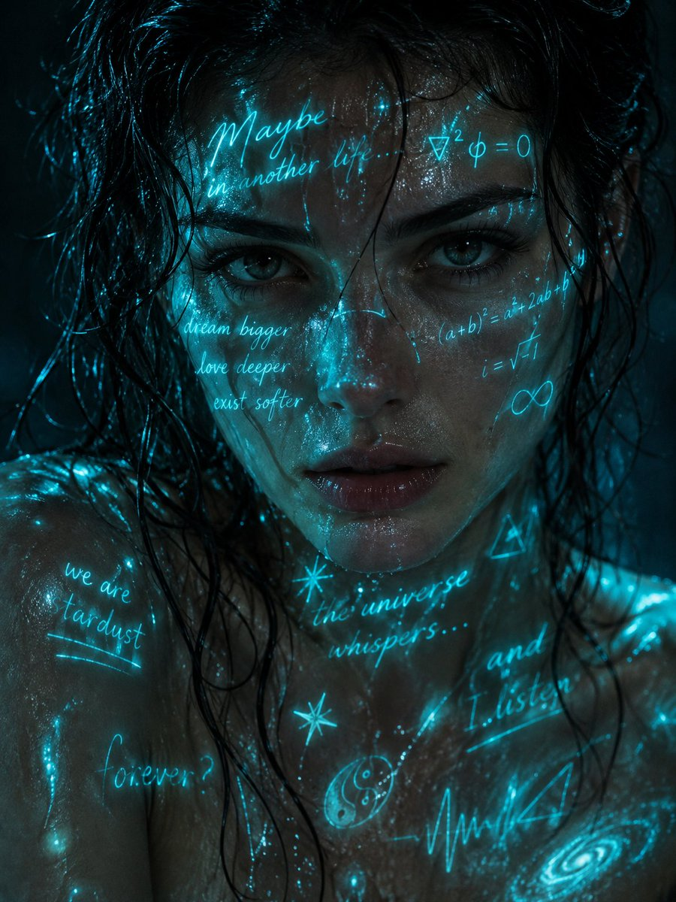

<!-- Generated by scripts/build_readme.py. Edit source data, locale catalogs and generator scripts. -->

<a id="top"></a>

[](https://raphael.app/?utm_source=github&utm_medium=repository&utm_campaign=gpt_image_2_6_launch&utm_content=hero&utm_term=ja-JP)

# 🎨 Awesome GPT Image 2.6

GPT Image 2.6 のプロンプト、作例、原典を集めたオープンなコレクションです。

<a href="LICENSE"></a> <a href="docs/ATTRIBUTION.md"></a> <a href="CONTRIBUTING.md"></a> <a href="https://github.com/RaphaelAI-OpenLab/awesome-gpt-image-2-6/actions/workflows/validate.yml"></a> <a href="https://github.com/RaphaelAI-OpenLab/awesome-gpt-image-2-6"></a>

⚠️ **著作権に関するお知らせ**: このコレクションのプロンプトとメディアは、教育目的に限り公開情報から収集しています。権利を侵害する内容が含まれているとお考えの場合は、 [Issue を作成してください](https://github.com/RaphaelAI-OpenLab/awesome-gpt-image-2-6/issues/new)。直ちに削除いたします。

<a href="README.md"></a> <a href="README.zh-CN.md"></a> <a href="README.zh-TW.md"></a> <a href="README.ja-JP.md"></a><br />
<a href="README.ko-KR.md"></a> <a href="README.th-TH.md"></a> <a href="README.vi-VN.md"></a> <a href="README.hi-IN.md"></a><br />
<a href="README.es-ES.md"></a> <a href="README.es-419.md"></a> <a href="README.de-DE.md"></a> <a href="README.fr-FR.md"></a><br />
<a href="README.it-IT.md"></a> <a href="README.pt-BR.md"></a> <a href="README.pt-PT.md"></a> <a href="README.tr-TR.md"></a>

---

この言語版では、リポジトリのインターフェースを翻訳しています。事例の詳細全文は現在、英語と簡体字中国語で提供しています。

事例のタイトル、説明、詳細ページに翻訳がない場合は英語で表示されます。原文プロンプトと出典からの引用は翻訳しません。

**クイックリンク** · [🖼️ 事例を見る](#all-cases) · [🆕 最近の追加](#latest) · [📝 作例を追加](https://github.com/RaphaelAI-OpenLab/awesome-gpt-image-2-6/issues/new?template=submit-case.yml) · [🐞 問題を報告](https://github.com/RaphaelAI-OpenLab/awesome-gpt-image-2-6/issues/new?template=report-problem.yml) · [📚 ガイドを読む](CONTRIBUTING.md)

<a id="gallery"></a>

## 🌐 コレクションを見る

**[このリポジトリのすべての事例を見る →](#all-cases)**

以下で画像と元のプロンプトを閲覧・コピーできます。各事例の末尾に作者と出典を記載しています。

[外部サイト素材アーカイブ（分類・統計の対象外）](external-sites/README.md)

**プレースホルダー · 外部ウェブギャラリーの URL：未設定。**

**プレースホルダー · ワンクリック生成リンク：未検証。**

プレースホルダー · 関連コレクション / キャンペーンのリンク：追加予定。

[Raphael のホームページへ](https://raphael.app/?utm_source=github&utm_medium=repository&utm_campaign=gpt_image_2_6_launch&utm_content=top_nav&utm_term=ja-JP)

<a id="categories"></a>

## 🏷️ カテゴリーから探す

| カテゴリー | 出典リンク付き事例 | 完全なプロンプト |
| --- | ---: | ---: |
| [ブランド・製品ビジュアル](#category-brand-products) | 8 | 7 |
| [ポスター・タイポグラフィ](#category-posters-typography) | 9 | 7 |
| [インフォグラフィック](#category-infographics) | 3 | 3 |
| [インテリア・建築](#category-interiors-architecture) | 3 | 2 |
| [キャラクターと一貫性](#category-characters-consistency) | 18 | 15 |
| [マークアップ・部分編集](#category-markup-edits) | 9 | 8 |
| [SVG・デザイン素材](#category-svg-design-assets) | 4 | 3 |
| [GIF・アニメーション](#category-gif-animation) | 64 | 54 |

<a id="contents"></a>

## 📖 目次

- [GPT Image 2.6 とは？](#about)
- [統計](#statistics)
- [注目の事例](#featured)
- [最近の追加](#latest)
- [すべての事例](#all-cases)
- [完全なプロンプト](#collection)
- [使い方](#using)
- [貢献する](#contribute)
- [ライセンス](#license)
- [謝辞](#acknowledgements)
- [スター履歴](#star-history)

<a id="about"></a>

## 🤔 GPT Image 2.6 とは？

OpenAI は 2026 年 11 月 4 日に Images 2.6 を発表しました。このコレクションでは、Sunburst と Flare のモデルバリアント、画像の生成・編集、文書化された SVG と GIF のワークフローを扱います。各バリアントの対応状況は推測せず、事例ごとに記録しています。

[公式発表](https://openai.com/index/introducing-images-2-6/) · [モデルのドキュメント](https://developers.openai.com/api/docs/guides/image-generation)

<a id="statistics"></a>

## 📊 統計

| 指標 | 件数 / 日付 |
| --- | ---: |
| 出典リンク付き事例 | **118** |
| 公式の作例 | **37** |
| 作者が報告した作例 | **81** |
| 出典で公開されている原文プロンプト | **92** |
| ここで公開している完全なプロンプト | **99** |
| ローカルに保存済みのメディアファイル | **199** |
| 出典の最終確認日時（UTC） | **2026-11-09** |

出典の件数は再現を主張するものではありません。未確認の調査候補は除外し、同じワークフロー内の異なる出力は 1 件の事例として数えています。

<a id="featured"></a>

## 🔥 注目の事例

<table>
<tr>
<td width="33%" align="center"><a href="#source-case-docs-bakery-svg"><br /><strong>Bakery SVG logo</strong></a><br />公式ドキュメント</td>
<td width="33%" align="center"><a href="#source-case-docs-lantern-gif"><br /><strong>Lantern-carrying monkey loop</strong></a><br />公式ドキュメント</td>
<td width="33%" align="center"><a href="#source-case-launch-fal"><br /><strong>Living-room markup edit</strong></a><br />公式公開デモ</td>
</tr>
<tr>
<td width="33%" align="center"><a href="#source-case-launch-sable"><br /><strong>Miniature brand product world</strong></a><br />公式公開デモ</td>
<td width="33%" align="center"><a href="#source-case-launch-higgsfield"><br /><strong>Knight scene and clothing edit sequence</strong></a><br />公式公開デモ</td>
<td width="33%" align="center"><a href="#source-case-docs-complexity"><br /><strong>Paper-cut championship scene: complexity comparison</strong></a><br />公式ドキュメント</td>
</tr>
</table>

動画プレビューは最初のフレームです。動きを見るにはリンク先のファイルを開いてください。参照画像と元のポスターは個別に表示しています。

<a id="latest"></a>

## 🆕 最近の追加

| 追加日 | 事例 | 根拠 |
| --- | --- | --- |
| 2026-11-09 | [Weathered millennium-era anime and game posters](#source-case-social-tifa-lockhart-peeling-poster) | 作者申告のモデル |
| 2026-11-09 | [Everyday objects transformed by coronal light trails](#source-case-social-perfume-dancer-light-trails) | 作者申告のモデル |
| 2026-11-09 | [Glowing cyan poetry and equations on wet skin](#source-case-social-cyan-poetry-wet-portrait) | 作者申告のモデル |
| 2026-11-09 | [Woman in light blue sweatshirt before polaroid wall](#source-case-social-90s-film-snapshot-woman) | 作者申告のモデル |
| 2026-11-09 | [Woman holding floral tea mug indoors](#source-case-social-woman-holding-tea-mug) | 作者申告のモデル |
| 2026-11-09 | [Cartoon bee posts to X for daily check-in](#source-case-social-diligent-bee-daily-checkin-gif) | 作者申告のモデル |

<a id="all-cases"></a>

## 📋 すべての事例

<a id="collection"></a>

元のプロンプトは原文のまま掲載しています。未公開・未確認の場合は明記し、画像から推測して補いません。

<a id="category-brand-products"></a>

### ブランド・製品ビジュアル

<a id="source-case-docs-bakery-raster"></a>

#### 1. Transparent bakery raster logo

<table>
<tr>
<td align="center"><a href="assets/examples/docs-bakery-raster/logo-generation-1-gpt-image-2-6-flare.webp"></a><br /><sub>GPT Image 2.6 Flare output: Flare raster logo with a loaf above curved field rows and the stacked Field &amp; Flour wordmark.</sub></td>
<td align="center"><a href="assets/examples/docs-bakery-raster/logo-generation-1-gpt-image-2-6-sunburst.webp"></a><br /><sub>GPT Image 2.6 Sunburst output: Sunburst raster logo with golden wheat flanking a loaf above the Field &amp; Flour wordmark.</sub></td>
</tr>
</table>

**原文プロンプト**

```text
Create an original, non-infringing logo for a company called Field & Flour, a local bakery.
The logo should feel warm, simple, and timeless. Use clean, vector-like shapes, a strong silhouette, and balanced negative space.
Favor simplicity over detail so it reads clearly at small and large sizes. Flat design, minimal strokes, no gradients unless essential.
Fully transparent background. Deliver a single centered logo with generous padding, clean alpha edges, and no solid backdrop, scenery, checkerboard, or watermark.
```

[出典にある原文プロンプト](https://developers.openai.com/api/docs/guides/image-prompting#design-a-reusable-logo)

**作者**: [OpenAI](https://developers.openai.com/api/docs/guides/image-prompting#design-a-reusable-logo)

**原典**: [公式ドキュメント](https://developers.openai.com/api/docs/guides/image-prompting#design-a-reusable-logo) · [出典の詳細](cases/docs-bakery-raster/README.md)

---

<a id="source-case-docs-product-cutout"></a>

#### 2. Transparent product cutout

<table>
<tr>
<td align="center"><a href="assets/examples/docs-product-cutout/extract-product-gpt-image-2-6-flare.webp"></a><br /><sub>Isolated shampoo bottle on a transparent background — GPT Image 2.6 Flare (official model output)</sub></td>
<td align="center"><a href="assets/examples/docs-product-cutout/extract-product-gpt-image-2-6-sunburst.webp"></a><br /><sub>Isolated shampoo bottle on a transparent background — GPT Image 2.6 Sunburst (official model output)</sub></td>
</tr>
</table>

<details>
<summary>参照画像</summary>

参照用 / 入力用の画像です。生成結果ではありません。

- [Reference input: Original shampoo product photograph](assets/references/docs-product-cutout/shampoo.webp)

</details>

**原文プロンプト**

```text
Extract the product from the input image and isolate it on a fully transparent background.
Output: centered product, crisp silhouette, no halos/fringing.
Preserve product geometry and label legibility exactly.
Add only light polishing. Do not add a solid backdrop, checkerboard, scenery, or shadow.
Do not restyle the product; remove the background and preserve clean alpha transparency.
```

[出典にある原文プロンプト](https://developers.openai.com/api/docs/guides/image-prompting#create-a-transparent-product-cutout)

**作者**: [OpenAI](https://developers.openai.com/api/docs/guides/image-prompting#create-a-transparent-product-cutout)

**原典**: [公式ドキュメント](https://developers.openai.com/api/docs/guides/image-prompting#create-a-transparent-product-cutout) · [出典の詳細](cases/docs-product-cutout/README.md)

---

<a id="source-case-docs-toy-package"></a>

#### 3. Toy airplane packaging

<table>
<tr>
<td align="center"><a href="assets/examples/docs-toy-package/christmas-collectible-toy-airplane-gpt-image-2-6-flare.webp"></a><br /><sub>Collectible toy airplane in holiday packaging — GPT Image 2.6 Flare (official model output)</sub></td>
<td align="center"><a href="assets/examples/docs-toy-package/christmas-collectible-toy-airplane-gpt-image-2-6-sunburst.webp"></a><br /><sub>Collectible toy airplane in holiday packaging — GPT Image 2.6 Sunburst (official model output)</sub></td>
</tr>
</table>

**原文プロンプト**

```text
Create a collectible action figure of a vintage-style toy propeller airplane with rounded wings, a front-mounted spinning propeller, slightly worn paint edges, classic childhood proportions, designed as a nostalgic holiday collectible, in blister packaging.

Concept:
A nostalgic holiday collectible inspired by the simple toy airplanes
children used to play with during winter holidays.
Evokes warmth, imagination, and childhood wonder.

Style:
Premium toy photography, realistic plastic and painted metal textures,
studio lighting, shallow depth of field,
sharp label printing, high-end retail presentation.

Constraints:
- Original design only
- No trademarks
- No watermarks
- No logos

Include ONLY this packaging text (verbatim):
"Christmas Memories Edition"
```

[出典にある原文プロンプト](https://developers.openai.com/api/docs/guides/image-prompting#design-collectible-merchandise)

**作者**: [OpenAI](https://developers.openai.com/api/docs/guides/image-prompting#design-collectible-merchandise)

**原典**: [公式ドキュメント](https://developers.openai.com/api/docs/guides/image-prompting#design-collectible-merchandise) · [出典の詳細](cases/docs-toy-package/README.md)

---

<a id="source-case-launch-sable"></a>

#### 4. Miniature brand product world

<table>
<tr>
<td align="center"><a href="assets/examples/launch-sable/source-01.webp"></a><br /><sub>Source image 1</sub></td>
</tr>
</table>

**原文プロンプト**

```text
Create one exceptional finished presentation slide for Sable, not a layout template. The slide must have one powerful visual idea, the craft of a premium brand campaign and restrained, beautifully readable typography. Image 1 is a reference for the genuine Sable logo, colour palette, and light type ONLY: do not imitate its specimen-sheet layout. Image 2 is the identity reference for Aidan: a white rounded, softly textured head, subtle round spectacles, mustard knit sweater. Preserve his recognizable design when creating a new pose or scene. Aidan is a friendly AI product expert who sees, clicks and explains. The artwork should make this product idea understandable through visual storytelling. Use NB International-style Light/Regular typography, no bold or heavy fonts. Brand colours: #FFDB4D yellow, #F9F9F9 ground, #1B1D1F ink, warm neutral greys. A full black or full yellow brand pop slide is allowed when explicitly requested below. Flat, clean surrounding canvas; no grain, decorative gradients or interface drop shadows. Natural lighting and physical occlusion inside photographic artwork are allowed. Do not create a three-column feature layout, cards, bullet lists, dashboards, stock icon diagrams, a contact sheet or a fake browser screenshot. No generic floating glass panels. No invented metrics, claims, dates or brands. Use only the exact supplied copy and a small authentic Sable logo, with ample safe margins. All text must be legible. Produce the actual full-bleed slide, no external mockup frame.

Art direction: a spectacular, warm, photographically convincing miniature architectural world, shown as one continuous cutaway diorama on a flat #F9F9F9 canvas. A single generous capsule-shaped floor plate curves through three interconnected spaces: a place to explore a product, a hands-on product workshop, and a quiet learning space. The spaces have distinct heights, arches, staircases and tiny abstract product objects that make the scene reward a closer look. They form ONE inhabitable world, not three disconnected models. Aidan is a miniature physical character guiding a single visitor along a clearly continuous route through this world; include just one Aidan and one visitor, with believable scale. A giant yellow disc stands behind the entire architectural silhouette like a sun, while a capsule and circular openings are built into the architecture. Let this rich composition occupy roughly two-thirds of the slide. Beautiful daylight, tactile craftsmanship and elegant restraint, not a busy toy town or a tech isometric icon. Integrate the title in the remaining generous blank space, not on top of intricate architecture. Exact headline on two light-weight lines: "A whole product world" / "One guide". Optional tiny wayfinding inside the three spaces, exactly once each: "Explore", "Try", "Learn". No additional text.
```

The prompt requires two source reference images for the Sable brand and Aidan identity. These inputs are not archived in this case; the output alone is not a complete reproduction kit.

[出典にある原文プロンプト](https://openai.com/index/introducing-images-2-6/#more-ways-to-create-and-edit-in-the-api)

**作者**: [Sable](https://openai.com/index/introducing-images-2-6/#more-ways-to-create-and-edit-in-the-api)

**原典**: [公式公開デモ](https://openai.com/index/introducing-images-2-6/#more-ways-to-create-and-edit-in-the-api) · [出典の詳細](cases/launch-sable/README.md)

---

<a id="source-case-launch-travel"></a>

#### 5. Travel visual generation speed comparison

<table>
<tr>
<td align="center"><a href="assets/examples/launch-travel/source-01.webp"></a><br /><sub>Static poster 1</sub></td>
</tr>
</table>

**原文プロンプト**

**プロンプト非公開**

**作者**: [OpenAI](https://openai.com/index/introducing-images-2-6/)

**原典**: [公式公開デモ](https://openai.com/index/introducing-images-2-6/) · [出典の詳細](cases/launch-travel/README.md)

---

<a id="source-case-community-hn-watchmaker"></a>

#### 6. Watchmaker underwater macro test

<table>
<tr>
<td align="center"><a href="assets/examples/community-hn-watchmaker/output.png"></a><br /><sub>Watchmaker underwater macro test</sub></td>
</tr>
</table>

**原文プロンプト**

```text
A macro close-up photograph of an old watchmaker's hands carefully replacing a tiny gear inside a vintage pocket watch. The watch mechanism is partially submerged in a shallow dish of clear water, causing visible refraction and light caustics across the brass gears. A single drop of water is falling from a pair of steel tweezers, captured mid-splash on the water's surface.
Reflect the watchmaker's face, slightly distorted, in the curved glass of the watch face. Sharp focus throughout, natural window lighting from the left, shot on 100mm macro lens.
```

[出典にある原文プロンプト](https://news.ycombinator.com/item?id=50373686)

**作者**: [neom (Hacker News)](https://news.ycombinator.com/item?id=50373686)

**原典**: [作者申告のモデル](https://news.ycombinator.com/item?id=50373686) · [出典の詳細](cases/community-hn-watchmaker/README.md)

---

<a id="source-case-community-struggle-aurora-perfume"></a>

#### 7. AURORA orange perfume product image

<table>
<tr>
<td align="center"><a href="assets/examples/community-struggle-aurora-perfume/95c77557e2dc3b1d95975cfe16cf3138.png"></a><br /><sub>Orange AURORA perfume bottle with mint</sub></td>
</tr>
</table>

**原文プロンプト**

```text
设计一张高端电商产品主图：一个极简主义的哑光橙色玻璃香水瓶，放置在大理石台面上，周围有几片新鲜薄荷叶点缀，自然柔和侧逆光，瓶身正中心用优雅的无衬线英文字体印着‘AURORA’。
```

[出典にある原文プロンプト](https://tianqi.csdn.net/6aebfbae40858c2d8818a1fd.html#devmenu4)

**作者**: [STRUGGLE_xlf](https://tianqi.csdn.net/6aebfbae40858c2d8818a1fd.html#devmenu4)

**原典**: [作者申告のモデル](https://tianqi.csdn.net/6aebfbae40858c2d8818a1fd.html#devmenu4) · [出典の詳細](cases/community-struggle-aurora-perfume/README.md)

---

<a id="source-case-social-perfume-dancer-light-trails"></a>

#### 8. Everyday objects transformed by coronal light trails

<table>
<tr>
<td align="center"><a href="assets/examples/social-perfume-dancer-light-trails/source-01.jpg"></a><br /><sub>Everyday objects transformed by coronal light trails</sub></td>
<td align="center"><a href="assets/examples/social-perfume-dancer-light-trails/source-02.jpg"></a><br /><sub>Everyday objects transformed by coronal light trails</sub></td>
</tr>
<tr>
<td align="center"><a href="assets/examples/social-perfume-dancer-light-trails/source-03.jpg"></a><br /><sub>Everyday objects transformed by coronal light trails</sub></td>
<td align="center"><a href="assets/examples/social-perfume-dancer-light-trails/source-04.jpg"></a><br /><sub>Everyday objects transformed by coronal light trails</sub></td>
</tr>
</table>

**原文プロンプト**

```text
日常物件 × 隱藏形象 × 日冕弧線 × 超現實靜物攝影

每張獨立選擇一件不同的日常物件，根據它的用途、形態或情緒聯想，設計一個有趣且容易辨認的隱藏形象。

保留物件真實的材質、結構與使用痕跡。讓成束的發光絲線從物件局部延伸、彎曲、交疊，共同暗示隱藏形象的主要輪廓。絲線可以升起、向側面舒展，或環繞物件展開，與物件保持清楚的連接。

借鑒太陽日冕環的視覺形態，用疏密、跨度和亮度各異的弧線塑造形象。概括五官和內部細節，讓部分輪廓自然淡入周圍空間，保留絲線的輕盈與層次。

根據物件、隱藏形象與畫面情緒，自由選擇一種或多種協調的發光顏色。色彩沿絲線自然變化，發光結構在附近物體表面留下相應的細微映光。

根據物件與隱藏形象設計真實的生活場景。自由變化視角、物件位置、形象方向和畫面構圖，讓兩者的關係清楚可見。

竪版 9:16。

左下簽名：深藍色實心圓點在前，白色手寫體 DeepBlue 在後

n=10
```

[原文プロンプト (.txt)](cases/social-perfume-dancer-light-trails/prompt.txt)

[出典にある原文プロンプト](https://x.com/DeepBlueX0/status/2118527529208455403)

**作者**: [DeepBlueX0](https://x.com/DeepBlueX0)

**原典**: [作者申告のモデル](https://x.com/DeepBlueX0/status/2118527529208455403) · [出典の詳細](cases/social-perfume-dancer-light-trails/README.md)

---

<a id="category-posters-typography"></a>

### ポスター・タイポグラフィ

<a id="source-case-docs-streetwear"></a>

#### 9. Streetwear advertisement typography

<table>
<tr>
<td align="center"><a href="assets/examples/docs-streetwear/thread-ad-gpt-image-2-6-flare.webp"></a><br /><sub>Thread streetwear campaign with the requested tagline — GPT Image 2.6 Flare (official model output)</sub></td>
<td align="center"><a href="assets/examples/docs-streetwear/thread-ad-gpt-image-2-6-sunburst.webp"></a><br /><sub>Thread streetwear campaign with the requested tagline — GPT Image 2.6 Sunburst (official model output)</sub></td>
</tr>
</table>

**原文プロンプト**

```text
Give me a cool in culture ad / fashion shot for a brand called Thread.
It's a hip young street brand. The ad shows a group of friends hanging out together with the tagline "Yours to Create."
Make it feel like a polished campaign image for a youth streetwear audience: stylish, contemporary, energetic, and tasteful.
Use clean composition, strong color direction, natural poses, and premium fashion photography cues.
Render the tagline exactly once, clearly and legibly, integrated into the ad layout.
No extra text, no watermarks, no unrelated logos.
```

[出典にある原文プロンプト](https://developers.openai.com/api/docs/guides/image-prompting#render-exact-text)

**作者**: [OpenAI](https://developers.openai.com/api/docs/guides/image-prompting#render-exact-text)

**原典**: [公式ドキュメント](https://developers.openai.com/api/docs/guides/image-prompting#render-exact-text) · [出典の詳細](cases/docs-streetwear/README.md)

---

<a id="source-case-docs-billboard"></a>

#### 10. Roadside shampoo billboard

<table>
<tr>
<td align="center"><a href="assets/examples/docs-billboard/billboard-gpt-image-2-6-flare.webp"></a><br /><sub>Shampoo billboard at sunset — GPT Image 2.6 Flare (official model output)</sub></td>
<td align="center"><a href="assets/examples/docs-billboard/billboard-gpt-image-2-6-sunburst.webp"></a><br /><sub>Shampoo billboard at sunset — GPT Image 2.6 Sunburst (official model output)</sub></td>
</tr>
</table>

<details>
<summary>参照画像</summary>

参照用 / 入力用の画像です。生成結果ではありません。

- [Reference input: Original shampoo product photograph](assets/references/docs-billboard/shampoo.webp)

</details>

**原文プロンプト**

```text
Create a realistic billboard mockup of the shampoo on a highway scene during sunset.
Billboard text (EXACT, verbatim, no extra characters):
"Fresh and clean"
Typography: bold sans-serif, high contrast, centered, clean kerning.
Ensure text appears once and is perfectly legible.
No watermarks, no logos.
```

[出典にある原文プロンプト](https://developers.openai.com/api/docs/guides/image-prompting#create-the-starting-image)

**作者**: [OpenAI](https://developers.openai.com/api/docs/guides/image-prompting#create-the-starting-image)

**原典**: [公式ドキュメント](https://developers.openai.com/api/docs/guides/image-prompting#create-the-starting-image) · [出典の詳細](cases/docs-billboard/README.md)

---

<a id="source-case-docs-holiday-card"></a>

#### 11. Nostalgic holiday card

<table>
<tr>
<td align="center"><a href="assets/examples/docs-holiday-card/christmas-holiday-card-teddy-gpt-image-2-6-flare.webp"></a><br /><sub>Holiday card showing a teddy bear by a window — GPT Image 2.6 Flare (official model output)</sub></td>
<td align="center"><a href="assets/examples/docs-holiday-card/christmas-holiday-card-teddy-gpt-image-2-6-sunburst.webp"></a><br /><sub>Holiday card showing a teddy bear by a window — GPT Image 2.6 Sunburst (official model output)</sub></td>
</tr>
</table>

**原文プロンプト**

```text
Create a Christmas holiday card illustration.

Scene:
a cozy Christmas scene with an old teddy bear sitting inside a keepsake box, slightly worn fur, soft stitching repairs, placed near a window with falling snow outside. The scene suggests the child has grown up, but the memories remain.

Mood:
Warm, nostalgic, gentle, emotional.

Style:
Premium holiday card photography, soft cinematic lighting,
realistic textures, shallow depth of field,
tasteful bokeh lights, high print-quality composition.

Constraints:
- Original artwork only
- No trademarks
- No watermarks
- No logos

Include ONLY this card text (verbatim):
"Merry Christmas — some memories never fade."
```

[出典にある原文プロンプト](https://developers.openai.com/api/docs/guides/image-prompting#design-a-holiday-card)

**作者**: [OpenAI](https://developers.openai.com/api/docs/guides/image-prompting#design-a-holiday-card)

**原典**: [公式ドキュメント](https://developers.openai.com/api/docs/guides/image-prompting#design-a-holiday-card) · [出典の詳細](cases/docs-holiday-card/README.md)

---

<a id="source-case-community-flare-slogan-comparison"></a>

#### 12. Birthday cake without extra slogan cards

<table>
<tr>
<td align="center"><a href="assets/examples/community-flare-slogan-comparison/source-01.webp"></a><br /><sub>Original birthday-cake comparison composite: GPT Image 2.6 Flare (High) on the left; GPT Image 2.5 Sunburst with extra slogan cards on the right.</sub></td>
</tr>
</table>

**原文プロンプト**

```text
Generate a beautiful birthday cake
```

Transcribed from the instruction printed in the archived source comparison image.

[出典にある原文プロンプト](https://x.com/DesignArena/status/2118124381155303918)

**作者**: [DesignArena (@DesignArena)](https://x.com/DesignArena)

**原典**: [作者申告のモデル](https://x.com/DesignArena/status/2118124381155303918) · [出典の詳細](cases/community-flare-slogan-comparison/README.md)

---

<a id="source-case-community-struggle-poster-edit"></a>

#### 13. AI evolution poster revised to Image 2.6

<table>
<tr>
<td align="center"><a href="assets/examples/community-struggle-poster-edit/b1a93a6ee9e5febed5811e8e7c27ed32.png"></a><br /><sub>Rocket in glass cube, AI evolution title</sub></td>
</tr>
</table>

**原文プロンプト**

**Step 1 · Create the poster**

```text
设计一张科技博客封面海报：深邃蓝紫渐变背景，中间是一个发光的透明玻璃立方体，里面悬浮着一只小火箭，海报上方用干净的白色粗体字写着“AI 进化论”。16:9 比例。
```

**Step 2 · Edit the poster**

```text
保持玻璃立方体、小火箭的角度和背景光影完全不变，只做两处修改：1. 把里面的小火箭换成一枚金色齿轮；2. 把文字“AI 进化论”改成“Image 2.6 实测”。
```

[出典にある原文プロンプト](https://tianqi.csdn.net/6aebfbae40858c2d8818a1fd.html#devmenu4)

**作者**: [STRUGGLE_xlf](https://tianqi.csdn.net/6aebfbae40858c2d8818a1fd.html#devmenu4)

**原典**: [作者申告のモデル](https://tianqi.csdn.net/6aebfbae40858c2d8818a1fd.html#devmenu4) · [出典の詳細](cases/community-struggle-poster-edit/README.md)

---

<a id="source-case-nyle-health-fair"></a>

#### 14. Spring Health Fair 2027 flyer comparison

<table>
<tr>
<td align="center"><a href="assets/examples/nyle-health-fair/source-01.png"></a><br /><sub>Spring Health Fair 2027 flyer comparison. Original labelled composite retained without cropping. Panel order is 2.5 Sunburst, 2.6 Sunburst, 2.6 Flare (left to right or top to bottom). Exact full prompt is not shown.</sub></td>
</tr>
</table>

**原文プロンプト**

**プロンプト非公開**

**作者**: [石原 / Nyle Content Studio](https://note.com/content_studio/n/ndd9ab49a6dea)

**原典**: [作者申告のモデル](https://note.com/content_studio/n/ndd9ab49a6dea) · [出典の詳細](cases/nyle-health-fair/README.md)

---

<a id="source-case-nyle-skincare-ad"></a>

#### 15. Sensitive-skin lotion advertisement comparison

<table>
<tr>
<td align="center"><a href="assets/examples/nyle-skincare-ad/source-01.png"></a><br /><sub>Sensitive-skin lotion advertisement comparison. Original labelled composite retained without cropping. Panel order is 2.5 Sunburst, 2.6 Sunburst, 2.6 Flare (left to right or top to bottom). Exact full prompt is not shown.</sub></td>
</tr>
</table>

**原文プロンプト**

**プロンプト非公開**

**作者**: [石原 / Nyle Content Studio](https://note.com/content_studio/n/ndd9ab49a6dea)

**原典**: [作者申告のモデル](https://note.com/content_studio/n/ndd9ab49a6dea) · [出典の詳細](cases/nyle-skincare-ad/README.md)

---

<a id="source-case-nyle-kanji-cover"></a>

#### 16. Dense Japanese business cover comparison

<table>
<tr>
<td align="center"><a href="assets/examples/nyle-kanji-cover/source-01.png"></a><br /><sub>Dense Japanese business cover comparison. Original labelled composite retained without cropping. Panel order is 2.5 Sunburst, 2.6 Sunburst, 2.6 Flare (left to right or top to bottom). Exact full prompt is not shown.</sub></td>
</tr>
</table>

**原文プロンプト**

**プロンプト非公開**

**作者**: [石原 / Nyle Content Studio](https://note.com/content_studio/n/ndd9ab49a6dea)

**原典**: [作者申告のモデル](https://note.com/content_studio/n/ndd9ab49a6dea) · [出典の詳細](cases/nyle-kanji-cover/README.md)

---

<a id="source-case-social-tifa-lockhart-peeling-poster"></a>

#### 17. Weathered millennium-era anime and game posters

<table>
<tr>
<td align="center"><a href="assets/examples/social-tifa-lockhart-peeling-poster/source-01.jpg"></a><br /><sub>Weathered millennium-era anime and game posters</sub></td>
<td align="center"><a href="assets/examples/social-tifa-lockhart-peeling-poster/source-02.jpg"></a><br /><sub>Weathered millennium-era anime and game posters</sub></td>
</tr>
<tr>
<td align="center"><a href="assets/examples/social-tifa-lockhart-peeling-poster/source-03.jpg"></a><br /><sub>Weathered millennium-era anime and game posters</sub></td>
<td align="center"><a href="assets/examples/social-tifa-lockhart-peeling-poster/source-04.jpg"></a><br /><sub>Weathered millennium-era anime and game posters</sub></td>
</tr>
</table>

**原文プロンプト**

```text
經典動漫遊戲女性角色 × 城市自然剝蝕拼貼 × 千禧年廣告海報

一面真實城市街頭的舊牆壁，
表面覆蓋著多個年代的動漫、遊戲和商業廣告海報。

最上層是一張具有千禧年日本動漫遊戲雜誌風格的
成年女性角色宣傳海報。

海報經過自然風化，
出現真實的撕裂、捲曲、褪色和局部剝落。

破損區域露出下方不同年代的舊海報，
包括殘缺的角色肖像、日文字體、
復古廣告圖案和大面積印刷色塊。

所有紙張具有真實厚度，
破損邊緣露出纖維斷面，
局部可見膠水殘留和細小陰影。

圖像之間的關係由真實紙層覆蓋決定，
形成意外而有趣的抽象構圖。

畫面具有自然形成的街頭視覺檔案感，
避免刻意設計的規則拼貼。

真實iPhone街頭攝影質感，
自然光，細膩紙張紋理，低AI感。

n=6，9:16竪版。

左下簽名：深藍色實心圓點在前，
白色手寫體 DeepBlue 在後。
```

[原文プロンプト (.txt)](cases/social-tifa-lockhart-peeling-poster/prompt.txt)

[出典にある原文プロンプト](https://x.com/DeepBlueX0/status/2118602386172465509)

**作者**: [DeepBlueX0](https://x.com/DeepBlueX0)

**原典**: [作者申告のモデル](https://x.com/DeepBlueX0/status/2118602386172465509) · [出典の詳細](cases/social-tifa-lockhart-peeling-poster/README.md)

---

<a id="category-infographics"></a>

### インフォグラフィック

<a id="source-case-docs-coffee-diagram"></a>

#### 18. Coffee-machine process diagram

<table>
<tr>
<td align="center"><a href="assets/examples/docs-coffee-diagram/infographic-coffee-machine-gpt-image-2-6-flare.webp"></a><br /><sub>Diagram explaining an automatic coffee machine — GPT Image 2.6 Flare (official model output)</sub></td>
<td align="center"><a href="assets/examples/docs-coffee-diagram/infographic-coffee-machine-gpt-image-2-6-sunburst.webp"></a><br /><sub>Diagram explaining an automatic coffee machine — GPT Image 2.6 Sunburst (official model output)</sub></td>
</tr>
</table>

**原文プロンプト**

```text
Create a detailed Infographic of the functioning and flow of an automatic coffee machine like a Jura.
From bean basket, to grinding, to scale, water tank, boiler, etc.
I'd like to understand technically and visually the flow.
```

[出典にある原文プロンプト](https://developers.openai.com/api/docs/guides/image-prompting#explain-a-process-visually)

**作者**: [OpenAI](https://developers.openai.com/api/docs/guides/image-prompting#explain-a-process-visually)

**原典**: [公式ドキュメント](https://developers.openai.com/api/docs/guides/image-prompting#explain-a-process-visually) · [出典の詳細](cases/docs-coffee-diagram/README.md)

---

<a id="source-case-docs-cell-respiration"></a>

#### 19. Cellular respiration teaching visual

<table>
<tr>
<td align="center"><a href="assets/examples/docs-cell-respiration/scientific-educational-cellular-respiration-gpt-image-2-6-flare.webp"></a><br /><sub>Classroom diagram of cellular respiration — GPT Image 2.6 Flare (official model output)</sub></td>
<td align="center"><a href="assets/examples/docs-cell-respiration/scientific-educational-cellular-respiration-gpt-image-2-6-sunburst.webp"></a><br /><sub>Classroom diagram of cellular respiration — GPT Image 2.6 Sunburst (official model output)</sub></td>
</tr>
</table>

**原文プロンプト**

```text
Create a simple biology diagram titled "Cellular Respiration at a Glance" for high school students.

Show how glucose turns into energy inside a cell. Include glycolysis, the Krebs cycle, and the electron transport chain.
Use arrows to connect the steps, and label the main molecules: glucose, pyruvate, ATP, NADH, FADH2, CO2, O2, and H2O.
Make it look like a clean classroom handout or slide, with a white background, simple icons, clear labels, and easy-to-read text.

Avoid tiny text, extra decoration, or anything that makes the diagram hard to understand.
```

[出典にある原文プロンプト](https://developers.openai.com/api/docs/guides/image-prompting#create-scientific-and-educational-visuals)

**作者**: [OpenAI](https://developers.openai.com/api/docs/guides/image-prompting#create-scientific-and-educational-visuals)

**原典**: [公式ドキュメント](https://developers.openai.com/api/docs/guides/image-prompting#create-scientific-and-educational-visuals) · [出典の詳細](cases/docs-cell-respiration/README.md)

---

<a id="source-case-docs-pitch-slide"></a>

#### 20. Market-size presentation slide

<table>
<tr>
<td align="center"><a href="assets/examples/docs-pitch-slide/market-opportunity-slide-gpt-image-2-6-flare.webp"></a><br /><sub>Market opportunity slide with sample market sizing figures — GPT Image 2.6 Flare (official model output)</sub></td>
<td align="center"><a href="assets/examples/docs-pitch-slide/market-opportunity-slide-gpt-image-2-6-sunburst.webp"></a><br /><sub>Market opportunity slide with sample market sizing figures — GPT Image 2.6 Sunburst (official model output)</sub></td>
</tr>
</table>

**原文プロンプト**

```text
Create one pitch-deck slide titled **"Market Opportunity"** that feels like a real Series A fundraising slide from a YC-backed startup.

Use a clean white background, modern sans-serif typography like Inter, and a crisp, minimal layout. The slide should include:

* A TAM/SAM/SOM concentric-circle diagram in muted blues and grays
* Specific, believable market sizing numbers:

  * **TAM:** $42B
  * **SAM:** $8.7B
  * **SOM:** $340M
* A clean bar chart below showing market growth from **2021 to 2026**, with a subtle upward trend
* Small footnotes: **"AGI Research, 2024"** and **"Internal analysis"**
* A company logo placeholder in the bottom-right corner

The design should look like it belongs in a deck that actually raised money: highly readable text, clear data hierarchy, polished spacing, and professional startup-style visual language.

Avoid clip art, stock photography, gradients, shadows, decorative elements, or anything that feels generic or overdesigned.
```

[出典にある原文プロンプト](https://developers.openai.com/api/docs/guides/image-prompting#build-slides-diagrams-and-charts)

**作者**: [OpenAI](https://developers.openai.com/api/docs/guides/image-prompting#build-slides-diagrams-and-charts)

**原典**: [公式ドキュメント](https://developers.openai.com/api/docs/guides/image-prompting#build-slides-diagrams-and-charts) · [出典の詳細](cases/docs-pitch-slide/README.md)

---

<a id="category-interiors-architecture"></a>

### インテリア・建築

<a id="source-case-docs-room-chairs"></a>

#### 21. Replace chairs in an interior

<table>
<tr>
<td align="center"><a href="assets/examples/docs-room-chairs/kitchen-chairs-gpt-image-2-6-flare.webp"></a><br /><sub>Kitchen with replacement wooden chairs — GPT Image 2.6 Flare (official model output)</sub></td>
<td align="center"><a href="assets/examples/docs-room-chairs/kitchen-chairs-gpt-image-2-6-sunburst.webp"></a><br /><sub>Kitchen with replacement wooden chairs — GPT Image 2.6 Sunburst (official model output)</sub></td>
</tr>
</table>

<details>
<summary>参照画像</summary>

参照用 / 入力用の画像です。生成結果ではありません。

- [Reference input: Original kitchen with white chairs](assets/references/docs-room-chairs/kitchen.webp)

</details>

**原文プロンプト**

```text
In this room photo, replace ONLY the white chairs with chairs made of wood.
Preserve camera angle, room lighting, floor shadows, and surrounding objects.
Keep all other aspects of the image unchanged.
Photorealistic contact shadows and fabric texture.
```

[出典にある原文プロンプト](https://developers.openai.com/api/docs/guides/image-prompting#change-furniture-in-a-room)

**作者**: [OpenAI](https://developers.openai.com/api/docs/guides/image-prompting#change-furniture-in-a-room)

**原典**: [公式ドキュメント](https://developers.openai.com/api/docs/guides/image-prompting#change-furniture-in-a-room) · [出典の詳細](cases/docs-room-chairs/README.md)

---

<a id="source-case-launch-fal"></a>

#### 22. Living-room markup edit

<table>
<tr>
<td align="center"><a href="assets/examples/launch-fal/source-02.png"></a><br /><sub>Source image 2</sub></td>
</tr>
</table>

<details>
<summary>参照画像</summary>

参照用 / 入力用の画像です。生成結果ではありません。

- [Source image 1](assets/references/launch-fal/source-01.png)

</details>

**原文プロンプト**

```text
Follow the red markup on this photo. Each number marks a spot and the legend box explains what to do there. Apply every instruction, then remove all of the markup, including the numbers and the legend box, so the result is a clean photo.
```

[出典にある原文プロンプト](https://openai.com/index/introducing-images-2-6/#more-ways-to-create-and-edit-in-the-api)

**作者**: [fal](https://openai.com/index/introducing-images-2-6/#more-ways-to-create-and-edit-in-the-api)

**原典**: [公式公開デモ](https://openai.com/index/introducing-images-2-6/#more-ways-to-create-and-edit-in-the-api) · [出典の詳細](cases/launch-fal/README.md)

---

<a id="source-case-community-sunburst-dust-detail"></a>

#### 23. Dusty warehouse prompt-detail comparison

<table>
<tr>
<td align="center"><a href="assets/examples/community-sunburst-dust-detail/source-01.webp"></a><br /><sub>Original dusty-warehouse comparison composite: GPT Image 2.6 Sunburst (quality auto, complexity high) on the left; MAI-Image-2.6 Flash on the right.</sub></td>
</tr>
</table>

**原文プロンプト**

**プロンプトの公開状況は未確認**

**作者**: [DesignArena (@DesignArena)](https://x.com/DesignArena)

**原典**: [作者申告のモデル](https://x.com/DesignArena/status/2118124393843106154) · [出典の詳細](cases/community-sunburst-dust-detail/README.md)

---

<a id="category-characters-consistency"></a>

### キャラクターと一貫性

<a id="source-case-docs-complexity"></a>

#### 24. Paper-cut championship scene: complexity comparison

<table>
<tr>
<td align="center"><a href="assets/examples/docs-complexity/paper-cut-football-effort-high-gpt-image-2-6-sunburst.webp"></a><br /><sub>GPT Image 2.6 Sunburst output: Players in folded blue paper jerseys fill the foreground. A CHAMPIONS sign hangs in the stands behind them.</sub></td>
<td align="center"><a href="assets/examples/docs-complexity/paper-cut-football-effort-low-gpt-image-2-6-sunburst.webp"></a><br /><sub>GPT Image 2.6 Sunburst output: Players in red lift a trophy topped with a crown. A CHAMPIONS banner spans the foreground.</sub></td>
</tr>
<tr>
<td align="center"><a href="assets/examples/docs-complexity/paper-cut-football-effort-medium-gpt-image-2-6-sunburst.webp"></a><br /><sub>GPT Image 2.6 Sunburst output: Players in red shirts with team crests lift a trophy decorated with a laurel wreath above a CHAMPIONS banner.</sub></td>
</tr>
</table>

**原文プロンプト**

```text
A premium handcrafted layered paper-cut illustration of a football team celebrating a championship victory inside a packed stadium.
```

[出典にある原文プロンプト](https://developers.openai.com/api/docs/guides/image-prompting#compare-complexity)

**作者**: [OpenAI](https://developers.openai.com/api/docs/guides/image-prompting#compare-complexity)

**原典**: [公式ドキュメント](https://developers.openai.com/api/docs/guides/image-prompting#compare-complexity) · [出典の詳細](cases/docs-complexity/README.md)

---

<a id="source-case-docs-sailor"></a>

#### 25. Realistic fishing-boat sailor portrait

<table>
<tr>
<td align="center"><a href="assets/examples/docs-sailor/photorealism-gpt-image-2-6-flare.webp"></a><br /><sub>Photorealistic portrait of a sailor repairing a net — GPT Image 2.6 Flare (official model output)</sub></td>
<td align="center"><a href="assets/examples/docs-sailor/photorealism-gpt-image-2-6-sunburst.webp"></a><br /><sub>Photorealistic portrait of a sailor repairing a net — GPT Image 2.6 Sunburst (official model output)</sub></td>
</tr>
</table>

**原文プロンプト**

```text
Create a photorealistic candid photograph of an elderly sailor standing on a small fishing boat.
He has weathered skin with visible wrinkles, pores, and sun texture, and a few faded traditional sailor tattoos on his arms.
He is calmly adjusting a net while his dog sits nearby on the deck. Shot like a 35mm film photograph, medium close-up at eye level, using a 50mm lens.
Soft coastal daylight, shallow depth of field, subtle film grain, natural color balance.
The image should feel honest and unposed, with real skin texture, worn materials, and everyday detail. No glamorization, no heavy retouching.
```

[出典にある原文プロンプト](https://developers.openai.com/api/docs/guides/image-prompting#control-style-and-lighting)

**作者**: [OpenAI](https://developers.openai.com/api/docs/guides/image-prompting#control-style-and-lighting)

**原典**: [公式ドキュメント](https://developers.openai.com/api/docs/guides/image-prompting#control-style-and-lighting) · [出典の詳細](cases/docs-sailor/README.md)

---

<a id="source-case-docs-historical-crowd"></a>

#### 26. 1969 historical crowd scene

<table>
<tr>
<td align="center"><a href="assets/examples/docs-historical-crowd/world-knowledge-gpt-image-2-6-flare.webp"></a><br /><sub>Crowd scene in Bethel, New York, in August 1969 — GPT Image 2.6 Flare (official model output)</sub></td>
<td align="center"><a href="assets/examples/docs-historical-crowd/world-knowledge-gpt-image-2-6-sunburst.webp"></a><br /><sub>Crowd scene in Bethel, New York, in August 1969 — GPT Image 2.6 Sunburst (official model output)</sub></td>
</tr>
</table>

**原文プロンプト**

```text
Create a realistic outdoor crowd scene in Bethel, New York on August 16, 1969.
Photorealistic, period-accurate clothing, staging, and environment.
```

[出典にある原文プロンプト](https://developers.openai.com/api/docs/guides/image-prompting#use-historical-and-real-world-context)

**作者**: [OpenAI](https://developers.openai.com/api/docs/guides/image-prompting#use-historical-and-real-world-context)

**原典**: [公式ドキュメント](https://developers.openai.com/api/docs/guides/image-prompting#use-historical-and-real-world-context) · [出典の詳細](cases/docs-historical-crowd/README.md)

---

<a id="source-case-docs-pet-comic"></a>

#### 27. Four-panel pet comic

<table>
<tr>
<td align="center"><a href="assets/examples/docs-pet-comic/comic-reel-gpt-image-2-6-flare.webp"></a><br /><sub>Four-panel comic about a pet at home — GPT Image 2.6 Flare (official model output)</sub></td>
<td align="center"><a href="assets/examples/docs-pet-comic/comic-reel-gpt-image-2-6-sunburst.webp"></a><br /><sub>Four-panel comic about a pet at home — GPT Image 2.6 Sunburst (official model output)</sub></td>
</tr>
</table>

**原文プロンプト**

```text
Create a short vertical comic-style reel with 4 panels.
Panel 1: The owner leaves through the front door. The pet is framed in the window behind them, small against the glass, eyes wide, paws pressed high, the house suddenly quiet.
Panel 2: The door clicks shut. Silence breaks. The pet slowly turns toward the empty house, posture shifting, eyes sharp with possibility.
Panel 3: The house transformed. The pet sprawls across the couch like it owns the place, crumbs nearby, sunlight cutting across the room like a spotlight.
Panel 4: The door opens. The pet is seated perfectly by the entrance, alert and composed, as if nothing happened.
```

[出典にある原文プロンプト](https://developers.openai.com/api/docs/guides/image-prompting#turn-a-story-into-a-comic-strip)

**作者**: [OpenAI](https://developers.openai.com/api/docs/guides/image-prompting#turn-a-story-into-a-comic-strip)

**原典**: [公式ドキュメント](https://developers.openai.com/api/docs/guides/image-prompting#turn-a-story-into-a-comic-strip) · [出典の詳細](cases/docs-pet-comic/README.md)

---

<a id="source-case-docs-outfit"></a>

#### 28. Change clothing while preserving identity

<table>
<tr>
<td align="center"><a href="assets/examples/docs-outfit/outfit-gpt-image-2-6-flare.webp"></a><br /><sub>Woman wearing the supplied clothing items — GPT Image 2.6 Flare (official model output)</sub></td>
<td align="center"><a href="assets/examples/docs-outfit/outfit-gpt-image-2-6-sunburst.webp"></a><br /><sub>Woman wearing the supplied clothing items — GPT Image 2.6 Sunburst (official model output)</sub></td>
</tr>
</table>

<details>
<summary>参照画像</summary>

参照用 / 入力用の画像です。生成結果ではありません。

- [Reference input: Gray boots used as a clothing reference](assets/references/docs-outfit/boots.webp)
- [Reference input: Beige jacket used as a clothing reference](assets/references/docs-outfit/jacket.webp)
- [Reference input: White tank top used as a clothing reference](assets/references/docs-outfit/tank-top.webp)
- [Reference input: Woman in a museum used as the identity reference](assets/references/docs-outfit/woman-in-museum.webp)

</details>

**原文プロンプト**

```text
Edit the image to dress the woman using the provided clothing images. Do not change her face, facial features, skin tone, body shape, pose, or identity in any way. Preserve her exact likeness, expression, hairstyle, and proportions. Replace only the clothing, fitting the garments naturally to her existing pose and body geometry with realistic fabric behavior. Match lighting, shadows, and color temperature to the original photo so the outfit integrates photorealistically, without looking pasted on. Do not change the background, camera angle, framing, or image quality, and do not add accessories, text, logos, or watermarks.
```

[出典にある原文プロンプト](https://developers.openai.com/api/docs/guides/image-prompting#preserve-identity-and-change-clothing)

**作者**: [OpenAI](https://developers.openai.com/api/docs/guides/image-prompting#preserve-identity-and-change-clothing)

**原典**: [公式ドキュメント](https://developers.openai.com/api/docs/guides/image-prompting#preserve-identity-and-change-clothing) · [出典の詳細](cases/docs-outfit/README.md)

---

<a id="source-case-docs-person-scene"></a>

#### 29. Place a person into a camping escape scene

<table>
<tr>
<td align="center"><a href="assets/examples/docs-person-scene/scene-gpt-image-2-6-flare.webp"></a><br /><sub>Woman running from a bear in a campsite scene — GPT Image 2.6 Flare (official model output)</sub></td>
<td align="center"><a href="assets/examples/docs-person-scene/scene-gpt-image-2-6-sunburst.webp"></a><br /><sub>Woman running from a bear in a campsite scene — GPT Image 2.6 Sunburst (official model output)</sub></td>
</tr>
</table>

**原文プロンプト**

```text
Generate a highly realistic action scene where this person is running away from a large, realistic brown bear attacking a campsite. The image should look like a real photograph someone could have taken, not an overly enhanced or cinematic movie-poster image.
She is centered in the image but looking away from the camera, wearing outdoorsy camping attire, with dirt on her face and tears in her clothing. She is clearly afraid but focused on escaping, running away from the bear as it destroys the campsite behind her.
The campsite is in Yosemite National Park, with believable natural details. The time of day is dusk, with natural lighting and realistic colors. Everything should feel grounded, authentic, and unstyled, as if captured in a real moment. Avoid cinematic lighting, dramatic color grading, or stylized composition.
```

[出典にある原文プロンプト](https://developers.openai.com/api/docs/guides/image-prompting#insert-a-person-into-a-scene)

**作者**: [OpenAI](https://developers.openai.com/api/docs/guides/image-prompting#insert-a-person-into-a-scene)

**原典**: [公式ドキュメント](https://developers.openai.com/api/docs/guides/image-prompting#insert-a-person-into-a-scene) · [出典の詳細](cases/docs-person-scene/README.md)

---

<a id="source-case-docs-character-start"></a>

#### 30. Establish a storybook character

<table>
<tr>
<td align="center"><a href="assets/examples/docs-character-start/childrens-book-illustration-1-gpt-image-2-6-flare.webp"></a><br /><sub>Forest hero introducing a children&#x27;s book character — GPT Image 2.6 Flare (official model output)</sub></td>
<td align="center"><a href="assets/examples/docs-character-start/childrens-book-illustration-1-gpt-image-2-6-sunburst.webp"></a><br /><sub>Forest hero introducing a children&#x27;s book character — GPT Image 2.6 Sunburst (official model output)</sub></td>
</tr>
</table>

**原文プロンプト**

```text
Create a children’s book illustration introducing a main character.

Character:
A young, storybook-style hero inspired by a little forest outlaw,
wearing a simple green hooded tunic, soft brown boots, and a small belt pouch.
The character has a kind expression, gentle eyes, and a brave but warm demeanor.
Carries a small wooden bow used only for helping, never harming.

Theme:
The character protects and rescues small forest animals like squirrels, birds, and rabbits.

Style:
Children’s book illustration, hand-painted watercolor look,
soft outlines, warm earthy colors, whimsical and friendly.
Proportions suitable for picture books (slightly oversized head, expressive face).

Constraints:
- Original character (no copyrighted characters)
- No text
- No watermarks
- Plain forest background to clearly showcase the character
```

[出典にある原文プロンプト](https://developers.openai.com/api/docs/guides/image-prompting#establish-the-character)

**作者**: [OpenAI](https://developers.openai.com/api/docs/guides/image-prompting#establish-the-character)

**原典**: [公式ドキュメント](https://developers.openai.com/api/docs/guides/image-prompting#establish-the-character) · [出典の詳細](cases/docs-character-start/README.md)

---

<a id="source-case-docs-character-story"></a>

#### 31. Continue the same character’s story

<table>
<tr>
<td align="center"><a href="assets/examples/docs-character-story/childrens-book-illustration-2-gpt-image-2-6-flare.webp"></a><br /><sub>Same forest hero helping a squirrel in a winter scene — GPT Image 2.6 Flare (official model output)</sub></td>
<td align="center"><a href="assets/examples/docs-character-story/childrens-book-illustration-2-gpt-image-2-6-sunburst.webp"></a><br /><sub>Same forest hero helping a squirrel in a winter scene — GPT Image 2.6 Sunburst (official model output)</sub></td>
</tr>
</table>

**原文プロンプト**

```text
Continue the children’s book story using the same character.

Scene:
The same young forest hero is gently helping a frightened squirrel
out of a fallen tree after a winter storm.
The character kneels beside the squirrel, offering reassurance.

Character Consistency:
- Same green hooded tunic
- Same facial features, proportions, and color palette
- Same gentle, heroic personality

Style:
Children’s book watercolor illustration,
soft lighting, snowy forest environment,
warm and comforting mood.

Constraints:
- Do not redesign the character
- No text
- No watermarks
```

[出典にある原文プロンプト](https://developers.openai.com/api/docs/guides/image-prompting#continue-the-story)

**作者**: [OpenAI](https://developers.openai.com/api/docs/guides/image-prompting#continue-the-story)

**原典**: [公式ドキュメント](https://developers.openai.com/api/docs/guides/image-prompting#continue-the-story) · [出典の詳細](cases/docs-character-story/README.md)

---

<a id="source-case-launch-picsart"></a>

#### 32. Stained-glass whale

<table>
<tr>
<td align="center"><a href="assets/examples/launch-picsart/source-01.webp"></a><br /><sub>Source image 1</sub></td>
</tr>
</table>

**原文プロンプト**

**プロンプト非公開**

**作者**: [Picsart](https://openai.com/index/introducing-images-2-6/#more-ways-to-create-and-edit-in-the-api)

**原典**: [公式公開デモ](https://openai.com/index/introducing-images-2-6/#more-ways-to-create-and-edit-in-the-api) · [出典の詳細](cases/launch-picsart/README.md)

---

<a id="source-case-launch-higgsfield"></a>

#### 33. Knight scene and clothing edit sequence

<table>
<tr>
<td align="center"><a href="assets/examples/launch-higgsfield/source-01.webp"></a><br /><sub>Source image 1</sub></td>
<td align="center"><a href="assets/examples/launch-higgsfield/source-02.webp"></a><br /><sub>Source image 2</sub></td>
</tr>
<tr>
<td align="center"><a href="assets/examples/launch-higgsfield/source-03.webp"></a><br /><sub>Source image 3</sub></td>
</tr>
</table>

**原文プロンプト**

**Starting image · Character and scene**

```text
Epic high fantasy anime key visual, mature seinen style like a modern high-budget anime film. A young woman sorceress-knight in her twenties with long crimson hair and sharp golden eyes stands on the edge of a cliff in ornate silver and emerald armor with a flowing royal blue cape, a glowing runic sword planted in front of her, magic sparks around her hands. Behind her a vast fantasy kingdom: floating islands with waterfalls pouring into the clouds, a white castle with spires, a huge ancient dragon flying in the distance, giant blooming sakura and golden autumn forests in the valley below. Sunset sky with vivid orange, magenta, turquoise and violet clouds, god rays, glowing magic particles in the air. Extremely vibrant saturated colors, dramatic rim lighting, cel shading with detailed painted backgrounds, crisp clean line art, depth and atmosphere, dynamic low camera angle, wide cinematic composition. Adult, elegant, serious heroic mood, not childish, no chibi, no sci-fi, no neon, no text, no watermark.
```

**Edit 1 · Sunset valley**

```text
Replace the moonlit landscape with a golden sunset over a misty mountain valley, winding river, waterfalls and ancient ruins. Keep the background softly blurred and the knight, armor, sword, rock and composition unchanged.
```

**Edit 2 · Floating castle**

```text
Replace the background with a majestic floating castle, smaller floating islands, cascading waterfalls and a dragon flying overhead. Preserve the warm sunset, atmospheric haze and shallow depth of field. Keep the knight and foreground unchanged.
```

**Edit 3 · Recolor armor**

```text
Recolor the armor to ivory white with rich gold trim, replace emerald gemstones with rubies, and change green fabric panels to deep crimson. Preserve the armor design, blue cape, red hair, golden sword glow, pose and background.
```

Use the edits in order, passing the previous output into the next edit. The official page includes the starting-image prompt alongside Edit 1; the three archived images show the edited results.

[出典にある原文プロンプト](https://openai.com/index/introducing-images-2-6/#more-ways-to-create-and-edit-in-the-api)

**作者**: [Higgsfield](https://openai.com/index/introducing-images-2-6/#more-ways-to-create-and-edit-in-the-api)

**原典**: [公式公開デモ](https://openai.com/index/introducing-images-2-6/#more-ways-to-create-and-edit-in-the-api) · [出典の詳細](cases/launch-higgsfield/README.md)

---

<a id="source-case-community-marco-reference-photo-board"></a>

#### 34. Reference-led courtyard photo board

<table>
<tr>
<td align="center"><a href="assets/examples/community-marco-reference-photo-board/reference-output-board.webp"></a><br /><sub>Creator composite: labelled Runway reference at upper left and GPT 2.6 courtyard views</sub></td>
</tr>
</table>

**原文プロンプト**

**プロンプト非公開**

**作者**: [Marco (@ai_artworkgen)](https://x.com/ai_artworkgen)

**原典**: [作者申告のモデル](https://x.com/ai_artworkgen/status/2118235673727500369) · [出典の詳細](cases/community-marco-reference-photo-board/README.md)

---

<a id="source-case-community-marco-sunburst-courtyard-comparison"></a>

#### 35. Sunburst courtyard comparison

<table>
<tr>
<td align="center"><a href="assets/examples/community-marco-sunburst-courtyard-comparison/comparison.webp"></a><br /><sub>Top: GPT 2.6 Sunburst courtyard portrait; bottom: GPT 2.5 Sunburst baseline</sub></td>
</tr>
</table>

**原文プロンプト**

**プロンプト非公開**

**作者**: [Marco (@ai_artworkgen)](https://x.com/ai_artworkgen)

**原典**: [作者申告のモデル](https://x.com/ai_artworkgen/status/2118235678328893803) · [出典の詳細](cases/community-marco-sunburst-courtyard-comparison/README.md)

---

<a id="source-case-community-marco-mushroom-fashion-portrait"></a>

#### 36. Mushroom-lit fashion portrait

<table>
<tr>
<td align="center"><a href="assets/examples/community-marco-mushroom-fashion-portrait/portrait.webp"></a><br /><sub>Fashion portrait with metallic clothing and large mushrooms</sub></td>
</tr>
</table>

<details>
<summary>参照画像</summary>

参照用 / 入力用の画像です。生成結果ではありません。

- [Publisher model-settings screenshot, used as evidence; not a generation input or an additional output](assets/references/community-marco-mushroom-fashion-portrait/model-settings.webp)

</details>

**原文プロンプト**

**プロンプト非公開**

**作者**: [Marco (@ai_artworkgen)](https://x.com/ai_artworkgen)

**原典**: [作者申告のモデル](https://x.com/ai_artworkgen/status/2118235684217692275) · [出典の詳細](cases/community-marco-mushroom-fashion-portrait/README.md)

---

<a id="source-case-nyle-sunburst-style-gallery"></a>

#### 37. Sunburst six-style sample gallery

<table>
<tr>
<td align="center"><a href="assets/examples/nyle-sunburst-style-gallery/source-01.png"></a><br /><sub>Sunburst six-style sample gallery. One six-panel style series: business portrait, food photo, watercolor street, 3D illustration, bar chart and pixel-art street. This all-2.6 collage is a single series; clearly labelled comparisons are separate cases, while benchmark score charts are excluded. Exact prompts are not shown.</sub></td>
</tr>
</table>

**原文プロンプト**

**プロンプト非公開**

**作者**: [石原 / Nyle Content Studio](https://note.com/content_studio/n/ndd9ab49a6dea)

**原典**: [作者申告のモデル](https://note.com/content_studio/n/ndd9ab49a6dea) · [出典の詳細](cases/nyle-sunburst-style-gallery/README.md)

---

<a id="source-case-community-kokone-sunburst-calico"></a>

#### 38. Sunburst calico cat by a window

<table>
<tr>
<td align="center"><a href="assets/examples/community-kokone-sunburst-calico/calico-window.png"></a><br /><sub>Calico cat resting on a sunlit wooden windowsill</sub></td>
</tr>
</table>

**原文プロンプト**

**プロンプト非公開**

**作者**: [ここね｜AI学習中](https://note.com/kokone_ailab/n/n58ea583f8d45)

**原典**: [作者申告のモデル](https://note.com/kokone_ailab/n/n58ea583f8d45) · [出典の詳細](cases/community-kokone-sunburst-calico/README.md)

---

<a id="source-case-social-woman-holding-tea-mug"></a>

#### 39. Woman holding floral tea mug indoors

<table>
<tr>
<td align="center"><a href="assets/examples/social-woman-holding-tea-mug/source-01.jpg"></a><br /><sub>Woman holding floral tea mug indoors</sub></td>
</tr>
</table>

**原文プロンプト**

```text
a realistic photo of a woman holding a cup of tea inside her home
```

[原文プロンプト (.txt)](cases/social-woman-holding-tea-mug/prompt.txt)

[出典にある原文プロンプト](https://x.com/v3rt0x_/status/2118147596891901957)

**作者**: [v3rt0x_](https://x.com/v3rt0x_)

**原典**: [作者申告のモデル](https://x.com/v3rt0x_/status/2118147596891901957) · [出典の詳細](cases/social-woman-holding-tea-mug/README.md)

---

<a id="source-case-social-90s-film-snapshot-woman"></a>

#### 40. Woman in light blue sweatshirt before polaroid wall

<table>
<tr>
<td align="center"><a href="assets/examples/social-90s-film-snapshot-woman/source-01.jpg"></a><br /><sub>Woman in light blue sweatshirt before polaroid wall</sub></td>
</tr>
</table>

**原文プロンプト**

```text
A young woman with the same unchanged face and soft natural complexion, captured in a spontaneous 90s film snapshot. Her loose black hair falls over the shoulders of a baby-blue cropped zip-up sweatshirt worn over a white ribbed tank top. She looks directly into the camera with a relaxed expression and a faint smile. The dim beige wall behind her is covered with colorful polaroids, tiny stickers, music flyers, and handwritten messages. Bright on-camera flash, slightly cool color temperature, natural skin texture, subtle motion blur, authentic disposable-camera grain, imperfect vintage composition, nostalgic bedroom photography.
```

[原文プロンプト (.txt)](cases/social-90s-film-snapshot-woman/prompt.txt)

[出典にある原文プロンプト](https://x.com/AIwithSarah_/status/2118202866448077182)

**作者**: [AIwithSarah_](https://x.com/AIwithSarah_)

**原典**: [作者申告のモデル](https://x.com/AIwithSarah_/status/2118202866448077182) · [出典の詳細](cases/social-90s-film-snapshot-woman/README.md)

---

<a id="source-case-social-cyan-poetry-wet-portrait"></a>

#### 41. Glowing cyan poetry and equations on wet skin

<table>
<tr>
<td align="center"><a href="assets/examples/social-cyan-poetry-wet-portrait/source-01.jpg"></a><br /><sub>Glowing cyan poetry and equations on wet skin</sub></td>
</tr>
</table>

**原文プロンプト**

```text
A cinematic, ultra-realistic close-up portrait of a young woman with wet, tousled dark hair and luminous skin, staring directly into the camera with an intense, introspective expression. Glowing cyan handwritten text and symbols are projected across her face, neck, and shoulders, resembling poetic phrases, equations, and abstract handwriting. The light reflections shimmer on her damp skin, creating a futuristic, cyber-poetry aesthetic. Dark,moody background with soft shadows, shallow depth of field, sharp focus on the eyes, high contrast lighting, teal and blue color palette, hyper-detailed skin texture, photorealistic, dramatic atmosphere, cyberpunk meets fine-art portrait photography, 8K quality, cinematic lighting.
```

[原文プロンプト (.txt)](cases/social-cyan-poetry-wet-portrait/prompt.txt)

[出典にある原文プロンプト](https://x.com/iamsofiaijaz/status/2118561558511132918)

**作者**: [iamsofiaijaz](https://x.com/iamsofiaijaz)

**原典**: [作者申告のモデル](https://x.com/iamsofiaijaz/status/2118561513879507399) · [出典の詳細](cases/social-cyan-poetry-wet-portrait/README.md)

---

<a id="category-markup-edits"></a>

### マークアップ・部分編集

<a id="source-case-docs-vase-markup"></a>

#### 42. Recolor a marked vase

<table>
<tr>
<td align="center"><a href="assets/examples/docs-vase-markup/markup-vase-gpt-image-2-6-flare.webp"></a><br /><sub>GPT Image 2.6 Flare output: Flare edit of the kitchen with a blue vase and dried stems on the table</sub></td>
<td align="center"><a href="assets/examples/docs-vase-markup/markup-vase-gpt-image-2-6-sunburst.webp"></a><br /><sub>GPT Image 2.6 Sunburst output: Sunburst edit of the kitchen with the same vase in cobalt blue and the red circle removed</sub></td>
</tr>
</table>

<details>
<summary>参照画像</summary>

参照用 / 入力用の画像です。生成結果ではありません。

- [Reference input: Kitchen photo with a red circle around the striped vase on the dining table](assets/references/docs-vase-markup/markup-vase-input-gpt-image-2-6.webp)

</details>

**原文プロンプト**

```text
Recolor the striped vase inside the red circle to solid cobalt blue ceramic. Keep its shape, the dried stems, and the rest of the kitchen unchanged. Remove the red circle from the finished photo.
```

[出典にある原文プロンプト](https://developers.openai.com/api/docs/guides/image-prompting#guide-an-edit-with-markup)

**作者**: [OpenAI](https://developers.openai.com/api/docs/guides/image-prompting#guide-an-edit-with-markup)

**原典**: [公式ドキュメント](https://developers.openai.com/api/docs/guides/image-prompting#guide-an-edit-with-markup) · [出典の詳細](cases/docs-vase-markup/README.md)

---

<a id="source-case-docs-spanish-edit"></a>

#### 43. Translate an infographic into Spanish

<table>
<tr>
<td align="center"><a href="assets/examples/docs-spanish-edit/infographic-coffee-machine-sp-gpt-image-2-6-flare.webp"></a><br /><sub>Coffee machine diagram translated into Spanish — GPT Image 2.6 Flare (official model output)</sub></td>
<td align="center"><a href="assets/examples/docs-spanish-edit/infographic-coffee-machine-sp-gpt-image-2-6-sunburst.webp"></a><br /><sub>Coffee machine diagram translated into Spanish — GPT Image 2.6 Sunburst (official model output)</sub></td>
</tr>
</table>

**原文プロンプト**

```text
Translate the text in the infographic to Spanish. Do not change any other aspect of the image.
```

[出典にある原文プロンプト](https://developers.openai.com/api/docs/guides/image-prompting#translate-while-preserving-layout)

**作者**: [OpenAI](https://developers.openai.com/api/docs/guides/image-prompting#translate-while-preserving-layout)

**原典**: [公式ドキュメント](https://developers.openai.com/api/docs/guides/image-prompting#translate-while-preserving-layout) · [出典の詳細](cases/docs-spanish-edit/README.md)

---

<a id="source-case-docs-pixel-style"></a>

#### 44. Transfer a pixel-art style

<table>
<tr>
<td align="center"><a href="assets/examples/docs-pixel-style/motorcycle-gpt-image-2-6-flare.webp"></a><br /><sub>Pixel-art motorcycle rider using the reference style — GPT Image 2.6 Flare (official model output)</sub></td>
<td align="center"><a href="assets/examples/docs-pixel-style/motorcycle-gpt-image-2-6-sunburst.webp"></a><br /><sub>Pixel-art motorcycle rider using the reference style — GPT Image 2.6 Sunburst (official model output)</sub></td>
</tr>
</table>

<details>
<summary>参照画像</summary>

参照用 / 入力用の画像です。生成結果ではありません。

- [Reference input: Pixel-art game screen used as a style reference](assets/references/docs-pixel-style/pixels.webp)

</details>

**原文プロンプト**

```text
Use the same style from the input image and generate a man riding a motorcycle on a white background.
```

[出典にある原文プロンプト](https://developers.openai.com/api/docs/guides/image-prompting#transfer-a-visual-style)

**作者**: [OpenAI](https://developers.openai.com/api/docs/guides/image-prompting#transfer-a-visual-style)

**原典**: [公式ドキュメント](https://developers.openai.com/api/docs/guides/image-prompting#transfer-a-visual-style) · [出典の詳細](cases/docs-pixel-style/README.md)

---

<a id="source-case-docs-dog-composite"></a>

#### 45. Combine pets across images

<table>
<tr>
<td align="center"><a href="assets/examples/docs-dog-composite/test-woman-with-dog-gpt-image-2-6-flare.webp"></a><br /><sub>Dog placed beside the woman in the street scene — GPT Image 2.6 Flare (official model output)</sub></td>
<td align="center"><a href="assets/examples/docs-dog-composite/test-woman-with-dog-gpt-image-2-6-sunburst.webp"></a><br /><sub>Dog placed beside the woman in the street scene — GPT Image 2.6 Sunburst (official model output)</sub></td>
</tr>
</table>

<details>
<summary>参照画像</summary>

参照用 / 入力用の画像です。生成結果ではありません。

- [Reference input: Woman with a dog, the second compositing input](assets/references/docs-dog-composite/test-woman-2.webp)
- [Reference input: Woman in a street scene, the first compositing input](assets/references/docs-dog-composite/test-woman.webp)

</details>

**原文プロンプト**

```text
Place the dog from the second image into the setting of image 1, right next to the woman, use the same style of lighting, composition and background. Do not change anything else.
```

[出典にある原文プロンプト](https://developers.openai.com/api/docs/guides/image-prompting#combine-references)

**作者**: [OpenAI](https://developers.openai.com/api/docs/guides/image-prompting#combine-references)

**原典**: [公式ドキュメント](https://developers.openai.com/api/docs/guides/image-prompting#combine-references) · [出典の詳細](cases/docs-dog-composite/README.md)

---

<a id="source-case-docs-sketch-render"></a>

#### 46. Turn a sketch into a realistic scene

<table>
<tr>
<td align="center"><a href="assets/examples/docs-sketch-render/realistic-valley-gpt-image-2-6-flare.webp"></a><br /><sub>Photorealistic river valley rendered from the drawing — GPT Image 2.6 Flare (official model output)</sub></td>
<td align="center"><a href="assets/examples/docs-sketch-render/realistic-valley-gpt-image-2-6-sunburst.webp"></a><br /><sub>Photorealistic river valley rendered from the drawing — GPT Image 2.6 Sunburst (official model output)</sub></td>
</tr>
</table>

<details>
<summary>参照画像</summary>

参照用 / 入力用の画像です。生成結果ではありません。

- [Reference input: Line drawing of a river valley](assets/references/docs-sketch-render/drawings.webp)

</details>

**原文プロンプト**

```text
Turn this drawing into a photorealistic image.
Preserve the exact layout, proportions, and perspective.
Choose realistic materials and lighting consistent with the sketch intent.
Do not add new elements or text.
```

[出典にある原文プロンプト](https://developers.openai.com/api/docs/guides/image-prompting#turn-a-drawing-into-a-realistic-image)

**作者**: [OpenAI](https://developers.openai.com/api/docs/guides/image-prompting#turn-a-drawing-into-a-realistic-image)

**原典**: [公式ドキュメント](https://developers.openai.com/api/docs/guides/image-prompting#turn-a-drawing-into-a-realistic-image) · [出典の詳細](cases/docs-sketch-render/README.md)

---

<a id="source-case-docs-remove-flower"></a>

#### 47. Remove a held flower

<table>
<tr>
<td align="center"><a href="assets/examples/docs-remove-flower/man-with-no-flower-gpt-image-2-6-flare.webp"></a><br /><sub>Same man after the flower has been removed — GPT Image 2.6 Flare (official model output)</sub></td>
<td align="center"><a href="assets/examples/docs-remove-flower/man-with-no-flower-gpt-image-2-6-sunburst.webp"></a><br /><sub>Same man after the flower has been removed — GPT Image 2.6 Sunburst (official model output)</sub></td>
</tr>
</table>

<details>
<summary>参照画像</summary>

参照用 / 入力用の画像です。生成結果ではありません。

- [Reference input: Man holding a flower and wearing a blue cap](assets/references/docs-remove-flower/man-with-blue-hat.webp)

</details>

**原文プロンプト**

```text
Remove the flower from man's hand. Do not change anything else.
```

[出典にある原文プロンプト](https://developers.openai.com/api/docs/guides/image-prompting#remove-an-object)

**作者**: [OpenAI](https://developers.openai.com/api/docs/guides/image-prompting#remove-an-object)

**原典**: [公式ドキュメント](https://developers.openai.com/api/docs/guides/image-prompting#remove-an-object) · [出典の詳細](cases/docs-remove-flower/README.md)

---

<a id="source-case-docs-snow-edit"></a>

#### 48. Change the billboard scene to a snowy night

<table>
<tr>
<td align="center"><a href="assets/examples/docs-snow-edit/billboard-winter-gpt-image-2-6-flare.webp"></a><br /><sub>Shampoo billboard in a snowy evening scene — GPT Image 2.6 Flare (official model output)</sub></td>
<td align="center"><a href="assets/examples/docs-snow-edit/billboard-winter-gpt-image-2-6-sunburst.webp"></a><br /><sub>Shampoo billboard in a snowy evening scene — GPT Image 2.6 Sunburst (official model output)</sub></td>
</tr>
</table>

**原文プロンプト**

```text
Make it look like a winter evening with snowfall.
```

[出典にある原文プロンプト](https://developers.openai.com/api/docs/guides/image-prompting#change-one-condition)

**作者**: [OpenAI](https://developers.openai.com/api/docs/guides/image-prompting#change-one-condition)

**原典**: [公式ドキュメント](https://developers.openai.com/api/docs/guides/image-prompting#change-one-condition) · [出典の詳細](cases/docs-snow-edit/README.md)

---

<a id="source-case-community-flare-day-dusk-edit"></a>

#### 49. Rabbit storybook day-to-dusk edit

<table>
<tr>
<td align="center"><a href="assets/examples/community-flare-day-dusk-edit/source-01.webp"></a><br /><sub>Original rabbit-scene editing comparison composite with an input thumbnail: GPT Image 2.6 Flare (High) on the left; FLUX.2 Klein 4B Distilled Edit on the right.</sub></td>
</tr>
</table>

**原文プロンプト**

**プロンプトの公開状況は未確認**

**作者**: [DesignArena (@DesignArena)](https://x.com/DesignArena)

**原典**: [作者申告のモデル](https://x.com/DesignArena/status/2118124387639693686) · [出典の詳細](cases/community-flare-day-dusk-edit/README.md)

---

<a id="source-case-nyle-webinar-date-edit"></a>

#### 50. Webinar date replacement comparison

<table>
<tr>
<td align="center"><a href="assets/examples/nyle-webinar-date-edit/source-01.png"></a><br /><sub>Webinar date replacement comparison. Original labelled composite retained without cropping. From top: input, 2.5 Sunburst comparison, 2.6 Sunburst result, 2.6 Flare result with an erroneous date. The small printed edit instruction is public in the source image.</sub></td>
</tr>
</table>

**原文プロンプト**

```text
実施日時を「2027年1月21日（木）」に差し替える。ほかは変えない。
```

Transcribed from the instruction printed in the archived source comparison image.

[出典にある原文プロンプト](https://note.com/content_studio/n/ndd9ab49a6dea)

**作者**: [石原 / Nyle Content Studio](https://note.com/content_studio/n/ndd9ab49a6dea)

**原典**: [作者申告のモデル](https://note.com/content_studio/n/ndd9ab49a6dea) · [出典の詳細](cases/nyle-webinar-date-edit/README.md)

---

<a id="category-svg-design-assets"></a>

### SVG・デザイン素材

<a id="source-case-docs-bakery-svg"></a>

#### 51. Bakery SVG logo

<table>
<tr>
<td align="center"><a href="assets/examples/docs-bakery-svg/field-and-flour-gpt-image-2-6-flare.svg"></a><br /><sub>Flare SVG logo</sub></td>
<td align="center"><a href="assets/examples/docs-bakery-svg/field-and-flour-gpt-image-2-6-sunburst.svg"></a><br /><sub>Sunburst SVG logo</sub></td>
</tr>
</table>

**原文プロンプト**

```text
Create an original, non-infringing logo for a company called Field & Flour, a local bakery.
The logo should feel warm, simple, and timeless. Use clean, vector-like shapes, a strong silhouette, and balanced negative space.
Favor simplicity over detail so it reads clearly at small and large sizes. Flat design, minimal strokes, no gradients unless essential.
Fully transparent background. Deliver a single centered logo with generous padding, clean alpha edges, and no solid backdrop, scenery, checkerboard, or watermark.
```

[出典にある原文プロンプト](https://developers.openai.com/api/docs/guides/image-prompting#generate-svg-output)

**作者**: [OpenAI](https://developers.openai.com/api/docs/guides/image-prompting#generate-svg-output)

**原典**: [公式ドキュメント](https://developers.openai.com/api/docs/guides/image-prompting#generate-svg-output) · [出典の詳細](cases/docs-bakery-svg/README.md)

---

<a id="source-case-docs-market-ui"></a>

#### 52. Farmers market mobile interface

<table>
<tr>
<td align="center"><a href="assets/examples/docs-market-ui/ui-farmers-market-gpt-image-2-6-flare.webp"></a><br /><sub>Farmers market mobile app mockup — GPT Image 2.6 Flare (official model output)</sub></td>
<td align="center"><a href="assets/examples/docs-market-ui/ui-farmers-market-gpt-image-2-6-sunburst.webp"></a><br /><sub>Farmers market mobile app mockup — GPT Image 2.6 Sunburst (official model output)</sub></td>
</tr>
</table>

**原文プロンプト**

```text
Create a realistic mobile app UI mockup for a local farmers market.
Show today’s market with a simple header, a short list of vendors with small photos and categories, a small “Today’s specials” section, and basic information for location and hours.
Design it to be practical, and easy to use. White background, subtle natural accent colors, clear typography, and minimal decoration.
It should look like a real, well-designed, beautiful app for a small local market.
Place the UI mockup in an iPhone frame.
```

[出典にある原文プロンプト](https://developers.openai.com/api/docs/guides/image-prompting#create-an-interface-preview)

**作者**: [OpenAI](https://developers.openai.com/api/docs/guides/image-prompting#create-an-interface-preview)

**原典**: [公式ドキュメント](https://developers.openai.com/api/docs/guides/image-prompting#create-an-interface-preview) · [出典の詳細](cases/docs-market-ui/README.md)

---

<a id="source-case-community-bear-svg-comparison"></a>

#### 53. Bear mascot: SVG versus PNG previews

<table>
<tr>
<td align="center"><a href="assets/examples/community-bear-svg-comparison/source-01.webp"></a><br /><sub>Raster preview of the claimed SVG bear result</sub></td>
<td align="center"><a href="assets/examples/community-bear-svg-comparison/source-02.webp"></a><br /><sub>Raster preview of the claimed PNG bear result</sub></td>
</tr>
</table>

**原文プロンプト**

**プロンプト非公開**

**作者**: [pixexid (@pixexid)](https://x.com/pixexid)

**原典**: [作者申告のモデル](https://x.com/pixexid/status/2118153375464505689) · [出典の詳細](cases/community-bear-svg-comparison/README.md)

---

<a id="source-case-community-struggle-code-lightning-svg"></a>

#### 54. Code Lightning vector logo

<table>
<tr>
<td align="center"><a href="assets/examples/community-struggle-code-lightning-svg/62de72dff63229a2552216ee58ec142b.svg"></a><br /><sub>White brackets and lightning on blue square</sub></td>
</tr>
</table>

**原文プロンプト**

```text
设计一个极简扁平化风格的个人技术博客 Logo 图标：结合“代码括号 </>”与“闪电”元素，蓝白配色，线条干净利落，并直接导出为可编辑的 SVG 矢量文件给我。
```

[出典にある原文プロンプト](https://tianqi.csdn.net/6aebfbae40858c2d8818a1fd.html#devmenu4)

**作者**: [STRUGGLE_xlf](https://tianqi.csdn.net/6aebfbae40858c2d8818a1fd.html#devmenu4)

**原典**: [作者申告のモデル](https://tianqi.csdn.net/6aebfbae40858c2d8818a1fd.html#devmenu4) · [出典の詳細](cases/community-struggle-code-lightning-svg/README.md)

---

<a id="category-gif-animation"></a>

### GIF・アニメーション

<a id="source-case-docs-lantern-gif"></a>

#### 55. Lantern-carrying monkey loop

<table>
<tr>
<td align="center"><a href="assets/examples/docs-lantern-gif/monkey-lantern-gpt-image-2-6-sunburst.gif"></a><br /><sub>Original monkey GIF</sub></td>
</tr>
</table>

**原文プロンプト**

```text
A little monkey in an olive-green hooded coat stands in a snowy pine forest at dusk. A wooden cabin glows in the background. The monkey holds a glowing amber paper lantern at chest height, slowly lifts it, looks up and blinks, then lowers it back to its starting pose. Keep the lantern in its hands and the camera still. Make the motion loop smoothly.
```

[出典にある原文プロンプト](https://developers.openai.com/api/docs/guides/image-prompting#generate-a-looping-gif)

**作者**: [OpenAI](https://developers.openai.com/api/docs/guides/image-prompting#generate-a-looping-gif)

**原典**: [公式ドキュメント](https://developers.openai.com/api/docs/guides/image-prompting#generate-a-looping-gif) · [出典の詳細](cases/docs-lantern-gif/README.md)

---

<a id="source-case-launch-openart-down"></a>

#### 56. Office character: falling stock GIF

<table>
<tr>
<td align="center"><a href="assets/examples/launch-openart-down/source-01.webp"></a><br /><sub>Static poster 1</sub></td>
</tr>
</table>

**原文プロンプト**

```text
Create a single animation sprite sheet for a seamless looping GIF. A super-cute chibi adult office worker sits at a desk watching a computer monitor with a clearly plunging stock-market line chart. The sequence: hopeful expression, notices the chart falling, eyes widen, face crumples, large cartoon tears stream down both cheeks, then quietly wipes tears while still staring at the falling chart.
Oversized round head, tiny body, big expressive eyes, soft rounded features, messy fluffy hair, white shirt and loosened tie. Exactly 6 sequential frames arranged in a precise 3-column by 2-row grid, read left-to-right then top-to-bottom. Every panel has identical dimensions. Fixed front three-quarter camera, same character, same desk, monitor, outfit, and cozy miniature office background. Clear incremental facial and tear motion; sixth frame transitions smoothly toward the first.
Polished kawaii chibi 3D toy-like style, warm pastel lighting, funny and sympathetic mood. No captions, no words, no numbers, no logos, no speech bubbles, no panel labels, no borders, no gutters.
```

[出典にある原文プロンプト](https://openai.com/index/introducing-images-2-6/)

**作者**: [OpenArt](https://openai.com/index/introducing-images-2-6/)

**原典**: [公式公開デモ](https://openai.com/index/introducing-images-2-6/) · [出典の詳細](cases/launch-openart-down/README.md)

---

<a id="source-case-launch-openart-up"></a>

#### 57. Office character: rising stock GIF

<table>
<tr>
<td align="center"><a href="assets/examples/launch-openart-up/source-01.webp"></a><br /><sub>Static poster 1</sub></td>
</tr>
</table>

**原文プロンプト**

```text
Create a single animation sprite sheet for a seamless looping GIF. A super-cute chibi adult office worker sits at a desk watching a computer monitor with a clearly soaring stock-market line chart and a large upward arrow. The sequence: notices the chart rising, eyes widen with delight, jumps up cheering, grabs a handful of generic paper banknotes with no readable currency markings, then happily tosses the banknotes into the air like confetti while laughing.
Oversized round head, tiny body, big sparkling expressive eyes, soft rounded features, messy fluffy hair, white shirt and loosened tie. Exactly 6 sequential frames arranged in a precise 3-column by 2-row grid, read left-to-right then top-to-bottom. Every panel has identical dimensions. Fixed front three-quarter camera, same character, desk, monitor, outfit, and cozy miniature office background. Clear incremental body, arm, and flying-paper motion; sixth frame transitions smoothly toward the first.
Polished kawaii chibi 3D toy-like style, bright celebratory pastel lighting, funny joyful mood. No captions, no words, no numbers, no logos, no real currency symbols, no speech bubbles, no panel labels, no borders, no gutters.
```

[出典にある原文プロンプト](https://openai.com/index/introducing-images-2-6/)

**作者**: [OpenArt](https://openai.com/index/introducing-images-2-6/)

**原典**: [公式公開デモ](https://openai.com/index/introducing-images-2-6/) · [出典の詳細](cases/launch-openart-up/README.md)

---

<a id="source-case-launch-owl"></a>

#### 58. Owl sketch to animation

<table>
<tr>
<td align="center"><a href="assets/examples/launch-owl/source-02.webp"></a><br /><sub>Static poster 2</sub></td>
</tr>
</table>

<details>
<summary>参照画像</summary>

参照用 / 入力用の画像です。生成結果ではありません。

- [Source image 1](assets/references/launch-owl/source-01.webp)

</details>

**原文プロンプト**

**プロンプト非公開**

**作者**: [OpenAI](https://openai.com/index/introducing-images-2-6/)

**原典**: [公式公開デモ](https://openai.com/index/introducing-images-2-6/) · [出典の詳細](cases/launch-owl/README.md)

---

<a id="source-case-launch-town"></a>

#### 59. Monty typing indicator animation

<table>
<tr>
<td align="center"><a href="assets/examples/launch-town/source-01.webp"></a><br /><sub>Static poster 1</sub></td>
</tr>
</table>

**原文プロンプト**

**プロンプト非公開**

**作者**: [Town](https://openai.com/index/introducing-images-2-6/)

**原典**: [公式公開デモ](https://openai.com/index/introducing-images-2-6/) · [出典の詳細](cases/launch-town/README.md)

---

<a id="source-case-community-malfoid"></a>

#### 60. Summer character illustration animation

**未保存の画像** · [原典で作品を見る](https://www.reddit.com/r/mAIfoid/comments/1xo9cd2/a_little_summer_malfoid_animation/)

**原文プロンプト**

**プロンプト非公開**

**作者**: [u/Junior-Grade-2965](https://www.reddit.com/r/mAIfoid/comments/1xo9cd2/a_little_summer_malfoid_animation/)

**原典**: [作者申告のモデル](https://www.reddit.com/r/mAIfoid/comments/1xo9cd2/a_little_summer_malfoid_animation/) · [出典の詳細](cases/community-malfoid/README.md)

---

<a id="source-case-community-gifts"></a>

#### 61. Images 2.6 brings GIF(T)S :D

**未保存の画像** · [原典で作品を見る](https://www.reddit.com/r/ChatGPT/comments/1xo6c69/images_26_brings_gifts_d/)

**原文プロンプト**

**プロンプト非公開**

**作者**: [u/Algoartist](https://www.reddit.com/r/ChatGPT/comments/1xo6c69/images_26_brings_gifts_d/)

**原典**: [作者申告のモデル](https://www.reddit.com/r/ChatGPT/comments/1xo6c69/images_26_brings_gifts_d/) · [出典の詳細](cases/community-gifts/README.md)

---

<a id="source-case-community-boxing-tiger"></a>

#### 62. Boxing tiger animation

<table>
<tr>
<td align="center"><a href="assets/examples/community-boxing-tiger/source-01.mp4"><br />動画の先頭フレーム · 動画を開く</a><br /><sub>X-served MP4 of the boxing tiger animation</sub></td>
<td align="center"><a href="assets/examples/community-boxing-tiger/source-02.webp"></a><br /><sub>Static boxing tiger preview, not a GIF</sub></td>
</tr>
</table>

**原文プロンプト**

**プロンプト非公開**

**作者**: [Archiefff (@baiji57165)](https://x.com/baiji57165)

**原典**: [作者申告のモデル](https://x.com/baiji57165/status/2118176730079007145) · [出典の詳細](cases/community-boxing-tiger/README.md)

---

<a id="source-case-community-hummingbird-variants"></a>

#### 63. Hummingbird and kingfisher animation variants

<table>
<tr>
<td align="center"><a href="assets/examples/community-hummingbird-variants/source-01.mp4"><br />動画の先頭フレーム · 動画を開く</a><br /><sub>Hummingbird animation variant 1, X-served MP4</sub></td>
<td align="center"><a href="assets/examples/community-hummingbird-variants/source-02.mp4"><br />動画の先頭フレーム · 動画を開く</a><br /><sub>Hummingbird animation variant 2, X-served MP4</sub></td>
</tr>
<tr>
<td align="center"><a href="assets/examples/community-hummingbird-variants/source-03.mp4"><br />動画の先頭フレーム · 動画を開く</a><br /><sub>Kingfisher animation variant 3, X-served MP4</sub></td>
<td align="center"><a href="assets/examples/community-hummingbird-variants/source-04.mp4"><br />動画の先頭フレーム · 動画を開く</a><br /><sub>Kingfisher animation variant 4, X-served MP4</sub></td>
</tr>
<tr>
<td align="center"><a href="assets/examples/community-hummingbird-variants/source-05.webp"></a><br /><sub>Static hummingbird and hibiscus preview, not a GIF</sub></td>
</tr>
</table>

**原文プロンプト**

**プロンプト非公開**

**作者**: [Dheepan Ratnam (@Dheepanratnam)](https://x.com/Dheepanratnam)

**原典**: [作者申告のモデル](https://x.com/Dheepanratnam/status/2118138765487100027) · [出典の詳細](cases/community-hummingbird-variants/README.md)

---

<a id="source-case-community-rosebud-animation"></a>

#### 64. Rosebud animation

<table>
<tr>
<td align="center"><a href="assets/examples/community-rosebud-animation/source-01.mp4"><br />動画の先頭フレーム · 動画を開く</a><br /><sub>X-served MP4 of the rosebud animation</sub></td>
<td align="center"><a href="assets/examples/community-rosebud-animation/source-02.webp"></a><br /><sub>Static rosebud preview, not a GIF</sub></td>
</tr>
</table>

**原文プロンプト**

**プロンプト非公開**

**作者**: [Michael Guo (@Michaelzsguo)](https://x.com/Michaelzsguo)

**原典**: [作者申告のモデル](https://x.com/Michaelzsguo/status/2118134837357744435) · [出典の詳細](cases/community-rosebud-animation/README.md)

---

<a id="source-case-ailingqu-jelly-bear-wobble"></a>

#### 65. Jelly bear wobble

<table>
<tr>
<td align="center"><a href="assets/examples/ailingqu-jelly-bear-wobble/jelly-bear-wobble.gif"></a><br /><sub>Jelly bear wobble</sub></td>
</tr>
</table>

**原文プロンプト**

```text
A chubby round cartoon bear with a soft jelly-like body and stubby arms, squishing down and springing back up while wobbling side to side, cheeks jiggling on every bounce. Thick clean outlines, flat pastel colors, centered on a plain solid mint-green background that contrasts strongly with the bear.

Animate it as a short, smooth, seamlessly looping GIF with clear motion between frames.
```

Prompt body and shared loop instruction are combined using the source’s documented two-newline separator. Original wording is unchanged. This records the documented recipe, not an independently observed model submission.

[出典にある原文プロンプト](https://github.com/ailingqu/awesome-ai-gif-prompts/blob/2672b8fe04e75275de70a8d5d2992da6271ce8f5/data/prompts.json)

**作者**: [ailingqu / awesome-ai-gif-prompts](https://github.com/ailingqu)

**原典**: [作者申告のモデル](https://github.com/ailingqu/awesome-ai-gif-prompts/blob/2672b8fe04e75275de70a8d5d2992da6271ce8f5/README.md) · [出典の詳細](cases/ailingqu-jelly-bear-wobble/README.md) · [CC BY 4.0](docs/ailingqu-2037/ATTRIBUTION.md)

---

<a id="source-case-ailingqu-bunny-reaction-set"></a>

#### 66. White bunny reaction sticker set

<table>
<tr>
<td align="center"><a href="assets/examples/ailingqu-bunny-reaction-set/bunny-thumbs-up.gif"></a><br /><sub>Bunny thumbs-up</sub></td>
<td align="center"><a href="assets/examples/ailingqu-bunny-reaction-set/bunny-laughing.gif"></a><br /><sub>Bunny laughing to tears</sub></td>
</tr>
<tr>
<td align="center"><a href="assets/examples/ailingqu-bunny-reaction-set/bunny-sleepy.gif"></a><br /><sub>Sleepy bunny</sub></td>
</tr>
</table>

**原文プロンプト**

**Bunny thumbs-up**

```text
A small white cartoon bunny with long floppy ears and a pink nose, giving an enthusiastic thumbs-up with one paw, the paw pumping forward twice while the ears bounce. Chibi sticker style, bold outline, plain warm yellow background.

Animate it as a short, smooth, seamlessly looping GIF with clear motion between frames.
```

**Bunny laughing to tears**

```text
A small white cartoon bunny with long floppy ears and a pink nose, laughing so hard it rocks back and forth, eyes squeezed shut and two little tears flying out. Chibi sticker style, bold outline, plain warm yellow background.

Animate it as a short, smooth, seamlessly looping GIF with clear motion between frames.
```

**Sleepy bunny**

```text
A small white cartoon bunny with long floppy ears and a pink nose, sitting and nodding off, head slowly drooping then jerking back up, a small bubble swelling and shrinking from its nose. Chibi sticker style, bold outline, plain warm yellow background.

Animate it as a short, smooth, seamlessly looping GIF with clear motion between frames.
```

Prompt body and shared loop instruction are combined using the source’s documented two-newline separator. Original wording is unchanged. This records the documented recipe, not an independently observed model submission.

[出典にある原文プロンプト](https://github.com/ailingqu/awesome-ai-gif-prompts/blob/2672b8fe04e75275de70a8d5d2992da6271ce8f5/data/prompts.json)

**作者**: [ailingqu / awesome-ai-gif-prompts](https://github.com/ailingqu)

**原典**: [作者申告のモデル](https://github.com/ailingqu/awesome-ai-gif-prompts/blob/2672b8fe04e75275de70a8d5d2992da6271ce8f5/README.md) · [出典の詳細](cases/ailingqu-bunny-reaction-set/README.md) · [CC BY 4.0](docs/ailingqu-2037/ATTRIBUTION.md)

---

<a id="source-case-ailingqu-cat-waving-hello"></a>

#### 67. Cartoon cat waving hello

<table>
<tr>
<td align="center"><a href="assets/examples/ailingqu-cat-waving-hello/cat-waving-hello.gif"></a><br /><sub>Cartoon cat waving hello</sub></td>
</tr>
</table>

**原文プロンプト**

```text
A cheerful cartoon cat waving hello.

Animate it as a short, smooth, seamlessly looping GIF with clear motion between frames.
```

Prompt body and shared loop instruction are combined using the source’s documented two-newline separator. Original wording is unchanged. This records the documented recipe, not an independently observed model submission.

[出典にある原文プロンプト](https://github.com/ailingqu/awesome-ai-gif-prompts/blob/2672b8fe04e75275de70a8d5d2992da6271ce8f5/data/prompts.json)

**作者**: [ailingqu / awesome-ai-gif-prompts](https://github.com/ailingqu)

**原典**: [作者申告のモデル](https://github.com/ailingqu/awesome-ai-gif-prompts/blob/2672b8fe04e75275de70a8d5d2992da6271ce8f5/README.md) · [出典の詳細](cases/ailingqu-cat-waving-hello/README.md) · [CC BY 4.0](docs/ailingqu-2037/ATTRIBUTION.md)

---

<a id="source-case-ailingqu-shiba-head-tilt"></a>

#### 68. Confused shiba head tilt

<table>
<tr>
<td align="center"><a href="assets/examples/ailingqu-shiba-head-tilt/shiba-head-tilt.gif"></a><br /><sub>Confused shiba head tilt</sub></td>
</tr>
</table>

**原文プロンプト**

```text
A fluffy orange shiba inu puppy tilting its head to one side and back again, ears twitching, a small question mark popping above its head. Chibi sticker style, bold outline, plain light blue background.

Animate it as a short, smooth, seamlessly looping GIF with clear motion between frames.
```

Prompt body and shared loop instruction are combined using the source’s documented two-newline separator. Original wording is unchanged. This records the documented recipe, not an independently observed model submission.

[出典にある原文プロンプト](https://github.com/ailingqu/awesome-ai-gif-prompts/blob/2672b8fe04e75275de70a8d5d2992da6271ce8f5/data/prompts.json)

**作者**: [ailingqu / awesome-ai-gif-prompts](https://github.com/ailingqu)

**原典**: [作者申告のモデル](https://github.com/ailingqu/awesome-ai-gif-prompts/blob/2672b8fe04e75275de70a8d5d2992da6271ce8f5/README.md) · [出典の詳細](cases/ailingqu-shiba-head-tilt/README.md) · [CC BY 4.0](docs/ailingqu-2037/ATTRIBUTION.md)

---

<a id="source-case-ailingqu-cat-typing-laptop"></a>

#### 69. Cat typing furiously

<table>
<tr>
<td align="center"><a href="assets/examples/ailingqu-cat-typing-laptop/cat-typing-laptop.gif"></a><br /><sub>Cat typing furiously</sub></td>
</tr>
</table>

**原文プロンプト**

```text
A grey tabby cat sitting at a tiny laptop and typing furiously with both front paws, paws blurring, little speed lines and sweat drops flying off. Flat cartoon sticker style, bold outline, plain pale pink background.

Animate it as a short, smooth, seamlessly looping GIF with clear motion between frames.
```

Prompt body and shared loop instruction are combined using the source’s documented two-newline separator. Original wording is unchanged. This records the documented recipe, not an independently observed model submission.

[出典にある原文プロンプト](https://github.com/ailingqu/awesome-ai-gif-prompts/blob/2672b8fe04e75275de70a8d5d2992da6271ce8f5/data/prompts.json)

**作者**: [ailingqu / awesome-ai-gif-prompts](https://github.com/ailingqu)

**原典**: [作者申告のモデル](https://github.com/ailingqu/awesome-ai-gif-prompts/blob/2672b8fe04e75275de70a8d5d2992da6271ce8f5/README.md) · [出典の詳細](cases/ailingqu-cat-typing-laptop/README.md) · [CC BY 4.0](docs/ailingqu-2037/ATTRIBUTION.md)

---

<a id="source-case-ailingqu-frog-heart-bubble"></a>

#### 70. Frog blowing a heart

<table>
<tr>
<td align="center"><a href="assets/examples/ailingqu-frog-heart-bubble/frog-heart-bubble.gif"></a><br /><sub>Frog blowing a heart</sub></td>
</tr>
</table>

**原文プロンプト**

```text
A round green cartoon frog puffing its cheeks and blowing a pink heart-shaped bubble that floats up and pops into tiny sparkles. Cute flat sticker style, bold outline, plain cream background.

Animate it as a short, smooth, seamlessly looping GIF with clear motion between frames.
```

Prompt body and shared loop instruction are combined using the source’s documented two-newline separator. Original wording is unchanged. This records the documented recipe, not an independently observed model submission.

[出典にある原文プロンプト](https://github.com/ailingqu/awesome-ai-gif-prompts/blob/2672b8fe04e75275de70a8d5d2992da6271ce8f5/data/prompts.json)

**作者**: [ailingqu / awesome-ai-gif-prompts](https://github.com/ailingqu)

**原典**: [作者申告のモデル](https://github.com/ailingqu/awesome-ai-gif-prompts/blob/2672b8fe04e75275de70a8d5d2992da6271ce8f5/README.md) · [出典の詳細](cases/ailingqu-frog-heart-bubble/README.md) · [CC BY 4.0](docs/ailingqu-2037/ATTRIBUTION.md)

---

<a id="source-case-ailingqu-penguin-facepalm"></a>

#### 71. Penguin facepalm

<table>
<tr>
<td align="center"><a href="assets/examples/ailingqu-penguin-facepalm/penguin-facepalm.gif"></a><br /><sub>Penguin facepalm</sub></td>
</tr>
</table>

**原文プロンプト**

```text
A chubby cartoon penguin slowly raising one flipper and slapping it onto its forehead, then shaking its head in disbelief. Chibi sticker style, bold outline, plain light grey background.

Animate it as a short, smooth, seamlessly looping GIF with clear motion between frames.
```

Prompt body and shared loop instruction are combined using the source’s documented two-newline separator. Original wording is unchanged. This records the documented recipe, not an independently observed model submission.

[出典にある原文プロンプト](https://github.com/ailingqu/awesome-ai-gif-prompts/blob/2672b8fe04e75275de70a8d5d2992da6271ce8f5/data/prompts.json)

**作者**: [ailingqu / awesome-ai-gif-prompts](https://github.com/ailingqu)

**原典**: [作者申告のモデル](https://github.com/ailingqu/awesome-ai-gif-prompts/blob/2672b8fe04e75275de70a8d5d2992da6271ce8f5/README.md) · [出典の詳細](cases/ailingqu-penguin-facepalm/README.md) · [CC BY 4.0](docs/ailingqu-2037/ATTRIBUTION.md)

---

<a id="source-case-ailingqu-basketball-shot-sticker"></a>

#### 72. Basketball shot celebration

<table>
<tr>
<td align="center"><a href="assets/examples/ailingqu-basketball-shot-sticker/basketball-shot-sticker.gif"></a><br /><sub>Basketball shot celebration</sub></td>
</tr>
</table>

**原文プロンプト**

```text
A chibi kid in a red jersey jumps and shoots a basketball, the ball swishes through the hoop, then the kid lands and pumps a fist in celebration before returning to the starting pose. Bold-outline sticker style, plain light orange background.

Animate it as a short, smooth, seamlessly looping GIF with clear motion between frames.
```

Prompt body and shared loop instruction are combined using the source’s documented two-newline separator. Original wording is unchanged. This records the documented recipe, not an independently observed model submission.

[出典にある原文プロンプト](https://github.com/ailingqu/awesome-ai-gif-prompts/blob/2672b8fe04e75275de70a8d5d2992da6271ce8f5/data/prompts.json)

**作者**: [ailingqu / awesome-ai-gif-prompts](https://github.com/ailingqu)

**原典**: [作者申告のモデル](https://github.com/ailingqu/awesome-ai-gif-prompts/blob/2672b8fe04e75275de70a8d5d2992da6271ce8f5/README.md) · [出典の詳細](cases/ailingqu-basketball-shot-sticker/README.md) · [CC BY 4.0](docs/ailingqu-2037/ATTRIBUTION.md)

---

<a id="source-case-ailingqu-cat-chef-fried-rice"></a>

#### 73. Cat chef tossing fried rice

<table>
<tr>
<td align="center"><a href="assets/examples/ailingqu-cat-chef-fried-rice/cat-chef-fried-rice.gif"></a><br /><sub>Cat chef tossing fried rice</sub></td>
</tr>
</table>

**原文プロンプト**

```text
A white cat chef in a tall chef hat tossing fried rice in a wok, the rice flies up in a little arc and lands back in the pan, a puff of steam rising each time. Comic cartoon style, warm kitchen background kept still.

Animate it as a short, smooth, seamlessly looping GIF with clear motion between frames.
```

Prompt body and shared loop instruction are combined using the source’s documented two-newline separator. Original wording is unchanged. This records the documented recipe, not an independently observed model submission.

[出典にある原文プロンプト](https://github.com/ailingqu/awesome-ai-gif-prompts/blob/2672b8fe04e75275de70a8d5d2992da6271ce8f5/data/prompts.json)

**作者**: [ailingqu / awesome-ai-gif-prompts](https://github.com/ailingqu)

**原典**: [作者申告のモデル](https://github.com/ailingqu/awesome-ai-gif-prompts/blob/2672b8fe04e75275de70a8d5d2992da6271ce8f5/README.md) · [出典の詳細](cases/ailingqu-cat-chef-fried-rice/README.md) · [CC BY 4.0](docs/ailingqu-2037/ATTRIBUTION.md)

---

<a id="source-case-ailingqu-black-cat-punch"></a>

#### 74. Black cat punch

<table>
<tr>
<td align="center"><a href="assets/examples/ailingqu-black-cat-punch/black-cat-punch.gif"></a><br /><sub>Black cat punch</sub></td>
</tr>
</table>

**原文プロンプト**

```text
A round black cat with big yellow eyes throwing a quick one-two punch toward the viewer with its front paws, little impact stars popping, then settling back into a boxing stance. Chibi sticker style, bold outline, plain pastel purple background.

Animate it as a short, smooth, seamlessly looping GIF with clear motion between frames.
```

Prompt body and shared loop instruction are combined using the source’s documented two-newline separator. Original wording is unchanged. This records the documented recipe, not an independently observed model submission.

[出典にある原文プロンプト](https://github.com/ailingqu/awesome-ai-gif-prompts/blob/2672b8fe04e75275de70a8d5d2992da6271ce8f5/data/prompts.json)

**作者**: [ailingqu / awesome-ai-gif-prompts](https://github.com/ailingqu)

**原典**: [作者申告のモデル](https://github.com/ailingqu/awesome-ai-gif-prompts/blob/2672b8fe04e75275de70a8d5d2992da6271ce8f5/README.md) · [出典の詳細](cases/ailingqu-black-cat-punch/README.md) · [CC BY 4.0](docs/ailingqu-2037/ATTRIBUTION.md)

---

<a id="source-case-ailingqu-office-cat-workday-set"></a>

#### 75. Office cat workday reaction set

<table>
<tr>
<td align="center"><a href="assets/examples/ailingqu-office-cat-workday-set/office-cat-exhausted.gif"></a><br /><sub>Office cat: exhausted</sub></td>
<td align="center"><a href="assets/examples/ailingqu-office-cat-workday-set/office-cat-clock-out.gif"></a><br /><sub>Office cat: clocking out</sub></td>
</tr>
</table>

**原文プロンプト**

**Office cat: exhausted**

```text
A chubby orange tabby cat office worker with a tiny blue tie and an employee badge slumps face-down onto a pile of papers on its desk, ears drooping, a tiny ghost of a sigh floating up, then twitches one paw. Flat cartoon sticker style, bold outline, plain pale grey background.

Animate it as a short, smooth, seamlessly looping GIF with clear motion between frames.
```

**Office cat: clocking out**

```text
A chubby orange tabby cat office worker with a tiny blue tie and an employee badge tosses its badge in the air, grabs a tiny backpack and does a happy little hop toward the door, tail swishing. Flat cartoon sticker style, bold outline, plain pale yellow background.

Animate it as a short, smooth, seamlessly looping GIF with clear motion between frames.
```

Prompt body and shared loop instruction are combined using the source’s documented two-newline separator. Original wording is unchanged. This records the documented recipe, not an independently observed model submission.

[出典にある原文プロンプト](https://github.com/ailingqu/awesome-ai-gif-prompts/blob/2672b8fe04e75275de70a8d5d2992da6271ce8f5/data/prompts.json)

**作者**: [ailingqu / awesome-ai-gif-prompts](https://github.com/ailingqu)

**原典**: [作者申告のモデル](https://github.com/ailingqu/awesome-ai-gif-prompts/blob/2672b8fe04e75275de70a8d5d2992da6271ce8f5/README.md) · [出典の詳細](cases/ailingqu-office-cat-workday-set/README.md) · [CC BY 4.0](docs/ailingqu-2037/ATTRIBUTION.md)

---

<a id="source-case-ailingqu-roaring-duck"></a>

#### 76. Roaring duck

<table>
<tr>
<td align="center"><a href="assets/examples/ailingqu-roaring-duck/roaring-duck.gif"></a><br /><sub>Roaring duck</sub></td>
</tr>
</table>

**原文プロンプト**

```text
A small round yellow duck suddenly opening its beak wide and roaring like a lion, feathers blown back, the screen shaking slightly, then it calmly closes its beak. Cute cartoon sticker style, bold outline, plain sky-blue background.

Animate it as a short, smooth, seamlessly looping GIF with clear motion between frames.
```

Prompt body and shared loop instruction are combined using the source’s documented two-newline separator. Original wording is unchanged. This records the documented recipe, not an independently observed model submission.

[出典にある原文プロンプト](https://github.com/ailingqu/awesome-ai-gif-prompts/blob/2672b8fe04e75275de70a8d5d2992da6271ce8f5/data/prompts.json)

**作者**: [ailingqu / awesome-ai-gif-prompts](https://github.com/ailingqu)

**原典**: [作者申告のモデル](https://github.com/ailingqu/awesome-ai-gif-prompts/blob/2672b8fe04e75275de70a8d5d2992da6271ce8f5/README.md) · [出典の詳細](cases/ailingqu-roaring-duck/README.md) · [CC BY 4.0](docs/ailingqu-2037/ATTRIBUTION.md)

---

<a id="source-case-ailingqu-flower-macro-flash"></a>

#### 77. Flower macro flash cut

<table>
<tr>
<td align="center"><a href="assets/examples/ailingqu-flower-macro-flash/flower-macro-flash.gif"></a><br /><sub>Flower macro flash cut</sub></td>
</tr>
</table>

**原文プロンプト**

```text
A fast flash-cut sequence of eight different flower photographs, one per frame, each filling the whole frame: a red poppy shot from above with light glowing through its petals, a creamy gardenia in soft side light, blue delphinium against a deep blue background, a golden marigold macro, a pink peony from a high angle, a dark purple iris close-up, an orange lily with curled petals, and pale green hydrangea with dew drops. Realistic botanical fashion photography, each frame with a different color, distance and composition.

Animate it as a short, smooth, seamlessly looping GIF with clear motion between frames.
```

Prompt body and shared loop instruction are combined using the source’s documented two-newline separator. Original wording is unchanged. This records the documented recipe, not an independently observed model submission.

[出典にある原文プロンプト](https://github.com/ailingqu/awesome-ai-gif-prompts/blob/2672b8fe04e75275de70a8d5d2992da6271ce8f5/data/prompts.json)

**作者**: [ailingqu / awesome-ai-gif-prompts](https://github.com/ailingqu)

**原典**: [作者申告のモデル](https://github.com/ailingqu/awesome-ai-gif-prompts/blob/2672b8fe04e75275de70a8d5d2992da6271ce8f5/README.md) · [出典の詳細](cases/ailingqu-flower-macro-flash/README.md) · [CC BY 4.0](docs/ailingqu-2037/ATTRIBUTION.md)

---

<a id="source-case-ailingqu-cat-brand-reel"></a>

#### 78. Cat-head logo brand reel

<table>
<tr>
<td align="center"><a href="assets/examples/ailingqu-cat-brand-reel/cat-brand-reel.gif"></a><br /><sub>Cat-head logo brand reel</sub></td>
</tr>
</table>

**原文プロンプト**

```text
A quick-cut brand reel for a fictional cat food brand called "MEOWBITE". The same flat dark-brown cat-head logo — round face, two short pointed ears, cream almond eyes, short whiskers — stays fixed at the center of every frame while everything around it changes: an orange full-bleed poster, a pink pouch of cat food, a blue ceramic cat bowl seen from above, a kraft shipping box, a round sticker, and a final dark frame with the word MEOWBITE in big cream letters. Bold graphic design, flat colors, citrus orange, cream and dark brown palette.

Animate it as a short, smooth, seamlessly looping GIF with clear motion between frames.
```

Prompt body and shared loop instruction are combined using the source’s documented two-newline separator. Original wording is unchanged. This records the documented recipe, not an independently observed model submission.

[出典にある原文プロンプト](https://github.com/ailingqu/awesome-ai-gif-prompts/blob/2672b8fe04e75275de70a8d5d2992da6271ce8f5/data/prompts.json)

**作者**: [ailingqu / awesome-ai-gif-prompts](https://github.com/ailingqu)

**原典**: [作者申告のモデル](https://github.com/ailingqu/awesome-ai-gif-prompts/blob/2672b8fe04e75275de70a8d5d2992da6271ce8f5/README.md) · [出典の詳細](cases/ailingqu-cat-brand-reel/README.md) · [CC BY 4.0](docs/ailingqu-2037/ATTRIBUTION.md)

---

<a id="source-case-ailingqu-sneaker-colorway-flash"></a>

#### 79. Sneaker colorway flash

<table>
<tr>
<td align="center"><a href="assets/examples/ailingqu-sneaker-colorway-flash/sneaker-colorway-flash.gif"></a><br /><sub>Sneaker colorway flash</sub></td>
</tr>
</table>

**原文プロンプト**

```text
A fast flash-cut in a square frame: the same chunky sneaker seen from the side, centered and the same size in every frame, while its colorway and the full-bleed solid background change each frame: white and red on blue, black and lime on pink, cream and brown on orange, purple and silver on yellow, all-white on black. Clean studio product photography, the background fills the whole frame edge to edge.

Animate it as a short, smooth, seamlessly looping GIF with clear motion between frames.
```

Prompt body and shared loop instruction are combined using the source’s documented two-newline separator. Original wording is unchanged. This records the documented recipe, not an independently observed model submission.

[出典にある原文プロンプト](https://github.com/ailingqu/awesome-ai-gif-prompts/blob/2672b8fe04e75275de70a8d5d2992da6271ce8f5/data/prompts.json)

**作者**: [ailingqu / awesome-ai-gif-prompts](https://github.com/ailingqu)

**原典**: [作者申告のモデル](https://github.com/ailingqu/awesome-ai-gif-prompts/blob/2672b8fe04e75275de70a8d5d2992da6271ce8f5/README.md) · [出典の詳細](cases/ailingqu-sneaker-colorway-flash/README.md) · [CC BY 4.0](docs/ailingqu-2037/ATTRIBUTION.md)

---

<a id="source-case-ailingqu-four-seasons-tree"></a>

#### 80. One tree, four seasons

<table>
<tr>
<td align="center"><a href="assets/examples/ailingqu-four-seasons-tree/four-seasons-tree.gif"></a><br /><sub>One tree, four seasons</sub></td>
</tr>
</table>

**原文プロンプト**

```text
The same lone round tree on a small hill, framed identically in every frame, cycling through the four seasons: pink spring blossoms, lush green summer, orange autumn leaves falling, bare branches in winter snow. Soft flat illustration with a matching sky color for each season.

Animate it as a short, smooth, seamlessly looping GIF with clear motion between frames.
```

Prompt body and shared loop instruction are combined using the source’s documented two-newline separator. Original wording is unchanged. This records the documented recipe, not an independently observed model submission.

[出典にある原文プロンプト](https://github.com/ailingqu/awesome-ai-gif-prompts/blob/2672b8fe04e75275de70a8d5d2992da6271ce8f5/data/prompts.json)

**作者**: [ailingqu / awesome-ai-gif-prompts](https://github.com/ailingqu)

**原典**: [作者申告のモデル](https://github.com/ailingqu/awesome-ai-gif-prompts/blob/2672b8fe04e75275de70a8d5d2992da6271ce8f5/README.md) · [出典の詳細](cases/ailingqu-four-seasons-tree/README.md) · [CC BY 4.0](docs/ailingqu-2037/ATTRIBUTION.md)

---

<a id="source-case-ailingqu-magazine-panels-pop"></a>

#### 81. Magazine collage panels pop in

<table>
<tr>
<td align="center"><a href="assets/examples/ailingqu-magazine-panels-pop/magazine-panels-pop.gif"></a><br /><sub>Magazine collage panels pop in</sub></td>
</tr>
</table>

**原文プロンプト**

```text
A fashion-magazine collage layout where photo panels pop in one by one — a flower, a pair of sunglasses, a coffee cup, a city skyline — each with a small bounce, and finally a bold title bar reading "WEEKEND" slides in. Clean editorial design, cream background, coral and navy accents.

Animate it as a short, smooth, seamlessly looping GIF with clear motion between frames.
```

Prompt body and shared loop instruction are combined using the source’s documented two-newline separator. Original wording is unchanged. This records the documented recipe, not an independently observed model submission.

[出典にある原文プロンプト](https://github.com/ailingqu/awesome-ai-gif-prompts/blob/2672b8fe04e75275de70a8d5d2992da6271ce8f5/data/prompts.json)

**作者**: [ailingqu / awesome-ai-gif-prompts](https://github.com/ailingqu)

**原典**: [作者申告のモデル](https://github.com/ailingqu/awesome-ai-gif-prompts/blob/2672b8fe04e75275de70a8d5d2992da6271ce8f5/README.md) · [出典の詳細](cases/ailingqu-magazine-panels-pop/README.md) · [CC BY 4.0](docs/ailingqu-2037/ATTRIBUTION.md)

---

<a id="source-case-ailingqu-window-day-to-night"></a>

#### 82. Reading by the window, day to night

<table>
<tr>
<td align="center"><a href="assets/examples/ailingqu-window-day-to-night/window-day-to-night.gif"></a><br /><sub>Reading by the window, day to night</sub></td>
</tr>
</table>

**原文プロンプト**

```text
A girl with a short bob reading a book on a cushion by a big window, seen from the side. Outside the window the sky cycles from bright morning blue to orange sunset to a starry night and back to morning, while the room light warms up and a desk lamp switches on at night. Soft flat illustration, calm and cozy.

Animate it as a short, smooth, seamlessly looping GIF with clear motion between frames.
```

Prompt body and shared loop instruction are combined using the source’s documented two-newline separator. Original wording is unchanged. This records the documented recipe, not an independently observed model submission.

[出典にある原文プロンプト](https://github.com/ailingqu/awesome-ai-gif-prompts/blob/2672b8fe04e75275de70a8d5d2992da6271ce8f5/data/prompts.json)

**作者**: [ailingqu / awesome-ai-gif-prompts](https://github.com/ailingqu)

**原典**: [作者申告のモデル](https://github.com/ailingqu/awesome-ai-gif-prompts/blob/2672b8fe04e75275de70a8d5d2992da6271ce8f5/README.md) · [出典の詳細](cases/ailingqu-window-day-to-night/README.md) · [CC BY 4.0](docs/ailingqu-2037/ATTRIBUTION.md)

---

<a id="source-case-ailingqu-steaming-coffee"></a>

#### 83. Steaming coffee loop

<table>
<tr>
<td align="center"><a href="assets/examples/ailingqu-steaming-coffee/steaming-coffee.gif"></a><br /><sub>Steaming coffee loop</sub></td>
</tr>
</table>

**原文プロンプト**

```text
A steaming cup of coffee on a small wooden table, steam curling and drifting upward, a tiny spoon wobbling on the saucer. Cozy flat illustration with warm colors.

Animate it as a short, smooth, seamlessly looping GIF with clear motion between frames.
```

Prompt body and shared loop instruction are combined using the source’s documented two-newline separator. Original wording is unchanged. This records the documented recipe, not an independently observed model submission.

[出典にある原文プロンプト](https://github.com/ailingqu/awesome-ai-gif-prompts/blob/2672b8fe04e75275de70a8d5d2992da6271ce8f5/data/prompts.json)

**作者**: [ailingqu / awesome-ai-gif-prompts](https://github.com/ailingqu)

**原典**: [作者申告のモデル](https://github.com/ailingqu/awesome-ai-gif-prompts/blob/2672b8fe04e75275de70a8d5d2992da6271ce8f5/README.md) · [出典の詳細](cases/ailingqu-steaming-coffee/README.md) · [CC BY 4.0](docs/ailingqu-2037/ATTRIBUTION.md)

---

<a id="source-case-ailingqu-rain-on-window"></a>

#### 84. Rainy window and plant

<table>
<tr>
<td align="center"><a href="assets/examples/ailingqu-rain-on-window/rain-on-window.gif"></a><br /><sub>Rainy window and plant</sub></td>
</tr>
</table>

**原文プロンプト**

```text
A rainy window at dusk with a small potted plant on the sill, raindrops sliding down the glass and blurry city lights twinkling outside. Soft muted blue palette, lo-fi illustration style.

Animate it as a short, smooth, seamlessly looping GIF with clear motion between frames.
```

Prompt body and shared loop instruction are combined using the source’s documented two-newline separator. Original wording is unchanged. This records the documented recipe, not an independently observed model submission.

[出典にある原文プロンプト](https://github.com/ailingqu/awesome-ai-gif-prompts/blob/2672b8fe04e75275de70a8d5d2992da6271ce8f5/data/prompts.json)

**作者**: [ailingqu / awesome-ai-gif-prompts](https://github.com/ailingqu)

**原典**: [作者申告のモデル](https://github.com/ailingqu/awesome-ai-gif-prompts/blob/2672b8fe04e75275de70a8d5d2992da6271ce8f5/README.md) · [出典の詳細](cases/ailingqu-rain-on-window/README.md) · [CC BY 4.0](docs/ailingqu-2037/ATTRIBUTION.md)

---

<a id="source-case-ailingqu-goldfish-bowl"></a>

#### 85. Goldfish in a bowl

<table>
<tr>
<td align="center"><a href="assets/examples/ailingqu-goldfish-bowl/goldfish-bowl.gif"></a><br /><sub>Goldfish in a bowl</sub></td>
</tr>
</table>

**原文プロンプト**

```text
A round glass fishbowl on a windowsill with one orange goldfish swimming a slow circle, tail fluttering, tiny bubbles rising to the surface. Soft watercolor-style illustration, gentle light.

Animate it as a short, smooth, seamlessly looping GIF with clear motion between frames.
```

Prompt body and shared loop instruction are combined using the source’s documented two-newline separator. Original wording is unchanged. This records the documented recipe, not an independently observed model submission.

[出典にある原文プロンプト](https://github.com/ailingqu/awesome-ai-gif-prompts/blob/2672b8fe04e75275de70a8d5d2992da6271ce8f5/data/prompts.json)

**作者**: [ailingqu / awesome-ai-gif-prompts](https://github.com/ailingqu)

**原典**: [作者申告のモデル](https://github.com/ailingqu/awesome-ai-gif-prompts/blob/2672b8fe04e75275de70a8d5d2992da6271ce8f5/README.md) · [出典の詳細](cases/ailingqu-goldfish-bowl/README.md) · [CC BY 4.0](docs/ailingqu-2037/ATTRIBUTION.md)

---

<a id="source-case-ailingqu-lighthouse-night"></a>

#### 86. Lighthouse at night

<table>
<tr>
<td align="center"><a href="assets/examples/ailingqu-lighthouse-night/lighthouse-night.gif"></a><br /><sub>Lighthouse at night</sub></td>
</tr>
</table>

**原文プロンプト**

```text
A white lighthouse on a rocky shore at night, its beam sweeping slowly across a dark blue sky, waves rolling and splashing against the rocks below. Flat illustration with a deep navy and warm yellow palette.

Animate it as a short, smooth, seamlessly looping GIF with clear motion between frames.
```

Prompt body and shared loop instruction are combined using the source’s documented two-newline separator. Original wording is unchanged. This records the documented recipe, not an independently observed model submission.

[出典にある原文プロンプト](https://github.com/ailingqu/awesome-ai-gif-prompts/blob/2672b8fe04e75275de70a8d5d2992da6271ce8f5/data/prompts.json)

**作者**: [ailingqu / awesome-ai-gif-prompts](https://github.com/ailingqu)

**原典**: [作者申告のモデル](https://github.com/ailingqu/awesome-ai-gif-prompts/blob/2672b8fe04e75275de70a8d5d2992da6271ce8f5/README.md) · [出典の詳細](cases/ailingqu-lighthouse-night/README.md) · [CC BY 4.0](docs/ailingqu-2037/ATTRIBUTION.md)

---

<a id="source-case-ailingqu-cat-by-fireplace"></a>

#### 87. Cat sleeping by the fireplace

<table>
<tr>
<td align="center"><a href="assets/examples/ailingqu-cat-by-fireplace/cat-by-fireplace.gif"></a><br /><sub>Cat sleeping by the fireplace</sub></td>
</tr>
</table>

**原文プロンプト**

```text
A ginger cat curled up asleep on a rug in front of a crackling fireplace, its body gently rising and falling with each breath, flames flickering and casting warm light. Cozy flat illustration, warm orange and brown tones.

Animate it as a short, smooth, seamlessly looping GIF with clear motion between frames.
```

Prompt body and shared loop instruction are combined using the source’s documented two-newline separator. Original wording is unchanged. This records the documented recipe, not an independently observed model submission.

[出典にある原文プロンプト](https://github.com/ailingqu/awesome-ai-gif-prompts/blob/2672b8fe04e75275de70a8d5d2992da6271ce8f5/data/prompts.json)

**作者**: [ailingqu / awesome-ai-gif-prompts](https://github.com/ailingqu)

**原典**: [作者申告のモデル](https://github.com/ailingqu/awesome-ai-gif-prompts/blob/2672b8fe04e75275de70a8d5d2992da6271ce8f5/README.md) · [出典の詳細](cases/ailingqu-cat-by-fireplace/README.md) · [CC BY 4.0](docs/ailingqu-2037/ATTRIBUTION.md)

---

<a id="source-case-ailingqu-lantern-monkey-snow"></a>

#### 88. Lantern monkey in the snow

<table>
<tr>
<td align="center"><a href="assets/examples/ailingqu-lantern-monkey-snow/lantern-monkey-snow.gif"></a><br /><sub>Lantern monkey in the snow</sub></td>
</tr>
</table>

**原文プロンプト**

```text
A small monkey in an olive-green hooded coat standing in a snowy pine forest at dusk, lifting a glowing amber paper lantern, looking up and blinking, then lowering the lantern back to where it started. Snow falls gently and a tiny cabin glows in the background. Soft storybook illustration, locked camera.

Animate it as a short, smooth, seamlessly looping GIF with clear motion between frames.
```

Prompt body and shared loop instruction are combined using the source’s documented two-newline separator. Original wording is unchanged. This records the documented recipe, not an independently observed model submission.

[出典にある原文プロンプト](https://github.com/ailingqu/awesome-ai-gif-prompts/blob/2672b8fe04e75275de70a8d5d2992da6271ce8f5/data/prompts.json)

**作者**: [ailingqu / awesome-ai-gif-prompts](https://github.com/ailingqu)

**原典**: [作者申告のモデル](https://github.com/ailingqu/awesome-ai-gif-prompts/blob/2672b8fe04e75275de70a8d5d2992da6271ce8f5/README.md) · [出典の詳細](cases/ailingqu-lantern-monkey-snow/README.md) · [CC BY 4.0](docs/ailingqu-2037/ATTRIBUTION.md)

---

<a id="source-case-ailingqu-sleepy-fox-rock"></a>

#### 89. Sleepy fox on a mossy rock

<table>
<tr>
<td align="center"><a href="assets/examples/ailingqu-sleepy-fox-rock/sleepy-fox-rock.gif"></a><br /><sub>Sleepy fox on a mossy rock</sub></td>
</tr>
</table>

**原文プロンプト**

```text
A small orange fox curled up asleep on a mossy rock, its tail gently swaying and ears twitching. Soft storybook illustration, locked camera.

Animate it as a short, smooth, seamlessly looping GIF with clear motion between frames.
```

Prompt body and shared loop instruction are combined using the source’s documented two-newline separator. Original wording is unchanged. This records the documented recipe, not an independently observed model submission.

[出典にある原文プロンプト](https://github.com/ailingqu/awesome-ai-gif-prompts/blob/2672b8fe04e75275de70a8d5d2992da6271ce8f5/data/prompts.json)

**作者**: [ailingqu / awesome-ai-gif-prompts](https://github.com/ailingqu)

**原典**: [作者申告のモデル](https://github.com/ailingqu/awesome-ai-gif-prompts/blob/2672b8fe04e75275de70a8d5d2992da6271ce8f5/README.md) · [出典の詳細](cases/ailingqu-sleepy-fox-rock/README.md) · [CC BY 4.0](docs/ailingqu-2037/ATTRIBUTION.md)

---

<a id="source-case-ailingqu-lofi-study-loop"></a>

#### 90. Lo-fi study loop

<table>
<tr>
<td align="center"><a href="assets/examples/ailingqu-lofi-study-loop/lofi-study-loop.gif"></a><br /><sub>Lo-fi study loop</sub></td>
</tr>
</table>

**原文プロンプト**

```text
A girl with headphones writing in a notebook at a desk at night, her pencil moving, steam rising from a mug, rain sliding down the window behind her and a desk lamp glowing. Lo-fi anime illustration, muted purple and blue palette, locked camera.

Animate it as a short, smooth, seamlessly looping GIF with clear motion between frames.
```

Prompt body and shared loop instruction are combined using the source’s documented two-newline separator. Original wording is unchanged. This records the documented recipe, not an independently observed model submission.

[出典にある原文プロンプト](https://github.com/ailingqu/awesome-ai-gif-prompts/blob/2672b8fe04e75275de70a8d5d2992da6271ce8f5/data/prompts.json)

**作者**: [ailingqu / awesome-ai-gif-prompts](https://github.com/ailingqu)

**原典**: [作者申告のモデル](https://github.com/ailingqu/awesome-ai-gif-prompts/blob/2672b8fe04e75275de70a8d5d2992da6271ce8f5/README.md) · [出典の詳細](cases/ailingqu-lofi-study-loop/README.md) · [CC BY 4.0](docs/ailingqu-2037/ATTRIBUTION.md)

---

<a id="source-case-ailingqu-cafe-cinemagraph"></a>

#### 91. Café cinemagraph

<table>
<tr>
<td align="center"><a href="assets/examples/ailingqu-cafe-cinemagraph/cafe-cinemagraph.gif"></a><br /><sub>Café cinemagraph</sub></td>
</tr>
</table>

**原文プロンプト**

```text
A cinemagraph of a quiet street café terrace in the morning: everything is perfectly still except the steam curling from a cup on the table and a striped awning flag fluttering in the breeze. Realistic photography, soft warm light, locked camera.

Animate it as a short, smooth, seamlessly looping GIF with clear motion between frames.
```

Prompt body and shared loop instruction are combined using the source’s documented two-newline separator. Original wording is unchanged. This records the documented recipe, not an independently observed model submission.

[出典にある原文プロンプト](https://github.com/ailingqu/awesome-ai-gif-prompts/blob/2672b8fe04e75275de70a8d5d2992da6271ce8f5/data/prompts.json)

**作者**: [ailingqu / awesome-ai-gif-prompts](https://github.com/ailingqu)

**原典**: [作者申告のモデル](https://github.com/ailingqu/awesome-ai-gif-prompts/blob/2672b8fe04e75275de70a8d5d2992da6271ce8f5/README.md) · [出典の詳細](cases/ailingqu-cafe-cinemagraph/README.md) · [CC BY 4.0](docs/ailingqu-2037/ATTRIBUTION.md)

---

<a id="source-case-ailingqu-ink-wash-horse"></a>

#### 92. Ink-wash galloping horse

<table>
<tr>
<td align="center"><a href="assets/examples/ailingqu-ink-wash-horse/ink-wash-horse.gif"></a><br /><sub>Ink-wash galloping horse</sub></td>
</tr>
</table>

**原文プロンプト**

```text
A racehorse with a jockey galloping to the right in a loose Chinese ink-wash painting style, legs cycling through a full gallop stride, the jockey bobbing up and down, ink splashes kicking up behind the hooves. Rice-paper background, black ink with a touch of red.

Animate it as a short, smooth, seamlessly looping GIF with clear motion between frames.
```

Prompt body and shared loop instruction are combined using the source’s documented two-newline separator. Original wording is unchanged. This records the documented recipe, not an independently observed model submission.

[出典にある原文プロンプト](https://github.com/ailingqu/awesome-ai-gif-prompts/blob/2672b8fe04e75275de70a8d5d2992da6271ce8f5/data/prompts.json)

**作者**: [ailingqu / awesome-ai-gif-prompts](https://github.com/ailingqu)

**原典**: [作者申告のモデル](https://github.com/ailingqu/awesome-ai-gif-prompts/blob/2672b8fe04e75275de70a8d5d2992da6271ce8f5/README.md) · [出典の詳細](cases/ailingqu-ink-wash-horse/README.md) · [CC BY 4.0](docs/ailingqu-2037/ATTRIBUTION.md)

---

<a id="source-case-ailingqu-doodle-monster"></a>

#### 93. Doodle monster comes alive

<table>
<tr>
<td align="center"><a href="assets/examples/ailingqu-doodle-monster/doodle-monster.gif"></a><br /><sub>Doodle monster comes alive</sub></td>
</tr>
</table>

**原文プロンプト**

```text
A crude crayon doodle of a little purple blob monster with two eyes on wobbly stalks and three stubby legs, drawn on lined notebook paper, comes alive: its eye-stalks blink and sway, it waves its tiny arms and hops in place, keeping the wobbly hand-drawn lines and odd proportions. The notebook paper stays still.

Animate it as a short, smooth, seamlessly looping GIF with clear motion between frames.
```

Prompt body and shared loop instruction are combined using the source’s documented two-newline separator. Original wording is unchanged. This records the documented recipe, not an independently observed model submission.

[出典にある原文プロンプト](https://github.com/ailingqu/awesome-ai-gif-prompts/blob/2672b8fe04e75275de70a8d5d2992da6271ce8f5/data/prompts.json)

**作者**: [ailingqu / awesome-ai-gif-prompts](https://github.com/ailingqu)

**原典**: [作者申告のモデル](https://github.com/ailingqu/awesome-ai-gif-prompts/blob/2672b8fe04e75275de70a8d5d2992da6271ce8f5/README.md) · [出典の詳細](cases/ailingqu-doodle-monster/README.md) · [CC BY 4.0](docs/ailingqu-2037/ATTRIBUTION.md)

---

<a id="source-case-ailingqu-pixel-campfire"></a>

#### 94. Pixel art campfire

<table>
<tr>
<td align="center"><a href="assets/examples/ailingqu-pixel-campfire/pixel-campfire.gif"></a><br /><sub>Pixel art campfire</sub></td>
</tr>
</table>

**原文プロンプト**

```text
A pixel art campfire at night in a small forest clearing, flames flickering, sparks rising and fading, two logs glowing orange. 16-bit retro game style, dark blue night sky with a few stars.

Animate it as a short, smooth, seamlessly looping GIF with clear motion between frames.
```

Prompt body and shared loop instruction are combined using the source’s documented two-newline separator. Original wording is unchanged. This records the documented recipe, not an independently observed model submission.

[出典にある原文プロンプト](https://github.com/ailingqu/awesome-ai-gif-prompts/blob/2672b8fe04e75275de70a8d5d2992da6271ce8f5/data/prompts.json)

**作者**: [ailingqu / awesome-ai-gif-prompts](https://github.com/ailingqu)

**原典**: [作者申告のモデル](https://github.com/ailingqu/awesome-ai-gif-prompts/blob/2672b8fe04e75275de70a8d5d2992da6271ce8f5/README.md) · [出典の詳細](cases/ailingqu-pixel-campfire/README.md) · [CC BY 4.0](docs/ailingqu-2037/ATTRIBUTION.md)

---

<a id="source-case-ailingqu-bouncing-dots-loader"></a>

#### 95. Bouncing dots loader

<table>
<tr>
<td align="center"><a href="assets/examples/ailingqu-bouncing-dots-loader/bouncing-dots-loader.gif"></a><br /><sub>Bouncing dots loader</sub></td>
</tr>
</table>

**原文プロンプト**

```text
A minimal loading animation: three rounded dots in coral, violet and teal bouncing up and down one after another in a wave, with soft squash on landing. Flat vector style on a plain off-white background.

Animate it as a short, smooth, seamlessly looping GIF with clear motion between frames.
```

Prompt body and shared loop instruction are combined using the source’s documented two-newline separator. Original wording is unchanged. This records the documented recipe, not an independently observed model submission.

[出典にある原文プロンプト](https://github.com/ailingqu/awesome-ai-gif-prompts/blob/2672b8fe04e75275de70a8d5d2992da6271ce8f5/data/prompts.json)

**作者**: [ailingqu / awesome-ai-gif-prompts](https://github.com/ailingqu)

**原典**: [作者申告のモデル](https://github.com/ailingqu/awesome-ai-gif-prompts/blob/2672b8fe04e75275de70a8d5d2992da6271ce8f5/README.md) · [出典の詳細](cases/ailingqu-bouncing-dots-loader/README.md) · [CC BY 4.0](docs/ailingqu-2037/ATTRIBUTION.md)

---

<a id="source-case-ailingqu-pixel-knight-run"></a>

#### 96. Pixel knight run cycle

<table>
<tr>
<td align="center"><a href="assets/examples/ailingqu-pixel-knight-run/pixel-knight-run.gif"></a><br /><sub>Pixel knight run cycle</sub></td>
</tr>
</table>

**原文プロンプト**

```text
A pixel art knight with a blue cape and a small sword running to the right in a side view run cycle, cape flapping, on a plain dark background. 16-bit retro game sprite style, crisp pixels.

Animate it as a short, smooth, seamlessly looping GIF with clear motion between frames.
```

Prompt body and shared loop instruction are combined using the source’s documented two-newline separator. Original wording is unchanged. This records the documented recipe, not an independently observed model submission.

[出典にある原文プロンプト](https://github.com/ailingqu/awesome-ai-gif-prompts/blob/2672b8fe04e75275de70a8d5d2992da6271ce8f5/data/prompts.json)

**作者**: [ailingqu / awesome-ai-gif-prompts](https://github.com/ailingqu)

**原典**: [作者申告のモデル](https://github.com/ailingqu/awesome-ai-gif-prompts/blob/2672b8fe04e75275de70a8d5d2992da6271ce8f5/README.md) · [出典の詳細](cases/ailingqu-pixel-knight-run/README.md) · [CC BY 4.0](docs/ailingqu-2037/ATTRIBUTION.md)

---

<a id="source-case-ailingqu-like-heart-burst"></a>

#### 97. Like button heart burst

<table>
<tr>
<td align="center"><a href="assets/examples/ailingqu-like-heart-burst/like-heart-burst.gif"></a><br /><sub>Like button heart burst</sub></td>
</tr>
</table>

**原文プロンプト**

```text
A rounded outline heart icon that fills with red, pops bigger with a bounce and bursts into small colorful confetti dots around it, then settles back. Flat vector UI animation on a plain white background.

Animate it as a short, smooth, seamlessly looping GIF with clear motion between frames.
```

Prompt body and shared loop instruction are combined using the source’s documented two-newline separator. Original wording is unchanged. This records the documented recipe, not an independently observed model submission.

[出典にある原文プロンプト](https://github.com/ailingqu/awesome-ai-gif-prompts/blob/2672b8fe04e75275de70a8d5d2992da6271ce8f5/data/prompts.json)

**作者**: [ailingqu / awesome-ai-gif-prompts](https://github.com/ailingqu)

**原典**: [作者申告のモデル](https://github.com/ailingqu/awesome-ai-gif-prompts/blob/2672b8fe04e75275de70a8d5d2992da6271ce8f5/README.md) · [出典の詳細](cases/ailingqu-like-heart-burst/README.md) · [CC BY 4.0](docs/ailingqu-2037/ATTRIBUTION.md)

---

<a id="source-case-ailingqu-hourglass-flip"></a>

#### 98. Hourglass loading

<table>
<tr>
<td align="center"><a href="assets/examples/ailingqu-hourglass-flip/hourglass-flip.gif"></a><br /><sub>Hourglass loading</sub></td>
</tr>
</table>

**原文プロンプト**

```text
A simple flat hourglass icon with sand pouring from the top to the bottom, then the hourglass flips over and starts again. Minimal vector style, teal frame and golden sand on a plain off-white background.

Animate it as a short, smooth, seamlessly looping GIF with clear motion between frames.
```

Prompt body and shared loop instruction are combined using the source’s documented two-newline separator. Original wording is unchanged. This records the documented recipe, not an independently observed model submission.

[出典にある原文プロンプト](https://github.com/ailingqu/awesome-ai-gif-prompts/blob/2672b8fe04e75275de70a8d5d2992da6271ce8f5/data/prompts.json)

**作者**: [ailingqu / awesome-ai-gif-prompts](https://github.com/ailingqu)

**原典**: [作者申告のモデル](https://github.com/ailingqu/awesome-ai-gif-prompts/blob/2672b8fe04e75275de70a8d5d2992da6271ce8f5/README.md) · [出典の詳細](cases/ailingqu-hourglass-flip/README.md) · [CC BY 4.0](docs/ailingqu-2037/ATTRIBUTION.md)

---

<a id="source-case-ailingqu-arcade-vs-screen"></a>

#### 99. Arcade VS screen

<table>
<tr>
<td align="center"><a href="assets/examples/ailingqu-arcade-vs-screen/arcade-vs-screen.gif"></a><br /><sub>Arcade VS screen</sub></td>
</tr>
</table>

**原文プロンプト**

```text
A retro arcade versus screen: on the left a chubby panda wrestler in a yellow cape, on the right a lanky girl skateboarder with a green ponytail and a hoodie, both slide in from the edges, a huge "VS" slams into the center with lightning flashes, then both strike a pose. 16-bit pixel art, bold colors.

Animate it as a short, smooth, seamlessly looping GIF with clear motion between frames.
```

Prompt body and shared loop instruction are combined using the source’s documented two-newline separator. Original wording is unchanged. This records the documented recipe, not an independently observed model submission.

[出典にある原文プロンプト](https://github.com/ailingqu/awesome-ai-gif-prompts/blob/2672b8fe04e75275de70a8d5d2992da6271ce8f5/data/prompts.json)

**作者**: [ailingqu / awesome-ai-gif-prompts](https://github.com/ailingqu)

**原典**: [作者申告のモデル](https://github.com/ailingqu/awesome-ai-gif-prompts/blob/2672b8fe04e75275de70a8d5d2992da6271ce8f5/README.md) · [出典の詳細](cases/ailingqu-arcade-vs-screen/README.md) · [CC BY 4.0](docs/ailingqu-2037/ATTRIBUTION.md)

---

<a id="source-case-ailingqu-pixel-slime-boss"></a>

#### 100. 8-bit slime boss battle

<table>
<tr>
<td align="center"><a href="assets/examples/ailingqu-pixel-slime-boss/pixel-slime-boss.gif"></a><br /><sub>8-bit slime boss battle</sub></td>
</tr>
</table>

**原文プロンプト**

```text
An 8-bit boss battle: a giant green slime boss with a tiny crown bounces and squishes in the center of a dungeon arena, its health bar at the top flashing, while a small pixel hero on the left raises a shield. Retro NES pixel art, dark stone background.

Animate it as a short, smooth, seamlessly looping GIF with clear motion between frames.
```

Prompt body and shared loop instruction are combined using the source’s documented two-newline separator. Original wording is unchanged. This records the documented recipe, not an independently observed model submission.

[出典にある原文プロンプト](https://github.com/ailingqu/awesome-ai-gif-prompts/blob/2672b8fe04e75275de70a8d5d2992da6271ce8f5/data/prompts.json)

**作者**: [ailingqu / awesome-ai-gif-prompts](https://github.com/ailingqu)

**原典**: [作者申告のモデル](https://github.com/ailingqu/awesome-ai-gif-prompts/blob/2672b8fe04e75275de70a8d5d2992da6271ce8f5/README.md) · [出典の詳細](cases/ailingqu-pixel-slime-boss/README.md) · [CC BY 4.0](docs/ailingqu-2037/ATTRIBUTION.md)

---

<a id="source-case-ailingqu-love-burst-skill"></a>

#### 101. Love-burst skill animation

<table>
<tr>
<td align="center"><a href="assets/examples/ailingqu-love-burst-skill/love-burst-skill.gif"></a><br /><sub>Love-burst skill animation</sub></td>
</tr>
</table>

**原文プロンプト**

```text
A chibi magical girl with a pink bob raises her wand and casts a "love burst" skill: a ring of glowing pink hearts explodes outward from her and fades, then she returns to her idle pose. Game skill-card style animation, sparkly effects, dark purple background.

Animate it as a short, smooth, seamlessly looping GIF with clear motion between frames.
```

Prompt body and shared loop instruction are combined using the source’s documented two-newline separator. Original wording is unchanged. This records the documented recipe, not an independently observed model submission.

[出典にある原文プロンプト](https://github.com/ailingqu/awesome-ai-gif-prompts/blob/2672b8fe04e75275de70a8d5d2992da6271ce8f5/data/prompts.json)

**作者**: [ailingqu / awesome-ai-gif-prompts](https://github.com/ailingqu)

**原典**: [作者申告のモデル](https://github.com/ailingqu/awesome-ai-gif-prompts/blob/2672b8fe04e75275de70a8d5d2992da6271ce8f5/README.md) · [出典の詳細](cases/ailingqu-love-burst-skill/README.md) · [CC BY 4.0](docs/ailingqu-2037/ATTRIBUTION.md)

---

<a id="source-case-ailingqu-junkyard-robot-walk"></a>

#### 102. Junkyard robot walk cycle

<table>
<tr>
<td align="center"><a href="assets/examples/ailingqu-junkyard-robot-walk/junkyard-robot-walk.gif"></a><br /><sub>Junkyard robot walk cycle</sub></td>
</tr>
</table>

**原文プロンプト**

```text
A rusty little scrap-metal robot with one antenna and a mismatched arm walking to the right in a side-view walk cycle, bolts jiggling, a puff of dust at each step. Pixel art game sprite on a plain dark background, crisp pixels.

Animate it as a short, smooth, seamlessly looping GIF with clear motion between frames.
```

Prompt body and shared loop instruction are combined using the source’s documented two-newline separator. Original wording is unchanged. This records the documented recipe, not an independently observed model submission.

[出典にある原文プロンプト](https://github.com/ailingqu/awesome-ai-gif-prompts/blob/2672b8fe04e75275de70a8d5d2992da6271ce8f5/data/prompts.json)

**作者**: [ailingqu / awesome-ai-gif-prompts](https://github.com/ailingqu)

**原典**: [作者申告のモデル](https://github.com/ailingqu/awesome-ai-gif-prompts/blob/2672b8fe04e75275de70a8d5d2992da6271ce8f5/README.md) · [出典の詳細](cases/ailingqu-junkyard-robot-walk/README.md) · [CC BY 4.0](docs/ailingqu-2037/ATTRIBUTION.md)

---

<a id="source-case-community-ozan-robin-wink-hat"></a>

#### 103. Robin cat wink and falling name hat

<table>
<tr>
<td align="center"><a href="assets/examples/community-ozan-robin-wink-hat/animation.mp4"><br />動画の先頭フレーム · 動画を開く</a><br /><sub>Gray cat winking and receiving a Robin cap</sub></td>
<td align="center"><a href="assets/examples/community-ozan-robin-wink-hat/poster.webp"></a><br /><sub>Static source poster for Robin cat wink and falling name hat</sub></td>
</tr>
</table>

**原文プロンプト**

```text
Kedimiz Robin’in GIF'ini oluştur. Kameraya baksın göz tek gözünü kırpsın ve kafasına Robin yazan bir şapka düşsün.
```

[出典にある原文プロンプト](https://x.com/ozansihay/status/2118238946412953985)

**作者**: [Ozan Sihay (@ozansihay)](https://x.com/ozansihay)

**原典**: [作者申告のモデル](https://x.com/ozansihay/status/2118238946412953985) · [出典の詳細](cases/community-ozan-robin-wink-hat/README.md)

---

<a id="source-case-community-mirochill-anime-dialogue-prototype"></a>

#### 104. Blue-haired maid dialogue prototype

<table>
<tr>
<td align="center"><a href="assets/examples/community-mirochill-anime-dialogue-prototype/animation.mp4"><br />動画の先頭フレーム · 動画を開く</a><br /><sub>Blue-haired anime maid changing expression with English dialogue subtitles</sub></td>
</tr>
</table>

**原文プロンプト**

**プロンプト非公開**

**作者**: [Mirochill (@mirochill)](https://x.com/mirochill)

**原典**: [作者申告のモデル](https://x.com/mirochill/status/2118328887348191491) · [出典の詳細](cases/community-mirochill-anime-dialogue-prototype/README.md)

---

<a id="source-case-community-mirochill-ram-altman-animation"></a>

#### 105. Ram Altman memory-stick parody

<table>
<tr>
<td align="center"><a href="assets/examples/community-mirochill-ram-altman-animation/animation.mp4"><br />動画の先頭フレーム · 動画を開く</a><br /><sub>AI parody of Sam Altman biting a computer memory stick</sub></td>
</tr>
</table>

**原文プロンプト**

**プロンプト非公開**

**作者**: [Mirochill (@mirochill)](https://x.com/mirochill)

**原典**: [作者申告のモデル](https://x.com/mirochill/status/2118267971025944955) · [出典の詳細](cases/community-mirochill-ram-altman-animation/README.md)

---

<a id="source-case-community-struggle-sailor-dance"></a>

#### 106. Moonlit magical-girl dance

<table>
<tr>
<td align="center"><a href="assets/examples/community-struggle-sailor-dance/9ff4f428146eff32d28f14d3db8d46d1.gif"></a><br /><sub>Magical girl dancing at night</sub></td>
</tr>
</table>

**原文プロンプト**

```text
创建一个 GIF，内容是 一位美少女战士在跳舞
```

[出典にある原文プロンプト](https://tianqi.csdn.net/6aebfbae40858c2d8818a1fd.html#devmenu4)

**作者**: [STRUGGLE_xlf](https://tianqi.csdn.net/6aebfbae40858c2d8818a1fd.html#devmenu4)

**原典**: [作者申告のモデル](https://tianqi.csdn.net/6aebfbae40858c2d8818a1fd.html#devmenu4) · [出典の詳細](cases/community-struggle-sailor-dance/README.md)

---

<a id="source-case-community-struggle-cat-programmer"></a>

#### 107. Clay orange cat typing

<table>
<tr>
<td align="center"><a href="assets/examples/community-struggle-cat-programmer/8ed3d79aa8c9de6c2722d2426f9a406f.gif"></a><br /><sub>Orange cat typing with coffee nearby</sub></td>
</tr>
</table>

**原文プロンプト**

```text
帮我生成一个无缝循环的 GIF 动图：一只穿格子衫的橘猫坐在电脑前疯狂敲键盘，屏幕反光映在脸上，旁边放着一杯冒热气的咖啡。3D 黏土动画风格，要求动作自然连贯，首尾帧无缝循环。
```

[出典にある原文プロンプト](https://tianqi.csdn.net/6aebfbae40858c2d8818a1fd.html#devmenu4)

**作者**: [STRUGGLE_xlf](https://tianqi.csdn.net/6aebfbae40858c2d8818a1fd.html#devmenu4)

**原典**: [作者申告のモデル](https://tianqi.csdn.net/6aebfbae40858c2d8818a1fd.html#devmenu4) · [出典の詳細](cases/community-struggle-cat-programmer/README.md)

---

<a id="source-case-community-struggle-desk-animation"></a>

#### 108. Desk photograph cleanup and animation

<table>
<tr>
<td align="center"><a href="assets/examples/community-struggle-desk-animation/a4f35dfc424561c644adc7533b89ff8e.gif"></a><br /><sub>Sunflower and doll on cleaned desk</sub></td>
</tr>
</table>

<details>
<summary>参照画像</summary>

参照用 / 入力用の画像です。生成結果ではありません。

- [Original desktop photograph](https://i-blog.csdnimg.cn/img_convert/28c1519fce92a17d56fef731dcf02691.jpeg)

</details>

**原文プロンプト**

```text
严格保留我上传照片里的主体外观和桌面环境不变，把黑色的线删掉，保留向日葵和玩偶，后面的蓝色背景优化成干净一点的背景，把它变成一张有趣的循环 GIF 动图：让画面里的主体轻轻弹跳并眨眼打招呼。
```

[出典にある原文プロンプト](https://tianqi.csdn.net/6aebfbae40858c2d8818a1fd.html#devmenu4)

**作者**: [STRUGGLE_xlf](https://tianqi.csdn.net/6aebfbae40858c2d8818a1fd.html#devmenu4)

**原典**: [作者申告のモデル](https://tianqi.csdn.net/6aebfbae40858c2d8818a1fd.html#devmenu4) · [出典の詳細](cases/community-struggle-desk-animation/README.md)

---

<a id="source-case-community-zunbeho-parody-ad-gifs"></a>

#### 109. Ten parody web-ad GIFs: a Japanese creator test

<table>
<tr>
<td align="center"><a href="assets/examples/community-zunbeho-parody-ad-gifs/ad-01.gif"></a><br /><sub>English-lesson parody banner with an animated instructor and moving close button.</sub></td>
<td align="center"><a href="assets/examples/community-zunbeho-parody-ad-gifs/ad-02.gif"></a><br /><sub>Hair-removal salon parody banner with a repeating countdown and flashing discount text.</sub></td>
</tr>
<tr>
<td align="center"><a href="assets/examples/community-zunbeho-parody-ad-gifs/ad-03.gif"></a><br /><sub>Property-investment seminar parody banner with a presenter, rising chart and expanding sales text.</sub></td>
<td align="center"><a href="assets/examples/community-zunbeho-parody-ad-gifs/ad-05.gif"></a><br /><sub>AI-companion parody ad with an anime character whose expression changes during the loop.</sub></td>
</tr>
<tr>
<td align="center"><a href="assets/examples/community-zunbeho-parody-ad-gifs/ad-06.gif"></a><br /><sub>Security-software parody ad showing changing fake threat counts and an animated scan button.</sub></td>
<td align="center"><a href="assets/examples/community-zunbeho-parody-ad-gifs/ad-07.gif"></a><br /><sub>Recruitment-agency parody ad with a gesturing presenter and scrolling news-style salary ticker.</sub></td>
</tr>
<tr>
<td align="center"><a href="assets/examples/community-zunbeho-parody-ad-gifs/ad-08.gif"></a><br /><sub>Online-shopping coupon parody with a returning popup and changing character expression.</sub></td>
<td align="center"><a href="assets/examples/community-zunbeho-parody-ad-gifs/ad-09.gif"></a><br /><sub>Online-fitness parody banner with a muscular instructor changing pose and expression.</sub></td>
</tr>
<tr>
<td align="center"><a href="assets/examples/community-zunbeho-parody-ad-gifs/ad-10.gif"></a><br /><sub>Streaming-service parody banner with successively appearing promotional cards.</sub></td>
</tr>
</table>

**原文プロンプト**

**プロンプトの公開状況は未確認**

**作者**: [Zun-Beho](https://note.com/akikito/n/ne6232185c3c4)

**原典**: [作者申告のモデル](https://note.com/akikito/n/ne6232185c3c4) · [出典の詳細](cases/community-zunbeho-parody-ad-gifs/README.md)

---

<a id="source-case-community-temae-pixel-love-swimming-sheet"></a>

#### 110. Pixel♡Love: swimming-character animation contact sheet

<table>
<tr>
<td align="center"><a href="assets/examples/community-temae-pixel-love-swimming-sheet/swimming-frames.png"></a><br /><sub>Static two-row contact sheet of a dark-haired, pink-clad pixel character swimming through sixteen poses.</sub></td>
</tr>
</table>

**原文プロンプト**

**プロンプト非公開**

**作者**: [❐てまえ❐ (temae)](https://note.com/temae/n/n5b9b365d8c99)

**原典**: [作者申告のモデル](https://note.com/temae/n/n5b9b365d8c99) · [出典の詳細](cases/community-temae-pixel-love-swimming-sheet/README.md)

---

<a id="source-case-community-kiki-tanjiro-pixel-loop"></a>

#### 111. Tanjiro pixel-art water-slash loop

<table>
<tr>
<td align="center"><a href="assets/examples/community-kiki-tanjiro-pixel-loop/source-01.mp4"><br />動画の先頭フレーム · 動画を開く</a><br /><sub>Pixel-art swordsman swinging a blade through a curling blue water effect.</sub></td>
</tr>
</table>

<details>
<summary>参照画像</summary>

参照用 / 入力用の画像です。生成結果ではありません。

- [Source-attached character reference; file retrieval unresolved.](https://pbs.twimg.com/media/HWWEpmba0AAmqWc?format=webp&name=large)

</details>

**原文プロンプト**

```text
Use the character I uploaded as the reference and make a downloadable looping pixel-art GIF of them performing a signature move.

[Keep the character consistent]
Study the reference and keep every key feature: hairstyle and hair color, face and eye color, marks or scars, outfit colors and patterns, accessories, and their weapon or prop. Same proportions and same look in every frame.

[Pixel art style]
Highly detailed HD pixel art, like premium 2D fighting game sprites: crisp hard-edged pixels, rich palette with pixel shading and highlights, visible fabric folds and hair strands, no anti-aliasing.
Full body, side 3/4 view, same size and same ground line in every frame.

[Design the move]
Pick a move that fits the character's personality, power or weapon (or use the one I give below).
Make it a short, punchy attack anyone can read at a glance: ready stance → wind-up → strike → follow-through → back to ready.
Add an elemental or energy effect that matches the character, rendered as pixel art (e.g. water waves, fire, lightning, petals).
Hair, clothes and effects react naturally to the motion. First and last frame match so it loops seamlessly.

[Output]
Pure white background, fixed camera, character centered with enough margin. No text.
About 12 frames, 1.5–2 seconds, infinite loop.
Deliver an actual multi-frame GIF file I can download.
```

[出典にある原文プロンプト](https://x.com/Mayz1169/status/2118246507128541553)

**作者**: [Kiki / Mayz (@Mayz1169)](https://x.com/Mayz1169)

**原典**: [作者申告のモデル](https://x.com/Mayz1169/status/2118245929505669260) · [出典の詳細](cases/community-kiki-tanjiro-pixel-loop/README.md)

---

<a id="source-case-community-kiki-heartbeat-dance-comparison"></a>

#### 112. Heartbeat dance modes: source poster

<table>
<tr>
<td align="center"><a href="assets/examples/community-kiki-heartbeat-dance-comparison/poster-01.webp"></a><br /><sub>Static three-column Low, Medium and High poster with a pink-haired character.</sub></td>
</tr>
</table>

**原文プロンプト**

**プロンプトの公開状況は未確認**

**作者**: [Kiki / Mayz (@Mayz1169)](https://x.com/Mayz1169)

**原典**: [作者申告のモデル](https://x.com/Mayz1169/status/2118241781074862569) · [出典の詳細](cases/community-kiki-heartbeat-dance-comparison/README.md)

---

<a id="source-case-community-kiki-malfoid-mood-stickers"></a>

#### 113. Six Miss Malfoid mood sticker loops

<table>
<tr>
<td align="center"><a href="assets/examples/community-kiki-malfoid-mood-stickers/source-01.mp4"><br />動画の先頭フレーム · 動画を開く</a><br /><sub>Cat-eared chibi character blushing and covering her face.</sub></td>
<td align="center"><a href="assets/examples/community-kiki-malfoid-mood-stickers/source-02.mp4"><br />動画の先頭フレーム · 動画を開く</a><br /><sub>Cat-eared chibi character bristling in anger.</sub></td>
</tr>
<tr>
<td align="center"><a href="assets/examples/community-kiki-malfoid-mood-stickers/source-03.mp4"><br />動画の先頭フレーム · 動画を開く</a><br /><sub>Cat-eared chibi character crossing her arms dismissively.</sub></td>
<td align="center"><a href="assets/examples/community-kiki-malfoid-mood-stickers/source-04.mp4"><br />動画の先頭フレーム · 動画を開く</a><br /><sub>Cat-eared chibi character crying with large tears.</sub></td>
</tr>
<tr>
<td align="center"><a href="assets/examples/community-kiki-malfoid-mood-stickers/source-05.mp4"><br />動画の先頭フレーム · 動画を開く</a><br /><sub>Cat-eared chibi character giving a pleased reaction.</sub></td>
<td align="center"><a href="assets/examples/community-kiki-malfoid-mood-stickers/source-06.mp4"><br />動画の先頭フレーム · 動画を開く</a><br /><sub>Cat-eared chibi character making a green heart gesture.</sub></td>
</tr>
</table>

**原文プロンプト**

**プロンプトの公開状況は未確認**

**作者**: [Kiki / Mayz (@Mayz1169)](https://x.com/Mayz1169)

**原典**: [作者申告のモデル](https://x.com/Mayz1169/status/2118355858208010412) · [出典の詳細](cases/community-kiki-malfoid-mood-stickers/README.md)

---

<a id="source-case-social-blue-hair-chibi-eating-rice-gif"></a>

#### 114. Chibi character eating rice with chopsticks

<table>
<tr>
<td align="center"><a href="assets/examples/social-blue-hair-chibi-eating-rice-gif/source-01.mp4"><br />動画の先頭フレーム · 動画を開く</a><br /><sub>Chibi character eating rice with chopsticks</sub></td>
<td align="center"><a href="assets/examples/social-blue-hair-chibi-eating-rice-gif/preview-01.gif"></a><br /><sub>Chibi character eating rice with chopsticks</sub></td>
</tr>
</table>

<details>
<summary>参照画像</summary>

参照用 / 入力用の画像です。生成結果ではありません。

- [Reference input: Chibi character eating rice with chopsticks](assets/references/social-blue-hair-chibi-eating-rice-gif/source-02.jpg)

</details>

**原文プロンプト**

```text
使用这个角色，生成一张GIF图，内容是她吃大白米饭，图片里有文字：真香！
```

[原文プロンプト (.txt)](cases/social-blue-hair-chibi-eating-rice-gif/prompt.txt)

[出典にある原文プロンプト](https://x.com/Gorden_Sun/status/2118166046175908016)

**作者**: [Gorden_Sun](https://x.com/Gorden_Sun)

**原典**: [作者申告のモデル](https://x.com/Gorden_Sun/status/2118166046175908016) · [出典の詳細](cases/social-blue-hair-chibi-eating-rice-gif/README.md)

---

<a id="source-case-social-chibi-cheongsam-girl-gif"></a>

#### 115. Chibi cheongsam girl performs a cute jump sequence

<table>
<tr>
<td align="center"><a href="assets/examples/social-chibi-cheongsam-girl-gif/source-01.mp4"><br />動画の先頭フレーム · 動画を開く</a><br /><sub>Chibi cheongsam girl performs a cute jump sequence</sub></td>
<td align="center"><a href="assets/examples/social-chibi-cheongsam-girl-gif/preview-01.gif"></a><br /><sub>Chibi cheongsam girl performs a cute jump sequence</sub></td>
</tr>
</table>

<details>
<summary>参照画像</summary>

参照用 / 入力用の画像です。生成結果ではありません。

- [Reference input: Chibi cheongsam girl performs a cute jump sequence](assets/references/social-chibi-cheongsam-girl-gif/source-02.jpg)

</details>

**原文プロンプト**

```text
このキャラクターをちびキャラ化して、何か可愛らしい動きをしているところをGIF画像にしてください。
```

[原文プロンプト (.txt)](cases/social-chibi-cheongsam-girl-gif/prompt.txt)

[出典にある原文プロンプト](https://x.com/shinshin86/status/2118225428976705908)

**作者**: [shinshin86](https://x.com/shinshin86)

**原典**: [作者申告のモデル](https://x.com/shinshin86/status/2118225428976705908) · [出典の詳細](cases/social-chibi-cheongsam-girl-gif/README.md)

---

<a id="source-case-social-dancing-frog-top-hat"></a>

#### 116. Dancing cartoon frog in a top hat

<table>
<tr>
<td align="center"><a href="assets/examples/social-dancing-frog-top-hat/source-01.mp4"><br />動画の先頭フレーム · 動画を開く</a><br /><sub>Dancing cartoon frog in a top hat</sub></td>
<td align="center"><a href="assets/examples/social-dancing-frog-top-hat/preview-01.gif"></a><br /><sub>Dancing cartoon frog in a top hat</sub></td>
</tr>
</table>

**原文プロンプト**

```text
dancing frog with a top hat on, with ego be gone! written at the top
```

[原文プロンプト (.txt)](cases/social-dancing-frog-top-hat/prompt.txt)

[出典にある原文プロンプト](https://x.com/princess414141/status/2118144125354877152)

**作者**: [princess414141](https://x.com/princess414141)

**原典**: [作者申告のモデル](https://x.com/princess414141/status/2118144125354877152) · [出典の詳細](cases/social-dancing-frog-top-hat/README.md)

---

<a id="source-case-social-heisei-flip-phone-decomail-gif"></a>

#### 117. Flip phone shows Heisei decomail animation in Tokyo street

<table>
<tr>
<td align="center"><a href="assets/examples/social-heisei-flip-phone-decomail-gif/source-01.mp4"><br />動画の先頭フレーム · 動画を開く</a><br /><sub>Flip phone shows Heisei decomail animation in Tokyo street</sub></td>
<td align="center"><a href="assets/examples/social-heisei-flip-phone-decomail-gif/preview-01.gif"></a><br /><sub>Flip phone shows Heisei decomail animation in Tokyo street</sub></td>
</tr>
</table>

**原文プロンプト**

```text
平成を象徴する何か。SNS向けのGIF画像を生成して下さい。
```

[原文プロンプト (.txt)](cases/social-heisei-flip-phone-decomail-gif/prompt.txt)

[出典にある原文プロンプト](https://x.com/rem_rev/status/2118252486360498485)

**作者**: [rem_rev](https://x.com/rem_rev)

**原典**: [作者申告のモデル](https://x.com/rem_rev/status/2118252486360498485) · [出典の詳細](cases/social-heisei-flip-phone-decomail-gif/README.md)

---

<a id="source-case-social-diligent-bee-daily-checkin-gif"></a>

#### 118. Cartoon bee posts to X for daily check-in

<table>
<tr>
<td align="center"><a href="assets/examples/social-diligent-bee-daily-checkin-gif/source-01.mp4"><br />動画の先頭フレーム · 動画を開く</a><br /><sub>Cartoon bee posts to X for daily check-in</sub></td>
<td align="center"><a href="assets/examples/social-diligent-bee-daily-checkin-gif/preview-01.gif"></a><br /><sub>Cartoon bee posts to X for daily check-in</sub></td>
</tr>
</table>

**原文プロンプト**

```text
生成一个GIF，用于在𝕏 平台每日签到打卡，寓意我是一个发贴的勤劳小蜜蜂
```

[原文プロンプト (.txt)](cases/social-diligent-bee-daily-checkin-gif/prompt.txt)

[出典にある原文プロンプト](https://x.com/MrGafish/status/2118217749680025722)

**作者**: [MrGafish](https://x.com/MrGafish)

**原典**: [作者申告のモデル](https://x.com/MrGafish/status/2118217749680025722) · [出典の詳細](cases/social-diligent-bee-daily-checkin-gif/README.md)

---

[検索ログ、メディアレポート、未確認の調査候補](docs/CASE_GALLERY.md)

<a id="using"></a>

## 📚 使い方

1. カテゴリーまたは注目カードから事例を開いてください。
2. モデルの根拠、必要な入力、出典、再利用の制限を確認してください。
3. 原文プロンプトのリンクがある場合は、そちらを参照してください。公開されていないプロンプトは未掲載のままにし、画像から推測しないでください。

<a id="contribute"></a>

## 🤝 貢献方法

メインコレクションの事例は content/source-cases.json、外部サイトの事例は external-sites/source-cases.json に追加してください。完全なプロンプトは content/prompts.json に追加します。各コレクションの索引と英中の詳細ページは個別に生成されます。

[貢献ガイド](CONTRIBUTING.md) · [出典事例とメディアのガイド](docs/SOURCE_CASES.md) · [メンテナーガイド（中国語）](docs/FILLING_GUIDE.zh-CN.md)

<a id="license"></a>

## 📄 ライセンス

コード、独自に作成したドキュメント、装飾用 SVG プレースホルダーには MIT ライセンスを適用しています。第三者のプロンプトとメディアにはそれぞれの利用条件が適用され、項目ごとに出典と再利用条件を記録しています。改変して利用した README レイアウトの出典は、以下に別途記載しています。

[リポジトリのライセンス](LICENSE)

<a id="acknowledgements"></a>

## 🙏 謝辞

README の構成は、CC BY 4.0 に基づき YouMind OpenLab の awesome-nano-banana-pro-prompts を改変して使用しています。GPT Image 2.6 向けに文章、データ、ローカルの詳細ページを新たに作成し、プレースホルダーを明示しています。創作例やメディアのコピーは行っていません。

[YouMind README](https://github.com/YouMind-OpenLab/awesome-nano-banana-pro-prompts/blob/main/README_zh.md) · [CC BY 4.0](https://creativecommons.org/licenses/by/4.0/) · [出典表記について](docs/ATTRIBUTION.md)

OpenAI と、各事例ページにクレジットを記載したオリジナルの作者の皆様に感謝します。

<a id="star-history"></a>

## ⭐ スター履歴

[スター履歴](https://star-history.com/#RaphaelAI-OpenLab/awesome-gpt-image-2-6&Date) · [スターを付けたユーザーを見る](https://github.com/RaphaelAI-OpenLab/awesome-gpt-image-2-6/stargazers)

[このリポジトリにスターを付ける / フォローする](https://github.com/RaphaelAI-OpenLab/awesome-gpt-image-2-6)

[↑ ページの先頭に戻る](#top)

---

Raphael が収集・整理しています。 [ホームページ](https://raphael.app/?utm_source=github&utm_medium=repository&utm_campaign=gpt_image_2_6_launch&utm_content=footer&utm_term=ja-JP)

構造化された出典データから生成しています。データセットを編集して再生成してください。このファイルは直接編集しないでください。
