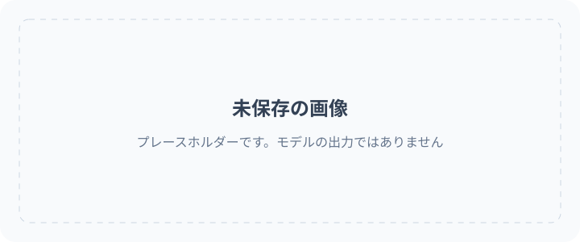

<!-- Generated by scripts/build_readme.py. Edit source data, locale catalogs and generator scripts. -->

# 🎨 Awesome GPT Image 2.6

GPT Image 2.6 のプロンプト、作例、原典を集めたオープンなコレクションです。

    

⚠️ **著作権に関するお知らせ**: このコレクションのプロンプトとメディアは、教育目的に限り公開情報から収集しています。権利を侵害する内容が含まれているとお考えの場合は、 [Issue を作成してください](https://github.com/RaphaelAI-OpenLab/awesome-gpt-image-2-6/issues/new)。直ちに削除いたします。

    
    
    
   

---

この言語版では、リポジトリのインターフェースを翻訳しています。事例の詳細全文は現在、英語と簡体字中国語で提供しています。

事例のタイトル、説明、詳細ページに翻訳がない場合は英語で表示されます。原文プロンプトと出典からの引用は翻訳しません。

**クイックリンク** · [🖼️ 事例を見る](#all-cases) · [🆕 最近の追加](#latest) · [📝 作例を追加](https://github.com/RaphaelAI-OpenLab/awesome-gpt-image-2-6/issues/new?template=submit-case.yml) · [🐞 問題を報告](https://github.com/RaphaelAI-OpenLab/awesome-gpt-image-2-6/issues/new?template=report-problem.yml) · [📚 ガイドを読む](CONTRIBUTING.md)

## 🌐 コレクションを見る

**[このリポジトリのすべての事例を見る →](#all-cases)**

以下の各事例から、モデルの根拠、出典クレジット、プロンプトの公開状況を記載したリポジトリ内の詳細ページを開けます。

**プレースホルダー · 外部ウェブギャラリーの URL：未設定。**

**プレースホルダー · ワンクリック生成リンク：未検証。**

プレースホルダー · 関連コレクション / キャンペーンのリンク：追加予定。

[Raphael のホームページへ](https://raphael.app/?utm_source=github&utm_medium=repository&utm_campaign=gpt_image_2_6_launch&utm_content=top_nav&utm_term=ja-JP)

## 🏷️ カテゴリーから探す

| カテゴリー | 出典リンク付き事例 | 完全なプロンプト |
| --- | ---: | ---: |
| [ブランド・製品ビジュアル](#category-brand-products) | 10 | 0 |
| [ポスター・タイポグラフィ](#category-posters-typography) | 8 | 0 |
| [インフォグラフィック](#category-infographics) | 3 | 0 |
| [インテリア・建築](#category-interiors-architecture) | 2 | 0 |
| [キャラクターと一貫性](#category-characters-consistency) | 10 | 0 |
| [マークアップ・部分編集](#category-markup-edits) | 11 | 0 |
| [SVG・デザイン素材](#category-svg-design-assets) | 3 | 0 |
| [GIF・アニメーション](#category-gif-animation) | 13 | 0 |

## 📖 目次

- [GPT Image 2.6 とは？](#about)
- [統計](#statistics)
- [注目の事例](#featured)
- [最近の追加](#latest)
- [すべての事例](#all-cases)
- [完全なプロンプト](#collection)
- [使い方](#using)
- [貢献する](#contribute)
- [ライセンス](#license)
- [謝辞](#acknowledgements)
- [スター履歴](#star-history)

## 🤔 GPT Image 2.6 とは？

OpenAI は 2026 年 11 月 4 日に Images 2.6 を発表しました。このコレクションでは、Sunburst と Flare のモデルバリアント、画像の生成・編集、文書化された SVG と GIF のワークフローを扱います。各バリアントの対応状況は推測せず、事例ごとに記録しています。

[公式発表](https://openai.com/index/introducing-images-2-6/) · [モデルのドキュメント](https://developers.openai.com/api/docs/guides/image-generation)

## 📊 統計

| 指標 | 件数 / 日付 |
| --- | ---: |
| 出典リンク付き事例 | **60** |
| 公式の作例 | **37** |
| 作者が報告した作例 | **23** |
| 出典で公開されている原文プロンプト | **38** |
| ここで公開している完全なプロンプト | **0** |
| ローカルに保存済みのメディアファイル | **110** |
| 出典の最終確認日時（UTC） | **2026-11-06** |

出典の件数は再現を主張するものではありません。未確認の調査候補は除外し、同じワークフロー内の異なる出力は 1 件の事例として数えています。

## 🔥 注目の事例

<table>
<tr>
<td width="33%" align="center"><a href="cases/docs-bakery-svg/README.md"> <strong>Bakery SVG logo</strong></a> 公式ドキュメント</td>
<td width="33%" align="center"><a href="cases/docs-lantern-gif/README.md"> <strong>Lantern-carrying monkey loop</strong></a> 公式ドキュメント</td>
<td width="33%" align="center"><a href="cases/launch-fal/README.md"> <strong>Living-room markup edit</strong></a> 公式公開デモ</td>
</tr>
<tr>
<td width="33%" align="center"><a href="cases/launch-sable/README.md"> <strong>Miniature brand product world</strong></a> 公式公開デモ</td>
<td width="33%" align="center"><a href="cases/launch-higgsfield/README.md"> <strong>Knight scene and clothing edit sequence</strong></a> 公式公開デモ</td>
<td width="33%" align="center"><a href="cases/community-malfoid/README.md"> <strong>Summer character illustration animation</strong></a> 作者申告のモデル</td>
</tr>
</table>

プレースホルダーカードは生成結果ではありません。表示されるメディアファイルはすべてこのリポジトリに保存しています。未保存のメディアについては、詳細ページにリンクを残しています。

## 🆕 最近の追加

| 追加日 | 事例 | 根拠 |
| --- | --- | --- |
| 2026-11-06 | [Morphed: bubblegum pop and reset loop](cases/morphed-bubblegum-loop/README.md) | 作者申告のモデル |
| 2026-11-06 | [Stock-market kitten meme: three GIF iterations](cases/community-greta-stock-kitten-iterations/README.md) | 作者申告のモデル |
| 2026-11-05 | [Cable-knit cardigan on a model](cases/productai-cable-knit-cardigan-comparison/README.md) | 作者申告のモデル |
| 2026-11-05 | [Running-shoe scenes and precise edits](cases/productai-running-shoe-comparison/README.md) | 作者申告のモデル |
| 2026-11-05 | [Quillhaven coffee scenes and precise edits](cases/productai-quillhaven-coffee-comparison/README.md) | 作者申告のモデル |
| 2026-11-05 | [Tovalin serum scene comparison](cases/productai-tovalin-serum-comparison/README.md) | 作者申告のモデル |

## 📋 すべての事例

### ブランド・製品ビジュアル

| 事例 · リポジトリ内の詳細ページ | 出典 | プロンプト |
| --- | --- | --- |
| [Transparent bakery raster logo](cases/docs-bakery-raster/README.md) | 公式ドキュメント | 出典にある原文プロンプト |
| [Transparent product cutout](cases/docs-product-cutout/README.md) | 公式ドキュメント | 出典にある原文プロンプト |
| [Toy airplane packaging](cases/docs-toy-package/README.md) | 公式ドキュメント | 出典にある原文プロンプト |
| [Miniature brand product world](cases/launch-sable/README.md) | 公式公開デモ | 出典にある原文プロンプト |
| [Travel visual generation speed comparison](cases/launch-travel/README.md) | 公式公開デモ | プロンプト非公開 |
| [Laptop GIF-creation workspace illustration](cases/techrepublic-gif-workspace-illustration/README.md) | 作者申告のモデル | プロンプト非公開 |
| [Tovalin serum scene comparison](cases/productai-tovalin-serum-comparison/README.md) | 作者申告のモデル | プロンプト非公開 |
| [Quillhaven coffee scenes and precise edits](cases/productai-quillhaven-coffee-comparison/README.md) | 作者申告のモデル | プロンプト非公開 |
| [Running-shoe scenes and precise edits](cases/productai-running-shoe-comparison/README.md) | 作者申告のモデル | プロンプト非公開 |
| [Cable-knit cardigan on a model](cases/productai-cable-knit-cardigan-comparison/README.md) | 作者申告のモデル | プロンプト非公開 |

### ポスター・タイポグラフィ

| 事例 · リポジトリ内の詳細ページ | 出典 | プロンプト |
| --- | --- | --- |
| [Streetwear advertisement typography](cases/docs-streetwear/README.md) | 公式ドキュメント | 出典にある原文プロンプト |
| [Roadside shampoo billboard](cases/docs-billboard/README.md) | 公式ドキュメント | 出典にある原文プロンプト |
| [Nostalgic holiday card](cases/docs-holiday-card/README.md) | 公式ドキュメント | 出典にある原文プロンプト |
| [Shiba ramen shop: two quality comparison runs](cases/ai-garage-ramen-quality-series/README.md) | 作者申告のモデル | プロンプト非公開 |
| [Autumn café menu announcement comparison](cases/ai-garage-autumn-cafe/README.md) | 作者申告のモデル | プロンプト非公開 |
| [Flare 4K test, published previews](cases/aivideos-flare-4k-comparison/README.md) | 作者申告のモデル | プロンプト非公開 |
| [Flare quality and planning comparison](cases/aivideos-flare-quality-planning/README.md) | 作者申告のモデル | プロンプト非公開 |
| [Retro diner menu board](cases/dreamega-retro-diner/README.md) | 作者申告のモデル | 出典にある原文プロンプト |

### インフォグラフィック

| 事例 · リポジトリ内の詳細ページ | 出典 | プロンプト |
| --- | --- | --- |
| [Coffee-machine process diagram](cases/docs-coffee-diagram/README.md) | 公式ドキュメント | 出典にある原文プロンプト |
| [Cellular respiration teaching visual](cases/docs-cell-respiration/README.md) | 公式ドキュメント | 出典にある原文プロンプト |
| [Market-size presentation slide](cases/docs-pitch-slide/README.md) | 公式ドキュメント | 出典にある原文プロンプト |

### インテリア・建築

| 事例 · リポジトリ内の詳細ページ | 出典 | プロンプト |
| --- | --- | --- |
| [Replace chairs in an interior](cases/docs-room-chairs/README.md) | 公式ドキュメント | 出典にある原文プロンプト |
| [Living-room markup edit](cases/launch-fal/README.md) | 公式公開デモ | 出典にある原文プロンプト |

### キャラクターと一貫性

| 事例 · リポジトリ内の詳細ページ | 出典 | プロンプト |
| --- | --- | --- |
| [Paper-cut championship scene: complexity comparison](cases/docs-complexity/README.md) | 公式ドキュメント | 出典にある原文プロンプト |
| [Realistic fishing-boat sailor portrait](cases/docs-sailor/README.md) | 公式ドキュメント | 出典にある原文プロンプト |
| [1969 historical crowd scene](cases/docs-historical-crowd/README.md) | 公式ドキュメント | 出典にある原文プロンプト |
| [Four-panel pet comic](cases/docs-pet-comic/README.md) | 公式ドキュメント | 出典にある原文プロンプト |
| [Change clothing while preserving identity](cases/docs-outfit/README.md) | 公式ドキュメント | 出典にある原文プロンプト |
| [Place a person into a camping escape scene](cases/docs-person-scene/README.md) | 公式ドキュメント | 出典にある原文プロンプト |
| [Establish a storybook character](cases/docs-character-start/README.md) | 公式ドキュメント | 出典にある原文プロンプト |
| [Continue the same character’s story](cases/docs-character-story/README.md) | 公式ドキュメント | 出典にある原文プロンプト |
| [Stained-glass whale](cases/launch-picsart/README.md) | 公式公開デモ | プロンプト非公開 |
| [Knight scene and clothing edit sequence](cases/launch-higgsfield/README.md) | 公式公開デモ | 出典にある原文プロンプト |

### マークアップ・部分編集

| 事例 · リポジトリ内の詳細ページ | 出典 | プロンプト |
| --- | --- | --- |
| [Recolor a marked vase](cases/docs-vase-markup/README.md) | 公式ドキュメント | 出典にある原文プロンプト |
| [Translate an infographic into Spanish](cases/docs-spanish-edit/README.md) | 公式ドキュメント | 出典にある原文プロンプト |
| [Transfer a pixel-art style](cases/docs-pixel-style/README.md) | 公式ドキュメント | 出典にある原文プロンプト |
| [Combine pets across images](cases/docs-dog-composite/README.md) | 公式ドキュメント | 出典にある原文プロンプト |
| [Turn a sketch into a realistic scene](cases/docs-sketch-render/README.md) | 公式ドキュメント | 出典にある原文プロンプト |
| [Remove a held flower](cases/docs-remove-flower/README.md) | 公式ドキュメント | 出典にある原文プロンプト |
| [Change the billboard scene to a snowy night](cases/docs-snow-edit/README.md) | 公式ドキュメント | 出典にある原文プロンプト |
| [Shiba chef festival background edit](cases/ai-garage-festival-background/README.md) | 作者申告のモデル | 出典にある原文プロンプト |
| [Red chef hat despite conflicting markup](cases/ai-garage-red-chef-hat/README.md) | 作者申告のモデル | 出典にある原文プロンプト |
| [Mirror reflection costume edit](cases/dreamega-mirror-reflection/README.md) | 作者申告のモデル | プロンプト非公開 |
| [Miniature city inside a piano](cases/dreamega-piano-city/README.md) | 作者申告のモデル | プロンプト非公開 |

### SVG・デザイン素材

| 事例 · リポジトリ内の詳細ページ | 出典 | プロンプト |
| --- | --- | --- |
| [Bakery SVG logo](cases/docs-bakery-svg/README.md) | 公式ドキュメント | 出典にある原文プロンプト |
| [Farmers market mobile interface](cases/docs-market-ui/README.md) | 公式ドキュメント | 出典にある原文プロンプト |
| [Bear mascot: SVG versus PNG previews](cases/community-bear-svg-comparison/README.md) | 作者申告のモデル | プロンプト非公開 |

### GIF・アニメーション

| 事例 · リポジトリ内の詳細ページ | 出典 | プロンプト |
| --- | --- | --- |
| [Lantern-carrying monkey loop](cases/docs-lantern-gif/README.md) | 公式ドキュメント | 出典にある原文プロンプト |
| [Office character: falling stock GIF](cases/launch-openart-down/README.md) | 公式公開デモ | 出典にある原文プロンプト |
| [Office character: rising stock GIF](cases/launch-openart-up/README.md) | 公式公開デモ | 出典にある原文プロンプト |
| [Owl sketch to animation](cases/launch-owl/README.md) | 公式公開デモ | プロンプト非公開 |
| [Monty typing indicator animation](cases/launch-town/README.md) | 公式公開デモ | プロンプト非公開 |
| [Summer character illustration animation](cases/community-malfoid/README.md) | 作者申告のモデル | プロンプト非公開 |
| [Images 2.6 brings GIF(T)S :D](cases/community-gifts/README.md) | 作者申告のモデル | プロンプト非公開 |
| [Boxing tiger animation](cases/community-boxing-tiger/README.md) | 作者申告のモデル | プロンプト非公開 |
| [Hummingbird and kingfisher animation variants](cases/community-hummingbird-variants/README.md) | 作者申告のモデル | プロンプト非公開 |
| [Rosebud animation](cases/community-rosebud-animation/README.md) | 作者申告のモデル | プロンプト非公開 |
| [Shiba chef waving loop](cases/ai-garage-shiba-wave/README.md) | 作者申告のモデル | プロンプト非公開 |
| [Stock-market kitten meme: three GIF iterations](cases/community-greta-stock-kitten-iterations/README.md) | 作者申告のモデル | 出典にある原文プロンプト |
| [Morphed: bubblegum pop and reset loop](cases/morphed-bubblegum-loop/README.md) | 作者申告のモデル | 出典にある原文プロンプト |

[検索ログ、メディアレポート、未確認の調査候補](docs/CASE_GALLERY.md)

## 📝 完全なプロンプト

完全なプロンプトはまだ転載していません。事例ページには、公開されている実際の原文プロンプトへのリンクを掲載し、非公開の場合はその旨を明示しています。出典リンクがある項目と、そのままコピーできるプロンプトがある項目は異なります。

## 📚 使い方

1. カテゴリーまたは注目カードから事例を開いてください。
2. モデルの根拠、必要な入力、出典、再利用の制限を確認してください。
3. 原文プロンプトのリンクがある場合は、そちらを参照してください。公開されていないプロンプトは未掲載のままにし、画像から推測しないでください。

## 🤝 貢献方法

出典リンク付きの事例は content/source-cases.json に、完全で再利用可能なプロンプトは content/prompts.json に追加してください。ジェネレーターがこれらのデータセットから両言語版とリポジトリ内のページを生成します。

[貢献ガイド](CONTRIBUTING.md) · [出典事例とメディアのガイド](docs/SOURCE_CASES.md) · [メンテナーガイド（中国語）](docs/FILLING_GUIDE.zh-CN.md)

## 📄 ライセンス

コード、独自に作成したドキュメント、装飾用 SVG プレースホルダーには MIT ライセンスを適用しています。第三者のプロンプトとメディアにはそれぞれの利用条件が適用され、項目ごとに出典と再利用条件を記録しています。改変して利用した README レイアウトの出典は、以下に別途記載しています。

[リポジトリのライセンス](LICENSE)

## 🙏 謝辞

README の構成は、CC BY 4.0 に基づき YouMind OpenLab の awesome-nano-banana-pro-prompts を改変して使用しています。GPT Image 2.6 向けに文章、データ、ローカルの詳細ページを新たに作成し、プレースホルダーを明示しています。創作例やメディアのコピーは行っていません。

[YouMind README](https://github.com/YouMind-OpenLab/awesome-nano-banana-pro-prompts/blob/main/README_zh.md) · [CC BY 4.0](https://creativecommons.org/licenses/by/4.0/) · [出典表記について](docs/ATTRIBUTION.md)

OpenAI と、各事例ページにクレジットを記載したオリジナルの作者の皆様に感謝します。

## ⭐ スター履歴

[スター履歴](https://star-history.com/#RaphaelAI-OpenLab/awesome-gpt-image-2-6&Date) · [スターを付けたユーザーを見る](https://github.com/RaphaelAI-OpenLab/awesome-gpt-image-2-6/stargazers)

[このリポジトリにスターを付ける / フォローする](https://github.com/RaphaelAI-OpenLab/awesome-gpt-image-2-6)

[↑ ページの先頭に戻る](#top)

---

Raphael が収集・整理しています。 [ホームページ](https://raphael.app/?utm_source=github&utm_medium=repository&utm_campaign=gpt_image_2_6_launch&utm_content=footer&utm_term=ja-JP)

構造化された出典データから生成しています。データセットを編集して再生成してください。このファイルは直接編集しないでください。
