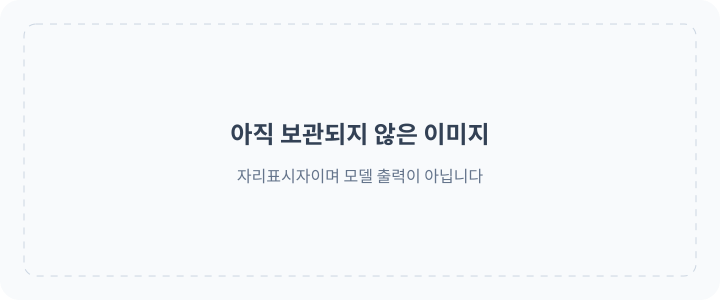

<!-- Generated by scripts/build_readme.py. Edit source data, locale catalogs and generator scripts. -->

<a id="top"></a>

[](https://raphael.app/?utm_source=github&utm_medium=repository&utm_campaign=gpt_image_2_6_launch&utm_content=hero&utm_term=ko-KR)

# 🎨 Awesome GPT Image 2.6

GPT Image 2.6의 프롬프트, 시각적 예시, 원본 출처를 모은 공개 모음집입니다.

<a href="LICENSE"></a> <a href="docs/ATTRIBUTION.md"></a> <a href="CONTRIBUTING.md"></a> <a href="https://github.com/RaphaelAI-OpenLab/awesome-gpt-image-2-6/actions/workflows/validate.yml"></a> <a href="https://github.com/RaphaelAI-OpenLab/awesome-gpt-image-2-6"></a>

⚠️ **저작권 안내**: 이 모음집의 프롬프트와 미디어는 교육 목적으로만 공개 출처에서 수집했습니다. 권리를 침해하는 콘텐츠가 있다고 생각하시면 [이슈를 등록해 주세요](https://github.com/RaphaelAI-OpenLab/awesome-gpt-image-2-6/issues/new). 즉시 삭제하겠습니다.

<a href="README.md"></a> <a href="README.zh-CN.md"></a> <a href="README.zh-TW.md"></a> <a href="README.ja-JP.md"></a><br />
<a href="README.ko-KR.md"></a> <a href="README.th-TH.md"></a> <a href="README.vi-VN.md"></a> <a href="README.hi-IN.md"></a><br />
<a href="README.es-ES.md"></a> <a href="README.es-419.md"></a> <a href="README.de-DE.md"></a> <a href="README.fr-FR.md"></a><br />
<a href="README.it-IT.md"></a> <a href="README.pt-BR.md"></a> <a href="README.pt-PT.md"></a> <a href="README.tr-TR.md"></a>

---

이 언어 버전은 저장소 인터페이스를 번역합니다. 전체 사례 상세 정보는 현재 영어와 중국어 간체로 제공됩니다.

사례 제목, 설명, 상세 페이지에 번역이 없으면 영어로 표시됩니다. 원문 프롬프트와 출처 인용문은 번역하지 않습니다.

**빠른 링크** · [🖼️ 사례 둘러보기](#all-cases) · [🆕 최근 추가](#latest) · [📝 예시 추가](https://github.com/RaphaelAI-OpenLab/awesome-gpt-image-2-6/issues/new?template=submit-case.yml) · [🐞 문제 신고](https://github.com/RaphaelAI-OpenLab/awesome-gpt-image-2-6/issues/new?template=report-problem.yml) · [📚 가이드 읽기](CONTRIBUTING.md)

<a id="gallery"></a>

## 🌐 모음집 둘러보기

**[이 저장소의 모든 사례 보기 →](#all-cases)**

아래의 모든 사례는 모델 관련 근거, 출처 크레딧, 프롬프트 제공 여부가 담긴 저장소 내부 상세 페이지로 연결됩니다.

[외부 웹사이트 자료 보관함(분류 및 통계에서 제외)](external-sites/README.md)

**자리표시자 · 외부 웹 갤러리 URL: 미설정.**

**자리표시자 · 원클릭 생성 링크: 미검증.**

자리표시자 · 관련 모음집 / 캠페인 링크: 추가 예정.

[Raphael 홈페이지 방문](https://raphael.app/?utm_source=github&utm_medium=repository&utm_campaign=gpt_image_2_6_launch&utm_content=top_nav&utm_term=ko-KR)

<a id="categories"></a>

## 🏷️ 카테고리별 탐색

| 카테고리 | 출처 링크가 있는 사례 | 전체 프롬프트 |
| --- | ---: | ---: |
| [브랜드 및 제품 비주얼](#category-brand-products) | 7 | 0 |
| [포스터 및 타이포그래피](#category-posters-typography) | 8 | 0 |
| [인포그래픽](#category-infographics) | 3 | 0 |
| [인테리어 및 건축](#category-interiors-architecture) | 3 | 0 |
| [캐릭터 및 일관성](#category-characters-consistency) | 15 | 0 |
| [마크업 및 특정 영역 편집](#category-markup-edits) | 9 | 0 |
| [SVG 및 디자인 에셋](#category-svg-design-assets) | 4 | 0 |
| [GIF 및 애니메이션](#category-gif-animation) | 64 | 5 |

<a id="contents"></a>

## 📖 목차

- [GPT Image 2.6이란?](#about)
- [통계](#statistics)
- [주요 사례](#featured)
- [최근 추가](#latest)
- [모든 사례](#all-cases)
- [전체 프롬프트](#collection)
- [사용 방법](#using)
- [기여하기](#contribute)
- [라이선스](#license)
- [감사의 말](#acknowledgements)
- [스타 기록](#star-history)

<a id="about"></a>

## 🤔 GPT Image 2.6이란?

OpenAI는 2026년 11월 4일 Images 2.6을 발표했습니다. 이 모음집은 Sunburst와 Flare 변형 모델, 이미지 생성 및 편집, 문서화된 SVG 및 GIF 워크플로를 다룹니다. 변형 모델의 지원 여부는 추정하지 않고 사례별로 기록합니다.

[공식 발표](https://openai.com/index/introducing-images-2-6/) · [모델 문서](https://developers.openai.com/api/docs/guides/image-generation)

<a id="statistics"></a>

## 📊 통계

| 지표 | 수량 / 날짜 |
| --- | ---: |
| 출처 링크가 있는 사례 | **113** |
| 공식 예시 | **37** |
| 제작자가 보고한 예시 | **76** |
| 출처에서 제공하는 원문 프롬프트 | **87** |
| 여기에 공개된 전체 프롬프트 | **5** |
| 로컬에 보관된 미디어 파일 | **188** |
| 최근 출처 확인 일시(UTC) | **2026-11-09** |

출처 수는 재현을 주장하는 수치가 아닙니다. 확인 대기 중인 조사 후보는 제외하며, 하나의 워크플로에서 나온 서로 다른 결과물은 하나의 사례로 계산합니다.

<a id="featured"></a>

## 🔥 주요 사례

<table>
<tr>
<td width="33%" align="center"><a href="cases/docs-bakery-svg/README.md"><br /><strong>Bakery SVG logo</strong></a><br />공식 문서</td>
<td width="33%" align="center"><a href="cases/docs-lantern-gif/README.md"><br /><strong>Lantern-carrying monkey loop</strong></a><br />공식 문서</td>
<td width="33%" align="center"><a href="cases/launch-fal/README.md"><br /><strong>Living-room markup edit</strong></a><br />공식 출시 데모</td>
</tr>
<tr>
<td width="33%" align="center"><a href="cases/launch-sable/README.md"><br /><strong>Miniature brand product world</strong></a><br />공식 출시 데모</td>
<td width="33%" align="center"><a href="cases/launch-higgsfield/README.md"><br /><strong>Knight scene and clothing edit sequence</strong></a><br />공식 출시 데모</td>
<td width="33%" align="center"><a href="cases/community-malfoid/README.md"><br /><strong>Summer character illustration animation</strong></a><br />제작자가 밝힌 모델</td>
</tr>
</table>

자리표시자 카드는 생성 결과물이 아닙니다. 표시되는 모든 미디어 파일은 이 저장소에 저장되어 있으며, 아직 보관되지 않은 미디어는 상세 페이지에 링크로 남겨 둡니다.

<a id="latest"></a>

## 🆕 최근 추가

| 추가일 | 사례 | 근거 |
| --- | --- | --- |
| 2026-11-09 | [Cartoon bee posts to X for daily check-in](cases/social-diligent-bee-daily-checkin-gif/README.md) | 제작자가 밝힌 모델 |
| 2026-11-09 | [Flip phone shows Heisei decomail animation in Tokyo street](cases/social-heisei-flip-phone-decomail-gif/README.md) | 제작자가 밝힌 모델 |
| 2026-11-09 | [Dancing cartoon frog in a top hat](cases/social-dancing-frog-top-hat/README.md) | 제작자가 밝힌 모델 |
| 2026-11-09 | [Chibi cheongsam girl performs a cute jump sequence](cases/social-chibi-cheongsam-girl-gif/README.md) | 제작자가 밝힌 모델 |
| 2026-11-09 | [Chibi character eating rice with chopsticks](cases/social-blue-hair-chibi-eating-rice-gif/README.md) | 제작자가 밝힌 모델 |
| 2026-11-06 | [Junkyard robot walk cycle](cases/ailingqu-junkyard-robot-walk/README.md) | 제작자가 밝힌 모델 |

<a id="all-cases"></a>

## 📋 모든 사례

<a id="category-brand-products"></a>

### 브랜드 및 제품 비주얼

| 사례 · 저장소 내부 상세 페이지 | 출처 | 프롬프트 |
| --- | --- | --- |
| [Transparent bakery raster logo](cases/docs-bakery-raster/README.md) | 공식 문서 | 출처의 원문 프롬프트 |
| [Transparent product cutout](cases/docs-product-cutout/README.md) | 공식 문서 | 출처의 원문 프롬프트 |
| [Toy airplane packaging](cases/docs-toy-package/README.md) | 공식 문서 | 출처의 원문 프롬프트 |
| [Miniature brand product world](cases/launch-sable/README.md) | 공식 출시 데모 | 출처의 원문 프롬프트 |
| [Travel visual generation speed comparison](cases/launch-travel/README.md) | 공식 출시 데모 | 프롬프트 비공개 |
| [Watchmaker underwater macro test](cases/community-hn-watchmaker/README.md) | 제작자가 밝힌 모델 | 출처의 원문 프롬프트 |
| [AURORA orange perfume product image](cases/community-struggle-aurora-perfume/README.md) | 제작자가 밝힌 모델 | 출처의 원문 프롬프트 |

<a id="category-posters-typography"></a>

### 포스터 및 타이포그래피

| 사례 · 저장소 내부 상세 페이지 | 출처 | 프롬프트 |
| --- | --- | --- |
| [Streetwear advertisement typography](cases/docs-streetwear/README.md) | 공식 문서 | 출처의 원문 프롬프트 |
| [Roadside shampoo billboard](cases/docs-billboard/README.md) | 공식 문서 | 출처의 원문 프롬프트 |
| [Nostalgic holiday card](cases/docs-holiday-card/README.md) | 공식 문서 | 출처의 원문 프롬프트 |
| [Birthday cake without extra slogan cards](cases/community-flare-slogan-comparison/README.md) | 제작자가 밝힌 모델 | 출처의 원문 프롬프트 |
| [AI evolution poster revised to Image 2.6](cases/community-struggle-poster-edit/README.md) | 제작자가 밝힌 모델 | 출처의 원문 프롬프트 |
| [Spring Health Fair 2027 flyer comparison](cases/nyle-health-fair/README.md) | 제작자가 밝힌 모델 | 프롬프트 비공개 |
| [Sensitive-skin lotion advertisement comparison](cases/nyle-skincare-ad/README.md) | 제작자가 밝힌 모델 | 프롬프트 비공개 |
| [Dense Japanese business cover comparison](cases/nyle-kanji-cover/README.md) | 제작자가 밝힌 모델 | 프롬프트 비공개 |

<a id="category-infographics"></a>

### 인포그래픽

| 사례 · 저장소 내부 상세 페이지 | 출처 | 프롬프트 |
| --- | --- | --- |
| [Coffee-machine process diagram](cases/docs-coffee-diagram/README.md) | 공식 문서 | 출처의 원문 프롬프트 |
| [Cellular respiration teaching visual](cases/docs-cell-respiration/README.md) | 공식 문서 | 출처의 원문 프롬프트 |
| [Market-size presentation slide](cases/docs-pitch-slide/README.md) | 공식 문서 | 출처의 원문 프롬프트 |

<a id="category-interiors-architecture"></a>

### 인테리어 및 건축

| 사례 · 저장소 내부 상세 페이지 | 출처 | 프롬프트 |
| --- | --- | --- |
| [Replace chairs in an interior](cases/docs-room-chairs/README.md) | 공식 문서 | 출처의 원문 프롬프트 |
| [Living-room markup edit](cases/launch-fal/README.md) | 공식 출시 데모 | 출처의 원문 프롬프트 |
| [Dusty warehouse prompt-detail comparison](cases/community-sunburst-dust-detail/README.md) | 제작자가 밝힌 모델 | 프롬프트 공개 여부 미확인 |

<a id="category-characters-consistency"></a>

### 캐릭터 및 일관성

| 사례 · 저장소 내부 상세 페이지 | 출처 | 프롬프트 |
| --- | --- | --- |
| [Paper-cut championship scene: complexity comparison](cases/docs-complexity/README.md) | 공식 문서 | 출처의 원문 프롬프트 |
| [Realistic fishing-boat sailor portrait](cases/docs-sailor/README.md) | 공식 문서 | 출처의 원문 프롬프트 |
| [1969 historical crowd scene](cases/docs-historical-crowd/README.md) | 공식 문서 | 출처의 원문 프롬프트 |
| [Four-panel pet comic](cases/docs-pet-comic/README.md) | 공식 문서 | 출처의 원문 프롬프트 |
| [Change clothing while preserving identity](cases/docs-outfit/README.md) | 공식 문서 | 출처의 원문 프롬프트 |
| [Place a person into a camping escape scene](cases/docs-person-scene/README.md) | 공식 문서 | 출처의 원문 프롬프트 |
| [Establish a storybook character](cases/docs-character-start/README.md) | 공식 문서 | 출처의 원문 프롬프트 |
| [Continue the same character’s story](cases/docs-character-story/README.md) | 공식 문서 | 출처의 원문 프롬프트 |
| [Stained-glass whale](cases/launch-picsart/README.md) | 공식 출시 데모 | 프롬프트 비공개 |
| [Knight scene and clothing edit sequence](cases/launch-higgsfield/README.md) | 공식 출시 데모 | 출처의 원문 프롬프트 |
| [Reference-led courtyard photo board](cases/community-marco-reference-photo-board/README.md) | 제작자가 밝힌 모델 | 프롬프트 비공개 |
| [Sunburst courtyard comparison](cases/community-marco-sunburst-courtyard-comparison/README.md) | 제작자가 밝힌 모델 | 프롬프트 비공개 |
| [Mushroom-lit fashion portrait](cases/community-marco-mushroom-fashion-portrait/README.md) | 제작자가 밝힌 모델 | 프롬프트 비공개 |
| [Sunburst six-style sample gallery](cases/nyle-sunburst-style-gallery/README.md) | 제작자가 밝힌 모델 | 프롬프트 비공개 |
| [Sunburst calico cat by a window](cases/community-kokone-sunburst-calico/README.md) | 제작자가 밝힌 모델 | 프롬프트 비공개 |

<a id="category-markup-edits"></a>

### 마크업 및 특정 영역 편집

| 사례 · 저장소 내부 상세 페이지 | 출처 | 프롬프트 |
| --- | --- | --- |
| [Recolor a marked vase](cases/docs-vase-markup/README.md) | 공식 문서 | 출처의 원문 프롬프트 |
| [Translate an infographic into Spanish](cases/docs-spanish-edit/README.md) | 공식 문서 | 출처의 원문 프롬프트 |
| [Transfer a pixel-art style](cases/docs-pixel-style/README.md) | 공식 문서 | 출처의 원문 프롬프트 |
| [Combine pets across images](cases/docs-dog-composite/README.md) | 공식 문서 | 출처의 원문 프롬프트 |
| [Turn a sketch into a realistic scene](cases/docs-sketch-render/README.md) | 공식 문서 | 출처의 원문 프롬프트 |
| [Remove a held flower](cases/docs-remove-flower/README.md) | 공식 문서 | 출처의 원문 프롬프트 |
| [Change the billboard scene to a snowy night](cases/docs-snow-edit/README.md) | 공식 문서 | 출처의 원문 프롬프트 |
| [Rabbit storybook day-to-dusk edit](cases/community-flare-day-dusk-edit/README.md) | 제작자가 밝힌 모델 | 프롬프트 공개 여부 미확인 |
| [Webinar date replacement comparison](cases/nyle-webinar-date-edit/README.md) | 제작자가 밝힌 모델 | 출처의 원문 프롬프트 |

<a id="category-svg-design-assets"></a>

### SVG 및 디자인 에셋

| 사례 · 저장소 내부 상세 페이지 | 출처 | 프롬프트 |
| --- | --- | --- |
| [Bakery SVG logo](cases/docs-bakery-svg/README.md) | 공식 문서 | 출처의 원문 프롬프트 |
| [Farmers market mobile interface](cases/docs-market-ui/README.md) | 공식 문서 | 출처의 원문 프롬프트 |
| [Bear mascot: SVG versus PNG previews](cases/community-bear-svg-comparison/README.md) | 제작자가 밝힌 모델 | 프롬프트 비공개 |
| [Code Lightning vector logo](cases/community-struggle-code-lightning-svg/README.md) | 제작자가 밝힌 모델 | 출처의 원문 프롬프트 |

<a id="category-gif-animation"></a>

### GIF 및 애니메이션

| 사례 · 저장소 내부 상세 페이지 | 출처 | 프롬프트 |
| --- | --- | --- |
| [Lantern-carrying monkey loop](cases/docs-lantern-gif/README.md) | 공식 문서 | 출처의 원문 프롬프트 |
| [Office character: falling stock GIF](cases/launch-openart-down/README.md) | 공식 출시 데모 | 출처의 원문 프롬프트 |
| [Office character: rising stock GIF](cases/launch-openart-up/README.md) | 공식 출시 데모 | 출처의 원문 프롬프트 |
| [Owl sketch to animation](cases/launch-owl/README.md) | 공식 출시 데모 | 프롬프트 비공개 |
| [Monty typing indicator animation](cases/launch-town/README.md) | 공식 출시 데모 | 프롬프트 비공개 |
| [Summer character illustration animation](cases/community-malfoid/README.md) | 제작자가 밝힌 모델 | 프롬프트 비공개 |
| [Images 2.6 brings GIF(T)S :D](cases/community-gifts/README.md) | 제작자가 밝힌 모델 | 프롬프트 비공개 |
| [Boxing tiger animation](cases/community-boxing-tiger/README.md) | 제작자가 밝힌 모델 | 프롬프트 비공개 |
| [Hummingbird and kingfisher animation variants](cases/community-hummingbird-variants/README.md) | 제작자가 밝힌 모델 | 프롬프트 비공개 |
| [Rosebud animation](cases/community-rosebud-animation/README.md) | 제작자가 밝힌 모델 | 프롬프트 비공개 |
| [Jelly bear wobble](cases/ailingqu-jelly-bear-wobble/README.md) | 제작자가 밝힌 모델 | 출처의 원문 프롬프트 |
| [White bunny reaction sticker set](cases/ailingqu-bunny-reaction-set/README.md) | 제작자가 밝힌 모델 | 출처의 원문 프롬프트 |
| [Cartoon cat waving hello](cases/ailingqu-cat-waving-hello/README.md) | 제작자가 밝힌 모델 | 출처의 원문 프롬프트 |
| [Confused shiba head tilt](cases/ailingqu-shiba-head-tilt/README.md) | 제작자가 밝힌 모델 | 출처의 원문 프롬프트 |
| [Cat typing furiously](cases/ailingqu-cat-typing-laptop/README.md) | 제작자가 밝힌 모델 | 출처의 원문 프롬프트 |
| [Frog blowing a heart](cases/ailingqu-frog-heart-bubble/README.md) | 제작자가 밝힌 모델 | 출처의 원문 프롬프트 |
| [Penguin facepalm](cases/ailingqu-penguin-facepalm/README.md) | 제작자가 밝힌 모델 | 출처의 원문 프롬프트 |
| [Basketball shot celebration](cases/ailingqu-basketball-shot-sticker/README.md) | 제작자가 밝힌 모델 | 출처의 원문 프롬프트 |
| [Cat chef tossing fried rice](cases/ailingqu-cat-chef-fried-rice/README.md) | 제작자가 밝힌 모델 | 출처의 원문 프롬프트 |
| [Black cat punch](cases/ailingqu-black-cat-punch/README.md) | 제작자가 밝힌 모델 | 출처의 원문 프롬프트 |
| [Office cat workday reaction set](cases/ailingqu-office-cat-workday-set/README.md) | 제작자가 밝힌 모델 | 출처의 원문 프롬프트 |
| [Roaring duck](cases/ailingqu-roaring-duck/README.md) | 제작자가 밝힌 모델 | 출처의 원문 프롬프트 |
| [Flower macro flash cut](cases/ailingqu-flower-macro-flash/README.md) | 제작자가 밝힌 모델 | 출처의 원문 프롬프트 |
| [Cat-head logo brand reel](cases/ailingqu-cat-brand-reel/README.md) | 제작자가 밝힌 모델 | 출처의 원문 프롬프트 |
| [Sneaker colorway flash](cases/ailingqu-sneaker-colorway-flash/README.md) | 제작자가 밝힌 모델 | 출처의 원문 프롬프트 |
| [One tree, four seasons](cases/ailingqu-four-seasons-tree/README.md) | 제작자가 밝힌 모델 | 출처의 원문 프롬프트 |
| [Magazine collage panels pop in](cases/ailingqu-magazine-panels-pop/README.md) | 제작자가 밝힌 모델 | 출처의 원문 프롬프트 |
| [Reading by the window, day to night](cases/ailingqu-window-day-to-night/README.md) | 제작자가 밝힌 모델 | 출처의 원문 프롬프트 |
| [Steaming coffee loop](cases/ailingqu-steaming-coffee/README.md) | 제작자가 밝힌 모델 | 출처의 원문 프롬프트 |
| [Rainy window and plant](cases/ailingqu-rain-on-window/README.md) | 제작자가 밝힌 모델 | 출처의 원문 프롬프트 |
| [Goldfish in a bowl](cases/ailingqu-goldfish-bowl/README.md) | 제작자가 밝힌 모델 | 출처의 원문 프롬프트 |
| [Lighthouse at night](cases/ailingqu-lighthouse-night/README.md) | 제작자가 밝힌 모델 | 출처의 원문 프롬프트 |
| [Cat sleeping by the fireplace](cases/ailingqu-cat-by-fireplace/README.md) | 제작자가 밝힌 모델 | 출처의 원문 프롬프트 |
| [Lantern monkey in the snow](cases/ailingqu-lantern-monkey-snow/README.md) | 제작자가 밝힌 모델 | 출처의 원문 프롬프트 |
| [Sleepy fox on a mossy rock](cases/ailingqu-sleepy-fox-rock/README.md) | 제작자가 밝힌 모델 | 출처의 원문 프롬프트 |
| [Lo-fi study loop](cases/ailingqu-lofi-study-loop/README.md) | 제작자가 밝힌 모델 | 출처의 원문 프롬프트 |
| [Café cinemagraph](cases/ailingqu-cafe-cinemagraph/README.md) | 제작자가 밝힌 모델 | 출처의 원문 프롬프트 |
| [Ink-wash galloping horse](cases/ailingqu-ink-wash-horse/README.md) | 제작자가 밝힌 모델 | 출처의 원문 프롬프트 |
| [Doodle monster comes alive](cases/ailingqu-doodle-monster/README.md) | 제작자가 밝힌 모델 | 출처의 원문 프롬프트 |
| [Pixel art campfire](cases/ailingqu-pixel-campfire/README.md) | 제작자가 밝힌 모델 | 출처의 원문 프롬프트 |
| [Bouncing dots loader](cases/ailingqu-bouncing-dots-loader/README.md) | 제작자가 밝힌 모델 | 출처의 원문 프롬프트 |
| [Pixel knight run cycle](cases/ailingqu-pixel-knight-run/README.md) | 제작자가 밝힌 모델 | 출처의 원문 프롬프트 |
| [Like button heart burst](cases/ailingqu-like-heart-burst/README.md) | 제작자가 밝힌 모델 | 출처의 원문 프롬프트 |
| [Hourglass loading](cases/ailingqu-hourglass-flip/README.md) | 제작자가 밝힌 모델 | 출처의 원문 프롬프트 |
| [Arcade VS screen](cases/ailingqu-arcade-vs-screen/README.md) | 제작자가 밝힌 모델 | 출처의 원문 프롬프트 |
| [8-bit slime boss battle](cases/ailingqu-pixel-slime-boss/README.md) | 제작자가 밝힌 모델 | 출처의 원문 프롬프트 |
| [Love-burst skill animation](cases/ailingqu-love-burst-skill/README.md) | 제작자가 밝힌 모델 | 출처의 원문 프롬프트 |
| [Junkyard robot walk cycle](cases/ailingqu-junkyard-robot-walk/README.md) | 제작자가 밝힌 모델 | 출처의 원문 프롬프트 |
| [Robin cat wink and falling name hat](cases/community-ozan-robin-wink-hat/README.md) | 제작자가 밝힌 모델 | 출처의 원문 프롬프트 |
| [Blue-haired maid dialogue prototype](cases/community-mirochill-anime-dialogue-prototype/README.md) | 제작자가 밝힌 모델 | 프롬프트 비공개 |
| [Ram Altman memory-stick parody](cases/community-mirochill-ram-altman-animation/README.md) | 제작자가 밝힌 모델 | 프롬프트 비공개 |
| [Moonlit magical-girl dance](cases/community-struggle-sailor-dance/README.md) | 제작자가 밝힌 모델 | 출처의 원문 프롬프트 |
| [Clay orange cat typing](cases/community-struggle-cat-programmer/README.md) | 제작자가 밝힌 모델 | 출처의 원문 프롬프트 |
| [Desk photograph cleanup and animation](cases/community-struggle-desk-animation/README.md) | 제작자가 밝힌 모델 | 출처의 원문 프롬프트 |
| [Ten parody web-ad GIFs: a Japanese creator test](cases/community-zunbeho-parody-ad-gifs/README.md) | 제작자가 밝힌 모델 | 프롬프트 공개 여부 미확인 |
| [Pixel♡Love: swimming-character animation contact sheet](cases/community-temae-pixel-love-swimming-sheet/README.md) | 제작자가 밝힌 모델 | 프롬프트 비공개 |
| [Tanjiro pixel-art water-slash loop](cases/community-kiki-tanjiro-pixel-loop/README.md) | 제작자가 밝힌 모델 | 출처의 원문 프롬프트 |
| [Heartbeat dance modes: source poster](cases/community-kiki-heartbeat-dance-comparison/README.md) | 제작자가 밝힌 모델 | 프롬프트 공개 여부 미확인 |
| [Six Miss Malfoid mood sticker loops](cases/community-kiki-malfoid-mood-stickers/README.md) | 제작자가 밝힌 모델 | 프롬프트 공개 여부 미확인 |
| [Chibi character eating rice with chopsticks](cases/social-blue-hair-chibi-eating-rice-gif/README.md) | 제작자가 밝힌 모델 | Original prompt included |
| [Chibi cheongsam girl performs a cute jump sequence](cases/social-chibi-cheongsam-girl-gif/README.md) | 제작자가 밝힌 모델 | Original prompt included |
| [Dancing cartoon frog in a top hat](cases/social-dancing-frog-top-hat/README.md) | 제작자가 밝힌 모델 | Original prompt included |
| [Flip phone shows Heisei decomail animation in Tokyo street](cases/social-heisei-flip-phone-decomail-gif/README.md) | 제작자가 밝힌 모델 | Original prompt included |
| [Cartoon bee posts to X for daily check-in](cases/social-diligent-bee-daily-checkin-gif/README.md) | 제작자가 밝힌 모델 | Original prompt included |

[검색 기록, 미디어 보고서, 미확인 조사 후보](docs/CASE_GALLERY.md)

<a id="collection"></a>

## 📝 전체 프롬프트

<a id="prompt-social-blue-hair-chibi-eating-rice-gif"></a>

### [Chibi character eating rice with chopsticks](cases/social-blue-hair-chibi-eating-rice-gif/README.md)

[Gorden_Sun](https://x.com/Gorden_Sun/status/2118166046175908016)

<a href="cases/social-blue-hair-chibi-eating-rice-gif/README.md"></a>

[Original animation file](assets/examples/social-blue-hair-chibi-eating-rice-gif/source-01.mp4)

<details>
<summary>Copy the original prompt</summary>

```text
使用这个角色，生成一张GIF图，内容是她吃大白米饭，图片里有文字：真香！
```

</details>

[Prompt text file](cases/social-blue-hair-chibi-eating-rice-gif/prompt.txt) · [Source and model evidence](cases/social-blue-hair-chibi-eating-rice-gif/README.md)

---

<a id="prompt-social-chibi-cheongsam-girl-gif"></a>

### [Chibi cheongsam girl performs a cute jump sequence](cases/social-chibi-cheongsam-girl-gif/README.md)

[shinshin86](https://x.com/shinshin86/status/2118225428976705908)

<a href="cases/social-chibi-cheongsam-girl-gif/README.md"></a>

[Original animation file](assets/examples/social-chibi-cheongsam-girl-gif/source-01.mp4)

<details>
<summary>Copy the original prompt</summary>

```text
このキャラクターをちびキャラ化して、何か可愛らしい動きをしているところをGIF画像にしてください。
```

</details>

[Prompt text file](cases/social-chibi-cheongsam-girl-gif/prompt.txt) · [Source and model evidence](cases/social-chibi-cheongsam-girl-gif/README.md)

---

<a id="prompt-social-dancing-frog-top-hat"></a>

### [Dancing cartoon frog in a top hat](cases/social-dancing-frog-top-hat/README.md)

[princess414141](https://x.com/princess414141/status/2118144125354877152)

<a href="cases/social-dancing-frog-top-hat/README.md"></a>

[Original animation file](assets/examples/social-dancing-frog-top-hat/source-01.mp4)

<details>
<summary>Copy the original prompt</summary>

```text
dancing frog with a top hat on, with ego be gone! written at the top
```

</details>

[Prompt text file](cases/social-dancing-frog-top-hat/prompt.txt) · [Source and model evidence](cases/social-dancing-frog-top-hat/README.md)

---

<a id="prompt-social-heisei-flip-phone-decomail-gif"></a>

### [Flip phone shows Heisei decomail animation in Tokyo street](cases/social-heisei-flip-phone-decomail-gif/README.md)

[rem_rev](https://x.com/rem_rev/status/2118252486360498485)

<a href="cases/social-heisei-flip-phone-decomail-gif/README.md"></a>

[Original animation file](assets/examples/social-heisei-flip-phone-decomail-gif/source-01.mp4)

<details>
<summary>Copy the original prompt</summary>

```text
平成を象徴する何か。SNS向けのGIF画像を生成して下さい。
```

</details>

[Prompt text file](cases/social-heisei-flip-phone-decomail-gif/prompt.txt) · [Source and model evidence](cases/social-heisei-flip-phone-decomail-gif/README.md)

---

<a id="prompt-social-diligent-bee-daily-checkin-gif"></a>

### [Cartoon bee posts to X for daily check-in](cases/social-diligent-bee-daily-checkin-gif/README.md)

[MrGafish](https://x.com/MrGafish/status/2118217749680025722)

<a href="cases/social-diligent-bee-daily-checkin-gif/README.md"></a>

[Original animation file](assets/examples/social-diligent-bee-daily-checkin-gif/source-01.mp4)

<details>
<summary>Copy the original prompt</summary>

```text
生成一个GIF，用于在𝕏 平台每日签到打卡，寓意我是一个发贴的勤劳小蜜蜂
```

</details>

[Prompt text file](cases/social-diligent-bee-daily-checkin-gif/prompt.txt) · [Source and model evidence](cases/social-diligent-bee-daily-checkin-gif/README.md)

---

<a id="using"></a>

## 📚 사용 방법

1. 카테고리 또는 주요 사례 카드에서 사례를 여세요.
2. 모델 관련 근거, 필요한 입력, 출처, 재사용 제한을 확인하세요.
3. 원문 프롬프트 링크가 있으면 해당 링크를 확인하세요. 제공되지 않은 프롬프트는 그대로 누락된 상태로 두고, 이미지로 추정하지 마세요.

<a id="contribute"></a>

## 🤝 기여 방법

기본 모음 사례는 content/source-cases.json에, 외부 웹사이트 사례는 external-sites/source-cases.json에 추가하세요. 전체 프롬프트는 content/prompts.json에 추가합니다. 생성기는 각 모음의 색인과 영어·중국어 상세 페이지를 별도로 만듭니다.

[기여 가이드](CONTRIBUTING.md) · [출처 사례 및 미디어 가이드](docs/SOURCE_CASES.md) · [관리자 가이드(중국어)](docs/FILLING_GUIDE.zh-CN.md)

<a id="license"></a>

## 📄 라이선스

코드, 자체 작성 문서, 장식용 SVG 자리표시자에는 MIT 라이선스를 적용합니다. 제3자의 프롬프트와 미디어에는 각각의 이용 약관이 적용되며, 항목별로 출처와 재사용 상태를 기록합니다. 수정해 사용한 README 레이아웃의 출처는 아래에 별도로 표시합니다.

[저장소 라이선스](LICENSE)

<a id="acknowledgements"></a>

## 🙏 감사의 말

README 구조는 CC BY 4.0에 따라 YouMind OpenLab의 awesome-nano-banana-pro-prompts를 수정해 사용했습니다. GPT Image 2.6에 맞춰 새로운 문구, 데이터, 로컬 상세 페이지를 작성하고 자리표시자를 명확히 표시했습니다. 창작 예시나 미디어는 복사하지 않았습니다.

[YouMind README](https://github.com/YouMind-OpenLab/awesome-nano-banana-pro-prompts/blob/main/README_zh.md) · [CC BY 4.0](https://creativecommons.org/licenses/by/4.0/) · [출처 표시 안내](docs/ATTRIBUTION.md)

OpenAI와 각 사례 페이지에 표시된 원작자들께 감사드립니다.

<a id="star-history"></a>

## ⭐ 스타 기록

[스타 기록](https://star-history.com/#RaphaelAI-OpenLab/awesome-gpt-image-2-6&Date) · [스타를 누른 사용자 보기](https://github.com/RaphaelAI-OpenLab/awesome-gpt-image-2-6/stargazers)

[이 저장소에 스타 누르기 / 팔로우하기](https://github.com/RaphaelAI-OpenLab/awesome-gpt-image-2-6)

[↑ 맨 위로](#top)

---

Raphael이 수집하고 정리합니다. [홈페이지](https://raphael.app/?utm_source=github&utm_medium=repository&utm_campaign=gpt_image_2_6_launch&utm_content=footer&utm_term=ko-KR)

구조화된 출처 데이터로 생성되었습니다. 데이터셋을 수정한 후 다시 생성하세요. 이 파일을 직접 수정하지 마세요.
