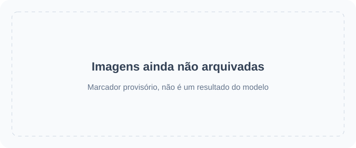

<!-- Generated by scripts/build_readme.py. Edit source data, locale catalogs and generator scripts. -->

# 🎨 Awesome GPT Image 2.6

Uma coleção aberta de prompts, exemplos visuais e fontes originais para GPT Image 2.6.

    

⚠️ **Aviso de direitos autorais**: Os prompts e a mídia desta coleção são reunidos de fontes públicas apenas para fins educacionais. Se você acredita que algum conteúdo infringe seus direitos, por favor, [abra uma issue](https://github.com/RaphaelAI-OpenLab/awesome-gpt-image-2-6/issues/new), e o removeremos imediatamente.

    
    
    
   

---

Esta versão de idioma traduz a interface do repositório. Os detalhes completos dos casos estão disponíveis atualmente em inglês e chinês simplificado.

Os títulos, as descrições e as páginas de detalhes dos casos são exibidos em inglês quando não há tradução disponível. Os prompts originais e as citações das fontes não são traduzidos.

**Links rápidos** · [🖼️ Explorar casos](#all-cases) · [🆕 Adicionado recentemente](#latest) · [📝 Adicionar um exemplo](https://github.com/RaphaelAI-OpenLab/awesome-gpt-image-2-6/issues/new?template=submit-case.yml) · [🐞 Relatar um problema](https://github.com/RaphaelAI-OpenLab/awesome-gpt-image-2-6/issues/new?template=report-problem.yml) · [📚 Ler o guia](CONTRIBUTING.md)

## 🌐 Explorar a coleção

**[Ver todos os casos deste repositório →](#all-cases)**

Cada caso abaixo abre uma página interna de detalhes com evidências do modelo, créditos das fontes e disponibilidade do prompt.

**MARCADOR PROVISÓRIO · URL da galeria web externa: não configurada.**

**MARCADOR PROVISÓRIO · Link de geração com um clique: não verificado.**

MARCADOR PROVISÓRIO · Link de coleção ou campanha relacionada: a adicionar.

[Visitar Raphael (página inicial)](https://raphael.app/?utm_source=github&utm_medium=repository&utm_campaign=gpt_image_2_6_launch&utm_content=top_nav&utm_term=pt-BR)

## 🏷️ Explorar por categoria

| Categoria | Casos com link para a fonte | Prompts completos |
| --- | ---: | ---: |
| [Imagens de marcas e produtos](#category-brand-products) | 64 | 0 |
| [Pôsteres e tipografia](#category-posters-typography) | 40 | 0 |
| [Infográficos](#category-infographics) | 16 | 0 |
| [Interiores e arquitetura](#category-interiors-architecture) | 10 | 0 |
| [Personagens e consistência](#category-characters-consistency) | 55 | 0 |
| [Anotações e edições pontuais](#category-markup-edits) | 36 | 0 |
| [SVG e recursos de design](#category-svg-design-assets) | 12 | 0 |
| [GIF e animação](#category-gif-animation) | 116 | 0 |

## 📖 Sumário

- [O que é GPT Image 2.6?](#about)
- [Estatísticas](#statistics)
- [Casos em destaque](#featured)
- [Adicionado recentemente](#latest)
- [Todos os casos](#all-cases)
- [Prompts completos](#collection)
- [Como usar](#using)
- [Contribuir](#contribute)
- [Licença](#license)
- [Agradecimentos](#acknowledgements)
- [Histórico de estrelas](#star-history)

## 🤔 O que é GPT Image 2.6?

A OpenAI apresentou Images 2.6 em 4 de novembro de 2026. Esta coleção abrange as variantes Sunburst e Flare do modelo, a criação e edição de imagens, além dos fluxos de trabalho documentados com SVG e GIF. O suporte a cada variante é registrado por caso, em vez de ser presumido.

[Anúncio oficial](https://openai.com/index/introducing-images-2-6/) · [Documentação do modelo](https://developers.openai.com/api/docs/guides/image-generation)

## 📊 Estatísticas

| Métrica | Contagem / data |
| --- | ---: |
| Casos com link para a fonte | **349** |
| Exemplos oficiais | **37** |
| Exemplos relatados pelos criadores | **312** |
| Prompts originais disponíveis na fonte | **216** |
| Prompts completos publicados aqui | **0** |
| Arquivos de mídia arquivados localmente | **511** |
| Última verificação das fontes (UTC) | **2026-11-09** |

As contagens de fontes não implicam reprodução dos resultados. As pistas pendentes são excluídas; resultados diferentes de um mesmo fluxo de trabalho contam como um único caso.

## 🔥 Casos em destaque

<table>
<tr>
<td width="33%" align="center"><a href="cases/docs-bakery-svg/README.md"> <strong>Bakery SVG logo</strong></a> Documentação oficial</td>
<td width="33%" align="center"><a href="cases/docs-lantern-gif/README.md"> <strong>Lantern-carrying monkey loop</strong></a> Documentação oficial</td>
<td width="33%" align="center"><a href="cases/launch-fal/README.md"> <strong>Living-room markup edit</strong></a> Demonstração oficial de lançamento</td>
</tr>
<tr>
<td width="33%" align="center"><a href="cases/launch-sable/README.md"> <strong>Miniature brand product world</strong></a> Demonstração oficial de lançamento</td>
<td width="33%" align="center"><a href="cases/launch-higgsfield/README.md"> <strong>Knight scene and clothing edit sequence</strong></a> Demonstração oficial de lançamento</td>
<td width="33%" align="center"><a href="cases/community-malfoid/README.md"> <strong>Summer character illustration animation</strong></a> Modelo informado pelo criador</td>
</tr>
</table>

Os cartões provisórios não são resultados gerados. Todos os arquivos de mídia exibidos estão neste repositório; a mídia ainda não arquivada mantém seus links nas páginas de detalhes.

## 🆕 Adicionado recentemente

| Adicionado | Caso | Evidência |
| --- | --- | --- |
| 2026-11-06 | [Borrow the Style of a Reference Image](cases/yepshot-compose-style-transfer/README.md) | Modelo informado pelo criador |
| 2026-11-06 | [Sketch to Product Render](cases/yepshot-creative-sketch-to-render/README.md) | Modelo informado pelo criador |
| 2026-11-06 | [Photo to 3D Clay Character](cases/yepshot-creative-3d-clay/README.md) | Modelo informado pelo criador |
| 2026-11-06 | [Photo to Watercolor Illustration](cases/yepshot-creative-watercolor-illustration/README.md) | Modelo informado pelo criador |
| 2026-11-06 | [Turn Your Pet into a Collectible Figure](cases/yepshot-creative-collectible-figure/README.md) | Modelo informado pelo criador |
| 2026-11-06 | [Brighten an Underexposed Photo](cases/yepshot-restore-low-light-fix/README.md) | Modelo informado pelo criador |

## 📋 Todos os casos

### Imagens de marcas e produtos

| Caso · página interna de detalhes | Fonte | Prompt |
| --- | --- | --- |
| [Transparent bakery raster logo](cases/docs-bakery-raster/README.md) | Documentação oficial | Prompt original na fonte |
| [Transparent product cutout](cases/docs-product-cutout/README.md) | Documentação oficial | Prompt original na fonte |
| [Toy airplane packaging](cases/docs-toy-package/README.md) | Documentação oficial | Prompt original na fonte |
| [Miniature brand product world](cases/launch-sable/README.md) | Demonstração oficial de lançamento | Prompt original na fonte |
| [Travel visual generation speed comparison](cases/launch-travel/README.md) | Demonstração oficial de lançamento | Prompt não público |
| [Laptop GIF-creation workspace illustration](cases/techrepublic-gif-workspace-illustration/README.md) | Modelo informado pelo criador | Prompt não público |
| [Tovalin serum scene comparison](cases/productai-tovalin-serum-comparison/README.md) | Modelo informado pelo criador | Prompt não público |
| [Quillhaven coffee scenes and precise edits](cases/productai-quillhaven-coffee-comparison/README.md) | Modelo informado pelo criador | Prompt não público |
| [Running-shoe scenes and precise edits](cases/productai-running-shoe-comparison/README.md) | Modelo informado pelo criador | Prompt não público |
| [Cable-knit cardigan on a model](cases/productai-cable-knit-cardigan-comparison/README.md) | Modelo informado pelo criador | Prompt não público |
| [Oaken Mile Coffee label: Flare and Sunburst](cases/community-moss-coffee-label/README.md) | Modelo informado pelo criador | Prompt original na fonte |
| [Cafe latte: Flare and Sunburst](cases/community-lightlyn-latte-variants/README.md) | Modelo informado pelo criador | Prompt original na fonte |
| [Earbud product-ad comparison](cases/community-lightlyn-earbuds-ad-variants/README.md) | Modelo informado pelo criador | Prompt original na fonte |
| [Made Takeaway box](cases/made-flare-dumpling-box/README.md) | Modelo informado pelo criador | Prompt original na fonte |
| [Made Stylus macro](cases/made-sunburst-stylus-macro/README.md) | Modelo informado pelo criador | Prompt original na fonte |
| [Three-flavor soda lineup](cases/yir-flavor-lineup/README.md) | Modelo informado pelo criador | Prompt original na fonte |
| [French press product photos and background-edit continuation](cases/community-gptimagehub-french-press-edit/README.md) | Modelo informado pelo criador | Prompt original na fonte |
| [SUMMIT ROAST coffee-bag product shot](cases/zzo-flare-summit-roast-bag/README.md) | Modelo informado pelo criador | Prompt original na fonte |
| [Nowrap logo motion comparison](cases/nowrap-logo-motion/README.md) | Modelo informado pelo criador | Prompt original na fonte |
| [Flat fox mascot badge](cases/toonderly-fox-badge/README.md) | Modelo informado pelo criador | Prompt original na fonte |
| [Watch four-round editing](cases/yir-watch-edit-sequence/README.md) | Modelo informado pelo criador | Prompt não público |
| [Vase four-round editing](cases/yir-vase-edit-sequence/README.md) | Modelo informado pelo criador | Prompt não público |
| [Soup photograph with recipe card](cases/joinoasis-tomato-soup/README.md) | Modelo informado pelo criador | Prompt original na fonte |
| [Blazer and boots reference composition](cases/joinoasis-blazer-boots-composition/README.md) | Modelo informado pelo criador | Prompt original na fonte |
| [Rainbow cups and cat](cases/community-flixly-rainbow-teacups/README.md) | Modelo informado pelo criador | Prompt original na fonte |
| [Sage-green to terracotta bottle edit](cases/omniakey-bottle-color-edit/README.md) | Modelo informado pelo criador | Prompt não público |
| [Watchmaker underwater macro test](cases/community-hn-watchmaker/README.md) | Modelo informado pelo criador | Prompt original na fonte |
| [Perfume bottle on wet coastal rock](cases/chatimage2-seaside-perfume-edit/README.md) | Modelo informado pelo criador | Prompt original na fonte |
| [Sunburst Roasters ceramic coffee canister](cases/replicate-sunburst-coffee-canister/README.md) | Modelo informado pelo criador | Prompt original na fonte |
| [Brushed-titanium espresso tamper: Flare and Sunburst](cases/csuite-tamper/README.md) | Modelo informado pelo criador | Disponibilidade do prompt não verificada |
| [Ceramic mug: 2K background-setting test](cases/iskragen-mug-2k-background-test/README.md) | Modelo informado pelo criador | Prompt original na fonte |
| [SUNNY POP sparkling-water poster](cases/framemux-sunny-pop-poster/README.md) | Modelo informado pelo criador | Prompt original na fonte |
| [Sage-green speaker on travertine](cases/gptimagehub-sage-speaker/README.md) | Modelo informado pelo criador | Prompt original na fonte |
| [LUMIÈRE jewelry portrait at a car window](cases/302-lumiere-jewelry-portrait/README.md) | Modelo informado pelo criador | Prompt original na fonte |
| [VHS-style night racing scene](cases/302-vhs-drift-race/README.md) | Modelo informado pelo criador | Prompt original na fonte |
| [Pure White Marketplace Packshot](cases/yepshot-studio-pure-white-amazon/README.md) | Modelo informado pelo criador | Disponibilidade do prompt não verificada |
| [Black Acrylic Mirror Reflection](cases/yepshot-studio-acrylic-reflection/README.md) | Modelo informado pelo criador | Disponibilidade do prompt não verificada |
| [Floating Hero Shot](cases/yepshot-studio-floating-ambient-shadow/README.md) | Modelo informado pelo criador | Disponibilidade do prompt não verificada |
| [Overhead Flat Lay on Light Gray](cases/yepshot-studio-overhead-flat-lay/README.md) | Modelo informado pelo criador | Disponibilidade do prompt não verificada |
| [Three-Quarter Catalog Angle](cases/yepshot-studio-three-quarter-angle/README.md) | Modelo informado pelo criador | Disponibilidade do prompt não verificada |
| [Material Close-Up for Detail Images](cases/yepshot-studio-material-detail-closeup/README.md) | Modelo informado pelo criador | Disponibilidade do prompt não verificada |
| [Preview Colorways Side by Side](cases/yepshot-studio-colorway-lineup/README.md) | Modelo informado pelo criador | Disponibilidade do prompt não verificada |
| [Travertine Block in Morning Light](cases/yepshot-lifestyle-travertine-stone/README.md) | Modelo informado pelo criador | Disponibilidade do prompt não verificada |
| [Marble Vanity with Water Droplets](cases/yepshot-lifestyle-marble-bathroom-dew/README.md) | Modelo informado pelo criador | Disponibilidade do prompt não verificada |
| [Oak Table with Kitchen Props](cases/yepshot-lifestyle-scandinavian-wood-kitchen/README.md) | Modelo informado pelo criador | Disponibilidade do prompt não verificada |
| [Concrete Podium, Tech Style](cases/yepshot-lifestyle-industrial-concrete-podium/README.md) | Modelo informado pelo criador | Disponibilidade do prompt não verificada |
| [Bright Modern Living Room](cases/yepshot-lifestyle-bright-living-room/README.md) | Modelo informado pelo criador | Disponibilidade do prompt não verificada |
| [Sunny Picnic Blanket](cases/yepshot-lifestyle-outdoor-picnic/README.md) | Modelo informado pelo criador | Disponibilidade do prompt não verificada |
| [Neon Gaming Desk](cases/yepshot-lifestyle-neon-gaming-desk/README.md) | Modelo informado pelo criador | Disponibilidade do prompt não verificada |
| [Remove Glare on Shiny Surfaces](cases/yepshot-cleanup-remove-glare-reflections/README.md) | Modelo informado pelo criador | Disponibilidade do prompt não verificada |
| [Erase Barcode and Price Sticker](cases/yepshot-cleanup-erase-barcode-watermark/README.md) | Modelo informado pelo criador | Disponibilidade do prompt não verificada |
| [Remove Dust and Fingerprints](cases/yepshot-cleanup-dust-fingerprints/README.md) | Modelo informado pelo criador | Disponibilidade do prompt não verificada |
| [Place a Product into Your Scene](cases/yepshot-compose-product-into-scene/README.md) | Modelo informado pelo criador | Disponibilidade do prompt não verificada |
| [Bundle Two Products into One Shot](cases/yepshot-compose-bundle-group-shot/README.md) | Modelo informado pelo criador | Disponibilidade do prompt não verificada |
| [Match Your Existing Catalog Look](cases/yepshot-compose-match-catalog-style/README.md) | Modelo informado pelo criador | Disponibilidade do prompt não verificada |
| [Smooth Out Fabric Wrinkles](cases/yepshot-cleanup-smooth-fabric-wrinkles/README.md) | Modelo informado pelo criador | Disponibilidade do prompt não verificada |
| [Christmas Pine and Warm Bokeh](cases/yepshot-seasonal-christmas-pine-bokeh/README.md) | Modelo informado pelo criador | Disponibilidade do prompt não verificada |
| [Summer Pool Water and Caustics](cases/yepshot-seasonal-summer-pool-water-ripples/README.md) | Modelo informado pelo criador | Disponibilidade do prompt não verificada |
| [Black Friday Black-and-Gold Pedestal](cases/yepshot-seasonal-black-friday-gold-geometry/README.md) | Modelo informado pelo criador | Disponibilidade do prompt não verificada |
| [Lunar New Year Red and Gold](cases/yepshot-seasonal-lunar-new-year/README.md) | Modelo informado pelo criador | Disponibilidade do prompt não verificada |
| [Turn Your Pet into a Collectible Figure](cases/yepshot-creative-collectible-figure/README.md) | Modelo informado pelo criador | Disponibilidade do prompt não verificada |
| [Photo to Watercolor Illustration](cases/yepshot-creative-watercolor-illustration/README.md) | Modelo informado pelo criador | Disponibilidade do prompt não verificada |
| [Sketch to Product Render](cases/yepshot-creative-sketch-to-render/README.md) | Modelo informado pelo criador | Disponibilidade do prompt não verificada |
| [Borrow the Style of a Reference Image](cases/yepshot-compose-style-transfer/README.md) | Modelo informado pelo criador | Disponibilidade do prompt não verificada |

### Pôsteres e tipografia

| Caso · página interna de detalhes | Fonte | Prompt |
| --- | --- | --- |
| [Streetwear advertisement typography](cases/docs-streetwear/README.md) | Documentação oficial | Prompt original na fonte |
| [Roadside shampoo billboard](cases/docs-billboard/README.md) | Documentação oficial | Prompt original na fonte |
| [Nostalgic holiday card](cases/docs-holiday-card/README.md) | Documentação oficial | Prompt original na fonte |
| [Shiba ramen shop: two quality comparison runs](cases/ai-garage-ramen-quality-series/README.md) | Modelo informado pelo criador | Prompt não público |
| [Autumn café menu announcement comparison](cases/ai-garage-autumn-cafe/README.md) | Modelo informado pelo criador | Prompt não público |
| [Flare 4K test, published previews](cases/aivideos-flare-4k-comparison/README.md) | Modelo informado pelo criador | Prompt não público |
| [Flare quality and planning comparison](cases/aivideos-flare-quality-planning/README.md) | Modelo informado pelo criador | Prompt não público |
| [Retro diner menu board](cases/dreamega-retro-diner/README.md) | Modelo informado pelo criador | Prompt original na fonte |
| [Lantern Row Night Market flyer: Flare and Sunburst](cases/community-moss-night-market-flyer/README.md) | Modelo informado pelo criador | Prompt original na fonte |
| [Café breakfast menu: Flare and Sunburst](cases/community-moss-breakfast-menu/README.md) | Modelo informado pelo criador | Prompt original na fonte |
| [Pottery event banner layout: Flare and Sunburst](cases/community-moss-pottery-banner-layout/README.md) | Modelo informado pelo criador | Prompt original na fonte |
| [Night market poster comparison](cases/community-lightlyn-night-market-variants/README.md) | Modelo informado pelo criador | Prompt original na fonte |
| [Made Lightbox menu](cases/made-flare-noodle-menu/README.md) | Modelo informado pelo criador | Prompt original na fonte |
| [Made Sleeve typography](cases/made-sunburst-record-sleeve/README.md) | Modelo informado pelo criador | Prompt original na fonte |
| [Made Window lettering](cases/made-sunburst-shop-window/README.md) | Modelo informado pelo criador | Prompt original na fonte |
| [Hot-sauce launch and speed-test posters](cases/yir-hot-sauce-posters/README.md) | Modelo informado pelo criador | Prompt original na fonte |
| [End-of-season bicycle sale ad](cases/yir-bicycle-sale-ad/README.md) | Modelo informado pelo criador | Prompt original na fonte |
| [Blue Hour jazz posters and date-edit continuation](cases/community-gptimagehub-jazz-poster-edit/README.md) | Modelo informado pelo criador | Prompt original na fonte |
| [Winter Night Market poster](cases/veevid-holiday-market-poster/README.md) | Modelo informado pelo criador | Prompt original na fonte |
| [English–Hindi evening menu from a document brief](cases/analyticsvidhya-bilingual-evening-menu/README.md) | Modelo informado pelo criador | Prompt original na fonte |
| [NIGHT TIDE wave concert poster](cases/zzo-flare-night-tide-poster/README.md) | Modelo informado pelo criador | Prompt original na fonte |
| [NIGHT MARKET typography comparison](cases/cellcog-night-market-poster/README.md) | Modelo informado pelo criador | Prompt não público |
| [Café neon text comparison](cases/nowrap-cafe-sign-motion/README.md) | Modelo informado pelo criador | Prompt original na fonte |
| [BOUNCE balloon-letter poster](cases/toonderly-bounce-poster/README.md) | Modelo informado pelo criador | Prompt não público |
| [OPEN LATE neon storefront](cases/kavel-open-late/README.md) | Modelo informado pelo criador | Prompt não público |
| [Lemon cake recipe card](cases/community-flixly-lemon-recipe/README.md) | Modelo informado pelo criador | Prompt original na fonte |
| [FIELD & FLOUR bakery poster](cases/sogni-flare-bakery-poster/README.md) | Modelo informado pelo criador | Prompt não público |
| [NORTHLIGHT TEA poster layout comparison](cases/sandbase-northlight-tea-posters/README.md) | Modelo informado pelo criador | Prompt não público |
| [Port Calder poster complexity comparison](cases/omniakey-port-calder-comparison/README.md) | Modelo informado pelo criador | Prompt original na fonte |
| [Birthday cake without extra slogan cards](cases/community-flare-slogan-comparison/README.md) | Modelo informado pelo criador | Prompt original na fonte |
| [NIGHT SIGNAL concert poster: Flare and Sunburst](cases/csuite-poster/README.md) | Modelo informado pelo criador | Disponibilidade do prompt não verificada |
| [The Daily Pour coffee poster](cases/apixo-daily-pour-poster/README.md) | Modelo informado pelo criador | Prompt não público |
| [Coffee poster: vague prompt versus structured brief](cases/gptimagehub-structured-coffee-poster/README.md) | Modelo informado pelo criador | Prompt original na fonte |
| [AMALFI travel poster](cases/gptimagehub-amalfi-poster/README.md) | Modelo informado pelo criador | Prompt original na fonte |
| [Block-world comparison cover redesign](cases/302-block-world-cover/README.md) | Modelo informado pelo criador | Prompt original na fonte |
| [Five-view concept-car poster collage](cases/302-flying-car-collage/README.md) | Modelo informado pelo criador | Prompt original na fonte |
| [Change the Name on a Product Label](cases/yepshot-text-label-name-swap/README.md) | Modelo informado pelo criador | Disponibilidade do prompt não verificada |
| [Translate the Text on Packaging](cases/yepshot-text-translate-packaging/README.md) | Modelo informado pelo criador | Disponibilidade do prompt não verificada |
| [Turn a Product Photo into a Sale Poster](cases/yepshot-campaign-sale-poster-text/README.md) | Modelo informado pelo criador | Disponibilidade do prompt não verificada |
| [Update the Discount on a Promo Graphic](cases/yepshot-text-promo-discount-update/README.md) | Modelo informado pelo criador | Disponibilidade do prompt não verificada |

### Infográficos

| Caso · página interna de detalhes | Fonte | Prompt |
| --- | --- | --- |
| [Coffee-machine process diagram](cases/docs-coffee-diagram/README.md) | Documentação oficial | Prompt original na fonte |
| [Cellular respiration teaching visual](cases/docs-cell-respiration/README.md) | Documentação oficial | Prompt original na fonte |
| [Market-size presentation slide](cases/docs-pitch-slide/README.md) | Documentação oficial | Prompt original na fonte |
| [Northfield Design Summit agenda: Flare and Sunburst](cases/community-moss-design-summit-agenda/README.md) | Modelo informado pelo criador | Prompt original na fonte |
| [Honeybee scientific scale layouts](cases/community-lightlyn-bee-scale-variants/README.md) | Modelo informado pelo criador | Prompt original na fonte |
| [Made Illustrated map](cases/made-flare-market-map/README.md) | Modelo informado pelo criador | Prompt original na fonte |
| [Made Exploded diagram](cases/made-sunburst-turntable-diagram/README.md) | Modelo informado pelo criador | Prompt original na fonte |
| [Lisbon weather screen: matched Flare and Sunburst test](cases/community-gptimagehub-weather-ui/README.md) | Modelo informado pelo criador | Prompt original na fonte |
| [Six-step bill-to-law infographic comparison](cases/community-gptimagehub-law-infographic/README.md) | Modelo informado pelo criador | Prompt original na fonte |
| [Monarch butterfly life-cycle field-guide plate](cases/analyticsvidhya-monarch-life-cycle/README.md) | Modelo informado pelo criador | Prompt original na fonte |
| [Automatic coffee-machine flow infographic](cases/zzo-flare-coffee-machine-diagram/README.md) | Modelo informado pelo criador | Prompt original na fonte |
| [Quarterly revenue chart animation](cases/nowrap-chart-motion/README.md) | Modelo informado pelo criador | Prompt original na fonte |
| [Five-step coffee process infographic](cases/replicate-flare-coffee-process-infographic/README.md) | Modelo informado pelo criador | Prompt original na fonte |
| [Labeled sunflower botanical plate](cases/replicate-sunburst-sunflower-botanical/README.md) | Modelo informado pelo criador | Prompt original na fonte |
| [The Life of a Coffee Bean infographic](cases/gptimagehub-coffee-bean-infographic/README.md) | Modelo informado pelo criador | Prompt original na fonte |
| [The Ember Isles fantasy map](cases/gptimagehub-ember-isles-map/README.md) | Modelo informado pelo criador | Prompt original na fonte |

### Interiores e arquitetura

| Caso · página interna de detalhes | Fonte | Prompt |
| --- | --- | --- |
| [Replace chairs in an interior](cases/docs-room-chairs/README.md) | Documentação oficial | Prompt original na fonte |
| [Living-room markup edit](cases/launch-fal/README.md) | Demonstração oficial de lançamento | Prompt original na fonte |
| [Made Ultra-wide aisle](cases/made-flare-market-aerial/README.md) | Modelo informado pelo criador | Prompt original na fonte |
| [Snowy mountain greenhouse at blue hour](cases/analyticsvidhya-snowy-greenhouse/README.md) | Modelo informado pelo criador | Prompt original na fonte |
| [Red tram in a foggy city](cases/kavel-tram/README.md) | Modelo informado pelo criador | Prompt não público |
| [Four-room doorway layout](cases/joinoasis-four-room-floorplan/README.md) | Modelo informado pelo criador | Prompt original na fonte |
| [Kitchen hanging-light replacement](cases/joinoasis-kitchen-pendant-edit/README.md) | Modelo informado pelo criador | Prompt original na fonte |
| [Dusty warehouse prompt-detail comparison](cases/community-sunburst-dust-detail/README.md) | Modelo informado pelo criador | Disponibilidade do prompt não verificada |
| [Rainy-window reading nook](cases/chatimage2-rainy-reading-nook/README.md) | Modelo informado pelo criador | Prompt original na fonte |
| [Waterfall landscape with a red-jacket hiker](cases/zhidx-waterfall-landscape/README.md) | Modelo informado pelo criador | Prompt não público |

### Personagens e consistência

| Caso · página interna de detalhes | Fonte | Prompt |
| --- | --- | --- |
| [Paper-cut championship scene: complexity comparison](cases/docs-complexity/README.md) | Documentação oficial | Prompt original na fonte |
| [Realistic fishing-boat sailor portrait](cases/docs-sailor/README.md) | Documentação oficial | Prompt original na fonte |
| [1969 historical crowd scene](cases/docs-historical-crowd/README.md) | Documentação oficial | Prompt original na fonte |
| [Four-panel pet comic](cases/docs-pet-comic/README.md) | Documentação oficial | Prompt original na fonte |
| [Change clothing while preserving identity](cases/docs-outfit/README.md) | Documentação oficial | Prompt original na fonte |
| [Place a person into a camping escape scene](cases/docs-person-scene/README.md) | Documentação oficial | Prompt original na fonte |
| [Establish a storybook character](cases/docs-character-start/README.md) | Documentação oficial | Prompt original na fonte |
| [Continue the same character’s story](cases/docs-character-story/README.md) | Documentação oficial | Prompt original na fonte |
| [Stained-glass whale](cases/launch-picsart/README.md) | Demonstração oficial de lançamento | Prompt não público |
| [Knight scene and clothing edit sequence](cases/launch-higgsfield/README.md) | Demonstração oficial de lançamento | Prompt original na fonte |
| [Ophanim-inspired still: The Coastal Lookout](cases/community-ophanim-coastal-lookout/README.md) | Modelo informado pelo criador | Prompt original na fonte |
| [Ophanim-inspired still: The Mountain Reservoir](cases/community-ophanim-mountain-reservoir/README.md) | Modelo informado pelo criador | Prompt original na fonte |
| [Ophanim-inspired still: The Village in the Rain](cases/community-ophanim-village-rain/README.md) | Modelo informado pelo criador | Prompt original na fonte |
| [Ophanim-inspired still: The Subway Entrance](cases/community-ophanim-subway-entrance/README.md) | Modelo informado pelo criador | Prompt original na fonte |
| [Fisherman at dawn: Flare and Sunburst](cases/community-moss-fisherman-dawn/README.md) | Modelo informado pelo criador | Prompt original na fonte |
| [Made Vendor portrait](cases/made-flare-vendor-flash/README.md) | Modelo informado pelo criador | Prompt original na fonte |
| [Made Rainy night](cases/made-flare-rain-stall/README.md) | Modelo informado pelo criador | Prompt original na fonte |
| [Made Crate digger](cases/made-sunburst-crate-digger/README.md) | Modelo informado pelo criador | Prompt original na fonte |
| [Made Listening booth](cases/made-sunburst-listening-booth/README.md) | Modelo informado pelo criador | Prompt original na fonte |
| [Ferry at blue hour](cases/yir-ferry-blue-hour/README.md) | Modelo informado pelo criador | Prompt original na fonte |
| [Night market noodle stall](cases/yir-noodle-stall/README.md) | Modelo informado pelo criador | Prompt original na fonte |
| [Raincoat animation storyboard](cases/yir-raincoat-storyboard/README.md) | Modelo informado pelo criador | Prompt original na fonte |
| [Fox raincoat consistency test](cases/nowrap-fox-motion/README.md) | Modelo informado pelo criador | Prompt original na fonte |
| [Robot learning to fly storyboard](cases/toonderly-robot-storyboard/README.md) | Modelo informado pelo criador | Prompt não público |
| [Portrait four-round editing](cases/yir-portrait-edit-sequence/README.md) | Modelo informado pelo criador | Prompt não público |
| [1990s-style flash portrait](cases/kavel-90s-snapshot/README.md) | Modelo informado pelo criador | Prompt original na fonte |
| [Mira lighthouse keyframes](cases/community-flixly-mira-keyframes/README.md) | Modelo informado pelo criador | Prompt original na fonte |
| [Fisherman repairing a net](cases/community-flixly-fisherman-portrait/README.md) | Modelo informado pelo criador | Prompt original na fonte |
| [Fox and badger in rain](cases/community-flixly-rainy-bridge-friends/README.md) | Modelo informado pelo criador | Prompt original na fonte |
| [The Last Reel: Flare and Sunburst scene variants](cases/maxvideo-gpt26-last-reel-generation/README.md) | Modelo informado pelo criador | Prompt original na fonte |
| [Curly-haired editorial portrait: Flare and Sunburst](cases/csuite-portrait/README.md) | Modelo informado pelo criador | Disponibilidade do prompt não verificada |
| [Paladin: background and armor edit sequence](cases/overchat-paladin-edits/README.md) | Modelo informado pelo criador | Prompt original na fonte |
| [Astronaut cat sticker with jetpack](cases/replicate-flare-astronaut-cat-sticker/README.md) | Modelo informado pelo criador | Prompt original na fonte |
| [Nine-panel workplace AI comic](cases/zhidx-nine-panel-comic/README.md) | Modelo informado pelo criador | Prompt não público |
| [Photoreal basketball game image](cases/zhidx-basketball-photo/README.md) | Modelo informado pelo criador | Prompt não público |
| [Orange Y2K fashion in a blue studio](cases/302-y2k-orange-fashion/README.md) | Modelo informado pelo criador | Prompt original na fonte |
| [Ink illustration of wolves in snow](cases/302-ink-wolves-snow/README.md) | Modelo informado pelo criador | Prompt original na fonte |
| [Reference-led courtyard photo board](cases/community-marco-reference-photo-board/README.md) | Modelo informado pelo criador | Prompt não público |
| [Sunburst courtyard comparison](cases/community-marco-sunburst-courtyard-comparison/README.md) | Modelo informado pelo criador | Prompt não público |
| [Mushroom-lit fashion portrait](cases/community-marco-mushroom-fashion-portrait/README.md) | Modelo informado pelo criador | Prompt não público |
| [Ghost Mannequin to Street Model](cases/yepshot-apparel-ghost-mannequin-to-street-model/README.md) | Modelo informado pelo criador | Disponibilidade do prompt não verificada |
| [Virtual Try-On](cases/yepshot-compose-virtual-try-on/README.md) | Modelo informado pelo criador | Disponibilidade do prompt não verificada |
| [Upgrade Fabric to Silk](cases/yepshot-apparel-silk-texture-upgrade/README.md) | Modelo informado pelo criador | Disponibilidade do prompt não verificada |
| [Recolor a Garment](cases/yepshot-fashion-garment-recolor/README.md) | Modelo informado pelo criador | Disponibilidade do prompt não verificada |
| [Clean Studio Backdrop for Model Shots](cases/yepshot-fashion-model-studio-backdrop/README.md) | Modelo informado pelo criador | Disponibilidade do prompt não verificada |
| [Change Hair to Platinum Blonde](cases/yepshot-portrait-platinum-blonde-hair/README.md) | Modelo informado pelo criador | Disponibilidade do prompt não verificada |
| [Natural Skin Retouch](cases/yepshot-portrait-skin-texture-refinement/README.md) | Modelo informado pelo criador | Disponibilidade do prompt não verificada |
| [Casual Photo to Business Headshot](cases/yepshot-portrait-business-headshot/README.md) | Modelo informado pelo criador | Disponibilidade do prompt não verificada |
| [ID Photo with White Background](cases/yepshot-portrait-id-photo/README.md) | Modelo informado pelo criador | Disponibilidade do prompt não verificada |
| [Remove People from the Background](cases/yepshot-portrait-remove-photobomber/README.md) | Modelo informado pelo criador | Disponibilidade do prompt não verificada |
| [Restore a Faded Old Photo](cases/yepshot-restore-vintage-photo-reconstruction/README.md) | Modelo informado pelo criador | Disponibilidade do prompt não verificada |
| [Colorize a Black-and-White Photo](cases/yepshot-restore-colorize-bw/README.md) | Modelo informado pelo criador | Disponibilidade do prompt não verificada |
| [Fix Blur and Noise](cases/yepshot-restore-deblur-sharpen/README.md) | Modelo informado pelo criador | Disponibilidade do prompt não verificada |
| [Brighten an Underexposed Photo](cases/yepshot-restore-low-light-fix/README.md) | Modelo informado pelo criador | Disponibilidade do prompt não verificada |
| [Photo to 3D Clay Character](cases/yepshot-creative-3d-clay/README.md) | Modelo informado pelo criador | Disponibilidade do prompt não verificada |

### Anotações e edições pontuais

| Caso · página interna de detalhes | Fonte | Prompt |
| --- | --- | --- |
| [Recolor a marked vase](cases/docs-vase-markup/README.md) | Documentação oficial | Prompt original na fonte |
| [Translate an infographic into Spanish](cases/docs-spanish-edit/README.md) | Documentação oficial | Prompt original na fonte |
| [Transfer a pixel-art style](cases/docs-pixel-style/README.md) | Documentação oficial | Prompt original na fonte |
| [Combine pets across images](cases/docs-dog-composite/README.md) | Documentação oficial | Prompt original na fonte |
| [Turn a sketch into a realistic scene](cases/docs-sketch-render/README.md) | Documentação oficial | Prompt original na fonte |
| [Remove a held flower](cases/docs-remove-flower/README.md) | Documentação oficial | Prompt original na fonte |
| [Change the billboard scene to a snowy night](cases/docs-snow-edit/README.md) | Documentação oficial | Prompt original na fonte |
| [Shiba chef festival background edit](cases/ai-garage-festival-background/README.md) | Modelo informado pelo criador | Prompt original na fonte |
| [Red chef hat despite conflicting markup](cases/ai-garage-red-chef-hat/README.md) | Modelo informado pelo criador | Prompt original na fonte |
| [Mirror reflection costume edit](cases/dreamega-mirror-reflection/README.md) | Modelo informado pelo criador | Prompt não público |
| [Miniature city inside a piano](cases/dreamega-piano-city/README.md) | Modelo informado pelo criador | Prompt não público |
| [Recolor a sofa in a living room](cases/community-lightlyn-sofa-edit-variants/README.md) | Modelo informado pelo criador | Prompt original na fonte |
| [Sneaker recolored to forest green suede](cases/veevid-sneaker-suede-recolor/README.md) | Modelo informado pelo criador | Prompt original na fonte |
| [Markup-guided forest-green armchair edit](cases/analyticsvidhya-markup-green-armchair/README.md) | Modelo informado pelo criador | Prompt original na fonte |
| [LUMA 02 bottle on a forest river stone](cases/zzo-flare-luma-forest-stone/README.md) | Modelo informado pelo criador | Prompt original na fonte |
| [Owl doodle watercolor edit](cases/toonderly-owl-watercolor/README.md) | Modelo informado pelo criador | Prompt não público |
| [Sparrow added to a ramen shop](cases/toonderly-ramen-sparrow-edit/README.md) | Modelo informado pelo criador | Prompt não público |
| [Golden retriever photo to cartoon](cases/toonderly-dog-photo-cartoon/README.md) | Modelo informado pelo criador | Prompt não público |
| [Sunny mansion transformation](cases/community-flixly-sunny-mansion-edit/README.md) | Modelo informado pelo criador | Prompt original na fonte |
| [NORTHLIGHT TEA color and date edits](cases/sandbase-northlight-tea-edits/README.md) | Modelo informado pelo criador | Prompt não público |
| [Rabbit storybook day-to-dusk edit](cases/community-flare-day-dusk-edit/README.md) | Modelo informado pelo criador | Disponibilidade do prompt não verificada |
| [The Last Reel: shared-input wardrobe edits](cases/maxvideo-gpt26-last-reel-edit/README.md) | Modelo informado pelo criador | Prompt original na fonte |
| [GEN202 astronaut cat-to-dog edit comparison](cases/gen202-astronaut-cat-dog-variant-workflow/README.md) | Modelo informado pelo criador | Prompt original na fonte |
| [Living-room markup: Flare and Sunburst comparisons](cases/overchat-room-markup/README.md) | Modelo informado pelo criador | Prompt original na fonte |
| [Food court: evening scene and rainy neon edit](cases/iskragen-food-court-weather-edit/README.md) | Modelo informado pelo criador | Prompt original na fonte |
| [Schoolyard: autumn scene and snow edit](cases/iskragen-schoolyard-season-edit/README.md) | Modelo informado pelo criador | Prompt original na fonte |
| [Family pancakes: original and sunny-light edit](cases/iskragen-pancake-kitchen-light-edit/README.md) | Modelo informado pelo criador | Prompt original na fonte |
| [Paper-cut lighthouse sky changed from sunset to stars](cases/replicate-flare-lighthouse-sky-edit/README.md) | Modelo informado pelo criador | Prompt original na fonte |
| [Watchmaker workbench, golden hour to moonlight](cases/replicate-sunburst-watchmaker-moonlight/README.md) | Modelo informado pelo criador | Prompt original na fonte |
| [Clearly labeled fictional GPT-6.2 announcement edit](cases/zhidx-fictional-release-post/README.md) | Modelo informado pelo criador | Prompt não público |
| [Museum photograph: marked-person removal comparison](cases/zhidx-museum-person-removal/README.md) | Modelo informado pelo criador | Prompt não público |
| [Coral vase markup comparison](cases/apixo-coral-vase-comparison/README.md) | Modelo informado pelo criador | Prompt original na fonte |
| [Ramen shop: rain-to-snow reference edit](cases/gptimagehub-ramen-rain-snow/README.md) | Modelo informado pelo criador | Prompt original na fonte |
| [MOONLEAF tea tin: jasmine-to-rose label edit](cases/gptimagehub-moonleaf-tea-edit/README.md) | Modelo informado pelo criador | Prompt original na fonte |
| [AI-edited group-photo environment transfer](cases/302-group-photo-environment-edit/README.md) | Modelo informado pelo criador | Prompt original na fonte |
| [Flare STUDIO NIGHTS headline edit](cases/aivideos-flare-headline-edit/README.md) | Modelo informado pelo criador | Prompt original na fonte |

### SVG e recursos de design

| Caso · página interna de detalhes | Fonte | Prompt |
| --- | --- | --- |
| [Bakery SVG logo](cases/docs-bakery-svg/README.md) | Documentação oficial | Prompt original na fonte |
| [Farmers market mobile interface](cases/docs-market-ui/README.md) | Documentação oficial | Prompt original na fonte |
| [Bear mascot: SVG versus PNG previews](cases/community-bear-svg-comparison/README.md) | Modelo informado pelo criador | Prompt não público |
| [Harbor Roast vector logo](cases/community-lightlyn-coffee-logo-svg/README.md) | Modelo informado pelo criador | Prompt original na fonte |
| [Six weather icons as SVG](cases/community-lightlyn-weather-icons-svg/README.md) | Modelo informado pelo criador | Prompt original na fonte |
| [Turn a cafe photo into vector art](cases/community-lightlyn-latte-vector-svg/README.md) | Modelo informado pelo criador | Prompt original na fonte |
| [Teal and amber hourglass pictogram comparison](cases/cellcog-hourglass-icon/README.md) | Modelo informado pelo criador | Prompt não público |
| [Six vector-test comparison renders](cases/cellcog-vector-comparison-renders/README.md) | Modelo informado pelo criador | Prompt não público |
| [Purple fox and news-panel SVG](cases/ai-garage-fox-news-vector/README.md) | Modelo informado pelo criador | Prompt não público |
| [Ember & Rye logo: raster preview of SVG workflow](cases/overchat-ember-rye-logo/README.md) | Modelo informado pelo criador | Prompt original na fonte |
| [Coffee-cup SVG icon](cases/apixo-coffee-cup-svg/README.md) | Modelo informado pelo criador | Prompt original na fonte |
| [Clapperboard play-button SVG](cases/aivideos-clapperboard-svg/README.md) | Modelo informado pelo criador | Prompt não público |

### GIF e animação

| Caso · página interna de detalhes | Fonte | Prompt |
| --- | --- | --- |
| [Lantern-carrying monkey loop](cases/docs-lantern-gif/README.md) | Documentação oficial | Prompt original na fonte |
| [Office character: falling stock GIF](cases/launch-openart-down/README.md) | Demonstração oficial de lançamento | Prompt original na fonte |
| [Office character: rising stock GIF](cases/launch-openart-up/README.md) | Demonstração oficial de lançamento | Prompt original na fonte |
| [Owl sketch to animation](cases/launch-owl/README.md) | Demonstração oficial de lançamento | Prompt não público |
| [Monty typing indicator animation](cases/launch-town/README.md) | Demonstração oficial de lançamento | Prompt não público |
| [Summer character illustration animation](cases/community-malfoid/README.md) | Modelo informado pelo criador | Prompt não público |
| [Images 2.6 brings GIF(T)S :D](cases/community-gifts/README.md) | Modelo informado pelo criador | Prompt não público |
| [Boxing tiger animation](cases/community-boxing-tiger/README.md) | Modelo informado pelo criador | Prompt não público |
| [Hummingbird and kingfisher animation variants](cases/community-hummingbird-variants/README.md) | Modelo informado pelo criador | Prompt não público |
| [Rosebud animation](cases/community-rosebud-animation/README.md) | Modelo informado pelo criador | Prompt não público |
| [Shiba chef waving loop](cases/ai-garage-shiba-wave/README.md) | Modelo informado pelo criador | Prompt não público |
| [Stock-market kitten meme: three GIF iterations](cases/community-greta-stock-kitten-iterations/README.md) | Modelo informado pelo criador | Prompt original na fonte |
| [Morphed: bubblegum pop and reset loop](cases/morphed-bubblegum-loop/README.md) | Modelo informado pelo criador | Prompt original na fonte |
| [Rocking KINGY LAB bottle GIF](cases/kingy-sunburst-bottle-rocking/README.md) | Modelo informado pelo criador | Disponibilidade do prompt não verificada |
| [Cartoon snowman waving loop](cases/veevid-snowman-wave/README.md) | Modelo informado pelo criador | Prompt original na fonte |
| [Selfie to sunglasses reaction loop](cases/yepshot-sunglasses-reaction/README.md) | Modelo informado pelo criador | Prompt original na fonte |
| [Puppy head-tilt loop](cases/yepshot-pet-head-tilt/README.md) | Modelo informado pelo criador | Prompt original na fonte |
| [Photo to waving chibi sticker loop](cases/yepshot-chibi-sticker-wave/README.md) | Modelo informado pelo criador | Prompt original na fonte |
| [Owl sketch comes alive](cases/yepshot-drawing-comes-alive/README.md) | Modelo informado pelo criador | Prompt original na fonte |
| [OPEN neon animation preview](cases/zzo-neon-open-sign/README.md) | Modelo informado pelo criador | Prompt original na fonte |
| [Good-night sticker animation preview](cases/zzo-goodnight-girl-from-reference/README.md) | Modelo informado pelo criador | Prompt original na fonte |
| [Thank-you shiba animation preview](cases/zzo-thank-you-shiba/README.md) | Modelo informado pelo criador | Disponibilidade do prompt não verificada |
| [LOL bean animation preview](cases/zzo-lol-bean/README.md) | Modelo informado pelo criador | Disponibilidade do prompt não verificada |
| [Oops reaction animation preview](cases/zzo-oops-facepalm/README.md) | Modelo informado pelo criador | Disponibilidade do prompt não verificada |
| [Got-it robot animation preview](cases/zzo-got-it-robot/README.md) | Modelo informado pelo criador | Disponibilidade do prompt não verificada |
| [Morning coffee animation preview](cases/zzo-good-morning-coffee/README.md) | Modelo informado pelo criador | Disponibilidade do prompt não verificada |
| [Birthday cake animation preview](cases/zzo-birthday-cake/README.md) | Modelo informado pelo criador | Disponibilidade do prompt não verificada |
| [Thanksgiving turkey animation preview](cases/zzo-thanksgiving-turkey/README.md) | Modelo informado pelo criador | Disponibilidade do prompt não verificada |
| [Black Friday animation preview](cases/zzo-black-friday-sale/README.md) | Modelo informado pelo criador | Disponibilidade do prompt não verificada |
| [Christmas tree animation preview](cases/zzo-christmas-tree/README.md) | Modelo informado pelo criador | Disponibilidade do prompt não verificada |
| [New Year 2027 animation preview](cases/zzo-new-year-2027/README.md) | Modelo informado pelo criador | Disponibilidade do prompt não verificada |
| [Snowy-window cat animation preview](cases/zzo-window-cat-snow/README.md) | Modelo informado pelo criador | Prompt original na fonte |
| [Glasses-wearing fox mascot wave](cases/cellcog-mascot-wave/README.md) | Modelo informado pelo criador | Prompt não público |
| [SCOUT ANALYSE PATCH animation](cases/cellcog-labelled-workflow/README.md) | Modelo informado pelo criador | Prompt não público |
| [Office worker surprise reaction](cases/cellcog-office-reaction/README.md) | Modelo informado pelo criador | Prompt não público |
| [Bouncing ball frame-control comparison](cases/nowrap-ball-motion/README.md) | Modelo informado pelo criador | Prompt original na fonte |
| [Paper boat seamless-loop test](cases/nowrap-boat-motion/README.md) | Modelo informado pelo criador | Prompt original na fonte |
| [Night-market crowd animation](cases/nowrap-night-market-motion/README.md) | Modelo informado pelo criador | Prompt original na fonte |
| [Bouncing fox pup loop](cases/toonderly-fox-bounce/README.md) | Modelo informado pelo criador | Prompt não público |
| [Penguin chef pancake-flip loop](cases/toonderly-penguin-pancake/README.md) | Modelo informado pelo criador | Prompt original na fonte |
| [LUCKY neon sign flicker](cases/kavel-neon-lucky/README.md) | Modelo informado pelo criador | Prompt não público |
| [Corgi chasing its tail](cases/kavel-corgi/README.md) | Modelo informado pelo criador | Prompt não público |
| [Flat character stretch routine](cases/kavel-stretch/README.md) | Modelo informado pelo criador | Prompt original na fonte |
| [Jelly bear wobble](cases/ailingqu-jelly-bear-wobble/README.md) | Modelo informado pelo criador | Prompt original na fonte |
| [White bunny reaction sticker set](cases/ailingqu-bunny-reaction-set/README.md) | Modelo informado pelo criador | Prompt original na fonte |
| [Cartoon cat waving hello](cases/ailingqu-cat-waving-hello/README.md) | Modelo informado pelo criador | Prompt original na fonte |
| [Confused shiba head tilt](cases/ailingqu-shiba-head-tilt/README.md) | Modelo informado pelo criador | Prompt original na fonte |
| [Cat typing furiously](cases/ailingqu-cat-typing-laptop/README.md) | Modelo informado pelo criador | Prompt original na fonte |
| [Frog blowing a heart](cases/ailingqu-frog-heart-bubble/README.md) | Modelo informado pelo criador | Prompt original na fonte |
| [Penguin facepalm](cases/ailingqu-penguin-facepalm/README.md) | Modelo informado pelo criador | Prompt original na fonte |
| [Basketball shot celebration](cases/ailingqu-basketball-shot-sticker/README.md) | Modelo informado pelo criador | Prompt original na fonte |
| [Cat chef tossing fried rice](cases/ailingqu-cat-chef-fried-rice/README.md) | Modelo informado pelo criador | Prompt original na fonte |
| [Black cat punch](cases/ailingqu-black-cat-punch/README.md) | Modelo informado pelo criador | Prompt original na fonte |
| [Office cat workday reaction set](cases/ailingqu-office-cat-workday-set/README.md) | Modelo informado pelo criador | Prompt original na fonte |
| [Roaring duck](cases/ailingqu-roaring-duck/README.md) | Modelo informado pelo criador | Prompt original na fonte |
| [Flower macro flash cut](cases/ailingqu-flower-macro-flash/README.md) | Modelo informado pelo criador | Prompt original na fonte |
| [Cat-head logo brand reel](cases/ailingqu-cat-brand-reel/README.md) | Modelo informado pelo criador | Prompt original na fonte |
| [Sneaker colorway flash](cases/ailingqu-sneaker-colorway-flash/README.md) | Modelo informado pelo criador | Prompt original na fonte |
| [One tree, four seasons](cases/ailingqu-four-seasons-tree/README.md) | Modelo informado pelo criador | Prompt original na fonte |
| [Magazine collage panels pop in](cases/ailingqu-magazine-panels-pop/README.md) | Modelo informado pelo criador | Prompt original na fonte |
| [Reading by the window, day to night](cases/ailingqu-window-day-to-night/README.md) | Modelo informado pelo criador | Prompt original na fonte |
| [Steaming coffee loop](cases/ailingqu-steaming-coffee/README.md) | Modelo informado pelo criador | Prompt original na fonte |
| [Rainy window and plant](cases/ailingqu-rain-on-window/README.md) | Modelo informado pelo criador | Prompt original na fonte |
| [Goldfish in a bowl](cases/ailingqu-goldfish-bowl/README.md) | Modelo informado pelo criador | Prompt original na fonte |
| [Lighthouse at night](cases/ailingqu-lighthouse-night/README.md) | Modelo informado pelo criador | Prompt original na fonte |
| [Cat sleeping by the fireplace](cases/ailingqu-cat-by-fireplace/README.md) | Modelo informado pelo criador | Prompt original na fonte |
| [Lantern monkey in the snow](cases/ailingqu-lantern-monkey-snow/README.md) | Modelo informado pelo criador | Prompt original na fonte |
| [Sleepy fox on a mossy rock](cases/ailingqu-sleepy-fox-rock/README.md) | Modelo informado pelo criador | Prompt original na fonte |
| [Lo-fi study loop](cases/ailingqu-lofi-study-loop/README.md) | Modelo informado pelo criador | Prompt original na fonte |
| [Café cinemagraph](cases/ailingqu-cafe-cinemagraph/README.md) | Modelo informado pelo criador | Prompt original na fonte |
| [Ink-wash galloping horse](cases/ailingqu-ink-wash-horse/README.md) | Modelo informado pelo criador | Prompt original na fonte |
| [Doodle monster comes alive](cases/ailingqu-doodle-monster/README.md) | Modelo informado pelo criador | Prompt original na fonte |
| [Pixel art campfire](cases/ailingqu-pixel-campfire/README.md) | Modelo informado pelo criador | Prompt original na fonte |
| [Bouncing dots loader](cases/ailingqu-bouncing-dots-loader/README.md) | Modelo informado pelo criador | Prompt original na fonte |
| [Pixel knight run cycle](cases/ailingqu-pixel-knight-run/README.md) | Modelo informado pelo criador | Prompt original na fonte |
| [Like button heart burst](cases/ailingqu-like-heart-burst/README.md) | Modelo informado pelo criador | Prompt original na fonte |
| [Hourglass loading](cases/ailingqu-hourglass-flip/README.md) | Modelo informado pelo criador | Prompt original na fonte |
| [Arcade VS screen](cases/ailingqu-arcade-vs-screen/README.md) | Modelo informado pelo criador | Prompt original na fonte |
| [8-bit slime boss battle](cases/ailingqu-pixel-slime-boss/README.md) | Modelo informado pelo criador | Prompt original na fonte |
| [Love-burst skill animation](cases/ailingqu-love-burst-skill/README.md) | Modelo informado pelo criador | Prompt original na fonte |
| [Junkyard robot walk cycle](cases/ailingqu-junkyard-robot-walk/README.md) | Modelo informado pelo criador | Prompt original na fonte |
| [Orange fox mascot waving](cases/veevid-fox-wave/README.md) | Modelo informado pelo criador | Prompt original na fonte |
| [Heart-latte steam loop](cases/veevid-coffee-steam/README.md) | Modelo informado pelo criador | Prompt original na fonte |
| [Potted cactus mascot waving](cases/veevid-cactus-wave/README.md) | Modelo informado pelo criador | Prompt original na fonte |
| [Holiday retriever tail-wag loop](cases/veevid-dog-tail-loop/README.md) | Modelo informado pelo criador | Prompt original na fonte |
| [Ink robot sketch waving](cases/veevid-robot-sketch-wave/README.md) | Modelo informado pelo criador | Prompt original na fonte |
| [Perfume bottle light sweep](cases/veevid-perfume-light-loop/README.md) | Modelo informado pelo criador | Prompt original na fonte |
| [Sunburst monkey lantern loop](cases/sogni-sunburst-lantern-loop/README.md) | Modelo informado pelo criador | Prompt original na fonte |
| [Flare monkey lantern loop](cases/sogni-flare-lantern-loop/README.md) | Modelo informado pelo criador | Prompt não público |
| [Paper-cut fox waving loop](cases/omniakey-paper-fox-loop/README.md) | Modelo informado pelo criador | Prompt original na fonte |
| [Copper teapot with heart-shaped steam loop](cases/analyticsvidhya-copper-teapot-heart-gif/README.md) | Modelo informado pelo criador | Prompt original na fonte |
| [Robin cat wink and falling name hat](cases/community-ozan-robin-wink-hat/README.md) | Modelo informado pelo criador | Prompt original na fonte |
| [Blue-haired maid dialogue prototype](cases/community-mirochill-anime-dialogue-prototype/README.md) | Modelo informado pelo criador | Prompt não público |
| [Ram Altman memory-stick parody](cases/community-mirochill-ram-altman-animation/README.md) | Modelo informado pelo criador | Prompt não público |
| [Windmill turning-sails GIF](cases/community-hn-windmill/README.md) | Modelo informado pelo criador | Disponibilidade do prompt não verificada |
| [Eagle wingbeat GIF](cases/community-hn-eagle/README.md) | Modelo informado pelo criador | Disponibilidade do prompt não verificada |
| [Chess opening GIF test](cases/community-hn-chess/README.md) | Modelo informado pelo criador | Disponibilidade do prompt não verificada |
| [Howling husky snowglobe GIF](cases/community-hn-husky/README.md) | Modelo informado pelo criador | Disponibilidade do prompt não verificada |
| [Paper-cut lighthouse at night: animated loop](cases/replicate-flare-lighthouse-loop/README.md) | Modelo informado pelo criador | Prompt original na fonte |
| [Flying Aruru polar-bear mascot](cases/aruru-flying-polar-bear/README.md) | Modelo informado pelo criador | Prompt não público |
| [Stationary coffee cup with moving steam](cases/aruru-coffee-steam/README.md) | Modelo informado pelo criador | Disponibilidade do prompt não verificada |
| [Crying chef: direct GIF versus sprite-sheet method](cases/overchat-chef-gif/README.md) | Modelo informado pelo criador | Prompt original na fonte |
| [Short-prompt loops: orange mascot and rotating sneakers](cases/overchat-short-prompt-animation-pair/README.md) | Modelo informado pelo criador | Prompt original na fonte |
| [Paper plane: four-frame animated WebP](cases/iskragen-paper-plane-animation/README.md) | Modelo informado pelo criador | Prompt original na fonte |
| [Clay robot waters and observes a plant](cases/zhidx-clay-robot-garden/README.md) | Modelo informado pelo criador | Prompt não público |
| [TV-scene reconciliation dialogue GIF](cases/zhidx-rv-reconciliation/README.md) | Modelo informado pelo criador | Prompt não público |
| [Vintage street checkpoint photo animation](cases/zhidx-vintage-checkpoint/README.md) | Modelo informado pelo criador | Prompt não público |
| [Cat barista: sprite sheet and assembled animation](cases/framemux-cat-barista/README.md) | Modelo informado pelo criador | Prompt original na fonte |
| [Waving dinosaur: assembled sprite animation](cases/framemux-dinosaur-wave/README.md) | Modelo informado pelo criador | Prompt original na fonte |
| [Pixel knight: assembled sword animation](cases/framemux-pixel-knight/README.md) | Modelo informado pelo criador | Prompt original na fonte |
| [Window cat: reference-to-animation workflow](cases/framemux-window-cat/README.md) | Modelo informado pelo criador | Prompt original na fonte |
| [Moon bounce: reference-to-animation workflow](cases/framemux-moon-bounce/README.md) | Modelo informado pelo criador | Prompt original na fonte |
| [Steaming ramen: reference-to-animation workflow](cases/framemux-ramen-steam/README.md) | Modelo informado pelo criador | Prompt original na fonte |
| [Fox greeting GIF workflow](cases/apixo-fox-wave-workflow/README.md) | Modelo informado pelo criador | Prompt original na fonte |
| [Halftone cat meow animation pair](cases/302-halftone-meow-loop/README.md) | Modelo informado pelo criador | Prompt original na fonte |
| [Neon film-reel GIF comparison](cases/aivideos-neon-reel-gif-comparison/README.md) | Modelo informado pelo criador | Prompt não público |

[Registro de pesquisas, relatório de mídia e pistas não resolvidas](docs/CASE_GALLERY.md)

## 📝 Prompts completos

Ainda não foram republicados prompts completos aqui. As páginas dos casos têm links para os prompts originais reais quando são públicos e indicam explicitamente os prompts ausentes. Uma entrada com link para a fonte não é uma entrada com um prompt pronto para copiar.

## 📚 Como usar

1. Abra um caso a partir de uma categoria ou de um cartão em destaque.
2. Leia as evidências do modelo, as entradas necessárias, a fonte e os limites de reutilização.
3. Siga o link do prompt original quando estiver disponível. Um prompt ausente continua marcado como ausente; não o deduza de uma imagem.

## 🤝 Como contribuir

Adicione casos com links para as fontes em content/source-cases.json. Adicione prompts completos e reutilizáveis em content/prompts.json. O gerador cria as duas versões de idioma e as páginas internas a partir desses conjuntos de dados.

[Guia de contribuição](CONTRIBUTING.md) · [Guia de casos das fontes e mídia](docs/SOURCE_CASES.md) · [Guia de manutenção (chinês)](docs/FILLING_GUIDE.zh-CN.md)

## 📄 Licença

O código, a documentação original e os marcadores SVG decorativos usam a licença MIT. Os prompts e a mídia de terceiros mantêm seus próprios termos, com procedência e status de reutilização registrados por item. O layout adaptado do README recebe crédito separadamente abaixo.

[Licença do repositório](LICENSE)

## 🙏 Agradecimentos

Estrutura do README adaptada de awesome-nano-banana-pro-prompts, do YouMind OpenLab, sob CC BY 4.0. Adaptada para GPT Image 2.6 com novos textos, dados, páginas locais de detalhes e marcadores provisórios explícitos; nenhum exemplo criativo ou arquivo de mídia foi copiado.

[YouMind README](https://github.com/YouMind-OpenLab/awesome-nano-banana-pro-prompts/blob/main/README_zh.md) · [CC BY 4.0](https://creativecommons.org/licenses/by/4.0/) · [Notas de atribuição](docs/ATTRIBUTION.md)

Agradecemos à OpenAI e aos criadores originais creditados na página de cada caso.

## ⭐ Histórico de estrelas

[Histórico de estrelas](https://star-history.com/#RaphaelAI-OpenLab/awesome-gpt-image-2-6&Date) · [Ver quem deu uma estrela](https://github.com/RaphaelAI-OpenLab/awesome-gpt-image-2-6/stargazers)

[Dar uma estrela / seguir este repositório](https://github.com/RaphaelAI-OpenLab/awesome-gpt-image-2-6)

[↑ Voltar ao topo](#top)

---

Curadoria de Raphael. [Página inicial](https://raphael.app/?utm_source=github&utm_medium=repository&utm_campaign=gpt_image_2_6_launch&utm_content=footer&utm_term=pt-BR)

Gerado a partir de dados estruturados das fontes. Edite os conjuntos de dados e gere novamente; não edite este arquivo diretamente.
