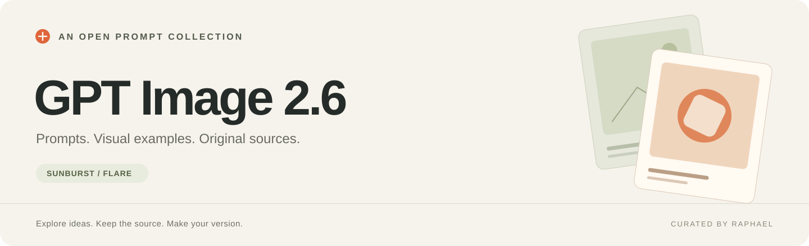
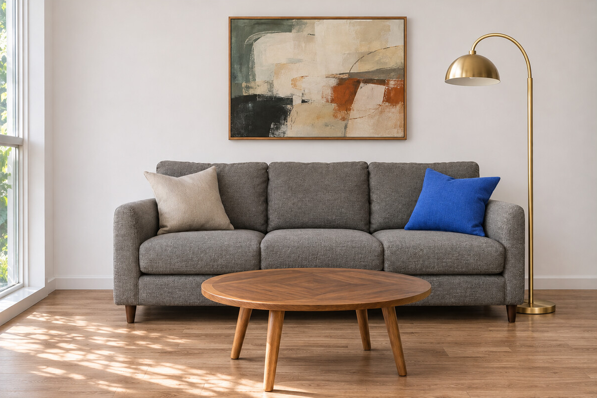
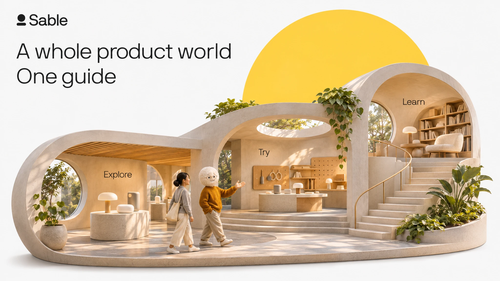
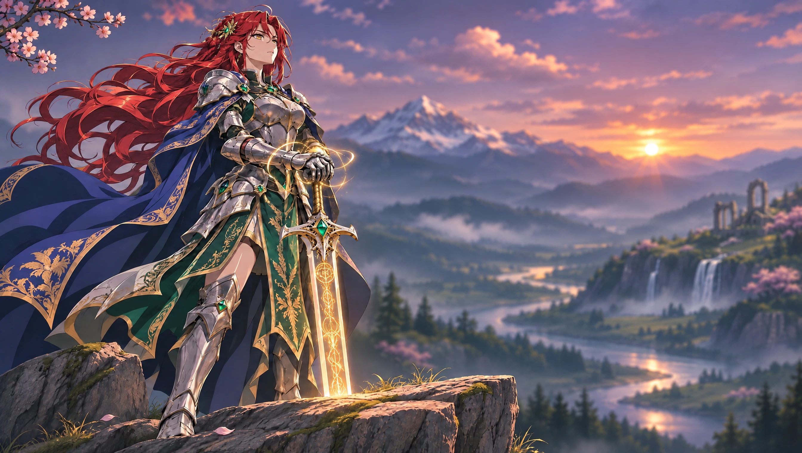
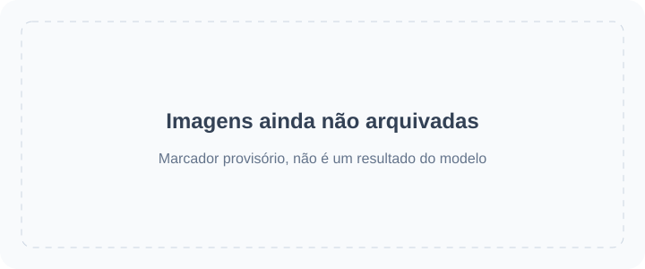

<!-- Generated by scripts/build_readme.py. Edit source data, locale catalogs and generator scripts. -->

# 🎨 Awesome GPT Image 2.6

Uma coleção aberta de prompts, exemplos visuais e fontes originais para GPT Image 2.6.

    

⚠️ **Aviso de direitos de autor**: Os prompts e os conteúdos multimédia desta coleção são recolhidos de fontes públicas apenas para fins educativos. Se considerar que algum conteúdo infringe os seus direitos, por favor, [comunique um problema](https://github.com/RaphaelAI-OpenLab/awesome-gpt-image-2-6/issues/new), e iremos removê-lo imediatamente.

    
    
    
   

---

Esta versão linguística traduz a interface do repositório. Os detalhes completos dos casos estão atualmente disponíveis em inglês e chinês simplificado.

Os títulos, as descrições e as páginas de detalhes dos casos são apresentados em inglês quando não há tradução disponível. Os prompts originais e as citações das fontes não são traduzidos.

**Ligações rápidas** · [🖼️ Explorar casos](#all-cases) · [🆕 Adicionado recentemente](#latest) · [📝 Adicionar um exemplo](https://github.com/RaphaelAI-OpenLab/awesome-gpt-image-2-6/issues/new?template=submit-case.yml) · [🐞 Comunicar um problema](https://github.com/RaphaelAI-OpenLab/awesome-gpt-image-2-6/issues/new?template=report-problem.yml) · [📚 Ler o guia](CONTRIBUTING.md)

## 🌐 Explorar a coleção

**[Ver todos os casos deste repositório →](#all-cases)**

Cada caso abaixo abre uma página interna de detalhes com evidências do modelo, créditos das fontes e disponibilidade do prompt.

**MARCADOR PROVISÓRIO · URL da galeria web externa: não configurado.**

**MARCADOR PROVISÓRIO · Ligação de geração com um clique: não verificada.**

MARCADOR PROVISÓRIO · Ligação de coleção ou campanha relacionada: a adicionar.

[Visitar Raphael (página inicial)](https://raphael.app/?utm_source=github&utm_medium=repository&utm_campaign=gpt_image_2_6_launch&utm_content=top_nav&utm_term=pt-PT)

## 🏷️ Explorar por categoria

| Categoria | Casos com ligação para a fonte | Prompts completos |
| --- | ---: | ---: |
| [Imagens de marcas e produtos](#category-brand-products) | 22 | 0 |
| [Cartazes e tipografia](#category-posters-typography) | 26 | 0 |
| [Infografias](#category-infographics) | 11 | 0 |
| [Interiores e arquitetura](#category-interiors-architecture) | 5 | 0 |
| [Personagens e consistência](#category-characters-consistency) | 27 | 0 |
| [Anotações e edições pontuais](#category-markup-edits) | 17 | 0 |
| [SVG e recursos de design](#category-svg-design-assets) | 6 | 0 |
| [GIF e animação](#category-gif-animation) | 44 | 0 |

## 📖 Índice

- [O que é GPT Image 2.6?](#about)
- [Estatísticas](#statistics)
- [Casos em destaque](#featured)
- [Adicionado recentemente](#latest)
- [Todos os casos](#all-cases)
- [Prompts completos](#collection)
- [Como utilizar](#using)
- [Contribuir](#contribute)
- [Licença](#license)
- [Agradecimentos](#acknowledgements)
- [Histórico de estrelas](#star-history)

## 🤔 O que é GPT Image 2.6?

A OpenAI apresentou Images 2.6 a 4 de novembro de 2026. Esta coleção abrange as variantes Sunburst e Flare do modelo, a criação e edição de imagens, além dos fluxos de trabalho documentados com SVG e GIF. O suporte de cada variante é registado por caso, em vez de ser presumido.

[Anúncio oficial](https://openai.com/index/introducing-images-2-6/) · [Documentação do modelo](https://developers.openai.com/api/docs/guides/image-generation)

## 📊 Estatísticas

| Métrica | Contagem / data |
| --- | ---: |
| Casos com ligação para a fonte | **158** |
| Exemplos oficiais | **37** |
| Exemplos comunicados pelos criadores | **121** |
| Prompts originais disponíveis na fonte | **113** |
| Prompts completos publicados aqui | **0** |
| Ficheiros multimédia arquivados localmente | **251** |
| Última verificação das fontes (UTC) | **2026-11-08** |

As contagens de fontes não implicam reprodução dos resultados. As pistas pendentes são excluídas; resultados diferentes de um mesmo fluxo de trabalho contam como um único caso.

## 🔥 Casos em destaque

<table>
<tr>
<td width="33%" align="center"><a href="cases/docs-bakery-svg/README.md"> <strong>Bakery SVG logo</strong></a> Documentação oficial</td>
<td width="33%" align="center"><a href="cases/docs-lantern-gif/README.md"> <strong>Lantern-carrying monkey loop</strong></a> Documentação oficial</td>
<td width="33%" align="center"><a href="cases/launch-fal/README.md"> <strong>Living-room markup edit</strong></a> Demonstração oficial de lançamento</td>
</tr>
<tr>
<td width="33%" align="center"><a href="cases/launch-sable/README.md"> <strong>Miniature brand product world</strong></a> Demonstração oficial de lançamento</td>
<td width="33%" align="center"><a href="cases/launch-higgsfield/README.md"> <strong>Knight scene and clothing edit sequence</strong></a> Demonstração oficial de lançamento</td>
<td width="33%" align="center"><a href="cases/community-malfoid/README.md"> <strong>Summer character illustration animation</strong></a> Modelo indicado pelo criador</td>
</tr>
</table>

Os cartões provisórios não são resultados gerados. Todos os ficheiros multimédia apresentados estão neste repositório; os conteúdos multimédia ainda não arquivados mantêm as respetivas ligações nas páginas de detalhes.

## 🆕 Adicionado recentemente

| Adicionado | Caso | Evidência |
| --- | --- | --- |
| 2026-11-06 | [Sneaker recolored to forest green suede](cases/veevid-sneaker-suede-recolor/README.md) | Modelo indicado pelo criador |
| 2026-11-06 | [Winter Night Market poster](cases/veevid-holiday-market-poster/README.md) | Modelo indicado pelo criador |
| 2026-11-06 | [Cartoon snowman waving loop](cases/veevid-snowman-wave/README.md) | Modelo indicado pelo criador |
| 2026-11-06 | [French press product photos and background-edit continuation](cases/community-gptimagehub-french-press-edit/README.md) | Modelo indicado pelo criador |
| 2026-11-06 | [Blue Hour jazz posters and date-edit continuation](cases/community-gptimagehub-jazz-poster-edit/README.md) | Modelo indicado pelo criador |
| 2026-11-06 | [Six-step bill-to-law infographic comparison](cases/community-gptimagehub-law-infographic/README.md) | Modelo indicado pelo criador |

## 📋 Todos os casos

### Imagens de marcas e produtos

| Caso · página interna de detalhes | Fonte | Prompt |
| --- | --- | --- |
| [Transparent bakery raster logo](cases/docs-bakery-raster/README.md) | Documentação oficial | Prompt original na fonte |
| [Transparent product cutout](cases/docs-product-cutout/README.md) | Documentação oficial | Prompt original na fonte |
| [Toy airplane packaging](cases/docs-toy-package/README.md) | Documentação oficial | Prompt original na fonte |
| [Miniature brand product world](cases/launch-sable/README.md) | Demonstração oficial de lançamento | Prompt original na fonte |
| [Travel visual generation speed comparison](cases/launch-travel/README.md) | Demonstração oficial de lançamento | Prompt não público |
| [Laptop GIF-creation workspace illustration](cases/techrepublic-gif-workspace-illustration/README.md) | Modelo indicado pelo criador | Prompt não público |
| [Tovalin serum scene comparison](cases/productai-tovalin-serum-comparison/README.md) | Modelo indicado pelo criador | Prompt não público |
| [Quillhaven coffee scenes and precise edits](cases/productai-quillhaven-coffee-comparison/README.md) | Modelo indicado pelo criador | Prompt não público |
| [Running-shoe scenes and precise edits](cases/productai-running-shoe-comparison/README.md) | Modelo indicado pelo criador | Prompt não público |
| [Cable-knit cardigan on a model](cases/productai-cable-knit-cardigan-comparison/README.md) | Modelo indicado pelo criador | Prompt não público |
| [Oaken Mile Coffee label: Flare and Sunburst](cases/community-moss-coffee-label/README.md) | Modelo indicado pelo criador | Prompt original na fonte |
| [Cafe latte: Flare and Sunburst](cases/community-lightlyn-latte-variants/README.md) | Modelo indicado pelo criador | Prompt original na fonte |
| [Earbud product-ad comparison](cases/community-lightlyn-earbuds-ad-variants/README.md) | Modelo indicado pelo criador | Prompt original na fonte |
| [Made Takeaway box](cases/made-flare-dumpling-box/README.md) | Modelo indicado pelo criador | Prompt original na fonte |
| [Made Stylus macro](cases/made-sunburst-stylus-macro/README.md) | Modelo indicado pelo criador | Prompt original na fonte |
| [Three-flavor soda lineup](cases/yir-flavor-lineup/README.md) | Modelo indicado pelo criador | Prompt original na fonte |
| [French press product photos and background-edit continuation](cases/community-gptimagehub-french-press-edit/README.md) | Modelo indicado pelo criador | Prompt original na fonte |
| [SUMMIT ROAST coffee-bag product shot](cases/zzo-flare-summit-roast-bag/README.md) | Modelo indicado pelo criador | Prompt original na fonte |
| [Watch four-round editing](cases/yir-watch-edit-sequence/README.md) | Modelo indicado pelo criador | Prompt não público |
| [Vase four-round editing](cases/yir-vase-edit-sequence/README.md) | Modelo indicado pelo criador | Prompt não público |
| [Rainbow cups and cat](cases/community-flixly-rainbow-teacups/README.md) | Modelo indicado pelo criador | Prompt original na fonte |
| [Sage-green to terracotta bottle edit](cases/omniakey-bottle-color-edit/README.md) | Modelo indicado pelo criador | Prompt não público |

### Cartazes e tipografia

| Caso · página interna de detalhes | Fonte | Prompt |
| --- | --- | --- |
| [Streetwear advertisement typography](cases/docs-streetwear/README.md) | Documentação oficial | Prompt original na fonte |
| [Roadside shampoo billboard](cases/docs-billboard/README.md) | Documentação oficial | Prompt original na fonte |
| [Nostalgic holiday card](cases/docs-holiday-card/README.md) | Documentação oficial | Prompt original na fonte |
| [Shiba ramen shop: two quality comparison runs](cases/ai-garage-ramen-quality-series/README.md) | Modelo indicado pelo criador | Prompt não público |
| [Autumn café menu announcement comparison](cases/ai-garage-autumn-cafe/README.md) | Modelo indicado pelo criador | Prompt não público |
| [Flare 4K test, published previews](cases/aivideos-flare-4k-comparison/README.md) | Modelo indicado pelo criador | Prompt não público |
| [Flare quality and planning comparison](cases/aivideos-flare-quality-planning/README.md) | Modelo indicado pelo criador | Prompt não público |
| [Retro diner menu board](cases/dreamega-retro-diner/README.md) | Modelo indicado pelo criador | Prompt original na fonte |
| [Lantern Row Night Market flyer: Flare and Sunburst](cases/community-moss-night-market-flyer/README.md) | Modelo indicado pelo criador | Prompt original na fonte |
| [Café breakfast menu: Flare and Sunburst](cases/community-moss-breakfast-menu/README.md) | Modelo indicado pelo criador | Prompt original na fonte |
| [Pottery event banner layout: Flare and Sunburst](cases/community-moss-pottery-banner-layout/README.md) | Modelo indicado pelo criador | Prompt original na fonte |
| [Night market poster comparison](cases/community-lightlyn-night-market-variants/README.md) | Modelo indicado pelo criador | Prompt original na fonte |
| [Made Lightbox menu](cases/made-flare-noodle-menu/README.md) | Modelo indicado pelo criador | Prompt original na fonte |
| [Made Sleeve typography](cases/made-sunburst-record-sleeve/README.md) | Modelo indicado pelo criador | Prompt original na fonte |
| [Made Window lettering](cases/made-sunburst-shop-window/README.md) | Modelo indicado pelo criador | Prompt original na fonte |
| [Hot-sauce launch and speed-test posters](cases/yir-hot-sauce-posters/README.md) | Modelo indicado pelo criador | Prompt original na fonte |
| [End-of-season bicycle sale ad](cases/yir-bicycle-sale-ad/README.md) | Modelo indicado pelo criador | Prompt original na fonte |
| [Blue Hour jazz posters and date-edit continuation](cases/community-gptimagehub-jazz-poster-edit/README.md) | Modelo indicado pelo criador | Prompt original na fonte |
| [Winter Night Market poster](cases/veevid-holiday-market-poster/README.md) | Modelo indicado pelo criador | Prompt original na fonte |
| [English–Hindi evening menu from a document brief](cases/analyticsvidhya-bilingual-evening-menu/README.md) | Modelo indicado pelo criador | Prompt original na fonte |
| [NIGHT TIDE wave concert poster](cases/zzo-flare-night-tide-poster/README.md) | Modelo indicado pelo criador | Prompt original na fonte |
| [OPEN LATE neon storefront](cases/kavel-open-late/README.md) | Modelo indicado pelo criador | Prompt não público |
| [Lemon cake recipe card](cases/community-flixly-lemon-recipe/README.md) | Modelo indicado pelo criador | Prompt original na fonte |
| [FIELD & FLOUR bakery poster](cases/sogni-flare-bakery-poster/README.md) | Modelo indicado pelo criador | Prompt não público |
| [NORTHLIGHT TEA poster layout comparison](cases/sandbase-northlight-tea-posters/README.md) | Modelo indicado pelo criador | Prompt não público |
| [Port Calder poster complexity comparison](cases/omniakey-port-calder-comparison/README.md) | Modelo indicado pelo criador | Prompt original na fonte |

### Infografias

| Caso · página interna de detalhes | Fonte | Prompt |
| --- | --- | --- |
| [Coffee-machine process diagram](cases/docs-coffee-diagram/README.md) | Documentação oficial | Prompt original na fonte |
| [Cellular respiration teaching visual](cases/docs-cell-respiration/README.md) | Documentação oficial | Prompt original na fonte |
| [Market-size presentation slide](cases/docs-pitch-slide/README.md) | Documentação oficial | Prompt original na fonte |
| [Northfield Design Summit agenda: Flare and Sunburst](cases/community-moss-design-summit-agenda/README.md) | Modelo indicado pelo criador | Prompt original na fonte |
| [Honeybee scientific scale layouts](cases/community-lightlyn-bee-scale-variants/README.md) | Modelo indicado pelo criador | Prompt original na fonte |
| [Made Illustrated map](cases/made-flare-market-map/README.md) | Modelo indicado pelo criador | Prompt original na fonte |
| [Made Exploded diagram](cases/made-sunburst-turntable-diagram/README.md) | Modelo indicado pelo criador | Prompt original na fonte |
| [Lisbon weather screen: matched Flare and Sunburst test](cases/community-gptimagehub-weather-ui/README.md) | Modelo indicado pelo criador | Prompt original na fonte |
| [Six-step bill-to-law infographic comparison](cases/community-gptimagehub-law-infographic/README.md) | Modelo indicado pelo criador | Prompt original na fonte |
| [Monarch butterfly life-cycle field-guide plate](cases/analyticsvidhya-monarch-life-cycle/README.md) | Modelo indicado pelo criador | Prompt original na fonte |
| [Automatic coffee-machine flow infographic](cases/zzo-flare-coffee-machine-diagram/README.md) | Modelo indicado pelo criador | Prompt original na fonte |

### Interiores e arquitetura

| Caso · página interna de detalhes | Fonte | Prompt |
| --- | --- | --- |
| [Replace chairs in an interior](cases/docs-room-chairs/README.md) | Documentação oficial | Prompt original na fonte |
| [Living-room markup edit](cases/launch-fal/README.md) | Demonstração oficial de lançamento | Prompt original na fonte |
| [Made Ultra-wide aisle](cases/made-flare-market-aerial/README.md) | Modelo indicado pelo criador | Prompt original na fonte |
| [Snowy mountain greenhouse at blue hour](cases/analyticsvidhya-snowy-greenhouse/README.md) | Modelo indicado pelo criador | Prompt original na fonte |
| [Red tram in a foggy city](cases/kavel-tram/README.md) | Modelo indicado pelo criador | Prompt não público |

### Personagens e consistência

| Caso · página interna de detalhes | Fonte | Prompt |
| --- | --- | --- |
| [Paper-cut championship scene: complexity comparison](cases/docs-complexity/README.md) | Documentação oficial | Prompt original na fonte |
| [Realistic fishing-boat sailor portrait](cases/docs-sailor/README.md) | Documentação oficial | Prompt original na fonte |
| [1969 historical crowd scene](cases/docs-historical-crowd/README.md) | Documentação oficial | Prompt original na fonte |
| [Four-panel pet comic](cases/docs-pet-comic/README.md) | Documentação oficial | Prompt original na fonte |
| [Change clothing while preserving identity](cases/docs-outfit/README.md) | Documentação oficial | Prompt original na fonte |
| [Place a person into a camping escape scene](cases/docs-person-scene/README.md) | Documentação oficial | Prompt original na fonte |
| [Establish a storybook character](cases/docs-character-start/README.md) | Documentação oficial | Prompt original na fonte |
| [Continue the same character’s story](cases/docs-character-story/README.md) | Documentação oficial | Prompt original na fonte |
| [Stained-glass whale](cases/launch-picsart/README.md) | Demonstração oficial de lançamento | Prompt não público |
| [Knight scene and clothing edit sequence](cases/launch-higgsfield/README.md) | Demonstração oficial de lançamento | Prompt original na fonte |
| [Ophanim-inspired still: The Coastal Lookout](cases/community-ophanim-coastal-lookout/README.md) | Modelo indicado pelo criador | Prompt original na fonte |
| [Ophanim-inspired still: The Mountain Reservoir](cases/community-ophanim-mountain-reservoir/README.md) | Modelo indicado pelo criador | Prompt original na fonte |
| [Ophanim-inspired still: The Village in the Rain](cases/community-ophanim-village-rain/README.md) | Modelo indicado pelo criador | Prompt original na fonte |
| [Ophanim-inspired still: The Subway Entrance](cases/community-ophanim-subway-entrance/README.md) | Modelo indicado pelo criador | Prompt original na fonte |
| [Fisherman at dawn: Flare and Sunburst](cases/community-moss-fisherman-dawn/README.md) | Modelo indicado pelo criador | Prompt original na fonte |
| [Made Vendor portrait](cases/made-flare-vendor-flash/README.md) | Modelo indicado pelo criador | Prompt original na fonte |
| [Made Rainy night](cases/made-flare-rain-stall/README.md) | Modelo indicado pelo criador | Prompt original na fonte |
| [Made Crate digger](cases/made-sunburst-crate-digger/README.md) | Modelo indicado pelo criador | Prompt original na fonte |
| [Made Listening booth](cases/made-sunburst-listening-booth/README.md) | Modelo indicado pelo criador | Prompt original na fonte |
| [Ferry at blue hour](cases/yir-ferry-blue-hour/README.md) | Modelo indicado pelo criador | Prompt original na fonte |
| [Night market noodle stall](cases/yir-noodle-stall/README.md) | Modelo indicado pelo criador | Prompt original na fonte |
| [Raincoat animation storyboard](cases/yir-raincoat-storyboard/README.md) | Modelo indicado pelo criador | Prompt original na fonte |
| [Portrait four-round editing](cases/yir-portrait-edit-sequence/README.md) | Modelo indicado pelo criador | Prompt não público |
| [1990s-style flash portrait](cases/kavel-90s-snapshot/README.md) | Modelo indicado pelo criador | Prompt original na fonte |
| [Mira lighthouse keyframes](cases/community-flixly-mira-keyframes/README.md) | Modelo indicado pelo criador | Prompt original na fonte |
| [Fisherman repairing a net](cases/community-flixly-fisherman-portrait/README.md) | Modelo indicado pelo criador | Prompt original na fonte |
| [Fox and badger in rain](cases/community-flixly-rainy-bridge-friends/README.md) | Modelo indicado pelo criador | Prompt original na fonte |

### Anotações e edições pontuais

| Caso · página interna de detalhes | Fonte | Prompt |
| --- | --- | --- |
| [Recolor a marked vase](cases/docs-vase-markup/README.md) | Documentação oficial | Prompt original na fonte |
| [Translate an infographic into Spanish](cases/docs-spanish-edit/README.md) | Documentação oficial | Prompt original na fonte |
| [Transfer a pixel-art style](cases/docs-pixel-style/README.md) | Documentação oficial | Prompt original na fonte |
| [Combine pets across images](cases/docs-dog-composite/README.md) | Documentação oficial | Prompt original na fonte |
| [Turn a sketch into a realistic scene](cases/docs-sketch-render/README.md) | Documentação oficial | Prompt original na fonte |
| [Remove a held flower](cases/docs-remove-flower/README.md) | Documentação oficial | Prompt original na fonte |
| [Change the billboard scene to a snowy night](cases/docs-snow-edit/README.md) | Documentação oficial | Prompt original na fonte |
| [Shiba chef festival background edit](cases/ai-garage-festival-background/README.md) | Modelo indicado pelo criador | Prompt original na fonte |
| [Red chef hat despite conflicting markup](cases/ai-garage-red-chef-hat/README.md) | Modelo indicado pelo criador | Prompt original na fonte |
| [Mirror reflection costume edit](cases/dreamega-mirror-reflection/README.md) | Modelo indicado pelo criador | Prompt não público |
| [Miniature city inside a piano](cases/dreamega-piano-city/README.md) | Modelo indicado pelo criador | Prompt não público |
| [Recolor a sofa in a living room](cases/community-lightlyn-sofa-edit-variants/README.md) | Modelo indicado pelo criador | Prompt original na fonte |
| [Sneaker recolored to forest green suede](cases/veevid-sneaker-suede-recolor/README.md) | Modelo indicado pelo criador | Prompt original na fonte |
| [Markup-guided forest-green armchair edit](cases/analyticsvidhya-markup-green-armchair/README.md) | Modelo indicado pelo criador | Prompt original na fonte |
| [LUMA 02 bottle on a forest river stone](cases/zzo-flare-luma-forest-stone/README.md) | Modelo indicado pelo criador | Prompt original na fonte |
| [Sunny mansion transformation](cases/community-flixly-sunny-mansion-edit/README.md) | Modelo indicado pelo criador | Prompt original na fonte |
| [NORTHLIGHT TEA color and date edits](cases/sandbase-northlight-tea-edits/README.md) | Modelo indicado pelo criador | Prompt não público |

### SVG e recursos de design

| Caso · página interna de detalhes | Fonte | Prompt |
| --- | --- | --- |
| [Bakery SVG logo](cases/docs-bakery-svg/README.md) | Documentação oficial | Prompt original na fonte |
| [Farmers market mobile interface](cases/docs-market-ui/README.md) | Documentação oficial | Prompt original na fonte |
| [Bear mascot: SVG versus PNG previews](cases/community-bear-svg-comparison/README.md) | Modelo indicado pelo criador | Prompt não público |
| [Harbor Roast vector logo](cases/community-lightlyn-coffee-logo-svg/README.md) | Modelo indicado pelo criador | Prompt original na fonte |
| [Six weather icons as SVG](cases/community-lightlyn-weather-icons-svg/README.md) | Modelo indicado pelo criador | Prompt original na fonte |
| [Turn a cafe photo into vector art](cases/community-lightlyn-latte-vector-svg/README.md) | Modelo indicado pelo criador | Prompt original na fonte |

### GIF e animação

| Caso · página interna de detalhes | Fonte | Prompt |
| --- | --- | --- |
| [Lantern-carrying monkey loop](cases/docs-lantern-gif/README.md) | Documentação oficial | Prompt original na fonte |
| [Office character: falling stock GIF](cases/launch-openart-down/README.md) | Demonstração oficial de lançamento | Prompt original na fonte |
| [Office character: rising stock GIF](cases/launch-openart-up/README.md) | Demonstração oficial de lançamento | Prompt original na fonte |
| [Owl sketch to animation](cases/launch-owl/README.md) | Demonstração oficial de lançamento | Prompt não público |
| [Monty typing indicator animation](cases/launch-town/README.md) | Demonstração oficial de lançamento | Prompt não público |
| [Summer character illustration animation](cases/community-malfoid/README.md) | Modelo indicado pelo criador | Prompt não público |
| [Images 2.6 brings GIF(T)S :D](cases/community-gifts/README.md) | Modelo indicado pelo criador | Prompt não público |
| [Boxing tiger animation](cases/community-boxing-tiger/README.md) | Modelo indicado pelo criador | Prompt não público |
| [Hummingbird and kingfisher animation variants](cases/community-hummingbird-variants/README.md) | Modelo indicado pelo criador | Prompt não público |
| [Rosebud animation](cases/community-rosebud-animation/README.md) | Modelo indicado pelo criador | Prompt não público |
| [Shiba chef waving loop](cases/ai-garage-shiba-wave/README.md) | Modelo indicado pelo criador | Prompt não público |
| [Stock-market kitten meme: three GIF iterations](cases/community-greta-stock-kitten-iterations/README.md) | Modelo indicado pelo criador | Prompt original na fonte |
| [Morphed: bubblegum pop and reset loop](cases/morphed-bubblegum-loop/README.md) | Modelo indicado pelo criador | Prompt original na fonte |
| [Rocking KINGY LAB bottle GIF](cases/kingy-sunburst-bottle-rocking/README.md) | Modelo indicado pelo criador | Disponibilidade do prompt não verificada |
| [Cartoon snowman waving loop](cases/veevid-snowman-wave/README.md) | Modelo indicado pelo criador | Prompt original na fonte |
| [Selfie to sunglasses reaction loop](cases/yepshot-sunglasses-reaction/README.md) | Modelo indicado pelo criador | Prompt original na fonte |
| [Puppy head-tilt loop](cases/yepshot-pet-head-tilt/README.md) | Modelo indicado pelo criador | Prompt original na fonte |
| [Photo to waving chibi sticker loop](cases/yepshot-chibi-sticker-wave/README.md) | Modelo indicado pelo criador | Prompt original na fonte |
| [Owl sketch comes alive](cases/yepshot-drawing-comes-alive/README.md) | Modelo indicado pelo criador | Prompt original na fonte |
| [OPEN neon animation preview](cases/zzo-neon-open-sign/README.md) | Modelo indicado pelo criador | Prompt original na fonte |
| [Good-night sticker animation preview](cases/zzo-goodnight-girl-from-reference/README.md) | Modelo indicado pelo criador | Prompt original na fonte |
| [Thank-you shiba animation preview](cases/zzo-thank-you-shiba/README.md) | Modelo indicado pelo criador | Disponibilidade do prompt não verificada |
| [LOL bean animation preview](cases/zzo-lol-bean/README.md) | Modelo indicado pelo criador | Disponibilidade do prompt não verificada |
| [Oops reaction animation preview](cases/zzo-oops-facepalm/README.md) | Modelo indicado pelo criador | Disponibilidade do prompt não verificada |
| [Got-it robot animation preview](cases/zzo-got-it-robot/README.md) | Modelo indicado pelo criador | Disponibilidade do prompt não verificada |
| [Morning coffee animation preview](cases/zzo-good-morning-coffee/README.md) | Modelo indicado pelo criador | Disponibilidade do prompt não verificada |
| [Birthday cake animation preview](cases/zzo-birthday-cake/README.md) | Modelo indicado pelo criador | Disponibilidade do prompt não verificada |
| [Thanksgiving turkey animation preview](cases/zzo-thanksgiving-turkey/README.md) | Modelo indicado pelo criador | Disponibilidade do prompt não verificada |
| [Black Friday animation preview](cases/zzo-black-friday-sale/README.md) | Modelo indicado pelo criador | Disponibilidade do prompt não verificada |
| [Christmas tree animation preview](cases/zzo-christmas-tree/README.md) | Modelo indicado pelo criador | Disponibilidade do prompt não verificada |
| [New Year 2027 animation preview](cases/zzo-new-year-2027/README.md) | Modelo indicado pelo criador | Disponibilidade do prompt não verificada |
| [Snowy-window cat animation preview](cases/zzo-window-cat-snow/README.md) | Modelo indicado pelo criador | Prompt original na fonte |
| [LUCKY neon sign flicker](cases/kavel-neon-lucky/README.md) | Modelo indicado pelo criador | Prompt não público |
| [Corgi chasing its tail](cases/kavel-corgi/README.md) | Modelo indicado pelo criador | Prompt não público |
| [Flat character stretch routine](cases/kavel-stretch/README.md) | Modelo indicado pelo criador | Prompt original na fonte |
| [Orange fox mascot waving](cases/veevid-fox-wave/README.md) | Modelo indicado pelo criador | Prompt original na fonte |
| [Heart-latte steam loop](cases/veevid-coffee-steam/README.md) | Modelo indicado pelo criador | Prompt original na fonte |
| [Potted cactus mascot waving](cases/veevid-cactus-wave/README.md) | Modelo indicado pelo criador | Prompt original na fonte |
| [Holiday retriever tail-wag loop](cases/veevid-dog-tail-loop/README.md) | Modelo indicado pelo criador | Prompt original na fonte |
| [Ink robot sketch waving](cases/veevid-robot-sketch-wave/README.md) | Modelo indicado pelo criador | Prompt original na fonte |
| [Perfume bottle light sweep](cases/veevid-perfume-light-loop/README.md) | Modelo indicado pelo criador | Prompt original na fonte |
| [Sunburst monkey lantern loop](cases/sogni-sunburst-lantern-loop/README.md) | Modelo indicado pelo criador | Prompt original na fonte |
| [Flare monkey lantern loop](cases/sogni-flare-lantern-loop/README.md) | Modelo indicado pelo criador | Prompt não público |
| [Paper-cut fox waving loop](cases/omniakey-paper-fox-loop/README.md) | Modelo indicado pelo criador | Prompt original na fonte |

[Registo de pesquisas, relatório de conteúdos multimédia e pistas por resolver](docs/CASE_GALLERY.md)

## 📝 Prompts completos

Ainda não foram republicados prompts completos aqui. As páginas dos casos têm ligações para os prompts originais reais quando são públicos e assinalam explicitamente os prompts em falta. Uma entrada com ligação para a fonte não é uma entrada com um prompt pronto a copiar.

## 📚 Como utilizar

1. Abra um caso a partir de uma categoria ou de um cartão em destaque.
2. Leia as evidências do modelo, as entradas necessárias, a fonte e os limites de reutilização.
3. Siga a ligação do prompt original quando estiver disponível. Um prompt em falta continua marcado como em falta; não o deduza de uma imagem.

## 🤝 Como contribuir

Adicione casos com ligações para as fontes em content/source-cases.json. Adicione prompts completos e reutilizáveis em content/prompts.json. O gerador cria as duas versões linguísticas e as páginas internas a partir destes conjuntos de dados.

[Guia de contribuição](CONTRIBUTING.md) · [Guia de casos das fontes e conteúdos multimédia](docs/SOURCE_CASES.md) · [Guia de manutenção (chinês)](docs/FILLING_GUIDE.zh-CN.md)

## 📄 Licença

O código, a documentação original e os marcadores SVG decorativos usam a licença MIT. Os prompts e os conteúdos multimédia de terceiros mantêm os seus próprios termos, com proveniência e estado de reutilização registados por elemento. O esquema adaptado do README recebe crédito separadamente abaixo.

[Licença do repositório](LICENSE)

## 🙏 Agradecimentos

Estrutura do README adaptada de awesome-nano-banana-pro-prompts, do YouMind OpenLab, sob CC BY 4.0. Adaptada para GPT Image 2.6 com novos textos, dados, páginas locais de detalhes e marcadores provisórios explícitos; nenhum exemplo criativo ou ficheiro multimédia foi copiado.

[YouMind README](https://github.com/YouMind-OpenLab/awesome-nano-banana-pro-prompts/blob/main/README_zh.md) · [CC BY 4.0](https://creativecommons.org/licenses/by/4.0/) · [Notas de atribuição](docs/ATTRIBUTION.md)

Agradecemos à OpenAI e aos criadores originais creditados na página de cada caso.

## ⭐ Histórico de estrelas

[Histórico de estrelas](https://star-history.com/#RaphaelAI-OpenLab/awesome-gpt-image-2-6&Date) · [Ver quem deu uma estrela](https://github.com/RaphaelAI-OpenLab/awesome-gpt-image-2-6/stargazers)

[Dar uma estrela / seguir este repositório](https://github.com/RaphaelAI-OpenLab/awesome-gpt-image-2-6)

[↑ Voltar ao topo](#top)

---

Seleção de Raphael. [Página inicial](https://raphael.app/?utm_source=github&utm_medium=repository&utm_campaign=gpt_image_2_6_launch&utm_content=footer&utm_term=pt-PT)

Gerado a partir de dados estruturados das fontes. Edite os conjuntos de dados e gere novamente; não edite este ficheiro diretamente.
