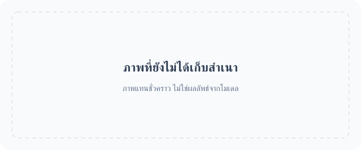

<!-- Generated by scripts/build_readme.py. Edit source data, locale catalogs and generator scripts. -->

# 🎨 Awesome GPT Image 2.6

คอลเลกชันแบบเปิดที่รวบรวมพรอมป์ต์ ตัวอย่างภาพ และแหล่งที่มาต้นฉบับสำหรับ GPT Image 2.6

    

⚠️ **ประกาศลิขสิทธิ์**: พรอมป์ต์และสื่อในคอลเลกชันนี้รวบรวมจากแหล่งข้อมูลสาธารณะเพื่อการศึกษาเท่านั้น หากคุณเห็นว่าเนื้อหาใดละเมิดสิทธิ์ของคุณ โปรด [เปิด Issue](https://github.com/RaphaelAI-OpenLab/awesome-gpt-image-2-6/issues/new) แล้วเราจะนำเนื้อหานั้นออกทันที

    
    
    
   

---

ฉบับภาษานี้แปลส่วนอินเทอร์เฟซของคลังโค้ด ขณะนี้รายละเอียดกรณีตัวอย่างฉบับเต็มมีให้ในภาษาอังกฤษและภาษาจีนตัวย่อ

ชื่อ คำอธิบาย และหน้ารายละเอียดของกรณีตัวอย่างจะแสดงเป็นภาษาอังกฤษเมื่อยังไม่มีคำแปล พรอมป์ต์ต้นฉบับและข้อความอ้างอิงจากแหล่งที่มาจะไม่ถูกแปล

**ลิงก์ด่วน** · [🖼️ ดูกรณีตัวอย่าง](#all-cases) · [🆕 เพิ่มล่าสุด](#latest) · [📝 เพิ่มตัวอย่าง](https://github.com/RaphaelAI-OpenLab/awesome-gpt-image-2-6/issues/new?template=submit-case.yml) · [🐞 รายงานปัญหา](https://github.com/RaphaelAI-OpenLab/awesome-gpt-image-2-6/issues/new?template=report-problem.yml) · [📚 อ่านคู่มือ](CONTRIBUTING.md)

## 🌐 ดูคอลเลกชัน

**[ดูกรณีตัวอย่างทั้งหมดในคลังโค้ดนี้ →](#all-cases)**

ทุกกรณีตัวอย่างด้านล่างเปิดไปยังหน้ารายละเอียดภายในคลังโค้ด ซึ่งมีหลักฐานเกี่ยวกับโมเดล เครดิตแหล่งที่มา และสถานะการเข้าถึงพรอมป์ต์

**ส่วนสำรองชั่วคราว · URL แกลเลอรีภายนอกบนเว็บ: ยังไม่ได้ตั้งค่า**

**ส่วนสำรองชั่วคราว · ลิงก์สร้างด้วยคลิกเดียว: ยังไม่ได้ตรวจสอบ**

ส่วนสำรองชั่วคราว · ลิงก์คอลเลกชัน / แคมเปญที่เกี่ยวข้อง: รอเพิ่ม

[เยี่ยมชม Raphael (หน้าแรก)](https://raphael.app/?utm_source=github&utm_medium=repository&utm_campaign=gpt_image_2_6_launch&utm_content=top_nav&utm_term=th-TH)

## 🏷️ ดูตามหมวดหมู่

| หมวดหมู่ | กรณีตัวอย่างที่มีลิงก์แหล่งที่มา | พรอมป์ต์ฉบับเต็ม |
| --- | ---: | ---: |
| [ภาพสำหรับแบรนด์และผลิตภัณฑ์](#category-brand-products) | 15 | 0 |
| [โปสเตอร์และการจัดวางตัวอักษร](#category-posters-typography) | 15 | 0 |
| [อินโฟกราฟิก](#category-infographics) | 7 | 0 |
| [การตกแต่งภายในและสถาปัตยกรรม](#category-interiors-architecture) | 3 | 0 |
| [ตัวละครและความสม่ำเสมอ](#category-characters-consistency) | 19 | 0 |
| [การทำเครื่องหมายและการแก้ไขเฉพาะจุด](#category-markup-edits) | 12 | 0 |
| [SVG และทรัพยากรงานออกแบบ](#category-svg-design-assets) | 6 | 0 |
| [GIF และแอนิเมชัน](#category-gif-animation) | 13 | 0 |

## 📖 สารบัญ

- [GPT Image 2.6 คืออะไร?](#about)
- [สถิติ](#statistics)
- [กรณีตัวอย่างเด่น](#featured)
- [เพิ่มล่าสุด](#latest)
- [กรณีตัวอย่างทั้งหมด](#all-cases)
- [พรอมป์ต์ฉบับเต็ม](#collection)
- [วิธีใช้](#using)
- [ร่วมพัฒนา](#contribute)
- [สัญญาอนุญาต](#license)
- [กิตติกรรมประกาศ](#acknowledgements)
- [ประวัติดาว](#star-history)

## 🤔 GPT Image 2.6 คืออะไร?

OpenAI เปิดตัว Images 2.6 เมื่อวันที่ 4 พฤศจิกายน 2026 คอลเลกชันนี้ครอบคลุมโมเดลรุ่นย่อย Sunburst และ Flare การสร้างและแก้ไขภาพ รวมถึงเวิร์กโฟลว์ SVG และ GIF ที่มีเอกสารอ้างอิง โดยบันทึกการรองรับรุ่นย่อยแยกตามกรณีตัวอย่าง แทนการคาดเดา

[ประกาศอย่างเป็นทางการ](https://openai.com/index/introducing-images-2-6/) · [เอกสารโมเดล](https://developers.openai.com/api/docs/guides/image-generation)

## 📊 สถิติ

| ตัวชี้วัด | จำนวน / วันที่ |
| --- | ---: |
| กรณีตัวอย่างที่มีลิงก์แหล่งที่มา | **90** |
| ตัวอย่างอย่างเป็นทางการ | **37** |
| ตัวอย่างที่ผู้สร้างรายงาน | **53** |
| พรอมป์ต์ต้นฉบับที่เข้าถึงได้จากแหล่งที่มา | **68** |
| พรอมป์ต์ฉบับเต็มที่เผยแพร่ที่นี่ | **0** |
| ไฟล์สื่อที่เก็บสำเนาไว้ในเครื่อง | **152** |
| ตรวจสอบแหล่งที่มาครั้งล่าสุด (UTC) | **2026-11-06** |

จำนวนแหล่งที่มาไม่ได้อ้างว่าได้ทดลองทำซ้ำแล้ว โดยไม่รวมเบาะแสที่รอตรวจสอบ และนับผลลัพธ์ต่าง ๆ ภายในเวิร์กโฟลว์เดียวกันเป็นหนึ่งกรณีตัวอย่าง

## 🔥 กรณีตัวอย่างเด่น

<table>
<tr>
<td width="33%" align="center"><a href="cases/docs-bakery-svg/README.md"> <strong>Bakery SVG logo</strong></a> เอกสารอย่างเป็นทางการ</td>
<td width="33%" align="center"><a href="cases/docs-lantern-gif/README.md"> <strong>Lantern-carrying monkey loop</strong></a> เอกสารอย่างเป็นทางการ</td>
<td width="33%" align="center"><a href="cases/launch-fal/README.md"> <strong>Living-room markup edit</strong></a> เดโมเปิดตัวอย่างเป็นทางการ</td>
</tr>
<tr>
<td width="33%" align="center"><a href="cases/launch-sable/README.md"> <strong>Miniature brand product world</strong></a> เดโมเปิดตัวอย่างเป็นทางการ</td>
<td width="33%" align="center"><a href="cases/launch-higgsfield/README.md"> <strong>Knight scene and clothing edit sequence</strong></a> เดโมเปิดตัวอย่างเป็นทางการ</td>
<td width="33%" align="center"><a href="cases/community-malfoid/README.md"> <strong>Summer character illustration animation</strong></a> โมเดลที่ผู้สร้างระบุ</td>
</tr>
</table>

การ์ดสำรองชั่วคราวไม่ใช่ผลลัพธ์ที่สร้างด้วยโมเดล ไฟล์สื่อทั้งหมดที่แสดงอยู่ในคลังโค้ดนี้ ส่วนสื่อที่ยังไม่ได้เก็บสำเนาจะคงลิงก์ไว้ในหน้ารายละเอียด

## 🆕 เพิ่มล่าสุด

| วันที่เพิ่ม | กรณีตัวอย่าง | หลักฐาน |
| --- | --- | --- |
| 2026-11-06 | [Morphed: bubblegum pop and reset loop](cases/morphed-bubblegum-loop/README.md) | โมเดลที่ผู้สร้างระบุ |
| 2026-11-06 | [Stock-market kitten meme: three GIF iterations](cases/community-greta-stock-kitten-iterations/README.md) | โมเดลที่ผู้สร้างระบุ |
| 2026-11-05 | [Made Window lettering](cases/made-sunburst-shop-window/README.md) | โมเดลที่ผู้สร้างระบุ |
| 2026-11-05 | [Made Listening booth](cases/made-sunburst-listening-booth/README.md) | โมเดลที่ผู้สร้างระบุ |
| 2026-11-05 | [Made Exploded diagram](cases/made-sunburst-turntable-diagram/README.md) | โมเดลที่ผู้สร้างระบุ |
| 2026-11-05 | [Made Stylus macro](cases/made-sunburst-stylus-macro/README.md) | โมเดลที่ผู้สร้างระบุ |

## 📋 กรณีตัวอย่างทั้งหมด

### ภาพสำหรับแบรนด์และผลิตภัณฑ์

| กรณีตัวอย่าง · หน้ารายละเอียดภายในคลังโค้ด | แหล่งที่มา | พรอมป์ต์ |
| --- | --- | --- |
| [Transparent bakery raster logo](cases/docs-bakery-raster/README.md) | เอกสารอย่างเป็นทางการ | พรอมป์ต์ต้นฉบับที่แหล่งที่มา |
| [Transparent product cutout](cases/docs-product-cutout/README.md) | เอกสารอย่างเป็นทางการ | พรอมป์ต์ต้นฉบับที่แหล่งที่มา |
| [Toy airplane packaging](cases/docs-toy-package/README.md) | เอกสารอย่างเป็นทางการ | พรอมป์ต์ต้นฉบับที่แหล่งที่มา |
| [Miniature brand product world](cases/launch-sable/README.md) | เดโมเปิดตัวอย่างเป็นทางการ | พรอมป์ต์ต้นฉบับที่แหล่งที่มา |
| [Travel visual generation speed comparison](cases/launch-travel/README.md) | เดโมเปิดตัวอย่างเป็นทางการ | พรอมป์ต์ไม่ได้เผยแพร่ต่อสาธารณะ |
| [Laptop GIF-creation workspace illustration](cases/techrepublic-gif-workspace-illustration/README.md) | โมเดลที่ผู้สร้างระบุ | พรอมป์ต์ไม่ได้เผยแพร่ต่อสาธารณะ |
| [Tovalin serum scene comparison](cases/productai-tovalin-serum-comparison/README.md) | โมเดลที่ผู้สร้างระบุ | พรอมป์ต์ไม่ได้เผยแพร่ต่อสาธารณะ |
| [Quillhaven coffee scenes and precise edits](cases/productai-quillhaven-coffee-comparison/README.md) | โมเดลที่ผู้สร้างระบุ | พรอมป์ต์ไม่ได้เผยแพร่ต่อสาธารณะ |
| [Running-shoe scenes and precise edits](cases/productai-running-shoe-comparison/README.md) | โมเดลที่ผู้สร้างระบุ | พรอมป์ต์ไม่ได้เผยแพร่ต่อสาธารณะ |
| [Cable-knit cardigan on a model](cases/productai-cable-knit-cardigan-comparison/README.md) | โมเดลที่ผู้สร้างระบุ | พรอมป์ต์ไม่ได้เผยแพร่ต่อสาธารณะ |
| [Oaken Mile Coffee label: Flare and Sunburst](cases/community-moss-coffee-label/README.md) | โมเดลที่ผู้สร้างระบุ | พรอมป์ต์ต้นฉบับที่แหล่งที่มา |
| [Cafe latte: Flare and Sunburst](cases/community-lightlyn-latte-variants/README.md) | โมเดลที่ผู้สร้างระบุ | พรอมป์ต์ต้นฉบับที่แหล่งที่มา |
| [Earbud product-ad comparison](cases/community-lightlyn-earbuds-ad-variants/README.md) | โมเดลที่ผู้สร้างระบุ | พรอมป์ต์ต้นฉบับที่แหล่งที่มา |
| [Made Takeaway box](cases/made-flare-dumpling-box/README.md) | โมเดลที่ผู้สร้างระบุ | พรอมป์ต์ต้นฉบับที่แหล่งที่มา |
| [Made Stylus macro](cases/made-sunburst-stylus-macro/README.md) | โมเดลที่ผู้สร้างระบุ | พรอมป์ต์ต้นฉบับที่แหล่งที่มา |

### โปสเตอร์และการจัดวางตัวอักษร

| กรณีตัวอย่าง · หน้ารายละเอียดภายในคลังโค้ด | แหล่งที่มา | พรอมป์ต์ |
| --- | --- | --- |
| [Streetwear advertisement typography](cases/docs-streetwear/README.md) | เอกสารอย่างเป็นทางการ | พรอมป์ต์ต้นฉบับที่แหล่งที่มา |
| [Roadside shampoo billboard](cases/docs-billboard/README.md) | เอกสารอย่างเป็นทางการ | พรอมป์ต์ต้นฉบับที่แหล่งที่มา |
| [Nostalgic holiday card](cases/docs-holiday-card/README.md) | เอกสารอย่างเป็นทางการ | พรอมป์ต์ต้นฉบับที่แหล่งที่มา |
| [Shiba ramen shop: two quality comparison runs](cases/ai-garage-ramen-quality-series/README.md) | โมเดลที่ผู้สร้างระบุ | พรอมป์ต์ไม่ได้เผยแพร่ต่อสาธารณะ |
| [Autumn café menu announcement comparison](cases/ai-garage-autumn-cafe/README.md) | โมเดลที่ผู้สร้างระบุ | พรอมป์ต์ไม่ได้เผยแพร่ต่อสาธารณะ |
| [Flare 4K test, published previews](cases/aivideos-flare-4k-comparison/README.md) | โมเดลที่ผู้สร้างระบุ | พรอมป์ต์ไม่ได้เผยแพร่ต่อสาธารณะ |
| [Flare quality and planning comparison](cases/aivideos-flare-quality-planning/README.md) | โมเดลที่ผู้สร้างระบุ | พรอมป์ต์ไม่ได้เผยแพร่ต่อสาธารณะ |
| [Retro diner menu board](cases/dreamega-retro-diner/README.md) | โมเดลที่ผู้สร้างระบุ | พรอมป์ต์ต้นฉบับที่แหล่งที่มา |
| [Lantern Row Night Market flyer: Flare and Sunburst](cases/community-moss-night-market-flyer/README.md) | โมเดลที่ผู้สร้างระบุ | พรอมป์ต์ต้นฉบับที่แหล่งที่มา |
| [Café breakfast menu: Flare and Sunburst](cases/community-moss-breakfast-menu/README.md) | โมเดลที่ผู้สร้างระบุ | พรอมป์ต์ต้นฉบับที่แหล่งที่มา |
| [Pottery event banner layout: Flare and Sunburst](cases/community-moss-pottery-banner-layout/README.md) | โมเดลที่ผู้สร้างระบุ | พรอมป์ต์ต้นฉบับที่แหล่งที่มา |
| [Night market poster comparison](cases/community-lightlyn-night-market-variants/README.md) | โมเดลที่ผู้สร้างระบุ | พรอมป์ต์ต้นฉบับที่แหล่งที่มา |
| [Made Lightbox menu](cases/made-flare-noodle-menu/README.md) | โมเดลที่ผู้สร้างระบุ | พรอมป์ต์ต้นฉบับที่แหล่งที่มา |
| [Made Sleeve typography](cases/made-sunburst-record-sleeve/README.md) | โมเดลที่ผู้สร้างระบุ | พรอมป์ต์ต้นฉบับที่แหล่งที่มา |
| [Made Window lettering](cases/made-sunburst-shop-window/README.md) | โมเดลที่ผู้สร้างระบุ | พรอมป์ต์ต้นฉบับที่แหล่งที่มา |

### อินโฟกราฟิก

| กรณีตัวอย่าง · หน้ารายละเอียดภายในคลังโค้ด | แหล่งที่มา | พรอมป์ต์ |
| --- | --- | --- |
| [Coffee-machine process diagram](cases/docs-coffee-diagram/README.md) | เอกสารอย่างเป็นทางการ | พรอมป์ต์ต้นฉบับที่แหล่งที่มา |
| [Cellular respiration teaching visual](cases/docs-cell-respiration/README.md) | เอกสารอย่างเป็นทางการ | พรอมป์ต์ต้นฉบับที่แหล่งที่มา |
| [Market-size presentation slide](cases/docs-pitch-slide/README.md) | เอกสารอย่างเป็นทางการ | พรอมป์ต์ต้นฉบับที่แหล่งที่มา |
| [Northfield Design Summit agenda: Flare and Sunburst](cases/community-moss-design-summit-agenda/README.md) | โมเดลที่ผู้สร้างระบุ | พรอมป์ต์ต้นฉบับที่แหล่งที่มา |
| [Honeybee scientific scale layouts](cases/community-lightlyn-bee-scale-variants/README.md) | โมเดลที่ผู้สร้างระบุ | พรอมป์ต์ต้นฉบับที่แหล่งที่มา |
| [Made Illustrated map](cases/made-flare-market-map/README.md) | โมเดลที่ผู้สร้างระบุ | พรอมป์ต์ต้นฉบับที่แหล่งที่มา |
| [Made Exploded diagram](cases/made-sunburst-turntable-diagram/README.md) | โมเดลที่ผู้สร้างระบุ | พรอมป์ต์ต้นฉบับที่แหล่งที่มา |

### การตกแต่งภายในและสถาปัตยกรรม

| กรณีตัวอย่าง · หน้ารายละเอียดภายในคลังโค้ด | แหล่งที่มา | พรอมป์ต์ |
| --- | --- | --- |
| [Replace chairs in an interior](cases/docs-room-chairs/README.md) | เอกสารอย่างเป็นทางการ | พรอมป์ต์ต้นฉบับที่แหล่งที่มา |
| [Living-room markup edit](cases/launch-fal/README.md) | เดโมเปิดตัวอย่างเป็นทางการ | พรอมป์ต์ต้นฉบับที่แหล่งที่มา |
| [Made Ultra-wide aisle](cases/made-flare-market-aerial/README.md) | โมเดลที่ผู้สร้างระบุ | พรอมป์ต์ต้นฉบับที่แหล่งที่มา |

### ตัวละครและความสม่ำเสมอ

| กรณีตัวอย่าง · หน้ารายละเอียดภายในคลังโค้ด | แหล่งที่มา | พรอมป์ต์ |
| --- | --- | --- |
| [Paper-cut championship scene: complexity comparison](cases/docs-complexity/README.md) | เอกสารอย่างเป็นทางการ | พรอมป์ต์ต้นฉบับที่แหล่งที่มา |
| [Realistic fishing-boat sailor portrait](cases/docs-sailor/README.md) | เอกสารอย่างเป็นทางการ | พรอมป์ต์ต้นฉบับที่แหล่งที่มา |
| [1969 historical crowd scene](cases/docs-historical-crowd/README.md) | เอกสารอย่างเป็นทางการ | พรอมป์ต์ต้นฉบับที่แหล่งที่มา |
| [Four-panel pet comic](cases/docs-pet-comic/README.md) | เอกสารอย่างเป็นทางการ | พรอมป์ต์ต้นฉบับที่แหล่งที่มา |
| [Change clothing while preserving identity](cases/docs-outfit/README.md) | เอกสารอย่างเป็นทางการ | พรอมป์ต์ต้นฉบับที่แหล่งที่มา |
| [Place a person into a camping escape scene](cases/docs-person-scene/README.md) | เอกสารอย่างเป็นทางการ | พรอมป์ต์ต้นฉบับที่แหล่งที่มา |
| [Establish a storybook character](cases/docs-character-start/README.md) | เอกสารอย่างเป็นทางการ | พรอมป์ต์ต้นฉบับที่แหล่งที่มา |
| [Continue the same character’s story](cases/docs-character-story/README.md) | เอกสารอย่างเป็นทางการ | พรอมป์ต์ต้นฉบับที่แหล่งที่มา |
| [Stained-glass whale](cases/launch-picsart/README.md) | เดโมเปิดตัวอย่างเป็นทางการ | พรอมป์ต์ไม่ได้เผยแพร่ต่อสาธารณะ |
| [Knight scene and clothing edit sequence](cases/launch-higgsfield/README.md) | เดโมเปิดตัวอย่างเป็นทางการ | พรอมป์ต์ต้นฉบับที่แหล่งที่มา |
| [Ophanim-inspired still: The Coastal Lookout](cases/community-ophanim-coastal-lookout/README.md) | โมเดลที่ผู้สร้างระบุ | พรอมป์ต์ต้นฉบับที่แหล่งที่มา |
| [Ophanim-inspired still: The Mountain Reservoir](cases/community-ophanim-mountain-reservoir/README.md) | โมเดลที่ผู้สร้างระบุ | พรอมป์ต์ต้นฉบับที่แหล่งที่มา |
| [Ophanim-inspired still: The Village in the Rain](cases/community-ophanim-village-rain/README.md) | โมเดลที่ผู้สร้างระบุ | พรอมป์ต์ต้นฉบับที่แหล่งที่มา |
| [Ophanim-inspired still: The Subway Entrance](cases/community-ophanim-subway-entrance/README.md) | โมเดลที่ผู้สร้างระบุ | พรอมป์ต์ต้นฉบับที่แหล่งที่มา |
| [Fisherman at dawn: Flare and Sunburst](cases/community-moss-fisherman-dawn/README.md) | โมเดลที่ผู้สร้างระบุ | พรอมป์ต์ต้นฉบับที่แหล่งที่มา |
| [Made Vendor portrait](cases/made-flare-vendor-flash/README.md) | โมเดลที่ผู้สร้างระบุ | พรอมป์ต์ต้นฉบับที่แหล่งที่มา |
| [Made Rainy night](cases/made-flare-rain-stall/README.md) | โมเดลที่ผู้สร้างระบุ | พรอมป์ต์ต้นฉบับที่แหล่งที่มา |
| [Made Crate digger](cases/made-sunburst-crate-digger/README.md) | โมเดลที่ผู้สร้างระบุ | พรอมป์ต์ต้นฉบับที่แหล่งที่มา |
| [Made Listening booth](cases/made-sunburst-listening-booth/README.md) | โมเดลที่ผู้สร้างระบุ | พรอมป์ต์ต้นฉบับที่แหล่งที่มา |

### การทำเครื่องหมายและการแก้ไขเฉพาะจุด

| กรณีตัวอย่าง · หน้ารายละเอียดภายในคลังโค้ด | แหล่งที่มา | พรอมป์ต์ |
| --- | --- | --- |
| [Recolor a marked vase](cases/docs-vase-markup/README.md) | เอกสารอย่างเป็นทางการ | พรอมป์ต์ต้นฉบับที่แหล่งที่มา |
| [Translate an infographic into Spanish](cases/docs-spanish-edit/README.md) | เอกสารอย่างเป็นทางการ | พรอมป์ต์ต้นฉบับที่แหล่งที่มา |
| [Transfer a pixel-art style](cases/docs-pixel-style/README.md) | เอกสารอย่างเป็นทางการ | พรอมป์ต์ต้นฉบับที่แหล่งที่มา |
| [Combine pets across images](cases/docs-dog-composite/README.md) | เอกสารอย่างเป็นทางการ | พรอมป์ต์ต้นฉบับที่แหล่งที่มา |
| [Turn a sketch into a realistic scene](cases/docs-sketch-render/README.md) | เอกสารอย่างเป็นทางการ | พรอมป์ต์ต้นฉบับที่แหล่งที่มา |
| [Remove a held flower](cases/docs-remove-flower/README.md) | เอกสารอย่างเป็นทางการ | พรอมป์ต์ต้นฉบับที่แหล่งที่มา |
| [Change the billboard scene to a snowy night](cases/docs-snow-edit/README.md) | เอกสารอย่างเป็นทางการ | พรอมป์ต์ต้นฉบับที่แหล่งที่มา |
| [Shiba chef festival background edit](cases/ai-garage-festival-background/README.md) | โมเดลที่ผู้สร้างระบุ | พรอมป์ต์ต้นฉบับที่แหล่งที่มา |
| [Red chef hat despite conflicting markup](cases/ai-garage-red-chef-hat/README.md) | โมเดลที่ผู้สร้างระบุ | พรอมป์ต์ต้นฉบับที่แหล่งที่มา |
| [Mirror reflection costume edit](cases/dreamega-mirror-reflection/README.md) | โมเดลที่ผู้สร้างระบุ | พรอมป์ต์ไม่ได้เผยแพร่ต่อสาธารณะ |
| [Miniature city inside a piano](cases/dreamega-piano-city/README.md) | โมเดลที่ผู้สร้างระบุ | พรอมป์ต์ไม่ได้เผยแพร่ต่อสาธารณะ |
| [Recolor a sofa in a living room](cases/community-lightlyn-sofa-edit-variants/README.md) | โมเดลที่ผู้สร้างระบุ | พรอมป์ต์ต้นฉบับที่แหล่งที่มา |

### SVG และทรัพยากรงานออกแบบ

| กรณีตัวอย่าง · หน้ารายละเอียดภายในคลังโค้ด | แหล่งที่มา | พรอมป์ต์ |
| --- | --- | --- |
| [Bakery SVG logo](cases/docs-bakery-svg/README.md) | เอกสารอย่างเป็นทางการ | พรอมป์ต์ต้นฉบับที่แหล่งที่มา |
| [Farmers market mobile interface](cases/docs-market-ui/README.md) | เอกสารอย่างเป็นทางการ | พรอมป์ต์ต้นฉบับที่แหล่งที่มา |
| [Bear mascot: SVG versus PNG previews](cases/community-bear-svg-comparison/README.md) | โมเดลที่ผู้สร้างระบุ | พรอมป์ต์ไม่ได้เผยแพร่ต่อสาธารณะ |
| [Harbor Roast vector logo](cases/community-lightlyn-coffee-logo-svg/README.md) | โมเดลที่ผู้สร้างระบุ | พรอมป์ต์ต้นฉบับที่แหล่งที่มา |
| [Six weather icons as SVG](cases/community-lightlyn-weather-icons-svg/README.md) | โมเดลที่ผู้สร้างระบุ | พรอมป์ต์ต้นฉบับที่แหล่งที่มา |
| [Turn a cafe photo into vector art](cases/community-lightlyn-latte-vector-svg/README.md) | โมเดลที่ผู้สร้างระบุ | พรอมป์ต์ต้นฉบับที่แหล่งที่มา |

### GIF และแอนิเมชัน

| กรณีตัวอย่าง · หน้ารายละเอียดภายในคลังโค้ด | แหล่งที่มา | พรอมป์ต์ |
| --- | --- | --- |
| [Lantern-carrying monkey loop](cases/docs-lantern-gif/README.md) | เอกสารอย่างเป็นทางการ | พรอมป์ต์ต้นฉบับที่แหล่งที่มา |
| [Office character: falling stock GIF](cases/launch-openart-down/README.md) | เดโมเปิดตัวอย่างเป็นทางการ | พรอมป์ต์ต้นฉบับที่แหล่งที่มา |
| [Office character: rising stock GIF](cases/launch-openart-up/README.md) | เดโมเปิดตัวอย่างเป็นทางการ | พรอมป์ต์ต้นฉบับที่แหล่งที่มา |
| [Owl sketch to animation](cases/launch-owl/README.md) | เดโมเปิดตัวอย่างเป็นทางการ | พรอมป์ต์ไม่ได้เผยแพร่ต่อสาธารณะ |
| [Monty typing indicator animation](cases/launch-town/README.md) | เดโมเปิดตัวอย่างเป็นทางการ | พรอมป์ต์ไม่ได้เผยแพร่ต่อสาธารณะ |
| [Summer character illustration animation](cases/community-malfoid/README.md) | โมเดลที่ผู้สร้างระบุ | พรอมป์ต์ไม่ได้เผยแพร่ต่อสาธารณะ |
| [Images 2.6 brings GIF(T)S :D](cases/community-gifts/README.md) | โมเดลที่ผู้สร้างระบุ | พรอมป์ต์ไม่ได้เผยแพร่ต่อสาธารณะ |
| [Boxing tiger animation](cases/community-boxing-tiger/README.md) | โมเดลที่ผู้สร้างระบุ | พรอมป์ต์ไม่ได้เผยแพร่ต่อสาธารณะ |
| [Hummingbird and kingfisher animation variants](cases/community-hummingbird-variants/README.md) | โมเดลที่ผู้สร้างระบุ | พรอมป์ต์ไม่ได้เผยแพร่ต่อสาธารณะ |
| [Rosebud animation](cases/community-rosebud-animation/README.md) | โมเดลที่ผู้สร้างระบุ | พรอมป์ต์ไม่ได้เผยแพร่ต่อสาธารณะ |
| [Shiba chef waving loop](cases/ai-garage-shiba-wave/README.md) | โมเดลที่ผู้สร้างระบุ | พรอมป์ต์ไม่ได้เผยแพร่ต่อสาธารณะ |
| [Stock-market kitten meme: three GIF iterations](cases/community-greta-stock-kitten-iterations/README.md) | โมเดลที่ผู้สร้างระบุ | พรอมป์ต์ต้นฉบับที่แหล่งที่มา |
| [Morphed: bubblegum pop and reset loop](cases/morphed-bubblegum-loop/README.md) | โมเดลที่ผู้สร้างระบุ | พรอมป์ต์ต้นฉบับที่แหล่งที่มา |

[บันทึกการค้นหา รายงานสื่อ และเบาะแสที่ยังไม่ได้ข้อสรุป](docs/CASE_GALLERY.md)

## 📝 พรอมป์ต์ฉบับเต็ม

ยังไม่มีการนำพรอมป์ต์ฉบับเต็มมาเผยแพร่ซ้ำที่นี่ หน้ากรณีตัวอย่างจะลิงก์ไปยังพรอมป์ต์ต้นฉบับจริงเมื่อมีการเผยแพร่ต่อสาธารณะ และระบุชัดเจนเมื่อไม่มีพรอมป์ต์ รายการที่มีลิงก์แหล่งที่มาไม่เท่ากับรายการที่มีพรอมป์ต์ให้คัดลอก

## 📚 วิธีใช้

1. เปิดกรณีตัวอย่างจากหมวดหมู่หรือการ์ดกรณีตัวอย่างเด่น
2. อ่านหลักฐานเกี่ยวกับโมเดล ข้อมูลนำเข้าที่จำเป็น แหล่งที่มา และข้อจำกัดการนำกลับมาใช้
3. เปิดลิงก์พรอมป์ต์ต้นฉบับเมื่อมีให้ หากไม่มีพรอมป์ต์ ให้ระบุว่าไม่มีต่อไป อย่าคาดเดาจากภาพ

## 🤝 วิธีร่วมพัฒนา

เพิ่มกรณีตัวอย่างที่มีลิงก์แหล่งที่มาใน content/source-cases.json และเพิ่มพรอมป์ต์ฉบับเต็มที่นำกลับมาใช้ได้ใน content/prompts.json เครื่องมือสร้างจะใช้ชุดข้อมูลเหล่านี้สร้างทั้งสองภาษาและหน้าภายในคลังโค้ด

[คู่มือการร่วมพัฒนา](CONTRIBUTING.md) · [คู่มือกรณีตัวอย่างจากแหล่งที่มาและสื่อ](docs/SOURCE_CASES.md) · [คู่มือผู้ดูแล (ภาษาจีน)](docs/FILLING_GUIDE.zh-CN.md)

## 📄 สัญญาอนุญาต

โค้ด เอกสารที่เขียนขึ้นเอง และภาพ SVG สำหรับตกแต่งที่ใช้เป็นตัวแทนชั่วคราวใช้สัญญาอนุญาต MIT พรอมป์ต์และสื่อของบุคคลที่สามยังอยู่ภายใต้เงื่อนไขของเจ้าของ โดยมีการบันทึกที่มาและสถานะการนำกลับมาใช้แยกตามรายการ ส่วนรูปแบบ README ที่ดัดแปลงมาจะระบุที่มาแยกไว้ด้านล่าง

[สัญญาอนุญาตของคลังโค้ด](LICENSE)

## 🙏 กิตติกรรมประกาศ

โครงสร้าง README ดัดแปลงจาก awesome-nano-banana-pro-prompts ของ YouMind OpenLab ภายใต้ CC BY 4.0 โดยปรับให้เหมาะกับ GPT Image 2.6 ด้วยข้อความ ข้อมูล และหน้ารายละเอียดในเครื่องที่สร้างขึ้นใหม่ พร้อมระบุส่วนสำรองชั่วคราวอย่างชัดเจน ไม่มีการคัดลอกตัวอย่างผลงานสร้างสรรค์หรือสื่อ

[YouMind README](https://github.com/YouMind-OpenLab/awesome-nano-banana-pro-prompts/blob/main/README_zh.md) · [CC BY 4.0](https://creativecommons.org/licenses/by/4.0/) · [หมายเหตุเกี่ยวกับการระบุที่มา](docs/ATTRIBUTION.md)

ขอขอบคุณ OpenAI และผู้สร้างต้นฉบับที่ระบุเครดิตไว้ในแต่ละหน้ากรณีตัวอย่าง

## ⭐ ประวัติดาว

[ประวัติดาว](https://star-history.com/#RaphaelAI-OpenLab/awesome-gpt-image-2-6&Date) · [ดูผู้ที่กดดาว](https://github.com/RaphaelAI-OpenLab/awesome-gpt-image-2-6/stargazers)

[กดดาว / ติดตามคลังโค้ดนี้](https://github.com/RaphaelAI-OpenLab/awesome-gpt-image-2-6)

[↑ กลับด้านบน](#top)

---

รวบรวมและคัดสรรโดย Raphael [หน้าแรก](https://raphael.app/?utm_source=github&utm_medium=repository&utm_campaign=gpt_image_2_6_launch&utm_content=footer&utm_term=th-TH)

สร้างจากข้อมูลแหล่งที่มาแบบมีโครงสร้าง ให้แก้ไขชุดข้อมูลแล้วสร้างใหม่ อย่าแก้ไขไฟล์นี้โดยตรง
