<!-- Generated by scripts/build_readme.py. Edit source data, locale catalogs and generator scripts. -->

<a id="top"></a>

[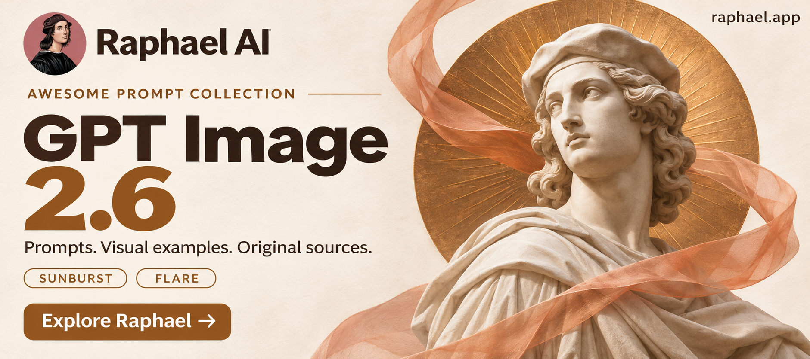](https://raphael.app/?utm_source=github&utm_medium=repository&utm_campaign=gpt_image_2_6_launch&utm_content=hero&utm_term=tr-TR)

# 🚀 GPT Image 2.6 İstem Koleksiyonu

[](https://github.com/sindresorhus/awesome)
[](https://github.com/RaphaelAI-OpenLab/awesome-gpt-image-2-6)
[](LICENSE)
[](https://github.com/RaphaelAI-OpenLab/awesome-gpt-image-2-6/actions/workflows/validate.yml)
[](CONTRIBUTING.md)

> 🎨 GPT Image 2.6 için özenle seçilmiş yaratıcı istemler ve görsel örneklerden oluşan bir koleksiyon.

> ⚠️ **Telif hakkı bildirimi**: Bu koleksiyon, herkese açık kaynaklardan alınan istemleri ve örnekleri, ayrıca bağımsız olarak oluşturulan görselleri içerir ve yalnızca eğitim amaçlıdır. Herhangi bir içeriğin haklarınızı ihlal ettiğini düşünüyorsanız lütfen [bir sorun kaydı açın](https://github.com/RaphaelAI-OpenLab/awesome-gpt-image-2-6/issues/new?template=report-problem.yml), içeriği de hemen kaldıracağız.

---

<a href="README.md"></a> <a href="README.zh-CN.md"></a> <a href="README.zh-TW.md"></a> <a href="README.ja-JP.md"></a><br />
<a href="README.ko-KR.md"></a> <a href="README.th-TH.md"></a> <a href="README.vi-VN.md"></a> <a href="README.hi-IN.md"></a><br />
<a href="README.es-ES.md"></a> <a href="README.es-419.md"></a> <a href="README.de-DE.md"></a> <a href="README.fr-FR.md"></a><br />
<a href="README.it-IT.md"></a> <a href="README.pt-BR.md"></a> <a href="README.pt-PT.md"></a> <a href="README.tr-TR.md"></a>

---

Bu dil sürümü deponun arayüzünü çevirir. Tam örnek ayrıntıları şu anda İngilizce ve Basitleştirilmiş Çince olarak mevcuttur.

Çeviri bulunmadığında örnek başlıkları, açıklamalar ve ayrıntı sayfaları İngilizce gösterilir. Özgün istemler ve kaynak alıntıları çevrilmez.

<a id="gallery"></a>

## 🌐 Web galerisinde görüntüle

<div align="center">

[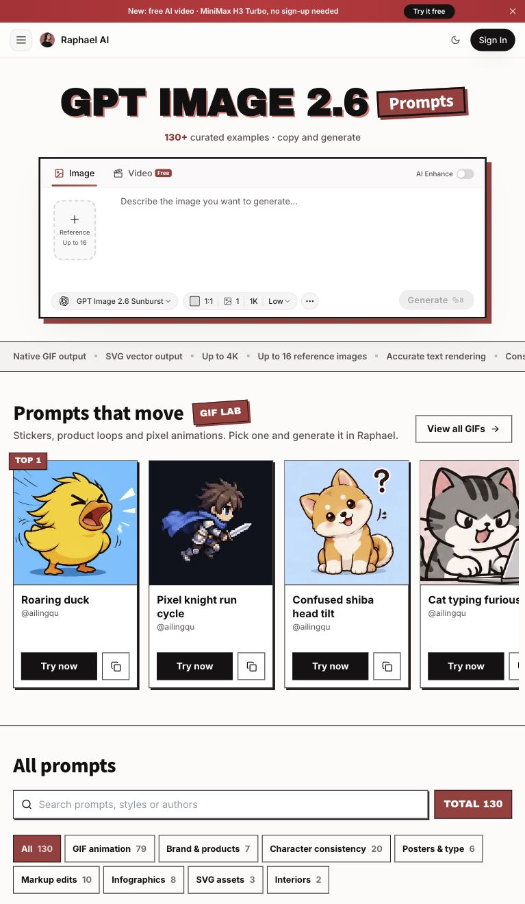](https://raphael.app/gpt-image-2-6-prompts?utm_source=github&utm_medium=repository&utm_campaign=gpt_image_2_6_launch&utm_content=gallery_preview&utm_term=tr-TR)

</div>

**[👉 Raphael üzerindeki GPT Image 2.6 istem galerisine göz at](https://raphael.app/gpt-image-2-6-prompts?utm_source=github&utm_medium=repository&utm_campaign=gpt_image_2_6_launch&utm_content=top_cta&utm_term=tr-TR)**

**[📝 Tam istemler](#collection)**

Neden web sitesinde oluşturmalısınız?

| Özellik | GitHub README | Raphael web sitesi |
| --- | --- | --- |
| 🆓 Ücretsiz görsel üretimi | Örnekleri ve istemleri inceleyin | Temel modda ücretsiz üretim, giriş veya kredi kartı gerekmez |
| ✍️ İstem kullanımı | Yayımlanmış istemleri kopyalama | Bir istem yapıştırıp görsel üretin |
| 🖼️ Referans görsellerle düzenleme | Referans görselleri ve gerekli girdileri inceleyin | Üretim ve düzenlemeyi yönlendirmek için referans görseller yükleyin |
| 🤖 Model seçimi | Her örnekte hangi modelin kullanıldığını görün | GPT Image, Seedream, Nano Banana ve diğer modellerden seçin |
| 🎨 Stiller ve boyutlar | Kaynakta belirtilen stilleri ve ayarları inceleyin | Stil, en boy oranı ve çıktı biçimini seçin |
| 🔄 Farklı sonuçlar | Derlenen örnekleri karşılaştırın | Her istemle tek seferde en fazla 4 görsel üretin |
| 🛠️ Görsel araçları | Düzenleme iş akışlarını okuyun | Arka plan kaldırın, çözünürlüğü artırın, görseli genişletin ve düzenleyin |
| 📱 Mobil | Örnekleri okuma | Mobil tarayıcınızda görsel üretin ve düzenleyin |

Ücretsiz üretim temel modu kullanır. Diğer modellerin kredi ve plan gereksinimleri web sitesinde gösterilir.

[Bu depodaki tüm örneklere göz atın →](#all-cases)

<a id="categories"></a>

## 🏷️ Kategoriye göre göz atın

[Tümü (130)](https://raphael.app/tr/gpt-image-2-6-prompts?utm_source=github&utm_medium=repository&utm_campaign=gpt_image_2_6_launch&utm_content=category_all&utm_term=tr-TR) · [GIF ve animasyon (79)](https://raphael.app/tr/gpt-image-2-6-prompts/gif-animation?utm_source=github&utm_medium=repository&utm_campaign=gpt_image_2_6_launch&utm_content=category_gif-animation&utm_term=tr-TR) · [Marka ve ürün görselleri (7)](https://raphael.app/tr/gpt-image-2-6-prompts/brand-products?utm_source=github&utm_medium=repository&utm_campaign=gpt_image_2_6_launch&utm_content=category_brand-products&utm_term=tr-TR) · [Karakterler ve tutarlılık (20)](https://raphael.app/tr/gpt-image-2-6-prompts/characters-consistency?utm_source=github&utm_medium=repository&utm_campaign=gpt_image_2_6_launch&utm_content=category_characters-consistency&utm_term=tr-TR) · [Afişler ve tipografi (6)](https://raphael.app/tr/gpt-image-2-6-prompts/posters-typography?utm_source=github&utm_medium=repository&utm_campaign=gpt_image_2_6_launch&utm_content=category_posters-typography&utm_term=tr-TR) · [İşaretleme ve hedefli düzenlemeler (10)](https://raphael.app/tr/gpt-image-2-6-prompts/markup-edits?utm_source=github&utm_medium=repository&utm_campaign=gpt_image_2_6_launch&utm_content=category_markup-edits&utm_term=tr-TR) · [İnfografikler (8)](https://raphael.app/tr/gpt-image-2-6-prompts/infographics?utm_source=github&utm_medium=repository&utm_campaign=gpt_image_2_6_launch&utm_content=category_infographics&utm_term=tr-TR) · [SVG ve tasarım varlıkları (3)](https://raphael.app/tr/gpt-image-2-6-prompts/svg-design-assets?utm_source=github&utm_medium=repository&utm_campaign=gpt_image_2_6_launch&utm_content=category_svg-design-assets&utm_term=tr-TR) · [İç mekân ve mimari (2)](https://raphael.app/tr/gpt-image-2-6-prompts/interiors-architecture?utm_source=github&utm_medium=repository&utm_campaign=gpt_image_2_6_launch&utm_content=category_interiors-architecture&utm_term=tr-TR)

<a id="contents"></a>

## 📖 İçindekiler

- [GPT Image 2.6 nedir?](#about)
- [İstatistikler](#statistics)
- [Öne çıkan örnekler](#featured)
- [Tüm örnekler](#all-cases)
- [Tam istemler](#collection)
- [Nasıl kullanılır?](#using)
- [Katkıda bulunun](#contribute)
- [Lisans](#license)
- [Teşekkürler](#acknowledgements)
- [Yıldız geçmişi](#star-history)

<a id="about"></a>

## 🤔 GPT Image 2.6 nedir?

OpenAI, Images 2.6'yı 4 Kasım 2026'da tanıttı. Bu koleksiyon Sunburst ve Flare model varyantlarını, görsel oluşturma ve düzenlemeyi, ayrıca belgelenmiş SVG ve GIF iş akışlarını kapsar. Varyant desteği varsayılmaz; her örnek için ayrı ayrı kaydedilir.

[Resmî duyuru](https://openai.com/index/introducing-images-2-6/) · [Model belgeleri](https://developers.openai.com/api/docs/guides/image-generation)

<a id="statistics"></a>

## 📊 İstatistikler

| **Ölçüt** | **Sayı** |
| --- | --- |
| 📝 Toplam istem | **146** |
| ⭐ Öne çıkanlar | **12** |
| 🔄 Son güncelleme | **2026-11-13 UTC 05:15:02** |

<a id="featured"></a>

## 🔥 Öne çıkan örnekler

<a id="featured-case-launch-higgsfield"></a>

### 38. [Knight scene and clothing edit sequence](#source-case-launch-higgsfield)

<div align="center">
<a href="assets/examples/launch-higgsfield/source-01.webp"></a><br /><sub>Source image 1</sub>
</div>

<div align="center">
<a href="assets/examples/launch-higgsfield/source-02.webp"></a><br /><sub>Source image 2</sub>
</div>

<div align="center">
<a href="assets/examples/launch-higgsfield/source-03.webp"></a><br /><sub>Source image 3</sub>
</div>

**Özgün istem**

**Starting image · Character and scene**

```text
Epic high fantasy anime key visual, mature seinen style like a modern high-budget anime film. A young woman sorceress-knight in her twenties with long crimson hair and sharp golden eyes stands on the edge of a cliff in ornate silver and emerald armor with a flowing royal blue cape, a glowing runic sword planted in front of her, magic sparks around her hands. Behind her a vast fantasy kingdom: floating islands with waterfalls pouring into the clouds, a white castle with spires, a huge ancient dragon flying in the distance, giant blooming sakura and golden autumn forests in the valley below. Sunset sky with vivid orange, magenta, turquoise and violet clouds, god rays, glowing magic particles in the air. Extremely vibrant saturated colors, dramatic rim lighting, cel shading with detailed painted backgrounds, crisp clean line art, depth and atmosphere, dynamic low camera angle, wide cinematic composition. Adult, elegant, serious heroic mood, not childish, no chibi, no sci-fi, no neon, no text, no watermark.
```

**Edit 1 · Sunset valley**

```text
Replace the moonlit landscape with a golden sunset over a misty mountain valley, winding river, waterfalls and ancient ruins. Keep the background softly blurred and the knight, armor, sword, rock and composition unchanged.
```

**Edit 2 · Floating castle**

```text
Replace the background with a majestic floating castle, smaller floating islands, cascading waterfalls and a dragon flying overhead. Preserve the warm sunset, atmospheric haze and shallow depth of field. Keep the knight and foreground unchanged.
```

**Edit 3 · Recolor armor**

```text
Recolor the armor to ivory white with rich gold trim, replace emerald gemstones with rubies, and change green fabric panels to deep crimson. Preserve the armor design, blue cape, red hair, golden sword glow, pose and background.
```

Use the edits in order, passing the previous output into the next edit. The official page includes the starting-image prompt alongside Edit 1; the three archived images show the edited results.

[Kaynaktaki özgün istem](https://openai.com/index/introducing-images-2-6/#more-ways-to-create-and-edit-in-the-api)

**Yazar**: [Higgsfield](https://openai.com/index/introducing-images-2-6/#more-ways-to-create-and-edit-in-the-api)

**Özgün kaynak**: [Resmî lansman demosu](https://openai.com/index/introducing-images-2-6/#more-ways-to-create-and-edit-in-the-api) · [Kaynak ayrıntıları](cases/launch-higgsfield/README.md)

**[👉 Şimdi dene →](https://raphael.app/gpt-image-2-6-prompts?utm_source=github&utm_medium=repository&utm_campaign=gpt_image_2_6_launch&utm_content=case_gallery_launch-higgsfield&utm_term=tr-TR)**

---

<a id="featured-case-ailingqu-four-seasons-tree"></a>

### 95. [One tree, four seasons](#source-case-ailingqu-four-seasons-tree)

<div align="center">
<a href="assets/examples/ailingqu-four-seasons-tree/four-seasons-tree.gif"></a><br /><sub>One tree, four seasons</sub>
</div>

**Özgün istem**

```text
The same lone round tree on a small hill, framed identically in every frame, cycling through the four seasons: pink spring blossoms, lush green summer, orange autumn leaves falling, bare branches in winter snow. Soft flat illustration with a matching sky color for each season.

Animate it as a short, smooth, seamlessly looping GIF with clear motion between frames.
```

Prompt body and shared loop instruction are combined using the source’s documented two-newline separator. Original wording is unchanged. This records the documented recipe, not an independently observed model submission.

[Kaynaktaki özgün istem](https://github.com/ailingqu/awesome-ai-gif-prompts/blob/2672b8fe04e75275de70a8d5d2992da6271ce8f5/data/prompts.json)

**Yazar**: [ailingqu / awesome-ai-gif-prompts](https://github.com/ailingqu)

**Özgün kaynak**: [Üreticinin bildirdiği model](https://github.com/ailingqu/awesome-ai-gif-prompts/blob/2672b8fe04e75275de70a8d5d2992da6271ce8f5/README.md) · [Kaynak ayrıntıları](cases/ailingqu-four-seasons-tree/README.md) · [CC BY 4.0](docs/ailingqu-2037/ATTRIBUTION.md)

**[👉 Şimdi dene →](https://raphael.app/gpt-image-2-6-prompts?utm_source=github&utm_medium=repository&utm_campaign=gpt_image_2_6_launch&utm_content=case_gallery_ailingqu-four-seasons-tree&utm_term=tr-TR)**

---

<a id="featured-case-launch-picsart"></a>

### 37. [Stained-glass whale](#source-case-launch-picsart)

<div align="center">
<a href="assets/examples/launch-picsart/source-01.webp"></a><br /><sub>Source image 1</sub>
</div>

**Özgün istem**

**İstem herkese açık değil**

**Yazar**: [Picsart](https://openai.com/index/introducing-images-2-6/#more-ways-to-create-and-edit-in-the-api)

**Özgün kaynak**: [Resmî lansman demosu](https://openai.com/index/introducing-images-2-6/#more-ways-to-create-and-edit-in-the-api) · [Kaynak ayrıntıları](cases/launch-picsart/README.md)

**[👉 Şimdi dene →](https://raphael.app/gpt-image-2-6-prompts?utm_source=github&utm_medium=repository&utm_campaign=gpt_image_2_6_launch&utm_content=case_gallery_launch-picsart&utm_term=tr-TR)**

---

<a id="featured-case-ailingqu-window-day-to-night"></a>

### 97. [Reading by the window, day to night](#source-case-ailingqu-window-day-to-night)

<div align="center">
<a href="assets/examples/ailingqu-window-day-to-night/window-day-to-night.gif"></a><br /><sub>Reading by the window, day to night</sub>
</div>

**Özgün istem**

```text
A girl with a short bob reading a book on a cushion by a big window, seen from the side. Outside the window the sky cycles from bright morning blue to orange sunset to a starry night and back to morning, while the room light warms up and a desk lamp switches on at night. Soft flat illustration, calm and cozy.

Animate it as a short, smooth, seamlessly looping GIF with clear motion between frames.
```

Prompt body and shared loop instruction are combined using the source’s documented two-newline separator. Original wording is unchanged. This records the documented recipe, not an independently observed model submission.

[Kaynaktaki özgün istem](https://github.com/ailingqu/awesome-ai-gif-prompts/blob/2672b8fe04e75275de70a8d5d2992da6271ce8f5/data/prompts.json)

**Yazar**: [ailingqu / awesome-ai-gif-prompts](https://github.com/ailingqu)

**Özgün kaynak**: [Üreticinin bildirdiği model](https://github.com/ailingqu/awesome-ai-gif-prompts/blob/2672b8fe04e75275de70a8d5d2992da6271ce8f5/README.md) · [Kaynak ayrıntıları](cases/ailingqu-window-day-to-night/README.md) · [CC BY 4.0](docs/ailingqu-2037/ATTRIBUTION.md)

**[👉 Şimdi dene →](https://raphael.app/gpt-image-2-6-prompts?utm_source=github&utm_medium=repository&utm_campaign=gpt_image_2_6_launch&utm_content=case_gallery_ailingqu-window-day-to-night&utm_term=tr-TR)**

---

<a id="featured-case-social-cyan-poetry-wet-portrait"></a>

### 46. [Glowing cyan poetry and equations on wet skin](#source-case-social-cyan-poetry-wet-portrait)

<div align="center">
<a href="assets/examples/social-cyan-poetry-wet-portrait/source-01.jpg"></a><br /><sub>Glowing cyan poetry and equations on wet skin</sub>
</div>

**Özgün istem**

```text
A cinematic, ultra-realistic close-up portrait of a young woman with wet, tousled dark hair and luminous skin, staring directly into the camera with an intense, introspective expression. Glowing cyan handwritten text and symbols are projected across her face, neck, and shoulders, resembling poetic phrases, equations, and abstract handwriting. The light reflections shimmer on her damp skin, creating a futuristic, cyber-poetry aesthetic. Dark,moody background with soft shadows, shallow depth of field, sharp focus on the eyes, high contrast lighting, teal and blue color palette, hyper-detailed skin texture, photorealistic, dramatic atmosphere, cyberpunk meets fine-art portrait photography, 8K quality, cinematic lighting.
```

[Özgün istem (.txt)](cases/social-cyan-poetry-wet-portrait/prompt.txt)

[Kaynaktaki özgün istem](https://x.com/iamsofiaijaz/status/2118561558511132918)

**Yazar**: [iamsofiaijaz](https://x.com/iamsofiaijaz)

**Özgün kaynak**: [Üreticinin bildirdiği model](https://x.com/iamsofiaijaz/status/2118561513879507399) · [Kaynak ayrıntıları](cases/social-cyan-poetry-wet-portrait/README.md)

**[👉 Şimdi dene →](https://raphael.app/gpt-image-2-6-prompts?utm_source=github&utm_medium=repository&utm_campaign=gpt_image_2_6_launch&utm_content=case_gallery_social-cyan-poetry-wet-portrait&utm_term=tr-TR)**

---

<a id="featured-case-ailingqu-goldfish-bowl"></a>

### 100. [Goldfish in a bowl](#source-case-ailingqu-goldfish-bowl)

<div align="center">
<a href="assets/examples/ailingqu-goldfish-bowl/goldfish-bowl.gif"></a><br /><sub>Goldfish in a bowl</sub>
</div>

**Özgün istem**

```text
A round glass fishbowl on a windowsill with one orange goldfish swimming a slow circle, tail fluttering, tiny bubbles rising to the surface. Soft watercolor-style illustration, gentle light.

Animate it as a short, smooth, seamlessly looping GIF with clear motion between frames.
```

Prompt body and shared loop instruction are combined using the source’s documented two-newline separator. Original wording is unchanged. This records the documented recipe, not an independently observed model submission.

[Kaynaktaki özgün istem](https://github.com/ailingqu/awesome-ai-gif-prompts/blob/2672b8fe04e75275de70a8d5d2992da6271ce8f5/data/prompts.json)

**Yazar**: [ailingqu / awesome-ai-gif-prompts](https://github.com/ailingqu)

**Özgün kaynak**: [Üreticinin bildirdiği model](https://github.com/ailingqu/awesome-ai-gif-prompts/blob/2672b8fe04e75275de70a8d5d2992da6271ce8f5/README.md) · [Kaynak ayrıntıları](cases/ailingqu-goldfish-bowl/README.md) · [CC BY 4.0](docs/ailingqu-2037/ATTRIBUTION.md)

**[👉 Şimdi dene →](https://raphael.app/gpt-image-2-6-prompts?utm_source=github&utm_medium=repository&utm_campaign=gpt_image_2_6_launch&utm_content=case_gallery_ailingqu-goldfish-bowl&utm_term=tr-TR)**

---

<a id="featured-case-docs-pixel-style"></a>

### 57. [Transfer a pixel-art style](#source-case-docs-pixel-style)

<div align="center">
<a href="assets/examples/docs-pixel-style/motorcycle-gpt-image-2-6-flare.webp"></a><br /><sub>Pixel-art motorcycle rider using the reference style — GPT Image 2.6 Flare (official model output)</sub>
</div>

<div align="center">
<a href="assets/examples/docs-pixel-style/motorcycle-gpt-image-2-6-sunburst.webp"></a><br /><sub>Pixel-art motorcycle rider using the reference style — GPT Image 2.6 Sunburst (official model output)</sub>
</div>

**Referans görselleri**

Referans / girdi görselidir, üretilmiş çıktı değildir.

<div align="center">
<a href="assets/references/docs-pixel-style/pixels.webp">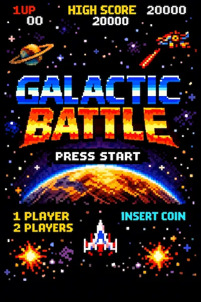</a><br /><sub>Reference input: Pixel-art game screen used as a style reference</sub>
</div>


**Özgün istem**

```text
Use the same style from the input image and generate a man riding a motorcycle on a white background.
```

[Kaynaktaki özgün istem](https://developers.openai.com/api/docs/guides/image-prompting#transfer-a-visual-style)

**Yazar**: [OpenAI](https://developers.openai.com/api/docs/guides/image-prompting#transfer-a-visual-style)

**Özgün kaynak**: [Resmî belgeler](https://developers.openai.com/api/docs/guides/image-prompting#transfer-a-visual-style) · [Kaynak ayrıntıları](cases/docs-pixel-style/README.md)

**[👉 Şimdi dene →](https://raphael.app/gpt-image-2-6-prompts?utm_source=github&utm_medium=repository&utm_campaign=gpt_image_2_6_launch&utm_content=case_gallery_docs-pixel-style&utm_term=tr-TR)**

---

<a id="featured-case-ailingqu-doodle-monster"></a>

### 108. [Doodle monster comes alive](#source-case-ailingqu-doodle-monster)

<div align="center">
<a href="assets/examples/ailingqu-doodle-monster/doodle-monster.gif"></a><br /><sub>Doodle monster comes alive</sub>
</div>

**Özgün istem**

```text
A crude crayon doodle of a little purple blob monster with two eyes on wobbly stalks and three stubby legs, drawn on lined notebook paper, comes alive: its eye-stalks blink and sway, it waves its tiny arms and hops in place, keeping the wobbly hand-drawn lines and odd proportions. The notebook paper stays still.

Animate it as a short, smooth, seamlessly looping GIF with clear motion between frames.
```

Prompt body and shared loop instruction are combined using the source’s documented two-newline separator. Original wording is unchanged. This records the documented recipe, not an independently observed model submission.

[Kaynaktaki özgün istem](https://github.com/ailingqu/awesome-ai-gif-prompts/blob/2672b8fe04e75275de70a8d5d2992da6271ce8f5/data/prompts.json)

**Yazar**: [ailingqu / awesome-ai-gif-prompts](https://github.com/ailingqu)

**Özgün kaynak**: [Üreticinin bildirdiği model](https://github.com/ailingqu/awesome-ai-gif-prompts/blob/2672b8fe04e75275de70a8d5d2992da6271ce8f5/README.md) · [Kaynak ayrıntıları](cases/ailingqu-doodle-monster/README.md) · [CC BY 4.0](docs/ailingqu-2037/ATTRIBUTION.md)

**[👉 Şimdi dene →](https://raphael.app/gpt-image-2-6-prompts?utm_source=github&utm_medium=repository&utm_campaign=gpt_image_2_6_launch&utm_content=case_gallery_ailingqu-doodle-monster&utm_term=tr-TR)**

---

<a id="featured-case-docs-market-ui"></a>

### 67. [Farmers market mobile interface](#source-case-docs-market-ui)

<div align="center">
<a href="assets/examples/docs-market-ui/ui-farmers-market-gpt-image-2-6-flare.webp"></a><br /><sub>Farmers market mobile app mockup — GPT Image 2.6 Flare (official model output)</sub>
</div>

<div align="center">
<a href="assets/examples/docs-market-ui/ui-farmers-market-gpt-image-2-6-sunburst.webp"></a><br /><sub>Farmers market mobile app mockup — GPT Image 2.6 Sunburst (official model output)</sub>
</div>

**Özgün istem**

```text
Create a realistic mobile app UI mockup for a local farmers market.
Show today’s market with a simple header, a short list of vendors with small photos and categories, a small “Today’s specials” section, and basic information for location and hours.
Design it to be practical, and easy to use. White background, subtle natural accent colors, clear typography, and minimal decoration.
It should look like a real, well-designed, beautiful app for a small local market.
Place the UI mockup in an iPhone frame.
```

[Kaynaktaki özgün istem](https://developers.openai.com/api/docs/guides/image-prompting#create-an-interface-preview)

**Yazar**: [OpenAI](https://developers.openai.com/api/docs/guides/image-prompting#create-an-interface-preview)

**Özgün kaynak**: [Resmî belgeler](https://developers.openai.com/api/docs/guides/image-prompting#create-an-interface-preview) · [Kaynak ayrıntıları](cases/docs-market-ui/README.md)

**[👉 Şimdi dene →](https://raphael.app/gpt-image-2-6-prompts?utm_source=github&utm_medium=repository&utm_campaign=gpt_image_2_6_launch&utm_content=case_gallery_docs-market-ui&utm_term=tr-TR)**

---

<a id="featured-case-ailingqu-pixel-campfire"></a>

### 109. [Pixel art campfire](#source-case-ailingqu-pixel-campfire)

<div align="center">
<a href="assets/examples/ailingqu-pixel-campfire/pixel-campfire.gif"></a><br /><sub>Pixel art campfire</sub>
</div>

**Özgün istem**

```text
A pixel art campfire at night in a small forest clearing, flames flickering, sparks rising and fading, two logs glowing orange. 16-bit retro game style, dark blue night sky with a few stars.

Animate it as a short, smooth, seamlessly looping GIF with clear motion between frames.
```

Prompt body and shared loop instruction are combined using the source’s documented two-newline separator. Original wording is unchanged. This records the documented recipe, not an independently observed model submission.

[Kaynaktaki özgün istem](https://github.com/ailingqu/awesome-ai-gif-prompts/blob/2672b8fe04e75275de70a8d5d2992da6271ce8f5/data/prompts.json)

**Yazar**: [ailingqu / awesome-ai-gif-prompts](https://github.com/ailingqu)

**Özgün kaynak**: [Üreticinin bildirdiği model](https://github.com/ailingqu/awesome-ai-gif-prompts/blob/2672b8fe04e75275de70a8d5d2992da6271ce8f5/README.md) · [Kaynak ayrıntıları](cases/ailingqu-pixel-campfire/README.md) · [CC BY 4.0](docs/ailingqu-2037/ATTRIBUTION.md)

**[👉 Şimdi dene →](https://raphael.app/gpt-image-2-6-prompts?utm_source=github&utm_medium=repository&utm_campaign=gpt_image_2_6_launch&utm_content=case_gallery_ailingqu-pixel-campfire&utm_term=tr-TR)**

---

<a id="featured-case-launch-town"></a>

### 74. [Monty typing indicator animation](#source-case-launch-town)

<div align="center">
<a href="assets/examples/launch-town/source-01.webp"></a><br /><sub>Static poster 1</sub>
</div>

**Özgün istem**

**İstem herkese açık değil**

**Yazar**: [Town](https://openai.com/index/introducing-images-2-6/)

**Özgün kaynak**: [Resmî lansman demosu](https://openai.com/index/introducing-images-2-6/) · [Kaynak ayrıntıları](cases/launch-town/README.md)

**[👉 Şimdi dene →](https://raphael.app/gpt-image-2-6-prompts?utm_source=github&utm_medium=repository&utm_campaign=gpt_image_2_6_launch&utm_content=case_gallery_launch-town&utm_term=tr-TR)**

---

<a id="featured-case-community-struggle-sailor-dance"></a>

### 121. [Moonlit magical-girl dance](#source-case-community-struggle-sailor-dance)

<div align="center">
<a href="assets/examples/community-struggle-sailor-dance/9ff4f428146eff32d28f14d3db8d46d1.gif"></a><br /><sub>Magical girl dancing at night</sub>
</div>

**Özgün istem**

```text
创建一个 GIF，内容是 一位美少女战士在跳舞
```

[Kaynaktaki özgün istem](https://tianqi.csdn.net/6aebfbae40858c2d8818a1fd.html#devmenu4)

**Yazar**: [STRUGGLE_xlf](https://tianqi.csdn.net/6aebfbae40858c2d8818a1fd.html#devmenu4)

**Özgün kaynak**: [Üreticinin bildirdiği model](https://tianqi.csdn.net/6aebfbae40858c2d8818a1fd.html#devmenu4) · [Kaynak ayrıntıları](cases/community-struggle-sailor-dance/README.md)

**[👉 Şimdi dene →](https://raphael.app/gpt-image-2-6-prompts?utm_source=github&utm_medium=repository&utm_campaign=gpt_image_2_6_launch&utm_content=case_gallery_community-struggle-sailor-dance&utm_term=tr-TR)**

---

Video önizlemeleri ilk sabit karedir; hareketi görmek için bağlantılı dosyayı açın. Referans görseller ve kaynak posterler ayrı etiketlenir.

<a id="all-cases"></a>

## 📋 Tüm örnekler

<a id="category-brand-products"></a>

### Marka ve ürün görselleri

<a id="source-case-docs-bakery-raster"></a>

#### 1. Transparent bakery raster logo

<table>
<tr>
<td align="center"><a href="assets/examples/docs-bakery-raster/logo-generation-1-gpt-image-2-6-flare.webp"></a><br /><sub>GPT Image 2.6 Flare output: Flare raster logo with a loaf above curved field rows and the stacked Field &amp; Flour wordmark.</sub></td>
<td align="center"><a href="assets/examples/docs-bakery-raster/logo-generation-1-gpt-image-2-6-sunburst.webp"></a><br /><sub>GPT Image 2.6 Sunburst output: Sunburst raster logo with golden wheat flanking a loaf above the Field &amp; Flour wordmark.</sub></td>
</tr>
</table>

**Özgün istem**

```text
Create an original, non-infringing logo for a company called Field & Flour, a local bakery.
The logo should feel warm, simple, and timeless. Use clean, vector-like shapes, a strong silhouette, and balanced negative space.
Favor simplicity over detail so it reads clearly at small and large sizes. Flat design, minimal strokes, no gradients unless essential.
Fully transparent background. Deliver a single centered logo with generous padding, clean alpha edges, and no solid backdrop, scenery, checkerboard, or watermark.
```

[Kaynaktaki özgün istem](https://developers.openai.com/api/docs/guides/image-prompting#design-a-reusable-logo)

**Yazar**: [OpenAI](https://developers.openai.com/api/docs/guides/image-prompting#design-a-reusable-logo)

**Özgün kaynak**: [Resmî belgeler](https://developers.openai.com/api/docs/guides/image-prompting#design-a-reusable-logo) · [Kaynak ayrıntıları](cases/docs-bakery-raster/README.md)

**[👉 Şimdi dene →](https://raphael.app/gpt-image-2-6-prompts?utm_source=github&utm_medium=repository&utm_campaign=gpt_image_2_6_launch&utm_content=case_gallery_docs-bakery-raster&utm_term=tr-TR)**

---

<a id="source-case-docs-product-cutout"></a>

#### 2. Transparent product cutout

<table>
<tr>
<td align="center"><a href="assets/examples/docs-product-cutout/extract-product-gpt-image-2-6-flare.webp"></a><br /><sub>Isolated shampoo bottle on a transparent background — GPT Image 2.6 Flare (official model output)</sub></td>
<td align="center"><a href="assets/examples/docs-product-cutout/extract-product-gpt-image-2-6-sunburst.webp"></a><br /><sub>Isolated shampoo bottle on a transparent background — GPT Image 2.6 Sunburst (official model output)</sub></td>
</tr>
</table>

<details>
<summary>Referans görselleri</summary>

Referans / girdi görselidir, üretilmiş çıktı değildir.

- [Reference input: Original shampoo product photograph](assets/references/docs-product-cutout/shampoo.webp)

</details>

**Özgün istem**

```text
Extract the product from the input image and isolate it on a fully transparent background.
Output: centered product, crisp silhouette, no halos/fringing.
Preserve product geometry and label legibility exactly.
Add only light polishing. Do not add a solid backdrop, checkerboard, scenery, or shadow.
Do not restyle the product; remove the background and preserve clean alpha transparency.
```

[Kaynaktaki özgün istem](https://developers.openai.com/api/docs/guides/image-prompting#create-a-transparent-product-cutout)

**Yazar**: [OpenAI](https://developers.openai.com/api/docs/guides/image-prompting#create-a-transparent-product-cutout)

**Özgün kaynak**: [Resmî belgeler](https://developers.openai.com/api/docs/guides/image-prompting#create-a-transparent-product-cutout) · [Kaynak ayrıntıları](cases/docs-product-cutout/README.md)

**[👉 Şimdi dene →](https://raphael.app/gpt-image-2-6-prompts?utm_source=github&utm_medium=repository&utm_campaign=gpt_image_2_6_launch&utm_content=case_gallery_docs-product-cutout&utm_term=tr-TR)**

---

<a id="source-case-docs-toy-package"></a>

#### 3. Toy airplane packaging

<table>
<tr>
<td align="center"><a href="assets/examples/docs-toy-package/christmas-collectible-toy-airplane-gpt-image-2-6-flare.webp"></a><br /><sub>Collectible toy airplane in holiday packaging — GPT Image 2.6 Flare (official model output)</sub></td>
<td align="center"><a href="assets/examples/docs-toy-package/christmas-collectible-toy-airplane-gpt-image-2-6-sunburst.webp"></a><br /><sub>Collectible toy airplane in holiday packaging — GPT Image 2.6 Sunburst (official model output)</sub></td>
</tr>
</table>

**Özgün istem**

```text
Create a collectible action figure of a vintage-style toy propeller airplane with rounded wings, a front-mounted spinning propeller, slightly worn paint edges, classic childhood proportions, designed as a nostalgic holiday collectible, in blister packaging.

Concept:
A nostalgic holiday collectible inspired by the simple toy airplanes
children used to play with during winter holidays.
Evokes warmth, imagination, and childhood wonder.

Style:
Premium toy photography, realistic plastic and painted metal textures,
studio lighting, shallow depth of field,
sharp label printing, high-end retail presentation.

Constraints:
- Original design only
- No trademarks
- No watermarks
- No logos

Include ONLY this packaging text (verbatim):
"Christmas Memories Edition"
```

[Kaynaktaki özgün istem](https://developers.openai.com/api/docs/guides/image-prompting#design-collectible-merchandise)

**Yazar**: [OpenAI](https://developers.openai.com/api/docs/guides/image-prompting#design-collectible-merchandise)

**Özgün kaynak**: [Resmî belgeler](https://developers.openai.com/api/docs/guides/image-prompting#design-collectible-merchandise) · [Kaynak ayrıntıları](cases/docs-toy-package/README.md)

**[👉 Şimdi dene →](https://raphael.app/gpt-image-2-6-prompts?utm_source=github&utm_medium=repository&utm_campaign=gpt_image_2_6_launch&utm_content=case_gallery_docs-toy-package&utm_term=tr-TR)**

---

<a id="source-case-launch-sable"></a>

#### 4. Miniature brand product world

<table>
<tr>
<td align="center"><a href="assets/examples/launch-sable/source-01.webp"></a><br /><sub>Source image 1</sub></td>
</tr>
</table>

**Özgün istem**

```text
Create one exceptional finished presentation slide for Sable, not a layout template. The slide must have one powerful visual idea, the craft of a premium brand campaign and restrained, beautifully readable typography. Image 1 is a reference for the genuine Sable logo, colour palette, and light type ONLY: do not imitate its specimen-sheet layout. Image 2 is the identity reference for Aidan: a white rounded, softly textured head, subtle round spectacles, mustard knit sweater. Preserve his recognizable design when creating a new pose or scene. Aidan is a friendly AI product expert who sees, clicks and explains. The artwork should make this product idea understandable through visual storytelling. Use NB International-style Light/Regular typography, no bold or heavy fonts. Brand colours: #FFDB4D yellow, #F9F9F9 ground, #1B1D1F ink, warm neutral greys. A full black or full yellow brand pop slide is allowed when explicitly requested below. Flat, clean surrounding canvas; no grain, decorative gradients or interface drop shadows. Natural lighting and physical occlusion inside photographic artwork are allowed. Do not create a three-column feature layout, cards, bullet lists, dashboards, stock icon diagrams, a contact sheet or a fake browser screenshot. No generic floating glass panels. No invented metrics, claims, dates or brands. Use only the exact supplied copy and a small authentic Sable logo, with ample safe margins. All text must be legible. Produce the actual full-bleed slide, no external mockup frame.

Art direction: a spectacular, warm, photographically convincing miniature architectural world, shown as one continuous cutaway diorama on a flat #F9F9F9 canvas. A single generous capsule-shaped floor plate curves through three interconnected spaces: a place to explore a product, a hands-on product workshop, and a quiet learning space. The spaces have distinct heights, arches, staircases and tiny abstract product objects that make the scene reward a closer look. They form ONE inhabitable world, not three disconnected models. Aidan is a miniature physical character guiding a single visitor along a clearly continuous route through this world; include just one Aidan and one visitor, with believable scale. A giant yellow disc stands behind the entire architectural silhouette like a sun, while a capsule and circular openings are built into the architecture. Let this rich composition occupy roughly two-thirds of the slide. Beautiful daylight, tactile craftsmanship and elegant restraint, not a busy toy town or a tech isometric icon. Integrate the title in the remaining generous blank space, not on top of intricate architecture. Exact headline on two light-weight lines: "A whole product world" / "One guide". Optional tiny wayfinding inside the three spaces, exactly once each: "Explore", "Try", "Learn". No additional text.
```

The prompt requires two source reference images for the Sable brand and Aidan identity. These inputs are not archived in this case; the output alone is not a complete reproduction kit.

[Kaynaktaki özgün istem](https://openai.com/index/introducing-images-2-6/#more-ways-to-create-and-edit-in-the-api)

**Yazar**: [Sable](https://openai.com/index/introducing-images-2-6/#more-ways-to-create-and-edit-in-the-api)

**Özgün kaynak**: [Resmî lansman demosu](https://openai.com/index/introducing-images-2-6/#more-ways-to-create-and-edit-in-the-api) · [Kaynak ayrıntıları](cases/launch-sable/README.md)

**[👉 Şimdi dene →](https://raphael.app/gpt-image-2-6-prompts?utm_source=github&utm_medium=repository&utm_campaign=gpt_image_2_6_launch&utm_content=case_gallery_launch-sable&utm_term=tr-TR)**

---

<a id="source-case-launch-travel"></a>

#### 5. Travel visual generation speed comparison

<table>
<tr>
<td align="center"><a href="assets/examples/launch-travel/source-01.webp"></a><br /><sub>Static poster 1</sub></td>
</tr>
</table>

**Özgün istem**

**İstem herkese açık değil**

**Yazar**: [OpenAI](https://openai.com/index/introducing-images-2-6/)

**Özgün kaynak**: [Resmî lansman demosu](https://openai.com/index/introducing-images-2-6/) · [Kaynak ayrıntıları](cases/launch-travel/README.md)

**[👉 Şimdi dene →](https://raphael.app/gpt-image-2-6-prompts?utm_source=github&utm_medium=repository&utm_campaign=gpt_image_2_6_launch&utm_content=case_gallery_launch-travel&utm_term=tr-TR)**

---

<a id="source-case-community-hn-watchmaker"></a>

#### 6. Watchmaker underwater macro test

<table>
<tr>
<td align="center"><a href="assets/examples/community-hn-watchmaker/output.png"></a><br /><sub>Watchmaker underwater macro test</sub></td>
</tr>
</table>

**Özgün istem**

```text
A macro close-up photograph of an old watchmaker's hands carefully replacing a tiny gear inside a vintage pocket watch. The watch mechanism is partially submerged in a shallow dish of clear water, causing visible refraction and light caustics across the brass gears. A single drop of water is falling from a pair of steel tweezers, captured mid-splash on the water's surface.
Reflect the watchmaker's face, slightly distorted, in the curved glass of the watch face. Sharp focus throughout, natural window lighting from the left, shot on 100mm macro lens.
```

[Kaynaktaki özgün istem](https://news.ycombinator.com/item?id=50373686)

**Yazar**: [neom (Hacker News)](https://news.ycombinator.com/item?id=50373686)

**Özgün kaynak**: [Üreticinin bildirdiği model](https://news.ycombinator.com/item?id=50373686) · [Kaynak ayrıntıları](cases/community-hn-watchmaker/README.md)

**[👉 Şimdi dene →](https://raphael.app/gpt-image-2-6-prompts?utm_source=github&utm_medium=repository&utm_campaign=gpt_image_2_6_launch&utm_content=case_gallery_community-hn-watchmaker&utm_term=tr-TR)**

---

<a id="source-case-community-struggle-aurora-perfume"></a>

#### 7. AURORA orange perfume product image

<table>
<tr>
<td align="center"><a href="assets/examples/community-struggle-aurora-perfume/95c77557e2dc3b1d95975cfe16cf3138.png"></a><br /><sub>Orange AURORA perfume bottle with mint</sub></td>
</tr>
</table>

**Özgün istem**

```text
设计一张高端电商产品主图：一个极简主义的哑光橙色玻璃香水瓶，放置在大理石台面上，周围有几片新鲜薄荷叶点缀，自然柔和侧逆光，瓶身正中心用优雅的无衬线英文字体印着‘AURORA’。
```

[Kaynaktaki özgün istem](https://tianqi.csdn.net/6aebfbae40858c2d8818a1fd.html#devmenu4)

**Yazar**: [STRUGGLE_xlf](https://tianqi.csdn.net/6aebfbae40858c2d8818a1fd.html#devmenu4)

**Özgün kaynak**: [Üreticinin bildirdiği model](https://tianqi.csdn.net/6aebfbae40858c2d8818a1fd.html#devmenu4) · [Kaynak ayrıntıları](cases/community-struggle-aurora-perfume/README.md)

**[👉 Şimdi dene →](https://raphael.app/gpt-image-2-6-prompts?utm_source=github&utm_medium=repository&utm_campaign=gpt_image_2_6_launch&utm_content=case_gallery_community-struggle-aurora-perfume&utm_term=tr-TR)**

---

<a id="source-case-social-perfume-dancer-light-trails"></a>

#### 8. Everyday objects transformed by coronal light trails

<table>
<tr>
<td align="center"><a href="assets/examples/social-perfume-dancer-light-trails/source-01.jpg"></a><br /><sub>Everyday objects transformed by coronal light trails</sub></td>
<td align="center"><a href="assets/examples/social-perfume-dancer-light-trails/source-02.jpg"></a><br /><sub>Everyday objects transformed by coronal light trails</sub></td>
</tr>
<tr>
<td align="center"><a href="assets/examples/social-perfume-dancer-light-trails/source-03.jpg"></a><br /><sub>Everyday objects transformed by coronal light trails</sub></td>
<td align="center"><a href="assets/examples/social-perfume-dancer-light-trails/source-04.jpg"></a><br /><sub>Everyday objects transformed by coronal light trails</sub></td>
</tr>
</table>

**Özgün istem**

```text
日常物件 × 隱藏形象 × 日冕弧線 × 超現實靜物攝影

每張獨立選擇一件不同的日常物件，根據它的用途、形態或情緒聯想，設計一個有趣且容易辨認的隱藏形象。

保留物件真實的材質、結構與使用痕跡。讓成束的發光絲線從物件局部延伸、彎曲、交疊，共同暗示隱藏形象的主要輪廓。絲線可以升起、向側面舒展，或環繞物件展開，與物件保持清楚的連接。

借鑒太陽日冕環的視覺形態，用疏密、跨度和亮度各異的弧線塑造形象。概括五官和內部細節，讓部分輪廓自然淡入周圍空間，保留絲線的輕盈與層次。

根據物件、隱藏形象與畫面情緒，自由選擇一種或多種協調的發光顏色。色彩沿絲線自然變化，發光結構在附近物體表面留下相應的細微映光。

根據物件與隱藏形象設計真實的生活場景。自由變化視角、物件位置、形象方向和畫面構圖，讓兩者的關係清楚可見。

竪版 9:16。

左下簽名：深藍色實心圓點在前，白色手寫體 DeepBlue 在後

n=10
```

[Özgün istem (.txt)](cases/social-perfume-dancer-light-trails/prompt.txt)

[Kaynaktaki özgün istem](https://x.com/DeepBlueX0/status/2118527529208455403)

**Yazar**: [DeepBlueX0](https://x.com/DeepBlueX0)

**Özgün kaynak**: [Üreticinin bildirdiği model](https://x.com/DeepBlueX0/status/2118527529208455403) · [Kaynak ayrıntıları](cases/social-perfume-dancer-light-trails/README.md)

**[👉 Şimdi dene →](https://raphael.app/gpt-image-2-6-prompts?utm_source=github&utm_medium=repository&utm_campaign=gpt_image_2_6_launch&utm_content=case_gallery_social-perfume-dancer-light-trails&utm_term=tr-TR)**

---

<a id="category-posters-typography"></a>

### Afişler ve tipografi

<a id="source-case-docs-streetwear"></a>

#### 9. Streetwear advertisement typography

<table>
<tr>
<td align="center"><a href="assets/examples/docs-streetwear/thread-ad-gpt-image-2-6-flare.webp"></a><br /><sub>Thread streetwear campaign with the requested tagline — GPT Image 2.6 Flare (official model output)</sub></td>
<td align="center"><a href="assets/examples/docs-streetwear/thread-ad-gpt-image-2-6-sunburst.webp"></a><br /><sub>Thread streetwear campaign with the requested tagline — GPT Image 2.6 Sunburst (official model output)</sub></td>
</tr>
</table>

**Özgün istem**

```text
Give me a cool in culture ad / fashion shot for a brand called Thread.
It's a hip young street brand. The ad shows a group of friends hanging out together with the tagline "Yours to Create."
Make it feel like a polished campaign image for a youth streetwear audience: stylish, contemporary, energetic, and tasteful.
Use clean composition, strong color direction, natural poses, and premium fashion photography cues.
Render the tagline exactly once, clearly and legibly, integrated into the ad layout.
No extra text, no watermarks, no unrelated logos.
```

[Kaynaktaki özgün istem](https://developers.openai.com/api/docs/guides/image-prompting#render-exact-text)

**Yazar**: [OpenAI](https://developers.openai.com/api/docs/guides/image-prompting#render-exact-text)

**Özgün kaynak**: [Resmî belgeler](https://developers.openai.com/api/docs/guides/image-prompting#render-exact-text) · [Kaynak ayrıntıları](cases/docs-streetwear/README.md)

**[👉 Şimdi dene →](https://raphael.app/gpt-image-2-6-prompts?utm_source=github&utm_medium=repository&utm_campaign=gpt_image_2_6_launch&utm_content=case_gallery_docs-streetwear&utm_term=tr-TR)**

---

<a id="source-case-docs-billboard"></a>

#### 10. Roadside shampoo billboard

<table>
<tr>
<td align="center"><a href="assets/examples/docs-billboard/billboard-gpt-image-2-6-flare.webp"></a><br /><sub>Shampoo billboard at sunset — GPT Image 2.6 Flare (official model output)</sub></td>
<td align="center"><a href="assets/examples/docs-billboard/billboard-gpt-image-2-6-sunburst.webp"></a><br /><sub>Shampoo billboard at sunset — GPT Image 2.6 Sunburst (official model output)</sub></td>
</tr>
</table>

<details>
<summary>Referans görselleri</summary>

Referans / girdi görselidir, üretilmiş çıktı değildir.

- [Reference input: Original shampoo product photograph](assets/references/docs-billboard/shampoo.webp)

</details>

**Özgün istem**

```text
Create a realistic billboard mockup of the shampoo on a highway scene during sunset.
Billboard text (EXACT, verbatim, no extra characters):
"Fresh and clean"
Typography: bold sans-serif, high contrast, centered, clean kerning.
Ensure text appears once and is perfectly legible.
No watermarks, no logos.
```

[Kaynaktaki özgün istem](https://developers.openai.com/api/docs/guides/image-prompting#create-the-starting-image)

**Yazar**: [OpenAI](https://developers.openai.com/api/docs/guides/image-prompting#create-the-starting-image)

**Özgün kaynak**: [Resmî belgeler](https://developers.openai.com/api/docs/guides/image-prompting#create-the-starting-image) · [Kaynak ayrıntıları](cases/docs-billboard/README.md)

**[👉 Şimdi dene →](https://raphael.app/gpt-image-2-6-prompts?utm_source=github&utm_medium=repository&utm_campaign=gpt_image_2_6_launch&utm_content=case_gallery_docs-billboard&utm_term=tr-TR)**

---

<a id="source-case-docs-holiday-card"></a>

#### 11. Nostalgic holiday card

<table>
<tr>
<td align="center"><a href="assets/examples/docs-holiday-card/christmas-holiday-card-teddy-gpt-image-2-6-flare.webp"></a><br /><sub>Holiday card showing a teddy bear by a window — GPT Image 2.6 Flare (official model output)</sub></td>
<td align="center"><a href="assets/examples/docs-holiday-card/christmas-holiday-card-teddy-gpt-image-2-6-sunburst.webp"></a><br /><sub>Holiday card showing a teddy bear by a window — GPT Image 2.6 Sunburst (official model output)</sub></td>
</tr>
</table>

**Özgün istem**

```text
Create a Christmas holiday card illustration.

Scene:
a cozy Christmas scene with an old teddy bear sitting inside a keepsake box, slightly worn fur, soft stitching repairs, placed near a window with falling snow outside. The scene suggests the child has grown up, but the memories remain.

Mood:
Warm, nostalgic, gentle, emotional.

Style:
Premium holiday card photography, soft cinematic lighting,
realistic textures, shallow depth of field,
tasteful bokeh lights, high print-quality composition.

Constraints:
- Original artwork only
- No trademarks
- No watermarks
- No logos

Include ONLY this card text (verbatim):
"Merry Christmas — some memories never fade."
```

[Kaynaktaki özgün istem](https://developers.openai.com/api/docs/guides/image-prompting#design-a-holiday-card)

**Yazar**: [OpenAI](https://developers.openai.com/api/docs/guides/image-prompting#design-a-holiday-card)

**Özgün kaynak**: [Resmî belgeler](https://developers.openai.com/api/docs/guides/image-prompting#design-a-holiday-card) · [Kaynak ayrıntıları](cases/docs-holiday-card/README.md)

**[👉 Şimdi dene →](https://raphael.app/gpt-image-2-6-prompts?utm_source=github&utm_medium=repository&utm_campaign=gpt_image_2_6_launch&utm_content=case_gallery_docs-holiday-card&utm_term=tr-TR)**

---

<a id="source-case-community-flare-slogan-comparison"></a>

#### 12. Birthday cake without extra slogan cards

<table>
<tr>
<td align="center"><a href="assets/examples/community-flare-slogan-comparison/source-01.webp"></a><br /><sub>Original birthday-cake comparison composite: GPT Image 2.6 Flare (High) on the left; GPT Image 2.5 Sunburst with extra slogan cards on the right.</sub></td>
</tr>
</table>

**Özgün istem**

```text
Generate a beautiful birthday cake
```

Transcribed from the instruction printed in the archived source comparison image.

[Kaynaktaki özgün istem](https://x.com/DesignArena/status/2118124381155303918)

**Yazar**: [DesignArena (@DesignArena)](https://x.com/DesignArena)

**Özgün kaynak**: [Üreticinin bildirdiği model](https://x.com/DesignArena/status/2118124381155303918) · [Kaynak ayrıntıları](cases/community-flare-slogan-comparison/README.md)

**[👉 Şimdi dene →](https://raphael.app/gpt-image-2-6-prompts?utm_source=github&utm_medium=repository&utm_campaign=gpt_image_2_6_launch&utm_content=case_gallery_community-flare-slogan-comparison&utm_term=tr-TR)**

---

<a id="source-case-community-struggle-poster-edit"></a>

#### 13. AI evolution poster revised to Image 2.6

<table>
<tr>
<td align="center"><a href="assets/examples/community-struggle-poster-edit/b1a93a6ee9e5febed5811e8e7c27ed32.png"></a><br /><sub>Rocket in glass cube, AI evolution title</sub></td>
</tr>
</table>

**Özgün istem**

**Step 1 · Create the poster**

```text
设计一张科技博客封面海报：深邃蓝紫渐变背景，中间是一个发光的透明玻璃立方体，里面悬浮着一只小火箭，海报上方用干净的白色粗体字写着“AI 进化论”。16:9 比例。
```

**Step 2 · Edit the poster**

```text
保持玻璃立方体、小火箭的角度和背景光影完全不变，只做两处修改：1. 把里面的小火箭换成一枚金色齿轮；2. 把文字“AI 进化论”改成“Image 2.6 实测”。
```

[Kaynaktaki özgün istem](https://tianqi.csdn.net/6aebfbae40858c2d8818a1fd.html#devmenu4)

**Yazar**: [STRUGGLE_xlf](https://tianqi.csdn.net/6aebfbae40858c2d8818a1fd.html#devmenu4)

**Özgün kaynak**: [Üreticinin bildirdiği model](https://tianqi.csdn.net/6aebfbae40858c2d8818a1fd.html#devmenu4) · [Kaynak ayrıntıları](cases/community-struggle-poster-edit/README.md)

**[👉 Şimdi dene →](https://raphael.app/gpt-image-2-6-prompts?utm_source=github&utm_medium=repository&utm_campaign=gpt_image_2_6_launch&utm_content=case_gallery_community-struggle-poster-edit&utm_term=tr-TR)**

---

<a id="source-case-nyle-health-fair"></a>

#### 14. Spring Health Fair 2027 flyer comparison

<table>
<tr>
<td align="center"><a href="assets/examples/nyle-health-fair/source-01.png"></a><br /><sub>Spring Health Fair 2027 flyer comparison. Original labelled composite retained without cropping. Panel order is 2.5 Sunburst, 2.6 Sunburst, 2.6 Flare (left to right or top to bottom). Exact full prompt is not shown.</sub></td>
</tr>
</table>

**Özgün istem**

**İstem herkese açık değil**

**Yazar**: [石原 / Nyle Content Studio](https://note.com/content_studio/n/ndd9ab49a6dea)

**Özgün kaynak**: [Üreticinin bildirdiği model](https://note.com/content_studio/n/ndd9ab49a6dea) · [Kaynak ayrıntıları](cases/nyle-health-fair/README.md)

**[👉 Şimdi dene →](https://raphael.app/gpt-image-2-6-prompts?utm_source=github&utm_medium=repository&utm_campaign=gpt_image_2_6_launch&utm_content=case_gallery_nyle-health-fair&utm_term=tr-TR)**

---

<a id="source-case-nyle-skincare-ad"></a>

#### 15. Sensitive-skin lotion advertisement comparison

<table>
<tr>
<td align="center"><a href="assets/examples/nyle-skincare-ad/source-01.png"></a><br /><sub>Sensitive-skin lotion advertisement comparison. Original labelled composite retained without cropping. Panel order is 2.5 Sunburst, 2.6 Sunburst, 2.6 Flare (left to right or top to bottom). Exact full prompt is not shown.</sub></td>
</tr>
</table>

**Özgün istem**

**İstem herkese açık değil**

**Yazar**: [石原 / Nyle Content Studio](https://note.com/content_studio/n/ndd9ab49a6dea)

**Özgün kaynak**: [Üreticinin bildirdiği model](https://note.com/content_studio/n/ndd9ab49a6dea) · [Kaynak ayrıntıları](cases/nyle-skincare-ad/README.md)

**[👉 Şimdi dene →](https://raphael.app/gpt-image-2-6-prompts?utm_source=github&utm_medium=repository&utm_campaign=gpt_image_2_6_launch&utm_content=case_gallery_nyle-skincare-ad&utm_term=tr-TR)**

---

<a id="source-case-nyle-kanji-cover"></a>

#### 16. Dense Japanese business cover comparison

<table>
<tr>
<td align="center"><a href="assets/examples/nyle-kanji-cover/source-01.png"></a><br /><sub>Dense Japanese business cover comparison. Original labelled composite retained without cropping. Panel order is 2.5 Sunburst, 2.6 Sunburst, 2.6 Flare (left to right or top to bottom). Exact full prompt is not shown.</sub></td>
</tr>
</table>

**Özgün istem**

**İstem herkese açık değil**

**Yazar**: [石原 / Nyle Content Studio](https://note.com/content_studio/n/ndd9ab49a6dea)

**Özgün kaynak**: [Üreticinin bildirdiği model](https://note.com/content_studio/n/ndd9ab49a6dea) · [Kaynak ayrıntıları](cases/nyle-kanji-cover/README.md)

**[👉 Şimdi dene →](https://raphael.app/gpt-image-2-6-prompts?utm_source=github&utm_medium=repository&utm_campaign=gpt_image_2_6_launch&utm_content=case_gallery_nyle-kanji-cover&utm_term=tr-TR)**

---

<a id="source-case-social-tifa-lockhart-peeling-poster"></a>

#### 17. Weathered millennium-era anime and game posters

<table>
<tr>
<td align="center"><a href="assets/examples/social-tifa-lockhart-peeling-poster/source-01.jpg"></a><br /><sub>Weathered millennium-era anime and game posters</sub></td>
<td align="center"><a href="assets/examples/social-tifa-lockhart-peeling-poster/source-02.jpg"></a><br /><sub>Weathered millennium-era anime and game posters</sub></td>
</tr>
<tr>
<td align="center"><a href="assets/examples/social-tifa-lockhart-peeling-poster/source-03.jpg"></a><br /><sub>Weathered millennium-era anime and game posters</sub></td>
<td align="center"><a href="assets/examples/social-tifa-lockhart-peeling-poster/source-04.jpg"></a><br /><sub>Weathered millennium-era anime and game posters</sub></td>
</tr>
</table>

**Özgün istem**

```text
經典動漫遊戲女性角色 × 城市自然剝蝕拼貼 × 千禧年廣告海報

一面真實城市街頭的舊牆壁，
表面覆蓋著多個年代的動漫、遊戲和商業廣告海報。

最上層是一張具有千禧年日本動漫遊戲雜誌風格的
成年女性角色宣傳海報。

海報經過自然風化，
出現真實的撕裂、捲曲、褪色和局部剝落。

破損區域露出下方不同年代的舊海報，
包括殘缺的角色肖像、日文字體、
復古廣告圖案和大面積印刷色塊。

所有紙張具有真實厚度，
破損邊緣露出纖維斷面，
局部可見膠水殘留和細小陰影。

圖像之間的關係由真實紙層覆蓋決定，
形成意外而有趣的抽象構圖。

畫面具有自然形成的街頭視覺檔案感，
避免刻意設計的規則拼貼。

真實iPhone街頭攝影質感，
自然光，細膩紙張紋理，低AI感。

n=6，9:16竪版。

左下簽名：深藍色實心圓點在前，
白色手寫體 DeepBlue 在後。
```

[Özgün istem (.txt)](cases/social-tifa-lockhart-peeling-poster/prompt.txt)

[Kaynaktaki özgün istem](https://x.com/DeepBlueX0/status/2118602386172465509)

**Yazar**: [DeepBlueX0](https://x.com/DeepBlueX0)

**Özgün kaynak**: [Üreticinin bildirdiği model](https://x.com/DeepBlueX0/status/2118602386172465509) · [Kaynak ayrıntıları](cases/social-tifa-lockhart-peeling-poster/README.md)

**[👉 Şimdi dene →](https://raphael.app/gpt-image-2-6-prompts?utm_source=github&utm_medium=repository&utm_campaign=gpt_image_2_6_launch&utm_content=case_gallery_social-tifa-lockhart-peeling-poster&utm_term=tr-TR)**

---

<a id="category-infographics"></a>

### İnfografikler

<a id="source-case-docs-coffee-diagram"></a>

#### 18. Coffee-machine process diagram

<table>
<tr>
<td align="center"><a href="assets/examples/docs-coffee-diagram/infographic-coffee-machine-gpt-image-2-6-flare.webp"></a><br /><sub>Diagram explaining an automatic coffee machine — GPT Image 2.6 Flare (official model output)</sub></td>
<td align="center"><a href="assets/examples/docs-coffee-diagram/infographic-coffee-machine-gpt-image-2-6-sunburst.webp"></a><br /><sub>Diagram explaining an automatic coffee machine — GPT Image 2.6 Sunburst (official model output)</sub></td>
</tr>
</table>

**Özgün istem**

```text
Create a detailed Infographic of the functioning and flow of an automatic coffee machine like a Jura.
From bean basket, to grinding, to scale, water tank, boiler, etc.
I'd like to understand technically and visually the flow.
```

[Kaynaktaki özgün istem](https://developers.openai.com/api/docs/guides/image-prompting#explain-a-process-visually)

**Yazar**: [OpenAI](https://developers.openai.com/api/docs/guides/image-prompting#explain-a-process-visually)

**Özgün kaynak**: [Resmî belgeler](https://developers.openai.com/api/docs/guides/image-prompting#explain-a-process-visually) · [Kaynak ayrıntıları](cases/docs-coffee-diagram/README.md)

**[👉 Şimdi dene →](https://raphael.app/gpt-image-2-6-prompts?utm_source=github&utm_medium=repository&utm_campaign=gpt_image_2_6_launch&utm_content=case_gallery_docs-coffee-diagram&utm_term=tr-TR)**

---

<a id="source-case-docs-cell-respiration"></a>

#### 19. Cellular respiration teaching visual

<table>
<tr>
<td align="center"><a href="assets/examples/docs-cell-respiration/scientific-educational-cellular-respiration-gpt-image-2-6-flare.webp"></a><br /><sub>Classroom diagram of cellular respiration — GPT Image 2.6 Flare (official model output)</sub></td>
<td align="center"><a href="assets/examples/docs-cell-respiration/scientific-educational-cellular-respiration-gpt-image-2-6-sunburst.webp"></a><br /><sub>Classroom diagram of cellular respiration — GPT Image 2.6 Sunburst (official model output)</sub></td>
</tr>
</table>

**Özgün istem**

```text
Create a simple biology diagram titled "Cellular Respiration at a Glance" for high school students.

Show how glucose turns into energy inside a cell. Include glycolysis, the Krebs cycle, and the electron transport chain.
Use arrows to connect the steps, and label the main molecules: glucose, pyruvate, ATP, NADH, FADH2, CO2, O2, and H2O.
Make it look like a clean classroom handout or slide, with a white background, simple icons, clear labels, and easy-to-read text.

Avoid tiny text, extra decoration, or anything that makes the diagram hard to understand.
```

[Kaynaktaki özgün istem](https://developers.openai.com/api/docs/guides/image-prompting#create-scientific-and-educational-visuals)

**Yazar**: [OpenAI](https://developers.openai.com/api/docs/guides/image-prompting#create-scientific-and-educational-visuals)

**Özgün kaynak**: [Resmî belgeler](https://developers.openai.com/api/docs/guides/image-prompting#create-scientific-and-educational-visuals) · [Kaynak ayrıntıları](cases/docs-cell-respiration/README.md)

**[👉 Şimdi dene →](https://raphael.app/gpt-image-2-6-prompts?utm_source=github&utm_medium=repository&utm_campaign=gpt_image_2_6_launch&utm_content=case_gallery_docs-cell-respiration&utm_term=tr-TR)**

---

<a id="source-case-docs-pitch-slide"></a>

#### 20. Market-size presentation slide

<table>
<tr>
<td align="center"><a href="assets/examples/docs-pitch-slide/market-opportunity-slide-gpt-image-2-6-flare.webp"></a><br /><sub>Market opportunity slide with sample market sizing figures — GPT Image 2.6 Flare (official model output)</sub></td>
<td align="center"><a href="assets/examples/docs-pitch-slide/market-opportunity-slide-gpt-image-2-6-sunburst.webp"></a><br /><sub>Market opportunity slide with sample market sizing figures — GPT Image 2.6 Sunburst (official model output)</sub></td>
</tr>
</table>

**Özgün istem**

```text
Create one pitch-deck slide titled **"Market Opportunity"** that feels like a real Series A fundraising slide from a YC-backed startup.

Use a clean white background, modern sans-serif typography like Inter, and a crisp, minimal layout. The slide should include:

* A TAM/SAM/SOM concentric-circle diagram in muted blues and grays
* Specific, believable market sizing numbers:

  * **TAM:** $42B
  * **SAM:** $8.7B
  * **SOM:** $340M
* A clean bar chart below showing market growth from **2021 to 2026**, with a subtle upward trend
* Small footnotes: **"AGI Research, 2024"** and **"Internal analysis"**
* A company logo placeholder in the bottom-right corner

The design should look like it belongs in a deck that actually raised money: highly readable text, clear data hierarchy, polished spacing, and professional startup-style visual language.

Avoid clip art, stock photography, gradients, shadows, decorative elements, or anything that feels generic or overdesigned.
```

[Kaynaktaki özgün istem](https://developers.openai.com/api/docs/guides/image-prompting#build-slides-diagrams-and-charts)

**Yazar**: [OpenAI](https://developers.openai.com/api/docs/guides/image-prompting#build-slides-diagrams-and-charts)

**Özgün kaynak**: [Resmî belgeler](https://developers.openai.com/api/docs/guides/image-prompting#build-slides-diagrams-and-charts) · [Kaynak ayrıntıları](cases/docs-pitch-slide/README.md)

**[👉 Şimdi dene →](https://raphael.app/gpt-image-2-6-prompts?utm_source=github&utm_medium=repository&utm_campaign=gpt_image_2_6_launch&utm_content=case_gallery_docs-pitch-slide&utm_term=tr-TR)**

---

<a id="source-case-social-revenue-chart-loop"></a>

#### 21. Quarterly revenue chart animation

<table>
<tr>
<td align="center"><a href="assets/examples/social-revenue-chart-loop/source-01.mp4"><br />İlk kare önizlemesi · Videoyu aç</a><br /><sub>Quarterly revenue chart animation</sub></td>
<td align="center"><a href="assets/examples/social-revenue-chart-loop/preview-01.gif">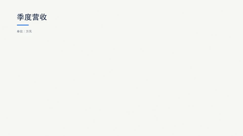</a><br /><sub>Quarterly revenue chart animation — derived GIF viewing copy</sub></td>
</tr>
</table>

**Özgün istem**

```text
文生 GIF 动图，16:9，用于业绩汇报。清爽的二维扁平矢量信息图风格：暖白色背景、轻微纸张质感、大量留白，深海军蓝细线与明亮蓝色为主，珊瑚橙只用于强调增长。画面中央是一张大幅上升折线图，展示季度营收：Q1 120 万、Q2 168 万、Q3 215 万、Q4 306 万。
动画开始时，浅灰色网格和坐标轴轻轻浮现；蓝色折线从 Q1 向 Q4 快速但顺滑地绘制，线下方出现半透明蓝色渐变填充。每到一个数据节点，圆点弹跳一下，对应的数值卡片弹出；线条经过时留下一小段发光轨迹。到达 Q4 时，终点出现珊瑚橙色上升箭头和“增长 155%”卡片，周围有少量星形闪光与圆环扩散。随后高亮、卡片和填充平滑收回，回到初始画面，形成首尾一致的 4 秒无缝循环 GIF。图表位置始终固定，动效有节奏感但不杂乱。不要人物、实拍质感、3D 效果、镜头运动或声音。
```

[Özgün istem (.txt)](cases/social-revenue-chart-loop/prompt.txt)

Original prompt wording is preserved.  See the precise source and item-level media notes; requested parameters are not independently verified output properties.

[Kaynaktaki özgün istem](https://x.com/aiwarts/status/2119435411667980473)

**Yazar**: [aiwarts](https://x.com/aiwarts)

**Özgün kaynak**: [Üreticinin bildirdiği model](https://x.com/aiwarts/status/2119435411667980473) · [Kaynak ayrıntıları](cases/social-revenue-chart-loop/README.md)

**[👉 Şimdi dene →](https://raphael.app/gpt-image-2-6-prompts?utm_source=github&utm_medium=repository&utm_campaign=gpt_image_2_6_launch&utm_content=case_gallery_social-revenue-chart-loop&utm_term=tr-TR)**

---

<a id="source-case-social-web-summary-interaction-loop"></a>

#### 22. Web summary interaction animation

<table>
<tr>
<td align="center"><a href="assets/examples/social-web-summary-interaction-loop/source-01.mp4"><br />İlk kare önizlemesi · Videoyu aç</a><br /><sub>Web summary interaction animation</sub></td>
<td align="center"><a href="assets/examples/social-web-summary-interaction-loop/preview-01.gif"></a><br /><sub>Web summary interaction animation — derived GIF viewing copy</sub></td>
</tr>
</table>

**Özgün istem**

```text
制作一段 3 秒、可无缝循环的网页产品演示动图。鼠标点击文章右上角的“生成摘要”按钮，按钮短暂显示加载状态，右侧随即展开简洁的摘要卡片。镜头固定，保留真实界面布局，让点击和结果清晰可见；动画轻快、克制，不添加其他操作或虚构文案。
```

[Özgün istem (.txt)](cases/social-web-summary-interaction-loop/prompt.txt)

Original prompt wording is preserved.  See the precise source and item-level media notes; requested parameters are not independently verified output properties.

[Kaynaktaki özgün istem](https://x.com/aiwarts/status/2119435411667980473)

**Yazar**: [aiwarts](https://x.com/aiwarts)

**Özgün kaynak**: [Üreticinin bildirdiği model](https://x.com/aiwarts/status/2119435411667980473) · [Kaynak ayrıntıları](cases/social-web-summary-interaction-loop/README.md)

**[👉 Şimdi dene →](https://raphael.app/gpt-image-2-6-prompts?utm_source=github&utm_medium=repository&utm_campaign=gpt_image_2_6_launch&utm_content=case_gallery_social-web-summary-interaction-loop&utm_term=tr-TR)**

---

<a id="source-case-social-camera-exploded-loop"></a>

#### 23. Camera exploded-view animation

<table>
<tr>
<td align="center"><a href="assets/examples/social-camera-exploded-loop/source-01.mp4">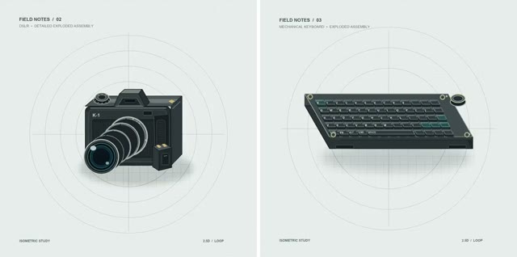<br />İlk kare önizlemesi · Videoyu aç</a><br /><sub>Camera exploded-view animation</sub></td>
<td align="center"><a href="assets/examples/social-camera-exploded-loop/preview-01.gif">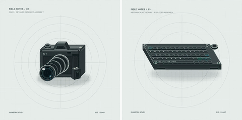</a><br /><sub>Camera exploded-view animation — derived GIF viewing copy</sub></td>
</tr>
</table>

**Özgün istem**

```text
等轴测 2.5D 爆炸拆解视图，一台经典的单反相机。拆成金属机身外壳、镜头零件、等等拆件的爆炸镜头，生成从完整相机到拆件的无缝循环 GIF 动图。
```

[Özgün istem (.txt)](cases/social-camera-exploded-loop/prompt.txt)

Original prompt wording is preserved.  See the precise source and item-level media notes; requested parameters are not independently verified output properties.

[Kaynaktaki özgün istem](https://x.com/aiwarts/status/2119435411667980473)

**Yazar**: [aiwarts](https://x.com/aiwarts)

**Özgün kaynak**: [Üreticinin bildirdiği model](https://x.com/aiwarts/status/2119435411667980473) · [Kaynak ayrıntıları](cases/social-camera-exploded-loop/README.md)

**[👉 Şimdi dene →](https://raphael.app/gpt-image-2-6-prompts?utm_source=github&utm_medium=repository&utm_campaign=gpt_image_2_6_launch&utm_content=case_gallery_social-camera-exploded-loop&utm_term=tr-TR)**

---

<a id="source-case-social-ink-history-timeline-loop"></a>

#### 24. Ink-wash history timeline

<table>
<tr>
<td align="center"><a href="assets/examples/social-ink-history-timeline-loop/source-01.mp4">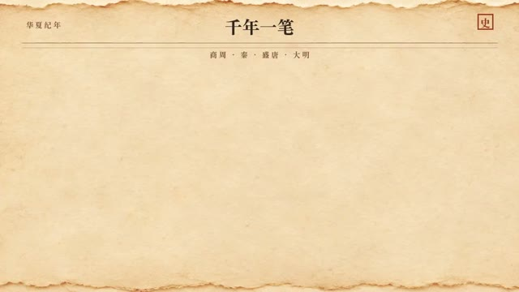<br />İlk kare önizlemesi · Videoyu aç</a><br /><sub>Ink-wash history timeline</sub></td>
<td align="center"><a href="assets/examples/social-ink-history-timeline-loop/preview-01.gif">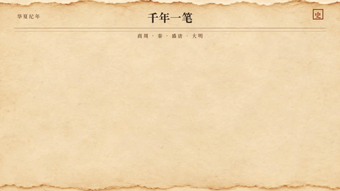</a><br /><sub>Ink-wash history timeline — derived GIF viewing copy</sub></td>
</tr>
</table>

**Özgün istem**

```text
历史科普长卷动态时间轴，动态 GIF，泛黄水墨宣纸质感底纹，手绘水墨写意风格，一支饱蘸浓墨的毛笔自左向右极速扫过划出一条起伏有力的墨迹时间线，墨迹划过之处依次如盖章般晕染浮现出四个朝代关键节点的微缩手绘插画：商周青铜司母戊鼎、秦代陶俑战车、盛唐飞天壁画阁楼与大明宝船，节点带有毛笔小楷年代标注，墨韵流动，首尾相接无缝循环
```

[Özgün istem (.txt)](cases/social-ink-history-timeline-loop/prompt.txt)

Original prompt wording is preserved.  See the precise source and item-level media notes; requested parameters are not independently verified output properties.

[Kaynaktaki özgün istem](https://x.com/aiwarts/status/2119435411667980473)

**Yazar**: [aiwarts](https://x.com/aiwarts)

**Özgün kaynak**: [Üreticinin bildirdiği model](https://x.com/aiwarts/status/2119435411667980473) · [Kaynak ayrıntıları](cases/social-ink-history-timeline-loop/README.md)

**[👉 Şimdi dene →](https://raphael.app/gpt-image-2-6-prompts?utm_source=github&utm_medium=repository&utm_campaign=gpt_image_2_6_launch&utm_content=case_gallery_social-ink-history-timeline-loop&utm_term=tr-TR)**

---

<a id="source-case-social-treasure-map-route-loop"></a>

#### 25. Treasure-map route animation

<table>
<tr>
<td align="center"><a href="assets/examples/social-treasure-map-route-loop/source-01.mp4"><br />İlk kare önizlemesi · Videoyu aç</a><br /><sub>Treasure-map route animation</sub></td>
<td align="center"><a href="assets/examples/social-treasure-map-route-loop/preview-01.gif">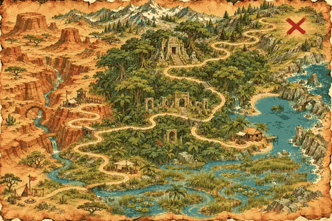</a><br /><sub>Treasure-map route animation — derived GIF viewing copy</sub></td>
</tr>
</table>

**Özgün istem**

```text
复古探险寻宝手绘路线图，动态 GIF，泛黄古老牛皮纸羊皮纸地图质感，手绘等高线与山川河流，一条红色的虚线轨迹从左下角出发像活蛇般沿着山谷快速向前蜿蜒穿梭，轨迹前端是一辆可爱的复古小越野车在颠簸狂奔，每到达一个补给站地标，一枚立体红色图钉便伴随微小冲击波咚地一声精准扎在地图上，最终在右上角的大红叉宝藏点画圈点亮，冒险故事感
```

[Özgün istem (.txt)](cases/social-treasure-map-route-loop/prompt.txt)

Original prompt wording is preserved.  See the precise source and item-level media notes; requested parameters are not independently verified output properties.

[Kaynaktaki özgün istem](https://x.com/aiwarts/status/2119435411667980473)

**Yazar**: [aiwarts](https://x.com/aiwarts)

**Özgün kaynak**: [Üreticinin bildirdiği model](https://x.com/aiwarts/status/2119435411667980473) · [Kaynak ayrıntıları](cases/social-treasure-map-route-loop/README.md)

**[👉 Şimdi dene →](https://raphael.app/gpt-image-2-6-prompts?utm_source=github&utm_medium=repository&utm_campaign=gpt_image_2_6_launch&utm_content=case_gallery_social-treasure-map-route-loop&utm_term=tr-TR)**

---

<a id="category-interiors-architecture"></a>

### İç mekân ve mimari

<a id="source-case-docs-room-chairs"></a>

#### 26. Replace chairs in an interior

<table>
<tr>
<td align="center"><a href="assets/examples/docs-room-chairs/kitchen-chairs-gpt-image-2-6-flare.webp"></a><br /><sub>Kitchen with replacement wooden chairs — GPT Image 2.6 Flare (official model output)</sub></td>
<td align="center"><a href="assets/examples/docs-room-chairs/kitchen-chairs-gpt-image-2-6-sunburst.webp"></a><br /><sub>Kitchen with replacement wooden chairs — GPT Image 2.6 Sunburst (official model output)</sub></td>
</tr>
</table>

<details>
<summary>Referans görselleri</summary>

Referans / girdi görselidir, üretilmiş çıktı değildir.

- [Reference input: Original kitchen with white chairs](assets/references/docs-room-chairs/kitchen.webp)

</details>

**Özgün istem**

```text
In this room photo, replace ONLY the white chairs with chairs made of wood.
Preserve camera angle, room lighting, floor shadows, and surrounding objects.
Keep all other aspects of the image unchanged.
Photorealistic contact shadows and fabric texture.
```

[Kaynaktaki özgün istem](https://developers.openai.com/api/docs/guides/image-prompting#change-furniture-in-a-room)

**Yazar**: [OpenAI](https://developers.openai.com/api/docs/guides/image-prompting#change-furniture-in-a-room)

**Özgün kaynak**: [Resmî belgeler](https://developers.openai.com/api/docs/guides/image-prompting#change-furniture-in-a-room) · [Kaynak ayrıntıları](cases/docs-room-chairs/README.md)

**[👉 Şimdi dene →](https://raphael.app/gpt-image-2-6-prompts?utm_source=github&utm_medium=repository&utm_campaign=gpt_image_2_6_launch&utm_content=case_gallery_docs-room-chairs&utm_term=tr-TR)**

---

<a id="source-case-launch-fal"></a>

#### 27. Living-room markup edit

<table>
<tr>
<td align="center"><a href="assets/examples/launch-fal/source-02.png"></a><br /><sub>Source image 2</sub></td>
</tr>
</table>

<details>
<summary>Referans görselleri</summary>

Referans / girdi görselidir, üretilmiş çıktı değildir.

- [Source image 1](assets/references/launch-fal/source-01.png)

</details>

**Özgün istem**

```text
Follow the red markup on this photo. Each number marks a spot and the legend box explains what to do there. Apply every instruction, then remove all of the markup, including the numbers and the legend box, so the result is a clean photo.
```

[Kaynaktaki özgün istem](https://openai.com/index/introducing-images-2-6/#more-ways-to-create-and-edit-in-the-api)

**Yazar**: [fal](https://openai.com/index/introducing-images-2-6/#more-ways-to-create-and-edit-in-the-api)

**Özgün kaynak**: [Resmî lansman demosu](https://openai.com/index/introducing-images-2-6/#more-ways-to-create-and-edit-in-the-api) · [Kaynak ayrıntıları](cases/launch-fal/README.md)

**[👉 Şimdi dene →](https://raphael.app/gpt-image-2-6-prompts?utm_source=github&utm_medium=repository&utm_campaign=gpt_image_2_6_launch&utm_content=case_gallery_launch-fal&utm_term=tr-TR)**

---

<a id="source-case-community-sunburst-dust-detail"></a>

#### 28. Dusty warehouse prompt-detail comparison

<table>
<tr>
<td align="center"><a href="assets/examples/community-sunburst-dust-detail/source-01.webp"></a><br /><sub>Original dusty-warehouse comparison composite: GPT Image 2.6 Sunburst (quality auto, complexity high) on the left; MAI-Image-2.6 Flash on the right.</sub></td>
</tr>
</table>

**Özgün istem**

**İstemin herkese açık olup olmadığı doğrulanmadı**

**Yazar**: [DesignArena (@DesignArena)](https://x.com/DesignArena)

**Özgün kaynak**: [Üreticinin bildirdiği model](https://x.com/DesignArena/status/2118124393843106154) · [Kaynak ayrıntıları](cases/community-sunburst-dust-detail/README.md)

**[👉 Şimdi dene →](https://raphael.app/gpt-image-2-6-prompts?utm_source=github&utm_medium=repository&utm_campaign=gpt_image_2_6_launch&utm_content=case_gallery_community-sunburst-dust-detail&utm_term=tr-TR)**

---

<a id="category-characters-consistency"></a>

### Karakterler ve tutarlılık

<a id="source-case-docs-complexity"></a>

#### 29. Paper-cut championship scene: complexity comparison

<table>
<tr>
<td align="center"><a href="assets/examples/docs-complexity/paper-cut-football-effort-high-gpt-image-2-6-sunburst.webp"></a><br /><sub>GPT Image 2.6 Sunburst output: Players in folded blue paper jerseys fill the foreground. A CHAMPIONS sign hangs in the stands behind them.</sub></td>
<td align="center"><a href="assets/examples/docs-complexity/paper-cut-football-effort-low-gpt-image-2-6-sunburst.webp"></a><br /><sub>GPT Image 2.6 Sunburst output: Players in red lift a trophy topped with a crown. A CHAMPIONS banner spans the foreground.</sub></td>
</tr>
<tr>
<td align="center"><a href="assets/examples/docs-complexity/paper-cut-football-effort-medium-gpt-image-2-6-sunburst.webp"></a><br /><sub>GPT Image 2.6 Sunburst output: Players in red shirts with team crests lift a trophy decorated with a laurel wreath above a CHAMPIONS banner.</sub></td>
</tr>
</table>

**Özgün istem**

```text
A premium handcrafted layered paper-cut illustration of a football team celebrating a championship victory inside a packed stadium.
```

[Kaynaktaki özgün istem](https://developers.openai.com/api/docs/guides/image-prompting#compare-complexity)

**Yazar**: [OpenAI](https://developers.openai.com/api/docs/guides/image-prompting#compare-complexity)

**Özgün kaynak**: [Resmî belgeler](https://developers.openai.com/api/docs/guides/image-prompting#compare-complexity) · [Kaynak ayrıntıları](cases/docs-complexity/README.md)

**[👉 Şimdi dene →](https://raphael.app/gpt-image-2-6-prompts?utm_source=github&utm_medium=repository&utm_campaign=gpt_image_2_6_launch&utm_content=case_gallery_docs-complexity&utm_term=tr-TR)**

---

<a id="source-case-docs-sailor"></a>

#### 30. Realistic fishing-boat sailor portrait

<table>
<tr>
<td align="center"><a href="assets/examples/docs-sailor/photorealism-gpt-image-2-6-flare.webp"></a><br /><sub>Photorealistic portrait of a sailor repairing a net — GPT Image 2.6 Flare (official model output)</sub></td>
<td align="center"><a href="assets/examples/docs-sailor/photorealism-gpt-image-2-6-sunburst.webp"></a><br /><sub>Photorealistic portrait of a sailor repairing a net — GPT Image 2.6 Sunburst (official model output)</sub></td>
</tr>
</table>

**Özgün istem**

```text
Create a photorealistic candid photograph of an elderly sailor standing on a small fishing boat.
He has weathered skin with visible wrinkles, pores, and sun texture, and a few faded traditional sailor tattoos on his arms.
He is calmly adjusting a net while his dog sits nearby on the deck. Shot like a 35mm film photograph, medium close-up at eye level, using a 50mm lens.
Soft coastal daylight, shallow depth of field, subtle film grain, natural color balance.
The image should feel honest and unposed, with real skin texture, worn materials, and everyday detail. No glamorization, no heavy retouching.
```

[Kaynaktaki özgün istem](https://developers.openai.com/api/docs/guides/image-prompting#control-style-and-lighting)

**Yazar**: [OpenAI](https://developers.openai.com/api/docs/guides/image-prompting#control-style-and-lighting)

**Özgün kaynak**: [Resmî belgeler](https://developers.openai.com/api/docs/guides/image-prompting#control-style-and-lighting) · [Kaynak ayrıntıları](cases/docs-sailor/README.md)

**[👉 Şimdi dene →](https://raphael.app/gpt-image-2-6-prompts?utm_source=github&utm_medium=repository&utm_campaign=gpt_image_2_6_launch&utm_content=case_gallery_docs-sailor&utm_term=tr-TR)**

---

<a id="source-case-docs-historical-crowd"></a>

#### 31. 1969 historical crowd scene

<table>
<tr>
<td align="center"><a href="assets/examples/docs-historical-crowd/world-knowledge-gpt-image-2-6-flare.webp"></a><br /><sub>Crowd scene in Bethel, New York, in August 1969 — GPT Image 2.6 Flare (official model output)</sub></td>
<td align="center"><a href="assets/examples/docs-historical-crowd/world-knowledge-gpt-image-2-6-sunburst.webp"></a><br /><sub>Crowd scene in Bethel, New York, in August 1969 — GPT Image 2.6 Sunburst (official model output)</sub></td>
</tr>
</table>

**Özgün istem**

```text
Create a realistic outdoor crowd scene in Bethel, New York on August 16, 1969.
Photorealistic, period-accurate clothing, staging, and environment.
```

[Kaynaktaki özgün istem](https://developers.openai.com/api/docs/guides/image-prompting#use-historical-and-real-world-context)

**Yazar**: [OpenAI](https://developers.openai.com/api/docs/guides/image-prompting#use-historical-and-real-world-context)

**Özgün kaynak**: [Resmî belgeler](https://developers.openai.com/api/docs/guides/image-prompting#use-historical-and-real-world-context) · [Kaynak ayrıntıları](cases/docs-historical-crowd/README.md)

**[👉 Şimdi dene →](https://raphael.app/gpt-image-2-6-prompts?utm_source=github&utm_medium=repository&utm_campaign=gpt_image_2_6_launch&utm_content=case_gallery_docs-historical-crowd&utm_term=tr-TR)**

---

<a id="source-case-docs-pet-comic"></a>

#### 32. Four-panel pet comic

<table>
<tr>
<td align="center"><a href="assets/examples/docs-pet-comic/comic-reel-gpt-image-2-6-flare.webp"></a><br /><sub>Four-panel comic about a pet at home — GPT Image 2.6 Flare (official model output)</sub></td>
<td align="center"><a href="assets/examples/docs-pet-comic/comic-reel-gpt-image-2-6-sunburst.webp"></a><br /><sub>Four-panel comic about a pet at home — GPT Image 2.6 Sunburst (official model output)</sub></td>
</tr>
</table>

**Özgün istem**

```text
Create a short vertical comic-style reel with 4 panels.
Panel 1: The owner leaves through the front door. The pet is framed in the window behind them, small against the glass, eyes wide, paws pressed high, the house suddenly quiet.
Panel 2: The door clicks shut. Silence breaks. The pet slowly turns toward the empty house, posture shifting, eyes sharp with possibility.
Panel 3: The house transformed. The pet sprawls across the couch like it owns the place, crumbs nearby, sunlight cutting across the room like a spotlight.
Panel 4: The door opens. The pet is seated perfectly by the entrance, alert and composed, as if nothing happened.
```

[Kaynaktaki özgün istem](https://developers.openai.com/api/docs/guides/image-prompting#turn-a-story-into-a-comic-strip)

**Yazar**: [OpenAI](https://developers.openai.com/api/docs/guides/image-prompting#turn-a-story-into-a-comic-strip)

**Özgün kaynak**: [Resmî belgeler](https://developers.openai.com/api/docs/guides/image-prompting#turn-a-story-into-a-comic-strip) · [Kaynak ayrıntıları](cases/docs-pet-comic/README.md)

**[👉 Şimdi dene →](https://raphael.app/gpt-image-2-6-prompts?utm_source=github&utm_medium=repository&utm_campaign=gpt_image_2_6_launch&utm_content=case_gallery_docs-pet-comic&utm_term=tr-TR)**

---

<a id="source-case-docs-outfit"></a>

#### 33. Change clothing while preserving identity

<table>
<tr>
<td align="center"><a href="assets/examples/docs-outfit/outfit-gpt-image-2-6-flare.webp"></a><br /><sub>Woman wearing the supplied clothing items — GPT Image 2.6 Flare (official model output)</sub></td>
<td align="center"><a href="assets/examples/docs-outfit/outfit-gpt-image-2-6-sunburst.webp"></a><br /><sub>Woman wearing the supplied clothing items — GPT Image 2.6 Sunburst (official model output)</sub></td>
</tr>
</table>

<details>
<summary>Referans görselleri</summary>

Referans / girdi görselidir, üretilmiş çıktı değildir.

- [Reference input: Gray boots used as a clothing reference](assets/references/docs-outfit/boots.webp)
- [Reference input: Beige jacket used as a clothing reference](assets/references/docs-outfit/jacket.webp)
- [Reference input: White tank top used as a clothing reference](assets/references/docs-outfit/tank-top.webp)
- [Reference input: Woman in a museum used as the identity reference](assets/references/docs-outfit/woman-in-museum.webp)

</details>

**Özgün istem**

```text
Edit the image to dress the woman using the provided clothing images. Do not change her face, facial features, skin tone, body shape, pose, or identity in any way. Preserve her exact likeness, expression, hairstyle, and proportions. Replace only the clothing, fitting the garments naturally to her existing pose and body geometry with realistic fabric behavior. Match lighting, shadows, and color temperature to the original photo so the outfit integrates photorealistically, without looking pasted on. Do not change the background, camera angle, framing, or image quality, and do not add accessories, text, logos, or watermarks.
```

[Kaynaktaki özgün istem](https://developers.openai.com/api/docs/guides/image-prompting#preserve-identity-and-change-clothing)

**Yazar**: [OpenAI](https://developers.openai.com/api/docs/guides/image-prompting#preserve-identity-and-change-clothing)

**Özgün kaynak**: [Resmî belgeler](https://developers.openai.com/api/docs/guides/image-prompting#preserve-identity-and-change-clothing) · [Kaynak ayrıntıları](cases/docs-outfit/README.md)

**[👉 Şimdi dene →](https://raphael.app/gpt-image-2-6-prompts?utm_source=github&utm_medium=repository&utm_campaign=gpt_image_2_6_launch&utm_content=case_gallery_docs-outfit&utm_term=tr-TR)**

---

<a id="source-case-docs-person-scene"></a>

#### 34. Place a person into a camping escape scene

<table>
<tr>
<td align="center"><a href="assets/examples/docs-person-scene/scene-gpt-image-2-6-flare.webp"></a><br /><sub>Woman running from a bear in a campsite scene — GPT Image 2.6 Flare (official model output)</sub></td>
<td align="center"><a href="assets/examples/docs-person-scene/scene-gpt-image-2-6-sunburst.webp"></a><br /><sub>Woman running from a bear in a campsite scene — GPT Image 2.6 Sunburst (official model output)</sub></td>
</tr>
</table>

**Özgün istem**

```text
Generate a highly realistic action scene where this person is running away from a large, realistic brown bear attacking a campsite. The image should look like a real photograph someone could have taken, not an overly enhanced or cinematic movie-poster image.
She is centered in the image but looking away from the camera, wearing outdoorsy camping attire, with dirt on her face and tears in her clothing. She is clearly afraid but focused on escaping, running away from the bear as it destroys the campsite behind her.
The campsite is in Yosemite National Park, with believable natural details. The time of day is dusk, with natural lighting and realistic colors. Everything should feel grounded, authentic, and unstyled, as if captured in a real moment. Avoid cinematic lighting, dramatic color grading, or stylized composition.
```

[Kaynaktaki özgün istem](https://developers.openai.com/api/docs/guides/image-prompting#insert-a-person-into-a-scene)

**Yazar**: [OpenAI](https://developers.openai.com/api/docs/guides/image-prompting#insert-a-person-into-a-scene)

**Özgün kaynak**: [Resmî belgeler](https://developers.openai.com/api/docs/guides/image-prompting#insert-a-person-into-a-scene) · [Kaynak ayrıntıları](cases/docs-person-scene/README.md)

**[👉 Şimdi dene →](https://raphael.app/gpt-image-2-6-prompts?utm_source=github&utm_medium=repository&utm_campaign=gpt_image_2_6_launch&utm_content=case_gallery_docs-person-scene&utm_term=tr-TR)**

---

<a id="source-case-docs-character-start"></a>

#### 35. Establish a storybook character

<table>
<tr>
<td align="center"><a href="assets/examples/docs-character-start/childrens-book-illustration-1-gpt-image-2-6-flare.webp"></a><br /><sub>Forest hero introducing a children&#x27;s book character — GPT Image 2.6 Flare (official model output)</sub></td>
<td align="center"><a href="assets/examples/docs-character-start/childrens-book-illustration-1-gpt-image-2-6-sunburst.webp"></a><br /><sub>Forest hero introducing a children&#x27;s book character — GPT Image 2.6 Sunburst (official model output)</sub></td>
</tr>
</table>

**Özgün istem**

```text
Create a children’s book illustration introducing a main character.

Character:
A young, storybook-style hero inspired by a little forest outlaw,
wearing a simple green hooded tunic, soft brown boots, and a small belt pouch.
The character has a kind expression, gentle eyes, and a brave but warm demeanor.
Carries a small wooden bow used only for helping, never harming.

Theme:
The character protects and rescues small forest animals like squirrels, birds, and rabbits.

Style:
Children’s book illustration, hand-painted watercolor look,
soft outlines, warm earthy colors, whimsical and friendly.
Proportions suitable for picture books (slightly oversized head, expressive face).

Constraints:
- Original character (no copyrighted characters)
- No text
- No watermarks
- Plain forest background to clearly showcase the character
```

[Kaynaktaki özgün istem](https://developers.openai.com/api/docs/guides/image-prompting#establish-the-character)

**Yazar**: [OpenAI](https://developers.openai.com/api/docs/guides/image-prompting#establish-the-character)

**Özgün kaynak**: [Resmî belgeler](https://developers.openai.com/api/docs/guides/image-prompting#establish-the-character) · [Kaynak ayrıntıları](cases/docs-character-start/README.md)

**[👉 Şimdi dene →](https://raphael.app/gpt-image-2-6-prompts?utm_source=github&utm_medium=repository&utm_campaign=gpt_image_2_6_launch&utm_content=case_gallery_docs-character-start&utm_term=tr-TR)**

---

<a id="source-case-docs-character-story"></a>

#### 36. Continue the same character’s story

<table>
<tr>
<td align="center"><a href="assets/examples/docs-character-story/childrens-book-illustration-2-gpt-image-2-6-flare.webp"></a><br /><sub>Same forest hero helping a squirrel in a winter scene — GPT Image 2.6 Flare (official model output)</sub></td>
<td align="center"><a href="assets/examples/docs-character-story/childrens-book-illustration-2-gpt-image-2-6-sunburst.webp"></a><br /><sub>Same forest hero helping a squirrel in a winter scene — GPT Image 2.6 Sunburst (official model output)</sub></td>
</tr>
</table>

**Özgün istem**

```text
Continue the children’s book story using the same character.

Scene:
The same young forest hero is gently helping a frightened squirrel
out of a fallen tree after a winter storm.
The character kneels beside the squirrel, offering reassurance.

Character Consistency:
- Same green hooded tunic
- Same facial features, proportions, and color palette
- Same gentle, heroic personality

Style:
Children’s book watercolor illustration,
soft lighting, snowy forest environment,
warm and comforting mood.

Constraints:
- Do not redesign the character
- No text
- No watermarks
```

[Kaynaktaki özgün istem](https://developers.openai.com/api/docs/guides/image-prompting#continue-the-story)

**Yazar**: [OpenAI](https://developers.openai.com/api/docs/guides/image-prompting#continue-the-story)

**Özgün kaynak**: [Resmî belgeler](https://developers.openai.com/api/docs/guides/image-prompting#continue-the-story) · [Kaynak ayrıntıları](cases/docs-character-story/README.md)

**[👉 Şimdi dene →](https://raphael.app/gpt-image-2-6-prompts?utm_source=github&utm_medium=repository&utm_campaign=gpt_image_2_6_launch&utm_content=case_gallery_docs-character-story&utm_term=tr-TR)**

---

<a id="source-case-launch-picsart"></a>

#### 37. Stained-glass whale

<table>
<tr>
<td align="center"><a href="assets/examples/launch-picsart/source-01.webp"></a><br /><sub>Source image 1</sub></td>
</tr>
</table>

**Özgün istem**

**İstem herkese açık değil**

**Yazar**: [Picsart](https://openai.com/index/introducing-images-2-6/#more-ways-to-create-and-edit-in-the-api)

**Özgün kaynak**: [Resmî lansman demosu](https://openai.com/index/introducing-images-2-6/#more-ways-to-create-and-edit-in-the-api) · [Kaynak ayrıntıları](cases/launch-picsart/README.md)

**[👉 Şimdi dene →](https://raphael.app/gpt-image-2-6-prompts?utm_source=github&utm_medium=repository&utm_campaign=gpt_image_2_6_launch&utm_content=case_gallery_launch-picsart&utm_term=tr-TR)**

---

<a id="source-case-launch-higgsfield"></a>

#### 38. Knight scene and clothing edit sequence

<table>
<tr>
<td align="center"><a href="assets/examples/launch-higgsfield/source-01.webp"></a><br /><sub>Source image 1</sub></td>
<td align="center"><a href="assets/examples/launch-higgsfield/source-02.webp"></a><br /><sub>Source image 2</sub></td>
</tr>
<tr>
<td align="center"><a href="assets/examples/launch-higgsfield/source-03.webp"></a><br /><sub>Source image 3</sub></td>
</tr>
</table>

**Özgün istem**

**Starting image · Character and scene**

```text
Epic high fantasy anime key visual, mature seinen style like a modern high-budget anime film. A young woman sorceress-knight in her twenties with long crimson hair and sharp golden eyes stands on the edge of a cliff in ornate silver and emerald armor with a flowing royal blue cape, a glowing runic sword planted in front of her, magic sparks around her hands. Behind her a vast fantasy kingdom: floating islands with waterfalls pouring into the clouds, a white castle with spires, a huge ancient dragon flying in the distance, giant blooming sakura and golden autumn forests in the valley below. Sunset sky with vivid orange, magenta, turquoise and violet clouds, god rays, glowing magic particles in the air. Extremely vibrant saturated colors, dramatic rim lighting, cel shading with detailed painted backgrounds, crisp clean line art, depth and atmosphere, dynamic low camera angle, wide cinematic composition. Adult, elegant, serious heroic mood, not childish, no chibi, no sci-fi, no neon, no text, no watermark.
```

**Edit 1 · Sunset valley**

```text
Replace the moonlit landscape with a golden sunset over a misty mountain valley, winding river, waterfalls and ancient ruins. Keep the background softly blurred and the knight, armor, sword, rock and composition unchanged.
```

**Edit 2 · Floating castle**

```text
Replace the background with a majestic floating castle, smaller floating islands, cascading waterfalls and a dragon flying overhead. Preserve the warm sunset, atmospheric haze and shallow depth of field. Keep the knight and foreground unchanged.
```

**Edit 3 · Recolor armor**

```text
Recolor the armor to ivory white with rich gold trim, replace emerald gemstones with rubies, and change green fabric panels to deep crimson. Preserve the armor design, blue cape, red hair, golden sword glow, pose and background.
```

Use the edits in order, passing the previous output into the next edit. The official page includes the starting-image prompt alongside Edit 1; the three archived images show the edited results.

[Kaynaktaki özgün istem](https://openai.com/index/introducing-images-2-6/#more-ways-to-create-and-edit-in-the-api)

**Yazar**: [Higgsfield](https://openai.com/index/introducing-images-2-6/#more-ways-to-create-and-edit-in-the-api)

**Özgün kaynak**: [Resmî lansman demosu](https://openai.com/index/introducing-images-2-6/#more-ways-to-create-and-edit-in-the-api) · [Kaynak ayrıntıları](cases/launch-higgsfield/README.md)

**[👉 Şimdi dene →](https://raphael.app/gpt-image-2-6-prompts?utm_source=github&utm_medium=repository&utm_campaign=gpt_image_2_6_launch&utm_content=case_gallery_launch-higgsfield&utm_term=tr-TR)**

---

<a id="source-case-community-marco-reference-photo-board"></a>

#### 39. Reference-led courtyard photo board

<table>
<tr>
<td align="center"><a href="assets/examples/community-marco-reference-photo-board/reference-output-board.webp"></a><br /><sub>Creator composite: labelled Runway reference at upper left and GPT 2.6 courtyard views</sub></td>
</tr>
</table>

**Özgün istem**

**İstem herkese açık değil**

**Yazar**: [Marco (@ai_artworkgen)](https://x.com/ai_artworkgen)

**Özgün kaynak**: [Üreticinin bildirdiği model](https://x.com/ai_artworkgen/status/2118235673727500369) · [Kaynak ayrıntıları](cases/community-marco-reference-photo-board/README.md)

**[👉 Şimdi dene →](https://raphael.app/gpt-image-2-6-prompts?utm_source=github&utm_medium=repository&utm_campaign=gpt_image_2_6_launch&utm_content=case_gallery_community-marco-reference-photo-board&utm_term=tr-TR)**

---

<a id="source-case-community-marco-sunburst-courtyard-comparison"></a>

#### 40. Sunburst courtyard comparison

<table>
<tr>
<td align="center"><a href="assets/examples/community-marco-sunburst-courtyard-comparison/comparison.webp"></a><br /><sub>Top: GPT 2.6 Sunburst courtyard portrait; bottom: GPT 2.5 Sunburst baseline</sub></td>
</tr>
</table>

**Özgün istem**

**İstem herkese açık değil**

**Yazar**: [Marco (@ai_artworkgen)](https://x.com/ai_artworkgen)

**Özgün kaynak**: [Üreticinin bildirdiği model](https://x.com/ai_artworkgen/status/2118235678328893803) · [Kaynak ayrıntıları](cases/community-marco-sunburst-courtyard-comparison/README.md)

**[👉 Şimdi dene →](https://raphael.app/gpt-image-2-6-prompts?utm_source=github&utm_medium=repository&utm_campaign=gpt_image_2_6_launch&utm_content=case_gallery_community-marco-sunburst-courtyard-comparison&utm_term=tr-TR)**

---

<a id="source-case-community-marco-mushroom-fashion-portrait"></a>

#### 41. Mushroom-lit fashion portrait

<table>
<tr>
<td align="center"><a href="assets/examples/community-marco-mushroom-fashion-portrait/portrait.webp"></a><br /><sub>Fashion portrait with metallic clothing and large mushrooms</sub></td>
</tr>
</table>

<details>
<summary>Referans görselleri</summary>

Referans / girdi görselidir, üretilmiş çıktı değildir.

- [Publisher model-settings screenshot, used as evidence; not a generation input or an additional output](assets/references/community-marco-mushroom-fashion-portrait/model-settings.webp)

</details>

**Özgün istem**

**İstem herkese açık değil**

**Yazar**: [Marco (@ai_artworkgen)](https://x.com/ai_artworkgen)

**Özgün kaynak**: [Üreticinin bildirdiği model](https://x.com/ai_artworkgen/status/2118235684217692275) · [Kaynak ayrıntıları](cases/community-marco-mushroom-fashion-portrait/README.md)

**[👉 Şimdi dene →](https://raphael.app/gpt-image-2-6-prompts?utm_source=github&utm_medium=repository&utm_campaign=gpt_image_2_6_launch&utm_content=case_gallery_community-marco-mushroom-fashion-portrait&utm_term=tr-TR)**

---

<a id="source-case-nyle-sunburst-style-gallery"></a>

#### 42. Sunburst six-style sample gallery

<table>
<tr>
<td align="center"><a href="assets/examples/nyle-sunburst-style-gallery/source-01.png"></a><br /><sub>Sunburst six-style sample gallery. One six-panel style series: business portrait, food photo, watercolor street, 3D illustration, bar chart and pixel-art street. This all-2.6 collage is a single series; clearly labelled comparisons are separate cases, while benchmark score charts are excluded. Exact prompts are not shown.</sub></td>
</tr>
</table>

**Özgün istem**

**İstem herkese açık değil**

**Yazar**: [石原 / Nyle Content Studio](https://note.com/content_studio/n/ndd9ab49a6dea)

**Özgün kaynak**: [Üreticinin bildirdiği model](https://note.com/content_studio/n/ndd9ab49a6dea) · [Kaynak ayrıntıları](cases/nyle-sunburst-style-gallery/README.md)

**[👉 Şimdi dene →](https://raphael.app/gpt-image-2-6-prompts?utm_source=github&utm_medium=repository&utm_campaign=gpt_image_2_6_launch&utm_content=case_gallery_nyle-sunburst-style-gallery&utm_term=tr-TR)**

---

<a id="source-case-community-kokone-sunburst-calico"></a>

#### 43. Sunburst calico cat by a window

<table>
<tr>
<td align="center"><a href="assets/examples/community-kokone-sunburst-calico/calico-window.png"></a><br /><sub>Calico cat resting on a sunlit wooden windowsill</sub></td>
</tr>
</table>

**Özgün istem**

**İstem herkese açık değil**

**Yazar**: [ここね｜AI学習中](https://note.com/kokone_ailab/n/n58ea583f8d45)

**Özgün kaynak**: [Üreticinin bildirdiği model](https://note.com/kokone_ailab/n/n58ea583f8d45) · [Kaynak ayrıntıları](cases/community-kokone-sunburst-calico/README.md)

**[👉 Şimdi dene →](https://raphael.app/gpt-image-2-6-prompts?utm_source=github&utm_medium=repository&utm_campaign=gpt_image_2_6_launch&utm_content=case_gallery_community-kokone-sunburst-calico&utm_term=tr-TR)**

---

<a id="source-case-social-woman-holding-tea-mug"></a>

#### 44. Woman holding floral tea mug indoors

<table>
<tr>
<td align="center"><a href="assets/examples/social-woman-holding-tea-mug/source-01.jpg"></a><br /><sub>Woman holding floral tea mug indoors</sub></td>
</tr>
</table>

**Özgün istem**

```text
a realistic photo of a woman holding a cup of tea inside her home
```

[Özgün istem (.txt)](cases/social-woman-holding-tea-mug/prompt.txt)

[Kaynaktaki özgün istem](https://x.com/v3rt0x_/status/2118147596891901957)

**Yazar**: [v3rt0x_](https://x.com/v3rt0x_)

**Özgün kaynak**: [Üreticinin bildirdiği model](https://x.com/v3rt0x_/status/2118147596891901957) · [Kaynak ayrıntıları](cases/social-woman-holding-tea-mug/README.md)

**[👉 Şimdi dene →](https://raphael.app/gpt-image-2-6-prompts?utm_source=github&utm_medium=repository&utm_campaign=gpt_image_2_6_launch&utm_content=case_gallery_social-woman-holding-tea-mug&utm_term=tr-TR)**

---

<a id="source-case-social-90s-film-snapshot-woman"></a>

#### 45. Woman in light blue sweatshirt before polaroid wall

<table>
<tr>
<td align="center"><a href="assets/examples/social-90s-film-snapshot-woman/source-01.jpg"></a><br /><sub>Woman in light blue sweatshirt before polaroid wall</sub></td>
</tr>
</table>

**Özgün istem**

```text
A young woman with the same unchanged face and soft natural complexion, captured in a spontaneous 90s film snapshot. Her loose black hair falls over the shoulders of a baby-blue cropped zip-up sweatshirt worn over a white ribbed tank top. She looks directly into the camera with a relaxed expression and a faint smile. The dim beige wall behind her is covered with colorful polaroids, tiny stickers, music flyers, and handwritten messages. Bright on-camera flash, slightly cool color temperature, natural skin texture, subtle motion blur, authentic disposable-camera grain, imperfect vintage composition, nostalgic bedroom photography.
```

[Özgün istem (.txt)](cases/social-90s-film-snapshot-woman/prompt.txt)

[Kaynaktaki özgün istem](https://x.com/AIwithSarah_/status/2118202866448077182)

**Yazar**: [AIwithSarah_](https://x.com/AIwithSarah_)

**Özgün kaynak**: [Üreticinin bildirdiği model](https://x.com/AIwithSarah_/status/2118202866448077182) · [Kaynak ayrıntıları](cases/social-90s-film-snapshot-woman/README.md)

**[👉 Şimdi dene →](https://raphael.app/gpt-image-2-6-prompts?utm_source=github&utm_medium=repository&utm_campaign=gpt_image_2_6_launch&utm_content=case_gallery_social-90s-film-snapshot-woman&utm_term=tr-TR)**

---

<a id="source-case-social-cyan-poetry-wet-portrait"></a>

#### 46. Glowing cyan poetry and equations on wet skin

<table>
<tr>
<td align="center"><a href="assets/examples/social-cyan-poetry-wet-portrait/source-01.jpg"></a><br /><sub>Glowing cyan poetry and equations on wet skin</sub></td>
</tr>
</table>

**Özgün istem**

```text
A cinematic, ultra-realistic close-up portrait of a young woman with wet, tousled dark hair and luminous skin, staring directly into the camera with an intense, introspective expression. Glowing cyan handwritten text and symbols are projected across her face, neck, and shoulders, resembling poetic phrases, equations, and abstract handwriting. The light reflections shimmer on her damp skin, creating a futuristic, cyber-poetry aesthetic. Dark,moody background with soft shadows, shallow depth of field, sharp focus on the eyes, high contrast lighting, teal and blue color palette, hyper-detailed skin texture, photorealistic, dramatic atmosphere, cyberpunk meets fine-art portrait photography, 8K quality, cinematic lighting.
```

[Özgün istem (.txt)](cases/social-cyan-poetry-wet-portrait/prompt.txt)

[Kaynaktaki özgün istem](https://x.com/iamsofiaijaz/status/2118561558511132918)

**Yazar**: [iamsofiaijaz](https://x.com/iamsofiaijaz)

**Özgün kaynak**: [Üreticinin bildirdiği model](https://x.com/iamsofiaijaz/status/2118561513879507399) · [Kaynak ayrıntıları](cases/social-cyan-poetry-wet-portrait/README.md)

**[👉 Şimdi dene →](https://raphael.app/gpt-image-2-6-prompts?utm_source=github&utm_medium=repository&utm_campaign=gpt_image_2_6_launch&utm_content=case_gallery_social-cyan-poetry-wet-portrait&utm_term=tr-TR)**

---

<a id="source-case-social-sleepy-star-eyed-emoji-fusion"></a>

#### 47. Emoji and kaomoji fusion posters

<table>
<tr>
<td align="center"><a href="assets/examples/social-sleepy-star-eyed-emoji-fusion/source-01.jpg">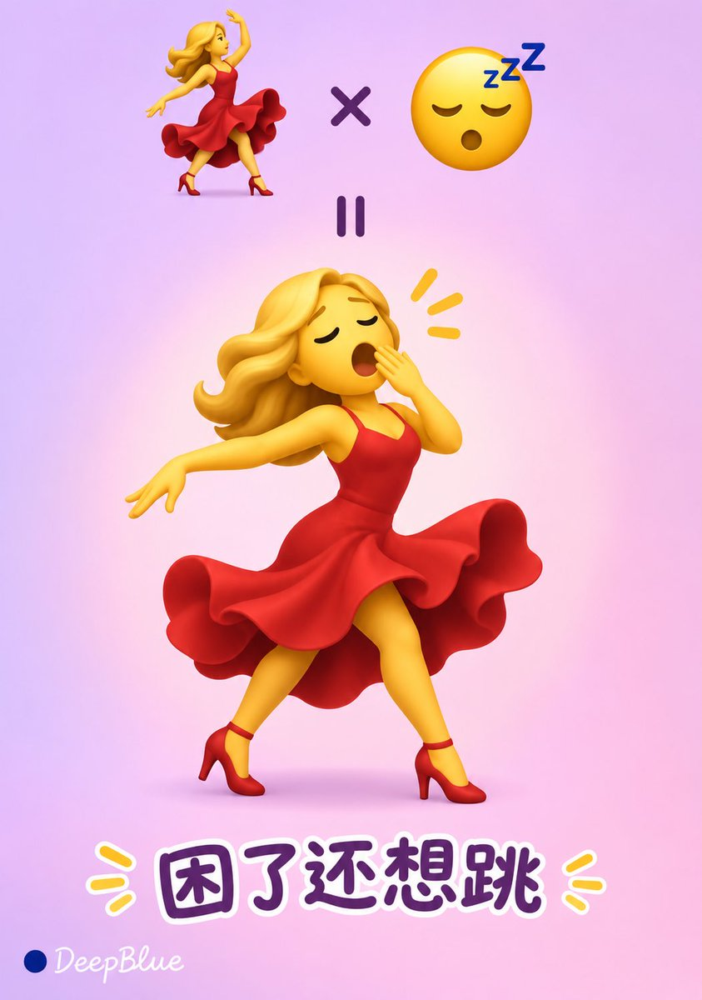</a><br /><sub>Emoji and kaomoji fusion posters</sub></td>
<td align="center"><a href="assets/examples/social-sleepy-star-eyed-emoji-fusion/source-02.jpg"></a><br /><sub>Emoji and kaomoji fusion posters</sub></td>
</tr>
<tr>
<td align="center"><a href="assets/examples/social-sleepy-star-eyed-emoji-fusion/source-03.jpg">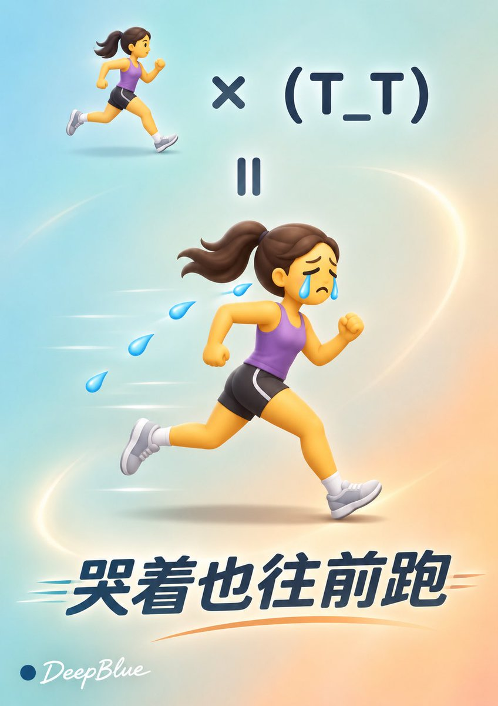</a><br /><sub>Emoji and kaomoji fusion posters</sub></td>
<td align="center"><a href="assets/examples/social-sleepy-star-eyed-emoji-fusion/source-04.jpg"></a><br /><sub>Emoji and kaomoji fusion posters</sub></td>
</tr>
</table>

**Özgün istem**

```text
iOS 系統Emoji × 顏文字× 全新表情設計

每張獨立選擇兩個或多個不同的 Emoji 或顏文字進行融合，開放探索人物、動物、食物、物件、自然元素與各種情緒。

整組變化來源類別與組合方式，探索 Emoji 與 Emoji、Emoji 與顏文字、多個顏文字等不同搭配，讓顏文字多次參與融合。每張選擇不同組合與心情，減少主體和表達重復。

先確定本張的融合配方，提取各來源最有辨識度的五官、神態、輪廓、動作或字符特徵，將它們融合成一個完整的新表情，表達一種有趣的情緒或狀態。

根據來源自身形態設計結果：臉部表情重點融合五官與神態；帶手勢或全身形態的表情保留有助於識別的身體結構；動物、物件和自然元素保留關鍵外形；顏文字的眼睛、嘴巴、符號或字符排列自然融入新表情。身體、四肢與動作由組合和表達需要決定。

融合結果保持簡潔的表情圖標感，以主體輪廓和關鍵特徵傳達心情，細節適度，縮小後仍清晰可辨。

畫面從上到下展示融合公式：上方用「×」連接所選來源，中間將「＝」旋轉90°，呈現為兩條並排的細竪線，下方展示融合後的新表情。新表情明顯大於來源，是畫面的視覺重點。

公式中的 Emoji 參照 iOS 系統對應表情的外觀，保留容易辨認的造型、顏色、神態與動作。公式中的顏文字以清晰字符原樣呈現，保持所選字符及排列完整。

融合後的新表情採用與 iOS Emoji 協調的視覺風格：造型簡潔圓潤，表情鮮明，色彩飽滿，具有柔和漸變、細膩高光與輕微立體感。人物、動物與物件保留各自適合的形態，整體如同同一套系統表情。

根據新表情的情緒與主體配色，自由選擇協調的低飽和漸變背景，在新表情後方加入柔和的主題色光暈。光暈與主體保持適當的明度或色相差異，讓表情輪廓清楚可辨。

在新表情附近寫一句簡短自然的中文心情短句，準確表達融合後的意思。字體形態與筆畫氣質呼應情緒，文字完整清晰，與表情和公式保持適當間距。

公式符號、顏文字與背景保持足夠對比。畫面疏密協調，留白自然。

竪版 9:16，n=10。每張為獨立單圖，逐張生成，不拼圖。

左下簽名：深藍色實心圓點在前，白色手寫體 DeepBlue 在後
```

[Özgün istem (.txt)](cases/social-sleepy-star-eyed-emoji-fusion/prompt.txt)

[Kaynaktaki özgün istem](https://x.com/DeepBlueX0/status/2118276577322750086)

**Yazar**: [DeepBlueX0](https://x.com/DeepBlueX0)

**Özgün kaynak**: [Üreticinin bildirdiği model](https://x.com/DeepBlueX0/status/2118276577322750086) · [Kaynak ayrıntıları](cases/social-sleepy-star-eyed-emoji-fusion/README.md)

**[👉 Şimdi dene →](https://raphael.app/gpt-image-2-6-prompts?utm_source=github&utm_medium=repository&utm_campaign=gpt_image_2_6_launch&utm_content=case_gallery_social-sleepy-star-eyed-emoji-fusion&utm_term=tr-TR)**

---

<a id="source-case-social-moonlit-lake-hanfu-portrait"></a>

#### 48. Woman seated in moonlit lake water

<table>
<tr>
<td align="center"><a href="assets/examples/social-moonlit-lake-hanfu-portrait/source-01.jpg">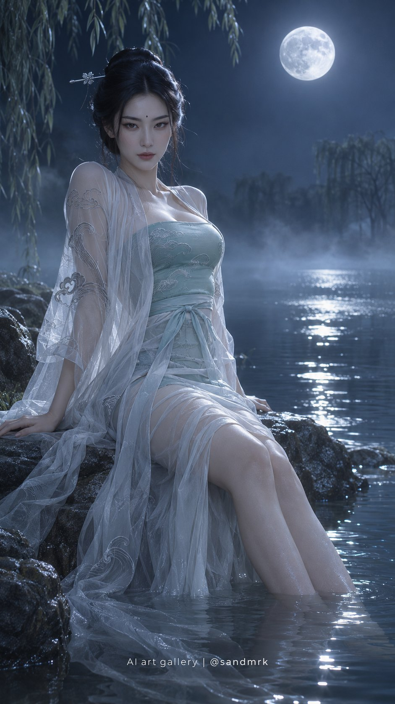</a><br /><sub>Woman seated in moonlit lake water</sub></td>
</tr>
</table>

**Özgün istem**

```text
9:16竖版，超写实人像摄影，月夜湖畔清冷氛围。成年东亚女性侧坐于湖边湿润岩石上，双腿垂入浅水，身形高挑纤细，胸部饱满，腰身收束流畅。身穿月白色纱质褙子，内衬淡青色抹胸，纱质披帛垂入水中。月光从右上方照射，形成冷银色轮廓光。

【人物】
成年东亚女性，清冷孤傲气质。瓜子脸（下巴尖，额头宽，清冷孤傲），丹凤眼（细长上挑，眼尾飞扬，妩媚冷艳），剑眉（粗直上扬，英气飒爽），薄唇（纤薄精致，清冷克制），尖鼻（鼻尖尖锐，冷艳凌厉）。五官严格匀称，透视关系正确：双眼大小一致对称，两眼间距等于单眼宽度，鼻翼宽度等于眼距，嘴唇宽度等于瞳孔间距，面部中线左右对称。眉心一颗小痣（增加辨识度）。乌黑低髻，简单银簪，素雅淡妆。

【姿势】
侧坐于湖边湿润岩石上，身体微微后仰，双手撑在身后岩石上。双腿向前伸展，垂入浅水中，水面泛起微微涟漪。头部微微抬起，丹凤眼直视镜头，眼神清冷孤傲。

【服装】
月白色纱质褙子，半透明，绣有淡墨色水纹和云纹。内衬淡青色抹胸，贴合承托。纱质披帛从肩部垂落，末端垂入水中，被水浸湿。整体修长含蓄，简洁内敛。

【环境】
月夜湖畔：深蓝色夜空，明月高悬，月光洒在湖面上形成银色光路。湖边有湿润的黑色岩石，水面平静如镜，倒映着月亮和人物。远处有模糊的柳树剪影。薄雾弥漫在湖面上，营造空灵氛围。

【光影】
月光从右上方照射，形成冷银色轮廓光，照亮发丝和纱质服装边缘。面部使用柔和的月光补光，保持清冷色调。水面反射月光，形成银色光路。整体色调：深蓝+银白+月白+淡青。

【构图】
中景构图，人物占据画面中央，双腿垂入水中形成纵向线条。月亮位于画面上方1/4处。水面倒影和薄雾营造层次。

Negative: anime, CGI, plastic skin, over-smoothing, hard shadows, revealing clothing, wrong anatomy, extra fingers, text, watermark, logo, modern elements, Western fantasy, oversaturated, thick legs, chubby body, overweight, flat chest, asymmetric eyes, uneven facial features, distorted proportions, deformed face, warm lighting, golden hour, sunny day.

Add the exact watermark "AI art gallery | @sandmrk" at the bottom center. Montserrat Regular, pure white, slightly expanded letter spacing (+1.5px), medium-small size (2% of image height), maximum 25% image width, positioned 10% above the bottom edge. Crisp, elegant, consistent typography. No shadow, outline, glow or background.
```

[Özgün istem (.txt)](cases/social-moonlit-lake-hanfu-portrait/prompt.txt)

[Kaynaktaki özgün istem](https://x.com/sandmrk/status/2118269433626124798)

**Yazar**: [sandmrk](https://x.com/sandmrk)

**Özgün kaynak**: [Üreticinin bildirdiği model](https://x.com/sandmrk/status/2118269430014599535) · [Kaynak ayrıntıları](cases/social-moonlit-lake-hanfu-portrait/README.md)

**[👉 Şimdi dene →](https://raphael.app/gpt-image-2-6-prompts?utm_source=github&utm_medium=repository&utm_campaign=gpt_image_2_6_launch&utm_content=case_gallery_social-moonlit-lake-hanfu-portrait&utm_term=tr-TR)**

---

<a id="source-case-social-seated-hanfu-woman-lotus-pond"></a>

#### 49. Seated hanfu woman by lotus pond at sunset

<table>
<tr>
<td align="center"><a href="assets/examples/social-seated-hanfu-woman-lotus-pond/source-01.jpg">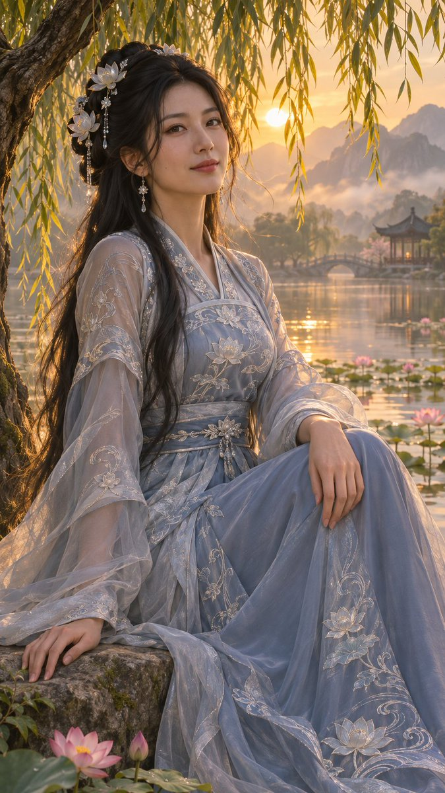</a><br /><sub>Seated hanfu woman by lotus pond at sunset</sub></td>
</tr>
</table>

**Özgün istem**

```text
An original cinematic semi-realistic fantasy portrait of a clearly adult East Asian woman, age 28, seated on a lakeside stone beneath trailing willow branches at golden hour. Long black hair with delicate pale lotus ornaments, elegant silver-blue embroidered silk hanfu with opaque bodice and modest neckline, airy outer sleeves, long skirt naturally draped over her legs. Three-quarter seated composition, vertical 9:16 framing. Warm golden backlight through leaves, soft mist, distant mountain silhouettes, a tranquil reflective pond and small pink lotus blossoms. Natural skin texture, individual hair strands, intricate silver embroidery, believable hands and anatomy, soft atmospheric depth. No text, no watermark, no logos.
```

[Özgün istem (.txt)](cases/social-seated-hanfu-woman-lotus-pond/prompt.txt)

[Kaynaktaki özgün istem](https://x.com/fengnian_ai/status/2118386725676552194)

**Yazar**: [fengnian_ai](https://x.com/fengnian_ai)

**Özgün kaynak**: [Üreticinin bildirdiği model](https://x.com/fengnian_ai/status/2118386725676552194) · [Kaynak ayrıntıları](cases/social-seated-hanfu-woman-lotus-pond/README.md)

**[👉 Şimdi dene →](https://raphael.app/gpt-image-2-6-prompts?utm_source=github&utm_medium=repository&utm_campaign=gpt_image_2_6_launch&utm_content=case_gallery_social-seated-hanfu-woman-lotus-pond&utm_term=tr-TR)**

---

<a id="source-case-social-sunset-beach-look-back"></a>

#### 50. Woman turning back on sunset beach

<table>
<tr>
<td align="center"><a href="assets/examples/social-sunset-beach-look-back/source-01.jpg">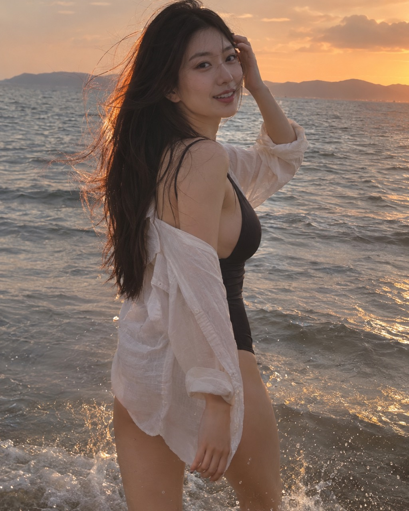</a><br /><sub>Woman turning back on sunset beach</sub></td>
<td align="center"><a href="assets/examples/social-sunset-beach-look-back/source-02.jpg">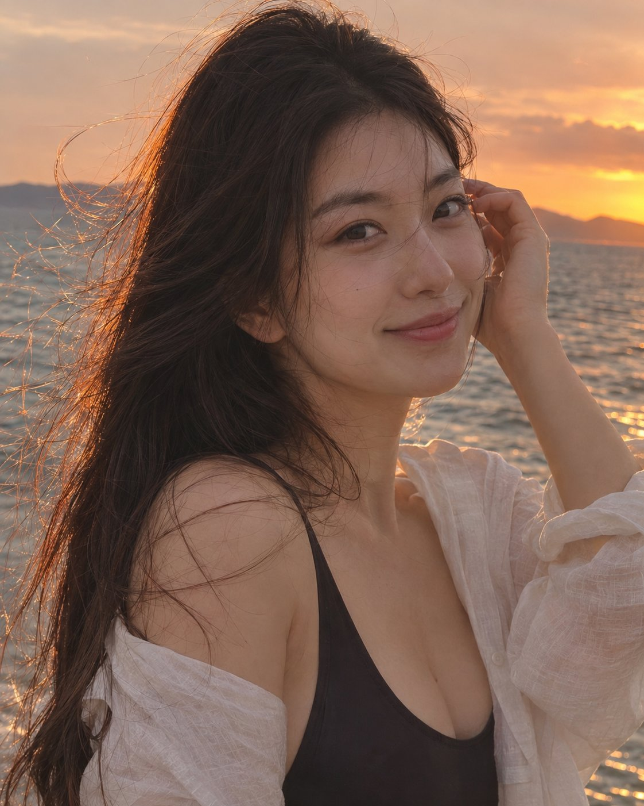</a><br /><sub>Woman turning back on sunset beach</sub></td>
</tr>
<tr>
<td align="center"><a href="assets/examples/social-sunset-beach-look-back/source-03.jpg">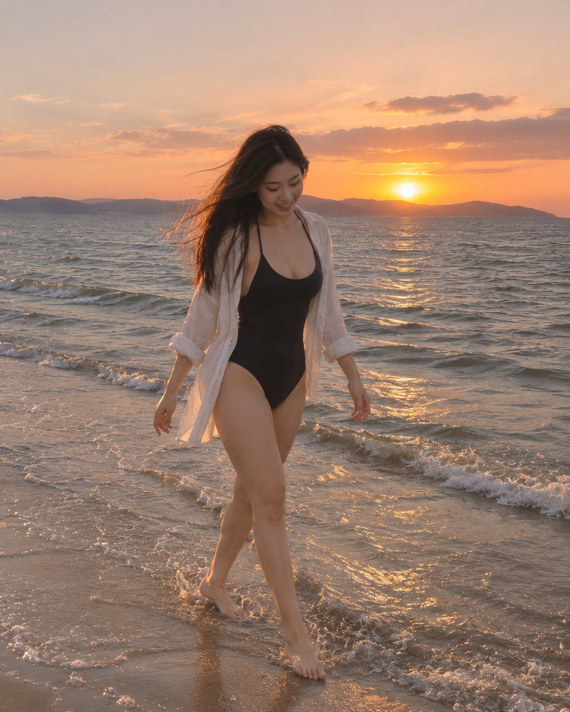</a><br /><sub>Woman turning back on sunset beach</sub></td>
<td align="center"><a href="assets/examples/social-sunset-beach-look-back/source-04.jpg">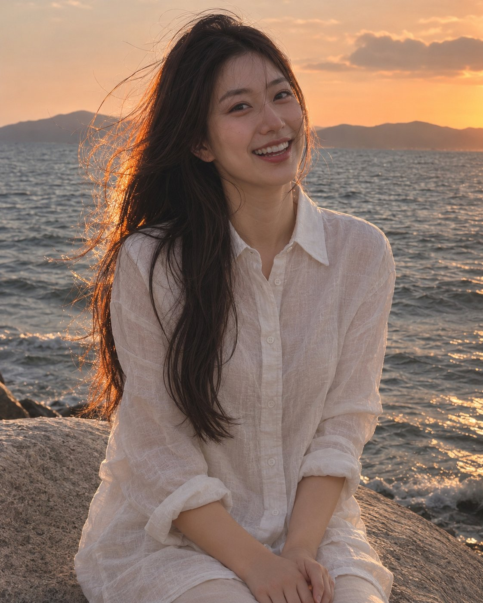</a><br /><sub>Woman turning back on sunset beach</sub></td>
</tr>
</table>

**Özgün istem**

```text
【首图】
生成一张4:5竖版写实人像照片。一位25岁的成年东亚美女，黑色长发，五官精致，身材修长匀称，穿黑色连体泳衣，外搭敞开的白色亚麻衬衫。傍晚赤脚走在海边浅水中，被身后的人叫住，回头看向镜头，露出刚开始笑的自然表情，一只手轻轻按住被海风吹起的头发。拍到大腿，人物占画面主体，前景有细碎浪花，夕阳从侧后方照亮发丝。像旅行时偶然拍到的漂亮瞬间，保留真实皮肤纹理、衣料褶皱和轻微抓拍感，色彩自然，无文字、水印。

【续图方法】
上传首图作参考，保持同一成年女性的五官、发型、服装、海边夕阳和真实肤质。每次单独生成一张，分别追加：
①近景：胸口以上，拨头发，轻轻微笑。
②全身：赤脚走在浅水里，低头看浪花。
③坐姿：白衬衫扣好，坐在海边岩石上，半身构图，自然大笑。
```

[Özgün istem (.txt)](cases/social-sunset-beach-look-back/prompt.txt)

[Kaynaktaki özgün istem](https://x.com/sonny_eacc/status/2118216507025187281)

**Yazar**: [sonny_eacc](https://x.com/sonny_eacc)

**Özgün kaynak**: [Üreticinin bildirdiği model](https://x.com/sonny_eacc/status/2118216234445791408) · [Kaynak ayrıntıları](cases/social-sunset-beach-look-back/README.md)

**[👉 Şimdi dene →](https://raphael.app/gpt-image-2-6-prompts?utm_source=github&utm_medium=repository&utm_campaign=gpt_image_2_6_launch&utm_content=case_gallery_social-sunset-beach-look-back&utm_term=tr-TR)**

---

<a id="source-case-social-streetwear-cap-headphones-portrait"></a>

#### 51. Sunlit streetwear portrait with cap and headphones

<table>
<tr>
<td align="center"><a href="assets/examples/social-streetwear-cap-headphones-portrait/source-01.jpg">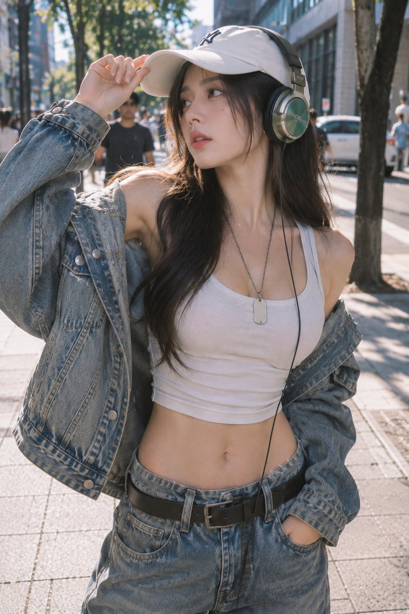</a><br /><sub>Sunlit streetwear portrait with cap and headphones</sub></td>
</tr>
</table>

**Özgün istem**

```text
A cinematic 35mm street-snap photograph captured at eye level — a three-quarter medium portrait of a cool, stylish young East Asian woman on a sunlit urban sidewalk, turning in profile toward camera-left.

She possesses top-tier model beauty with sharp facial features, defined cheekbones, amber-tinted eyes, and dark hair falling from beneath a clean white baseball cap as her right hand lifts the brim. She wears retro green metallic over-ear wired headphones, a silver dog-tag necklace, and a fitted white cropped tank top displaying athletic toned abs. An oversized light-wash blue denim trucker jacket drapes loosely off her shoulders, paired with low-rise baggy jeans and a black belt, her left hand casually tucked into her pocket.

The setting is a vibrant metropolitan avenue in bright daylight. Natural afternoon sun creates soft rim lighting along her hair strands and denim fabric, with the bustling street and modern architecture softly blurred into natural depth of field behind her.

Shot on a 35mm prime lens at f/2.2 with gentle highlight halation and fine organic film grain in an M1 street narrative register. Real human skin with visible fine pores, subtle natural warmth, and authentic heavy cotton denim weave — strictly no CGI, no 3D render, no plastic skin, no artificial smoothing, no waxy AI look.
```

[Özgün istem (.txt)](cases/social-streetwear-cap-headphones-portrait/prompt.txt)

Original prompt wording is preserved.

[Kaynaktaki özgün istem](https://x.com/johnAGI168/status/2118581030781382805)

**Yazar**: [johnAGI168](https://x.com/johnAGI168)

**Özgün kaynak**: [Üreticinin bildirdiği model](https://x.com/johnAGI168/status/2118581030781382805) · [Kaynak ayrıntıları](cases/social-streetwear-cap-headphones-portrait/README.md)

**[👉 Şimdi dene →](https://raphael.app/gpt-image-2-6-prompts?utm_source=github&utm_medium=repository&utm_campaign=gpt_image_2_6_launch&utm_content=case_gallery_social-streetwear-cap-headphones-portrait&utm_term=tr-TR)**

---

<a id="source-case-social-kimono-door-peephole-portrait"></a>

#### 52. Kimono portrait through a door peephole

<table>
<tr>
<td align="center"><a href="assets/examples/social-kimono-door-peephole-portrait/source-01.jpg"></a><br /><sub>Kimono portrait through a door peephole</sub></td>
<td align="center"><a href="assets/examples/social-kimono-door-peephole-portrait/source-02.jpg"></a><br /><sub>Kimono portrait through a door peephole</sub></td>
</tr>
</table>

**Özgün istem**

```text
玄関先でこちらを見るキャラ。
[＊＊＊]
キャラは、アップロード画像を参照。
顔・髪型・服装まで忠実に再現。
晴れた住宅街、自然光。
アスペクト比縦4:5。
```

[Özgün istem (.txt)](cases/social-kimono-door-peephole-portrait/prompt.txt)

Original prompt wording is preserved. The source offers two placeholder choices; inputs are not independently reconstructed. See the precise source and item-level media notes; requested parameters are not independently verified output properties.

[Kaynaktaki özgün istem](https://x.com/kabumira862571/status/2118220107487051883)

**Yazar**: [kabumira862571](https://x.com/kabumira862571)

**Özgün kaynak**: [Üreticinin bildirdiği model](https://x.com/kabumira862571/status/2118220107487051883) · [Kaynak ayrıntıları](cases/social-kimono-door-peephole-portrait/README.md)

**[👉 Şimdi dene →](https://raphael.app/gpt-image-2-6-prompts?utm_source=github&utm_medium=repository&utm_campaign=gpt_image_2_6_launch&utm_content=case_gallery_social-kimono-door-peephole-portrait&utm_term=tr-TR)**

---

<a id="source-case-social-keor-elevator-mirror-portrait"></a>

#### 53. Keor outfit portrait in a mirrored elevator

<table>
<tr>
<td align="center"><a href="assets/examples/social-keor-elevator-mirror-portrait/source-01.jpg">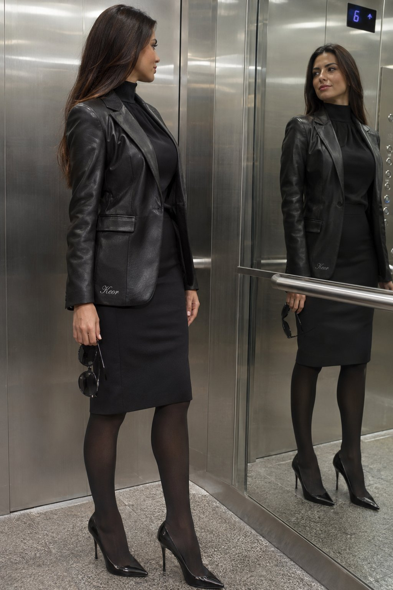</a><br /><sub>Keor outfit portrait in a mirrored elevator</sub></td>
</tr>
</table>

**Özgün istem**

```text
{"subject": {"description": "A beautiful young woman with long straight dark brown hair, tanned skin, and a confident expression. She has a toned, curvaceous figure.", "pose": "Standing in an elevator, looking at her reflection in the mirrored wall while holding a pair of black sunglasses. Her body is slightly turned toward the mirror.", "clothing": {"main": "Black leather-style crop top with deep V-neck, black mini skirt with chain details, black arm sleeves/gloves with cut-outs, black thigh-high stockings, and black high heels stilettos. Black choker necklace.", "modifications": "Add a small, elegant 'Keor' embroidery in refined script on the border or hem of her black top or skirt, subtly visible."}}, "setting": {"environment": "Modern elevator interior with mirrored walls, metal panels, and a digital display.", "lighting": "Bright indoor elevator lighting creating reflections on the metal and mirrors."}, "style": {"photography": "Realistic, high-resolution candid-style photograph with sharp details on skin, hair, leather textures, and reflections.", "mood": "Edgy, confident, and stylish.", "composition": "Medium full-body shot capturing the subject and her mirror reflection."}, "full_prompt": "Photorealistic image of a beautiful woman with long dark hair in a black leather crop top, mini skirt, thigh-high stockings, and boots, standing in an elevator looking at her reflection while holding sunglasses. Add small elegant 'Keor' embroidery on the border of her outfit. Bright elevator lighting with mirror reflections, highly detailed skin, hair, and fabric textures."}
```

[Özgün istem (.txt)](cases/social-keor-elevator-mirror-portrait/prompt.txt)

Original prompt wording is preserved.  See the precise source and item-level media notes; requested parameters are not independently verified output properties.

[Kaynaktaki özgün istem](https://x.com/tadasgedgaudas/status/2118284291381875124)

**Yazar**: [tadasgedgaudas](https://x.com/tadasgedgaudas)

**Özgün kaynak**: [Üreticinin bildirdiği model](https://x.com/tadasgedgaudas/status/2118284291381875124) · [Kaynak ayrıntıları](cases/social-keor-elevator-mirror-portrait/README.md)

**[👉 Şimdi dene →](https://raphael.app/gpt-image-2-6-prompts?utm_source=github&utm_medium=repository&utm_campaign=gpt_image_2_6_launch&utm_content=case_gallery_social-keor-elevator-mirror-portrait&utm_term=tr-TR)**

---

<a id="source-case-social-japanese-office-short-prompts"></a>

#### 54. Japanese office snapshots with short prompts

<table>
<tr>
<td align="center"><a href="assets/examples/social-japanese-office-short-prompts/source-01.jpg">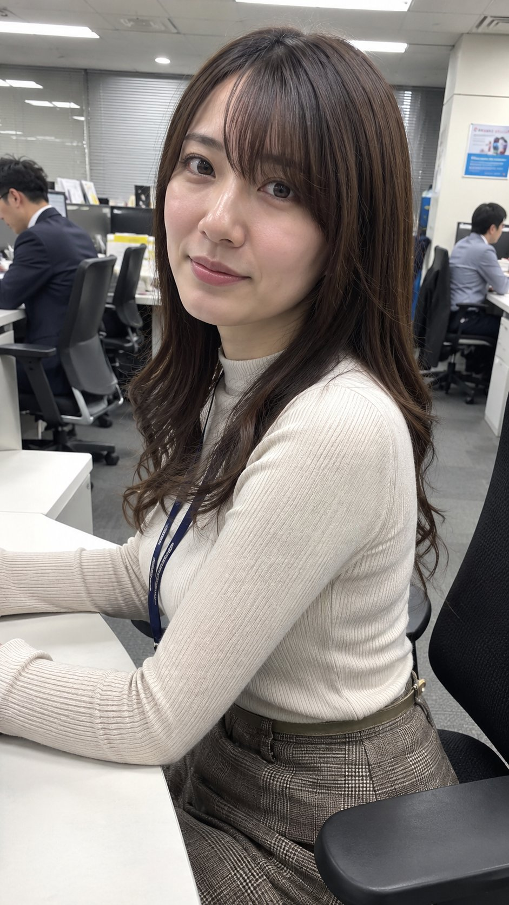</a><br /><sub>Japanese office snapshots with short prompts</sub></td>
<td align="center"><a href="assets/examples/social-japanese-office-short-prompts/source-02.jpg">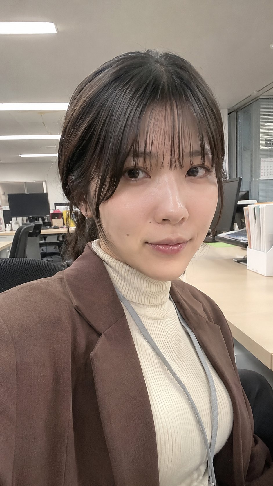</a><br /><sub>Japanese office snapshots with short prompts</sub></td>
</tr>
<tr>
<td align="center"><a href="assets/examples/social-japanese-office-short-prompts/source-03.jpg">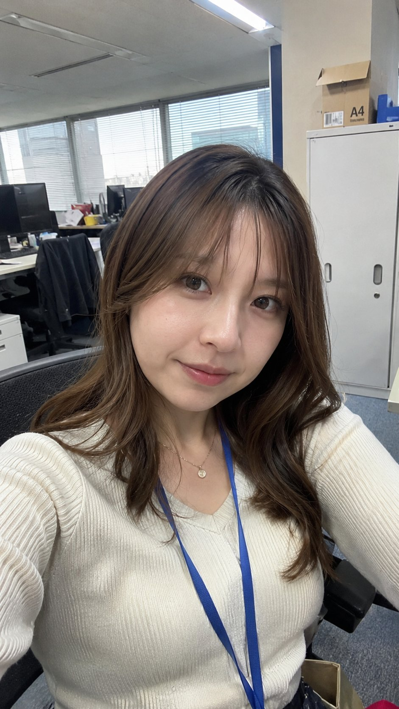</a><br /><sub>Japanese office snapshots with short prompts</sub></td>
<td align="center"><a href="assets/examples/social-japanese-office-short-prompts/source-04.jpg">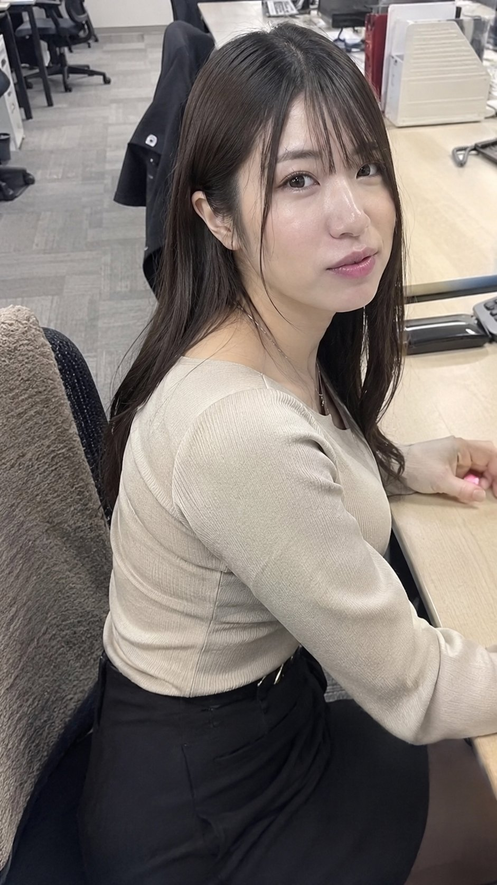</a><br /><sub>Japanese office snapshots with short prompts</sub></td>
</tr>
</table>

**Özgün istem**

```text
1,2枚目:縦長9:16の超写実的な実写写真。
成人日本人女性。日本の一般的なオフィス。

3,4枚目:縦長9:16の超写実的な実写写真スマホ画質のスナップショット。
成人日本人女性。日本の一般的なオフィス。
```

[Özgün istem (.txt)](cases/social-japanese-office-short-prompts/prompt.txt)

Original prompt wording is preserved.  See the precise source and item-level media notes; requested parameters are not independently verified output properties.

[Kaynaktaki özgün istem](https://x.com/buusk4/status/2118543259257712714)

**Yazar**: [buusk4](https://x.com/buusk4)

**Özgün kaynak**: [Üreticinin bildirdiği model](https://x.com/buusk4/status/2118543259257712714) · [Kaynak ayrıntıları](cases/social-japanese-office-short-prompts/README.md)

**[👉 Şimdi dene →](https://raphael.app/gpt-image-2-6-prompts?utm_source=github&utm_medium=repository&utm_campaign=gpt_image_2_6_launch&utm_content=case_gallery_social-japanese-office-short-prompts&utm_term=tr-TR)**

---

<a id="category-markup-edits"></a>

### İşaretleme ve hedefli düzenlemeler

<a id="source-case-docs-vase-markup"></a>

#### 55. Recolor a marked vase

<table>
<tr>
<td align="center"><a href="assets/examples/docs-vase-markup/markup-vase-gpt-image-2-6-flare.webp"></a><br /><sub>GPT Image 2.6 Flare output: Flare edit of the kitchen with a blue vase and dried stems on the table</sub></td>
<td align="center"><a href="assets/examples/docs-vase-markup/markup-vase-gpt-image-2-6-sunburst.webp"></a><br /><sub>GPT Image 2.6 Sunburst output: Sunburst edit of the kitchen with the same vase in cobalt blue and the red circle removed</sub></td>
</tr>
</table>

<details>
<summary>Referans görselleri</summary>

Referans / girdi görselidir, üretilmiş çıktı değildir.

- [Reference input: Kitchen photo with a red circle around the striped vase on the dining table](assets/references/docs-vase-markup/markup-vase-input-gpt-image-2-6.webp)

</details>

**Özgün istem**

```text
Recolor the striped vase inside the red circle to solid cobalt blue ceramic. Keep its shape, the dried stems, and the rest of the kitchen unchanged. Remove the red circle from the finished photo.
```

[Kaynaktaki özgün istem](https://developers.openai.com/api/docs/guides/image-prompting#guide-an-edit-with-markup)

**Yazar**: [OpenAI](https://developers.openai.com/api/docs/guides/image-prompting#guide-an-edit-with-markup)

**Özgün kaynak**: [Resmî belgeler](https://developers.openai.com/api/docs/guides/image-prompting#guide-an-edit-with-markup) · [Kaynak ayrıntıları](cases/docs-vase-markup/README.md)

**[👉 Şimdi dene →](https://raphael.app/gpt-image-2-6-prompts?utm_source=github&utm_medium=repository&utm_campaign=gpt_image_2_6_launch&utm_content=case_gallery_docs-vase-markup&utm_term=tr-TR)**

---

<a id="source-case-docs-spanish-edit"></a>

#### 56. Translate an infographic into Spanish

<table>
<tr>
<td align="center"><a href="assets/examples/docs-spanish-edit/infographic-coffee-machine-sp-gpt-image-2-6-flare.webp"></a><br /><sub>Coffee machine diagram translated into Spanish — GPT Image 2.6 Flare (official model output)</sub></td>
<td align="center"><a href="assets/examples/docs-spanish-edit/infographic-coffee-machine-sp-gpt-image-2-6-sunburst.webp"></a><br /><sub>Coffee machine diagram translated into Spanish — GPT Image 2.6 Sunburst (official model output)</sub></td>
</tr>
</table>

**Özgün istem**

```text
Translate the text in the infographic to Spanish. Do not change any other aspect of the image.
```

[Kaynaktaki özgün istem](https://developers.openai.com/api/docs/guides/image-prompting#translate-while-preserving-layout)

**Yazar**: [OpenAI](https://developers.openai.com/api/docs/guides/image-prompting#translate-while-preserving-layout)

**Özgün kaynak**: [Resmî belgeler](https://developers.openai.com/api/docs/guides/image-prompting#translate-while-preserving-layout) · [Kaynak ayrıntıları](cases/docs-spanish-edit/README.md)

**[👉 Şimdi dene →](https://raphael.app/gpt-image-2-6-prompts?utm_source=github&utm_medium=repository&utm_campaign=gpt_image_2_6_launch&utm_content=case_gallery_docs-spanish-edit&utm_term=tr-TR)**

---

<a id="source-case-docs-pixel-style"></a>

#### 57. Transfer a pixel-art style

<table>
<tr>
<td align="center"><a href="assets/examples/docs-pixel-style/motorcycle-gpt-image-2-6-flare.webp"></a><br /><sub>Pixel-art motorcycle rider using the reference style — GPT Image 2.6 Flare (official model output)</sub></td>
<td align="center"><a href="assets/examples/docs-pixel-style/motorcycle-gpt-image-2-6-sunburst.webp"></a><br /><sub>Pixel-art motorcycle rider using the reference style — GPT Image 2.6 Sunburst (official model output)</sub></td>
</tr>
</table>

<details>
<summary>Referans görselleri</summary>

Referans / girdi görselidir, üretilmiş çıktı değildir.

- [Reference input: Pixel-art game screen used as a style reference](assets/references/docs-pixel-style/pixels.webp)

</details>

**Özgün istem**

```text
Use the same style from the input image and generate a man riding a motorcycle on a white background.
```

[Kaynaktaki özgün istem](https://developers.openai.com/api/docs/guides/image-prompting#transfer-a-visual-style)

**Yazar**: [OpenAI](https://developers.openai.com/api/docs/guides/image-prompting#transfer-a-visual-style)

**Özgün kaynak**: [Resmî belgeler](https://developers.openai.com/api/docs/guides/image-prompting#transfer-a-visual-style) · [Kaynak ayrıntıları](cases/docs-pixel-style/README.md)

**[👉 Şimdi dene →](https://raphael.app/gpt-image-2-6-prompts?utm_source=github&utm_medium=repository&utm_campaign=gpt_image_2_6_launch&utm_content=case_gallery_docs-pixel-style&utm_term=tr-TR)**

---

<a id="source-case-docs-dog-composite"></a>

#### 58. Combine pets across images

<table>
<tr>
<td align="center"><a href="assets/examples/docs-dog-composite/test-woman-with-dog-gpt-image-2-6-flare.webp"></a><br /><sub>Dog placed beside the woman in the street scene — GPT Image 2.6 Flare (official model output)</sub></td>
<td align="center"><a href="assets/examples/docs-dog-composite/test-woman-with-dog-gpt-image-2-6-sunburst.webp"></a><br /><sub>Dog placed beside the woman in the street scene — GPT Image 2.6 Sunburst (official model output)</sub></td>
</tr>
</table>

<details>
<summary>Referans görselleri</summary>

Referans / girdi görselidir, üretilmiş çıktı değildir.

- [Reference input: Woman with a dog, the second compositing input](assets/references/docs-dog-composite/test-woman-2.webp)
- [Reference input: Woman in a street scene, the first compositing input](assets/references/docs-dog-composite/test-woman.webp)

</details>

**Özgün istem**

```text
Place the dog from the second image into the setting of image 1, right next to the woman, use the same style of lighting, composition and background. Do not change anything else.
```

[Kaynaktaki özgün istem](https://developers.openai.com/api/docs/guides/image-prompting#combine-references)

**Yazar**: [OpenAI](https://developers.openai.com/api/docs/guides/image-prompting#combine-references)

**Özgün kaynak**: [Resmî belgeler](https://developers.openai.com/api/docs/guides/image-prompting#combine-references) · [Kaynak ayrıntıları](cases/docs-dog-composite/README.md)

**[👉 Şimdi dene →](https://raphael.app/gpt-image-2-6-prompts?utm_source=github&utm_medium=repository&utm_campaign=gpt_image_2_6_launch&utm_content=case_gallery_docs-dog-composite&utm_term=tr-TR)**

---

<a id="source-case-docs-sketch-render"></a>

#### 59. Turn a sketch into a realistic scene

<table>
<tr>
<td align="center"><a href="assets/examples/docs-sketch-render/realistic-valley-gpt-image-2-6-flare.webp"></a><br /><sub>Photorealistic river valley rendered from the drawing — GPT Image 2.6 Flare (official model output)</sub></td>
<td align="center"><a href="assets/examples/docs-sketch-render/realistic-valley-gpt-image-2-6-sunburst.webp"></a><br /><sub>Photorealistic river valley rendered from the drawing — GPT Image 2.6 Sunburst (official model output)</sub></td>
</tr>
</table>

<details>
<summary>Referans görselleri</summary>

Referans / girdi görselidir, üretilmiş çıktı değildir.

- [Reference input: Line drawing of a river valley](assets/references/docs-sketch-render/drawings.webp)

</details>

**Özgün istem**

```text
Turn this drawing into a photorealistic image.
Preserve the exact layout, proportions, and perspective.
Choose realistic materials and lighting consistent with the sketch intent.
Do not add new elements or text.
```

[Kaynaktaki özgün istem](https://developers.openai.com/api/docs/guides/image-prompting#turn-a-drawing-into-a-realistic-image)

**Yazar**: [OpenAI](https://developers.openai.com/api/docs/guides/image-prompting#turn-a-drawing-into-a-realistic-image)

**Özgün kaynak**: [Resmî belgeler](https://developers.openai.com/api/docs/guides/image-prompting#turn-a-drawing-into-a-realistic-image) · [Kaynak ayrıntıları](cases/docs-sketch-render/README.md)

**[👉 Şimdi dene →](https://raphael.app/gpt-image-2-6-prompts?utm_source=github&utm_medium=repository&utm_campaign=gpt_image_2_6_launch&utm_content=case_gallery_docs-sketch-render&utm_term=tr-TR)**

---

<a id="source-case-docs-remove-flower"></a>

#### 60. Remove a held flower

<table>
<tr>
<td align="center"><a href="assets/examples/docs-remove-flower/man-with-no-flower-gpt-image-2-6-flare.webp"></a><br /><sub>Same man after the flower has been removed — GPT Image 2.6 Flare (official model output)</sub></td>
<td align="center"><a href="assets/examples/docs-remove-flower/man-with-no-flower-gpt-image-2-6-sunburst.webp"></a><br /><sub>Same man after the flower has been removed — GPT Image 2.6 Sunburst (official model output)</sub></td>
</tr>
</table>

<details>
<summary>Referans görselleri</summary>

Referans / girdi görselidir, üretilmiş çıktı değildir.

- [Reference input: Man holding a flower and wearing a blue cap](assets/references/docs-remove-flower/man-with-blue-hat.webp)

</details>

**Özgün istem**

```text
Remove the flower from man's hand. Do not change anything else.
```

[Kaynaktaki özgün istem](https://developers.openai.com/api/docs/guides/image-prompting#remove-an-object)

**Yazar**: [OpenAI](https://developers.openai.com/api/docs/guides/image-prompting#remove-an-object)

**Özgün kaynak**: [Resmî belgeler](https://developers.openai.com/api/docs/guides/image-prompting#remove-an-object) · [Kaynak ayrıntıları](cases/docs-remove-flower/README.md)

**[👉 Şimdi dene →](https://raphael.app/gpt-image-2-6-prompts?utm_source=github&utm_medium=repository&utm_campaign=gpt_image_2_6_launch&utm_content=case_gallery_docs-remove-flower&utm_term=tr-TR)**

---

<a id="source-case-docs-snow-edit"></a>

#### 61. Change the billboard scene to a snowy night

<table>
<tr>
<td align="center"><a href="assets/examples/docs-snow-edit/billboard-winter-gpt-image-2-6-flare.webp"></a><br /><sub>Shampoo billboard in a snowy evening scene — GPT Image 2.6 Flare (official model output)</sub></td>
<td align="center"><a href="assets/examples/docs-snow-edit/billboard-winter-gpt-image-2-6-sunburst.webp"></a><br /><sub>Shampoo billboard in a snowy evening scene — GPT Image 2.6 Sunburst (official model output)</sub></td>
</tr>
</table>

**Özgün istem**

```text
Make it look like a winter evening with snowfall.
```

[Kaynaktaki özgün istem](https://developers.openai.com/api/docs/guides/image-prompting#change-one-condition)

**Yazar**: [OpenAI](https://developers.openai.com/api/docs/guides/image-prompting#change-one-condition)

**Özgün kaynak**: [Resmî belgeler](https://developers.openai.com/api/docs/guides/image-prompting#change-one-condition) · [Kaynak ayrıntıları](cases/docs-snow-edit/README.md)

**[👉 Şimdi dene →](https://raphael.app/gpt-image-2-6-prompts?utm_source=github&utm_medium=repository&utm_campaign=gpt_image_2_6_launch&utm_content=case_gallery_docs-snow-edit&utm_term=tr-TR)**

---

<a id="source-case-community-flare-day-dusk-edit"></a>

#### 62. Rabbit storybook day-to-dusk edit

<table>
<tr>
<td align="center"><a href="assets/examples/community-flare-day-dusk-edit/source-01.webp"></a><br /><sub>Original rabbit-scene editing comparison composite with an input thumbnail: GPT Image 2.6 Flare (High) on the left; FLUX.2 Klein 4B Distilled Edit on the right.</sub></td>
</tr>
</table>

**Özgün istem**

**İstemin herkese açık olup olmadığı doğrulanmadı**

**Yazar**: [DesignArena (@DesignArena)](https://x.com/DesignArena)

**Özgün kaynak**: [Üreticinin bildirdiği model](https://x.com/DesignArena/status/2118124387639693686) · [Kaynak ayrıntıları](cases/community-flare-day-dusk-edit/README.md)

**[👉 Şimdi dene →](https://raphael.app/gpt-image-2-6-prompts?utm_source=github&utm_medium=repository&utm_campaign=gpt_image_2_6_launch&utm_content=case_gallery_community-flare-day-dusk-edit&utm_term=tr-TR)**

---

<a id="source-case-nyle-webinar-date-edit"></a>

#### 63. Webinar date replacement comparison

<table>
<tr>
<td align="center"><a href="assets/examples/nyle-webinar-date-edit/source-01.png"></a><br /><sub>Webinar date replacement comparison. Original labelled composite retained without cropping. From top: input, 2.5 Sunburst comparison, 2.6 Sunburst result, 2.6 Flare result with an erroneous date. The small printed edit instruction is public in the source image.</sub></td>
</tr>
</table>

**Özgün istem**

```text
実施日時を「2027年1月21日（木）」に差し替える。ほかは変えない。
```

Transcribed from the instruction printed in the archived source comparison image.

[Kaynaktaki özgün istem](https://note.com/content_studio/n/ndd9ab49a6dea)

**Yazar**: [石原 / Nyle Content Studio](https://note.com/content_studio/n/ndd9ab49a6dea)

**Özgün kaynak**: [Üreticinin bildirdiği model](https://note.com/content_studio/n/ndd9ab49a6dea) · [Kaynak ayrıntıları](cases/nyle-webinar-date-edit/README.md)

**[👉 Şimdi dene →](https://raphael.app/gpt-image-2-6-prompts?utm_source=github&utm_medium=repository&utm_campaign=gpt_image_2_6_launch&utm_content=case_gallery_nyle-webinar-date-edit&utm_term=tr-TR)**

---

<a id="source-case-social-portugal-folk-christmas-card"></a>

#### 64. Photo-to-folk-art Christmas greeting cards

<table>
<tr>
<td align="center"><a href="assets/examples/social-portugal-folk-christmas-card/source-01.jpg">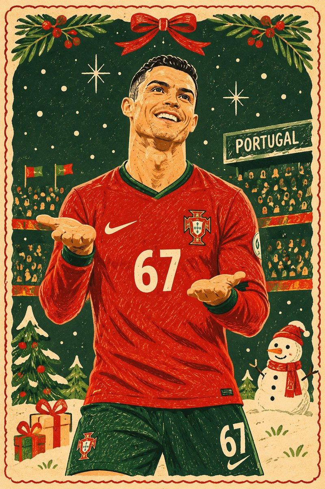</a><br /><sub>Photo-to-folk-art Christmas greeting cards</sub></td>
<td align="center"><a href="assets/examples/social-portugal-folk-christmas-card/source-02.jpg">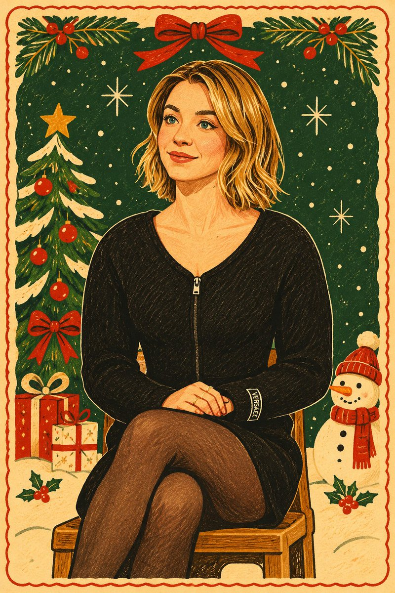</a><br /><sub>Photo-to-folk-art Christmas greeting cards</sub></td>
</tr>
</table>

**Özgün istem**

```text
Transform the uploaded photograph into a beautiful, contemporary hand-drawn naïve Christmas illustration, inspired by premium vintage holiday greeting cards and modern folk-art poster design.

ART STYLE:

- Authentic hand-drawn illustration with a charming, playful naïve-art aesthetic.
- Slightly exaggerated, whimsical proportions.
- Imperfect, irregular outlines and organic hand-drawn contours.
- Simplified shapes with carefully selected decorative details.
- Flat, bold, contrasting colours with a warm Christmas palette.
- Subtle vintage paper texture with a refined printed-card finish.
- Delicate hand-drawn decorative marks, patterns and festive accents.
- Minimalist yet visually rich composition.

COLOUR PALETTE:
Use traditional Christmas colours: deep forest green, warm red, cream, muted beige, golden yellow and earthy brown. Maintain strong colour contrast and a cohesive vintage aesthetic.

PRESERVE THE ORIGINAL PHOTOGRAPH:
Retain the person's recognisable facial features, hairstyle, clothing, pose, expression and body proportions. Preserve the main objects, their arrangement and the essential details of the original environment. Translate everything into the illustrated style rather than replacing it with unrelated elements.

DESIGN & COMPOSITION:
Create an elegant, charming Christmas postcard illustration. Simplify the background into tasteful decorative shapes while retaining recognizable elements from the original photograph. Add small festive decorative details only where they naturally complement the existing scene.

STRICT VISUAL RULES:

- No photorealism.
- No 3D rendering.
- No realistic lighting or shadows.
- No gradients.
- No glossy or metallic effects.
- No artificial digital painting appearance.
- No excessive detail or visual clutter.

The final result should look like an authentic, professionally illustrated Christmas greeting card, with the charm of handmade folk art and the sophistication of a premium designer postcard.

FORMAT: A6 portrait orientation, 2:3 aspect ratio, print-ready composition.
```

[Özgün istem (.txt)](cases/social-portugal-folk-christmas-card/prompt.txt)

[Kaynaktaki özgün istem](https://x.com/Goodmanprotocol/status/2118562099987398753)

**Yazar**: [Goodmanprotocol](https://x.com/Goodmanprotocol)

**Özgün kaynak**: [Üreticinin bildirdiği model](https://x.com/Goodmanprotocol/status/2118562099987398753) · [Kaynak ayrıntıları](cases/social-portugal-folk-christmas-card/README.md)

**[👉 Şimdi dene →](https://raphael.app/gpt-image-2-6-prompts?utm_source=github&utm_medium=repository&utm_campaign=gpt_image_2_6_launch&utm_content=case_gallery_social-portugal-folk-christmas-card&utm_term=tr-TR)**

---

<a id="source-case-social-circle-markup-santa-gift-edit"></a>

#### 65. Circle markup edit adding Santa hat and gift

<table>
<tr>
<td align="center"><a href="assets/examples/social-circle-markup-santa-gift-edit/source-01.jpg">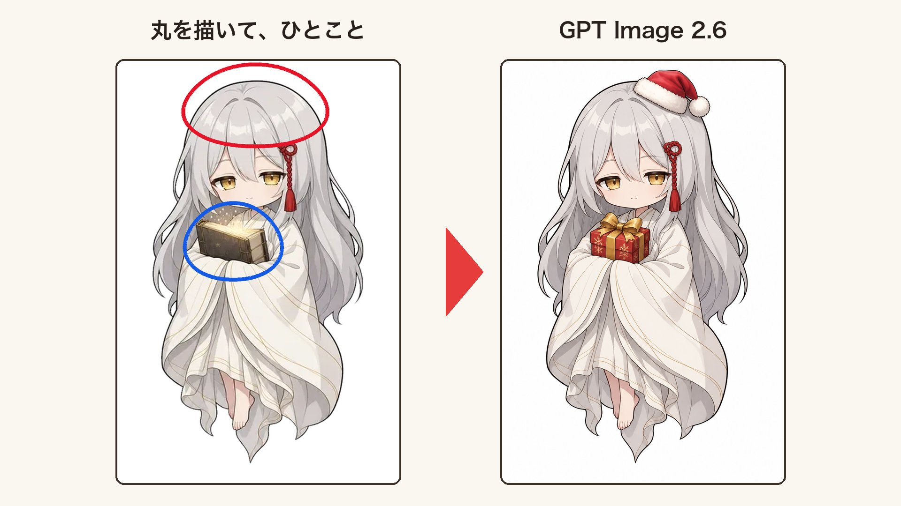</a><br /><sub>Circle markup edit adding Santa hat and gift</sub></td>
</tr>
</table>

**Özgün istem**

```text
赤丸にサンタ帽、青丸の本はプレゼントに
```

[Özgün istem (.txt)](cases/social-circle-markup-santa-gift-edit/prompt.txt)

Original prompt wording is preserved.  See the precise source and item-level media notes; requested parameters are not independently verified output properties.

[Kaynaktaki özgün istem](https://x.com/IHayato/status/2118151619212890291)

**Yazar**: [IHayato](https://x.com/IHayato)

**Özgün kaynak**: [Üreticinin bildirdiği model](https://x.com/IHayato/status/2118151619212890291) · [Kaynak ayrıntıları](cases/social-circle-markup-santa-gift-edit/README.md)

**[👉 Şimdi dene →](https://raphael.app/gpt-image-2-6-prompts?utm_source=github&utm_medium=repository&utm_campaign=gpt_image_2_6_launch&utm_content=case_gallery_social-circle-markup-santa-gift-edit&utm_term=tr-TR)**

---

<a id="category-svg-design-assets"></a>

### SVG ve tasarım varlıkları

<a id="source-case-docs-bakery-svg"></a>

#### 66. Bakery SVG logo

<table>
<tr>
<td align="center"><a href="assets/examples/docs-bakery-svg/field-and-flour-gpt-image-2-6-flare.svg"></a><br /><sub>Flare SVG logo</sub></td>
<td align="center"><a href="assets/examples/docs-bakery-svg/field-and-flour-gpt-image-2-6-sunburst.svg"></a><br /><sub>Sunburst SVG logo</sub></td>
</tr>
</table>

**Özgün istem**

```text
Create an original, non-infringing logo for a company called Field & Flour, a local bakery.
The logo should feel warm, simple, and timeless. Use clean, vector-like shapes, a strong silhouette, and balanced negative space.
Favor simplicity over detail so it reads clearly at small and large sizes. Flat design, minimal strokes, no gradients unless essential.
Fully transparent background. Deliver a single centered logo with generous padding, clean alpha edges, and no solid backdrop, scenery, checkerboard, or watermark.
```

[Kaynaktaki özgün istem](https://developers.openai.com/api/docs/guides/image-prompting#generate-svg-output)

**Yazar**: [OpenAI](https://developers.openai.com/api/docs/guides/image-prompting#generate-svg-output)

**Özgün kaynak**: [Resmî belgeler](https://developers.openai.com/api/docs/guides/image-prompting#generate-svg-output) · [Kaynak ayrıntıları](cases/docs-bakery-svg/README.md)

**[👉 Şimdi dene →](https://raphael.app/gpt-image-2-6-prompts?utm_source=github&utm_medium=repository&utm_campaign=gpt_image_2_6_launch&utm_content=case_gallery_docs-bakery-svg&utm_term=tr-TR)**

---

<a id="source-case-docs-market-ui"></a>

#### 67. Farmers market mobile interface

<table>
<tr>
<td align="center"><a href="assets/examples/docs-market-ui/ui-farmers-market-gpt-image-2-6-flare.webp"></a><br /><sub>Farmers market mobile app mockup — GPT Image 2.6 Flare (official model output)</sub></td>
<td align="center"><a href="assets/examples/docs-market-ui/ui-farmers-market-gpt-image-2-6-sunburst.webp"></a><br /><sub>Farmers market mobile app mockup — GPT Image 2.6 Sunburst (official model output)</sub></td>
</tr>
</table>

**Özgün istem**

```text
Create a realistic mobile app UI mockup for a local farmers market.
Show today’s market with a simple header, a short list of vendors with small photos and categories, a small “Today’s specials” section, and basic information for location and hours.
Design it to be practical, and easy to use. White background, subtle natural accent colors, clear typography, and minimal decoration.
It should look like a real, well-designed, beautiful app for a small local market.
Place the UI mockup in an iPhone frame.
```

[Kaynaktaki özgün istem](https://developers.openai.com/api/docs/guides/image-prompting#create-an-interface-preview)

**Yazar**: [OpenAI](https://developers.openai.com/api/docs/guides/image-prompting#create-an-interface-preview)

**Özgün kaynak**: [Resmî belgeler](https://developers.openai.com/api/docs/guides/image-prompting#create-an-interface-preview) · [Kaynak ayrıntıları](cases/docs-market-ui/README.md)

**[👉 Şimdi dene →](https://raphael.app/gpt-image-2-6-prompts?utm_source=github&utm_medium=repository&utm_campaign=gpt_image_2_6_launch&utm_content=case_gallery_docs-market-ui&utm_term=tr-TR)**

---

<a id="source-case-community-bear-svg-comparison"></a>

#### 68. Bear mascot: SVG versus PNG previews

<table>
<tr>
<td align="center"><a href="assets/examples/community-bear-svg-comparison/source-01.webp"></a><br /><sub>Raster preview of the claimed SVG bear result</sub></td>
<td align="center"><a href="assets/examples/community-bear-svg-comparison/source-02.webp"></a><br /><sub>Raster preview of the claimed PNG bear result</sub></td>
</tr>
</table>

**Özgün istem**

**İstem herkese açık değil**

**Yazar**: [pixexid (@pixexid)](https://x.com/pixexid)

**Özgün kaynak**: [Üreticinin bildirdiği model](https://x.com/pixexid/status/2118153375464505689) · [Kaynak ayrıntıları](cases/community-bear-svg-comparison/README.md)

**[👉 Şimdi dene →](https://raphael.app/gpt-image-2-6-prompts?utm_source=github&utm_medium=repository&utm_campaign=gpt_image_2_6_launch&utm_content=case_gallery_community-bear-svg-comparison&utm_term=tr-TR)**

---

<a id="source-case-community-struggle-code-lightning-svg"></a>

#### 69. Code Lightning vector logo

<table>
<tr>
<td align="center"><a href="assets/examples/community-struggle-code-lightning-svg/62de72dff63229a2552216ee58ec142b.svg"></a><br /><sub>White brackets and lightning on blue square</sub></td>
</tr>
</table>

**Özgün istem**

```text
设计一个极简扁平化风格的个人技术博客 Logo 图标：结合“代码括号 </>”与“闪电”元素，蓝白配色，线条干净利落，并直接导出为可编辑的 SVG 矢量文件给我。
```

[Kaynaktaki özgün istem](https://tianqi.csdn.net/6aebfbae40858c2d8818a1fd.html#devmenu4)

**Yazar**: [STRUGGLE_xlf](https://tianqi.csdn.net/6aebfbae40858c2d8818a1fd.html#devmenu4)

**Özgün kaynak**: [Üreticinin bildirdiği model](https://tianqi.csdn.net/6aebfbae40858c2d8818a1fd.html#devmenu4) · [Kaynak ayrıntıları](cases/community-struggle-code-lightning-svg/README.md)

**[👉 Şimdi dene →](https://raphael.app/gpt-image-2-6-prompts?utm_source=github&utm_medium=repository&utm_campaign=gpt_image_2_6_launch&utm_content=case_gallery_community-struggle-code-lightning-svg&utm_term=tr-TR)**

---

<a id="category-gif-animation"></a>

### GIF ve animasyon

<a id="source-case-docs-lantern-gif"></a>

#### 70. Lantern-carrying monkey loop

<table>
<tr>
<td align="center"><a href="assets/examples/docs-lantern-gif/monkey-lantern-gpt-image-2-6-sunburst.gif"></a><br /><sub>Original monkey GIF</sub></td>
</tr>
</table>

**Özgün istem**

```text
A little monkey in an olive-green hooded coat stands in a snowy pine forest at dusk. A wooden cabin glows in the background. The monkey holds a glowing amber paper lantern at chest height, slowly lifts it, looks up and blinks, then lowers it back to its starting pose. Keep the lantern in its hands and the camera still. Make the motion loop smoothly.
```

[Kaynaktaki özgün istem](https://developers.openai.com/api/docs/guides/image-prompting#generate-a-looping-gif)

**Yazar**: [OpenAI](https://developers.openai.com/api/docs/guides/image-prompting#generate-a-looping-gif)

**Özgün kaynak**: [Resmî belgeler](https://developers.openai.com/api/docs/guides/image-prompting#generate-a-looping-gif) · [Kaynak ayrıntıları](cases/docs-lantern-gif/README.md)

**[👉 Şimdi dene →](https://raphael.app/gpt-image-2-6-prompts?utm_source=github&utm_medium=repository&utm_campaign=gpt_image_2_6_launch&utm_content=case_gallery_docs-lantern-gif&utm_term=tr-TR)**

---

<a id="source-case-launch-openart-down"></a>

#### 71. Office character: falling stock GIF

<table>
<tr>
<td align="center"><a href="assets/examples/launch-openart-down/source-01.webp"></a><br /><sub>Static poster 1</sub></td>
</tr>
</table>

**Özgün istem**

```text
Create a single animation sprite sheet for a seamless looping GIF. A super-cute chibi adult office worker sits at a desk watching a computer monitor with a clearly plunging stock-market line chart. The sequence: hopeful expression, notices the chart falling, eyes widen, face crumples, large cartoon tears stream down both cheeks, then quietly wipes tears while still staring at the falling chart.
Oversized round head, tiny body, big expressive eyes, soft rounded features, messy fluffy hair, white shirt and loosened tie. Exactly 6 sequential frames arranged in a precise 3-column by 2-row grid, read left-to-right then top-to-bottom. Every panel has identical dimensions. Fixed front three-quarter camera, same character, same desk, monitor, outfit, and cozy miniature office background. Clear incremental facial and tear motion; sixth frame transitions smoothly toward the first.
Polished kawaii chibi 3D toy-like style, warm pastel lighting, funny and sympathetic mood. No captions, no words, no numbers, no logos, no speech bubbles, no panel labels, no borders, no gutters.
```

[Kaynaktaki özgün istem](https://openai.com/index/introducing-images-2-6/)

**Yazar**: [OpenArt](https://openai.com/index/introducing-images-2-6/)

**Özgün kaynak**: [Resmî lansman demosu](https://openai.com/index/introducing-images-2-6/) · [Kaynak ayrıntıları](cases/launch-openart-down/README.md)

**[👉 Şimdi dene →](https://raphael.app/gpt-image-2-6-prompts?utm_source=github&utm_medium=repository&utm_campaign=gpt_image_2_6_launch&utm_content=case_gallery_launch-openart-down&utm_term=tr-TR)**

---

<a id="source-case-launch-openart-up"></a>

#### 72. Office character: rising stock GIF

<table>
<tr>
<td align="center"><a href="assets/examples/launch-openart-up/source-01.webp"></a><br /><sub>Static poster 1</sub></td>
</tr>
</table>

**Özgün istem**

```text
Create a single animation sprite sheet for a seamless looping GIF. A super-cute chibi adult office worker sits at a desk watching a computer monitor with a clearly soaring stock-market line chart and a large upward arrow. The sequence: notices the chart rising, eyes widen with delight, jumps up cheering, grabs a handful of generic paper banknotes with no readable currency markings, then happily tosses the banknotes into the air like confetti while laughing.
Oversized round head, tiny body, big sparkling expressive eyes, soft rounded features, messy fluffy hair, white shirt and loosened tie. Exactly 6 sequential frames arranged in a precise 3-column by 2-row grid, read left-to-right then top-to-bottom. Every panel has identical dimensions. Fixed front three-quarter camera, same character, desk, monitor, outfit, and cozy miniature office background. Clear incremental body, arm, and flying-paper motion; sixth frame transitions smoothly toward the first.
Polished kawaii chibi 3D toy-like style, bright celebratory pastel lighting, funny joyful mood. No captions, no words, no numbers, no logos, no real currency symbols, no speech bubbles, no panel labels, no borders, no gutters.
```

[Kaynaktaki özgün istem](https://openai.com/index/introducing-images-2-6/)

**Yazar**: [OpenArt](https://openai.com/index/introducing-images-2-6/)

**Özgün kaynak**: [Resmî lansman demosu](https://openai.com/index/introducing-images-2-6/) · [Kaynak ayrıntıları](cases/launch-openart-up/README.md)

**[👉 Şimdi dene →](https://raphael.app/gpt-image-2-6-prompts?utm_source=github&utm_medium=repository&utm_campaign=gpt_image_2_6_launch&utm_content=case_gallery_launch-openart-up&utm_term=tr-TR)**

---

<a id="source-case-launch-owl"></a>

#### 73. Owl sketch to animation

<table>
<tr>
<td align="center"><a href="assets/examples/launch-owl/source-02.webp"></a><br /><sub>Static poster 2</sub></td>
</tr>
</table>

<details>
<summary>Referans görselleri</summary>

Referans / girdi görselidir, üretilmiş çıktı değildir.

- [Source image 1](assets/references/launch-owl/source-01.webp)

</details>

**Özgün istem**

**İstem herkese açık değil**

**Yazar**: [OpenAI](https://openai.com/index/introducing-images-2-6/)

**Özgün kaynak**: [Resmî lansman demosu](https://openai.com/index/introducing-images-2-6/) · [Kaynak ayrıntıları](cases/launch-owl/README.md)

**[👉 Şimdi dene →](https://raphael.app/gpt-image-2-6-prompts?utm_source=github&utm_medium=repository&utm_campaign=gpt_image_2_6_launch&utm_content=case_gallery_launch-owl&utm_term=tr-TR)**

---

<a id="source-case-launch-town"></a>

#### 74. Monty typing indicator animation

<table>
<tr>
<td align="center"><a href="assets/examples/launch-town/source-01.webp"></a><br /><sub>Static poster 1</sub></td>
</tr>
</table>

**Özgün istem**

**İstem herkese açık değil**

**Yazar**: [Town](https://openai.com/index/introducing-images-2-6/)

**Özgün kaynak**: [Resmî lansman demosu](https://openai.com/index/introducing-images-2-6/) · [Kaynak ayrıntıları](cases/launch-town/README.md)

**[👉 Şimdi dene →](https://raphael.app/gpt-image-2-6-prompts?utm_source=github&utm_medium=repository&utm_campaign=gpt_image_2_6_launch&utm_content=case_gallery_launch-town&utm_term=tr-TR)**

---

<a id="source-case-community-malfoid"></a>

#### 75. Summer character illustration animation

**Henüz arşivlenmemiş görseller** · [Çalışmayı özgün kaynağında görüntüleyin](https://www.reddit.com/r/mAIfoid/comments/1xo9cd2/a_little_summer_malfoid_animation/)

**Özgün istem**

**İstem herkese açık değil**

**Yazar**: [u/Junior-Grade-2965](https://www.reddit.com/r/mAIfoid/comments/1xo9cd2/a_little_summer_malfoid_animation/)

**Özgün kaynak**: [Üreticinin bildirdiği model](https://www.reddit.com/r/mAIfoid/comments/1xo9cd2/a_little_summer_malfoid_animation/) · [Kaynak ayrıntıları](cases/community-malfoid/README.md)

**[👉 Şimdi dene →](https://raphael.app/gpt-image-2-6-prompts?utm_source=github&utm_medium=repository&utm_campaign=gpt_image_2_6_launch&utm_content=case_gallery_community-malfoid&utm_term=tr-TR)**

---

<a id="source-case-community-gifts"></a>

#### 76. Images 2.6 brings GIF(T)S :D

**Henüz arşivlenmemiş görseller** · [Çalışmayı özgün kaynağında görüntüleyin](https://www.reddit.com/r/ChatGPT/comments/1xo6c69/images_26_brings_gifts_d/)

**Özgün istem**

**İstem herkese açık değil**

**Yazar**: [u/Algoartist](https://www.reddit.com/r/ChatGPT/comments/1xo6c69/images_26_brings_gifts_d/)

**Özgün kaynak**: [Üreticinin bildirdiği model](https://www.reddit.com/r/ChatGPT/comments/1xo6c69/images_26_brings_gifts_d/) · [Kaynak ayrıntıları](cases/community-gifts/README.md)

**[👉 Şimdi dene →](https://raphael.app/gpt-image-2-6-prompts?utm_source=github&utm_medium=repository&utm_campaign=gpt_image_2_6_launch&utm_content=case_gallery_community-gifts&utm_term=tr-TR)**

---

<a id="source-case-community-boxing-tiger"></a>

#### 77. Boxing tiger animation

<table>
<tr>
<td align="center"><a href="assets/examples/community-boxing-tiger/source-01.mp4"><br />İlk kare önizlemesi · Videoyu aç</a><br /><sub>X-served MP4 of the boxing tiger animation</sub></td>
<td align="center"><a href="assets/examples/community-boxing-tiger/source-02.webp"></a><br /><sub>Static boxing tiger preview, not a GIF</sub></td>
</tr>
</table>

**Özgün istem**

**İstem herkese açık değil**

**Yazar**: [Archiefff (@baiji57165)](https://x.com/baiji57165)

**Özgün kaynak**: [Üreticinin bildirdiği model](https://x.com/baiji57165/status/2118176730079007145) · [Kaynak ayrıntıları](cases/community-boxing-tiger/README.md)

**[👉 Şimdi dene →](https://raphael.app/gpt-image-2-6-prompts?utm_source=github&utm_medium=repository&utm_campaign=gpt_image_2_6_launch&utm_content=case_gallery_community-boxing-tiger&utm_term=tr-TR)**

---

<a id="source-case-community-hummingbird-variants"></a>

#### 78. Hummingbird and kingfisher animation variants

<table>
<tr>
<td align="center"><a href="assets/examples/community-hummingbird-variants/source-01.mp4"><br />İlk kare önizlemesi · Videoyu aç</a><br /><sub>Hummingbird animation variant 1, X-served MP4</sub></td>
<td align="center"><a href="assets/examples/community-hummingbird-variants/source-02.mp4"><br />İlk kare önizlemesi · Videoyu aç</a><br /><sub>Hummingbird animation variant 2, X-served MP4</sub></td>
</tr>
<tr>
<td align="center"><a href="assets/examples/community-hummingbird-variants/source-03.mp4"><br />İlk kare önizlemesi · Videoyu aç</a><br /><sub>Kingfisher animation variant 3, X-served MP4</sub></td>
<td align="center"><a href="assets/examples/community-hummingbird-variants/source-04.mp4"><br />İlk kare önizlemesi · Videoyu aç</a><br /><sub>Kingfisher animation variant 4, X-served MP4</sub></td>
</tr>
<tr>
<td align="center"><a href="assets/examples/community-hummingbird-variants/source-05.webp"></a><br /><sub>Static hummingbird and hibiscus preview, not a GIF</sub></td>
</tr>
</table>

**Özgün istem**

**İstem herkese açık değil**

**Yazar**: [Dheepan Ratnam (@Dheepanratnam)](https://x.com/Dheepanratnam)

**Özgün kaynak**: [Üreticinin bildirdiği model](https://x.com/Dheepanratnam/status/2118138765487100027) · [Kaynak ayrıntıları](cases/community-hummingbird-variants/README.md)

**[👉 Şimdi dene →](https://raphael.app/gpt-image-2-6-prompts?utm_source=github&utm_medium=repository&utm_campaign=gpt_image_2_6_launch&utm_content=case_gallery_community-hummingbird-variants&utm_term=tr-TR)**

---

<a id="source-case-community-rosebud-animation"></a>

#### 79. Rosebud animation

<table>
<tr>
<td align="center"><a href="assets/examples/community-rosebud-animation/source-01.mp4"><br />İlk kare önizlemesi · Videoyu aç</a><br /><sub>X-served MP4 of the rosebud animation</sub></td>
<td align="center"><a href="assets/examples/community-rosebud-animation/source-02.webp"></a><br /><sub>Static rosebud preview, not a GIF</sub></td>
</tr>
</table>

**Özgün istem**

**İstem herkese açık değil**

**Yazar**: [Michael Guo (@Michaelzsguo)](https://x.com/Michaelzsguo)

**Özgün kaynak**: [Üreticinin bildirdiği model](https://x.com/Michaelzsguo/status/2118134837357744435) · [Kaynak ayrıntıları](cases/community-rosebud-animation/README.md)

**[👉 Şimdi dene →](https://raphael.app/gpt-image-2-6-prompts?utm_source=github&utm_medium=repository&utm_campaign=gpt_image_2_6_launch&utm_content=case_gallery_community-rosebud-animation&utm_term=tr-TR)**

---

<a id="source-case-ailingqu-jelly-bear-wobble"></a>

#### 80. Jelly bear wobble

<table>
<tr>
<td align="center"><a href="assets/examples/ailingqu-jelly-bear-wobble/jelly-bear-wobble.gif"></a><br /><sub>Jelly bear wobble</sub></td>
</tr>
</table>

**Özgün istem**

```text
A chubby round cartoon bear with a soft jelly-like body and stubby arms, squishing down and springing back up while wobbling side to side, cheeks jiggling on every bounce. Thick clean outlines, flat pastel colors, centered on a plain solid mint-green background that contrasts strongly with the bear.

Animate it as a short, smooth, seamlessly looping GIF with clear motion between frames.
```

Prompt body and shared loop instruction are combined using the source’s documented two-newline separator. Original wording is unchanged. This records the documented recipe, not an independently observed model submission.

[Kaynaktaki özgün istem](https://github.com/ailingqu/awesome-ai-gif-prompts/blob/2672b8fe04e75275de70a8d5d2992da6271ce8f5/data/prompts.json)

**Yazar**: [ailingqu / awesome-ai-gif-prompts](https://github.com/ailingqu)

**Özgün kaynak**: [Üreticinin bildirdiği model](https://github.com/ailingqu/awesome-ai-gif-prompts/blob/2672b8fe04e75275de70a8d5d2992da6271ce8f5/README.md) · [Kaynak ayrıntıları](cases/ailingqu-jelly-bear-wobble/README.md) · [CC BY 4.0](docs/ailingqu-2037/ATTRIBUTION.md)

**[👉 Şimdi dene →](https://raphael.app/gpt-image-2-6-prompts?utm_source=github&utm_medium=repository&utm_campaign=gpt_image_2_6_launch&utm_content=case_gallery_ailingqu-jelly-bear-wobble&utm_term=tr-TR)**

---

<a id="source-case-ailingqu-bunny-reaction-set"></a>

#### 81. White bunny reaction sticker set

<table>
<tr>
<td align="center"><a href="assets/examples/ailingqu-bunny-reaction-set/bunny-thumbs-up.gif"></a><br /><sub>Bunny thumbs-up</sub></td>
<td align="center"><a href="assets/examples/ailingqu-bunny-reaction-set/bunny-laughing.gif"></a><br /><sub>Bunny laughing to tears</sub></td>
</tr>
<tr>
<td align="center"><a href="assets/examples/ailingqu-bunny-reaction-set/bunny-sleepy.gif"></a><br /><sub>Sleepy bunny</sub></td>
</tr>
</table>

**Özgün istem**

**Bunny thumbs-up**

```text
A small white cartoon bunny with long floppy ears and a pink nose, giving an enthusiastic thumbs-up with one paw, the paw pumping forward twice while the ears bounce. Chibi sticker style, bold outline, plain warm yellow background.

Animate it as a short, smooth, seamlessly looping GIF with clear motion between frames.
```

**Bunny laughing to tears**

```text
A small white cartoon bunny with long floppy ears and a pink nose, laughing so hard it rocks back and forth, eyes squeezed shut and two little tears flying out. Chibi sticker style, bold outline, plain warm yellow background.

Animate it as a short, smooth, seamlessly looping GIF with clear motion between frames.
```

**Sleepy bunny**

```text
A small white cartoon bunny with long floppy ears and a pink nose, sitting and nodding off, head slowly drooping then jerking back up, a small bubble swelling and shrinking from its nose. Chibi sticker style, bold outline, plain warm yellow background.

Animate it as a short, smooth, seamlessly looping GIF with clear motion between frames.
```

Prompt body and shared loop instruction are combined using the source’s documented two-newline separator. Original wording is unchanged. This records the documented recipe, not an independently observed model submission.

[Kaynaktaki özgün istem](https://github.com/ailingqu/awesome-ai-gif-prompts/blob/2672b8fe04e75275de70a8d5d2992da6271ce8f5/data/prompts.json)

**Yazar**: [ailingqu / awesome-ai-gif-prompts](https://github.com/ailingqu)

**Özgün kaynak**: [Üreticinin bildirdiği model](https://github.com/ailingqu/awesome-ai-gif-prompts/blob/2672b8fe04e75275de70a8d5d2992da6271ce8f5/README.md) · [Kaynak ayrıntıları](cases/ailingqu-bunny-reaction-set/README.md) · [CC BY 4.0](docs/ailingqu-2037/ATTRIBUTION.md)

**[👉 Şimdi dene →](https://raphael.app/gpt-image-2-6-prompts?utm_source=github&utm_medium=repository&utm_campaign=gpt_image_2_6_launch&utm_content=case_gallery_ailingqu-bunny-reaction-set&utm_term=tr-TR)**

---

<a id="source-case-ailingqu-cat-waving-hello"></a>

#### 82. Cartoon cat waving hello

<table>
<tr>
<td align="center"><a href="assets/examples/ailingqu-cat-waving-hello/cat-waving-hello.gif"></a><br /><sub>Cartoon cat waving hello</sub></td>
</tr>
</table>

**Özgün istem**

```text
A cheerful cartoon cat waving hello.

Animate it as a short, smooth, seamlessly looping GIF with clear motion between frames.
```

Prompt body and shared loop instruction are combined using the source’s documented two-newline separator. Original wording is unchanged. This records the documented recipe, not an independently observed model submission.

[Kaynaktaki özgün istem](https://github.com/ailingqu/awesome-ai-gif-prompts/blob/2672b8fe04e75275de70a8d5d2992da6271ce8f5/data/prompts.json)

**Yazar**: [ailingqu / awesome-ai-gif-prompts](https://github.com/ailingqu)

**Özgün kaynak**: [Üreticinin bildirdiği model](https://github.com/ailingqu/awesome-ai-gif-prompts/blob/2672b8fe04e75275de70a8d5d2992da6271ce8f5/README.md) · [Kaynak ayrıntıları](cases/ailingqu-cat-waving-hello/README.md) · [CC BY 4.0](docs/ailingqu-2037/ATTRIBUTION.md)

**[👉 Şimdi dene →](https://raphael.app/gpt-image-2-6-prompts?utm_source=github&utm_medium=repository&utm_campaign=gpt_image_2_6_launch&utm_content=case_gallery_ailingqu-cat-waving-hello&utm_term=tr-TR)**

---

<a id="source-case-ailingqu-shiba-head-tilt"></a>

#### 83. Confused shiba head tilt

<table>
<tr>
<td align="center"><a href="assets/examples/ailingqu-shiba-head-tilt/shiba-head-tilt.gif"></a><br /><sub>Confused shiba head tilt</sub></td>
</tr>
</table>

**Özgün istem**

```text
A fluffy orange shiba inu puppy tilting its head to one side and back again, ears twitching, a small question mark popping above its head. Chibi sticker style, bold outline, plain light blue background.

Animate it as a short, smooth, seamlessly looping GIF with clear motion between frames.
```

Prompt body and shared loop instruction are combined using the source’s documented two-newline separator. Original wording is unchanged. This records the documented recipe, not an independently observed model submission.

[Kaynaktaki özgün istem](https://github.com/ailingqu/awesome-ai-gif-prompts/blob/2672b8fe04e75275de70a8d5d2992da6271ce8f5/data/prompts.json)

**Yazar**: [ailingqu / awesome-ai-gif-prompts](https://github.com/ailingqu)

**Özgün kaynak**: [Üreticinin bildirdiği model](https://github.com/ailingqu/awesome-ai-gif-prompts/blob/2672b8fe04e75275de70a8d5d2992da6271ce8f5/README.md) · [Kaynak ayrıntıları](cases/ailingqu-shiba-head-tilt/README.md) · [CC BY 4.0](docs/ailingqu-2037/ATTRIBUTION.md)

**[👉 Şimdi dene →](https://raphael.app/gpt-image-2-6-prompts?utm_source=github&utm_medium=repository&utm_campaign=gpt_image_2_6_launch&utm_content=case_gallery_ailingqu-shiba-head-tilt&utm_term=tr-TR)**

---

<a id="source-case-ailingqu-cat-typing-laptop"></a>

#### 84. Cat typing furiously

<table>
<tr>
<td align="center"><a href="assets/examples/ailingqu-cat-typing-laptop/cat-typing-laptop.gif"></a><br /><sub>Cat typing furiously</sub></td>
</tr>
</table>

**Özgün istem**

```text
A grey tabby cat sitting at a tiny laptop and typing furiously with both front paws, paws blurring, little speed lines and sweat drops flying off. Flat cartoon sticker style, bold outline, plain pale pink background.

Animate it as a short, smooth, seamlessly looping GIF with clear motion between frames.
```

Prompt body and shared loop instruction are combined using the source’s documented two-newline separator. Original wording is unchanged. This records the documented recipe, not an independently observed model submission.

[Kaynaktaki özgün istem](https://github.com/ailingqu/awesome-ai-gif-prompts/blob/2672b8fe04e75275de70a8d5d2992da6271ce8f5/data/prompts.json)

**Yazar**: [ailingqu / awesome-ai-gif-prompts](https://github.com/ailingqu)

**Özgün kaynak**: [Üreticinin bildirdiği model](https://github.com/ailingqu/awesome-ai-gif-prompts/blob/2672b8fe04e75275de70a8d5d2992da6271ce8f5/README.md) · [Kaynak ayrıntıları](cases/ailingqu-cat-typing-laptop/README.md) · [CC BY 4.0](docs/ailingqu-2037/ATTRIBUTION.md)

**[👉 Şimdi dene →](https://raphael.app/gpt-image-2-6-prompts?utm_source=github&utm_medium=repository&utm_campaign=gpt_image_2_6_launch&utm_content=case_gallery_ailingqu-cat-typing-laptop&utm_term=tr-TR)**

---

<a id="source-case-ailingqu-frog-heart-bubble"></a>

#### 85. Frog blowing a heart

<table>
<tr>
<td align="center"><a href="assets/examples/ailingqu-frog-heart-bubble/frog-heart-bubble.gif"></a><br /><sub>Frog blowing a heart</sub></td>
</tr>
</table>

**Özgün istem**

```text
A round green cartoon frog puffing its cheeks and blowing a pink heart-shaped bubble that floats up and pops into tiny sparkles. Cute flat sticker style, bold outline, plain cream background.

Animate it as a short, smooth, seamlessly looping GIF with clear motion between frames.
```

Prompt body and shared loop instruction are combined using the source’s documented two-newline separator. Original wording is unchanged. This records the documented recipe, not an independently observed model submission.

[Kaynaktaki özgün istem](https://github.com/ailingqu/awesome-ai-gif-prompts/blob/2672b8fe04e75275de70a8d5d2992da6271ce8f5/data/prompts.json)

**Yazar**: [ailingqu / awesome-ai-gif-prompts](https://github.com/ailingqu)

**Özgün kaynak**: [Üreticinin bildirdiği model](https://github.com/ailingqu/awesome-ai-gif-prompts/blob/2672b8fe04e75275de70a8d5d2992da6271ce8f5/README.md) · [Kaynak ayrıntıları](cases/ailingqu-frog-heart-bubble/README.md) · [CC BY 4.0](docs/ailingqu-2037/ATTRIBUTION.md)

**[👉 Şimdi dene →](https://raphael.app/gpt-image-2-6-prompts?utm_source=github&utm_medium=repository&utm_campaign=gpt_image_2_6_launch&utm_content=case_gallery_ailingqu-frog-heart-bubble&utm_term=tr-TR)**

---

<a id="source-case-ailingqu-penguin-facepalm"></a>

#### 86. Penguin facepalm

<table>
<tr>
<td align="center"><a href="assets/examples/ailingqu-penguin-facepalm/penguin-facepalm.gif"></a><br /><sub>Penguin facepalm</sub></td>
</tr>
</table>

**Özgün istem**

```text
A chubby cartoon penguin slowly raising one flipper and slapping it onto its forehead, then shaking its head in disbelief. Chibi sticker style, bold outline, plain light grey background.

Animate it as a short, smooth, seamlessly looping GIF with clear motion between frames.
```

Prompt body and shared loop instruction are combined using the source’s documented two-newline separator. Original wording is unchanged. This records the documented recipe, not an independently observed model submission.

[Kaynaktaki özgün istem](https://github.com/ailingqu/awesome-ai-gif-prompts/blob/2672b8fe04e75275de70a8d5d2992da6271ce8f5/data/prompts.json)

**Yazar**: [ailingqu / awesome-ai-gif-prompts](https://github.com/ailingqu)

**Özgün kaynak**: [Üreticinin bildirdiği model](https://github.com/ailingqu/awesome-ai-gif-prompts/blob/2672b8fe04e75275de70a8d5d2992da6271ce8f5/README.md) · [Kaynak ayrıntıları](cases/ailingqu-penguin-facepalm/README.md) · [CC BY 4.0](docs/ailingqu-2037/ATTRIBUTION.md)

**[👉 Şimdi dene →](https://raphael.app/gpt-image-2-6-prompts?utm_source=github&utm_medium=repository&utm_campaign=gpt_image_2_6_launch&utm_content=case_gallery_ailingqu-penguin-facepalm&utm_term=tr-TR)**

---

<a id="source-case-ailingqu-basketball-shot-sticker"></a>

#### 87. Basketball shot celebration

<table>
<tr>
<td align="center"><a href="assets/examples/ailingqu-basketball-shot-sticker/basketball-shot-sticker.gif"></a><br /><sub>Basketball shot celebration</sub></td>
</tr>
</table>

**Özgün istem**

```text
A chibi kid in a red jersey jumps and shoots a basketball, the ball swishes through the hoop, then the kid lands and pumps a fist in celebration before returning to the starting pose. Bold-outline sticker style, plain light orange background.

Animate it as a short, smooth, seamlessly looping GIF with clear motion between frames.
```

Prompt body and shared loop instruction are combined using the source’s documented two-newline separator. Original wording is unchanged. This records the documented recipe, not an independently observed model submission.

[Kaynaktaki özgün istem](https://github.com/ailingqu/awesome-ai-gif-prompts/blob/2672b8fe04e75275de70a8d5d2992da6271ce8f5/data/prompts.json)

**Yazar**: [ailingqu / awesome-ai-gif-prompts](https://github.com/ailingqu)

**Özgün kaynak**: [Üreticinin bildirdiği model](https://github.com/ailingqu/awesome-ai-gif-prompts/blob/2672b8fe04e75275de70a8d5d2992da6271ce8f5/README.md) · [Kaynak ayrıntıları](cases/ailingqu-basketball-shot-sticker/README.md) · [CC BY 4.0](docs/ailingqu-2037/ATTRIBUTION.md)

**[👉 Şimdi dene →](https://raphael.app/gpt-image-2-6-prompts?utm_source=github&utm_medium=repository&utm_campaign=gpt_image_2_6_launch&utm_content=case_gallery_ailingqu-basketball-shot-sticker&utm_term=tr-TR)**

---

<a id="source-case-ailingqu-cat-chef-fried-rice"></a>

#### 88. Cat chef tossing fried rice

<table>
<tr>
<td align="center"><a href="assets/examples/ailingqu-cat-chef-fried-rice/cat-chef-fried-rice.gif"></a><br /><sub>Cat chef tossing fried rice</sub></td>
</tr>
</table>

**Özgün istem**

```text
A white cat chef in a tall chef hat tossing fried rice in a wok, the rice flies up in a little arc and lands back in the pan, a puff of steam rising each time. Comic cartoon style, warm kitchen background kept still.

Animate it as a short, smooth, seamlessly looping GIF with clear motion between frames.
```

Prompt body and shared loop instruction are combined using the source’s documented two-newline separator. Original wording is unchanged. This records the documented recipe, not an independently observed model submission.

[Kaynaktaki özgün istem](https://github.com/ailingqu/awesome-ai-gif-prompts/blob/2672b8fe04e75275de70a8d5d2992da6271ce8f5/data/prompts.json)

**Yazar**: [ailingqu / awesome-ai-gif-prompts](https://github.com/ailingqu)

**Özgün kaynak**: [Üreticinin bildirdiği model](https://github.com/ailingqu/awesome-ai-gif-prompts/blob/2672b8fe04e75275de70a8d5d2992da6271ce8f5/README.md) · [Kaynak ayrıntıları](cases/ailingqu-cat-chef-fried-rice/README.md) · [CC BY 4.0](docs/ailingqu-2037/ATTRIBUTION.md)

**[👉 Şimdi dene →](https://raphael.app/gpt-image-2-6-prompts?utm_source=github&utm_medium=repository&utm_campaign=gpt_image_2_6_launch&utm_content=case_gallery_ailingqu-cat-chef-fried-rice&utm_term=tr-TR)**

---

<a id="source-case-ailingqu-black-cat-punch"></a>

#### 89. Black cat punch

<table>
<tr>
<td align="center"><a href="assets/examples/ailingqu-black-cat-punch/black-cat-punch.gif"></a><br /><sub>Black cat punch</sub></td>
</tr>
</table>

**Özgün istem**

```text
A round black cat with big yellow eyes throwing a quick one-two punch toward the viewer with its front paws, little impact stars popping, then settling back into a boxing stance. Chibi sticker style, bold outline, plain pastel purple background.

Animate it as a short, smooth, seamlessly looping GIF with clear motion between frames.
```

Prompt body and shared loop instruction are combined using the source’s documented two-newline separator. Original wording is unchanged. This records the documented recipe, not an independently observed model submission.

[Kaynaktaki özgün istem](https://github.com/ailingqu/awesome-ai-gif-prompts/blob/2672b8fe04e75275de70a8d5d2992da6271ce8f5/data/prompts.json)

**Yazar**: [ailingqu / awesome-ai-gif-prompts](https://github.com/ailingqu)

**Özgün kaynak**: [Üreticinin bildirdiği model](https://github.com/ailingqu/awesome-ai-gif-prompts/blob/2672b8fe04e75275de70a8d5d2992da6271ce8f5/README.md) · [Kaynak ayrıntıları](cases/ailingqu-black-cat-punch/README.md) · [CC BY 4.0](docs/ailingqu-2037/ATTRIBUTION.md)

**[👉 Şimdi dene →](https://raphael.app/gpt-image-2-6-prompts?utm_source=github&utm_medium=repository&utm_campaign=gpt_image_2_6_launch&utm_content=case_gallery_ailingqu-black-cat-punch&utm_term=tr-TR)**

---

<a id="source-case-ailingqu-office-cat-workday-set"></a>

#### 90. Office cat workday reaction set

<table>
<tr>
<td align="center"><a href="assets/examples/ailingqu-office-cat-workday-set/office-cat-exhausted.gif"></a><br /><sub>Office cat: exhausted</sub></td>
<td align="center"><a href="assets/examples/ailingqu-office-cat-workday-set/office-cat-clock-out.gif"></a><br /><sub>Office cat: clocking out</sub></td>
</tr>
</table>

**Özgün istem**

**Office cat: exhausted**

```text
A chubby orange tabby cat office worker with a tiny blue tie and an employee badge slumps face-down onto a pile of papers on its desk, ears drooping, a tiny ghost of a sigh floating up, then twitches one paw. Flat cartoon sticker style, bold outline, plain pale grey background.

Animate it as a short, smooth, seamlessly looping GIF with clear motion between frames.
```

**Office cat: clocking out**

```text
A chubby orange tabby cat office worker with a tiny blue tie and an employee badge tosses its badge in the air, grabs a tiny backpack and does a happy little hop toward the door, tail swishing. Flat cartoon sticker style, bold outline, plain pale yellow background.

Animate it as a short, smooth, seamlessly looping GIF with clear motion between frames.
```

Prompt body and shared loop instruction are combined using the source’s documented two-newline separator. Original wording is unchanged. This records the documented recipe, not an independently observed model submission.

[Kaynaktaki özgün istem](https://github.com/ailingqu/awesome-ai-gif-prompts/blob/2672b8fe04e75275de70a8d5d2992da6271ce8f5/data/prompts.json)

**Yazar**: [ailingqu / awesome-ai-gif-prompts](https://github.com/ailingqu)

**Özgün kaynak**: [Üreticinin bildirdiği model](https://github.com/ailingqu/awesome-ai-gif-prompts/blob/2672b8fe04e75275de70a8d5d2992da6271ce8f5/README.md) · [Kaynak ayrıntıları](cases/ailingqu-office-cat-workday-set/README.md) · [CC BY 4.0](docs/ailingqu-2037/ATTRIBUTION.md)

**[👉 Şimdi dene →](https://raphael.app/gpt-image-2-6-prompts?utm_source=github&utm_medium=repository&utm_campaign=gpt_image_2_6_launch&utm_content=case_gallery_ailingqu-office-cat-workday-set&utm_term=tr-TR)**

---

<a id="source-case-ailingqu-roaring-duck"></a>

#### 91. Roaring duck

<table>
<tr>
<td align="center"><a href="assets/examples/ailingqu-roaring-duck/roaring-duck.gif"></a><br /><sub>Roaring duck</sub></td>
</tr>
</table>

**Özgün istem**

```text
A small round yellow duck suddenly opening its beak wide and roaring like a lion, feathers blown back, the screen shaking slightly, then it calmly closes its beak. Cute cartoon sticker style, bold outline, plain sky-blue background.

Animate it as a short, smooth, seamlessly looping GIF with clear motion between frames.
```

Prompt body and shared loop instruction are combined using the source’s documented two-newline separator. Original wording is unchanged. This records the documented recipe, not an independently observed model submission.

[Kaynaktaki özgün istem](https://github.com/ailingqu/awesome-ai-gif-prompts/blob/2672b8fe04e75275de70a8d5d2992da6271ce8f5/data/prompts.json)

**Yazar**: [ailingqu / awesome-ai-gif-prompts](https://github.com/ailingqu)

**Özgün kaynak**: [Üreticinin bildirdiği model](https://github.com/ailingqu/awesome-ai-gif-prompts/blob/2672b8fe04e75275de70a8d5d2992da6271ce8f5/README.md) · [Kaynak ayrıntıları](cases/ailingqu-roaring-duck/README.md) · [CC BY 4.0](docs/ailingqu-2037/ATTRIBUTION.md)

**[👉 Şimdi dene →](https://raphael.app/gpt-image-2-6-prompts?utm_source=github&utm_medium=repository&utm_campaign=gpt_image_2_6_launch&utm_content=case_gallery_ailingqu-roaring-duck&utm_term=tr-TR)**

---

<a id="source-case-ailingqu-flower-macro-flash"></a>

#### 92. Flower macro flash cut

<table>
<tr>
<td align="center"><a href="assets/examples/ailingqu-flower-macro-flash/flower-macro-flash.gif"></a><br /><sub>Flower macro flash cut</sub></td>
</tr>
</table>

**Özgün istem**

```text
A fast flash-cut sequence of eight different flower photographs, one per frame, each filling the whole frame: a red poppy shot from above with light glowing through its petals, a creamy gardenia in soft side light, blue delphinium against a deep blue background, a golden marigold macro, a pink peony from a high angle, a dark purple iris close-up, an orange lily with curled petals, and pale green hydrangea with dew drops. Realistic botanical fashion photography, each frame with a different color, distance and composition.

Animate it as a short, smooth, seamlessly looping GIF with clear motion between frames.
```

Prompt body and shared loop instruction are combined using the source’s documented two-newline separator. Original wording is unchanged. This records the documented recipe, not an independently observed model submission.

[Kaynaktaki özgün istem](https://github.com/ailingqu/awesome-ai-gif-prompts/blob/2672b8fe04e75275de70a8d5d2992da6271ce8f5/data/prompts.json)

**Yazar**: [ailingqu / awesome-ai-gif-prompts](https://github.com/ailingqu)

**Özgün kaynak**: [Üreticinin bildirdiği model](https://github.com/ailingqu/awesome-ai-gif-prompts/blob/2672b8fe04e75275de70a8d5d2992da6271ce8f5/README.md) · [Kaynak ayrıntıları](cases/ailingqu-flower-macro-flash/README.md) · [CC BY 4.0](docs/ailingqu-2037/ATTRIBUTION.md)

**[👉 Şimdi dene →](https://raphael.app/gpt-image-2-6-prompts?utm_source=github&utm_medium=repository&utm_campaign=gpt_image_2_6_launch&utm_content=case_gallery_ailingqu-flower-macro-flash&utm_term=tr-TR)**

---

<a id="source-case-ailingqu-cat-brand-reel"></a>

#### 93. Cat-head logo brand reel

<table>
<tr>
<td align="center"><a href="assets/examples/ailingqu-cat-brand-reel/cat-brand-reel.gif"></a><br /><sub>Cat-head logo brand reel</sub></td>
</tr>
</table>

**Özgün istem**

```text
A quick-cut brand reel for a fictional cat food brand called "MEOWBITE". The same flat dark-brown cat-head logo — round face, two short pointed ears, cream almond eyes, short whiskers — stays fixed at the center of every frame while everything around it changes: an orange full-bleed poster, a pink pouch of cat food, a blue ceramic cat bowl seen from above, a kraft shipping box, a round sticker, and a final dark frame with the word MEOWBITE in big cream letters. Bold graphic design, flat colors, citrus orange, cream and dark brown palette.

Animate it as a short, smooth, seamlessly looping GIF with clear motion between frames.
```

Prompt body and shared loop instruction are combined using the source’s documented two-newline separator. Original wording is unchanged. This records the documented recipe, not an independently observed model submission.

[Kaynaktaki özgün istem](https://github.com/ailingqu/awesome-ai-gif-prompts/blob/2672b8fe04e75275de70a8d5d2992da6271ce8f5/data/prompts.json)

**Yazar**: [ailingqu / awesome-ai-gif-prompts](https://github.com/ailingqu)

**Özgün kaynak**: [Üreticinin bildirdiği model](https://github.com/ailingqu/awesome-ai-gif-prompts/blob/2672b8fe04e75275de70a8d5d2992da6271ce8f5/README.md) · [Kaynak ayrıntıları](cases/ailingqu-cat-brand-reel/README.md) · [CC BY 4.0](docs/ailingqu-2037/ATTRIBUTION.md)

**[👉 Şimdi dene →](https://raphael.app/gpt-image-2-6-prompts?utm_source=github&utm_medium=repository&utm_campaign=gpt_image_2_6_launch&utm_content=case_gallery_ailingqu-cat-brand-reel&utm_term=tr-TR)**

---

<a id="source-case-ailingqu-sneaker-colorway-flash"></a>

#### 94. Sneaker colorway flash

<table>
<tr>
<td align="center"><a href="assets/examples/ailingqu-sneaker-colorway-flash/sneaker-colorway-flash.gif"></a><br /><sub>Sneaker colorway flash</sub></td>
</tr>
</table>

**Özgün istem**

```text
A fast flash-cut in a square frame: the same chunky sneaker seen from the side, centered and the same size in every frame, while its colorway and the full-bleed solid background change each frame: white and red on blue, black and lime on pink, cream and brown on orange, purple and silver on yellow, all-white on black. Clean studio product photography, the background fills the whole frame edge to edge.

Animate it as a short, smooth, seamlessly looping GIF with clear motion between frames.
```

Prompt body and shared loop instruction are combined using the source’s documented two-newline separator. Original wording is unchanged. This records the documented recipe, not an independently observed model submission.

[Kaynaktaki özgün istem](https://github.com/ailingqu/awesome-ai-gif-prompts/blob/2672b8fe04e75275de70a8d5d2992da6271ce8f5/data/prompts.json)

**Yazar**: [ailingqu / awesome-ai-gif-prompts](https://github.com/ailingqu)

**Özgün kaynak**: [Üreticinin bildirdiği model](https://github.com/ailingqu/awesome-ai-gif-prompts/blob/2672b8fe04e75275de70a8d5d2992da6271ce8f5/README.md) · [Kaynak ayrıntıları](cases/ailingqu-sneaker-colorway-flash/README.md) · [CC BY 4.0](docs/ailingqu-2037/ATTRIBUTION.md)

**[👉 Şimdi dene →](https://raphael.app/gpt-image-2-6-prompts?utm_source=github&utm_medium=repository&utm_campaign=gpt_image_2_6_launch&utm_content=case_gallery_ailingqu-sneaker-colorway-flash&utm_term=tr-TR)**

---

<a id="source-case-ailingqu-four-seasons-tree"></a>

#### 95. One tree, four seasons

<table>
<tr>
<td align="center"><a href="assets/examples/ailingqu-four-seasons-tree/four-seasons-tree.gif"></a><br /><sub>One tree, four seasons</sub></td>
</tr>
</table>

**Özgün istem**

```text
The same lone round tree on a small hill, framed identically in every frame, cycling through the four seasons: pink spring blossoms, lush green summer, orange autumn leaves falling, bare branches in winter snow. Soft flat illustration with a matching sky color for each season.

Animate it as a short, smooth, seamlessly looping GIF with clear motion between frames.
```

Prompt body and shared loop instruction are combined using the source’s documented two-newline separator. Original wording is unchanged. This records the documented recipe, not an independently observed model submission.

[Kaynaktaki özgün istem](https://github.com/ailingqu/awesome-ai-gif-prompts/blob/2672b8fe04e75275de70a8d5d2992da6271ce8f5/data/prompts.json)

**Yazar**: [ailingqu / awesome-ai-gif-prompts](https://github.com/ailingqu)

**Özgün kaynak**: [Üreticinin bildirdiği model](https://github.com/ailingqu/awesome-ai-gif-prompts/blob/2672b8fe04e75275de70a8d5d2992da6271ce8f5/README.md) · [Kaynak ayrıntıları](cases/ailingqu-four-seasons-tree/README.md) · [CC BY 4.0](docs/ailingqu-2037/ATTRIBUTION.md)

**[👉 Şimdi dene →](https://raphael.app/gpt-image-2-6-prompts?utm_source=github&utm_medium=repository&utm_campaign=gpt_image_2_6_launch&utm_content=case_gallery_ailingqu-four-seasons-tree&utm_term=tr-TR)**

---

<a id="source-case-ailingqu-magazine-panels-pop"></a>

#### 96. Magazine collage panels pop in

<table>
<tr>
<td align="center"><a href="assets/examples/ailingqu-magazine-panels-pop/magazine-panels-pop.gif"></a><br /><sub>Magazine collage panels pop in</sub></td>
</tr>
</table>

**Özgün istem**

```text
A fashion-magazine collage layout where photo panels pop in one by one — a flower, a pair of sunglasses, a coffee cup, a city skyline — each with a small bounce, and finally a bold title bar reading "WEEKEND" slides in. Clean editorial design, cream background, coral and navy accents.

Animate it as a short, smooth, seamlessly looping GIF with clear motion between frames.
```

Prompt body and shared loop instruction are combined using the source’s documented two-newline separator. Original wording is unchanged. This records the documented recipe, not an independently observed model submission.

[Kaynaktaki özgün istem](https://github.com/ailingqu/awesome-ai-gif-prompts/blob/2672b8fe04e75275de70a8d5d2992da6271ce8f5/data/prompts.json)

**Yazar**: [ailingqu / awesome-ai-gif-prompts](https://github.com/ailingqu)

**Özgün kaynak**: [Üreticinin bildirdiği model](https://github.com/ailingqu/awesome-ai-gif-prompts/blob/2672b8fe04e75275de70a8d5d2992da6271ce8f5/README.md) · [Kaynak ayrıntıları](cases/ailingqu-magazine-panels-pop/README.md) · [CC BY 4.0](docs/ailingqu-2037/ATTRIBUTION.md)

**[👉 Şimdi dene →](https://raphael.app/gpt-image-2-6-prompts?utm_source=github&utm_medium=repository&utm_campaign=gpt_image_2_6_launch&utm_content=case_gallery_ailingqu-magazine-panels-pop&utm_term=tr-TR)**

---

<a id="source-case-ailingqu-window-day-to-night"></a>

#### 97. Reading by the window, day to night

<table>
<tr>
<td align="center"><a href="assets/examples/ailingqu-window-day-to-night/window-day-to-night.gif"></a><br /><sub>Reading by the window, day to night</sub></td>
</tr>
</table>

**Özgün istem**

```text
A girl with a short bob reading a book on a cushion by a big window, seen from the side. Outside the window the sky cycles from bright morning blue to orange sunset to a starry night and back to morning, while the room light warms up and a desk lamp switches on at night. Soft flat illustration, calm and cozy.

Animate it as a short, smooth, seamlessly looping GIF with clear motion between frames.
```

Prompt body and shared loop instruction are combined using the source’s documented two-newline separator. Original wording is unchanged. This records the documented recipe, not an independently observed model submission.

[Kaynaktaki özgün istem](https://github.com/ailingqu/awesome-ai-gif-prompts/blob/2672b8fe04e75275de70a8d5d2992da6271ce8f5/data/prompts.json)

**Yazar**: [ailingqu / awesome-ai-gif-prompts](https://github.com/ailingqu)

**Özgün kaynak**: [Üreticinin bildirdiği model](https://github.com/ailingqu/awesome-ai-gif-prompts/blob/2672b8fe04e75275de70a8d5d2992da6271ce8f5/README.md) · [Kaynak ayrıntıları](cases/ailingqu-window-day-to-night/README.md) · [CC BY 4.0](docs/ailingqu-2037/ATTRIBUTION.md)

**[👉 Şimdi dene →](https://raphael.app/gpt-image-2-6-prompts?utm_source=github&utm_medium=repository&utm_campaign=gpt_image_2_6_launch&utm_content=case_gallery_ailingqu-window-day-to-night&utm_term=tr-TR)**

---

<a id="source-case-ailingqu-steaming-coffee"></a>

#### 98. Steaming coffee loop

<table>
<tr>
<td align="center"><a href="assets/examples/ailingqu-steaming-coffee/steaming-coffee.gif"></a><br /><sub>Steaming coffee loop</sub></td>
</tr>
</table>

**Özgün istem**

```text
A steaming cup of coffee on a small wooden table, steam curling and drifting upward, a tiny spoon wobbling on the saucer. Cozy flat illustration with warm colors.

Animate it as a short, smooth, seamlessly looping GIF with clear motion between frames.
```

Prompt body and shared loop instruction are combined using the source’s documented two-newline separator. Original wording is unchanged. This records the documented recipe, not an independently observed model submission.

[Kaynaktaki özgün istem](https://github.com/ailingqu/awesome-ai-gif-prompts/blob/2672b8fe04e75275de70a8d5d2992da6271ce8f5/data/prompts.json)

**Yazar**: [ailingqu / awesome-ai-gif-prompts](https://github.com/ailingqu)

**Özgün kaynak**: [Üreticinin bildirdiği model](https://github.com/ailingqu/awesome-ai-gif-prompts/blob/2672b8fe04e75275de70a8d5d2992da6271ce8f5/README.md) · [Kaynak ayrıntıları](cases/ailingqu-steaming-coffee/README.md) · [CC BY 4.0](docs/ailingqu-2037/ATTRIBUTION.md)

**[👉 Şimdi dene →](https://raphael.app/gpt-image-2-6-prompts?utm_source=github&utm_medium=repository&utm_campaign=gpt_image_2_6_launch&utm_content=case_gallery_ailingqu-steaming-coffee&utm_term=tr-TR)**

---

<a id="source-case-ailingqu-rain-on-window"></a>

#### 99. Rainy window and plant

<table>
<tr>
<td align="center"><a href="assets/examples/ailingqu-rain-on-window/rain-on-window.gif"></a><br /><sub>Rainy window and plant</sub></td>
</tr>
</table>

**Özgün istem**

```text
A rainy window at dusk with a small potted plant on the sill, raindrops sliding down the glass and blurry city lights twinkling outside. Soft muted blue palette, lo-fi illustration style.

Animate it as a short, smooth, seamlessly looping GIF with clear motion between frames.
```

Prompt body and shared loop instruction are combined using the source’s documented two-newline separator. Original wording is unchanged. This records the documented recipe, not an independently observed model submission.

[Kaynaktaki özgün istem](https://github.com/ailingqu/awesome-ai-gif-prompts/blob/2672b8fe04e75275de70a8d5d2992da6271ce8f5/data/prompts.json)

**Yazar**: [ailingqu / awesome-ai-gif-prompts](https://github.com/ailingqu)

**Özgün kaynak**: [Üreticinin bildirdiği model](https://github.com/ailingqu/awesome-ai-gif-prompts/blob/2672b8fe04e75275de70a8d5d2992da6271ce8f5/README.md) · [Kaynak ayrıntıları](cases/ailingqu-rain-on-window/README.md) · [CC BY 4.0](docs/ailingqu-2037/ATTRIBUTION.md)

**[👉 Şimdi dene →](https://raphael.app/gpt-image-2-6-prompts?utm_source=github&utm_medium=repository&utm_campaign=gpt_image_2_6_launch&utm_content=case_gallery_ailingqu-rain-on-window&utm_term=tr-TR)**

---

<a id="source-case-ailingqu-goldfish-bowl"></a>

#### 100. Goldfish in a bowl

<table>
<tr>
<td align="center"><a href="assets/examples/ailingqu-goldfish-bowl/goldfish-bowl.gif"></a><br /><sub>Goldfish in a bowl</sub></td>
</tr>
</table>

**Özgün istem**

```text
A round glass fishbowl on a windowsill with one orange goldfish swimming a slow circle, tail fluttering, tiny bubbles rising to the surface. Soft watercolor-style illustration, gentle light.

Animate it as a short, smooth, seamlessly looping GIF with clear motion between frames.
```

Prompt body and shared loop instruction are combined using the source’s documented two-newline separator. Original wording is unchanged. This records the documented recipe, not an independently observed model submission.

[Kaynaktaki özgün istem](https://github.com/ailingqu/awesome-ai-gif-prompts/blob/2672b8fe04e75275de70a8d5d2992da6271ce8f5/data/prompts.json)

**Yazar**: [ailingqu / awesome-ai-gif-prompts](https://github.com/ailingqu)

**Özgün kaynak**: [Üreticinin bildirdiği model](https://github.com/ailingqu/awesome-ai-gif-prompts/blob/2672b8fe04e75275de70a8d5d2992da6271ce8f5/README.md) · [Kaynak ayrıntıları](cases/ailingqu-goldfish-bowl/README.md) · [CC BY 4.0](docs/ailingqu-2037/ATTRIBUTION.md)

**[👉 Şimdi dene →](https://raphael.app/gpt-image-2-6-prompts?utm_source=github&utm_medium=repository&utm_campaign=gpt_image_2_6_launch&utm_content=case_gallery_ailingqu-goldfish-bowl&utm_term=tr-TR)**

---

<a id="source-case-ailingqu-lighthouse-night"></a>

#### 101. Lighthouse at night

<table>
<tr>
<td align="center"><a href="assets/examples/ailingqu-lighthouse-night/lighthouse-night.gif"></a><br /><sub>Lighthouse at night</sub></td>
</tr>
</table>

**Özgün istem**

```text
A white lighthouse on a rocky shore at night, its beam sweeping slowly across a dark blue sky, waves rolling and splashing against the rocks below. Flat illustration with a deep navy and warm yellow palette.

Animate it as a short, smooth, seamlessly looping GIF with clear motion between frames.
```

Prompt body and shared loop instruction are combined using the source’s documented two-newline separator. Original wording is unchanged. This records the documented recipe, not an independently observed model submission.

[Kaynaktaki özgün istem](https://github.com/ailingqu/awesome-ai-gif-prompts/blob/2672b8fe04e75275de70a8d5d2992da6271ce8f5/data/prompts.json)

**Yazar**: [ailingqu / awesome-ai-gif-prompts](https://github.com/ailingqu)

**Özgün kaynak**: [Üreticinin bildirdiği model](https://github.com/ailingqu/awesome-ai-gif-prompts/blob/2672b8fe04e75275de70a8d5d2992da6271ce8f5/README.md) · [Kaynak ayrıntıları](cases/ailingqu-lighthouse-night/README.md) · [CC BY 4.0](docs/ailingqu-2037/ATTRIBUTION.md)

**[👉 Şimdi dene →](https://raphael.app/gpt-image-2-6-prompts?utm_source=github&utm_medium=repository&utm_campaign=gpt_image_2_6_launch&utm_content=case_gallery_ailingqu-lighthouse-night&utm_term=tr-TR)**

---

<a id="source-case-ailingqu-cat-by-fireplace"></a>

#### 102. Cat sleeping by the fireplace

<table>
<tr>
<td align="center"><a href="assets/examples/ailingqu-cat-by-fireplace/cat-by-fireplace.gif"></a><br /><sub>Cat sleeping by the fireplace</sub></td>
</tr>
</table>

**Özgün istem**

```text
A ginger cat curled up asleep on a rug in front of a crackling fireplace, its body gently rising and falling with each breath, flames flickering and casting warm light. Cozy flat illustration, warm orange and brown tones.

Animate it as a short, smooth, seamlessly looping GIF with clear motion between frames.
```

Prompt body and shared loop instruction are combined using the source’s documented two-newline separator. Original wording is unchanged. This records the documented recipe, not an independently observed model submission.

[Kaynaktaki özgün istem](https://github.com/ailingqu/awesome-ai-gif-prompts/blob/2672b8fe04e75275de70a8d5d2992da6271ce8f5/data/prompts.json)

**Yazar**: [ailingqu / awesome-ai-gif-prompts](https://github.com/ailingqu)

**Özgün kaynak**: [Üreticinin bildirdiği model](https://github.com/ailingqu/awesome-ai-gif-prompts/blob/2672b8fe04e75275de70a8d5d2992da6271ce8f5/README.md) · [Kaynak ayrıntıları](cases/ailingqu-cat-by-fireplace/README.md) · [CC BY 4.0](docs/ailingqu-2037/ATTRIBUTION.md)

**[👉 Şimdi dene →](https://raphael.app/gpt-image-2-6-prompts?utm_source=github&utm_medium=repository&utm_campaign=gpt_image_2_6_launch&utm_content=case_gallery_ailingqu-cat-by-fireplace&utm_term=tr-TR)**

---

<a id="source-case-ailingqu-lantern-monkey-snow"></a>

#### 103. Lantern monkey in the snow

<table>
<tr>
<td align="center"><a href="assets/examples/ailingqu-lantern-monkey-snow/lantern-monkey-snow.gif"></a><br /><sub>Lantern monkey in the snow</sub></td>
</tr>
</table>

**Özgün istem**

```text
A small monkey in an olive-green hooded coat standing in a snowy pine forest at dusk, lifting a glowing amber paper lantern, looking up and blinking, then lowering the lantern back to where it started. Snow falls gently and a tiny cabin glows in the background. Soft storybook illustration, locked camera.

Animate it as a short, smooth, seamlessly looping GIF with clear motion between frames.
```

Prompt body and shared loop instruction are combined using the source’s documented two-newline separator. Original wording is unchanged. This records the documented recipe, not an independently observed model submission.

[Kaynaktaki özgün istem](https://github.com/ailingqu/awesome-ai-gif-prompts/blob/2672b8fe04e75275de70a8d5d2992da6271ce8f5/data/prompts.json)

**Yazar**: [ailingqu / awesome-ai-gif-prompts](https://github.com/ailingqu)

**Özgün kaynak**: [Üreticinin bildirdiği model](https://github.com/ailingqu/awesome-ai-gif-prompts/blob/2672b8fe04e75275de70a8d5d2992da6271ce8f5/README.md) · [Kaynak ayrıntıları](cases/ailingqu-lantern-monkey-snow/README.md) · [CC BY 4.0](docs/ailingqu-2037/ATTRIBUTION.md)

**[👉 Şimdi dene →](https://raphael.app/gpt-image-2-6-prompts?utm_source=github&utm_medium=repository&utm_campaign=gpt_image_2_6_launch&utm_content=case_gallery_ailingqu-lantern-monkey-snow&utm_term=tr-TR)**

---

<a id="source-case-ailingqu-sleepy-fox-rock"></a>

#### 104. Sleepy fox on a mossy rock

<table>
<tr>
<td align="center"><a href="assets/examples/ailingqu-sleepy-fox-rock/sleepy-fox-rock.gif"></a><br /><sub>Sleepy fox on a mossy rock</sub></td>
</tr>
</table>

**Özgün istem**

```text
A small orange fox curled up asleep on a mossy rock, its tail gently swaying and ears twitching. Soft storybook illustration, locked camera.

Animate it as a short, smooth, seamlessly looping GIF with clear motion between frames.
```

Prompt body and shared loop instruction are combined using the source’s documented two-newline separator. Original wording is unchanged. This records the documented recipe, not an independently observed model submission.

[Kaynaktaki özgün istem](https://github.com/ailingqu/awesome-ai-gif-prompts/blob/2672b8fe04e75275de70a8d5d2992da6271ce8f5/data/prompts.json)

**Yazar**: [ailingqu / awesome-ai-gif-prompts](https://github.com/ailingqu)

**Özgün kaynak**: [Üreticinin bildirdiği model](https://github.com/ailingqu/awesome-ai-gif-prompts/blob/2672b8fe04e75275de70a8d5d2992da6271ce8f5/README.md) · [Kaynak ayrıntıları](cases/ailingqu-sleepy-fox-rock/README.md) · [CC BY 4.0](docs/ailingqu-2037/ATTRIBUTION.md)

**[👉 Şimdi dene →](https://raphael.app/gpt-image-2-6-prompts?utm_source=github&utm_medium=repository&utm_campaign=gpt_image_2_6_launch&utm_content=case_gallery_ailingqu-sleepy-fox-rock&utm_term=tr-TR)**

---

<a id="source-case-ailingqu-lofi-study-loop"></a>

#### 105. Lo-fi study loop

<table>
<tr>
<td align="center"><a href="assets/examples/ailingqu-lofi-study-loop/lofi-study-loop.gif"></a><br /><sub>Lo-fi study loop</sub></td>
</tr>
</table>

**Özgün istem**

```text
A girl with headphones writing in a notebook at a desk at night, her pencil moving, steam rising from a mug, rain sliding down the window behind her and a desk lamp glowing. Lo-fi anime illustration, muted purple and blue palette, locked camera.

Animate it as a short, smooth, seamlessly looping GIF with clear motion between frames.
```

Prompt body and shared loop instruction are combined using the source’s documented two-newline separator. Original wording is unchanged. This records the documented recipe, not an independently observed model submission.

[Kaynaktaki özgün istem](https://github.com/ailingqu/awesome-ai-gif-prompts/blob/2672b8fe04e75275de70a8d5d2992da6271ce8f5/data/prompts.json)

**Yazar**: [ailingqu / awesome-ai-gif-prompts](https://github.com/ailingqu)

**Özgün kaynak**: [Üreticinin bildirdiği model](https://github.com/ailingqu/awesome-ai-gif-prompts/blob/2672b8fe04e75275de70a8d5d2992da6271ce8f5/README.md) · [Kaynak ayrıntıları](cases/ailingqu-lofi-study-loop/README.md) · [CC BY 4.0](docs/ailingqu-2037/ATTRIBUTION.md)

**[👉 Şimdi dene →](https://raphael.app/gpt-image-2-6-prompts?utm_source=github&utm_medium=repository&utm_campaign=gpt_image_2_6_launch&utm_content=case_gallery_ailingqu-lofi-study-loop&utm_term=tr-TR)**

---

<a id="source-case-ailingqu-cafe-cinemagraph"></a>

#### 106. Café cinemagraph

<table>
<tr>
<td align="center"><a href="assets/examples/ailingqu-cafe-cinemagraph/cafe-cinemagraph.gif"></a><br /><sub>Café cinemagraph</sub></td>
</tr>
</table>

**Özgün istem**

```text
A cinemagraph of a quiet street café terrace in the morning: everything is perfectly still except the steam curling from a cup on the table and a striped awning flag fluttering in the breeze. Realistic photography, soft warm light, locked camera.

Animate it as a short, smooth, seamlessly looping GIF with clear motion between frames.
```

Prompt body and shared loop instruction are combined using the source’s documented two-newline separator. Original wording is unchanged. This records the documented recipe, not an independently observed model submission.

[Kaynaktaki özgün istem](https://github.com/ailingqu/awesome-ai-gif-prompts/blob/2672b8fe04e75275de70a8d5d2992da6271ce8f5/data/prompts.json)

**Yazar**: [ailingqu / awesome-ai-gif-prompts](https://github.com/ailingqu)

**Özgün kaynak**: [Üreticinin bildirdiği model](https://github.com/ailingqu/awesome-ai-gif-prompts/blob/2672b8fe04e75275de70a8d5d2992da6271ce8f5/README.md) · [Kaynak ayrıntıları](cases/ailingqu-cafe-cinemagraph/README.md) · [CC BY 4.0](docs/ailingqu-2037/ATTRIBUTION.md)

**[👉 Şimdi dene →](https://raphael.app/gpt-image-2-6-prompts?utm_source=github&utm_medium=repository&utm_campaign=gpt_image_2_6_launch&utm_content=case_gallery_ailingqu-cafe-cinemagraph&utm_term=tr-TR)**

---

<a id="source-case-ailingqu-ink-wash-horse"></a>

#### 107. Ink-wash galloping horse

<table>
<tr>
<td align="center"><a href="assets/examples/ailingqu-ink-wash-horse/ink-wash-horse.gif"></a><br /><sub>Ink-wash galloping horse</sub></td>
</tr>
</table>

**Özgün istem**

```text
A racehorse with a jockey galloping to the right in a loose Chinese ink-wash painting style, legs cycling through a full gallop stride, the jockey bobbing up and down, ink splashes kicking up behind the hooves. Rice-paper background, black ink with a touch of red.

Animate it as a short, smooth, seamlessly looping GIF with clear motion between frames.
```

Prompt body and shared loop instruction are combined using the source’s documented two-newline separator. Original wording is unchanged. This records the documented recipe, not an independently observed model submission.

[Kaynaktaki özgün istem](https://github.com/ailingqu/awesome-ai-gif-prompts/blob/2672b8fe04e75275de70a8d5d2992da6271ce8f5/data/prompts.json)

**Yazar**: [ailingqu / awesome-ai-gif-prompts](https://github.com/ailingqu)

**Özgün kaynak**: [Üreticinin bildirdiği model](https://github.com/ailingqu/awesome-ai-gif-prompts/blob/2672b8fe04e75275de70a8d5d2992da6271ce8f5/README.md) · [Kaynak ayrıntıları](cases/ailingqu-ink-wash-horse/README.md) · [CC BY 4.0](docs/ailingqu-2037/ATTRIBUTION.md)

**[👉 Şimdi dene →](https://raphael.app/gpt-image-2-6-prompts?utm_source=github&utm_medium=repository&utm_campaign=gpt_image_2_6_launch&utm_content=case_gallery_ailingqu-ink-wash-horse&utm_term=tr-TR)**

---

<a id="source-case-ailingqu-doodle-monster"></a>

#### 108. Doodle monster comes alive

<table>
<tr>
<td align="center"><a href="assets/examples/ailingqu-doodle-monster/doodle-monster.gif"></a><br /><sub>Doodle monster comes alive</sub></td>
</tr>
</table>

**Özgün istem**

```text
A crude crayon doodle of a little purple blob monster with two eyes on wobbly stalks and three stubby legs, drawn on lined notebook paper, comes alive: its eye-stalks blink and sway, it waves its tiny arms and hops in place, keeping the wobbly hand-drawn lines and odd proportions. The notebook paper stays still.

Animate it as a short, smooth, seamlessly looping GIF with clear motion between frames.
```

Prompt body and shared loop instruction are combined using the source’s documented two-newline separator. Original wording is unchanged. This records the documented recipe, not an independently observed model submission.

[Kaynaktaki özgün istem](https://github.com/ailingqu/awesome-ai-gif-prompts/blob/2672b8fe04e75275de70a8d5d2992da6271ce8f5/data/prompts.json)

**Yazar**: [ailingqu / awesome-ai-gif-prompts](https://github.com/ailingqu)

**Özgün kaynak**: [Üreticinin bildirdiği model](https://github.com/ailingqu/awesome-ai-gif-prompts/blob/2672b8fe04e75275de70a8d5d2992da6271ce8f5/README.md) · [Kaynak ayrıntıları](cases/ailingqu-doodle-monster/README.md) · [CC BY 4.0](docs/ailingqu-2037/ATTRIBUTION.md)

**[👉 Şimdi dene →](https://raphael.app/gpt-image-2-6-prompts?utm_source=github&utm_medium=repository&utm_campaign=gpt_image_2_6_launch&utm_content=case_gallery_ailingqu-doodle-monster&utm_term=tr-TR)**

---

<a id="source-case-ailingqu-pixel-campfire"></a>

#### 109. Pixel art campfire

<table>
<tr>
<td align="center"><a href="assets/examples/ailingqu-pixel-campfire/pixel-campfire.gif"></a><br /><sub>Pixel art campfire</sub></td>
</tr>
</table>

**Özgün istem**

```text
A pixel art campfire at night in a small forest clearing, flames flickering, sparks rising and fading, two logs glowing orange. 16-bit retro game style, dark blue night sky with a few stars.

Animate it as a short, smooth, seamlessly looping GIF with clear motion between frames.
```

Prompt body and shared loop instruction are combined using the source’s documented two-newline separator. Original wording is unchanged. This records the documented recipe, not an independently observed model submission.

[Kaynaktaki özgün istem](https://github.com/ailingqu/awesome-ai-gif-prompts/blob/2672b8fe04e75275de70a8d5d2992da6271ce8f5/data/prompts.json)

**Yazar**: [ailingqu / awesome-ai-gif-prompts](https://github.com/ailingqu)

**Özgün kaynak**: [Üreticinin bildirdiği model](https://github.com/ailingqu/awesome-ai-gif-prompts/blob/2672b8fe04e75275de70a8d5d2992da6271ce8f5/README.md) · [Kaynak ayrıntıları](cases/ailingqu-pixel-campfire/README.md) · [CC BY 4.0](docs/ailingqu-2037/ATTRIBUTION.md)

**[👉 Şimdi dene →](https://raphael.app/gpt-image-2-6-prompts?utm_source=github&utm_medium=repository&utm_campaign=gpt_image_2_6_launch&utm_content=case_gallery_ailingqu-pixel-campfire&utm_term=tr-TR)**

---

<a id="source-case-ailingqu-bouncing-dots-loader"></a>

#### 110. Bouncing dots loader

<table>
<tr>
<td align="center"><a href="assets/examples/ailingqu-bouncing-dots-loader/bouncing-dots-loader.gif"></a><br /><sub>Bouncing dots loader</sub></td>
</tr>
</table>

**Özgün istem**

```text
A minimal loading animation: three rounded dots in coral, violet and teal bouncing up and down one after another in a wave, with soft squash on landing. Flat vector style on a plain off-white background.

Animate it as a short, smooth, seamlessly looping GIF with clear motion between frames.
```

Prompt body and shared loop instruction are combined using the source’s documented two-newline separator. Original wording is unchanged. This records the documented recipe, not an independently observed model submission.

[Kaynaktaki özgün istem](https://github.com/ailingqu/awesome-ai-gif-prompts/blob/2672b8fe04e75275de70a8d5d2992da6271ce8f5/data/prompts.json)

**Yazar**: [ailingqu / awesome-ai-gif-prompts](https://github.com/ailingqu)

**Özgün kaynak**: [Üreticinin bildirdiği model](https://github.com/ailingqu/awesome-ai-gif-prompts/blob/2672b8fe04e75275de70a8d5d2992da6271ce8f5/README.md) · [Kaynak ayrıntıları](cases/ailingqu-bouncing-dots-loader/README.md) · [CC BY 4.0](docs/ailingqu-2037/ATTRIBUTION.md)

**[👉 Şimdi dene →](https://raphael.app/gpt-image-2-6-prompts?utm_source=github&utm_medium=repository&utm_campaign=gpt_image_2_6_launch&utm_content=case_gallery_ailingqu-bouncing-dots-loader&utm_term=tr-TR)**

---

<a id="source-case-ailingqu-pixel-knight-run"></a>

#### 111. Pixel knight run cycle

<table>
<tr>
<td align="center"><a href="assets/examples/ailingqu-pixel-knight-run/pixel-knight-run.gif"></a><br /><sub>Pixel knight run cycle</sub></td>
</tr>
</table>

**Özgün istem**

```text
A pixel art knight with a blue cape and a small sword running to the right in a side view run cycle, cape flapping, on a plain dark background. 16-bit retro game sprite style, crisp pixels.

Animate it as a short, smooth, seamlessly looping GIF with clear motion between frames.
```

Prompt body and shared loop instruction are combined using the source’s documented two-newline separator. Original wording is unchanged. This records the documented recipe, not an independently observed model submission.

[Kaynaktaki özgün istem](https://github.com/ailingqu/awesome-ai-gif-prompts/blob/2672b8fe04e75275de70a8d5d2992da6271ce8f5/data/prompts.json)

**Yazar**: [ailingqu / awesome-ai-gif-prompts](https://github.com/ailingqu)

**Özgün kaynak**: [Üreticinin bildirdiği model](https://github.com/ailingqu/awesome-ai-gif-prompts/blob/2672b8fe04e75275de70a8d5d2992da6271ce8f5/README.md) · [Kaynak ayrıntıları](cases/ailingqu-pixel-knight-run/README.md) · [CC BY 4.0](docs/ailingqu-2037/ATTRIBUTION.md)

**[👉 Şimdi dene →](https://raphael.app/gpt-image-2-6-prompts?utm_source=github&utm_medium=repository&utm_campaign=gpt_image_2_6_launch&utm_content=case_gallery_ailingqu-pixel-knight-run&utm_term=tr-TR)**

---

<a id="source-case-ailingqu-like-heart-burst"></a>

#### 112. Like button heart burst

<table>
<tr>
<td align="center"><a href="assets/examples/ailingqu-like-heart-burst/like-heart-burst.gif"></a><br /><sub>Like button heart burst</sub></td>
</tr>
</table>

**Özgün istem**

```text
A rounded outline heart icon that fills with red, pops bigger with a bounce and bursts into small colorful confetti dots around it, then settles back. Flat vector UI animation on a plain white background.

Animate it as a short, smooth, seamlessly looping GIF with clear motion between frames.
```

Prompt body and shared loop instruction are combined using the source’s documented two-newline separator. Original wording is unchanged. This records the documented recipe, not an independently observed model submission.

[Kaynaktaki özgün istem](https://github.com/ailingqu/awesome-ai-gif-prompts/blob/2672b8fe04e75275de70a8d5d2992da6271ce8f5/data/prompts.json)

**Yazar**: [ailingqu / awesome-ai-gif-prompts](https://github.com/ailingqu)

**Özgün kaynak**: [Üreticinin bildirdiği model](https://github.com/ailingqu/awesome-ai-gif-prompts/blob/2672b8fe04e75275de70a8d5d2992da6271ce8f5/README.md) · [Kaynak ayrıntıları](cases/ailingqu-like-heart-burst/README.md) · [CC BY 4.0](docs/ailingqu-2037/ATTRIBUTION.md)

**[👉 Şimdi dene →](https://raphael.app/gpt-image-2-6-prompts?utm_source=github&utm_medium=repository&utm_campaign=gpt_image_2_6_launch&utm_content=case_gallery_ailingqu-like-heart-burst&utm_term=tr-TR)**

---

<a id="source-case-ailingqu-hourglass-flip"></a>

#### 113. Hourglass loading

<table>
<tr>
<td align="center"><a href="assets/examples/ailingqu-hourglass-flip/hourglass-flip.gif"></a><br /><sub>Hourglass loading</sub></td>
</tr>
</table>

**Özgün istem**

```text
A simple flat hourglass icon with sand pouring from the top to the bottom, then the hourglass flips over and starts again. Minimal vector style, teal frame and golden sand on a plain off-white background.

Animate it as a short, smooth, seamlessly looping GIF with clear motion between frames.
```

Prompt body and shared loop instruction are combined using the source’s documented two-newline separator. Original wording is unchanged. This records the documented recipe, not an independently observed model submission.

[Kaynaktaki özgün istem](https://github.com/ailingqu/awesome-ai-gif-prompts/blob/2672b8fe04e75275de70a8d5d2992da6271ce8f5/data/prompts.json)

**Yazar**: [ailingqu / awesome-ai-gif-prompts](https://github.com/ailingqu)

**Özgün kaynak**: [Üreticinin bildirdiği model](https://github.com/ailingqu/awesome-ai-gif-prompts/blob/2672b8fe04e75275de70a8d5d2992da6271ce8f5/README.md) · [Kaynak ayrıntıları](cases/ailingqu-hourglass-flip/README.md) · [CC BY 4.0](docs/ailingqu-2037/ATTRIBUTION.md)

**[👉 Şimdi dene →](https://raphael.app/gpt-image-2-6-prompts?utm_source=github&utm_medium=repository&utm_campaign=gpt_image_2_6_launch&utm_content=case_gallery_ailingqu-hourglass-flip&utm_term=tr-TR)**

---

<a id="source-case-ailingqu-arcade-vs-screen"></a>

#### 114. Arcade VS screen

<table>
<tr>
<td align="center"><a href="assets/examples/ailingqu-arcade-vs-screen/arcade-vs-screen.gif"></a><br /><sub>Arcade VS screen</sub></td>
</tr>
</table>

**Özgün istem**

```text
A retro arcade versus screen: on the left a chubby panda wrestler in a yellow cape, on the right a lanky girl skateboarder with a green ponytail and a hoodie, both slide in from the edges, a huge "VS" slams into the center with lightning flashes, then both strike a pose. 16-bit pixel art, bold colors.

Animate it as a short, smooth, seamlessly looping GIF with clear motion between frames.
```

Prompt body and shared loop instruction are combined using the source’s documented two-newline separator. Original wording is unchanged. This records the documented recipe, not an independently observed model submission.

[Kaynaktaki özgün istem](https://github.com/ailingqu/awesome-ai-gif-prompts/blob/2672b8fe04e75275de70a8d5d2992da6271ce8f5/data/prompts.json)

**Yazar**: [ailingqu / awesome-ai-gif-prompts](https://github.com/ailingqu)

**Özgün kaynak**: [Üreticinin bildirdiği model](https://github.com/ailingqu/awesome-ai-gif-prompts/blob/2672b8fe04e75275de70a8d5d2992da6271ce8f5/README.md) · [Kaynak ayrıntıları](cases/ailingqu-arcade-vs-screen/README.md) · [CC BY 4.0](docs/ailingqu-2037/ATTRIBUTION.md)

**[👉 Şimdi dene →](https://raphael.app/gpt-image-2-6-prompts?utm_source=github&utm_medium=repository&utm_campaign=gpt_image_2_6_launch&utm_content=case_gallery_ailingqu-arcade-vs-screen&utm_term=tr-TR)**

---

<a id="source-case-ailingqu-pixel-slime-boss"></a>

#### 115. 8-bit slime boss battle

<table>
<tr>
<td align="center"><a href="assets/examples/ailingqu-pixel-slime-boss/pixel-slime-boss.gif"></a><br /><sub>8-bit slime boss battle</sub></td>
</tr>
</table>

**Özgün istem**

```text
An 8-bit boss battle: a giant green slime boss with a tiny crown bounces and squishes in the center of a dungeon arena, its health bar at the top flashing, while a small pixel hero on the left raises a shield. Retro NES pixel art, dark stone background.

Animate it as a short, smooth, seamlessly looping GIF with clear motion between frames.
```

Prompt body and shared loop instruction are combined using the source’s documented two-newline separator. Original wording is unchanged. This records the documented recipe, not an independently observed model submission.

[Kaynaktaki özgün istem](https://github.com/ailingqu/awesome-ai-gif-prompts/blob/2672b8fe04e75275de70a8d5d2992da6271ce8f5/data/prompts.json)

**Yazar**: [ailingqu / awesome-ai-gif-prompts](https://github.com/ailingqu)

**Özgün kaynak**: [Üreticinin bildirdiği model](https://github.com/ailingqu/awesome-ai-gif-prompts/blob/2672b8fe04e75275de70a8d5d2992da6271ce8f5/README.md) · [Kaynak ayrıntıları](cases/ailingqu-pixel-slime-boss/README.md) · [CC BY 4.0](docs/ailingqu-2037/ATTRIBUTION.md)

**[👉 Şimdi dene →](https://raphael.app/gpt-image-2-6-prompts?utm_source=github&utm_medium=repository&utm_campaign=gpt_image_2_6_launch&utm_content=case_gallery_ailingqu-pixel-slime-boss&utm_term=tr-TR)**

---

<a id="source-case-ailingqu-love-burst-skill"></a>

#### 116. Love-burst skill animation

<table>
<tr>
<td align="center"><a href="assets/examples/ailingqu-love-burst-skill/love-burst-skill.gif"></a><br /><sub>Love-burst skill animation</sub></td>
</tr>
</table>

**Özgün istem**

```text
A chibi magical girl with a pink bob raises her wand and casts a "love burst" skill: a ring of glowing pink hearts explodes outward from her and fades, then she returns to her idle pose. Game skill-card style animation, sparkly effects, dark purple background.

Animate it as a short, smooth, seamlessly looping GIF with clear motion between frames.
```

Prompt body and shared loop instruction are combined using the source’s documented two-newline separator. Original wording is unchanged. This records the documented recipe, not an independently observed model submission.

[Kaynaktaki özgün istem](https://github.com/ailingqu/awesome-ai-gif-prompts/blob/2672b8fe04e75275de70a8d5d2992da6271ce8f5/data/prompts.json)

**Yazar**: [ailingqu / awesome-ai-gif-prompts](https://github.com/ailingqu)

**Özgün kaynak**: [Üreticinin bildirdiği model](https://github.com/ailingqu/awesome-ai-gif-prompts/blob/2672b8fe04e75275de70a8d5d2992da6271ce8f5/README.md) · [Kaynak ayrıntıları](cases/ailingqu-love-burst-skill/README.md) · [CC BY 4.0](docs/ailingqu-2037/ATTRIBUTION.md)

**[👉 Şimdi dene →](https://raphael.app/gpt-image-2-6-prompts?utm_source=github&utm_medium=repository&utm_campaign=gpt_image_2_6_launch&utm_content=case_gallery_ailingqu-love-burst-skill&utm_term=tr-TR)**

---

<a id="source-case-ailingqu-junkyard-robot-walk"></a>

#### 117. Junkyard robot walk cycle

<table>
<tr>
<td align="center"><a href="assets/examples/ailingqu-junkyard-robot-walk/junkyard-robot-walk.gif"></a><br /><sub>Junkyard robot walk cycle</sub></td>
</tr>
</table>

**Özgün istem**

```text
A rusty little scrap-metal robot with one antenna and a mismatched arm walking to the right in a side-view walk cycle, bolts jiggling, a puff of dust at each step. Pixel art game sprite on a plain dark background, crisp pixels.

Animate it as a short, smooth, seamlessly looping GIF with clear motion between frames.
```

Prompt body and shared loop instruction are combined using the source’s documented two-newline separator. Original wording is unchanged. This records the documented recipe, not an independently observed model submission.

[Kaynaktaki özgün istem](https://github.com/ailingqu/awesome-ai-gif-prompts/blob/2672b8fe04e75275de70a8d5d2992da6271ce8f5/data/prompts.json)

**Yazar**: [ailingqu / awesome-ai-gif-prompts](https://github.com/ailingqu)

**Özgün kaynak**: [Üreticinin bildirdiği model](https://github.com/ailingqu/awesome-ai-gif-prompts/blob/2672b8fe04e75275de70a8d5d2992da6271ce8f5/README.md) · [Kaynak ayrıntıları](cases/ailingqu-junkyard-robot-walk/README.md) · [CC BY 4.0](docs/ailingqu-2037/ATTRIBUTION.md)

**[👉 Şimdi dene →](https://raphael.app/gpt-image-2-6-prompts?utm_source=github&utm_medium=repository&utm_campaign=gpt_image_2_6_launch&utm_content=case_gallery_ailingqu-junkyard-robot-walk&utm_term=tr-TR)**

---

<a id="source-case-community-ozan-robin-wink-hat"></a>

#### 118. Robin cat wink and falling name hat

<table>
<tr>
<td align="center"><a href="assets/examples/community-ozan-robin-wink-hat/animation.mp4"><br />İlk kare önizlemesi · Videoyu aç</a><br /><sub>Gray cat winking and receiving a Robin cap</sub></td>
<td align="center"><a href="assets/examples/community-ozan-robin-wink-hat/poster.webp"></a><br /><sub>Static source poster for Robin cat wink and falling name hat</sub></td>
</tr>
</table>

**Özgün istem**

```text
Kedimiz Robin’in GIF'ini oluştur. Kameraya baksın göz tek gözünü kırpsın ve kafasına Robin yazan bir şapka düşsün.
```

[Kaynaktaki özgün istem](https://x.com/ozansihay/status/2118238946412953985)

**Yazar**: [Ozan Sihay (@ozansihay)](https://x.com/ozansihay)

**Özgün kaynak**: [Üreticinin bildirdiği model](https://x.com/ozansihay/status/2118238946412953985) · [Kaynak ayrıntıları](cases/community-ozan-robin-wink-hat/README.md)

**[👉 Şimdi dene →](https://raphael.app/gpt-image-2-6-prompts?utm_source=github&utm_medium=repository&utm_campaign=gpt_image_2_6_launch&utm_content=case_gallery_community-ozan-robin-wink-hat&utm_term=tr-TR)**

---

<a id="source-case-community-mirochill-anime-dialogue-prototype"></a>

#### 119. Blue-haired maid dialogue prototype

<table>
<tr>
<td align="center"><a href="assets/examples/community-mirochill-anime-dialogue-prototype/animation.mp4"><br />İlk kare önizlemesi · Videoyu aç</a><br /><sub>Blue-haired anime maid changing expression with English dialogue subtitles</sub></td>
</tr>
</table>

**Özgün istem**

**İstem herkese açık değil**

**Yazar**: [Mirochill (@mirochill)](https://x.com/mirochill)

**Özgün kaynak**: [Üreticinin bildirdiği model](https://x.com/mirochill/status/2118328887348191491) · [Kaynak ayrıntıları](cases/community-mirochill-anime-dialogue-prototype/README.md)

**[👉 Şimdi dene →](https://raphael.app/gpt-image-2-6-prompts?utm_source=github&utm_medium=repository&utm_campaign=gpt_image_2_6_launch&utm_content=case_gallery_community-mirochill-anime-dialogue-prototype&utm_term=tr-TR)**

---

<a id="source-case-community-mirochill-ram-altman-animation"></a>

#### 120. Ram Altman memory-stick parody

<table>
<tr>
<td align="center"><a href="assets/examples/community-mirochill-ram-altman-animation/animation.mp4"><br />İlk kare önizlemesi · Videoyu aç</a><br /><sub>AI parody of Sam Altman biting a computer memory stick</sub></td>
</tr>
</table>

**Özgün istem**

**İstem herkese açık değil**

**Yazar**: [Mirochill (@mirochill)](https://x.com/mirochill)

**Özgün kaynak**: [Üreticinin bildirdiği model](https://x.com/mirochill/status/2118267971025944955) · [Kaynak ayrıntıları](cases/community-mirochill-ram-altman-animation/README.md)

**[👉 Şimdi dene →](https://raphael.app/gpt-image-2-6-prompts?utm_source=github&utm_medium=repository&utm_campaign=gpt_image_2_6_launch&utm_content=case_gallery_community-mirochill-ram-altman-animation&utm_term=tr-TR)**

---

<a id="source-case-community-struggle-sailor-dance"></a>

#### 121. Moonlit magical-girl dance

<table>
<tr>
<td align="center"><a href="assets/examples/community-struggle-sailor-dance/9ff4f428146eff32d28f14d3db8d46d1.gif"></a><br /><sub>Magical girl dancing at night</sub></td>
</tr>
</table>

**Özgün istem**

```text
创建一个 GIF，内容是 一位美少女战士在跳舞
```

[Kaynaktaki özgün istem](https://tianqi.csdn.net/6aebfbae40858c2d8818a1fd.html#devmenu4)

**Yazar**: [STRUGGLE_xlf](https://tianqi.csdn.net/6aebfbae40858c2d8818a1fd.html#devmenu4)

**Özgün kaynak**: [Üreticinin bildirdiği model](https://tianqi.csdn.net/6aebfbae40858c2d8818a1fd.html#devmenu4) · [Kaynak ayrıntıları](cases/community-struggle-sailor-dance/README.md)

**[👉 Şimdi dene →](https://raphael.app/gpt-image-2-6-prompts?utm_source=github&utm_medium=repository&utm_campaign=gpt_image_2_6_launch&utm_content=case_gallery_community-struggle-sailor-dance&utm_term=tr-TR)**

---

<a id="source-case-community-struggle-cat-programmer"></a>

#### 122. Clay orange cat typing

<table>
<tr>
<td align="center"><a href="assets/examples/community-struggle-cat-programmer/8ed3d79aa8c9de6c2722d2426f9a406f.gif"></a><br /><sub>Orange cat typing with coffee nearby</sub></td>
</tr>
</table>

**Özgün istem**

```text
帮我生成一个无缝循环的 GIF 动图：一只穿格子衫的橘猫坐在电脑前疯狂敲键盘，屏幕反光映在脸上，旁边放着一杯冒热气的咖啡。3D 黏土动画风格，要求动作自然连贯，首尾帧无缝循环。
```

[Kaynaktaki özgün istem](https://tianqi.csdn.net/6aebfbae40858c2d8818a1fd.html#devmenu4)

**Yazar**: [STRUGGLE_xlf](https://tianqi.csdn.net/6aebfbae40858c2d8818a1fd.html#devmenu4)

**Özgün kaynak**: [Üreticinin bildirdiği model](https://tianqi.csdn.net/6aebfbae40858c2d8818a1fd.html#devmenu4) · [Kaynak ayrıntıları](cases/community-struggle-cat-programmer/README.md)

**[👉 Şimdi dene →](https://raphael.app/gpt-image-2-6-prompts?utm_source=github&utm_medium=repository&utm_campaign=gpt_image_2_6_launch&utm_content=case_gallery_community-struggle-cat-programmer&utm_term=tr-TR)**

---

<a id="source-case-community-struggle-desk-animation"></a>

#### 123. Desk photograph cleanup and animation

<table>
<tr>
<td align="center"><a href="assets/examples/community-struggle-desk-animation/a4f35dfc424561c644adc7533b89ff8e.gif"></a><br /><sub>Sunflower and doll on cleaned desk</sub></td>
</tr>
</table>

<details>
<summary>Referans görselleri</summary>

Referans / girdi görselidir, üretilmiş çıktı değildir.

- [Original desktop photograph](https://i-blog.csdnimg.cn/img_convert/28c1519fce92a17d56fef731dcf02691.jpeg)

</details>

**Özgün istem**

```text
严格保留我上传照片里的主体外观和桌面环境不变，把黑色的线删掉，保留向日葵和玩偶，后面的蓝色背景优化成干净一点的背景，把它变成一张有趣的循环 GIF 动图：让画面里的主体轻轻弹跳并眨眼打招呼。
```

[Kaynaktaki özgün istem](https://tianqi.csdn.net/6aebfbae40858c2d8818a1fd.html#devmenu4)

**Yazar**: [STRUGGLE_xlf](https://tianqi.csdn.net/6aebfbae40858c2d8818a1fd.html#devmenu4)

**Özgün kaynak**: [Üreticinin bildirdiği model](https://tianqi.csdn.net/6aebfbae40858c2d8818a1fd.html#devmenu4) · [Kaynak ayrıntıları](cases/community-struggle-desk-animation/README.md)

**[👉 Şimdi dene →](https://raphael.app/gpt-image-2-6-prompts?utm_source=github&utm_medium=repository&utm_campaign=gpt_image_2_6_launch&utm_content=case_gallery_community-struggle-desk-animation&utm_term=tr-TR)**

---

<a id="source-case-community-zunbeho-parody-ad-gifs"></a>

#### 124. Ten parody web-ad GIFs: a Japanese creator test

<table>
<tr>
<td align="center"><a href="assets/examples/community-zunbeho-parody-ad-gifs/ad-01.gif"></a><br /><sub>English-lesson parody banner with an animated instructor and moving close button.</sub></td>
<td align="center"><a href="assets/examples/community-zunbeho-parody-ad-gifs/ad-02.gif"></a><br /><sub>Hair-removal salon parody banner with a repeating countdown and flashing discount text.</sub></td>
</tr>
<tr>
<td align="center"><a href="assets/examples/community-zunbeho-parody-ad-gifs/ad-03.gif"></a><br /><sub>Property-investment seminar parody banner with a presenter, rising chart and expanding sales text.</sub></td>
<td align="center"><a href="assets/examples/community-zunbeho-parody-ad-gifs/ad-05.gif"></a><br /><sub>AI-companion parody ad with an anime character whose expression changes during the loop.</sub></td>
</tr>
<tr>
<td align="center"><a href="assets/examples/community-zunbeho-parody-ad-gifs/ad-06.gif"></a><br /><sub>Security-software parody ad showing changing fake threat counts and an animated scan button.</sub></td>
<td align="center"><a href="assets/examples/community-zunbeho-parody-ad-gifs/ad-07.gif"></a><br /><sub>Recruitment-agency parody ad with a gesturing presenter and scrolling news-style salary ticker.</sub></td>
</tr>
<tr>
<td align="center"><a href="assets/examples/community-zunbeho-parody-ad-gifs/ad-08.gif"></a><br /><sub>Online-shopping coupon parody with a returning popup and changing character expression.</sub></td>
<td align="center"><a href="assets/examples/community-zunbeho-parody-ad-gifs/ad-09.gif"></a><br /><sub>Online-fitness parody banner with a muscular instructor changing pose and expression.</sub></td>
</tr>
<tr>
<td align="center"><a href="assets/examples/community-zunbeho-parody-ad-gifs/ad-10.gif"></a><br /><sub>Streaming-service parody banner with successively appearing promotional cards.</sub></td>
</tr>
</table>

**Özgün istem**

**İstemin herkese açık olup olmadığı doğrulanmadı**

**Yazar**: [Zun-Beho](https://note.com/akikito/n/ne6232185c3c4)

**Özgün kaynak**: [Üreticinin bildirdiği model](https://note.com/akikito/n/ne6232185c3c4) · [Kaynak ayrıntıları](cases/community-zunbeho-parody-ad-gifs/README.md)

**[👉 Şimdi dene →](https://raphael.app/gpt-image-2-6-prompts?utm_source=github&utm_medium=repository&utm_campaign=gpt_image_2_6_launch&utm_content=case_gallery_community-zunbeho-parody-ad-gifs&utm_term=tr-TR)**

---

<a id="source-case-community-temae-pixel-love-swimming-sheet"></a>

#### 125. Pixel♡Love: swimming-character animation contact sheet

<table>
<tr>
<td align="center"><a href="assets/examples/community-temae-pixel-love-swimming-sheet/swimming-frames.png"></a><br /><sub>Static two-row contact sheet of a dark-haired, pink-clad pixel character swimming through sixteen poses.</sub></td>
</tr>
</table>

**Özgün istem**

**İstem herkese açık değil**

**Yazar**: [❐てまえ❐ (temae)](https://note.com/temae/n/n5b9b365d8c99)

**Özgün kaynak**: [Üreticinin bildirdiği model](https://note.com/temae/n/n5b9b365d8c99) · [Kaynak ayrıntıları](cases/community-temae-pixel-love-swimming-sheet/README.md)

**[👉 Şimdi dene →](https://raphael.app/gpt-image-2-6-prompts?utm_source=github&utm_medium=repository&utm_campaign=gpt_image_2_6_launch&utm_content=case_gallery_community-temae-pixel-love-swimming-sheet&utm_term=tr-TR)**

---

<a id="source-case-community-kiki-tanjiro-pixel-loop"></a>

#### 126. Tanjiro pixel-art water-slash loop

<table>
<tr>
<td align="center"><a href="assets/examples/community-kiki-tanjiro-pixel-loop/source-01.mp4"><br />İlk kare önizlemesi · Videoyu aç</a><br /><sub>Pixel-art swordsman swinging a blade through a curling blue water effect.</sub></td>
</tr>
</table>

<details>
<summary>Referans görselleri</summary>

Referans / girdi görselidir, üretilmiş çıktı değildir.

- [Source-attached character reference; file retrieval unresolved.](https://pbs.twimg.com/media/HWWEpmba0AAmqWc?format=webp&name=large)

</details>

**Özgün istem**

```text
Use the character I uploaded as the reference and make a downloadable looping pixel-art GIF of them performing a signature move.

[Keep the character consistent]
Study the reference and keep every key feature: hairstyle and hair color, face and eye color, marks or scars, outfit colors and patterns, accessories, and their weapon or prop. Same proportions and same look in every frame.

[Pixel art style]
Highly detailed HD pixel art, like premium 2D fighting game sprites: crisp hard-edged pixels, rich palette with pixel shading and highlights, visible fabric folds and hair strands, no anti-aliasing.
Full body, side 3/4 view, same size and same ground line in every frame.

[Design the move]
Pick a move that fits the character's personality, power or weapon (or use the one I give below).
Make it a short, punchy attack anyone can read at a glance: ready stance → wind-up → strike → follow-through → back to ready.
Add an elemental or energy effect that matches the character, rendered as pixel art (e.g. water waves, fire, lightning, petals).
Hair, clothes and effects react naturally to the motion. First and last frame match so it loops seamlessly.

[Output]
Pure white background, fixed camera, character centered with enough margin. No text.
About 12 frames, 1.5–2 seconds, infinite loop.
Deliver an actual multi-frame GIF file I can download.
```

[Kaynaktaki özgün istem](https://x.com/Mayz1169/status/2118246507128541553)

**Yazar**: [Kiki / Mayz (@Mayz1169)](https://x.com/Mayz1169)

**Özgün kaynak**: [Üreticinin bildirdiği model](https://x.com/Mayz1169/status/2118245929505669260) · [Kaynak ayrıntıları](cases/community-kiki-tanjiro-pixel-loop/README.md)

**[👉 Şimdi dene →](https://raphael.app/gpt-image-2-6-prompts?utm_source=github&utm_medium=repository&utm_campaign=gpt_image_2_6_launch&utm_content=case_gallery_community-kiki-tanjiro-pixel-loop&utm_term=tr-TR)**

---

<a id="source-case-community-kiki-heartbeat-dance-comparison"></a>

#### 127. Heartbeat dance modes: source poster

<table>
<tr>
<td align="center"><a href="assets/examples/community-kiki-heartbeat-dance-comparison/poster-01.webp"></a><br /><sub>Static three-column Low, Medium and High poster with a pink-haired character.</sub></td>
</tr>
</table>

**Özgün istem**

**İstemin herkese açık olup olmadığı doğrulanmadı**

**Yazar**: [Kiki / Mayz (@Mayz1169)](https://x.com/Mayz1169)

**Özgün kaynak**: [Üreticinin bildirdiği model](https://x.com/Mayz1169/status/2118241781074862569) · [Kaynak ayrıntıları](cases/community-kiki-heartbeat-dance-comparison/README.md)

**[👉 Şimdi dene →](https://raphael.app/gpt-image-2-6-prompts?utm_source=github&utm_medium=repository&utm_campaign=gpt_image_2_6_launch&utm_content=case_gallery_community-kiki-heartbeat-dance-comparison&utm_term=tr-TR)**

---

<a id="source-case-community-kiki-malfoid-mood-stickers"></a>

#### 128. Six Miss Malfoid mood sticker loops

<table>
<tr>
<td align="center"><a href="assets/examples/community-kiki-malfoid-mood-stickers/source-01.mp4"><br />İlk kare önizlemesi · Videoyu aç</a><br /><sub>Cat-eared chibi character blushing and covering her face.</sub></td>
<td align="center"><a href="assets/examples/community-kiki-malfoid-mood-stickers/source-02.mp4"><br />İlk kare önizlemesi · Videoyu aç</a><br /><sub>Cat-eared chibi character bristling in anger.</sub></td>
</tr>
<tr>
<td align="center"><a href="assets/examples/community-kiki-malfoid-mood-stickers/source-03.mp4"><br />İlk kare önizlemesi · Videoyu aç</a><br /><sub>Cat-eared chibi character crossing her arms dismissively.</sub></td>
<td align="center"><a href="assets/examples/community-kiki-malfoid-mood-stickers/source-04.mp4"><br />İlk kare önizlemesi · Videoyu aç</a><br /><sub>Cat-eared chibi character crying with large tears.</sub></td>
</tr>
<tr>
<td align="center"><a href="assets/examples/community-kiki-malfoid-mood-stickers/source-05.mp4"><br />İlk kare önizlemesi · Videoyu aç</a><br /><sub>Cat-eared chibi character giving a pleased reaction.</sub></td>
<td align="center"><a href="assets/examples/community-kiki-malfoid-mood-stickers/source-06.mp4"><br />İlk kare önizlemesi · Videoyu aç</a><br /><sub>Cat-eared chibi character making a green heart gesture.</sub></td>
</tr>
</table>

**Özgün istem**

**İstemin herkese açık olup olmadığı doğrulanmadı**

**Yazar**: [Kiki / Mayz (@Mayz1169)](https://x.com/Mayz1169)

**Özgün kaynak**: [Üreticinin bildirdiği model](https://x.com/Mayz1169/status/2118355858208010412) · [Kaynak ayrıntıları](cases/community-kiki-malfoid-mood-stickers/README.md)

**[👉 Şimdi dene →](https://raphael.app/gpt-image-2-6-prompts?utm_source=github&utm_medium=repository&utm_campaign=gpt_image_2_6_launch&utm_content=case_gallery_community-kiki-malfoid-mood-stickers&utm_term=tr-TR)**

---

<a id="source-case-social-blue-hair-chibi-eating-rice-gif"></a>

#### 129. Chibi character eating rice with chopsticks

<table>
<tr>
<td align="center"><a href="assets/examples/social-blue-hair-chibi-eating-rice-gif/source-01.mp4"><br />İlk kare önizlemesi · Videoyu aç</a><br /><sub>Chibi character eating rice with chopsticks</sub></td>
<td align="center"><a href="assets/examples/social-blue-hair-chibi-eating-rice-gif/preview-01.gif"></a><br /><sub>Chibi character eating rice with chopsticks</sub></td>
</tr>
</table>

<details>
<summary>Referans görselleri</summary>

Referans / girdi görselidir, üretilmiş çıktı değildir.

- [Reference input: Chibi character eating rice with chopsticks](assets/references/social-blue-hair-chibi-eating-rice-gif/source-02.jpg)

</details>

**Özgün istem**

```text
使用这个角色，生成一张GIF图，内容是她吃大白米饭，图片里有文字：真香！
```

[Özgün istem (.txt)](cases/social-blue-hair-chibi-eating-rice-gif/prompt.txt)

[Kaynaktaki özgün istem](https://x.com/Gorden_Sun/status/2118166046175908016)

**Yazar**: [Gorden_Sun](https://x.com/Gorden_Sun)

**Özgün kaynak**: [Üreticinin bildirdiği model](https://x.com/Gorden_Sun/status/2118166046175908016) · [Kaynak ayrıntıları](cases/social-blue-hair-chibi-eating-rice-gif/README.md)

**[👉 Şimdi dene →](https://raphael.app/gpt-image-2-6-prompts?utm_source=github&utm_medium=repository&utm_campaign=gpt_image_2_6_launch&utm_content=case_gallery_social-blue-hair-chibi-eating-rice-gif&utm_term=tr-TR)**

---

<a id="source-case-social-chibi-cheongsam-girl-gif"></a>

#### 130. Chibi cheongsam girl performs a cute jump sequence

<table>
<tr>
<td align="center"><a href="assets/examples/social-chibi-cheongsam-girl-gif/source-01.mp4"><br />İlk kare önizlemesi · Videoyu aç</a><br /><sub>Chibi cheongsam girl performs a cute jump sequence</sub></td>
<td align="center"><a href="assets/examples/social-chibi-cheongsam-girl-gif/preview-01.gif"></a><br /><sub>Chibi cheongsam girl performs a cute jump sequence</sub></td>
</tr>
</table>

<details>
<summary>Referans görselleri</summary>

Referans / girdi görselidir, üretilmiş çıktı değildir.

- [Reference input: Chibi cheongsam girl performs a cute jump sequence](assets/references/social-chibi-cheongsam-girl-gif/source-02.jpg)

</details>

**Özgün istem**

```text
このキャラクターをちびキャラ化して、何か可愛らしい動きをしているところをGIF画像にしてください。
```

[Özgün istem (.txt)](cases/social-chibi-cheongsam-girl-gif/prompt.txt)

[Kaynaktaki özgün istem](https://x.com/shinshin86/status/2118225428976705908)

**Yazar**: [shinshin86](https://x.com/shinshin86)

**Özgün kaynak**: [Üreticinin bildirdiği model](https://x.com/shinshin86/status/2118225428976705908) · [Kaynak ayrıntıları](cases/social-chibi-cheongsam-girl-gif/README.md)

**[👉 Şimdi dene →](https://raphael.app/gpt-image-2-6-prompts?utm_source=github&utm_medium=repository&utm_campaign=gpt_image_2_6_launch&utm_content=case_gallery_social-chibi-cheongsam-girl-gif&utm_term=tr-TR)**

---

<a id="source-case-social-dancing-frog-top-hat"></a>

#### 131. Dancing cartoon frog in a top hat

<table>
<tr>
<td align="center"><a href="assets/examples/social-dancing-frog-top-hat/source-01.mp4"><br />İlk kare önizlemesi · Videoyu aç</a><br /><sub>Dancing cartoon frog in a top hat</sub></td>
<td align="center"><a href="assets/examples/social-dancing-frog-top-hat/preview-01.gif"></a><br /><sub>Dancing cartoon frog in a top hat</sub></td>
</tr>
</table>

**Özgün istem**

```text
dancing frog with a top hat on, with ego be gone! written at the top
```

[Özgün istem (.txt)](cases/social-dancing-frog-top-hat/prompt.txt)

[Kaynaktaki özgün istem](https://x.com/princess414141/status/2118144125354877152)

**Yazar**: [princess414141](https://x.com/princess414141)

**Özgün kaynak**: [Üreticinin bildirdiği model](https://x.com/princess414141/status/2118144125354877152) · [Kaynak ayrıntıları](cases/social-dancing-frog-top-hat/README.md)

**[👉 Şimdi dene →](https://raphael.app/gpt-image-2-6-prompts?utm_source=github&utm_medium=repository&utm_campaign=gpt_image_2_6_launch&utm_content=case_gallery_social-dancing-frog-top-hat&utm_term=tr-TR)**

---

<a id="source-case-social-heisei-flip-phone-decomail-gif"></a>

#### 132. Flip phone shows Heisei decomail animation in Tokyo street

<table>
<tr>
<td align="center"><a href="assets/examples/social-heisei-flip-phone-decomail-gif/source-01.mp4"><br />İlk kare önizlemesi · Videoyu aç</a><br /><sub>Flip phone shows Heisei decomail animation in Tokyo street</sub></td>
<td align="center"><a href="assets/examples/social-heisei-flip-phone-decomail-gif/preview-01.gif"></a><br /><sub>Flip phone shows Heisei decomail animation in Tokyo street</sub></td>
</tr>
</table>

**Özgün istem**

```text
平成を象徴する何か。SNS向けのGIF画像を生成して下さい。
```

[Özgün istem (.txt)](cases/social-heisei-flip-phone-decomail-gif/prompt.txt)

[Kaynaktaki özgün istem](https://x.com/rem_rev/status/2118252486360498485)

**Yazar**: [rem_rev](https://x.com/rem_rev)

**Özgün kaynak**: [Üreticinin bildirdiği model](https://x.com/rem_rev/status/2118252486360498485) · [Kaynak ayrıntıları](cases/social-heisei-flip-phone-decomail-gif/README.md)

**[👉 Şimdi dene →](https://raphael.app/gpt-image-2-6-prompts?utm_source=github&utm_medium=repository&utm_campaign=gpt_image_2_6_launch&utm_content=case_gallery_social-heisei-flip-phone-decomail-gif&utm_term=tr-TR)**

---

<a id="source-case-social-diligent-bee-daily-checkin-gif"></a>

#### 133. Cartoon bee posts to X for daily check-in

<table>
<tr>
<td align="center"><a href="assets/examples/social-diligent-bee-daily-checkin-gif/source-01.mp4"><br />İlk kare önizlemesi · Videoyu aç</a><br /><sub>Cartoon bee posts to X for daily check-in</sub></td>
<td align="center"><a href="assets/examples/social-diligent-bee-daily-checkin-gif/preview-01.gif"></a><br /><sub>Cartoon bee posts to X for daily check-in</sub></td>
</tr>
</table>

**Özgün istem**

```text
生成一个GIF，用于在𝕏 平台每日签到打卡，寓意我是一个发贴的勤劳小蜜蜂
```

[Özgün istem (.txt)](cases/social-diligent-bee-daily-checkin-gif/prompt.txt)

[Kaynaktaki özgün istem](https://x.com/MrGafish/status/2118217749680025722)

**Yazar**: [MrGafish](https://x.com/MrGafish)

**Özgün kaynak**: [Üreticinin bildirdiği model](https://x.com/MrGafish/status/2118217749680025722) · [Kaynak ayrıntıları](cases/social-diligent-bee-daily-checkin-gif/README.md)

**[👉 Şimdi dene →](https://raphael.app/gpt-image-2-6-prompts?utm_source=github&utm_medium=repository&utm_campaign=gpt_image_2_6_launch&utm_content=case_gallery_social-diligent-bee-daily-checkin-gif&utm_term=tr-TR)**

---

<a id="source-case-social-snowy-yard-wood-chopping"></a>

#### 134. Elderly man chopping wood in a snowy yard

<table>
<tr>
<td align="center"><a href="assets/examples/social-snowy-yard-wood-chopping/source-01.mp4"><br />İlk kare önizlemesi · Videoyu aç</a><br /><sub>Elderly man chopping wood in a snowy yard</sub></td>
<td align="center"><a href="assets/examples/social-snowy-yard-wood-chopping/preview-01.gif">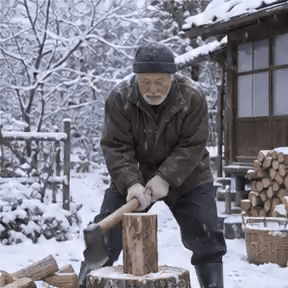</a><br /><sub>Elderly man chopping wood in a snowy yard — derived GIF viewing copy</sub></td>
</tr>
</table>

**Özgün istem**

```text
冬の寒い中、家の庭で薪割りをするおじいさんのGIF
```

[Özgün istem (.txt)](cases/social-snowy-yard-wood-chopping/prompt.txt)

Original prompt wording is preserved.  See the precise source and item-level media notes; requested parameters are not independently verified output properties.

[Kaynaktaki özgün istem](https://x.com/koe_ai414/status/2118153765094351279)

**Yazar**: [koe_ai414](https://x.com/koe_ai414)

**Özgün kaynak**: [Üreticinin bildirdiği model](https://x.com/koe_ai414/status/2118153765094351279) · [Kaynak ayrıntıları](cases/social-snowy-yard-wood-chopping/README.md)

**[👉 Şimdi dene →](https://raphael.app/gpt-image-2-6-prompts?utm_source=github&utm_medium=repository&utm_campaign=gpt_image_2_6_launch&utm_content=case_gallery_social-snowy-yard-wood-chopping&utm_term=tr-TR)**

---

<a id="source-case-social-pixel-purple-lightning-bolts"></a>

#### 135. Pixel character scattering bolts with purple lightning

<table>
<tr>
<td align="center"><a href="assets/examples/social-pixel-purple-lightning-bolts/source-01.mp4">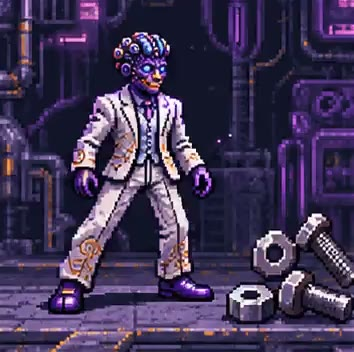<br />İlk kare önizlemesi · Videoyu aç</a><br /><sub>Pixel character scattering bolts with purple lightning</sub></td>
<td align="center"><a href="assets/examples/social-pixel-purple-lightning-bolts/preview-01.gif">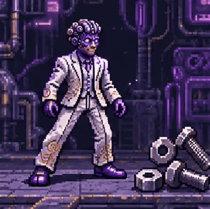</a><br /><sub>Pixel character scattering bolts with purple lightning — derived GIF viewing copy</sub></td>
</tr>
</table>

**Özgün istem**

```text
このキャラをドット化して、紫の電光エフェクトでボルトをナットを吹き飛ばすGIFを作成
```

[Özgün istem (.txt)](cases/social-pixel-purple-lightning-bolts/prompt.txt)

Original prompt wording is preserved.  See the precise source and item-level media notes; requested parameters are not independently verified output properties.

[Kaynaktaki özgün istem](https://x.com/YaReYaRu30Life/status/2118167174053597233)

**Yazar**: [YaReYaRu30Life](https://x.com/YaReYaRu30Life)

**Özgün kaynak**: [Üreticinin bildirdiği model](https://x.com/YaReYaRu30Life/status/2118167174053597233) · [Kaynak ayrıntıları](cases/social-pixel-purple-lightning-bolts/README.md)

**[👉 Şimdi dene →](https://raphael.app/gpt-image-2-6-prompts?utm_source=github&utm_medium=repository&utm_campaign=gpt_image_2_6_launch&utm_content=case_gallery_social-pixel-purple-lightning-bolts&utm_term=tr-TR)**

---

<a id="source-case-social-robot-pouring-coffee"></a>

#### 136. Robot pouring coffee

<table>
<tr>
<td align="center"><a href="assets/examples/social-robot-pouring-coffee/source-01.mp4"><br />İlk kare önizlemesi · Videoyu aç</a><br /><sub>Robot pouring coffee</sub></td>
<td align="center"><a href="assets/examples/social-robot-pouring-coffee/preview-01.gif">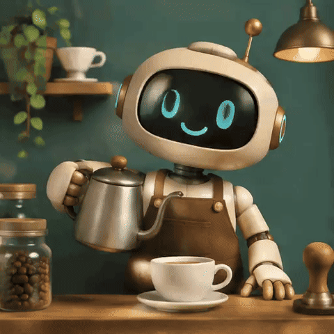</a><br /><sub>Robot pouring coffee — derived GIF viewing copy</sub></td>
</tr>
</table>

**Özgün istem**

```text
コーヒーを淹れるロボット
```

[Özgün istem (.txt)](cases/social-robot-pouring-coffee/prompt.txt)

Original prompt wording is preserved.

[Kaynaktaki özgün istem](https://x.com/sousoccer6/status/2118210705585537226)

**Yazar**: [sousoccer6](https://x.com/sousoccer6)

**Özgün kaynak**: [Üreticinin bildirdiği model](https://x.com/sousoccer6/status/2118210705585537226) · [Kaynak ayrıntıları](cases/social-robot-pouring-coffee/README.md)

**[👉 Şimdi dene →](https://raphael.app/gpt-image-2-6-prompts?utm_source=github&utm_medium=repository&utm_campaign=gpt_image_2_6_launch&utm_content=case_gallery_social-robot-pouring-coffee&utm_term=tr-TR)**

---

<a id="source-case-social-red-character-music-video-gif"></a>

#### 137. Red character in a music-video-style animation

<table>
<tr>
<td align="center"><a href="assets/examples/social-red-character-music-video-gif/source-01.mp4">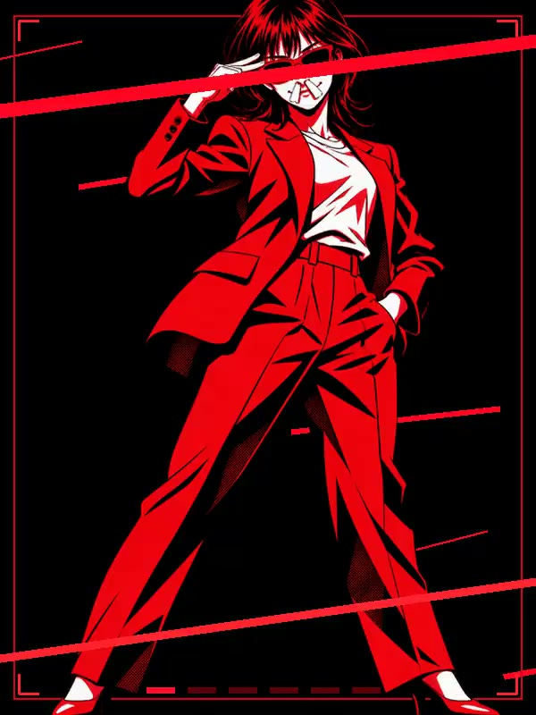<br />İlk kare önizlemesi · Videoyu aç</a><br /><sub>Red character in a music-video-style animation</sub></td>
<td align="center"><a href="assets/examples/social-red-character-music-video-gif/preview-01.gif">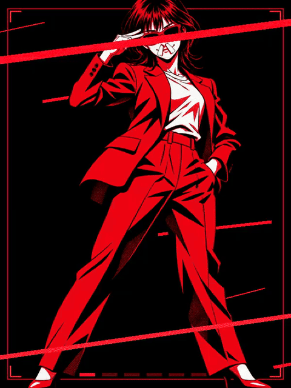</a><br /><sub>Red character in a music-video-style animation — derived GIF viewing copy</sub></td>
</tr>
</table>

**Özgün istem**

```text
添付した画像を使ってかっこいいMV風のGIFアニメにして
```

[Özgün istem (.txt)](cases/social-red-character-music-video-gif/prompt.txt)

Original prompt wording is preserved.  See the precise source and item-level media notes; requested parameters are not independently verified output properties.

[Kaynaktaki özgün istem](https://x.com/Ayu_AI_0912/status/2118138025024839939)

**Yazar**: [Ayu_AI_0912](https://x.com/Ayu_AI_0912)

**Özgün kaynak**: [Üreticinin bildirdiği model](https://x.com/Ayu_AI_0912/status/2118138025024839939) · [Kaynak ayrıntıları](cases/social-red-character-music-video-gif/README.md)

**[👉 Şimdi dene →](https://raphael.app/gpt-image-2-6-prompts?utm_source=github&utm_medium=repository&utm_campaign=gpt_image_2_6_launch&utm_content=case_gallery_social-red-character-music-video-gif&utm_term=tr-TR)**

---

<a id="source-case-social-sunglasses-cat-dance"></a>

#### 138. Sunglasses cat dancing in a purple room

<table>
<tr>
<td align="center"><a href="assets/examples/social-sunglasses-cat-dance/source-01.mp4">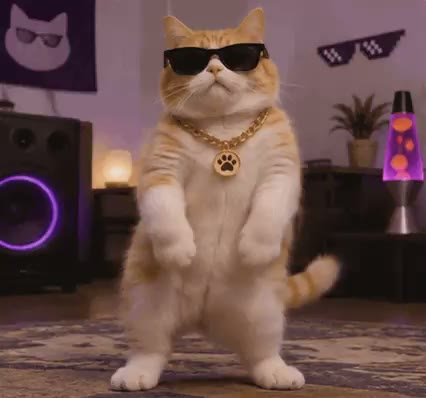<br />İlk kare önizlemesi · Videoyu aç</a><br /><sub>Sunglasses cat dancing in a purple room</sub></td>
<td align="center"><a href="assets/examples/social-sunglasses-cat-dance/preview-01.gif">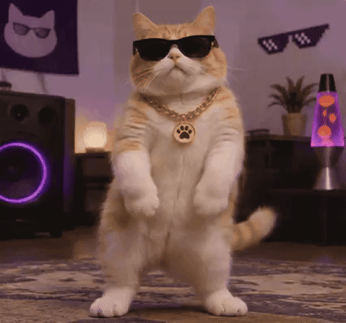</a><br /><sub>Sunglasses cat dancing in a purple room — derived GIF viewing copy</sub></td>
</tr>
</table>

**Özgün istem**

```text
次の内容で GIF を作成して: サングラスをかけた猫がダンスをするミームっぽいGIF
```

[Özgün istem (.txt)](cases/social-sunglasses-cat-dance/prompt.txt)

Original prompt wording is preserved.

[Kaynaktaki özgün istem](https://x.com/SSSS_CRYPTOMAN/status/2118144429848748108)

**Yazar**: [SSSS_CRYPTOMAN](https://x.com/SSSS_CRYPTOMAN)

**Özgün kaynak**: [Üreticinin bildirdiği model](https://x.com/SSSS_CRYPTOMAN/status/2118144429848748108) · [Kaynak ayrıntıları](cases/social-sunglasses-cat-dance/README.md)

**[👉 Şimdi dene →](https://raphael.app/gpt-image-2-6-prompts?utm_source=github&utm_medium=repository&utm_campaign=gpt_image_2_6_launch&utm_content=case_gallery_social-sunglasses-cat-dance&utm_term=tr-TR)**

---

<a id="source-case-social-pelican-riding-bicycle"></a>

#### 139. Pelican riding a bicycle

<table>
<tr>
<td align="center"><a href="assets/examples/social-pelican-riding-bicycle/source-01.mp4">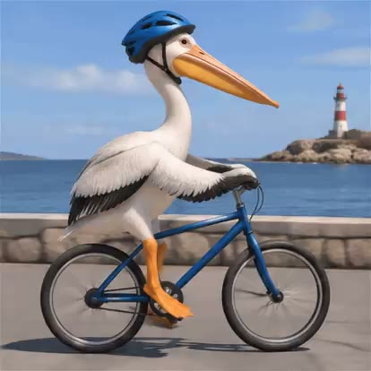<br />İlk kare önizlemesi · Videoyu aç</a><br /><sub>Pelican riding a bicycle</sub></td>
<td align="center"><a href="assets/examples/social-pelican-riding-bicycle/preview-01.gif">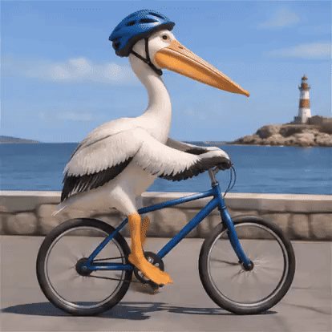</a><br /><sub>Pelican riding a bicycle — derived GIF viewing copy</sub></td>
</tr>
</table>

**Özgün istem**

```text
generate a gif of a pelican riding a bicycle
```

[Özgün istem (.txt)](cases/social-pelican-riding-bicycle/prompt.txt)

Original prompt wording is preserved.

[Kaynaktaki özgün istem](https://x.com/SSHCodes/status/2118127375481504100)

**Yazar**: [SSHCodes](https://x.com/SSHCodes)

**Özgün kaynak**: [Üreticinin bildirdiği model](https://x.com/SSHCodes/status/2118127375481504100) · [Kaynak ayrıntıları](cases/social-pelican-riding-bicycle/README.md)

**[👉 Şimdi dene →](https://raphael.app/gpt-image-2-6-prompts?utm_source=github&utm_medium=repository&utm_campaign=gpt_image_2_6_launch&utm_content=case_gallery_social-pelican-riding-bicycle&utm_term=tr-TR)**

---

<a id="source-case-social-paper-boat-water-loop"></a>

#### 140. Paper boat bobbing on water

<table>
<tr>
<td align="center"><a href="assets/examples/social-paper-boat-water-loop/source-01.mp4"><br />İlk kare önizlemesi · Videoyu aç</a><br /><sub>Paper boat bobbing on water</sub></td>
<td align="center"><a href="assets/examples/social-paper-boat-water-loop/preview-01.gif"></a><br /><sub>Paper boat bobbing on water — derived GIF viewing copy</sub></td>
</tr>
</table>

**Özgün istem**

```text
Make a looping GIF of a paper boat bobbing on the water.
```

[Özgün istem (.txt)](cases/social-paper-boat-water-loop/prompt.txt)

Original prompt wording is preserved.  See the precise source and item-level media notes; requested parameters are not independently verified output properties.

[Kaynaktaki özgün istem](https://x.com/thinkszyg/status/2118166234495947044)

**Yazar**: [thinkszyg](https://x.com/thinkszyg)

**Özgün kaynak**: [Üreticinin bildirdiği model](https://x.com/thinkszyg/status/2118166234495947044) · [Kaynak ayrıntıları](cases/social-paper-boat-water-loop/README.md)

**[👉 Şimdi dene →](https://raphael.app/gpt-image-2-6-prompts?utm_source=github&utm_medium=repository&utm_campaign=gpt_image_2_6_launch&utm_content=case_gallery_social-paper-boat-water-loop&utm_term=tr-TR)**

---

<a id="source-case-social-osaka-castle-construction"></a>

#### 141. Osaka Castle construction loop

<table>
<tr>
<td align="center"><a href="assets/examples/social-osaka-castle-construction/source-01.mp4">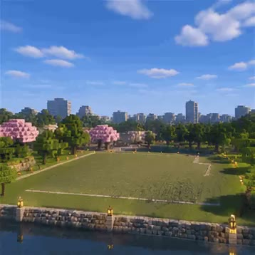<br />İlk kare önizlemesi · Videoyu aç</a><br /><sub>Osaka Castle construction loop</sub></td>
<td align="center"><a href="assets/examples/social-osaka-castle-construction/preview-01.gif">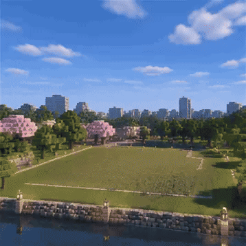</a><br /><sub>Osaka Castle construction loop — derived GIF viewing copy</sub></td>
</tr>
</table>

**Özgün istem**

```text
大阪城を建築する流れをGIFにして
```

[Özgün istem (.txt)](cases/social-osaka-castle-construction/prompt.txt)

Original prompt wording is preserved.

[Kaynaktaki özgün istem](https://x.com/jammaru_lab/status/2118153279821787623)

**Yazar**: [jammaru_lab](https://x.com/jammaru_lab)

**Özgün kaynak**: [Üreticinin bildirdiği model](https://x.com/jammaru_lab/status/2118153279821787623) · [Kaynak ayrıntıları](cases/social-osaka-castle-construction/README.md)

**[👉 Şimdi dene →](https://raphael.app/gpt-image-2-6-prompts?utm_source=github&utm_medium=repository&utm_campaign=gpt_image_2_6_launch&utm_content=case_gallery_social-osaka-castle-construction&utm_term=tr-TR)**

---

<a id="source-case-social-character-wave-laugh"></a>

#### 142. Character waving and laughing

<table>
<tr>
<td align="center"><a href="assets/examples/social-character-wave-laugh/source-01.mp4"><br />İlk kare önizlemesi · Videoyu aç</a><br /><sub>Character waving and laughing</sub></td>
<td align="center"><a href="assets/examples/social-character-wave-laugh/preview-01.gif">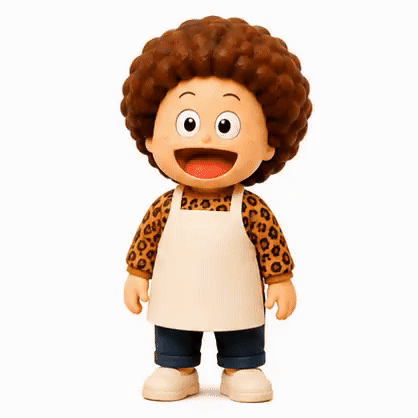</a><br /><sub>Character waving and laughing — derived GIF viewing copy</sub></td>
</tr>
</table>

**Özgün istem**

```text
このキャラをGIFで動かして。手を振って笑う
```

[Özgün istem (.txt)](cases/social-character-wave-laugh/prompt.txt)

Original prompt wording is preserved.  See the precise source and item-level media notes; requested parameters are not independently verified output properties.

[Kaynaktaki özgün istem](https://x.com/okan_aitool/status/2118201578406772887)

**Yazar**: [okan_aitool](https://x.com/okan_aitool)

**Özgün kaynak**: [Üreticinin bildirdiği model](https://x.com/okan_aitool/status/2118201578406772887) · [Kaynak ayrıntıları](cases/social-character-wave-laugh/README.md)

**[👉 Şimdi dene →](https://raphael.app/gpt-image-2-6-prompts?utm_source=github&utm_medium=repository&utm_campaign=gpt_image_2_6_launch&utm_content=case_gallery_social-character-wave-laugh&utm_term=tr-TR)**

---

<a id="source-case-social-pixel-hero-glowing-sword"></a>

#### 143. Pixel hero swinging a glowing sword

<table>
<tr>
<td align="center"><a href="assets/examples/social-pixel-hero-glowing-sword/source-01.mp4">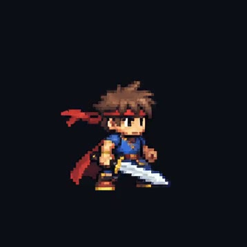<br />İlk kare önizlemesi · Videoyu aç</a><br /><sub>Pixel hero swinging a glowing sword</sub></td>
<td align="center"><a href="assets/examples/social-pixel-hero-glowing-sword/preview-01.gif"></a><br /><sub>Pixel hero swinging a glowing sword — derived GIF viewing copy</sub></td>
</tr>
</table>

**Özgün istem**

```text
GIFを作成。ドット絵の勇者。
剣にエフェクトをつけて振り回す
```

[Özgün istem (.txt)](cases/social-pixel-hero-glowing-sword/prompt.txt)

Original prompt wording is preserved.

[Kaynaktaki özgün istem](https://x.com/YaReYaRu30Life/status/2118166505603153922)

**Yazar**: [YaReYaRu30Life](https://x.com/YaReYaRu30Life)

**Özgün kaynak**: [Üreticinin bildirdiği model](https://x.com/YaReYaRu30Life/status/2118166505603153922) · [Kaynak ayrıntıları](cases/social-pixel-hero-glowing-sword/README.md)

**[👉 Şimdi dene →](https://raphael.app/gpt-image-2-6-prompts?utm_source=github&utm_medium=repository&utm_campaign=gpt_image_2_6_launch&utm_content=case_gallery_social-pixel-hero-glowing-sword&utm_term=tr-TR)**

---

<a id="source-case-social-falling-apple-frame-comparison"></a>

#### 144. Falling apple GIF frame-count comparison

<table>
<tr>
<td align="center"><a href="assets/examples/social-falling-apple-frame-comparison/source-01.mp4">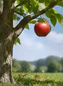<br />İlk kare önizlemesi · Videoyu aç</a><br /><sub>Falling apple GIF frame-count comparison</sub></td>
<td align="center"><a href="assets/examples/social-falling-apple-frame-comparison/source-02.mp4">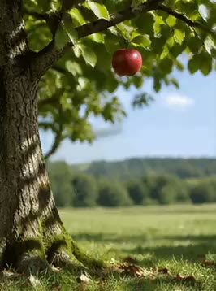<br />İlk kare önizlemesi · Videoyu aç</a><br /><sub>Falling apple GIF frame-count comparison</sub></td>
</tr>
<tr>
<td align="center"><a href="assets/examples/social-falling-apple-frame-comparison/source-03.mp4">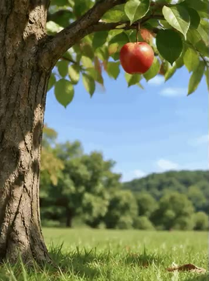<br />İlk kare önizlemesi · Videoyu aç</a><br /><sub>Falling apple GIF frame-count comparison</sub></td>
<td align="center"><a href="assets/examples/social-falling-apple-frame-comparison/source-04.jpg">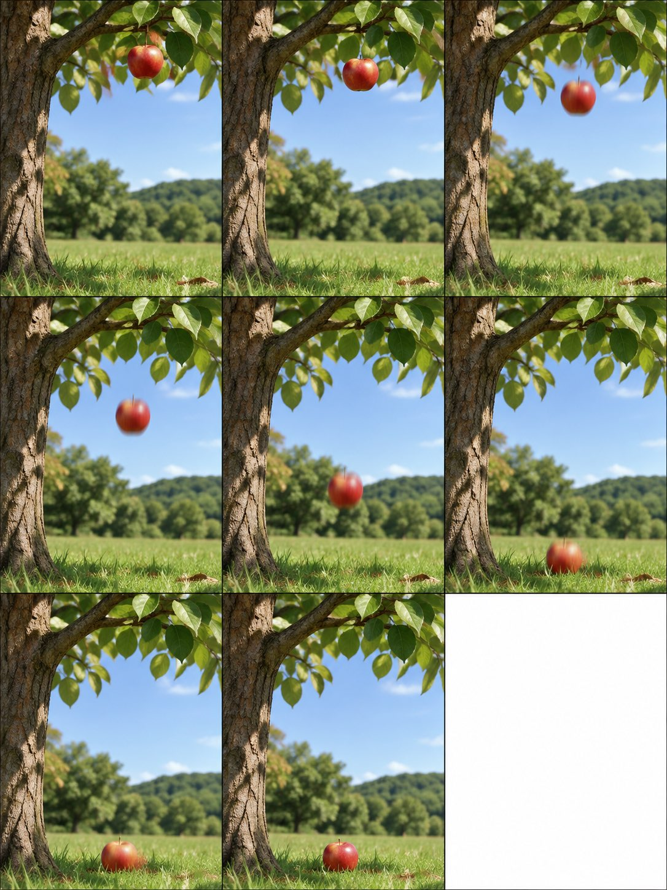</a><br /><sub>Falling apple GIF frame-count comparison</sub></td>
</tr>
<tr>
<td align="center"><a href="assets/examples/social-falling-apple-frame-comparison/preview-01.gif">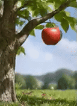</a><br /><sub>Falling apple GIF frame-count comparison — derived GIF viewing copy</sub></td>
<td align="center"><a href="assets/examples/social-falling-apple-frame-comparison/preview-02.gif">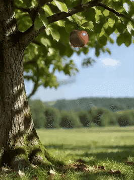</a><br /><sub>Falling apple GIF frame-count comparison — derived GIF viewing copy</sub></td>
</tr>
<tr>
<td align="center"><a href="assets/examples/social-falling-apple-frame-comparison/preview-03.gif"></a><br /><sub>Falling apple GIF frame-count comparison — derived GIF viewing copy</sub></td>
</tr>
</table>

**Özgün istem**

**64-frame original instruction**

```text
3:4.
GIF生成
frame_count = 64
frame_duration_ms = 30
3:4で木からりんごが落ちる差分
```

[Özgün istem (.txt)](cases/social-falling-apple-frame-comparison/prompt-01.txt)

**32-frame parameter change**

```text
frame_count = 32
frame_duration_ms = 60
```

[Özgün istem (.txt)](cases/social-falling-apple-frame-comparison/prompt-02.txt)

**8-frame parameter change**

```text
frame_count = 8
frame_duration_ms = 120
```

[Özgün istem (.txt)](cases/social-falling-apple-frame-comparison/prompt-03.txt)

Original prompt wording is preserved.  See the precise source and item-level media notes; requested parameters are not independently verified output properties.

[Kaynaktaki özgün istem](https://x.com/rei_aitech/status/2118245102409908571)

**Yazar**: [rei_aitech](https://x.com/rei_aitech)

**Özgün kaynak**: [Üreticinin bildirdiği model](https://x.com/rei_aitech/status/2118245102409908571) · [Kaynak ayrıntıları](cases/social-falling-apple-frame-comparison/README.md)

**[👉 Şimdi dene →](https://raphael.app/gpt-image-2-6-prompts?utm_source=github&utm_medium=repository&utm_campaign=gpt_image_2_6_launch&utm_content=case_gallery_social-falling-apple-frame-comparison&utm_term=tr-TR)**

---

<a id="source-case-social-line-dog-heart-loop"></a>

#### 145. Line-art dog with a floating heart

<table>
<tr>
<td align="center"><a href="assets/examples/social-line-dog-heart-loop/source-01.mp4"><br />İlk kare önizlemesi · Videoyu aç</a><br /><sub>Line-art dog with a floating heart</sub></td>
<td align="center"><a href="assets/examples/social-line-dog-heart-loop/preview-01.gif"></a><br /><sub>Line-art dog with a floating heart — derived GIF viewing copy</sub></td>
</tr>
</table>

**Özgün istem**

```text
做一个线条小狗风格的循环 GIF 动图：一只白色圆滚滚的简笔画小狗，黑色粗线条，手绘涂鸦感，纯白背景。小狗开心地左右摇摆身体、摇尾巴，眼睛眯成弯弯的笑眼，头顶冒出一颗小爱心。画面简洁可爱，动作流畅，首尾无缝循环，正方形构图，适合做表情包。
```

[Özgün istem (.txt)](cases/social-line-dog-heart-loop/prompt.txt)

Original prompt wording is preserved.

[Kaynaktaki özgün istem](https://x.com/CalosLaw/status/2118199125707547102)

**Yazar**: [CalosLaw](https://x.com/CalosLaw)

**Özgün kaynak**: [Üreticinin bildirdiği model](https://x.com/CalosLaw/status/2118199125707547102) · [Kaynak ayrıntıları](cases/social-line-dog-heart-loop/README.md)

**[👉 Şimdi dene →](https://raphael.app/gpt-image-2-6-prompts?utm_source=github&utm_medium=repository&utm_campaign=gpt_image_2_6_launch&utm_content=case_gallery_social-line-dog-heart-loop&utm_term=tr-TR)**

---

<a id="source-case-social-standing-backflip-complexity"></a>

#### 146. Standing backflip at three complexity levels

<table>
<tr>
<td align="center"><a href="assets/examples/social-standing-backflip-complexity/source-01.mp4">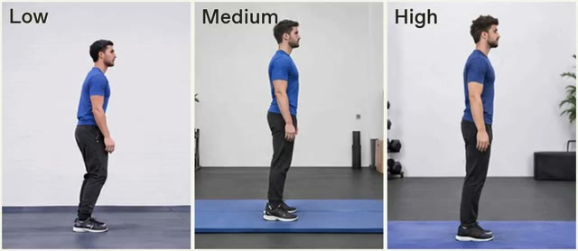<br />İlk kare önizlemesi · Videoyu aç</a><br /><sub>Standing backflip at three complexity levels</sub></td>
<td align="center"><a href="assets/examples/social-standing-backflip-complexity/preview-01.gif"></a><br /><sub>Standing backflip at three complexity levels — derived GIF viewing copy</sub></td>
</tr>
</table>

**Özgün istem**

```text
create a GIF of a man doing a standing backflip
```

[Özgün istem (.txt)](cases/social-standing-backflip-complexity/prompt.txt)

Original prompt wording is preserved. Only the task phrase is public; no full API request is claimed. See the precise source and item-level media notes; requested parameters are not independently verified output properties.

[Kaynaktaki özgün istem](https://x.com/gabrielchua/status/2118135343354720648)

**Yazar**: [gabrielchua](https://x.com/gabrielchua)

**Özgün kaynak**: [Üreticinin bildirdiği model](https://x.com/gabrielchua/status/2118135343354720648) · [Kaynak ayrıntıları](cases/social-standing-backflip-complexity/README.md)

**[👉 Şimdi dene →](https://raphael.app/gpt-image-2-6-prompts?utm_source=github&utm_medium=repository&utm_campaign=gpt_image_2_6_launch&utm_content=case_gallery_social-standing-backflip-complexity&utm_term=tr-TR)**

---

<a id="source-case-social-anime-floating-orb-control"></a>

#### 147. Anime character controlling a floating orb

<table>
<tr>
<td align="center"><a href="assets/examples/social-anime-floating-orb-control/source-01.mp4">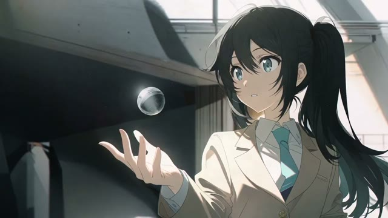<br />İlk kare önizlemesi · Videoyu aç</a><br /><sub>Anime character controlling a floating orb</sub></td>
<td align="center"><a href="assets/examples/social-anime-floating-orb-control/preview-01.gif"></a><br /><sub>Anime character controlling a floating orb — derived GIF viewing copy</sub></td>
</tr>
</table>

<details>
<summary>Referans görselleri</summary>

Referans / girdi görselidir, üretilmiş çıktı değildir.

- [Anime character controlling a floating orb](assets/references/social-anime-floating-orb-control/source-02.jpg)

</details>

**Özgün istem**

```text
添付画像を開始フレームとして球体をコントロールするキャラクター。
画像生成で6秒尺。100枚で構成。
ケレン味がありアニメーション12原則を意識した動き。
```

[Özgün istem (.txt)](cases/social-anime-floating-orb-control/prompt.txt)

Original prompt wording is preserved.  See the precise source and item-level media notes; requested parameters are not independently verified output properties.

[Kaynaktaki özgün istem](https://x.com/MiraMusic_AI/status/2118513591490163168)

**Yazar**: [MiraMusic_AI](https://x.com/MiraMusic_AI)

**Özgün kaynak**: [Üreticinin bildirdiği model](https://x.com/MiraMusic_AI/status/2118513591490163168) · [Kaynak ayrıntıları](cases/social-anime-floating-orb-control/README.md)

**[👉 Şimdi dene →](https://raphael.app/gpt-image-2-6-prompts?utm_source=github&utm_medium=repository&utm_campaign=gpt_image_2_6_launch&utm_content=case_gallery_social-anime-floating-orb-control&utm_term=tr-TR)**

---

<a id="source-case-social-golden-gate-gouache-loop"></a>

#### 148. Golden Gate gouache travel-poster loop

<table>
<tr>
<td align="center"><a href="assets/examples/social-golden-gate-gouache-loop/source-01.mp4">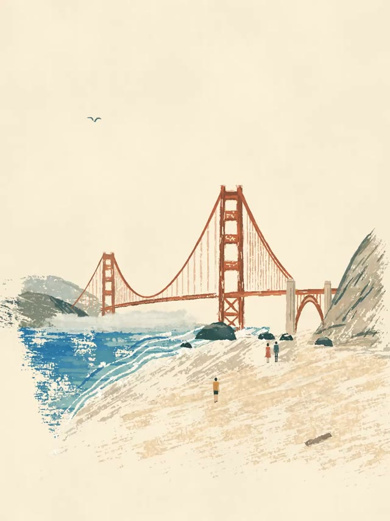<br />İlk kare önizlemesi · Videoyu aç</a><br /><sub>Golden Gate gouache travel-poster loop</sub></td>
<td align="center"><a href="assets/examples/social-golden-gate-gouache-loop/preview-01.gif">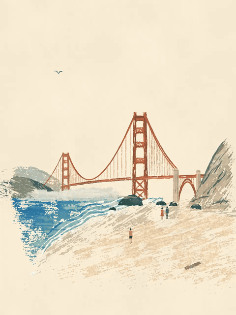</a><br /><sub>Golden Gate gouache travel-poster loop — derived GIF viewing copy</sub></td>
</tr>
</table>

**Özgün istem**

```text
A living mid-century gouache travel-poster painting of the Golden Gate Bridge seen from a beach, static locked-off camera, seamless looping animation. The bridge is rust-orange with two tall towers, fine suspension cables and vertical hangers, spanning to a hazy grey-blue headland on the left and a tan-grey rocky cliff on the right. In the foreground deep cobalt and teal surf rolls in with white foam lines onto a sweeping beach of sandy beige scratchy dry-brush strokes, with dark rocks, a driftwood log and tiny figures in coral, navy and mustard. Warm cream sky with fine paper grain fills the upper half. Matte opaque gouache, ragged flaking edges, visible bristle streaks, speckled worn texture. Gentle motion only: waves wash and recede, foam shimmers, seagulls glide across the sky, tiny people wander. Soft hazy daylight, vertical 3:4, perfect loop.
```

[Özgün istem (.txt)](cases/social-golden-gate-gouache-loop/prompt.txt)

Original prompt wording is preserved.

[Kaynaktaki özgün istem](https://x.com/devteamdrew/status/2118538745175503130)

**Yazar**: [devteamdrew](https://x.com/devteamdrew)

**Özgün kaynak**: [Üreticinin bildirdiği model](https://x.com/devteamdrew/status/2118308538564989025) · [Kaynak ayrıntıları](cases/social-golden-gate-gouache-loop/README.md)

**[👉 Şimdi dene →](https://raphael.app/gpt-image-2-6-prompts?utm_source=github&utm_medium=repository&utm_campaign=gpt_image_2_6_launch&utm_content=case_gallery_social-golden-gate-gouache-loop&utm_term=tr-TR)**

---

<a id="source-case-social-colosseum-gouache-loop"></a>

#### 149. Colosseum gouache travel-poster loop

<table>
<tr>
<td align="center"><a href="assets/examples/social-colosseum-gouache-loop/source-01.mp4"><br />İlk kare önizlemesi · Videoyu aç</a><br /><sub>Colosseum gouache travel-poster loop</sub></td>
<td align="center"><a href="assets/examples/social-colosseum-gouache-loop/preview-01.gif"></a><br /><sub>Colosseum gouache travel-poster loop — derived GIF viewing copy</sub></td>
</tr>
</table>

**Özgün istem**

```text
A living mid-century gouache travel-poster painting of the Roman Colosseum, locked-off static camera, a seamless looping animation. The ruined amphitheater sits low in the frame in sun-bleached ochre, sand and travertine with dusty rose and pale blue-grey arches, painted in dry-brush gouache with flaky, speckled edges and worn-away patches. A tall Italian stone pine in dark green and bottle-green leans in from the right, a vintage teal street lamp on the left, rose-coral flowering shrubs at the base. Open warm cream paper-textured sky fills the upper two thirds with fine paper grain. Gentle motion only: a few tiny birds drift across the sky, a cyclist rides slowly along the piazza, a small scooter, a couple in coral and mustard strolling, pine foliage barely sways. Soft warm afternoon light, long pale shadows, flat matte shapes, vertical 3:4, perfect loop.
```

[Özgün istem (.txt)](cases/social-colosseum-gouache-loop/prompt.txt)

Original prompt wording is preserved.

[Kaynaktaki özgün istem](https://x.com/devteamdrew/status/2118538745175503130)

**Yazar**: [devteamdrew](https://x.com/devteamdrew)

**Özgün kaynak**: [Üreticinin bildirdiği model](https://x.com/devteamdrew/status/2118308538564989025) · [Kaynak ayrıntıları](cases/social-colosseum-gouache-loop/README.md)

**[👉 Şimdi dene →](https://raphael.app/gpt-image-2-6-prompts?utm_source=github&utm_medium=repository&utm_campaign=gpt_image_2_6_launch&utm_content=case_gallery_social-colosseum-gouache-loop&utm_term=tr-TR)**

---

<a id="source-case-social-fuji-gouache-loop"></a>

#### 150. Mount Fuji gouache travel-poster loop

<table>
<tr>
<td align="center"><a href="assets/examples/social-fuji-gouache-loop/source-01.mp4"><br />İlk kare önizlemesi · Videoyu aç</a><br /><sub>Mount Fuji gouache travel-poster loop</sub></td>
<td align="center"><a href="assets/examples/social-fuji-gouache-loop/preview-01.gif"></a><br /><sub>Mount Fuji gouache travel-poster loop — derived GIF viewing copy</sub></td>
</tr>
</table>

**Özgün istem**

```text
A living mid-century gouache travel-poster painting of Mount Fuji behind a five-storey Japanese pagoda, static locked-off camera, seamless looping animation. The pagoda is vermilion-orange with deep teal-slate tiled roofs, a slender spire, and a dark evergreen tree beside it. Fuji sits small and distant in dusty blue-grey with a snow-white cap and ragged dry-brush ridges, over a pale mist field. Foreground cherry trees in soft coral-pink blossom with dark trunks frame the bottom, and tiny figures stand on pale speckled ground. Warm cream paper-grain sky fills the upper half. Matte flat gouache with ragged, flaking edges, visible bristle marks and speckled holes. Subtle motion only: blossom petals drift down, branches sway faintly, tiny figures shift, a bell-like gentle shimmer on the light. Soft spring morning light, vertical 3:4, perfect loop.
```

[Özgün istem (.txt)](cases/social-fuji-gouache-loop/prompt.txt)

Original prompt wording is preserved.

[Kaynaktaki özgün istem](https://x.com/devteamdrew/status/2118538745175503130)

**Yazar**: [devteamdrew](https://x.com/devteamdrew)

**Özgün kaynak**: [Üreticinin bildirdiği model](https://x.com/devteamdrew/status/2118308538564989025) · [Kaynak ayrıntıları](cases/social-fuji-gouache-loop/README.md)

**[👉 Şimdi dene →](https://raphael.app/gpt-image-2-6-prompts?utm_source=github&utm_medium=repository&utm_campaign=gpt_image_2_6_launch&utm_content=case_gallery_social-fuji-gouache-loop&utm_term=tr-TR)**

---

<a id="source-case-social-dwarf-360-turntable"></a>

#### 151. Dwarf game model rotating 360 degrees

<table>
<tr>
<td align="center"><a href="assets/examples/social-dwarf-360-turntable/source-01.mp4"><br />İlk kare önizlemesi · Videoyu aç</a><br /><sub>Dwarf game model rotating 360 degrees</sub></td>
<td align="center"><a href="assets/examples/social-dwarf-360-turntable/preview-01.gif"></a><br /><sub>Dwarf game model rotating 360 degrees — derived GIF viewing copy</sub></td>
</tr>
</table>

**Özgün istem**

```text
create a gif of a "3d dwarf game model carrying a huge axe on his shoulders" spinning full 360 degrees
```

[Özgün istem (.txt)](cases/social-dwarf-360-turntable/prompt.txt)

Original prompt wording is preserved.

[Kaynaktaki özgün istem](https://x.com/xikhar/status/2118409026044403849)

**Yazar**: [xikhar](https://x.com/xikhar)

**Özgün kaynak**: [Üreticinin bildirdiği model](https://x.com/xikhar/status/2118407355859878352) · [Kaynak ayrıntıları](cases/social-dwarf-360-turntable/README.md)

**[👉 Şimdi dene →](https://raphael.app/gpt-image-2-6-prompts?utm_source=github&utm_medium=repository&utm_campaign=gpt_image_2_6_launch&utm_content=case_gallery_social-dwarf-360-turntable&utm_term=tr-TR)**

---

<a id="source-case-social-sword-360-turntable"></a>

#### 152. Legendary sword game asset rotating 360 degrees

<table>
<tr>
<td align="center"><a href="assets/examples/social-sword-360-turntable/source-01.mp4"><br />İlk kare önizlemesi · Videoyu aç</a><br /><sub>Legendary sword game asset rotating 360 degrees</sub></td>
<td align="center"><a href="assets/examples/social-sword-360-turntable/preview-01.gif"></a><br /><sub>Legendary sword game asset rotating 360 degrees — derived GIF viewing copy</sub></td>
</tr>
</table>

**Özgün istem**

```text
create a gif of a "3d legendary sword in a stone game asset" spinning full 360 degrees
```

[Özgün istem (.txt)](cases/social-sword-360-turntable/prompt.txt)

Original prompt wording is preserved.

[Kaynaktaki özgün istem](https://x.com/xikhar/status/2118409026044403849)

**Yazar**: [xikhar](https://x.com/xikhar)

**Özgün kaynak**: [Üreticinin bildirdiği model](https://x.com/xikhar/status/2118407355859878352) · [Kaynak ayrıntıları](cases/social-sword-360-turntable/README.md)

**[👉 Şimdi dene →](https://raphael.app/gpt-image-2-6-prompts?utm_source=github&utm_medium=repository&utm_campaign=gpt_image_2_6_launch&utm_content=case_gallery_social-sword-360-turntable&utm_term=tr-TR)**

---

<a id="source-case-social-motorbike-360-turntable"></a>

#### 153. Futuristic motorbike rotating 360 degrees

<table>
<tr>
<td align="center"><a href="assets/examples/social-motorbike-360-turntable/source-01.mp4"><br />İlk kare önizlemesi · Videoyu aç</a><br /><sub>Futuristic motorbike rotating 360 degrees</sub></td>
<td align="center"><a href="assets/examples/social-motorbike-360-turntable/preview-01.gif"></a><br /><sub>Futuristic motorbike rotating 360 degrees — derived GIF viewing copy</sub></td>
</tr>
</table>

**Özgün istem**

```text
create a gif of a "AAA 3d futuristic motorbike game asset" spinning full 360 degrees
```

[Özgün istem (.txt)](cases/social-motorbike-360-turntable/prompt.txt)

Original prompt wording is preserved.

[Kaynaktaki özgün istem](https://x.com/xikhar/status/2118409026044403849)

**Yazar**: [xikhar](https://x.com/xikhar)

**Özgün kaynak**: [Üreticinin bildirdiği model](https://x.com/xikhar/status/2118407355859878352) · [Kaynak ayrıntıları](cases/social-motorbike-360-turntable/README.md)

**[👉 Şimdi dene →](https://raphael.app/gpt-image-2-6-prompts?utm_source=github&utm_medium=repository&utm_campaign=gpt_image_2_6_launch&utm_content=case_gallery_social-motorbike-360-turntable&utm_term=tr-TR)**

---

<a id="source-case-social-cat-spinning-gif"></a>

#### 154. Spinning cat GIF

<table>
<tr>
<td align="center"><a href="assets/examples/social-cat-spinning-gif/source-01.mp4"><br />İlk kare önizlemesi · Videoyu aç</a><br /><sub>Spinning cat GIF</sub></td>
<td align="center"><a href="assets/examples/social-cat-spinning-gif/preview-01.gif"></a><br /><sub>Spinning cat GIF — derived GIF viewing copy</sub></td>
</tr>
</table>

**Özgün istem**

```text
create a gif of a cat spinning
```

[Özgün istem (.txt)](cases/social-cat-spinning-gif/prompt.txt)

Original prompt wording is preserved.

[Kaynaktaki özgün istem](https://x.com/xikhar/status/2118409026044403849)

**Yazar**: [xikhar](https://x.com/xikhar)

**Özgün kaynak**: [Üreticinin bildirdiği model](https://x.com/xikhar/status/2118407355859878352) · [Kaynak ayrıntıları](cases/social-cat-spinning-gif/README.md)

**[👉 Şimdi dene →](https://raphael.app/gpt-image-2-6-prompts?utm_source=github&utm_medium=repository&utm_campaign=gpt_image_2_6_launch&utm_content=case_gallery_social-cat-spinning-gif&utm_term=tr-TR)**

---

<a id="source-case-social-gray-blender-hallway-draft"></a>

#### 155. Gray Blender hallway camera draft

<table>
<tr>
<td align="center"><a href="assets/examples/social-gray-blender-hallway-draft/source-01.mp4"><br />İlk kare önizlemesi · Videoyu aç</a><br /><sub>Gray Blender hallway camera draft</sub></td>
<td align="center"><a href="assets/examples/social-gray-blender-hallway-draft/preview-01.gif"></a><br /><sub>Gray Blender hallway camera draft — derived GIF viewing copy</sub></td>
</tr>
</table>

**Özgün istem**

```text
Generate a 5-second animated GIF consisting of 10 evenly spaced animation frames. Make it look like a crude gray Blender viewport animation, not cinematic footage. A single continuous shot inside a rectangular hallway with a tiled floor and simple gray walls. The camera slowly advances toward a doorway. A black humanoid mannequin with unusually long arms emerges from behind the doorway. The camera suddenly whips right, falls onto its side, and stops. The mannequin slowly walks toward and past the fallen camera. Maintain consistent 3D geometry, character proportions, doorway placement, and spatial relationships. No cuts, no teleportation, no scene changes, no added props. Focus on exact camera movement, depth, and timing. The animation should play once as a complete sequence, not return to its starting pose.
```

[Özgün istem (.txt)](cases/social-gray-blender-hallway-draft/prompt.txt)

Original prompt wording is preserved. Only the GPT Image 2.6 gray animation draft is included; the downstream H3 result is excluded. See the precise source and item-level media notes; requested parameters are not independently verified output properties.

[Kaynaktaki özgün istem](https://x.com/cocktailpeanut/status/2118408801812643957)

**Yazar**: [cocktailpeanut](https://x.com/cocktailpeanut)

**Özgün kaynak**: [Üreticinin bildirdiği model](https://x.com/cocktailpeanut/status/2118408795026043260) · [Kaynak ayrıntıları](cases/social-gray-blender-hallway-draft/README.md)

**[👉 Şimdi dene →](https://raphael.app/gpt-image-2-6-prompts?utm_source=github&utm_medium=repository&utm_campaign=gpt_image_2_6_launch&utm_content=case_gallery_social-gray-blender-hallway-draft&utm_term=tr-TR)**

---

<a id="source-case-social-summer-garden-water-gun"></a>

#### 156. Summer garden water-gun animation

<table>
<tr>
<td align="center"><a href="assets/examples/social-summer-garden-water-gun/source-02.mp4"><br />İlk kare önizlemesi · Videoyu aç</a><br /><sub>Summer garden water-gun animation</sub></td>
<td align="center"><a href="assets/examples/social-summer-garden-water-gun/source-03.mp4"><br />İlk kare önizlemesi · Videoyu aç</a><br /><sub>Summer garden water-gun animation</sub></td>
</tr>
<tr>
<td align="center"><a href="assets/examples/social-summer-garden-water-gun/preview-02.gif"></a><br /><sub>Summer garden water-gun animation — derived GIF viewing copy</sub></td>
<td align="center"><a href="assets/examples/social-summer-garden-water-gun/preview-03.gif"></a><br /><sub>Summer garden water-gun animation — derived GIF viewing copy</sub></td>
</tr>
</table>

<details>
<summary>Referans görselleri</summary>

Referans / girdi görselidir, üretilmiş çıktı değildir.

- [Summer garden water-gun animation](assets/references/social-summer-garden-water-gun/source-01.jpg)

</details>

**Özgün istem**

```text
请以这个内容创建一个 GIF，内容是： # JAPANESE SUMMER｜夏日元气少女
**10秒日系青春活力MV视频提示词**

**画面规格：** 9:16 竖屏，10秒，30fps，写实摄影质感。

**人物设定：**
22岁成年东亚女性，清透冷白皮肤，短款深棕色波波头，轻薄空气刘海，五官甜美可爱，身材匀称。穿着参考图中的蓝色泳装、黄色镂空针织罩衫及牛仔短裤。人物保持统一，性格活泼俏皮，笑容自然，有青春少女的灵动感。

**整体风格：**
Japanese Youth MV / Japanese Summer Pop / Youthful Cinematic Montage。

明亮通透的夏日阳光，翠绿花园，蓝色天空，橙色充气泳圈，水花飞溅。采用日本青春电影式混剪，快速切换全景、中景、近景和人物特写。画面具有轻微胶片颗粒、柔和高光、自然镜头运动。

### 01｜10秒分镜设计

**0—1.2秒｜开场钩子**
低机位快速推进，女主坐在橙色充气泳圈上，双手拿着水枪，突然发现镜头，露出惊喜的笑容，水流突然朝镜头喷来。

**1.2—2.4秒｜俏皮特写**
快速硬切面部近景，女主被水花溅到，轻轻眯眼，随后露出调皮笑容，发丝随着动作轻轻晃动。阳光在脸颊形成漂亮的光斑。

**2.4—3.6秒｜青春动态**
侧面低机位，女主赤脚轻轻踢起草坪上的水花，镜头快速横向跟拍，橙色泳圈在前景掠过，形成自然遮挡转场。

**3.6—4.8秒｜视觉节奏**
俯拍镜头，女主拿着水枪在草坪上转身，水流划出弧线。镜头快速向下俯冲，再跟随水花向上抬起。

**4.8—6.0秒｜少女感特写**
正面近景，女主双手举起水枪，突然向镜头喷水，水珠在阳光下形成晶莹的高光，女主笑着躲避镜头。

**6.0—7.3秒｜活力爆发**
快速硬切至侧后方，女主从泳圈上轻巧起身，转身甩动头发，黄色针织罩衫随动作自然摆动，镜头进行半圈快速环绕。

**7.3—8.7秒｜夏日氛围**
广角镜头，女主在草坪上轻快地转圈，双手张开，阳光穿过树叶洒落，水花从前景飞过，画面充满夏日青春气息。

**8.7—10秒｜记忆点结尾**
突然切换正面近景，女主向镜头靠近，俏皮地歪头眨眼，随后拿起水枪再次喷水，水花覆盖整个镜头，最后定格在明亮的白色水花中。

### 02｜音乐与剪辑

原创日系青春J-POP配乐：
- 轻快的电吉他、明亮合成器、活泼贝斯与清脆鼓点。
- 约155—165 BPM，具有夏日偶像MV的轻盈节奏。
- 开场直接进入音乐，不要冗长铺垫。
- 每次鼓点配合一次硬切或动作变化。
- 中间加入少量0.3—0.5秒高速慢动作水花特写，再迅速恢复正常速度。
- 结尾音乐与水花覆盖镜头同步收束。

### 03｜摄影与画面约束

1. 混剪必须具有明显的景别变化，避免全程一个机位。
2. 人物始终是画面视觉中心，保持同一张脸、发型和服装。
3. 人物动作自然轻快，表情丰富，笑容甜美但不过度表演。
4. 保留真实皮肤纹理、自然阳光与水珠物理效果。
5. 镜头切换干净利落，利用水花、泳圈和人物动作完成匹配剪辑。
6. 不要广告片质感，不要商业产品展示，不要字幕、文字、Logo、水印。
7. 避免人物变脸、服装改变、手指畸形、肢体错位及水枪结构变形。

**最终效果：像一支10秒的日本夏日青春偶像MV，轻松、明亮、活泼、俏皮，让人感受到夏天的快乐。**
```

[Özgün istem (.txt)](cases/social-summer-garden-water-gun/prompt.txt)

Original prompt wording is preserved.  See the precise source and item-level media notes; requested parameters are not independently verified output properties.

[Kaynaktaki özgün istem](https://x.com/nima2qisi2/status/2118150229811920912)

**Yazar**: [nima2qisi2](https://x.com/nima2qisi2)

**Özgün kaynak**: [Üreticinin bildirdiği model](https://x.com/nima2qisi2/status/2118150226330734787) · [Kaynak ayrıntıları](cases/social-summer-garden-water-gun/README.md)

**[👉 Şimdi dene →](https://raphael.app/gpt-image-2-6-prompts?utm_source=github&utm_medium=repository&utm_campaign=gpt_image_2_6_launch&utm_content=case_gallery_social-summer-garden-water-gun&utm_term=tr-TR)**

---

<a id="source-case-social-basketball-storyboard-to-gif"></a>

#### 157. Basketball storyboard-to-GIF workflow

<table>
<tr>
<td align="center"><a href="assets/examples/social-basketball-storyboard-to-gif/source-01.mp4"><br />İlk kare önizlemesi · Videoyu aç</a><br /><sub>Basketball storyboard-to-GIF workflow</sub></td>
<td align="center"><a href="assets/examples/social-basketball-storyboard-to-gif/preview-01.gif"></a><br /><sub>Basketball storyboard-to-GIF workflow — derived GIF viewing copy</sub></td>
</tr>
</table>

<details>
<summary>Referans görselleri</summary>

Referans / girdi görselidir, üretilmiş çıktı değildir.

- [Basketball storyboard-to-GIF workflow](assets/references/social-basketball-storyboard-to-gif/source-02.jpg)

</details>

**Özgün istem**

```text
创建一个gif，按照附图的动作顺序生成。
```

[Özgün istem (.txt)](cases/social-basketball-storyboard-to-gif/prompt.txt)

Original prompt wording is preserved.  See the precise source and item-level media notes; requested parameters are not independently verified output properties.

[Kaynaktaki özgün istem](https://x.com/crayon1267/status/2118186300339892472)

**Yazar**: [crayon1267](https://x.com/crayon1267)

**Özgün kaynak**: [Üreticinin bildirdiği model](https://x.com/crayon1267/status/2118186300339892472) · [Kaynak ayrıntıları](cases/social-basketball-storyboard-to-gif/README.md)

**[👉 Şimdi dene →](https://raphael.app/gpt-image-2-6-prompts?utm_source=github&utm_medium=repository&utm_campaign=gpt_image_2_6_launch&utm_content=case_gallery_social-basketball-storyboard-to-gif&utm_term=tr-TR)**

---

<a id="source-case-social-orange-office-cat-expression-grid"></a>

#### 158. Orange office-cat expression grid

<table>
<tr>
<td align="center"><a href="assets/examples/social-orange-office-cat-expression-grid/source-01.jpg"></a><br /><sub>Orange office-cat expression grid</sub></td>
<td align="center"><a href="assets/examples/social-orange-office-cat-expression-grid/source-02.mp4"><br />İlk kare önizlemesi · Videoyu aç</a><br /><sub>Orange office-cat expression grid</sub></td>
</tr>
<tr>
<td align="center"><a href="assets/examples/social-orange-office-cat-expression-grid/source-03.mp4"><br />İlk kare önizlemesi · Videoyu aç</a><br /><sub>Orange office-cat expression grid</sub></td>
<td align="center"><a href="assets/examples/social-orange-office-cat-expression-grid/source-04.mp4"><br />İlk kare önizlemesi · Videoyu aç</a><br /><sub>Orange office-cat expression grid</sub></td>
</tr>
<tr>
<td align="center"><a href="assets/examples/social-orange-office-cat-expression-grid/preview-02.gif"></a><br /><sub>Orange office-cat expression grid — derived GIF viewing copy</sub></td>
<td align="center"><a href="assets/examples/social-orange-office-cat-expression-grid/preview-03.gif"></a><br /><sub>Orange office-cat expression grid — derived GIF viewing copy</sub></td>
</tr>
<tr>
<td align="center"><a href="assets/examples/social-orange-office-cat-expression-grid/preview-04.gif"></a><br /><sub>Orange office-cat expression grid — derived GIF viewing copy</sub></td>
</tr>
</table>

**Özgün istem**

```text
画一套12款橘猫打工人表情包，圆脸胖橘戴蓝领带，粗黑蜡笔线条、橙蓝配色、米白底，表情夸张搞笑，角色保持一致。按3列×4行排列，分别配字：开心、气成河豚、委屈巴巴、笑不活了、收到、啊？、累瘫了、我裂开了、先装死、蹲个后续、没眼看、下班！
```

[Özgün istem (.txt)](cases/social-orange-office-cat-expression-grid/prompt.txt)

Original prompt wording is preserved.  See the precise source and item-level media notes; requested parameters are not independently verified output properties.

[Kaynaktaki özgün istem](https://x.com/karanwithai/status/2118156317034693026)

**Yazar**: [karanwithai](https://x.com/karanwithai)

**Özgün kaynak**: [Üreticinin bildirdiği model](https://x.com/karanwithai/status/2118156092865994837) · [Kaynak ayrıntıları](cases/social-orange-office-cat-expression-grid/README.md)

**[👉 Şimdi dene →](https://raphael.app/gpt-image-2-6-prompts?utm_source=github&utm_medium=repository&utm_campaign=gpt_image_2_6_launch&utm_content=case_gallery_social-orange-office-cat-expression-grid&utm_term=tr-TR)**

---

[Arama günlüğü, medya raporu ve sonuçlandırılmamış araştırma ipuçları](docs/CASE_GALLERY.md)

<a id="collection"></a>

## 📝 Tam istemler

<a id="case-recreated-vinyl-stylus-macro"></a>

#### Vinyl stylus macro · independent generation

**Derleyen kişi tarafından test edildi**

An extreme macro view of a stylus, record grooves and dust with a cobalt accent.


[Özgün kaynak](https://www.made.app/models/gpt-image-2-6-sunburst#examples-heading) · Yazar: Made / Made Inc.

Önizleme atfı: 原始提示词：Made / Made Inc.；本次生成图片：RaphaelAI-OpenLab，经 Raphael GPT Image 2.6 Sunburst 生成。

**Özgün istem**

```text
Extreme macro of a turntable stylus riding a vinyl groove, dust specks, groove walls and the cantilever sharply resolved, a sliver of light glancing across the record. Muted true color with one cobalt accent, shallow depth of field, subtle grain, no text, logos, or watermark.
```

**Kaydedilen ayarlar**

| Ayar | Değer |
| --- | --- |
| Model ailesi | GPT Image 2.6 |
| Varyant | sunburst |
| size | 2048x1360 |
| output_format | png |
| UI aspect ratio | 3:2 |
| UI resolution | 2K |
| UI quality | Standard |
| UI planning intensity | Medium |
| History quality label | Medium |
| Output count | 1 |
| AI Enhance | False |

**İş akışı**

1. 在 Raphael 文生图界面选择 GPT Image 2.6 Sunburst。
2. 粘贴原始提示词，不上传参考图，关闭 AI Enhance。
3. 选择 3:2、2K、Standard、Medium planning intensity，生成一张图片。
4. 下载 PNG 原图并检查；仓库展示副本使用像素一致的无损 WebP。

**Test notları**

Raphael web UI · GPT Image 2.6 Sunburst · 2026-11-13

The stylus, cantilever, grooves, dust and shallow depth of field are visible. The generated stylus geometry and apparent scale are illustrative and were not checked against a real cartridge or a measured macro photograph. The UI ratio was 3:2; the downloaded raster is 2048×1360.

**Notlar**

The source prompt was used unchanged, without the source image. Generation evidence and hashes: cases/recreated-vinyl-stylus-macro/generation.json. The displayed WebP preserves the original PNG pixels. Third-party prompt reuse terms were not independently licensed; attribution does not grant permission. The repository MIT license does not cover this prompt or generated image. UI labels are recorded as observed; no API model ID or official parameter mapping is inferred.

[Bağımsız örnek sayfası](cases/recreated-vinyl-stylus-macro/README.md)

**[👉 Şimdi dene →](https://raphael.app/gpt-image-2-6-prompts?utm_source=github&utm_medium=repository&utm_campaign=gpt_image_2_6_launch&utm_content=case_gallery_recreated-vinyl-stylus-macro&utm_term=tr-TR)**

---

<a id="case-recreated-snowy-greenhouse"></a>

#### Snowy mountain greenhouse · independent generation

**Derleyen kişi tarafından test edildi**

A blue-hour mountain greenhouse with tropical plants, warm lights and one copper watering can.


[Özgün kaynak](https://www.analyticsvidhya.com/blog/2026/11/gpt-image-2-6-review/#h-1-a-cinematic-editorial-photograph) · Yazar: Vasu Deo Sankrityayan / Analytics Vidhya

Önizleme atfı: 原始提示词：Vasu Deo Sankrityayan / Analytics Vidhya；本次生成图片：RaphaelAI-OpenLab，经 Raphael GPT Image 2.6 Sunburst 生成。

**Özgün istem**

```text
Create a wide cinematic editorial photograph of a glass greenhouse on a snowy mountain ridge at blue hour. Inside, lush tropical plants glow under warm amber lights. Outside, snow rests naturally on the glass roof and a narrow stone path leads to the entrance. Show realistic condensation, convincing glass reflections, and physically coherent architecture. Exactly one copper watering can sits beside the door. Rich emerald and amber palette, restrained film grain. No people, text, logos, or watermark. Use only this brief. Keep the output anonymous: no personal names, account information, contact details, signatures, or references to any user. Generate the actual image, not a written prompt.
```

**Kaydedilen ayarlar**

| Ayar | Değer |
| --- | --- |
| Model ailesi | GPT Image 2.6 |
| Varyant | sunburst |
| size | 2048x1152 |
| output_format | png |
| UI aspect ratio | 16:9 |
| UI resolution | 2K |
| UI quality | Standard |
| UI planning intensity | Medium |
| History quality label | Medium |
| Output count | 1 |
| AI Enhance | False |

**İş akışı**

1. 在 Raphael 文生图界面选择 GPT Image 2.6 Sunburst。
2. 粘贴原始提示词，不上传参考图，关闭 AI Enhance。
3. 选择 16:9、2K、Standard、Medium planning intensity，生成一张图片。
4. 下载 PNG 原图并检查；仓库展示副本使用像素一致的无损 WebP。

**Test notları**

Raphael web UI · GPT Image 2.6 Sunburst · 2026-11-13

Snow, warm interior lights, tropical foliage, glass condensation, a stone entrance path and one copper watering can are visible. The near roof is cropped by the upper frame; this is an atmospheric architectural image, not a structural or thermal feasibility study.

**Notlar**

The source prompt was used unchanged, without the source image. Generation evidence and hashes: cases/recreated-snowy-greenhouse/generation.json. The displayed WebP preserves the original PNG pixels. Third-party prompt reuse terms were not independently licensed; attribution does not grant permission. The repository MIT license does not cover this prompt or generated image. UI labels are recorded as observed; no API model ID or official parameter mapping is inferred.

[Bağımsız örnek sayfası](cases/recreated-snowy-greenhouse/README.md)

**[👉 Şimdi dene →](https://raphael.app/gpt-image-2-6-prompts?utm_source=github&utm_medium=repository&utm_campaign=gpt_image_2_6_launch&utm_content=case_gallery_recreated-snowy-greenhouse&utm_term=tr-TR)**

---

<a id="case-recreated-night-market-vendor"></a>

#### Night-market vendor portrait · independent generation

**Derleyen kişi tarafından test edildi**

A candid night-market portrait with direct flash, smoke, visible skin texture and motion blur.


[Özgün kaynak](https://www.made.app/models/gpt-image-2-6-flare#examples-heading) · Yazar: Made / Made Inc.

Önizleme atfı: 原始提示词：Made / Made Inc.；本次生成图片：RaphaelAI-OpenLab，经 Raphael GPT Image 2.6 Sunburst 生成。

**Özgün istem**

```text
Candid photo of a street food vendor in her fifties laughing mid-flip as she turns skewers over a charcoal grill at a crowded night market, smoke rising through strings of bare bulbs. Shot on a phone with direct on-camera flash, real skin texture, slight motion blur, muted true color with one chili red accent, candid and unposed, no text, logos, or watermark.
```

**Kaydedilen ayarlar**

| Ayar | Değer |
| --- | --- |
| Model ailesi | GPT Image 2.6 |
| Varyant | sunburst |
| size | 2048x2048 |
| output_format | png |
| UI aspect ratio | 1:1 |
| UI resolution | 2K |
| UI quality | Standard |
| UI planning intensity | Medium |
| History quality label | Medium |
| Output count | 1 |
| AI Enhance | False |

**İş akışı**

1. 在 Raphael 文生图界面选择 GPT Image 2.6 Sunburst。
2. 粘贴原始提示词，不上传参考图，关闭 AI Enhance。
3. 选择 1:1、2K、Standard、Medium planning intensity，生成一张图片。
4. 下载 PNG 原图并检查；仓库展示副本使用像素一致的无损 WebP。

**Test notları**

Raphael web UI · GPT Image 2.6 Sunburst · 2026-11-13

The laughing vendor, charcoal skewers, smoke and bare bulbs are visible. Motion blur obscures fine hand detail, so finger anatomy is not certified. This is a new Sunburst output from a prompt originally shown with Flare, not a reproduction of the original image or a model comparison.

**Notlar**

The source prompt was used unchanged, without the source image. Generation evidence and hashes: cases/recreated-night-market-vendor/generation.json. The displayed WebP preserves the original PNG pixels. Third-party prompt reuse terms were not independently licensed; attribution does not grant permission. The repository MIT license does not cover this prompt or generated image. UI labels are recorded as observed; no API model ID or official parameter mapping is inferred.

[Bağımsız örnek sayfası](cases/recreated-night-market-vendor/README.md)

**[👉 Şimdi dene →](https://raphael.app/gpt-image-2-6-prompts?utm_source=github&utm_medium=repository&utm_campaign=gpt_image_2_6_launch&utm_content=case_gallery_recreated-night-market-vendor&utm_term=tr-TR)**

---

<a id="case-recreated-night-market-map"></a>

#### Six-stall night-market map · independent generation

**Derleyen kişi tarafından test edildi**

A six-stall illustrated night-market map with a readable title and food legend.


[Özgün kaynak](https://www.made.app/models/gpt-image-2-6-flare#examples-heading) · Yazar: Made / Made Inc.

Önizleme atfı: 原始提示词：Made / Made Inc.；本次生成图片：RaphaelAI-OpenLab，经 Raphael GPT Image 2.6 Sunburst 生成。

**Özgün istem**

```text
Illustrated map poster of a night market on cream paper, titled exactly "NIGHT MARKET", six numbered stalls drawn along two aisles, with a legend reading exactly "1 Noodles", "2 Dumplings", "3 Skewers", "4 Bubble Tea", "5 Bao", "6 Mango Ice". Clean editorial design, muted earth tones with one chili red accent, subtle paper texture, sharp legible type, no other words or logos.
```

**Kaydedilen ayarlar**

| Ayar | Değer |
| --- | --- |
| Model ailesi | GPT Image 2.6 |
| Varyant | sunburst |
| size | 2048x2048 |
| output_format | png |
| UI aspect ratio | 1:1 |
| UI resolution | 2K |
| UI quality | Standard |
| UI planning intensity | Medium |
| History quality label | Medium |
| Output count | 1 |
| AI Enhance | False |

**İş akışı**

1. 在 Raphael 文生图界面选择 GPT Image 2.6 Sunburst。
2. 粘贴原始提示词，不上传参考图，关闭 AI Enhance。
3. 选择 1:1、2K、Standard、Medium planning intensity，生成一张图片。
4. 下载 PNG 原图并检查；仓库展示副本使用像素一致的无损 WebP。

**Test notları**

Raphael web UI · GPT Image 2.6 Sunburst · 2026-11-13

The title NIGHT MARKET, all six legend strings and stall numbers 1–6 are readable and match the brief. The stalls form two columns around one central aisle; the requested two aisles were not achieved. The original Made example used Flare; this new image was generated with Sunburst.

**Notlar**

The source prompt was used unchanged, without the source image. Generation evidence and hashes: cases/recreated-night-market-map/generation.json. The displayed WebP preserves the original PNG pixels. Third-party prompt reuse terms were not independently licensed; attribution does not grant permission. The repository MIT license does not cover this prompt or generated image. UI labels are recorded as observed; no API model ID or official parameter mapping is inferred.

[Bağımsız örnek sayfası](cases/recreated-night-market-map/README.md)

**[👉 Şimdi dene →](https://raphael.app/gpt-image-2-6-prompts?utm_source=github&utm_medium=repository&utm_campaign=gpt_image_2_6_launch&utm_content=case_gallery_recreated-night-market-map&utm_term=tr-TR)**

---

<a id="case-recreated-monarch-life-cycle"></a>

#### Monarch butterfly life cycle · independent generation

**Derleyen kişi tarafından test edildi**

A watercolor butterfly life-cycle plate with four labelled stages and clockwise arrows.


[Özgün kaynak](https://www.analyticsvidhya.com/blog/2026/11/gpt-image-2-6-review/#h-4-a-scientific-field-guide-illustration) · Yazar: Vasu Deo Sankrityayan / Analytics Vidhya

Önizleme atfı: 原始提示词：Vasu Deo Sankrityayan / Analytics Vidhya；本次生成图片：RaphaelAI-OpenLab，经 Raphael GPT Image 2.6 Sunburst 生成。

**Özgün istem**

```text
Create an elegant natural-history field-guide plate showing the monarch butterfly life cycle, on warm ivory paper, with meticulous watercolor and fine ink detail. Four clearly separated stages arranged clockwise: upper left one tiny egg on the underside of a milkweed leaf; upper right a yellow-black-white striped monarch caterpillar eating milkweed; lower right a green chrysalis with delicate gold accents attached by its tip; lower left an adult orange-and-black monarch with white-dotted wing edges resting on milkweed. Thin unobtrusive clockwise arrows must connect egg to caterpillar to chrysalis to adult and back to egg. Exactly four labels: Egg, Caterpillar, Chrysalis, Adult. No other text. Show biologically plausible proportions and plant structures; avoid decorative butterflies or extra stages. Use only this standalone brief. Keep all outputs anonymous: no personal names, account data, contact details, signatures or references to any user. Generate the actual image, not a prompt or code.
```

**Kaydedilen ayarlar**

| Ayar | Değer |
| --- | --- |
| Model ailesi | GPT Image 2.6 |
| Varyant | sunburst |
| size | 2048x2048 |
| output_format | png |
| UI aspect ratio | 1:1 |
| UI resolution | 2K |
| UI quality | Standard |
| UI planning intensity | Medium |
| History quality label | Medium |
| Output count | 1 |
| AI Enhance | False |

**İş akışı**

1. 在 Raphael 文生图界面选择 GPT Image 2.6 Sunburst。
2. 粘贴原始提示词，不上传参考图，关闭 AI Enhance。
3. 选择 1:1、2K、Standard、Medium planning intensity，生成一张图片。
4. 下载 PNG 原图并检查；仓库展示副本使用像素一致的无损 WebP。

**Test notları**

Raphael web UI · GPT Image 2.6 Sunburst · 2026-11-13

Four stages occupy the requested quadrants, with the labels Egg, Caterpillar, Chrysalis and Adult and a clockwise arrow cycle. The egg is enlarged for visibility, so the plate does not establish consistent biological scale. Species morphology and host-plant anatomy have not been reviewed by an entomologist; this is a visual-layout example.

**Notlar**

The source prompt was used unchanged, without the source image. Generation evidence and hashes: cases/recreated-monarch-life-cycle/generation.json. The displayed WebP preserves the original PNG pixels. Third-party prompt reuse terms were not independently licensed; attribution does not grant permission. The repository MIT license does not cover this prompt or generated image. UI labels are recorded as observed; no API model ID or official parameter mapping is inferred.

[Bağımsız örnek sayfası](cases/recreated-monarch-life-cycle/README.md)

**[👉 Şimdi dene →](https://raphael.app/gpt-image-2-6-prompts?utm_source=github&utm_medium=repository&utm_campaign=gpt_image_2_6_launch&utm_content=case_gallery_recreated-monarch-life-cycle&utm_term=tr-TR)**

---

<a id="using"></a>

## 📚 Nasıl kullanılır?

1. Bir kategoriden veya öne çıkan karttan örnek açın.
2. Model kanıtlarını, gerekli girdileri, kaynağı ve yeniden kullanım sınırlarını okuyun.
3. Varsa özgün istem bağlantısını izleyin. Eksik bir istem eksik kalmalıdır; görselden hareketle istemi tahmin etmeyin.

<a id="contribute"></a>

## 🤝 Nasıl katkıda bulunulur?

Kaynaklı örnekleri content/source-cases.json dosyasına, tam istemleri content/prompts.json dosyasına ekleyin. Oluşturucu, dizini ve İngilizce ile Çince ayrıntı sayfalarını oluşturur.

[Katkı rehberi](CONTRIBUTING.md) · [Kaynak örnekleri ve medya rehberi](docs/SOURCE_CASES.md) · [Bakım rehberi (Çince)](docs/FILLING_GUIDE.zh-CN.md)

<a id="license"></a>

## 📄 Lisans

Kod, özgün belgeler ve dekoratif SVG yer tutucular MIT lisansını kullanır. Üçüncü taraf istemleri ve medya kendi koşullarını korur; her öğenin kökeni ve yeniden kullanım durumu belirtilir. Uyarlanan README düzenine ilişkin atıf aşağıda ayrıca verilmiştir.

[Depo lisansı](LICENSE)

<a id="acknowledgements"></a>

## 🙏 Teşekkürler

README yapısı, YouMind OpenLab'ın awesome-nano-banana-pro-prompts deposundan CC BY 4.0 kapsamında uyarlanmıştır. GPT Image 2.6 için yeni metinler, veriler, yerel ayrıntı sayfaları ve açıkça belirtilen yer tutucularla uyarlanmıştır; yaratıcı örnekler veya medya kopyalanmamıştır.

[YouMind README](https://github.com/YouMind-OpenLab/awesome-nano-banana-pro-prompts/blob/main/README_zh.md) · [CC BY 4.0](https://creativecommons.org/licenses/by/4.0/) · [Atıf notları](docs/ATTRIBUTION.md)

OpenAI'a ve her örnek sayfasında atıfta bulunulan özgün üreticilere teşekkürler.

<a id="star-history"></a>

## ⭐ Yıldız geçmişi

[Yıldız geçmişi](https://star-history.com/#RaphaelAI-OpenLab/awesome-gpt-image-2-6&Date) · [Yıldız verenleri görüntüleyin](https://github.com/RaphaelAI-OpenLab/awesome-gpt-image-2-6/stargazers)

[Bu depoya yıldız verin / takip edin](https://github.com/RaphaelAI-OpenLab/awesome-gpt-image-2-6)

[↑ Başa dön](#top)

---

Raphael tarafından derlenmiştir. [Ana sayfa](https://raphael.app/?utm_source=github&utm_medium=repository&utm_campaign=gpt_image_2_6_launch&utm_content=footer&utm_term=tr-TR)

Yapılandırılmış kaynak verilerinden oluşturulmuştur. Veri kümelerini düzenleyip yeniden oluşturun; bu dosyayı doğrudan düzenlemeyin.
