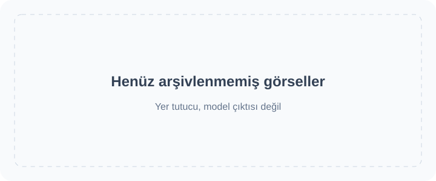

<!-- Generated by scripts/build_readme.py. Edit source data, locale catalogs and generator scripts. -->

# 🎨 Awesome GPT Image 2.6

GPT Image 2.6 için istemler, görsel örnekler ve özgün kaynaklardan oluşan açık bir koleksiyon.

    

⚠️ **Telif hakkı bildirimi**: Bu koleksiyondaki istemler ve medya yalnızca eğitim amacıyla kamuya açık kaynaklardan derlenmiştir. Herhangi bir içeriğin haklarınızı ihlal ettiğini düşünüyorsanız lütfen [bir sorun kaydı açın](https://github.com/RaphaelAI-OpenLab/awesome-gpt-image-2-6/issues/new), içeriği de hemen kaldıracağız.

    
    
    
   

---

Bu dil sürümü deponun arayüzünü çevirir. Tam örnek ayrıntıları şu anda İngilizce ve Basitleştirilmiş Çince olarak mevcuttur.

Çeviri bulunmadığında örnek başlıkları, açıklamalar ve ayrıntı sayfaları İngilizce gösterilir. Özgün istemler ve kaynak alıntıları çevrilmez.

**Hızlı bağlantılar** · [🖼️ Örneklere göz atın](#all-cases) · [🆕 Son eklenenler](#latest) · [📝 Örnek ekleyin](https://github.com/RaphaelAI-OpenLab/awesome-gpt-image-2-6/issues/new?template=submit-case.yml) · [🐞 Sorun bildirin](https://github.com/RaphaelAI-OpenLab/awesome-gpt-image-2-6/issues/new?template=report-problem.yml) · [📚 Rehberi okuyun](CONTRIBUTING.md)

## 🌐 Koleksiyona göz atın

**[Bu depodaki tüm örneklere göz atın →](#all-cases)**

Aşağıdaki her örnek, model kanıtlarını, kaynak atıflarını ve istemin mevcut olup olmadığını gösteren bir iç ayrıntı sayfası açar.

[Harici web sitesi materyalleri arşivi (kategori ve istatistiklere dahil değildir)](external-sites/README.md)

**YER TUTUCU · Harici web galerisi URL'si: yapılandırılmadı.**

**YER TUTUCU · Tek tıkla üretim bağlantısı: doğrulanmadı.**

YER TUTUCU · İlgili koleksiyon / kampanya bağlantısı: eklenecek.

[Raphael'i ziyaret edin (ana sayfa)](https://raphael.app/?utm_source=github&utm_medium=repository&utm_campaign=gpt_image_2_6_launch&utm_content=top_nav&utm_term=tr-TR)

## 🏷️ Kategoriye göre göz atın

| Kategori | Kaynak bağlantılı örnekler | Tam istemler |
| --- | ---: | ---: |
| [Marka ve ürün görselleri](#category-brand-products) | 7 | 0 |
| [Afişler ve tipografi](#category-posters-typography) | 8 | 0 |
| [İnfografikler](#category-infographics) | 3 | 0 |
| [İç mekân ve mimari](#category-interiors-architecture) | 3 | 0 |
| [Karakterler ve tutarlılık](#category-characters-consistency) | 15 | 0 |
| [İşaretleme ve hedefli düzenlemeler](#category-markup-edits) | 9 | 0 |
| [SVG ve tasarım varlıkları](#category-svg-design-assets) | 4 | 0 |
| [GIF ve animasyon](#category-gif-animation) | 59 | 0 |

## 📖 İçindekiler

- [GPT Image 2.6 nedir?](#about)
- [İstatistikler](#statistics)
- [Öne çıkan örnekler](#featured)
- [Son eklenenler](#latest)
- [Tüm örnekler](#all-cases)
- [Tam istemler](#collection)
- [Nasıl kullanılır?](#using)
- [Katkıda bulunun](#contribute)
- [Lisans](#license)
- [Teşekkürler](#acknowledgements)
- [Yıldız geçmişi](#star-history)

## 🤔 GPT Image 2.6 nedir?

OpenAI, Images 2.6'yı 4 Kasım 2026'da tanıttı. Bu koleksiyon Sunburst ve Flare model varyantlarını, görsel oluşturma ve düzenlemeyi, ayrıca belgelenmiş SVG ve GIF iş akışlarını kapsar. Varyant desteği varsayılmaz; her örnek için ayrı ayrı kaydedilir.

[Resmî duyuru](https://openai.com/index/introducing-images-2-6/) · [Model belgeleri](https://developers.openai.com/api/docs/guides/image-generation)

## 📊 İstatistikler

| Ölçüt | Sayı / tarih |
| --- | ---: |
| Kaynak bağlantılı örnekler | **108** |
| Resmî örnekler | **37** |
| Üreticilerinin bildirdiği örnekler | **71** |
| Kaynakta bulunan özgün istemler | **82** |
| Burada yayımlanan tam istemler | **0** |
| Yerel olarak arşivlenmiş medya dosyaları | **176** |
| Son kaynak kontrolü (UTC) | **2026-11-09** |

Kaynak sayıları yeniden üretim iddiası taşımaz. Bekleyen araştırma ipuçları dahil edilmez; aynı iş akışındaki farklı çıktılar tek bir örnek sayılır.

## 🔥 Öne çıkan örnekler

<table>
<tr>
<td width="33%" align="center"><a href="cases/docs-bakery-svg/README.md"> <strong>Bakery SVG logo</strong></a> Resmî belgeler</td>
<td width="33%" align="center"><a href="cases/docs-lantern-gif/README.md"> <strong>Lantern-carrying monkey loop</strong></a> Resmî belgeler</td>
<td width="33%" align="center"><a href="cases/launch-fal/README.md"> <strong>Living-room markup edit</strong></a> Resmî lansman demosu</td>
</tr>
<tr>
<td width="33%" align="center"><a href="cases/launch-sable/README.md"> <strong>Miniature brand product world</strong></a> Resmî lansman demosu</td>
<td width="33%" align="center"><a href="cases/launch-higgsfield/README.md"> <strong>Knight scene and clothing edit sequence</strong></a> Resmî lansman demosu</td>
<td width="33%" align="center"><a href="cases/community-malfoid/README.md"> <strong>Summer character illustration animation</strong></a> Üreticinin bildirdiği model</td>
</tr>
</table>

Yer tutucu kartlar üretilmiş sonuçlar değildir. Gösterilen tüm medya dosyaları bu depoda bulunur; henüz arşivlenmemiş medyanın bağlantıları ayrıntı sayfalarında kalır.

## 🆕 Son eklenenler

| Eklenme tarihi | Örnek | Kanıt |
| --- | --- | --- |
| 2026-11-06 | [Junkyard robot walk cycle](cases/ailingqu-junkyard-robot-walk/README.md) | Üreticinin bildirdiği model |
| 2026-11-06 | [Love-burst skill animation](cases/ailingqu-love-burst-skill/README.md) | Üreticinin bildirdiği model |
| 2026-11-06 | [8-bit slime boss battle](cases/ailingqu-pixel-slime-boss/README.md) | Üreticinin bildirdiği model |
| 2026-11-06 | [Arcade VS screen](cases/ailingqu-arcade-vs-screen/README.md) | Üreticinin bildirdiği model |
| 2026-11-06 | [Hourglass loading](cases/ailingqu-hourglass-flip/README.md) | Üreticinin bildirdiği model |
| 2026-11-06 | [Like button heart burst](cases/ailingqu-like-heart-burst/README.md) | Üreticinin bildirdiği model |

## 📋 Tüm örnekler

### Marka ve ürün görselleri

| Örnek · iç ayrıntı sayfası | Kaynak | İstem |
| --- | --- | --- |
| [Transparent bakery raster logo](cases/docs-bakery-raster/README.md) | Resmî belgeler | Kaynaktaki özgün istem |
| [Transparent product cutout](cases/docs-product-cutout/README.md) | Resmî belgeler | Kaynaktaki özgün istem |
| [Toy airplane packaging](cases/docs-toy-package/README.md) | Resmî belgeler | Kaynaktaki özgün istem |
| [Miniature brand product world](cases/launch-sable/README.md) | Resmî lansman demosu | Kaynaktaki özgün istem |
| [Travel visual generation speed comparison](cases/launch-travel/README.md) | Resmî lansman demosu | İstem herkese açık değil |
| [Watchmaker underwater macro test](cases/community-hn-watchmaker/README.md) | Üreticinin bildirdiği model | Kaynaktaki özgün istem |
| [AURORA orange perfume product image](cases/community-struggle-aurora-perfume/README.md) | Üreticinin bildirdiği model | Kaynaktaki özgün istem |

### Afişler ve tipografi

| Örnek · iç ayrıntı sayfası | Kaynak | İstem |
| --- | --- | --- |
| [Streetwear advertisement typography](cases/docs-streetwear/README.md) | Resmî belgeler | Kaynaktaki özgün istem |
| [Roadside shampoo billboard](cases/docs-billboard/README.md) | Resmî belgeler | Kaynaktaki özgün istem |
| [Nostalgic holiday card](cases/docs-holiday-card/README.md) | Resmî belgeler | Kaynaktaki özgün istem |
| [Birthday cake without extra slogan cards](cases/community-flare-slogan-comparison/README.md) | Üreticinin bildirdiği model | Kaynaktaki özgün istem |
| [AI evolution poster revised to Image 2.6](cases/community-struggle-poster-edit/README.md) | Üreticinin bildirdiği model | Kaynaktaki özgün istem |
| [Spring Health Fair 2027 flyer comparison](cases/nyle-health-fair/README.md) | Üreticinin bildirdiği model | İstem herkese açık değil |
| [Sensitive-skin lotion advertisement comparison](cases/nyle-skincare-ad/README.md) | Üreticinin bildirdiği model | İstem herkese açık değil |
| [Dense Japanese business cover comparison](cases/nyle-kanji-cover/README.md) | Üreticinin bildirdiği model | İstem herkese açık değil |

### İnfografikler

| Örnek · iç ayrıntı sayfası | Kaynak | İstem |
| --- | --- | --- |
| [Coffee-machine process diagram](cases/docs-coffee-diagram/README.md) | Resmî belgeler | Kaynaktaki özgün istem |
| [Cellular respiration teaching visual](cases/docs-cell-respiration/README.md) | Resmî belgeler | Kaynaktaki özgün istem |
| [Market-size presentation slide](cases/docs-pitch-slide/README.md) | Resmî belgeler | Kaynaktaki özgün istem |

### İç mekân ve mimari

| Örnek · iç ayrıntı sayfası | Kaynak | İstem |
| --- | --- | --- |
| [Replace chairs in an interior](cases/docs-room-chairs/README.md) | Resmî belgeler | Kaynaktaki özgün istem |
| [Living-room markup edit](cases/launch-fal/README.md) | Resmî lansman demosu | Kaynaktaki özgün istem |
| [Dusty warehouse prompt-detail comparison](cases/community-sunburst-dust-detail/README.md) | Üreticinin bildirdiği model | İstemin herkese açık olup olmadığı doğrulanmadı |

### Karakterler ve tutarlılık

| Örnek · iç ayrıntı sayfası | Kaynak | İstem |
| --- | --- | --- |
| [Paper-cut championship scene: complexity comparison](cases/docs-complexity/README.md) | Resmî belgeler | Kaynaktaki özgün istem |
| [Realistic fishing-boat sailor portrait](cases/docs-sailor/README.md) | Resmî belgeler | Kaynaktaki özgün istem |
| [1969 historical crowd scene](cases/docs-historical-crowd/README.md) | Resmî belgeler | Kaynaktaki özgün istem |
| [Four-panel pet comic](cases/docs-pet-comic/README.md) | Resmî belgeler | Kaynaktaki özgün istem |
| [Change clothing while preserving identity](cases/docs-outfit/README.md) | Resmî belgeler | Kaynaktaki özgün istem |
| [Place a person into a camping escape scene](cases/docs-person-scene/README.md) | Resmî belgeler | Kaynaktaki özgün istem |
| [Establish a storybook character](cases/docs-character-start/README.md) | Resmî belgeler | Kaynaktaki özgün istem |
| [Continue the same character’s story](cases/docs-character-story/README.md) | Resmî belgeler | Kaynaktaki özgün istem |
| [Stained-glass whale](cases/launch-picsart/README.md) | Resmî lansman demosu | İstem herkese açık değil |
| [Knight scene and clothing edit sequence](cases/launch-higgsfield/README.md) | Resmî lansman demosu | Kaynaktaki özgün istem |
| [Reference-led courtyard photo board](cases/community-marco-reference-photo-board/README.md) | Üreticinin bildirdiği model | İstem herkese açık değil |
| [Sunburst courtyard comparison](cases/community-marco-sunburst-courtyard-comparison/README.md) | Üreticinin bildirdiği model | İstem herkese açık değil |
| [Mushroom-lit fashion portrait](cases/community-marco-mushroom-fashion-portrait/README.md) | Üreticinin bildirdiği model | İstem herkese açık değil |
| [Sunburst six-style sample gallery](cases/nyle-sunburst-style-gallery/README.md) | Üreticinin bildirdiği model | İstem herkese açık değil |
| [Sunburst calico cat by a window](cases/community-kokone-sunburst-calico/README.md) | Üreticinin bildirdiği model | İstem herkese açık değil |

### İşaretleme ve hedefli düzenlemeler

| Örnek · iç ayrıntı sayfası | Kaynak | İstem |
| --- | --- | --- |
| [Recolor a marked vase](cases/docs-vase-markup/README.md) | Resmî belgeler | Kaynaktaki özgün istem |
| [Translate an infographic into Spanish](cases/docs-spanish-edit/README.md) | Resmî belgeler | Kaynaktaki özgün istem |
| [Transfer a pixel-art style](cases/docs-pixel-style/README.md) | Resmî belgeler | Kaynaktaki özgün istem |
| [Combine pets across images](cases/docs-dog-composite/README.md) | Resmî belgeler | Kaynaktaki özgün istem |
| [Turn a sketch into a realistic scene](cases/docs-sketch-render/README.md) | Resmî belgeler | Kaynaktaki özgün istem |
| [Remove a held flower](cases/docs-remove-flower/README.md) | Resmî belgeler | Kaynaktaki özgün istem |
| [Change the billboard scene to a snowy night](cases/docs-snow-edit/README.md) | Resmî belgeler | Kaynaktaki özgün istem |
| [Rabbit storybook day-to-dusk edit](cases/community-flare-day-dusk-edit/README.md) | Üreticinin bildirdiği model | İstemin herkese açık olup olmadığı doğrulanmadı |
| [Webinar date replacement comparison](cases/nyle-webinar-date-edit/README.md) | Üreticinin bildirdiği model | Kaynaktaki özgün istem |

### SVG ve tasarım varlıkları

| Örnek · iç ayrıntı sayfası | Kaynak | İstem |
| --- | --- | --- |
| [Bakery SVG logo](cases/docs-bakery-svg/README.md) | Resmî belgeler | Kaynaktaki özgün istem |
| [Farmers market mobile interface](cases/docs-market-ui/README.md) | Resmî belgeler | Kaynaktaki özgün istem |
| [Bear mascot: SVG versus PNG previews](cases/community-bear-svg-comparison/README.md) | Üreticinin bildirdiği model | İstem herkese açık değil |
| [Code Lightning vector logo](cases/community-struggle-code-lightning-svg/README.md) | Üreticinin bildirdiği model | Kaynaktaki özgün istem |

### GIF ve animasyon

| Örnek · iç ayrıntı sayfası | Kaynak | İstem |
| --- | --- | --- |
| [Lantern-carrying monkey loop](cases/docs-lantern-gif/README.md) | Resmî belgeler | Kaynaktaki özgün istem |
| [Office character: falling stock GIF](cases/launch-openart-down/README.md) | Resmî lansman demosu | Kaynaktaki özgün istem |
| [Office character: rising stock GIF](cases/launch-openart-up/README.md) | Resmî lansman demosu | Kaynaktaki özgün istem |
| [Owl sketch to animation](cases/launch-owl/README.md) | Resmî lansman demosu | İstem herkese açık değil |
| [Monty typing indicator animation](cases/launch-town/README.md) | Resmî lansman demosu | İstem herkese açık değil |
| [Summer character illustration animation](cases/community-malfoid/README.md) | Üreticinin bildirdiği model | İstem herkese açık değil |
| [Images 2.6 brings GIF(T)S :D](cases/community-gifts/README.md) | Üreticinin bildirdiği model | İstem herkese açık değil |
| [Boxing tiger animation](cases/community-boxing-tiger/README.md) | Üreticinin bildirdiği model | İstem herkese açık değil |
| [Hummingbird and kingfisher animation variants](cases/community-hummingbird-variants/README.md) | Üreticinin bildirdiği model | İstem herkese açık değil |
| [Rosebud animation](cases/community-rosebud-animation/README.md) | Üreticinin bildirdiği model | İstem herkese açık değil |
| [Jelly bear wobble](cases/ailingqu-jelly-bear-wobble/README.md) | Üreticinin bildirdiği model | Kaynaktaki özgün istem |
| [White bunny reaction sticker set](cases/ailingqu-bunny-reaction-set/README.md) | Üreticinin bildirdiği model | Kaynaktaki özgün istem |
| [Cartoon cat waving hello](cases/ailingqu-cat-waving-hello/README.md) | Üreticinin bildirdiği model | Kaynaktaki özgün istem |
| [Confused shiba head tilt](cases/ailingqu-shiba-head-tilt/README.md) | Üreticinin bildirdiği model | Kaynaktaki özgün istem |
| [Cat typing furiously](cases/ailingqu-cat-typing-laptop/README.md) | Üreticinin bildirdiği model | Kaynaktaki özgün istem |
| [Frog blowing a heart](cases/ailingqu-frog-heart-bubble/README.md) | Üreticinin bildirdiği model | Kaynaktaki özgün istem |
| [Penguin facepalm](cases/ailingqu-penguin-facepalm/README.md) | Üreticinin bildirdiği model | Kaynaktaki özgün istem |
| [Basketball shot celebration](cases/ailingqu-basketball-shot-sticker/README.md) | Üreticinin bildirdiği model | Kaynaktaki özgün istem |
| [Cat chef tossing fried rice](cases/ailingqu-cat-chef-fried-rice/README.md) | Üreticinin bildirdiği model | Kaynaktaki özgün istem |
| [Black cat punch](cases/ailingqu-black-cat-punch/README.md) | Üreticinin bildirdiği model | Kaynaktaki özgün istem |
| [Office cat workday reaction set](cases/ailingqu-office-cat-workday-set/README.md) | Üreticinin bildirdiği model | Kaynaktaki özgün istem |
| [Roaring duck](cases/ailingqu-roaring-duck/README.md) | Üreticinin bildirdiği model | Kaynaktaki özgün istem |
| [Flower macro flash cut](cases/ailingqu-flower-macro-flash/README.md) | Üreticinin bildirdiği model | Kaynaktaki özgün istem |
| [Cat-head logo brand reel](cases/ailingqu-cat-brand-reel/README.md) | Üreticinin bildirdiği model | Kaynaktaki özgün istem |
| [Sneaker colorway flash](cases/ailingqu-sneaker-colorway-flash/README.md) | Üreticinin bildirdiği model | Kaynaktaki özgün istem |
| [One tree, four seasons](cases/ailingqu-four-seasons-tree/README.md) | Üreticinin bildirdiği model | Kaynaktaki özgün istem |
| [Magazine collage panels pop in](cases/ailingqu-magazine-panels-pop/README.md) | Üreticinin bildirdiği model | Kaynaktaki özgün istem |
| [Reading by the window, day to night](cases/ailingqu-window-day-to-night/README.md) | Üreticinin bildirdiği model | Kaynaktaki özgün istem |
| [Steaming coffee loop](cases/ailingqu-steaming-coffee/README.md) | Üreticinin bildirdiği model | Kaynaktaki özgün istem |
| [Rainy window and plant](cases/ailingqu-rain-on-window/README.md) | Üreticinin bildirdiği model | Kaynaktaki özgün istem |
| [Goldfish in a bowl](cases/ailingqu-goldfish-bowl/README.md) | Üreticinin bildirdiği model | Kaynaktaki özgün istem |
| [Lighthouse at night](cases/ailingqu-lighthouse-night/README.md) | Üreticinin bildirdiği model | Kaynaktaki özgün istem |
| [Cat sleeping by the fireplace](cases/ailingqu-cat-by-fireplace/README.md) | Üreticinin bildirdiği model | Kaynaktaki özgün istem |
| [Lantern monkey in the snow](cases/ailingqu-lantern-monkey-snow/README.md) | Üreticinin bildirdiği model | Kaynaktaki özgün istem |
| [Sleepy fox on a mossy rock](cases/ailingqu-sleepy-fox-rock/README.md) | Üreticinin bildirdiği model | Kaynaktaki özgün istem |
| [Lo-fi study loop](cases/ailingqu-lofi-study-loop/README.md) | Üreticinin bildirdiği model | Kaynaktaki özgün istem |
| [Café cinemagraph](cases/ailingqu-cafe-cinemagraph/README.md) | Üreticinin bildirdiği model | Kaynaktaki özgün istem |
| [Ink-wash galloping horse](cases/ailingqu-ink-wash-horse/README.md) | Üreticinin bildirdiği model | Kaynaktaki özgün istem |
| [Doodle monster comes alive](cases/ailingqu-doodle-monster/README.md) | Üreticinin bildirdiği model | Kaynaktaki özgün istem |
| [Pixel art campfire](cases/ailingqu-pixel-campfire/README.md) | Üreticinin bildirdiği model | Kaynaktaki özgün istem |
| [Bouncing dots loader](cases/ailingqu-bouncing-dots-loader/README.md) | Üreticinin bildirdiği model | Kaynaktaki özgün istem |
| [Pixel knight run cycle](cases/ailingqu-pixel-knight-run/README.md) | Üreticinin bildirdiği model | Kaynaktaki özgün istem |
| [Like button heart burst](cases/ailingqu-like-heart-burst/README.md) | Üreticinin bildirdiği model | Kaynaktaki özgün istem |
| [Hourglass loading](cases/ailingqu-hourglass-flip/README.md) | Üreticinin bildirdiği model | Kaynaktaki özgün istem |
| [Arcade VS screen](cases/ailingqu-arcade-vs-screen/README.md) | Üreticinin bildirdiği model | Kaynaktaki özgün istem |
| [8-bit slime boss battle](cases/ailingqu-pixel-slime-boss/README.md) | Üreticinin bildirdiği model | Kaynaktaki özgün istem |
| [Love-burst skill animation](cases/ailingqu-love-burst-skill/README.md) | Üreticinin bildirdiği model | Kaynaktaki özgün istem |
| [Junkyard robot walk cycle](cases/ailingqu-junkyard-robot-walk/README.md) | Üreticinin bildirdiği model | Kaynaktaki özgün istem |
| [Robin cat wink and falling name hat](cases/community-ozan-robin-wink-hat/README.md) | Üreticinin bildirdiği model | Kaynaktaki özgün istem |
| [Blue-haired maid dialogue prototype](cases/community-mirochill-anime-dialogue-prototype/README.md) | Üreticinin bildirdiği model | İstem herkese açık değil |
| [Ram Altman memory-stick parody](cases/community-mirochill-ram-altman-animation/README.md) | Üreticinin bildirdiği model | İstem herkese açık değil |
| [Moonlit magical-girl dance](cases/community-struggle-sailor-dance/README.md) | Üreticinin bildirdiği model | Kaynaktaki özgün istem |
| [Clay orange cat typing](cases/community-struggle-cat-programmer/README.md) | Üreticinin bildirdiği model | Kaynaktaki özgün istem |
| [Desk photograph cleanup and animation](cases/community-struggle-desk-animation/README.md) | Üreticinin bildirdiği model | Kaynaktaki özgün istem |
| [Ten parody web-ad GIFs: a Japanese creator test](cases/community-zunbeho-parody-ad-gifs/README.md) | Üreticinin bildirdiği model | İstemin herkese açık olup olmadığı doğrulanmadı |
| [Pixel♡Love: swimming-character animation contact sheet](cases/community-temae-pixel-love-swimming-sheet/README.md) | Üreticinin bildirdiği model | İstem herkese açık değil |
| [Tanjiro pixel-art water-slash loop](cases/community-kiki-tanjiro-pixel-loop/README.md) | Üreticinin bildirdiği model | Kaynaktaki özgün istem |
| [Heartbeat dance modes: source poster](cases/community-kiki-heartbeat-dance-comparison/README.md) | Üreticinin bildirdiği model | İstemin herkese açık olup olmadığı doğrulanmadı |
| [Six Miss Malfoid mood sticker loops](cases/community-kiki-malfoid-mood-stickers/README.md) | Üreticinin bildirdiği model | İstemin herkese açık olup olmadığı doğrulanmadı |

[Arama günlüğü, medya raporu ve sonuçlandırılmamış araştırma ipuçları](docs/CASE_GALLERY.md)

## 📝 Tam istemler

Burada henüz tam istem metni yeniden yayımlanmamıştır. Örnek sayfaları, kamuya açıksa gerçek özgün istemlere bağlantı verir ve eksik istemleri açıkça belirtir. Kaynak bağlantısı içeren bir kayıt, kopyalanabilir istem kaydı değildir.

## 📚 Nasıl kullanılır?

1. Bir kategoriden veya öne çıkan karttan örnek açın.
2. Model kanıtlarını, gerekli girdileri, kaynağı ve yeniden kullanım sınırlarını okuyun.
3. Varsa özgün istem bağlantısını izleyin. Eksik bir istem eksik kalmalıdır; görselden hareketle istemi tahmin etmeyin.

## 🤝 Nasıl katkıda bulunulur?

Ana koleksiyon örneklerini content/source-cases.json dosyasına, harici web sitesi örneklerini external-sites/source-cases.json dosyasına ekleyin. Tam istemleri content/prompts.json dosyasına ekleyin. Oluşturucu, ayrı dizinler ve İngilizce ile Çince ayrıntı sayfaları oluşturur.

[Katkı rehberi](CONTRIBUTING.md) · [Kaynak örnekleri ve medya rehberi](docs/SOURCE_CASES.md) · [Bakım rehberi (Çince)](docs/FILLING_GUIDE.zh-CN.md)

## 📄 Lisans

Kod, özgün belgeler ve dekoratif SVG yer tutucular MIT lisansını kullanır. Üçüncü taraf istemleri ve medya kendi koşullarını korur; her öğenin kökeni ve yeniden kullanım durumu belirtilir. Uyarlanan README düzenine ilişkin atıf aşağıda ayrıca verilmiştir.

[Depo lisansı](LICENSE)

## 🙏 Teşekkürler

README yapısı, YouMind OpenLab'ın awesome-nano-banana-pro-prompts deposundan CC BY 4.0 kapsamında uyarlanmıştır. GPT Image 2.6 için yeni metinler, veriler, yerel ayrıntı sayfaları ve açıkça belirtilen yer tutucularla uyarlanmıştır; yaratıcı örnekler veya medya kopyalanmamıştır.

[YouMind README](https://github.com/YouMind-OpenLab/awesome-nano-banana-pro-prompts/blob/main/README_zh.md) · [CC BY 4.0](https://creativecommons.org/licenses/by/4.0/) · [Atıf notları](docs/ATTRIBUTION.md)

OpenAI'a ve her örnek sayfasında atıfta bulunulan özgün üreticilere teşekkürler.

## ⭐ Yıldız geçmişi

[Yıldız geçmişi](https://star-history.com/#RaphaelAI-OpenLab/awesome-gpt-image-2-6&Date) · [Yıldız verenleri görüntüleyin](https://github.com/RaphaelAI-OpenLab/awesome-gpt-image-2-6/stargazers)

[Bu depoya yıldız verin / takip edin](https://github.com/RaphaelAI-OpenLab/awesome-gpt-image-2-6)

[↑ Başa dön](#top)

---

Raphael tarafından derlenmiştir. [Ana sayfa](https://raphael.app/?utm_source=github&utm_medium=repository&utm_campaign=gpt_image_2_6_launch&utm_content=footer&utm_term=tr-TR)

Yapılandırılmış kaynak verilerinden oluşturulmuştur. Veri kümelerini düzenleyip yeniden oluşturun; bu dosyayı doğrudan düzenlemeyin.
