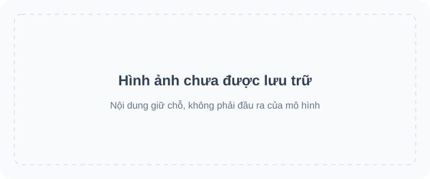

<!-- Generated by scripts/build_readme.py. Edit source data, locale catalogs and generator scripts. -->

# 🎨 Awesome GPT Image 2.6

Bộ sưu tập mở gồm các câu lệnh, ví dụ trực quan và nguồn gốc cho GPT Image 2.6.

    

⚠️ **Thông báo bản quyền**: Các câu lệnh và tư liệu trong bộ sưu tập này được thu thập từ các nguồn công khai chỉ nhằm mục đích giáo dục. Nếu bạn cho rằng bất kỳ nội dung nào xâm phạm quyền của mình, vui lòng [mở một báo cáo vấn đề](https://github.com/RaphaelAI-OpenLab/awesome-gpt-image-2-6/issues/new), và chúng tôi sẽ gỡ bỏ ngay lập tức.

    
    
    
   

---

Phiên bản ngôn ngữ này dịch giao diện kho mã. Chi tiết đầy đủ của các trường hợp hiện có bằng tiếng Anh và tiếng Trung giản thể.

Tiêu đề, mô tả và trang chi tiết của các trường hợp sẽ hiển thị bằng tiếng Anh khi chưa có bản dịch. Câu lệnh gốc và trích dẫn từ nguồn không được dịch.

**Liên kết nhanh** · [🖼️ Xem các trường hợp](#all-cases) · [🆕 Mới thêm gần đây](#latest) · [📝 Thêm ví dụ](https://github.com/RaphaelAI-OpenLab/awesome-gpt-image-2-6/issues/new?template=submit-case.yml) · [🐞 Báo cáo vấn đề](https://github.com/RaphaelAI-OpenLab/awesome-gpt-image-2-6/issues/new?template=report-problem.yml) · [📚 Đọc hướng dẫn](CONTRIBUTING.md)

## 🌐 Khám phá bộ sưu tập

**[Xem tất cả trường hợp trong kho mã này →](#all-cases)**

Mỗi trường hợp bên dưới mở một trang chi tiết nội bộ với bằng chứng về mô hình, ghi công nguồn và thông tin về khả năng truy cập câu lệnh.

**GIỮ CHỖ · URL thư viện ảnh bên ngoài: chưa cấu hình.**

**GIỮ CHỖ · Liên kết tạo ảnh một nhấp: chưa xác minh.**

GIỮ CHỖ · Liên kết bộ sưu tập / chiến dịch liên quan: sẽ được bổ sung.

[Ghé thăm Raphael (trang chủ)](https://raphael.app/?utm_source=github&utm_medium=repository&utm_campaign=gpt_image_2_6_launch&utm_content=top_nav&utm_term=vi-VN)

## 🏷️ Duyệt theo danh mục

| Danh mục | Trường hợp có liên kết nguồn | Câu lệnh đầy đủ |
| --- | ---: | ---: |
| [Hình ảnh thương hiệu và sản phẩm](#category-brand-products) | 24 | 0 |
| [Áp phích và nghệ thuật chữ](#category-posters-typography) | 25 | 0 |
| [Đồ họa thông tin](#category-infographics) | 12 | 0 |
| [Nội thất và kiến trúc](#category-interiors-architecture) | 7 | 0 |
| [Nhân vật và tính nhất quán](#category-characters-consistency) | 26 | 0 |
| [Đánh dấu và chỉnh sửa có mục tiêu](#category-markup-edits) | 18 | 0 |
| [SVG và tài nguyên thiết kế](#category-svg-design-assets) | 8 | 0 |
| [GIF và hoạt ảnh](#category-gif-animation) | 81 | 0 |

## 📖 Mục lục

- [GPT Image 2.6 là gì?](#about)
- [Thống kê](#statistics)
- [Trường hợp nổi bật](#featured)
- [Mới thêm gần đây](#latest)
- [Tất cả trường hợp](#all-cases)
- [Câu lệnh đầy đủ](#collection)
- [Cách sử dụng](#using)
- [Đóng góp](#contribute)
- [Giấy phép](#license)
- [Lời cảm ơn](#acknowledgements)
- [Lịch sử sao](#star-history)

## 🤔 GPT Image 2.6 là gì?

OpenAI giới thiệu Images 2.6 vào ngày 4 tháng 11 năm 2026. Bộ sưu tập này bao gồm các biến thể mô hình Sunburst và Flare, việc tạo và chỉnh sửa ảnh, cùng các quy trình SVG và GIF đã có tài liệu. Khả năng hỗ trợ biến thể được ghi theo từng trường hợp thay vì mặc định suy đoán.

[Thông báo chính thức](https://openai.com/index/introducing-images-2-6/) · [Tài liệu mô hình](https://developers.openai.com/api/docs/guides/image-generation)

## 📊 Thống kê

| Chỉ số | Số lượng / ngày |
| --- | ---: |
| Trường hợp có liên kết nguồn | **201** |
| Ví dụ chính thức | **37** |
| Ví dụ do tác giả báo cáo | **164** |
| Câu lệnh gốc có sẵn tại nguồn | **149** |
| Câu lệnh đầy đủ được công bố tại đây | **0** |
| Tệp tư liệu được lưu trữ cục bộ | **319** |
| Lần kiểm tra nguồn gần nhất (UTC) | **2026-11-09** |

Số lượng nguồn không khẳng định việc tái tạo. Các đầu mối đang chờ xử lý không được tính; các đầu ra khác nhau trong cùng một quy trình được tính là một trường hợp.

## 🔥 Trường hợp nổi bật

<table>
<tr>
<td width="33%" align="center"><a href="cases/docs-bakery-svg/README.md"> <strong>Bakery SVG logo</strong></a> Tài liệu chính thức</td>
<td width="33%" align="center"><a href="cases/docs-lantern-gif/README.md"> <strong>Lantern-carrying monkey loop</strong></a> Tài liệu chính thức</td>
<td width="33%" align="center"><a href="cases/launch-fal/README.md"> <strong>Living-room markup edit</strong></a> Bản trình diễn ra mắt chính thức</td>
</tr>
<tr>
<td width="33%" align="center"><a href="cases/launch-sable/README.md"> <strong>Miniature brand product world</strong></a> Bản trình diễn ra mắt chính thức</td>
<td width="33%" align="center"><a href="cases/launch-higgsfield/README.md"> <strong>Knight scene and clothing edit sequence</strong></a> Bản trình diễn ra mắt chính thức</td>
<td width="33%" align="center"><a href="cases/community-malfoid/README.md"> <strong>Summer character illustration animation</strong></a> Mô hình do tác giả báo cáo</td>
</tr>
</table>

Thẻ giữ chỗ không phải là kết quả được tạo. Tất cả tệp tư liệu hiển thị đều nằm trong kho mã này; tư liệu chưa được lưu trữ vẫn có liên kết trên các trang chi tiết.

## 🆕 Mới thêm gần đây

| Ngày thêm | Trường hợp | Bằng chứng |
| --- | --- | --- |
| 2026-11-06 | [Junkyard robot walk cycle](cases/ailingqu-junkyard-robot-walk/README.md) | Mô hình do tác giả báo cáo |
| 2026-11-06 | [Love-burst skill animation](cases/ailingqu-love-burst-skill/README.md) | Mô hình do tác giả báo cáo |
| 2026-11-06 | [8-bit slime boss battle](cases/ailingqu-pixel-slime-boss/README.md) | Mô hình do tác giả báo cáo |
| 2026-11-06 | [Arcade VS screen](cases/ailingqu-arcade-vs-screen/README.md) | Mô hình do tác giả báo cáo |
| 2026-11-06 | [Hourglass loading](cases/ailingqu-hourglass-flip/README.md) | Mô hình do tác giả báo cáo |
| 2026-11-06 | [Like button heart burst](cases/ailingqu-like-heart-burst/README.md) | Mô hình do tác giả báo cáo |

## 📋 Tất cả trường hợp

### Hình ảnh thương hiệu và sản phẩm

| Trường hợp · trang chi tiết nội bộ | Nguồn | Câu lệnh |
| --- | --- | --- |
| [Transparent bakery raster logo](cases/docs-bakery-raster/README.md) | Tài liệu chính thức | Câu lệnh gốc tại nguồn |
| [Transparent product cutout](cases/docs-product-cutout/README.md) | Tài liệu chính thức | Câu lệnh gốc tại nguồn |
| [Toy airplane packaging](cases/docs-toy-package/README.md) | Tài liệu chính thức | Câu lệnh gốc tại nguồn |
| [Miniature brand product world](cases/launch-sable/README.md) | Bản trình diễn ra mắt chính thức | Câu lệnh gốc tại nguồn |
| [Travel visual generation speed comparison](cases/launch-travel/README.md) | Bản trình diễn ra mắt chính thức | Câu lệnh chưa công khai |
| [Laptop GIF-creation workspace illustration](cases/techrepublic-gif-workspace-illustration/README.md) | Mô hình do tác giả báo cáo | Câu lệnh chưa công khai |
| [Tovalin serum scene comparison](cases/productai-tovalin-serum-comparison/README.md) | Mô hình do tác giả báo cáo | Câu lệnh chưa công khai |
| [Quillhaven coffee scenes and precise edits](cases/productai-quillhaven-coffee-comparison/README.md) | Mô hình do tác giả báo cáo | Câu lệnh chưa công khai |
| [Running-shoe scenes and precise edits](cases/productai-running-shoe-comparison/README.md) | Mô hình do tác giả báo cáo | Câu lệnh chưa công khai |
| [Cable-knit cardigan on a model](cases/productai-cable-knit-cardigan-comparison/README.md) | Mô hình do tác giả báo cáo | Câu lệnh chưa công khai |
| [Oaken Mile Coffee label: Flare and Sunburst](cases/community-moss-coffee-label/README.md) | Mô hình do tác giả báo cáo | Câu lệnh gốc tại nguồn |
| [Cafe latte: Flare and Sunburst](cases/community-lightlyn-latte-variants/README.md) | Mô hình do tác giả báo cáo | Câu lệnh gốc tại nguồn |
| [Earbud product-ad comparison](cases/community-lightlyn-earbuds-ad-variants/README.md) | Mô hình do tác giả báo cáo | Câu lệnh gốc tại nguồn |
| [Made Takeaway box](cases/made-flare-dumpling-box/README.md) | Mô hình do tác giả báo cáo | Câu lệnh gốc tại nguồn |
| [Made Stylus macro](cases/made-sunburst-stylus-macro/README.md) | Mô hình do tác giả báo cáo | Câu lệnh gốc tại nguồn |
| [Three-flavor soda lineup](cases/yir-flavor-lineup/README.md) | Mô hình do tác giả báo cáo | Câu lệnh gốc tại nguồn |
| [French press product photos and background-edit continuation](cases/community-gptimagehub-french-press-edit/README.md) | Mô hình do tác giả báo cáo | Câu lệnh gốc tại nguồn |
| [SUMMIT ROAST coffee-bag product shot](cases/zzo-flare-summit-roast-bag/README.md) | Mô hình do tác giả báo cáo | Câu lệnh gốc tại nguồn |
| [Nowrap logo motion comparison](cases/nowrap-logo-motion/README.md) | Mô hình do tác giả báo cáo | Câu lệnh gốc tại nguồn |
| [Flat fox mascot badge](cases/toonderly-fox-badge/README.md) | Mô hình do tác giả báo cáo | Câu lệnh gốc tại nguồn |
| [Watch four-round editing](cases/yir-watch-edit-sequence/README.md) | Mô hình do tác giả báo cáo | Câu lệnh chưa công khai |
| [Vase four-round editing](cases/yir-vase-edit-sequence/README.md) | Mô hình do tác giả báo cáo | Câu lệnh chưa công khai |
| [Soup photograph with recipe card](cases/joinoasis-tomato-soup/README.md) | Mô hình do tác giả báo cáo | Câu lệnh gốc tại nguồn |
| [Blazer and boots reference composition](cases/joinoasis-blazer-boots-composition/README.md) | Mô hình do tác giả báo cáo | Câu lệnh gốc tại nguồn |

### Áp phích và nghệ thuật chữ

| Trường hợp · trang chi tiết nội bộ | Nguồn | Câu lệnh |
| --- | --- | --- |
| [Streetwear advertisement typography](cases/docs-streetwear/README.md) | Tài liệu chính thức | Câu lệnh gốc tại nguồn |
| [Roadside shampoo billboard](cases/docs-billboard/README.md) | Tài liệu chính thức | Câu lệnh gốc tại nguồn |
| [Nostalgic holiday card](cases/docs-holiday-card/README.md) | Tài liệu chính thức | Câu lệnh gốc tại nguồn |
| [Shiba ramen shop: two quality comparison runs](cases/ai-garage-ramen-quality-series/README.md) | Mô hình do tác giả báo cáo | Câu lệnh chưa công khai |
| [Autumn café menu announcement comparison](cases/ai-garage-autumn-cafe/README.md) | Mô hình do tác giả báo cáo | Câu lệnh chưa công khai |
| [Flare 4K test, published previews](cases/aivideos-flare-4k-comparison/README.md) | Mô hình do tác giả báo cáo | Câu lệnh chưa công khai |
| [Flare quality and planning comparison](cases/aivideos-flare-quality-planning/README.md) | Mô hình do tác giả báo cáo | Câu lệnh chưa công khai |
| [Retro diner menu board](cases/dreamega-retro-diner/README.md) | Mô hình do tác giả báo cáo | Câu lệnh gốc tại nguồn |
| [Lantern Row Night Market flyer: Flare and Sunburst](cases/community-moss-night-market-flyer/README.md) | Mô hình do tác giả báo cáo | Câu lệnh gốc tại nguồn |
| [Café breakfast menu: Flare and Sunburst](cases/community-moss-breakfast-menu/README.md) | Mô hình do tác giả báo cáo | Câu lệnh gốc tại nguồn |
| [Pottery event banner layout: Flare and Sunburst](cases/community-moss-pottery-banner-layout/README.md) | Mô hình do tác giả báo cáo | Câu lệnh gốc tại nguồn |
| [Night market poster comparison](cases/community-lightlyn-night-market-variants/README.md) | Mô hình do tác giả báo cáo | Câu lệnh gốc tại nguồn |
| [Made Lightbox menu](cases/made-flare-noodle-menu/README.md) | Mô hình do tác giả báo cáo | Câu lệnh gốc tại nguồn |
| [Made Sleeve typography](cases/made-sunburst-record-sleeve/README.md) | Mô hình do tác giả báo cáo | Câu lệnh gốc tại nguồn |
| [Made Window lettering](cases/made-sunburst-shop-window/README.md) | Mô hình do tác giả báo cáo | Câu lệnh gốc tại nguồn |
| [Hot-sauce launch and speed-test posters](cases/yir-hot-sauce-posters/README.md) | Mô hình do tác giả báo cáo | Câu lệnh gốc tại nguồn |
| [End-of-season bicycle sale ad](cases/yir-bicycle-sale-ad/README.md) | Mô hình do tác giả báo cáo | Câu lệnh gốc tại nguồn |
| [Blue Hour jazz posters and date-edit continuation](cases/community-gptimagehub-jazz-poster-edit/README.md) | Mô hình do tác giả báo cáo | Câu lệnh gốc tại nguồn |
| [Winter Night Market poster](cases/veevid-holiday-market-poster/README.md) | Mô hình do tác giả báo cáo | Câu lệnh gốc tại nguồn |
| [English–Hindi evening menu from a document brief](cases/analyticsvidhya-bilingual-evening-menu/README.md) | Mô hình do tác giả báo cáo | Câu lệnh gốc tại nguồn |
| [NIGHT TIDE wave concert poster](cases/zzo-flare-night-tide-poster/README.md) | Mô hình do tác giả báo cáo | Câu lệnh gốc tại nguồn |
| [NIGHT MARKET typography comparison](cases/cellcog-night-market-poster/README.md) | Mô hình do tác giả báo cáo | Câu lệnh chưa công khai |
| [Café neon text comparison](cases/nowrap-cafe-sign-motion/README.md) | Mô hình do tác giả báo cáo | Câu lệnh gốc tại nguồn |
| [BOUNCE balloon-letter poster](cases/toonderly-bounce-poster/README.md) | Mô hình do tác giả báo cáo | Câu lệnh chưa công khai |
| [OPEN LATE neon storefront](cases/kavel-open-late/README.md) | Mô hình do tác giả báo cáo | Câu lệnh chưa công khai |

### Đồ họa thông tin

| Trường hợp · trang chi tiết nội bộ | Nguồn | Câu lệnh |
| --- | --- | --- |
| [Coffee-machine process diagram](cases/docs-coffee-diagram/README.md) | Tài liệu chính thức | Câu lệnh gốc tại nguồn |
| [Cellular respiration teaching visual](cases/docs-cell-respiration/README.md) | Tài liệu chính thức | Câu lệnh gốc tại nguồn |
| [Market-size presentation slide](cases/docs-pitch-slide/README.md) | Tài liệu chính thức | Câu lệnh gốc tại nguồn |
| [Northfield Design Summit agenda: Flare and Sunburst](cases/community-moss-design-summit-agenda/README.md) | Mô hình do tác giả báo cáo | Câu lệnh gốc tại nguồn |
| [Honeybee scientific scale layouts](cases/community-lightlyn-bee-scale-variants/README.md) | Mô hình do tác giả báo cáo | Câu lệnh gốc tại nguồn |
| [Made Illustrated map](cases/made-flare-market-map/README.md) | Mô hình do tác giả báo cáo | Câu lệnh gốc tại nguồn |
| [Made Exploded diagram](cases/made-sunburst-turntable-diagram/README.md) | Mô hình do tác giả báo cáo | Câu lệnh gốc tại nguồn |
| [Lisbon weather screen: matched Flare and Sunburst test](cases/community-gptimagehub-weather-ui/README.md) | Mô hình do tác giả báo cáo | Câu lệnh gốc tại nguồn |
| [Six-step bill-to-law infographic comparison](cases/community-gptimagehub-law-infographic/README.md) | Mô hình do tác giả báo cáo | Câu lệnh gốc tại nguồn |
| [Monarch butterfly life-cycle field-guide plate](cases/analyticsvidhya-monarch-life-cycle/README.md) | Mô hình do tác giả báo cáo | Câu lệnh gốc tại nguồn |
| [Automatic coffee-machine flow infographic](cases/zzo-flare-coffee-machine-diagram/README.md) | Mô hình do tác giả báo cáo | Câu lệnh gốc tại nguồn |
| [Quarterly revenue chart animation](cases/nowrap-chart-motion/README.md) | Mô hình do tác giả báo cáo | Câu lệnh gốc tại nguồn |

### Nội thất và kiến trúc

| Trường hợp · trang chi tiết nội bộ | Nguồn | Câu lệnh |
| --- | --- | --- |
| [Replace chairs in an interior](cases/docs-room-chairs/README.md) | Tài liệu chính thức | Câu lệnh gốc tại nguồn |
| [Living-room markup edit](cases/launch-fal/README.md) | Bản trình diễn ra mắt chính thức | Câu lệnh gốc tại nguồn |
| [Made Ultra-wide aisle](cases/made-flare-market-aerial/README.md) | Mô hình do tác giả báo cáo | Câu lệnh gốc tại nguồn |
| [Snowy mountain greenhouse at blue hour](cases/analyticsvidhya-snowy-greenhouse/README.md) | Mô hình do tác giả báo cáo | Câu lệnh gốc tại nguồn |
| [Red tram in a foggy city](cases/kavel-tram/README.md) | Mô hình do tác giả báo cáo | Câu lệnh chưa công khai |
| [Four-room doorway layout](cases/joinoasis-four-room-floorplan/README.md) | Mô hình do tác giả báo cáo | Câu lệnh gốc tại nguồn |
| [Kitchen hanging-light replacement](cases/joinoasis-kitchen-pendant-edit/README.md) | Mô hình do tác giả báo cáo | Câu lệnh gốc tại nguồn |

### Nhân vật và tính nhất quán

| Trường hợp · trang chi tiết nội bộ | Nguồn | Câu lệnh |
| --- | --- | --- |
| [Paper-cut championship scene: complexity comparison](cases/docs-complexity/README.md) | Tài liệu chính thức | Câu lệnh gốc tại nguồn |
| [Realistic fishing-boat sailor portrait](cases/docs-sailor/README.md) | Tài liệu chính thức | Câu lệnh gốc tại nguồn |
| [1969 historical crowd scene](cases/docs-historical-crowd/README.md) | Tài liệu chính thức | Câu lệnh gốc tại nguồn |
| [Four-panel pet comic](cases/docs-pet-comic/README.md) | Tài liệu chính thức | Câu lệnh gốc tại nguồn |
| [Change clothing while preserving identity](cases/docs-outfit/README.md) | Tài liệu chính thức | Câu lệnh gốc tại nguồn |
| [Place a person into a camping escape scene](cases/docs-person-scene/README.md) | Tài liệu chính thức | Câu lệnh gốc tại nguồn |
| [Establish a storybook character](cases/docs-character-start/README.md) | Tài liệu chính thức | Câu lệnh gốc tại nguồn |
| [Continue the same character’s story](cases/docs-character-story/README.md) | Tài liệu chính thức | Câu lệnh gốc tại nguồn |
| [Stained-glass whale](cases/launch-picsart/README.md) | Bản trình diễn ra mắt chính thức | Câu lệnh chưa công khai |
| [Knight scene and clothing edit sequence](cases/launch-higgsfield/README.md) | Bản trình diễn ra mắt chính thức | Câu lệnh gốc tại nguồn |
| [Ophanim-inspired still: The Coastal Lookout](cases/community-ophanim-coastal-lookout/README.md) | Mô hình do tác giả báo cáo | Câu lệnh gốc tại nguồn |
| [Ophanim-inspired still: The Mountain Reservoir](cases/community-ophanim-mountain-reservoir/README.md) | Mô hình do tác giả báo cáo | Câu lệnh gốc tại nguồn |
| [Ophanim-inspired still: The Village in the Rain](cases/community-ophanim-village-rain/README.md) | Mô hình do tác giả báo cáo | Câu lệnh gốc tại nguồn |
| [Ophanim-inspired still: The Subway Entrance](cases/community-ophanim-subway-entrance/README.md) | Mô hình do tác giả báo cáo | Câu lệnh gốc tại nguồn |
| [Fisherman at dawn: Flare and Sunburst](cases/community-moss-fisherman-dawn/README.md) | Mô hình do tác giả báo cáo | Câu lệnh gốc tại nguồn |
| [Made Vendor portrait](cases/made-flare-vendor-flash/README.md) | Mô hình do tác giả báo cáo | Câu lệnh gốc tại nguồn |
| [Made Rainy night](cases/made-flare-rain-stall/README.md) | Mô hình do tác giả báo cáo | Câu lệnh gốc tại nguồn |
| [Made Crate digger](cases/made-sunburst-crate-digger/README.md) | Mô hình do tác giả báo cáo | Câu lệnh gốc tại nguồn |
| [Made Listening booth](cases/made-sunburst-listening-booth/README.md) | Mô hình do tác giả báo cáo | Câu lệnh gốc tại nguồn |
| [Ferry at blue hour](cases/yir-ferry-blue-hour/README.md) | Mô hình do tác giả báo cáo | Câu lệnh gốc tại nguồn |
| [Night market noodle stall](cases/yir-noodle-stall/README.md) | Mô hình do tác giả báo cáo | Câu lệnh gốc tại nguồn |
| [Raincoat animation storyboard](cases/yir-raincoat-storyboard/README.md) | Mô hình do tác giả báo cáo | Câu lệnh gốc tại nguồn |
| [Fox raincoat consistency test](cases/nowrap-fox-motion/README.md) | Mô hình do tác giả báo cáo | Câu lệnh gốc tại nguồn |
| [Robot learning to fly storyboard](cases/toonderly-robot-storyboard/README.md) | Mô hình do tác giả báo cáo | Câu lệnh chưa công khai |
| [Portrait four-round editing](cases/yir-portrait-edit-sequence/README.md) | Mô hình do tác giả báo cáo | Câu lệnh chưa công khai |
| [1990s-style flash portrait](cases/kavel-90s-snapshot/README.md) | Mô hình do tác giả báo cáo | Câu lệnh gốc tại nguồn |

### Đánh dấu và chỉnh sửa có mục tiêu

| Trường hợp · trang chi tiết nội bộ | Nguồn | Câu lệnh |
| --- | --- | --- |
| [Recolor a marked vase](cases/docs-vase-markup/README.md) | Tài liệu chính thức | Câu lệnh gốc tại nguồn |
| [Translate an infographic into Spanish](cases/docs-spanish-edit/README.md) | Tài liệu chính thức | Câu lệnh gốc tại nguồn |
| [Transfer a pixel-art style](cases/docs-pixel-style/README.md) | Tài liệu chính thức | Câu lệnh gốc tại nguồn |
| [Combine pets across images](cases/docs-dog-composite/README.md) | Tài liệu chính thức | Câu lệnh gốc tại nguồn |
| [Turn a sketch into a realistic scene](cases/docs-sketch-render/README.md) | Tài liệu chính thức | Câu lệnh gốc tại nguồn |
| [Remove a held flower](cases/docs-remove-flower/README.md) | Tài liệu chính thức | Câu lệnh gốc tại nguồn |
| [Change the billboard scene to a snowy night](cases/docs-snow-edit/README.md) | Tài liệu chính thức | Câu lệnh gốc tại nguồn |
| [Shiba chef festival background edit](cases/ai-garage-festival-background/README.md) | Mô hình do tác giả báo cáo | Câu lệnh gốc tại nguồn |
| [Red chef hat despite conflicting markup](cases/ai-garage-red-chef-hat/README.md) | Mô hình do tác giả báo cáo | Câu lệnh gốc tại nguồn |
| [Mirror reflection costume edit](cases/dreamega-mirror-reflection/README.md) | Mô hình do tác giả báo cáo | Câu lệnh chưa công khai |
| [Miniature city inside a piano](cases/dreamega-piano-city/README.md) | Mô hình do tác giả báo cáo | Câu lệnh chưa công khai |
| [Recolor a sofa in a living room](cases/community-lightlyn-sofa-edit-variants/README.md) | Mô hình do tác giả báo cáo | Câu lệnh gốc tại nguồn |
| [Sneaker recolored to forest green suede](cases/veevid-sneaker-suede-recolor/README.md) | Mô hình do tác giả báo cáo | Câu lệnh gốc tại nguồn |
| [Markup-guided forest-green armchair edit](cases/analyticsvidhya-markup-green-armchair/README.md) | Mô hình do tác giả báo cáo | Câu lệnh gốc tại nguồn |
| [LUMA 02 bottle on a forest river stone](cases/zzo-flare-luma-forest-stone/README.md) | Mô hình do tác giả báo cáo | Câu lệnh gốc tại nguồn |
| [Owl doodle watercolor edit](cases/toonderly-owl-watercolor/README.md) | Mô hình do tác giả báo cáo | Câu lệnh chưa công khai |
| [Sparrow added to a ramen shop](cases/toonderly-ramen-sparrow-edit/README.md) | Mô hình do tác giả báo cáo | Câu lệnh chưa công khai |
| [Golden retriever photo to cartoon](cases/toonderly-dog-photo-cartoon/README.md) | Mô hình do tác giả báo cáo | Câu lệnh chưa công khai |

### SVG và tài nguyên thiết kế

| Trường hợp · trang chi tiết nội bộ | Nguồn | Câu lệnh |
| --- | --- | --- |
| [Bakery SVG logo](cases/docs-bakery-svg/README.md) | Tài liệu chính thức | Câu lệnh gốc tại nguồn |
| [Farmers market mobile interface](cases/docs-market-ui/README.md) | Tài liệu chính thức | Câu lệnh gốc tại nguồn |
| [Bear mascot: SVG versus PNG previews](cases/community-bear-svg-comparison/README.md) | Mô hình do tác giả báo cáo | Câu lệnh chưa công khai |
| [Harbor Roast vector logo](cases/community-lightlyn-coffee-logo-svg/README.md) | Mô hình do tác giả báo cáo | Câu lệnh gốc tại nguồn |
| [Six weather icons as SVG](cases/community-lightlyn-weather-icons-svg/README.md) | Mô hình do tác giả báo cáo | Câu lệnh gốc tại nguồn |
| [Turn a cafe photo into vector art](cases/community-lightlyn-latte-vector-svg/README.md) | Mô hình do tác giả báo cáo | Câu lệnh gốc tại nguồn |
| [Teal and amber hourglass pictogram comparison](cases/cellcog-hourglass-icon/README.md) | Mô hình do tác giả báo cáo | Câu lệnh chưa công khai |
| [Six vector-test comparison renders](cases/cellcog-vector-comparison-renders/README.md) | Mô hình do tác giả báo cáo | Câu lệnh chưa công khai |

### GIF và hoạt ảnh

| Trường hợp · trang chi tiết nội bộ | Nguồn | Câu lệnh |
| --- | --- | --- |
| [Lantern-carrying monkey loop](cases/docs-lantern-gif/README.md) | Tài liệu chính thức | Câu lệnh gốc tại nguồn |
| [Office character: falling stock GIF](cases/launch-openart-down/README.md) | Bản trình diễn ra mắt chính thức | Câu lệnh gốc tại nguồn |
| [Office character: rising stock GIF](cases/launch-openart-up/README.md) | Bản trình diễn ra mắt chính thức | Câu lệnh gốc tại nguồn |
| [Owl sketch to animation](cases/launch-owl/README.md) | Bản trình diễn ra mắt chính thức | Câu lệnh chưa công khai |
| [Monty typing indicator animation](cases/launch-town/README.md) | Bản trình diễn ra mắt chính thức | Câu lệnh chưa công khai |
| [Summer character illustration animation](cases/community-malfoid/README.md) | Mô hình do tác giả báo cáo | Câu lệnh chưa công khai |
| [Images 2.6 brings GIF(T)S :D](cases/community-gifts/README.md) | Mô hình do tác giả báo cáo | Câu lệnh chưa công khai |
| [Boxing tiger animation](cases/community-boxing-tiger/README.md) | Mô hình do tác giả báo cáo | Câu lệnh chưa công khai |
| [Hummingbird and kingfisher animation variants](cases/community-hummingbird-variants/README.md) | Mô hình do tác giả báo cáo | Câu lệnh chưa công khai |
| [Rosebud animation](cases/community-rosebud-animation/README.md) | Mô hình do tác giả báo cáo | Câu lệnh chưa công khai |
| [Shiba chef waving loop](cases/ai-garage-shiba-wave/README.md) | Mô hình do tác giả báo cáo | Câu lệnh chưa công khai |
| [Stock-market kitten meme: three GIF iterations](cases/community-greta-stock-kitten-iterations/README.md) | Mô hình do tác giả báo cáo | Câu lệnh gốc tại nguồn |
| [Morphed: bubblegum pop and reset loop](cases/morphed-bubblegum-loop/README.md) | Mô hình do tác giả báo cáo | Câu lệnh gốc tại nguồn |
| [Rocking KINGY LAB bottle GIF](cases/kingy-sunburst-bottle-rocking/README.md) | Mô hình do tác giả báo cáo | Chưa xác minh tình trạng công khai của câu lệnh |
| [Cartoon snowman waving loop](cases/veevid-snowman-wave/README.md) | Mô hình do tác giả báo cáo | Câu lệnh gốc tại nguồn |
| [Selfie to sunglasses reaction loop](cases/yepshot-sunglasses-reaction/README.md) | Mô hình do tác giả báo cáo | Câu lệnh gốc tại nguồn |
| [Puppy head-tilt loop](cases/yepshot-pet-head-tilt/README.md) | Mô hình do tác giả báo cáo | Câu lệnh gốc tại nguồn |
| [Photo to waving chibi sticker loop](cases/yepshot-chibi-sticker-wave/README.md) | Mô hình do tác giả báo cáo | Câu lệnh gốc tại nguồn |
| [Owl sketch comes alive](cases/yepshot-drawing-comes-alive/README.md) | Mô hình do tác giả báo cáo | Câu lệnh gốc tại nguồn |
| [OPEN neon animation preview](cases/zzo-neon-open-sign/README.md) | Mô hình do tác giả báo cáo | Câu lệnh gốc tại nguồn |
| [Good-night sticker animation preview](cases/zzo-goodnight-girl-from-reference/README.md) | Mô hình do tác giả báo cáo | Câu lệnh gốc tại nguồn |
| [Thank-you shiba animation preview](cases/zzo-thank-you-shiba/README.md) | Mô hình do tác giả báo cáo | Chưa xác minh tình trạng công khai của câu lệnh |
| [LOL bean animation preview](cases/zzo-lol-bean/README.md) | Mô hình do tác giả báo cáo | Chưa xác minh tình trạng công khai của câu lệnh |
| [Oops reaction animation preview](cases/zzo-oops-facepalm/README.md) | Mô hình do tác giả báo cáo | Chưa xác minh tình trạng công khai của câu lệnh |
| [Got-it robot animation preview](cases/zzo-got-it-robot/README.md) | Mô hình do tác giả báo cáo | Chưa xác minh tình trạng công khai của câu lệnh |
| [Morning coffee animation preview](cases/zzo-good-morning-coffee/README.md) | Mô hình do tác giả báo cáo | Chưa xác minh tình trạng công khai của câu lệnh |
| [Birthday cake animation preview](cases/zzo-birthday-cake/README.md) | Mô hình do tác giả báo cáo | Chưa xác minh tình trạng công khai của câu lệnh |
| [Thanksgiving turkey animation preview](cases/zzo-thanksgiving-turkey/README.md) | Mô hình do tác giả báo cáo | Chưa xác minh tình trạng công khai của câu lệnh |
| [Black Friday animation preview](cases/zzo-black-friday-sale/README.md) | Mô hình do tác giả báo cáo | Chưa xác minh tình trạng công khai của câu lệnh |
| [Christmas tree animation preview](cases/zzo-christmas-tree/README.md) | Mô hình do tác giả báo cáo | Chưa xác minh tình trạng công khai của câu lệnh |
| [New Year 2027 animation preview](cases/zzo-new-year-2027/README.md) | Mô hình do tác giả báo cáo | Chưa xác minh tình trạng công khai của câu lệnh |
| [Snowy-window cat animation preview](cases/zzo-window-cat-snow/README.md) | Mô hình do tác giả báo cáo | Câu lệnh gốc tại nguồn |
| [Glasses-wearing fox mascot wave](cases/cellcog-mascot-wave/README.md) | Mô hình do tác giả báo cáo | Câu lệnh chưa công khai |
| [SCOUT ANALYSE PATCH animation](cases/cellcog-labelled-workflow/README.md) | Mô hình do tác giả báo cáo | Câu lệnh chưa công khai |
| [Office worker surprise reaction](cases/cellcog-office-reaction/README.md) | Mô hình do tác giả báo cáo | Câu lệnh chưa công khai |
| [Bouncing ball frame-control comparison](cases/nowrap-ball-motion/README.md) | Mô hình do tác giả báo cáo | Câu lệnh gốc tại nguồn |
| [Paper boat seamless-loop test](cases/nowrap-boat-motion/README.md) | Mô hình do tác giả báo cáo | Câu lệnh gốc tại nguồn |
| [Night-market crowd animation](cases/nowrap-night-market-motion/README.md) | Mô hình do tác giả báo cáo | Câu lệnh gốc tại nguồn |
| [Bouncing fox pup loop](cases/toonderly-fox-bounce/README.md) | Mô hình do tác giả báo cáo | Câu lệnh chưa công khai |
| [Penguin chef pancake-flip loop](cases/toonderly-penguin-pancake/README.md) | Mô hình do tác giả báo cáo | Câu lệnh gốc tại nguồn |
| [LUCKY neon sign flicker](cases/kavel-neon-lucky/README.md) | Mô hình do tác giả báo cáo | Câu lệnh chưa công khai |
| [Corgi chasing its tail](cases/kavel-corgi/README.md) | Mô hình do tác giả báo cáo | Câu lệnh chưa công khai |
| [Flat character stretch routine](cases/kavel-stretch/README.md) | Mô hình do tác giả báo cáo | Câu lệnh gốc tại nguồn |
| [Jelly bear wobble](cases/ailingqu-jelly-bear-wobble/README.md) | Mô hình do tác giả báo cáo | Câu lệnh gốc tại nguồn |
| [White bunny reaction sticker set](cases/ailingqu-bunny-reaction-set/README.md) | Mô hình do tác giả báo cáo | Câu lệnh gốc tại nguồn |
| [Cartoon cat waving hello](cases/ailingqu-cat-waving-hello/README.md) | Mô hình do tác giả báo cáo | Câu lệnh gốc tại nguồn |
| [Confused shiba head tilt](cases/ailingqu-shiba-head-tilt/README.md) | Mô hình do tác giả báo cáo | Câu lệnh gốc tại nguồn |
| [Cat typing furiously](cases/ailingqu-cat-typing-laptop/README.md) | Mô hình do tác giả báo cáo | Câu lệnh gốc tại nguồn |
| [Frog blowing a heart](cases/ailingqu-frog-heart-bubble/README.md) | Mô hình do tác giả báo cáo | Câu lệnh gốc tại nguồn |
| [Penguin facepalm](cases/ailingqu-penguin-facepalm/README.md) | Mô hình do tác giả báo cáo | Câu lệnh gốc tại nguồn |
| [Basketball shot celebration](cases/ailingqu-basketball-shot-sticker/README.md) | Mô hình do tác giả báo cáo | Câu lệnh gốc tại nguồn |
| [Cat chef tossing fried rice](cases/ailingqu-cat-chef-fried-rice/README.md) | Mô hình do tác giả báo cáo | Câu lệnh gốc tại nguồn |
| [Black cat punch](cases/ailingqu-black-cat-punch/README.md) | Mô hình do tác giả báo cáo | Câu lệnh gốc tại nguồn |
| [Office cat workday reaction set](cases/ailingqu-office-cat-workday-set/README.md) | Mô hình do tác giả báo cáo | Câu lệnh gốc tại nguồn |
| [Roaring duck](cases/ailingqu-roaring-duck/README.md) | Mô hình do tác giả báo cáo | Câu lệnh gốc tại nguồn |
| [Flower macro flash cut](cases/ailingqu-flower-macro-flash/README.md) | Mô hình do tác giả báo cáo | Câu lệnh gốc tại nguồn |
| [Cat-head logo brand reel](cases/ailingqu-cat-brand-reel/README.md) | Mô hình do tác giả báo cáo | Câu lệnh gốc tại nguồn |
| [Sneaker colorway flash](cases/ailingqu-sneaker-colorway-flash/README.md) | Mô hình do tác giả báo cáo | Câu lệnh gốc tại nguồn |
| [One tree, four seasons](cases/ailingqu-four-seasons-tree/README.md) | Mô hình do tác giả báo cáo | Câu lệnh gốc tại nguồn |
| [Magazine collage panels pop in](cases/ailingqu-magazine-panels-pop/README.md) | Mô hình do tác giả báo cáo | Câu lệnh gốc tại nguồn |
| [Reading by the window, day to night](cases/ailingqu-window-day-to-night/README.md) | Mô hình do tác giả báo cáo | Câu lệnh gốc tại nguồn |
| [Steaming coffee loop](cases/ailingqu-steaming-coffee/README.md) | Mô hình do tác giả báo cáo | Câu lệnh gốc tại nguồn |
| [Rainy window and plant](cases/ailingqu-rain-on-window/README.md) | Mô hình do tác giả báo cáo | Câu lệnh gốc tại nguồn |
| [Goldfish in a bowl](cases/ailingqu-goldfish-bowl/README.md) | Mô hình do tác giả báo cáo | Câu lệnh gốc tại nguồn |
| [Lighthouse at night](cases/ailingqu-lighthouse-night/README.md) | Mô hình do tác giả báo cáo | Câu lệnh gốc tại nguồn |
| [Cat sleeping by the fireplace](cases/ailingqu-cat-by-fireplace/README.md) | Mô hình do tác giả báo cáo | Câu lệnh gốc tại nguồn |
| [Lantern monkey in the snow](cases/ailingqu-lantern-monkey-snow/README.md) | Mô hình do tác giả báo cáo | Câu lệnh gốc tại nguồn |
| [Sleepy fox on a mossy rock](cases/ailingqu-sleepy-fox-rock/README.md) | Mô hình do tác giả báo cáo | Câu lệnh gốc tại nguồn |
| [Lo-fi study loop](cases/ailingqu-lofi-study-loop/README.md) | Mô hình do tác giả báo cáo | Câu lệnh gốc tại nguồn |
| [Café cinemagraph](cases/ailingqu-cafe-cinemagraph/README.md) | Mô hình do tác giả báo cáo | Câu lệnh gốc tại nguồn |
| [Ink-wash galloping horse](cases/ailingqu-ink-wash-horse/README.md) | Mô hình do tác giả báo cáo | Câu lệnh gốc tại nguồn |
| [Doodle monster comes alive](cases/ailingqu-doodle-monster/README.md) | Mô hình do tác giả báo cáo | Câu lệnh gốc tại nguồn |
| [Pixel art campfire](cases/ailingqu-pixel-campfire/README.md) | Mô hình do tác giả báo cáo | Câu lệnh gốc tại nguồn |
| [Bouncing dots loader](cases/ailingqu-bouncing-dots-loader/README.md) | Mô hình do tác giả báo cáo | Câu lệnh gốc tại nguồn |
| [Pixel knight run cycle](cases/ailingqu-pixel-knight-run/README.md) | Mô hình do tác giả báo cáo | Câu lệnh gốc tại nguồn |
| [Like button heart burst](cases/ailingqu-like-heart-burst/README.md) | Mô hình do tác giả báo cáo | Câu lệnh gốc tại nguồn |
| [Hourglass loading](cases/ailingqu-hourglass-flip/README.md) | Mô hình do tác giả báo cáo | Câu lệnh gốc tại nguồn |
| [Arcade VS screen](cases/ailingqu-arcade-vs-screen/README.md) | Mô hình do tác giả báo cáo | Câu lệnh gốc tại nguồn |
| [8-bit slime boss battle](cases/ailingqu-pixel-slime-boss/README.md) | Mô hình do tác giả báo cáo | Câu lệnh gốc tại nguồn |
| [Love-burst skill animation](cases/ailingqu-love-burst-skill/README.md) | Mô hình do tác giả báo cáo | Câu lệnh gốc tại nguồn |
| [Junkyard robot walk cycle](cases/ailingqu-junkyard-robot-walk/README.md) | Mô hình do tác giả báo cáo | Câu lệnh gốc tại nguồn |

[Nhật ký tìm kiếm, báo cáo tư liệu và các đầu mối chưa được giải quyết](docs/CASE_GALLERY.md)

## 📝 Câu lệnh đầy đủ

Chưa có câu lệnh đầy đủ nào được đăng lại tại đây. Các trang trường hợp liên kết đến câu lệnh gốc thực tế khi được công khai và ghi rõ các câu lệnh còn thiếu. Một mục có liên kết nguồn không phải là một mục có câu lệnh để sao chép.

## 📚 Cách sử dụng

1. Mở một trường hợp từ danh mục hoặc thẻ nổi bật.
2. Đọc bằng chứng về mô hình, đầu vào cần thiết, nguồn và giới hạn tái sử dụng.
3. Mở liên kết câu lệnh gốc nếu có. Câu lệnh còn thiếu phải được giữ nguyên trạng thái đó; không suy đoán từ hình ảnh.

## 🤝 Cách đóng góp

Thêm các trường hợp có liên kết nguồn vào content/source-cases.json. Thêm các câu lệnh đầy đủ, có thể tái sử dụng vào content/prompts.json. Trình tạo sẽ tạo cả hai ngôn ngữ và các trang nội bộ từ những tập dữ liệu này.

[Hướng dẫn đóng góp](CONTRIBUTING.md) · [Hướng dẫn về trường hợp từ nguồn và tư liệu](docs/SOURCE_CASES.md) · [Hướng dẫn cho người bảo trì (tiếng Trung)](docs/FILLING_GUIDE.zh-CN.md)

## 📄 Giấy phép

Mã nguồn, tài liệu gốc và các hình SVG trang trí giữ chỗ sử dụng giấy phép MIT. Câu lệnh và tư liệu của bên thứ ba giữ nguyên điều khoản riêng, với nguồn gốc và trạng thái tái sử dụng được ghi theo từng mục. Bố cục README được điều chỉnh có ghi công riêng bên dưới.

[Giấy phép kho mã](LICENSE)

## 🙏 Lời cảm ơn

Cấu trúc README được điều chỉnh từ awesome-nano-banana-pro-prompts của YouMind OpenLab theo CC BY 4.0. Được điều chỉnh cho GPT Image 2.6 với nội dung, dữ liệu mới, các trang chi tiết cục bộ và nội dung giữ chỗ rõ ràng; không sao chép ví dụ sáng tạo hay tư liệu nào.

[YouMind README](https://github.com/YouMind-OpenLab/awesome-nano-banana-pro-prompts/blob/main/README_zh.md) · [CC BY 4.0](https://creativecommons.org/licenses/by/4.0/) · [Ghi chú về ghi công](docs/ATTRIBUTION.md)

Xin cảm ơn OpenAI và các tác giả gốc được ghi công trên từng trang trường hợp.

## ⭐ Lịch sử sao

[Lịch sử sao](https://star-history.com/#RaphaelAI-OpenLab/awesome-gpt-image-2-6&Date) · [Xem người gắn sao](https://github.com/RaphaelAI-OpenLab/awesome-gpt-image-2-6/stargazers)

[Gắn sao / theo dõi kho mã này](https://github.com/RaphaelAI-OpenLab/awesome-gpt-image-2-6)

[↑ Về đầu trang](#top)

---

Được tuyển chọn bởi Raphael. [Trang chủ](https://raphael.app/?utm_source=github&utm_medium=repository&utm_campaign=gpt_image_2_6_launch&utm_content=footer&utm_term=vi-VN)

Được tạo từ dữ liệu nguồn có cấu trúc. Hãy sửa các tập dữ liệu rồi tạo lại; không sửa trực tiếp tệp này.
