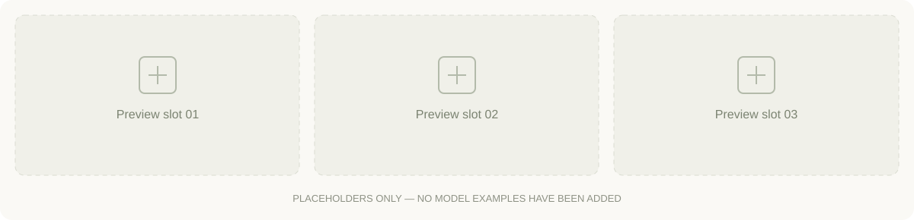

<!-- Generated by scripts/build_readme.py. Edit site.config.json and content/prompts.json. -->

<!-- SLOT: cross-promo. Disabled until a real campaign URL is configured. -->
<!-- SLOT: hero. Clickable brand entry. -->

# Awesome GPT Image 2.6

收集 GPT Image 2.6 的提示词、效果图与原始来源。

**框架已备好 · 0 条已发布提示词**

[English](README.md) · [简体中文](README.zh-CN.md)

<!-- SLOT: top-nav. Website link remains distinct from local navigation. -->
[提示词合集](#collection) · [按用途浏览](#categories) · [贡献提示词](CONTRIBUTING.md) · [Raphael ↗](https://raphael.app/?utm_source=github&utm_medium=repository&utm_campaign=gpt_image_2_6_launch&utm_content=top_nav&utm_term=zh-CN)

<!-- SLOT: primary-cta. Use the live gallery when configured; otherwise the live homepage. -->
**[访问 Raphael ↗](https://raphael.app/?utm_source=github&utm_medium=repository&utm_campaign=gpt_image_2_6_launch&utm_content=top_cta&utm_term=zh-CN)**

## 效果预览

这里预留给后续的真实案例，目前尚未发布提示词。

## 按用途浏览

<!-- SLOT: category-links. Local anchors until each exact website_url is configured. -->
| 分类 | 仓库已发布 |
| --- | ---: |
| [品牌与商品](#category-brand-products) | 0 |
| [海报与文字排版](#category-posters-typography) | 0 |
| [信息图](#category-infographics) | 0 |
| [室内与建筑](#category-interiors-architecture) | 0 |
| [角色与一致性](#category-characters-consistency) | 0 |
| [标注与局部编辑](#category-markup-edits) | 0 |
| [SVG 与设计素材](#category-svg-design-assets) | 0 |
| [GIF 与动画](#category-gif-animation) | 0 |

## 最近收录

新案例发布后会出现在这里。

## 提示词合集

<!-- SLOT: prompt-cards. Only status=published entries are rendered. -->

### 品牌与商品

该分类尚未发布提示词。

### 海报与文字排版

该分类尚未发布提示词。

### 信息图

该分类尚未发布提示词。

### 室内与建筑

该分类尚未发布提示词。

### 角色与一致性

该分类尚未发布提示词。

### 标注与局部编辑

该分类尚未发布提示词。

### SVG 与设计素材

该分类尚未发布提示词。

### GIF 与动画

该分类尚未发布提示词。

## 如何使用这份合集

1. 选择用途分类，打开提示词卡片。
2. 查看原始来源、所需参考图、模型版本与实测状态。
3. 复制原始提示词，按记录的参数使用；有经过验证的生成链接时，可以直接打开。

[模型官方发布说明](https://openai.com/index/introducing-images-2-6/) · [模型官方文档](https://developers.openai.com/api/docs/guides/image-generation)

## 来源与贡献

每条记录保留原始来源，并区分收集到的案例与我们自己的实测结果。提示词保留原文，图片与提示词的使用条件逐条记录。

欢迎提交案例。请按贡献指南附上原始帖子、提示词与图片署名。

[贡献提示词](CONTRIBUTING.md) · [维护者填充指南](docs/FILLING_GUIDE.zh-CN.md)

仓库代码与原创说明文档采用 MIT 协议；第三方提示词与图片保留各自的使用条件。

---

<!-- SLOT: footer. Persistent brand attribution and site entry. -->
由 Raphael 整理。可以 Star 仓库，关注后续收录。

[访问 Raphael ↗](https://raphael.app/?utm_source=github&utm_medium=repository&utm_campaign=gpt_image_2_6_launch&utm_content=footer&utm_term=zh-CN)

[在 GitHub 关注更新](https://github.com/netlogs/awesome-gpt-image-2-6)
