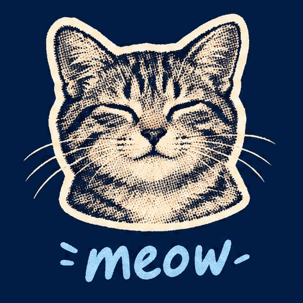
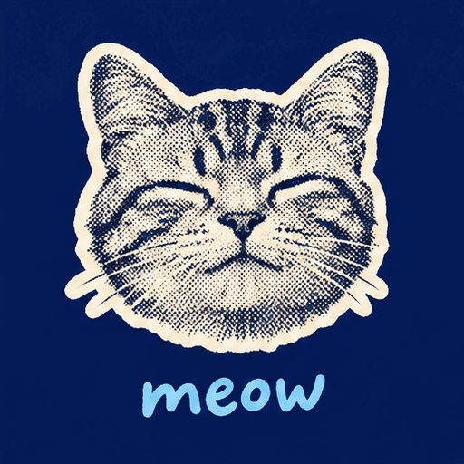

<!-- Generated by scripts/build_readme.py. Edit source data, locale catalogs and generator scripts. -->

# Halftone cat meow animation pair

[← Back to all cases](../../README.md#all-cases)

 

**Creator-reported model · Source-only; not independently reproduced**

Two original GIFs show a cat-face cutout and changing lettering. Each has 9 decoded frames at 200 ms per frame: 512 × 512 pixels and 1,800 ms per loop. All frames were inspected in sequence; no real-time playback or motion-quality benchmark is claimed. The pair is one task, not 18 cases or two separate prompts. Individual Flare/Sunburst assignments are unknown; neither display order nor color is used to infer them. The source reports xhigh quality, high complexity and first-returned outputs. Those settings and the model identity were not independently reproduced. The original request is public at the linked section; this record supplies only an independent short description and does not reproduce the full prompt. Source timing, cost and quality rankings are not adopted as verified benchmarks.

## Images / GIFs

- [Source-reported GPT Image 2.6 output 1 for Halftone cat meow animation pair; individual variant unspecified](https://302.ai/blog/wp-content/uploads/2026/11/asynccode-4.gif) · gif
  - Credit: 302.AI Test Team
  - Reuse: source-attributed. Unchanged publisher-served media. On 2026-11-08 the known file URL returned bytes identical to the retained SHA-256 and size. No explicit redistribution licence was verified. Public availability and attribution are not permission; repository MIT does not cover this media.
  - [Provenance / rights evidence](https://302.ai/blog/302-ai-benchmark-lab-review-on-gpt-image-2-6-flare-and-sunburst/)

- [Source-reported GPT Image 2.6 output 2 for Halftone cat meow animation pair; individual variant unspecified](https://302.ai/blog/wp-content/uploads/2026/11/asynccode-5.gif) · gif
  - Credit: 302.AI Test Team
  - Reuse: source-attributed. Unchanged publisher-served media. On 2026-11-08 the known file URL returned bytes identical to the retained SHA-256 and size. No explicit redistribution licence was verified. Public availability and attribution are not permission; repository MIT does not cover this media.
  - [Provenance / rights evidence](https://302.ai/blog/302-ai-benchmark-lab-review-on-gpt-image-2-6-flare-and-sunburst/)

## Source-page and media access

- Checked: 2026-11-08 (UTC)
- Original page: Accessible. Only the already-known source and model pages were reopened to verify this existing local case. Their example URLs and model labels were checked. All retained media URLs were fetched successfully and matched their original SHA-256 and byte counts. No new case search.
- Media: Archived locally. Original bytes retained. All stills and every GIF frame were fully decoded and visually reviewed. Reference composites are not generated outputs. No QA derivative is published.
- [Per-file attempts and results](../../docs/302_GPTIMAGEHUB_RECOVERY_AUDIT_2026-11-08.md)

## Original prompt

[Original prompt at source](https://302.ai/blog/302-ai-benchmark-lab-review-on-gpt-image-2-6-flare-and-sunburst/#aioseo-%E6%A1%88%E4%BE%8B5-%E6%96%87%E7%94%9F%E5%9B%BE-gif%E7%94%9F%E6%88%90-82)

The source publishes the actual prompt. This repository links to it rather than inventing or republishing the full text. Required inputs and parameters remain at the source.

## Attribution and verification

- ID: 302-halftone-meow-loop
- Author: 302.AI Test Team
- [Original source](https://302.ai/blog/302-ai-benchmark-lab-review-on-gpt-image-2-6-flare-and-sunburst/)
- Model: GPT Image 2.6
- Variant: Variant unspecified
- Evidence: In original section 5, the exact two-file gallery follows its own prompt and is discussed in a work-specific table naming gpt-image-2.6-flare and gpt-image-2.6-sunburst. The article states that its tests used 302.AI API debugging. This supports the pair's GPT Image 2.6 family attribution, but no label maps either individual file to a variant. Variants are therefore unspecified. This is publisher-reported work, not independent API reproduction.
- Collected: 2026-11-06 (UTC)
- Source checked: 2026-11-08 (UTC)

Attribution does not grant a media license. Repository MIT terms do not cover third-party outputs. Local files record provenance and reuse status; source-attributed does not mean open-licensed.
