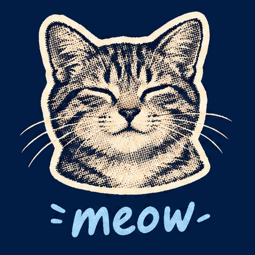
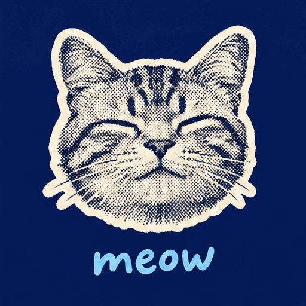

<!-- Generated by scripts/build_readme.py. Edit source data, locale catalogs and generator scripts. -->

# 半色调猫咪喵叫动画对照

[← 返回全部案例](../../README.zh-CN.md#all-cases)

 

**作者自报模型 · 仅核对来源；未独立复现**

两份原始 GIF 展示猫脸贴纸和变化的文字。每份均完整解码为 9 帧，每帧 200 毫秒，尺寸 512 × 512，每轮 1,800 毫秒。已按顺序检查全部帧，不声称完成实时播放或动态质量基准测试。这一对动画属于同一任务，不计为 18 个案例或两个提示词。无法确认每个文件对应 Flare 还是 Sunburst，不依据显示顺序或颜色推断。 来源自述采用 xhigh 质量、high 复杂度并展示首次返回结果；这些设置与模型身份未独立复现。原始指令公开于所链接章节，此处仅提供独立简述，不复制完整提示词，也不将来源的速度、成本或质量排名作为已核实基准。

## 图片 / GIF

- [来源归为 GPT Image 2.6 的「半色调猫咪喵叫动画对照」结果 1；单文件变体未确认](https://302.ai/blog/wp-content/uploads/2026/11/asynccode-4.gif) · gif
  - 署名：302.AI Test Team
  - 使用条件：source-attributed. 保留发布方提供的原始素材。2026-11-08从已知文件地址取得的字节与留存SHA-256及大小一致。未验证明确转载许可，公开可访问及署名不等于授权，仓库MIT不覆盖此素材。
  - [来源 / 权利依据](https://302.ai/blog/302-ai-benchmark-lab-review-on-gpt-image-2-6-flare-and-sunburst/)

- [来源归为 GPT Image 2.6 的「半色调猫咪喵叫动画对照」结果 2；单文件变体未确认](https://302.ai/blog/wp-content/uploads/2026/11/asynccode-5.gif) · gif
  - 署名：302.AI Test Team
  - 使用条件：source-attributed. 保留发布方提供的原始素材。2026-11-08从已知文件地址取得的字节与留存SHA-256及大小一致。未验证明确转载许可，公开可访问及署名不等于授权，仓库MIT不覆盖此素材。
  - [来源 / 权利依据](https://302.ai/blog/302-ai-benchmark-lab-review-on-gpt-image-2-6-flare-and-sunburst/)

## 原帖与素材获取状态

- 核对日期：2026-11-08 (UTC)
- 原帖：可打开. 仅重新打开已知来源与模型页面，为既有本地案例核对示例地址及模型标签。所有留存素材地址均成功取得文件，SHA-256及字节数与原件一致，未搜索新案例。
- 素材：已存入仓库. 保留原始字节；所有静图及GIF全部帧完整解码并目视核验。参考拼图不是生成输出，不发布质检派生图。
- [逐项尝试与结果](../../docs/302_GPTIMAGEHUB_RECOVERY_AUDIT_2026-11-08.md)

## 原始提示词

[原提示词见来源](https://302.ai/blog/302-ai-benchmark-lab-review-on-gpt-image-2-6-flare-and-sunburst/#aioseo-%E6%A1%88%E4%BE%8B5-%E6%96%87%E7%94%9F%E5%9B%BE-gif%E7%94%9F%E6%88%90-82)

来源公开了真实提示词。本仓库链接原文，不伪造或转载完整长提示词；所需输入与参数请在原文查看。

## 来源与核对信息

- ID: 302-halftone-meow-loop
- 作者：302.AI Test Team
- [原始来源](https://302.ai/blog/302-ai-benchmark-lab-review-on-gpt-image-2-6-flare-and-sunburst/)
- 模型：GPT Image 2.6
- 版本：版本未注明
- 依据：原文第 5 节中，这一对文件位于该任务自己的提示词之后，配套的任务表格明确列出 gpt-image-2.6-flare 与 gpt-image-2.6-sunburst。文章说明测试通过 302.AI API 在线调试完成，足以支持这一对结果的 GPT Image 2.6 家族归因，但没有标签将单个文件对应到具体变体，因此记录为 unspecified。这是发布方自述作品，不是独立 API 复现。
- 收录：2026-11-06 (UTC)
- 来源核对：2026-11-08 (UTC)

标注来源不等于取得素材许可。仓库 MIT 协议不覆盖第三方输出；本地素材逐项记录来源与使用状态，source-attributed 不代表开放许可。
