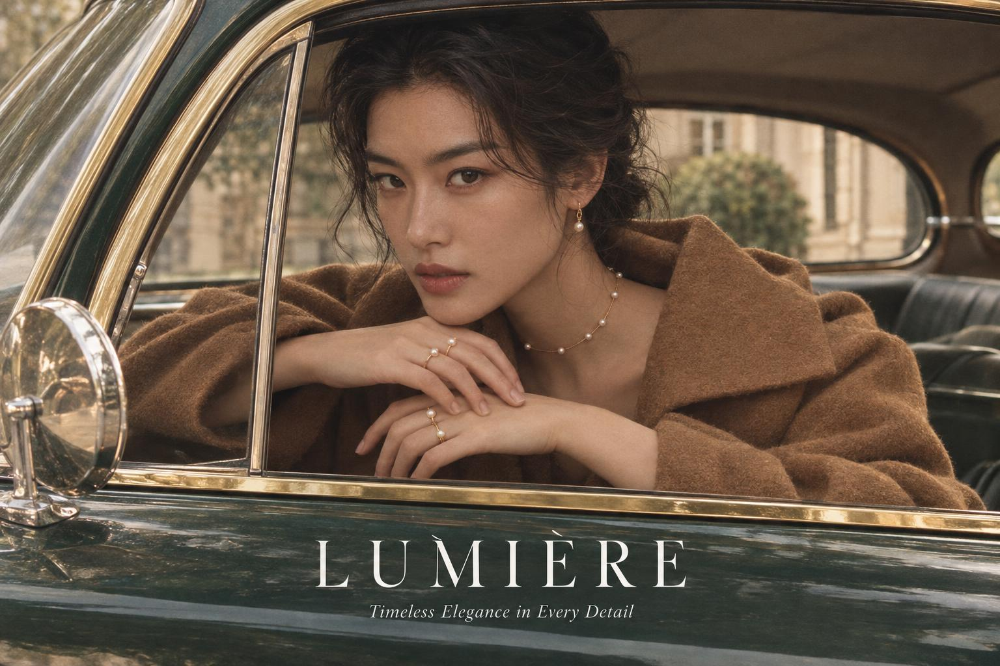
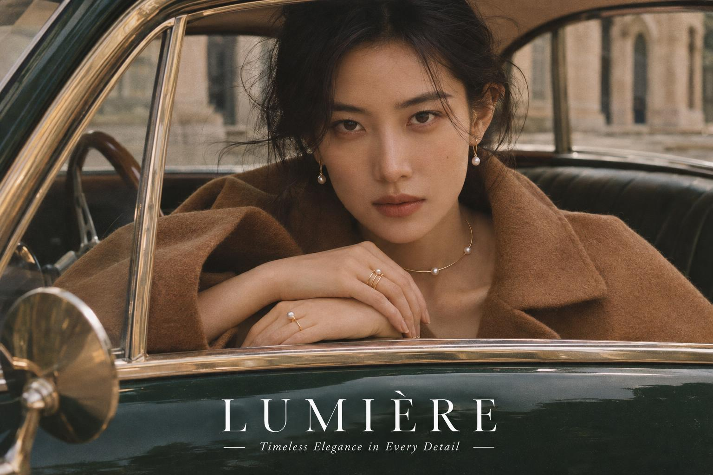

<!-- Generated by scripts/build_readme.py. Edit source data, locale catalogs and generator scripts. -->

# LUMIÈRE jewelry portrait at a car window

[← Back to all cases](../../README.md#all-cases)

 

**Creator-reported model · Source-only; not independently reproduced**

A pearl-jewelry campaign image combines a brown coat, a vintage car window and a short brand wordmark. These two outputs are one shared portrait task. The neighboring Gemini comparison is not included. The source reports xhigh quality, high complexity and first-returned outputs. Those settings and the model identity were not independently reproduced. The original request is public at the linked section; this record supplies only an independent short description and does not reproduce the full prompt. Source timing, cost and quality rankings are not adopted as verified benchmarks.

## Images / GIFs

- [Source-labeled gpt-image-2.6-flare output for LUMIÈRE jewelry portrait at a car window](https://302.ai/blog/wp-content/uploads/2026/11/asynccode-18.png) · image
  - Credit: 302.AI Test Team
  - Reuse: source-attributed. Unchanged publisher-served media. On 2026-11-08 the known file URL returned bytes identical to the retained SHA-256 and size. No explicit redistribution licence was verified. Public availability and attribution are not permission; repository MIT does not cover this media.
  - [Provenance / rights evidence](https://302.ai/blog/302-ai-benchmark-lab-review-on-gpt-image-2-6-flare-and-sunburst/)

- [Source-labeled gpt-image-2.6-sunburst output for LUMIÈRE jewelry portrait at a car window](https://302.ai/blog/wp-content/uploads/2026/11/asynccode-19.png) · image
  - Credit: 302.AI Test Team
  - Reuse: source-attributed. Unchanged publisher-served media. On 2026-11-08 the known file URL returned bytes identical to the retained SHA-256 and size. No explicit redistribution licence was verified. Public availability and attribution are not permission; repository MIT does not cover this media.
  - [Provenance / rights evidence](https://302.ai/blog/302-ai-benchmark-lab-review-on-gpt-image-2-6-flare-and-sunburst/)

## Source-page and media access

- Checked: 2026-11-08 (UTC)
- Original page: Accessible. Only the already-known source and model pages were reopened to verify this existing local case. Their example URLs and model labels were checked. All retained media URLs were fetched successfully and matched their original SHA-256 and byte counts. No new case search.
- Media: Archived locally. Original bytes retained. All stills and every GIF frame were fully decoded and visually reviewed. Reference composites are not generated outputs. No QA derivative is published.
- [Per-file attempts and results](../../docs/302_GPTIMAGEHUB_RECOVERY_AUDIT_2026-11-08.md)

## Original prompt

[Original prompt at source](https://302.ai/blog/302-ai-benchmark-lab-review-on-gpt-image-2-6-flare-and-sunburst/#aioseo-%E6%A1%88%E4%BE%8B1-%E6%96%87%E7%94%9F%E5%9B%BE-%E4%BA%BA%E5%83%8F%E6%8B%9F%E7%9C%9F-44)

The source publishes the actual prompt. This repository links to it rather than inventing or republishing the full text. Required inputs and parameters remain at the source.

## Attribution and verification

- ID: 302-lumiere-jewelry-portrait
- Author: 302.AI Test Team
- [Original source](https://302.ai/blog/302-ai-benchmark-lab-review-on-gpt-image-2-6-flare-and-sunburst/)
- Model: GPT Image 2.6
- Variant: Flare / Sunburst
- Evidence: Original section 1 places explicit GPT-Image-2.6 Flare and gpt-image-2.6-sunburst labels directly before the respective output files. The article names both API model IDs and reports using 302.AI API debugging. File assignments follow those adjacent labels, not image order or product-release context. These are source-reported results, not independently observed API responses.
- Collected: 2026-11-06 (UTC)
- Source checked: 2026-11-08 (UTC)

Attribution does not grant a media license. Repository MIT terms do not cover third-party outputs. Local files record provenance and reuse status; source-attributed does not mean open-licensed.
