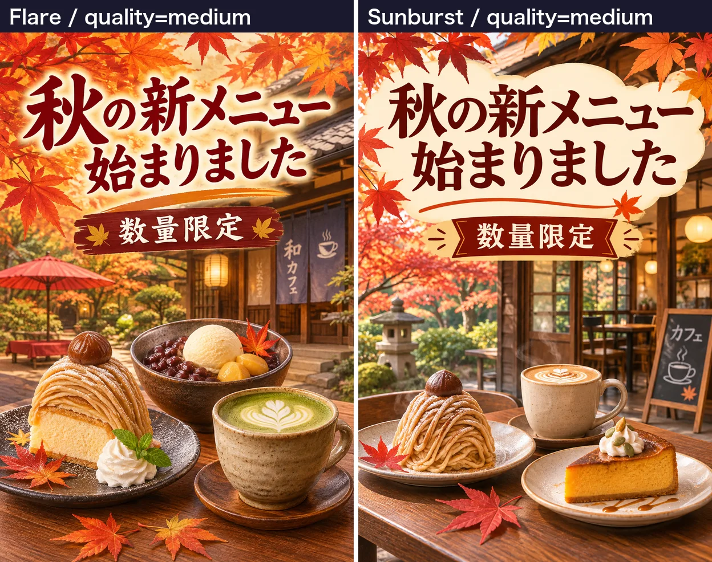

<!-- Generated by scripts/build_readme.py. Edit site.config.json, content/prompts.json and content/source-cases.json. -->

# Autumn café menu announcement comparison

[← Back to all cases](../../README.md#all-cases)

[English](README.md) · [简体中文](README.zh-CN.md)

**Creator-reported model · Source-only; not independently reproduced**

Original side-by-side Flare and Sunburst medium-quality results. The complete instruction is unknown.

## Images / GIFs

- [Autumn café menu announcement comparison. Original side-by-side Flare and Sunburst medium-quality results. The complete instruction is unknown.](https://ai-garage.jp/images/article-figures/gpt-image-2-6-flare-sunburst-api-test-2.webp) · image
  - Credit: Seiya Yagashiro / ai-garage
  - Reuse: source-attributed. Public-source copy with original author attribution. No explicit redistribution license was verified. Public availability and credit do not grant permission; the repository MIT license does not cover this media.
  - [Provenance / rights evidence](https://ai-garage.jp/news/gpt-image-2-6-flare-sunburst-api-test/)

## Source-page and media access

- Checked: 2026-11-05 (UTC)
- Original page: Accessible. Original public page and displayed model attribution checked in a normal browser without login.
- Media: Archived locally. The original 1248 × 986 WebP comparison is archived unchanged (288,176 bytes). Its format, full raster decoding, dimensions and hashes were checked. The labelled Flare and Sunburst panels remain one comparison case.
- [Per-file attempts and results](../../docs/AI_GARAGE_CAFE_SOURCE_2026-11-05.md)

## Original prompt

**PLACEHOLDER: prompt not publicly provided.**

## Attribution and verification

- ID: ai-garage-autumn-cafe
- Author: Seiya Yagashiro / ai-garage
- [Original source](https://ai-garage.jp/news/gpt-image-2-6-flare-sunburst-api-test/)
- Model: GPT Image 2.6
- Variant: Flare / Sunburst
- Evidence: The November 5 original report by Seiya Yagashiro describes its own GPT Image 2.6 API tests and labels the displayed variants. This is source attribution, not independent reproduction.
- Collected: 2026-11-05 (UTC)
- Source checked: 2026-11-05 (UTC)

Attribution does not grant a media license. Repository MIT terms do not cover third-party outputs. Local files record provenance and reuse status; source-attributed does not mean open-licensed.
