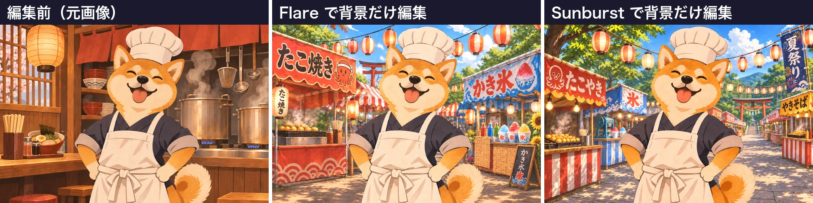

<!-- Generated by scripts/build_readme.py. Edit source data, locale catalogs and generator scripts. -->

# 柴犬厨师夏祭背景编辑

[← 返回全部案例](../../README.zh-CN.md#all-cases)

 

**作者自报模型 · 仅核对来源；未独立复现**

原始三联图左侧为输入，另有明确标注的 Flare/Sunburst 编辑结果。输入仅为拼图内上下文，不作为新输出计数。原文公开简短编辑指令。

## 图片 / GIF

- [柴犬厨师夏祭背景编辑。原始三联图左侧为输入，另有明确标注的 Flare/Sunburst 编辑结果。输入仅为拼图内上下文，不作为新输出计数。原文公开简短编辑指令。](https://ai-garage.jp/images/article-figures/gpt-image-2-6-flare-sunburst-api-test-3.webp) · image
  - 署名：Seiya Yagashiro / ai-garage
  - 使用条件：source-attributed. 公开来源副本，保留原作者署名。未核实明确转载许可证。公开可见及署名不构成授权，仓库 MIT 许可证不覆盖此媒体。
  - [来源 / 权利依据](https://ai-garage.jp/news/gpt-image-2-6-flare-sunburst-api-test/)

## 原帖与素材获取状态

- 核对日期：2026-11-05 (UTC)
- 原帖：可打开. 已在普通浏览器中核对公开原页面及展示的模型归因，无需登录。
- 素材：已存入仓库. 原始 1876 × 469 WebP 对比图原样存档（210,864 字节）。已检查格式、完整图像解码、文件大小与 SHA-256。左侧面板为输入，其余两幅分别标注 Flare 与 Sunburst 编辑结果。
- [逐项尝试与结果](../../docs/AI_GARAGE_FESTIVAL_SOURCE_2026-11-05.md)

## 原始提示词

[原提示词见来源](https://ai-garage.jp/news/gpt-image-2-6-flare-sunburst-api-test/)

来源公开了真实提示词。本仓库链接原文，不伪造或转载完整长提示词；所需输入与参数请在原文查看。

## 来源与核对信息

- ID: ai-garage-festival-background
- 作者：Seiya Yagashiro / ai-garage
- [原始来源](https://ai-garage.jp/news/gpt-image-2-6-flare-sunburst-api-test/)
- 模型：GPT Image 2.6
- 版本：Flare / Sunburst
- 依据：Seiya Yagashiro 的 11 月 5 日原始报告描述自行进行的 GPT Image 2.6 API 测试，并标注展示的变体。这是来源归因，非独立复现。
- 收录：2026-11-05 (UTC)
- 来源核对：2026-11-05 (UTC)

标注来源不等于取得素材许可。仓库 MIT 协议不覆盖第三方输出；本地素材逐项记录来源与使用状态，source-attributed 不代表开放许可。
