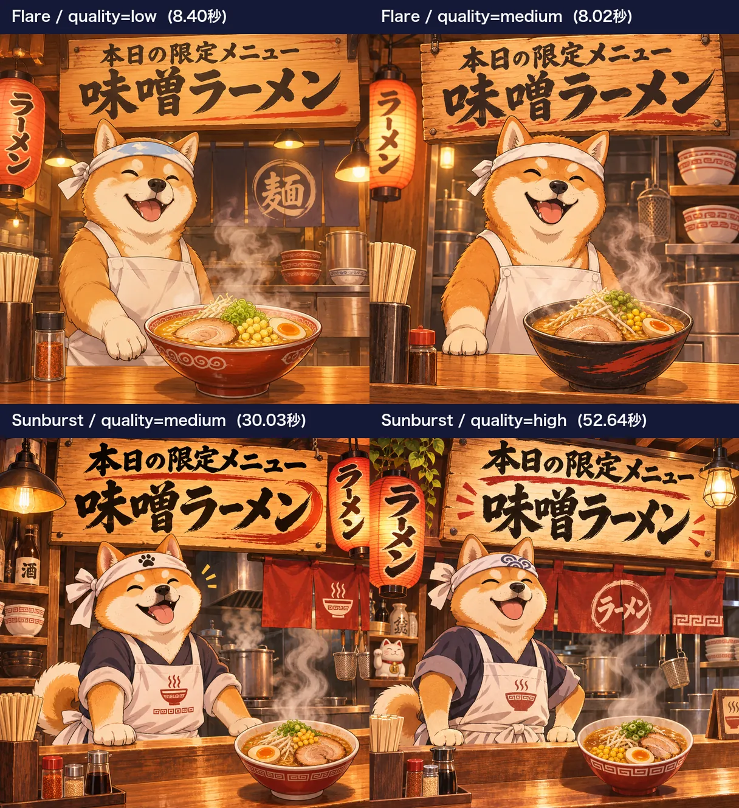
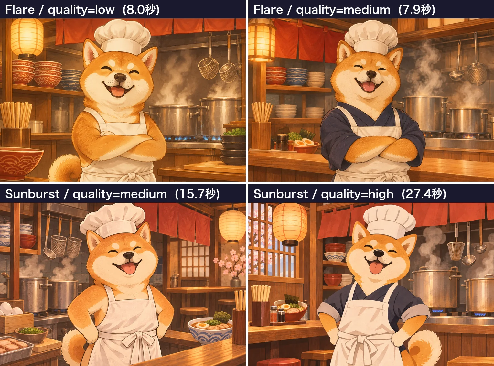

<!-- Generated by scripts/build_readme.py. Edit source data, locale catalogs and generator scripts. -->

# Shiba ramen shop: two quality comparison runs

[← Back to all cases](../../README.md#all-cases)

 

**Creator-reported model · Source-only; not independently reproduced**

Two original labelled four-panel composites are one natural quality/timing series, not eight cases. Exact full generation prompt is not published; the subject description is not substituted for it.

## Images / GIFs

- [Shiba ramen shop: two quality comparison runs. Two original labelled four-panel composites are one natural quality/timing series, not eight cases. Exact full generation prompt is not published; the subject description is not substituted for it.](https://ai-garage.jp/images/article-figures/gpt-image-2-6-flare-sunburst-api-test-7.webp) · image
  - Credit: Seiya Yagashiro / ai-garage
  - Reuse: source-attributed. Public-source copy with original author attribution. No explicit redistribution license was verified. Public availability and credit do not grant permission; the repository MIT license does not cover this media.
  - [Provenance / rights evidence](https://ai-garage.jp/news/gpt-image-2-6-flare-sunburst-api-test/)

- [Shiba ramen shop: two quality comparison runs. Two original labelled four-panel composites are one natural quality/timing series, not eight cases. Exact full generation prompt is not published; the subject description is not substituted for it.](https://ai-garage.jp/images/article-figures/gpt-image-2-6-flare-sunburst-api-test-1.webp) · image
  - Credit: Seiya Yagashiro / ai-garage
  - Reuse: source-attributed. Public-source copy with original author attribution. No explicit redistribution license was verified. Public availability and credit do not grant permission; the repository MIT license does not cover this media.
  - [Provenance / rights evidence](https://ai-garage.jp/news/gpt-image-2-6-flare-sunburst-api-test/)

## Source-page and media access

- Checked: 2026-11-05 (UTC)
- Original page: Accessible. Original public page and displayed model attribution checked in a normal browser without login.
- Media: Archived locally. The two original WebP comparison composites are archived unchanged: 1216 × 1328 (313,364 bytes) and 1528 × 1132 (267,924 bytes). Their formats, full raster decoding, dimensions and hashes were checked. Both four-panel composites remain one quality/timing series.
- [Per-file attempts and results](../../docs/AI_GARAGE_RAMEN_SOURCE_2026-11-05.md)

## Original prompt

**PLACEHOLDER: prompt not publicly provided.**

## Attribution and verification

- ID: ai-garage-ramen-quality-series
- Author: Seiya Yagashiro / ai-garage
- [Original source](https://ai-garage.jp/news/gpt-image-2-6-flare-sunburst-api-test/)
- Model: GPT Image 2.6
- Variant: Flare / Sunburst
- Evidence: The November 5 original report by Seiya Yagashiro describes its own GPT Image 2.6 API tests and labels the displayed variants. This is source attribution, not independent reproduction.
- Collected: 2026-11-05 (UTC)
- Source checked: 2026-11-05 (UTC)

Attribution does not grant a media license. Repository MIT terms do not cover third-party outputs. Local files record provenance and reuse status; source-attributed does not mean open-licensed.
