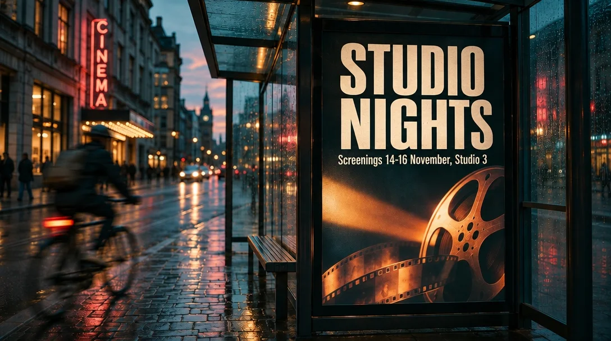

<!-- Generated by scripts/build_readme.py. Edit source data, locale catalogs and generator scripts. -->

# Flare STUDIO NIGHTS 标题编辑

[← 返回全部案例](../../README.zh-CN.md#all-cases)

 

**作者自报模型 · 仅核对来源；未独立复现**

Flare 编辑输出已存档；准确的 Sunburst 输入保留为原始来源链接，标记为参考而非另一个输出。所查来源提供编辑指令：把标题改成“STUDIO NIGHTS”，其余保持完全相同。目视比较支持整体构图保留，但未证明像素级一致。未执行生成。

## 图片 / GIF

- [公交站海报标题改为 STUDIO NIGHTS 的编辑结果。](https://aivideos.eu/blog/inline/gpt-image-2-6-edit-studio-nights.webp) · image
  - 署名：Richard Byrne / AI Videos
  - 使用条件：source-attributed. 原样存档公开来源文件，未核实明确转载许可。署名并非授权；仓库 MIT 许可不涵盖此媒体。
  - [来源 / 权利依据](https://aivideos.eu/blog/gpt-image-2-6)
- [Sunburst AIVIDEOS FILM WEEK 海报，旁有湿街道与运动模糊骑车人。](https://aivideos.eu/blog/inline/gpt-image-2-6-compare-2-6-sunburst.webp) · image
  - 署名：Richard Byrne / AI Videos
  - 使用条件：link-only. 仅链接公开原始素材，不在本仓库存档。未核实转载许可。
  - [来源 / 权利依据](https://aivideos.eu/blog/gpt-image-2-6)

## 原帖与素材获取状态

- 核对日期：2026-11-08 (UTC)
- 原帖：可打开. 仅重新打开已知原文为既有留存案例补证，核对模型标签及原始媒体地址，并披露GIF改为WebP的来源变化，未搜索新案例。
- 素材：部分入库. 所有留存原始素材地址均返回HTTP 200，SHA-256及字节数匹配。静图及动画全部帧完成解码与目视核验，SVG完成安全检查及渲染。仅链接的编辑参考图不算另一份已存档输出。
- [逐项尝试与结果](../../docs/AIVIDEOS_YEPSHOT_RECOVERY_AUDIT_2026-11-08.md)

## 原始提示词

[原提示词见来源](https://aivideos.eu/blog/gpt-image-2-6)

来源公开了真实提示词。本仓库链接原文，不伪造或转载完整长提示词；所需输入与参数请在原文查看。

## 来源与核对信息

- ID: aivideos-flare-headline-edit
- 作者：Richard Byrne / AI Videos
- [原始来源](https://aivideos.eu/blog/gpt-image-2-6)
- 模型：GPT Image 2.6
- 版本：Flare
- 依据：来源评测明确描述将 Sunburst 海报送入 GPT Image 2.6 Flare 编辑端点，并将标题改为“STUDIO NIGHTS”。来源核查记录了编辑输出地址及输入关系；模型归因未经独立复现。
- 收录：2026-11-06 (UTC)
- 来源核对：2026-11-08 (UTC)

标注来源不等于取得素材许可。仓库 MIT 协议不覆盖第三方输出；本地素材逐项记录来源与使用状态，source-attributed 不代表开放许可。
