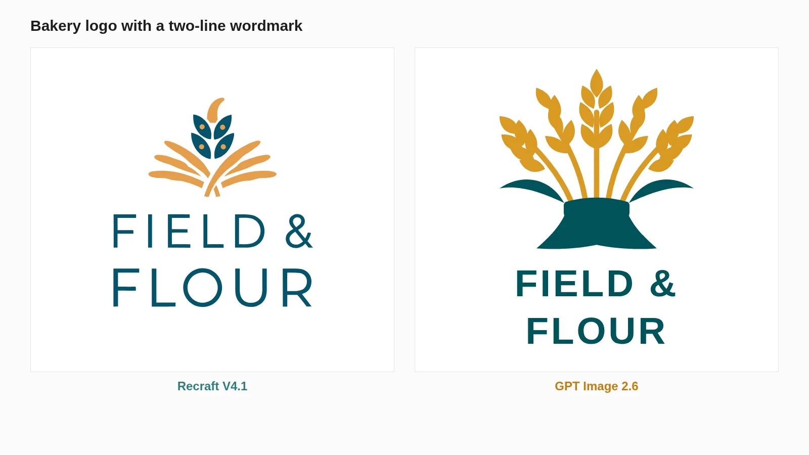
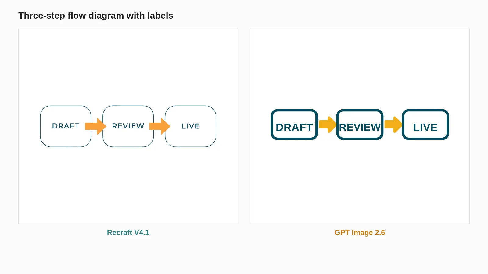
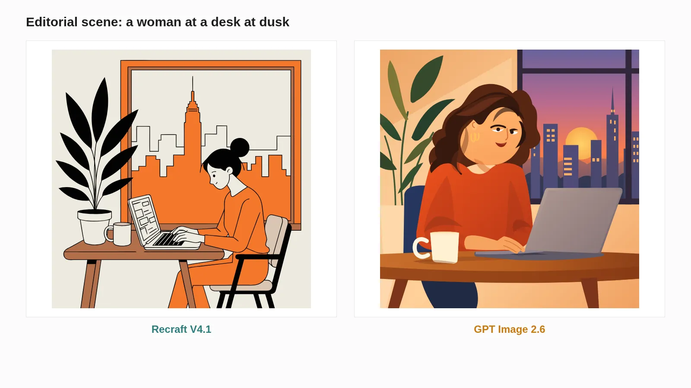
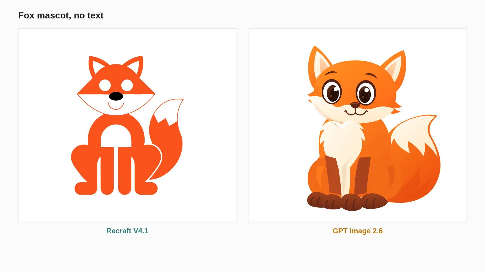
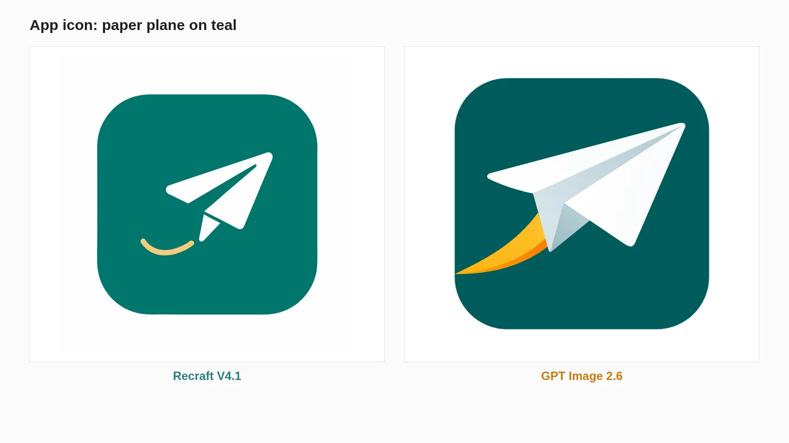
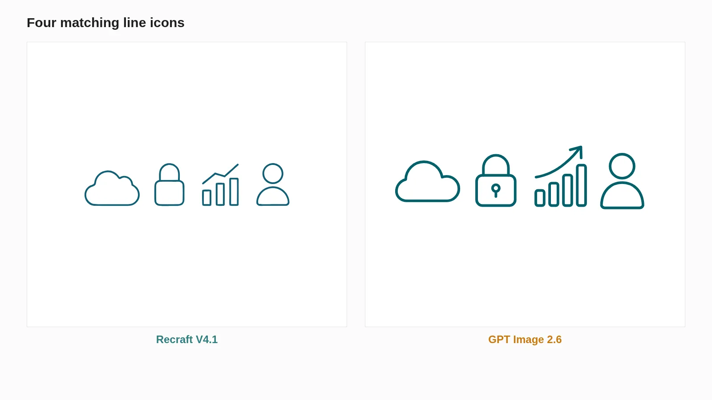

<!-- Generated by scripts/build_readme.py. Edit source data, locale catalogs and generator scripts. -->

# 六组矢量测试对比渲染

[← 返回全部案例](../../README.zh-CN.md#all-cases)

 

**作者自报模型 · 仅核对来源；未独立复现**

仅保存原始 WebP 对比渲染图，不是可编辑 SVG 文件，也不能证明矢量结构安全。六个主题：烘焙品牌字标、带标签流程、黄昏桌面、狐狸吉祥物、纸飞机应用图标及四个线条图标。未提供完整提示词与原始 SVG，不重构提示词。 此处 not-public 仅表示已复核来源未提供准确原始提示词，不判断其他地方是否公开或创作者意图。 2026-11-08 的离线恢复复核确认留存来源映射与原文件完整性，不证明后台执行或当前可访问性。

## 图片 / GIF

- [烘焙字标；左侧 Recraft，右侧 GPT Image 2.6。](https://cellcog.ai/blog/media/recraft-v4-1-vs-gpt-image-2-6-svg/slide-1.webp?v=48a1e42bae) · image
  - 署名：Nitish Garg / CellCog
  - 使用条件：source-attributed. 公开来源样例原样保存并署名。未核实转载许可，非开放许可素材，也不受仓库 MIT 许可证覆盖。
  - [来源 / 权利依据](https://cellcog.ai/blog/recraft-v4-1-vs-gpt-image-2-6-svg/)

- [三步标签流程；左侧 Recraft，右侧 GPT Image 2.6。](https://cellcog.ai/blog/media/recraft-v4-1-vs-gpt-image-2-6-svg/slide-2.webp?v=ce829acbe4) · image
  - 署名：Nitish Garg / CellCog
  - 使用条件：source-attributed. 公开来源样例原样保存并署名。未核实转载许可，非开放许可素材，也不受仓库 MIT 许可证覆盖。
  - [来源 / 权利依据](https://cellcog.ai/blog/recraft-v4-1-vs-gpt-image-2-6-svg/)

- [黄昏桌旁女性；左侧 Recraft，右侧 GPT Image 2.6。](https://cellcog.ai/blog/media/recraft-v4-1-vs-gpt-image-2-6-svg/slide-3.webp?v=453d97ba79) · image
  - 署名：Nitish Garg / CellCog
  - 使用条件：source-attributed. 公开来源样例原样保存并署名。未核实转载许可，非开放许可素材，也不受仓库 MIT 许可证覆盖。
  - [来源 / 权利依据](https://cellcog.ai/blog/recraft-v4-1-vs-gpt-image-2-6-svg/)

- [橙色狐狸吉祥物；左侧 Recraft，右侧 GPT Image 2.6。](https://cellcog.ai/blog/media/recraft-v4-1-vs-gpt-image-2-6-svg/slide-4.webp?v=f18bfdde0a) · image
  - 署名：Nitish Garg / CellCog
  - 使用条件：source-attributed. 公开来源样例原样保存并署名。未核实转载许可，非开放许可素材，也不受仓库 MIT 许可证覆盖。
  - [来源 / 权利依据](https://cellcog.ai/blog/recraft-v4-1-vs-gpt-image-2-6-svg/)

- [纸飞机应用图标；左侧 Recraft，右侧 GPT Image 2.6。](https://cellcog.ai/blog/media/recraft-v4-1-vs-gpt-image-2-6-svg/slide-5.webp?v=f5120f504b) · image
  - 署名：Nitish Garg / CellCog
  - 使用条件：source-attributed. 公开来源样例原样保存并署名。未核实转载许可，非开放许可素材，也不受仓库 MIT 许可证覆盖。
  - [来源 / 权利依据](https://cellcog.ai/blog/recraft-v4-1-vs-gpt-image-2-6-svg/)

- [四个线条图标；左侧 Recraft，右侧 GPT Image 2.6。](https://cellcog.ai/blog/media/recraft-v4-1-vs-gpt-image-2-6-svg/slide-6.webp?v=d6b28eea92) · image
  - 署名：Nitish Garg / CellCog
  - 使用条件：source-attributed. 公开来源样例原样保存并署名。未核实转载许可，非开放许可素材，也不受仓库 MIT 许可证覆盖。
  - [来源 / 权利依据](https://cellcog.ai/blog/recraft-v4-1-vs-gpt-image-2-6-svg/)

## 原帖与素材获取状态

- 核对日期：2026-11-05 (UTC)
- 原帖：可打开. 历史来源访问记录日期为 2026-11-05；2026-11-08 离线复核保留的原始来源证据，未检查当前可访问性。
- 素材：已存入仓库. 2026-11-08 复核留存原文件的 SHA-256、字节数与完整解码，以静帧检查每个 GIF 帧及 MP4 的各个不同帧；不等于新的实时播放或在线访问测试。
- [逐项尝试与结果](../../docs/NOWRAP_CELLCOG_TOONDERLY_RECOVERY_AUDIT_2026-11-08.md)

## 原始提示词

**占位：原作者未公开提示词。**

## 来源与核对信息

- ID: cellcog-vector-comparison-renders
- 作者：Nitish Garg / CellCog
- [原始来源](https://cellcog.ai/blog/recraft-v4-1-vs-gpt-image-2-6-svg/)
- 模型：GPT Image 2.6
- 版本：版本未注明
- 依据：CellCog 将六张公开对比图右侧标为 GPT Image 2.6，左侧为 Recraft V4.1，并描述自己的付费 SVG 测试。每张图未明确对应具体图像模型变体。此为发布方声明，非独立复现结果。
- 收录：2026-11-05 (UTC)
- 来源核对：2026-11-08 (UTC)

标注来源不等于取得素材许可。仓库 MIT 协议不覆盖第三方输出；本地素材逐项记录来源与使用状态，source-attributed 不代表开放许可。
