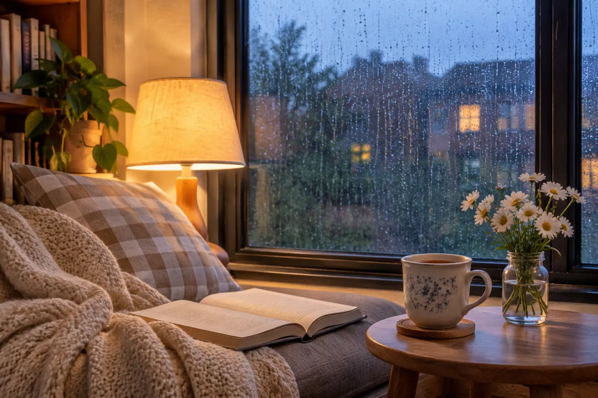

<!-- Generated by scripts/build_readme.py. Edit source data, locale catalogs and generator scripts. -->

# Rainy-window reading nook

[← Back to all cases](../../README.md#all-cases)

 

**Creator-reported model · Source-only; not independently reproduced**

Source-reported example from an independent provider, not OpenAI. The archived 1200 × 800 WebP is the compressed preview; the source-reported generation size is 1536 × 1024. The publisher notes unrequested daisies. No original-resolution file, runtime model or generation was independently verified.

## Images / GIFs

- [Reading nook beside a rainy window, compressed preview](https://chatgpt-image-2.com/imgs/gpt-image-2-6/still.webp) · image
  - Credit: ChatGPT Images / chatgpt-image-2.com
  - Reuse: source-attributed. Unmodified public-source research copy. No independent redistribution licence was verified. Attribution is provenance, not permission or open licensing. Customer-output rights do not license these publisher examples; this collection’s MIT licence does not cover this file.
  - [Provenance / rights evidence](https://chatgpt-image-2.com/gpt-image-2-6)

## Source-page and media access

- Checked: 2026-11-08 (UTC)
- Original page: Accessible. The already-known original provider page was read on 2026-11-08 to verify the existing local case. No new case search or generation was performed.
- Media: Archived locally. All retained original files were hash-checked, decoded and visually reviewed. No private QA derivative is published. The MaxVideoAI edit reference remains stored once in its generation case.
- [Per-file attempts and results](../../docs/DESIGNARENA_PROVIDERS_RECOVERY_AUDIT_2026-11-08.md)

## Original prompt

[Original prompt at source](https://chatgpt-image-2.com/gpt-image-2-6)

The source publishes the actual prompt. This repository links to it rather than inventing or republishing the full text. Required inputs and parameters remain at the source.

## Attribution and verification

- ID: chatimage2-rainy-reading-nook
- Author: ChatGPT Images / chatgpt-image-2.com (independent provider; no individual byline verified)
- [Original source](https://chatgpt-image-2.com/gpt-image-2-6)
- Model: GPT Image 2.6
- Variant: Variant unspecified
- Evidence: The provider identifies this named still as its November5 gpt-image-2.6 generation. Flare/Sunburst is unspecified. Publisher-reported attribution, not independent reproduction or backend verification.
- Collected: 2026-11-06 (UTC)
- Source checked: 2026-11-08 (UTC)

Attribution does not grant a media license. Repository MIT terms do not cover third-party outputs. Local files record provenance and reuse status; source-attributed does not mean open-licensed.
