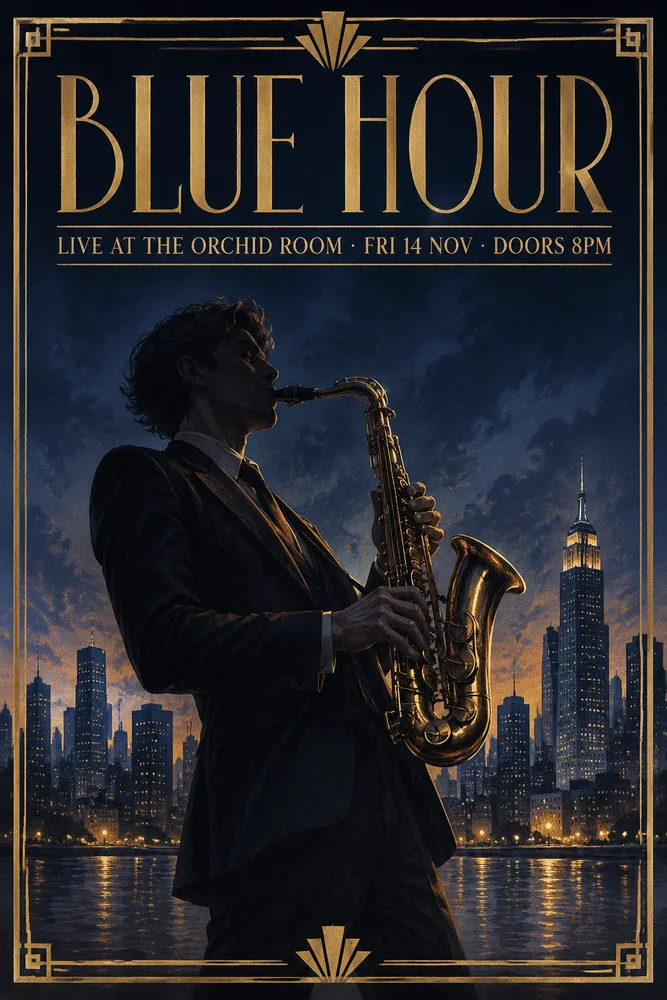
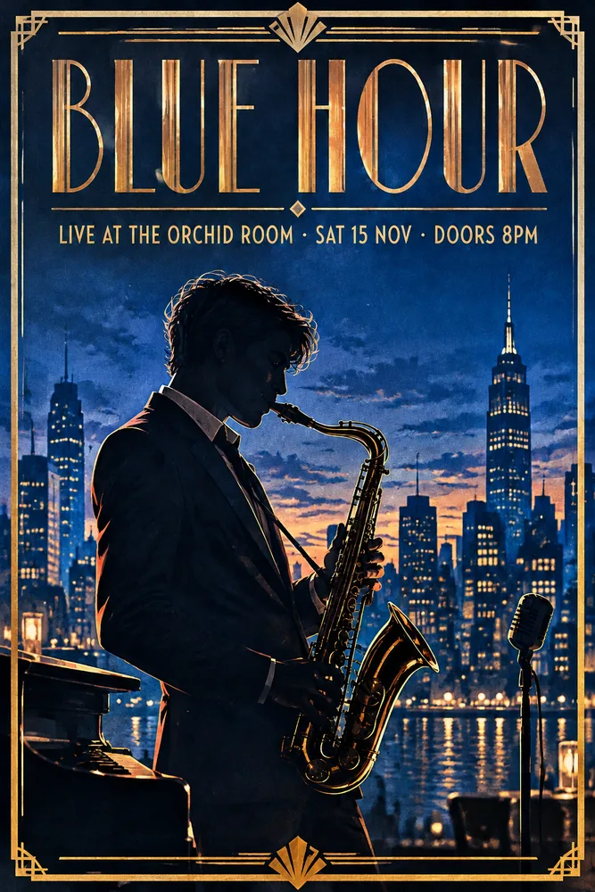
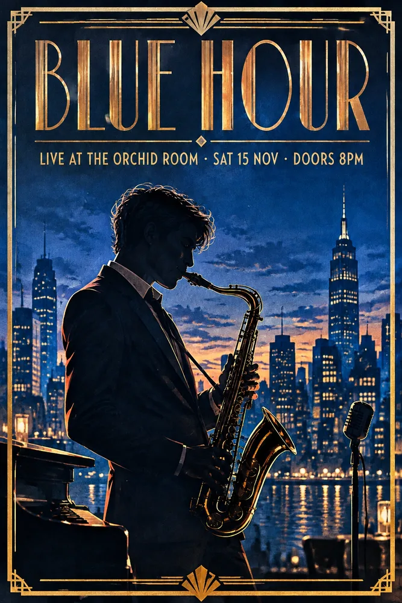

<!-- Generated by scripts/build_readme.py. Edit source data, locale catalogs and generator scripts. -->

# Blue Hour 爵士海报与日期编辑延续

[← 返回全部案例](../../README.zh-CN.md#all-cases)

 

**作者自报模型 · 仅核对来源；未独立复现**

两张初始海报及两张日期编辑归为同一作品。图片说明标明两次日期编辑均以 Flare 原图为输入，非 Sunburst 初始海报。活动为合成设计示例，未核实为真实活动。 精确生成及编辑提示词保留为原文链接。引用的 CellCog API 耗时及旧 DEV 2.5 测试不属于这些作品。文件为 1000 像素 WebP 网页导出版，不声称为 1536 像素原始生成文件。

## 图片 / GIF

- [Blue Hour 爵士海报与日期编辑延续：Flare 初始生成输出](https://www.gptimagehub.com/guides/gpt-image-2-6/poster-2-6-flare.webp) · image
  - 署名：GPT Image Hub
  - 使用条件：source-attributed. 公开原图保持字节不变并注明来源存档。未找到图片再分发许可证；提示词数据集许可不适用于这些图片。来源署名不等于授权或开放许可。
  - [来源 / 权利依据](https://www.gptimagehub.com/guides/gpt-image-2-6-flare-vs-sunburst)

- [Blue Hour 爵士海报与日期编辑延续：Sunburst 初始生成输出](https://www.gptimagehub.com/guides/gpt-image-2-6/poster-2-6-sunburst.webp) · image
  - 署名：GPT Image Hub
  - 使用条件：source-attributed. 公开原图保持字节不变并注明来源存档。未找到图片再分发许可证；提示词数据集许可不适用于这些图片。来源署名不等于授权或开放许可。
  - [来源 / 权利依据](https://www.gptimagehub.com/guides/gpt-image-2-6-flare-vs-sunburst)

- [Blue Hour 爵士海报与日期编辑延续：Flare 编辑输出](https://www.gptimagehub.com/guides/gpt-image-2-6/edit-date-2-6-flare.webp) · image
  - 署名：GPT Image Hub
  - 使用条件：source-attributed. 公开原图保持字节不变并注明来源存档。未找到图片再分发许可证；提示词数据集许可不适用于这些图片。来源署名不等于授权或开放许可。
  - [来源 / 权利依据](https://www.gptimagehub.com/guides/gpt-image-2-6-flare-vs-sunburst)

- [Blue Hour 爵士海报与日期编辑延续：Sunburst 编辑输出](https://www.gptimagehub.com/guides/gpt-image-2-6/edit-date-2-6-sunburst.webp) · image
  - 署名：GPT Image Hub
  - 使用条件：source-attributed. 公开原图保持字节不变并注明来源存档。未找到图片再分发许可证；提示词数据集许可不适用于这些图片。来源署名不等于授权或开放许可。
  - [来源 / 权利依据](https://www.gptimagehub.com/guides/gpt-image-2-6-flare-vs-sunburst)

## 原帖与素材获取状态

- 核对日期：2026-11-06 (UTC)
- 原帖：可打开. 原始页面返回 HTTP 200；复用保留证据，未重新抓取。
- 素材：已存入仓库. 所有精确公开原始 WebP 文件原样获取，已完整解码并检查画面。
- [逐项尝试与结果](../../docs/GPTIMAGEHUB_ACCESS_2026-11-06.md)

## 原始提示词

[原提示词见来源](https://www.gptimagehub.com/guides/gpt-image-2-6-flare-vs-sunburst)

来源公开了真实提示词。本仓库链接原文，不伪造或转载完整长提示词；所需输入与参数请在原文查看。

## 来源与核对信息

- ID: community-gptimagehub-jazz-poster-edit
- 作者：GPT Image Hub
- [原始来源](https://www.gptimagehub.com/guides/gpt-image-2-6-flare-vs-sunburst)
- 模型：GPT Image 2.6
- 版本：Flare / Sunburst
- 依据：原指南对“Blue Hour 爵士海报与日期编辑延续”各输出分别标注 GPT Image 2.6 Flare 与 Sunburst；来源说明指出图像来自其于 2026 年 11 月 5 日在 Saver 路线上进行的自有测试。此为创作者声明，非独立复现。
- 收录：2026-11-06 (UTC)
- 来源核对：2026-11-06 (UTC)

标注来源不等于取得素材许可。仓库 MIT 协议不覆盖第三方输出；本地素材逐项记录来源与使用状态，source-attributed 不代表开放许可。
