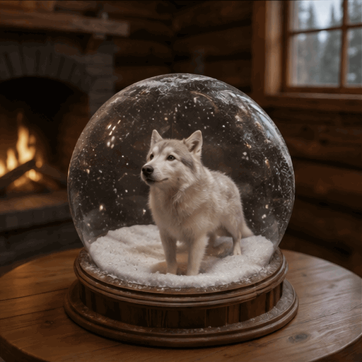

<!-- Generated by scripts/build_readme.py. Edit source data, locale catalogs and generator scripts. -->

# 雪花球内哈士奇嚎叫 GIF

[← 返回全部案例](../../README.zh-CN.md#all-cases)

 

**作者自报模型 · 仅核对来源；未独立复现**

哈士奇在雪花球内抬头嚎叫，雪花移动。HN 作者称将已有的哈士奇图片转为动画；未单独提供输入原图，也未核实完整提示词。 2026-11-08离线恢复审核核对原始来源证据及原文件完整性，仍为来源归因，非独立模型复现。

## 图片 / GIF

- [雪花球内哈士奇嚎叫 GIF](https://mordenstar.com/uploads/albums/be317507-f6ff-4a55-a6a4-f19e9c006bbc/4ab99efe-057c-4233-a9e7-a1bb3106de3f.gif) · gif
  - 署名：Mordenstar / vunderba (source attribution)
  - 使用条件：source-attributed. 公开作者输出原样存档并注明来源。未核实独立转载许可证。署名不构成授权；仓库 MIT 许可不覆盖此素材。
  - [来源 / 权利依据](https://mordenstar.com/share/gpt-image-26-animation-tests)

## 原帖与素材获取状态

- 核对日期：2026-11-05 (UTC)
- 原帖：可打开. 2026-11-08离线复核了2026-11-05保留的原页内容；历史跳转及预览对应来自当日采集记录，未测试当前访问。
- 素材：已存入仓库. 核对原字节、SHA-256、大小及真实格式，逐帧解码并目视检查；原SVG作结构检查并渲染复核。未重新实时播放或执行模型生成。
- [逐项尝试与结果](../../docs/MORDEN_AI_GARAGE_RECOVERY_AUDIT_2026-11-08.md)

## 原始提示词

**提示词公开状态待核验**

尚未核实原始提示词是否公开。原始来源见下方署名信息。

## 来源与核对信息

- ID: community-hn-husky
- 作者：Mordenstar / vunderba (source attribution)
- [原始来源](https://mordenstar.com/share/gpt-image-26-animation-tests)
- 模型：GPT Image 2.6
- 版本：版本未注明
- 依据：保留的Mordenstar原始画廊题为Gpt-Image-2.6 Animation Tests，并明确称测试原生GIF。vunderba的HN原评论50373694称运行GPT Image 2.6并链接imgpb.com/OzSMKJ，当日采集记录记载该链接跳转至本画廊。这是创作者归因，非独立复现，也不证明具体变体。
- 收录：2026-11-05 (UTC)
- 来源核对：2026-11-08 (UTC)

标注来源不等于取得素材许可。仓库 MIT 协议不覆盖第三方输出；本地素材逐项记录来源与使用状态，source-attributed 不代表开放许可。
