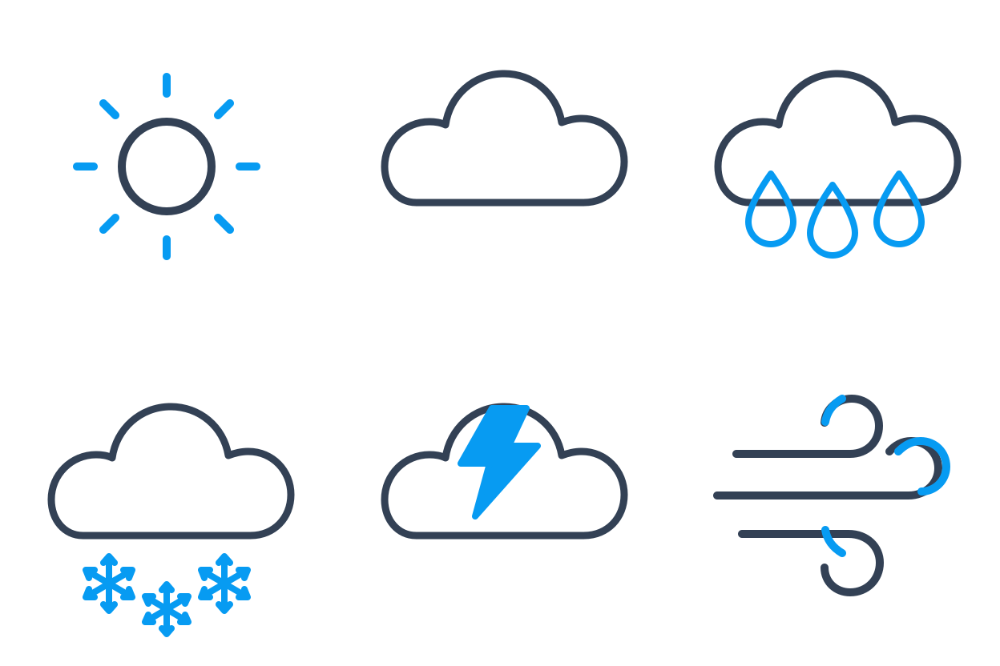

<!-- Generated by scripts/build_readme.py. Edit source data, locale catalogs and generator scripts. -->

# 六枚天气 SVG 图标

[← 返回全部案例](../../README.zh-CN.md#all-cases)

 

**作者自报模型 · 仅核对来源；未独立复现**

SVG 将六枚深色线条、蓝色点缀的图标排成两行。已本地渲染，未发现外部资源依赖或嵌入脚本。

## 图片 / GIF

- [太阳、云、雨、雪、闪电与风六枚线条图标。](https://image.lightlyn.com/examples/gpt-image-2-6/svg-icons.svg) · svg
  - 署名：Linger / Lightlyn Images
  - 使用条件：source-attributed. 从正常公开来源链接原样保存的示例。未核实转载许可证。来源署名仅记录出处，不等于授权或开放许可；仓库 MIT 协议不覆盖该文件。
  - [来源 / 权利依据](https://image.lightlyn.com/gpt-image-2-6?lang=en)

## 原帖与素材获取状态

- 核对日期：2026-11-05 (UTC)
- 原帖：可打开. 正常公开浏览器可读取文章及逐项模型标签。
- 素材：已存入仓库. 本案例记录的素材均经正常保存，并核对真实格式、大小与 SHA-256。视觉检查和限制详见逐文件报告。
- [逐项尝试与结果](../../docs/LIGHTLYN_SVG_PROVENANCE_2026-11-06.md)

## 原始提示词

[原提示词见来源](https://image.lightlyn.com/gpt-image-2-6?lang=en)

来源公开了真实提示词。本仓库链接原文，不伪造或转载完整长提示词；所需输入与参数请在原文查看。

## 来源与核对信息

- ID: community-lightlyn-weather-icons-svg
- 作者：Linger / Lightlyn Images
- [原始来源](https://image.lightlyn.com/gpt-image-2-6?lang=en)
- 模型：GPT Image 2.6
- 版本：Sunburst
- 依据：Linger 于 2026 年 11 月 5 日发布的文章将该具体结果标注为 GPT Image 2.6 Sunburst。这是作者自报归因，不是独立复现模型。
- 收录：2026-11-05 (UTC)
- 来源核对：2026-11-05 (UTC)

标注来源不等于取得素材许可。仓库 MIT 协议不覆盖第三方输出；本地素材逐项记录来源与使用状态，source-attributed 不代表开放许可。
