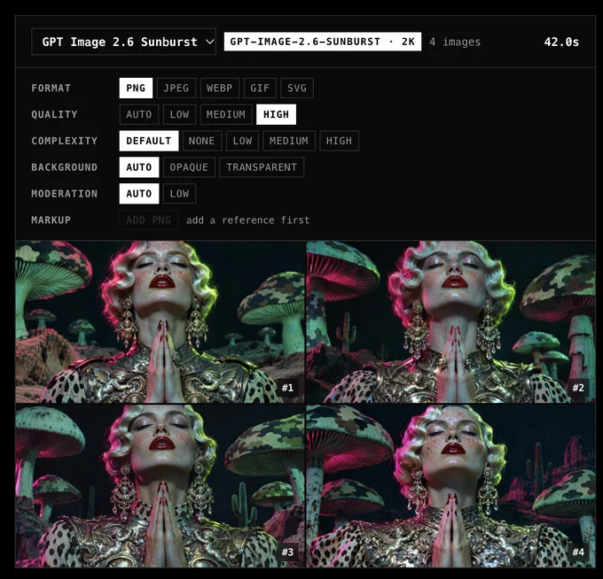

<!-- Generated by scripts/build_readme.py. Edit source data, locale catalogs and generator scripts. -->

# Mushroom-lit fashion portrait

[← Back to all cases](../../README.md#all-cases)

 

**Creator-reported model · Source-only; not independently reproduced**

An ornate fashion portrait places clasped hands and metallic clothing against oversized mushrooms with green and magenta light. The paired settings view documents the selected model; no original prompt was publicly shown. The settings screenshot is included only as supporting evidence, not a generation input or four extra cases. The displayed duration and selected settings are publisher evidence, not a validated runtime benchmark.

## Images / GIFs

- [Fashion portrait with metallic clothing and large mushrooms](https://pbs.twimg.com/media/HWV3tJUWUAAa6Xs?format=webp&name=large) · image
  - Credit: Marco (@ai_artworkgen)
  - Reuse: source-attributed. Unmodified source media with creator credit. No explicit redistribution license was verified; attribution is not permission, and the repository MIT license does not cover this media.
  - [Provenance / rights evidence](https://x.com/ai_artworkgen/status/2118235684217692275)

**Reference/input image, not a generated output.**

- [Publisher model-settings screenshot, used as evidence; not a generation input or an additional output](https://pbs.twimg.com/media/HWV3wlMXcAAVSwe?format=webp&name=large) · image
  - Credit: Marco (@ai_artworkgen)
  - Reuse: source-attributed. Unmodified source media with creator credit. No explicit redistribution license was verified; attribution is not permission, and the repository MIT license does not cover this media.
  - [Provenance / rights evidence](https://x.com/ai_artworkgen/status/2118235684217692275)

## Source-page and media access

- Checked: 2026-11-08 (UTC)
- Original page: Blocked in this browser. The current direct original-post request returned HTTP 403. No retry or alternate access route was used. Verification uses the retained 5 November original browser article capture, including author, caption, post URL and exact attachment URLs; this is not a live-access success.
- Media: Archived locally. Four retained source originals across these three workflows were decoded, hash/size checked and visually inspected. The settings screenshot is supporting evidence only. No media was downloaded again.
- [Per-file attempts and results](../../docs/MARCO_RETAINED_SOURCE_AUDIT_2026-11-08.md)

## Original prompt

**PLACEHOLDER: prompt not publicly provided.**

## Attribution and verification

- ID: community-marco-mushroom-fashion-portrait
- Author: Marco (@ai_artworkgen)
- [Original source](https://x.com/ai_artworkgen/status/2118235684217692275)
- Model: GPT Image 2.6
- Variant: Sunburst
- Evidence: The author calls the pair Settings for GPT 2.6 + Output Example. The settings screenshot visibly selects GPT Image 2.6 Sunburst and shows four outputs matching the separately attached portrait. This is source attribution, not independent model verification.
- Collected: 2026-11-05 (UTC)
- Source checked: 2026-11-08 (UTC)

Attribution does not grant a media license. Repository MIT terms do not cover third-party outputs. Local files record provenance and reuse status; source-attributed does not mean open-licensed.
