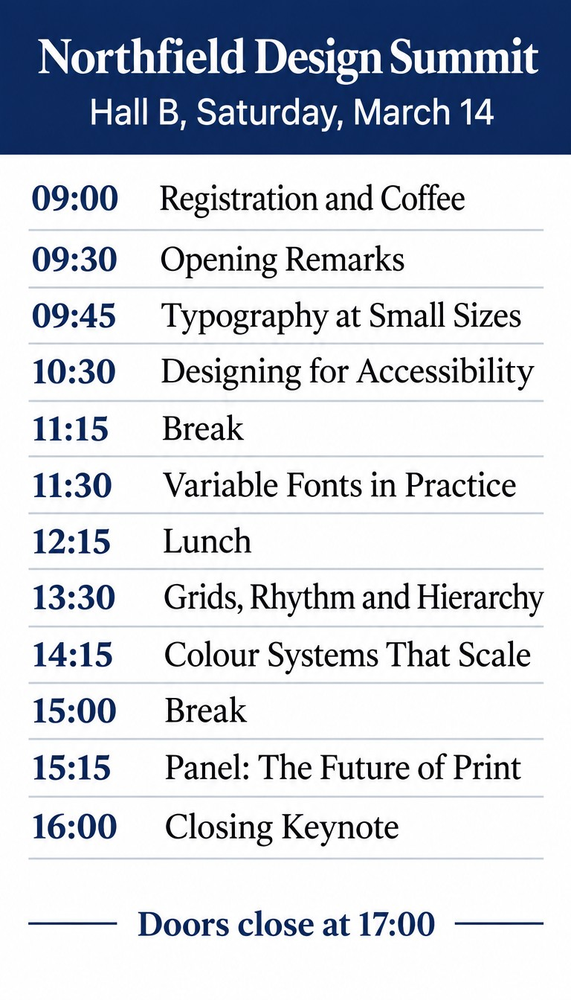
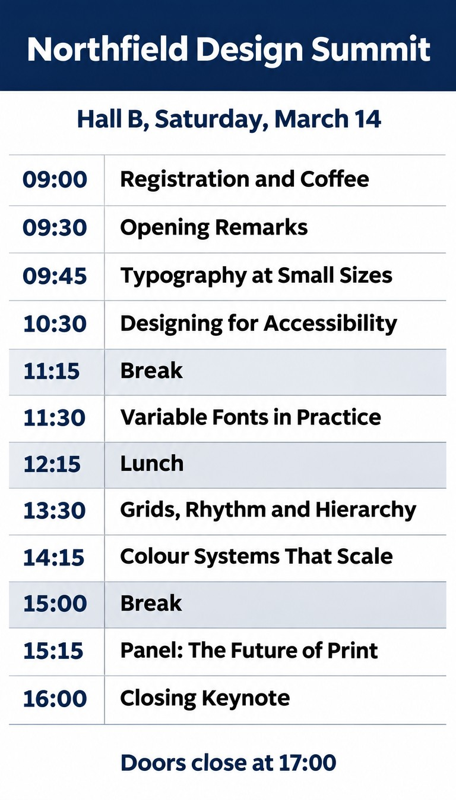

<!-- Generated by scripts/build_readme.py. Edit source data, locale catalogs and generator scripts. -->

# Northfield Design Summit agenda: Flare and Sunburst

[← Back to all cases](../../README.md#all-cases)

 

**Creator-reported model · Source-only; not independently reproduced**

White-and-navy design-conference agenda for Northfield Design Summit. The publisher reports one attempt per prompt with no edits; this is a source example, not our benchmark or an independent reproduction. Only the Flare and Sunburst outputs are included.

## Images / GIFs

- [Northfield Design Summit agenda: Flare and Sunburst: GPT Image 2.6 Flare source-served JPEG](https://mossimage.studio/examples/compare-agenda-flare.jpg) · image
  - Credit: MossImage Studio Team
  - Reuse: source-attributed. Unmodified public-source image archived with original attribution. An explicit redistribution license was not located; attribution and the repository copyright notice do not grant permission, and the repository MIT license does not cover this file. The direct HTTP request returned 403, but the source article and full-size image opened normally in a public browser, and its supported media save succeeded.
  - [Provenance / rights evidence](https://mossimage.studio/blog/gpt-image-2-6#round-4-a-dense-agenda)

- [Northfield Design Summit agenda: Flare and Sunburst: GPT Image 2.6 Sunburst source-served JPEG](https://mossimage.studio/examples/compare-agenda-sunburst.jpg) · image
  - Credit: MossImage Studio Team
  - Reuse: source-attributed. Unmodified public-source image archived with original attribution. An explicit redistribution license was not located; attribution and the repository copyright notice do not grant permission, and the repository MIT license does not cover this file. The direct HTTP request returned 403, but the source article and full-size image opened normally in a public browser, and its supported media save succeeded.
  - [Provenance / rights evidence](https://mossimage.studio/blog/gpt-image-2-6#round-4-a-dense-agenda)

## Source-page and media access

- Checked: 2026-11-05 (UTC)
- Original page: Unknown. The article opened normally in a public browser during the original collection. A later direct request to the same article returned HTTP 403. Present browser availability has not been rechecked.
- Media: Archived locally. The two archived JPEGs remain available locally and passed hash, byte-size and decoding checks. During original collection, direct media requests returned HTTP 403, while the exact full-size images opened and saved normally in the public browser. No new media request was made for this review.
- [Per-file attempts and results](../../docs/MOSS_PROVENANCE_2026-11-06.md)

## Original prompt

[Original prompt at source](https://mossimage.studio/blog/gpt-image-2-6#round-4-a-dense-agenda)

The source publishes the actual prompt. This repository links to it rather than inventing or republishing the full text. Required inputs and parameters remain at the source.

## Attribution and verification

- ID: community-moss-design-summit-agenda
- Author: MossImage Studio Team
- [Original source](https://mossimage.studio/blog/gpt-image-2-6#round-4-a-dense-agenda)
- Model: GPT Image 2.6
- Variant: Flare / Sunburst
- Evidence: The page labels these two outputs GPT Image 2.6 Flare and Sunburst. MossImage Studio Team reports generating them through fal on November 5, 2026. This is publisher-reported attribution, not an independent reproduction. The site is unofficial and not affiliated with OpenAI or OpenMOSS.
- Collected: 2026-11-05 (UTC)
- Source checked: 2026-11-05 (UTC)

Attribution does not grant a media license. Repository MIT terms do not cover third-party outputs. Local files record provenance and reuse status; source-attributed does not mean open-licensed.
