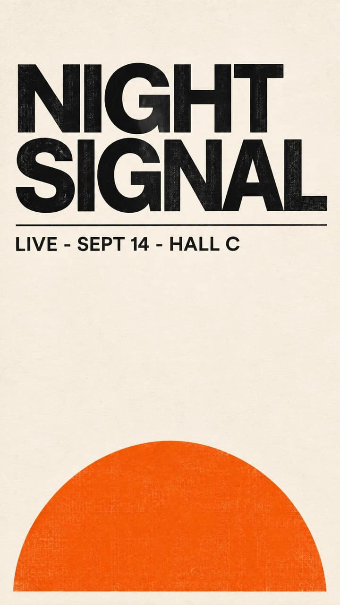
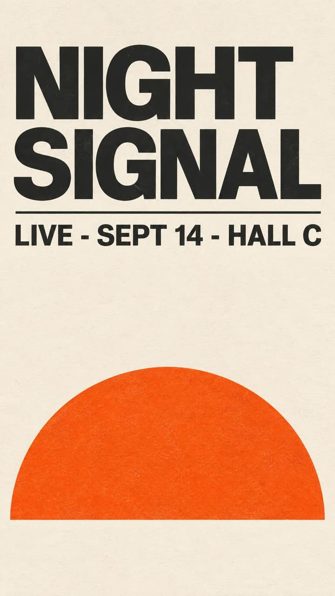

<!-- Generated by scripts/build_readme.py. Edit source data, locale catalogs and generator scripts. -->

# NIGHT SIGNAL concert poster: Flare and Sunburst

[← Back to all cases](../../README.md#all-cases)

 

**Creator-reported model · Source-only; not independently reproduced**

Creator/publisher-reported example, not independently reproduced. No run log independently verifies the served model. Original public media bytes are preserved; source attribution is not a redistribution license. The two model variants are one poster workflow. Exact older-page prompt text was not retained, so the prompt is unverified rather than assumed from the artwork.

## Images / GIFs

- [NIGHT SIGNAL concert poster: Flare and Sunburst — Sunburst](https://storage.googleapis.com/csuite-storage/public/models/openai-gpt-image-2-6-sunburst/samples/poster.w2048.jpg) · image
  - Credit: CSuite / July Labs, LLC
  - Reuse: source-attributed. Original public-source media retained unchanged with attribution. No independent redistribution license has been verified. Attribution is not permission, and the repository MIT license does not cover this file.
  - [Provenance / rights evidence](https://csuite.so/models/openai-gpt-image-2-6-sunburst)

- [NIGHT SIGNAL concert poster: Flare and Sunburst — Flare](https://storage.googleapis.com/csuite-storage/public/models/openai-gpt-image-2-6-flare/samples/poster.w2048.jpg) · image
  - Credit: CSuite / July Labs, LLC
  - Reuse: source-attributed. Original public-source media retained unchanged with attribution. No independent redistribution license has been verified. Attribution is not permission, and the repository MIT license does not cover this file.
  - [Provenance / rights evidence](https://csuite.so/models/openai-gpt-image-2-6-sunburst)

## Source-page and media access

- Checked: 2026-11-08 (UTC)
- Original page: Accessible. Directly revisited the known original public page and matched each archived media URL to the current HTML or embedded prediction record. No new-case search was performed.
- Media: Archived locally. Retained original bytes were checked against recorded SHA-256 and size, fully decoded and visually inspected, including every animation/video frame. No new generation or media download was performed.
- [Per-file attempts and results](../../docs/FIVE_SOURCES_BACKLOG_AUDIT_2026-11-08.md)

## Original prompt

**Prompt availability unverified**

Public availability of the original prompt has not been verified. The original source is credited below.

## Attribution and verification

- ID: csuite-poster
- Author: CSuite / July Labs, LLC
- [Original source](https://csuite.so/models/openai-gpt-image-2-6-sunburst)
- Model: GPT Image 2.6
- Variant: Flare / Sunburst
- Evidence: CSuite labels the individual sample tiles as generated with GPT Image 2.6 Sunburst and Flare via Replicate and says it retains the first result of the same three catalog prompts. These are publisher claims, not independently verified execution.
- Collected: 2026-11-06 (UTC)
- Source checked: 2026-11-08 (UTC)

Attribution does not grant a media license. Repository MIT terms do not cover third-party outputs. Local files record provenance and reuse status; source-attributed does not mean open-licensed.
