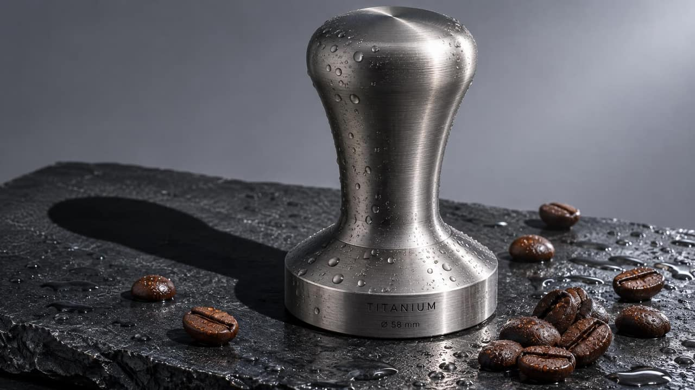

<!-- Generated by scripts/build_readme.py. Edit source data, locale catalogs and generator scripts. -->

# 钛金属咖啡压粉器：Flare 与 Sunburst

[← 返回全部案例](../../README.zh-CN.md#all-cases)

 

**作者自报模型 · 仅核对来源；未独立复现**

案例依据创作者或发布方自述，未经独立复现，也没有独立核验实际调用模型的运行日志。保留公开来源媒体的原始字节；来源署名不等于转载许可。 两种模型版本归为同一商品静物工作流。目录声称使用相同三组提示词，但本次未留存旧页面的准确提示词，故提示词状态待核验。

## 图片 / GIF

- [钛金属咖啡压粉器：Flare 与 Sunburst：Sunburst](https://storage.googleapis.com/csuite-storage/public/models/openai-gpt-image-2-6-sunburst/samples/product.w2048.jpg) · image
  - 署名：CSuite / July Labs, LLC
  - 使用条件：source-attributed. 公开来源素材原样保留并署名。未核实独立转载许可证；署名不构成授权，仓库 MIT 许可不覆盖此文件。
  - [来源 / 权利依据](https://csuite.so/models/openai-gpt-image-2-6-sunburst)

- [钛金属咖啡压粉器：Flare 与 Sunburst：Flare](https://storage.googleapis.com/csuite-storage/public/models/openai-gpt-image-2-6-flare/samples/product.w2048.jpg) · image
  - 署名：CSuite / July Labs, LLC
  - 使用条件：source-attributed. 公开来源素材原样保留并署名。未核实独立转载许可证；署名不构成授权，仓库 MIT 许可不覆盖此文件。
  - [来源 / 权利依据](https://csuite.so/models/openai-gpt-image-2-6-sunburst)

## 原帖与素材获取状态

- 核对日期：2026-11-08 (UTC)
- 原帖：可打开. 直接复核已知原始公开页面，将每个存档素材地址与当前 HTML 或内嵌预测记录对应。未搜索新案例。
- 素材：已存入仓库. 留存原件已核对 SHA-256 与大小、完整解码并视觉检查，包含全部动画和视频帧。未重新生成或下载媒体。
- [逐项尝试与结果](../../docs/FIVE_SOURCES_BACKLOG_AUDIT_2026-11-08.md)

## 原始提示词

**提示词公开状态待核验**

尚未核实原始提示词是否公开。原始来源见下方署名信息。

## 来源与核对信息

- ID: csuite-tamper
- 作者：CSuite / July Labs, LLC
- [原始来源](https://csuite.so/models/openai-gpt-image-2-6-sunburst)
- 模型：GPT Image 2.6
- 版本：Flare / Sunburst
- 依据：CSuite 将对应示例卡明确标为通过 Replicate 用 GPT Image 2.6 Sunburst 和 Flare 生成，并称统一三组目录提示词且保留首个结果。这是发布方自述，并非独立执行验证。
- 收录：2026-11-06 (UTC)
- 来源核对：2026-11-08 (UTC)

标注来源不等于取得素材许可。仓库 MIT 协议不覆盖第三方输出；本地素材逐项记录来源与使用状态，source-attributed 不代表开放许可。
