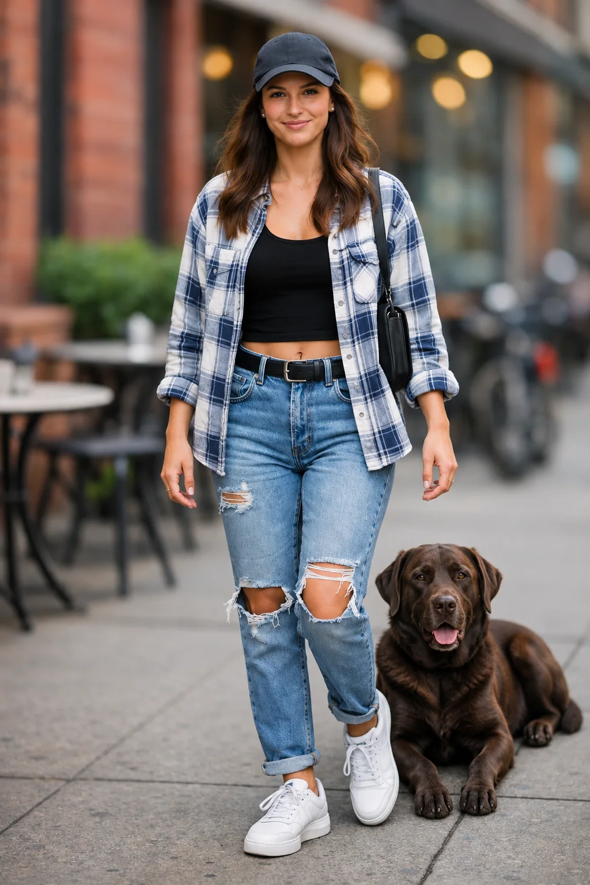
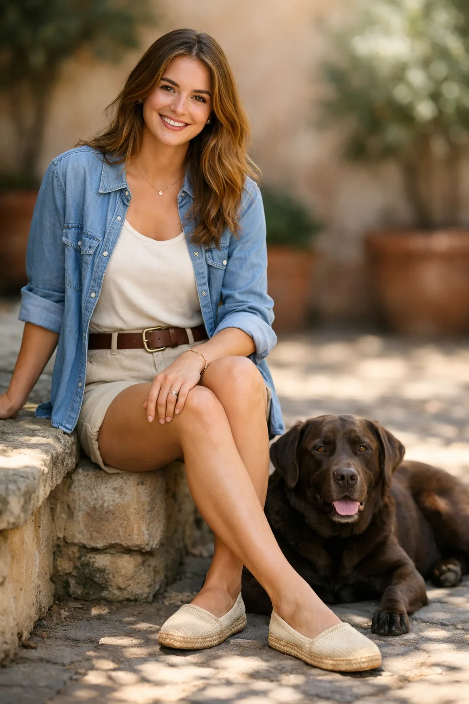
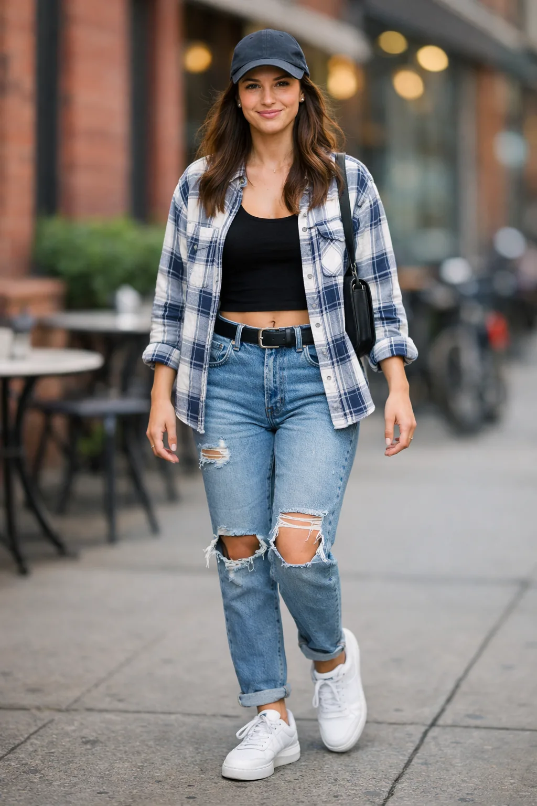

<!-- Generated by scripts/build_readme.py. Edit source data, locale catalogs and generator scripts. -->

# 跨图合成宠物

[← 返回全部案例](../../README.zh-CN.md#all-cases)

<a href="README.md"></a> <a href="README.zh-CN.md"></a>

**官方文档 · 仅核对来源；未独立复现**

在链接章节查看原始提示词、必需输入、参数与各版本输出。整理者未独立复现。

## 图片 / GIF


- [将参考狗合成到街景女子身旁的图像（GPT Image 2.6 Flare 输出）](https://developers.openai.com/images/platform/guides/image-prompting/test-woman-with-dog-gpt-image-2-6-flare.webp) · image
  - 署名：OpenAI, GPT Image 2.6 image prompting guide
  - 使用条件：source-attributed. 官方指南中的公开示例素材，原样存档并标注来源。未核实独立的转载许可证，不标为开放许可，仓库 MIT 协议不覆盖该素材。来源署名和仓库版权声明均不构成许可授权。
  - [来源 / 权利依据](https://developers.openai.com/api/docs/guides/image-prompting#combine-references)


- [将参考狗合成到街景女子身旁的图像（GPT Image 2.6 Sunburst 输出）](https://developers.openai.com/images/platform/guides/image-prompting/test-woman-with-dog-gpt-image-2-6-sunburst.webp) · image
  - 署名：OpenAI, GPT Image 2.6 image prompting guide
  - 使用条件：source-attributed. 官方指南中的公开示例素材，原样存档并标注来源。未核实独立的转载许可证，不标为开放许可，仓库 MIT 协议不覆盖该素材。来源署名和仓库版权声明均不构成许可授权。
  - [来源 / 权利依据](https://developers.openai.com/api/docs/guides/image-prompting#combine-references)


**参考 / 输入图，不是生成结果。**

- [参考输入图：女子与狗的照片，第二张合成输入图](https://developers.openai.com/images/platform/guides/image-prompting/test-woman-2.webp) · image
  - 署名：OpenAI, GPT Image 2.6 image prompting guide
  - 使用条件：source-attributed. 官方指南中的公开示例素材，原样存档并标注来源。未核实独立的转载许可证，不标为开放许可，仓库 MIT 协议不覆盖该素材。来源署名和仓库版权声明均不构成许可授权。
  - [来源 / 权利依据](https://developers.openai.com/api/docs/guides/image-prompting#combine-references)


**参考 / 输入图，不是生成结果。**

- [参考输入图：街景女子照片，第一张合成输入图](https://developers.openai.com/images/platform/guides/image-prompting/test-woman.webp) · image
  - 署名：OpenAI, GPT Image 2.6 image prompting guide
  - 使用条件：source-attributed. 官方指南中的公开示例素材，原样存档并标注来源。未核实独立的转载许可证，不标为开放许可，仓库 MIT 协议不覆盖该素材。来源署名和仓库版权声明均不构成许可授权。
  - [来源 / 权利依据](https://developers.openai.com/api/docs/guides/image-prompting#combine-references)

## 原始提示词

```text
Place the dog from the second image into the setting of image 1, right next to the woman, use the same style of lighting, composition and background. Do not change anything else.
```

[原提示词见来源](https://developers.openai.com/api/docs/guides/image-prompting#combine-references)

## 来源与核对信息

- ID: docs-dog-composite
- 作者：OpenAI
- [原始来源](https://developers.openai.com/api/docs/guides/image-prompting#combine-references)
- 模型：GPT Image 2.6
- 版本：Flare / Sunburst
- 依据：已逐项核对所引指南中输出的 GPT Image 2.6 标签。
- 收录：2026-11-05 (UTC)
- 来源核对：2026-11-05 (UTC)

标注来源不等于取得素材许可。仓库 MIT 协议不覆盖第三方输出；本地素材逐项记录来源与使用状态，source-attributed 不代表开放许可。
