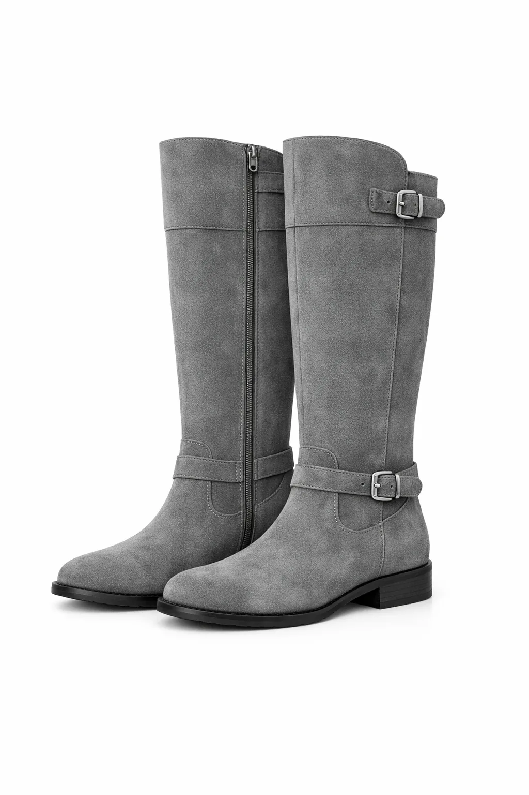
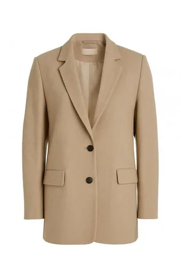
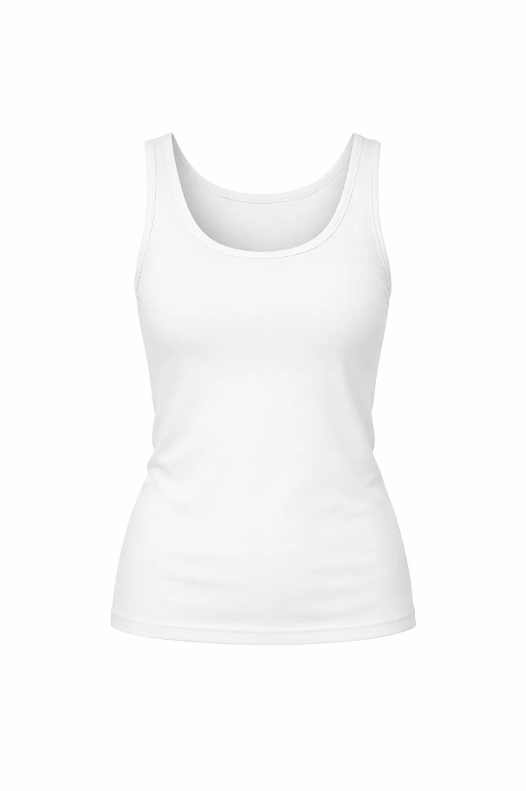
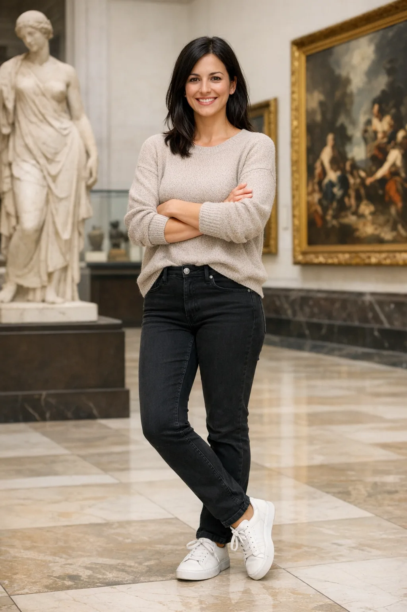

<!-- Generated by scripts/build_readme.py. Edit source data, locale catalogs and generator scripts. -->

# Change clothing while preserving identity

[← Back to all cases](../../README.md#all-cases)

<a href="README.md"></a> <a href="README.zh-CN.md"></a>

**Official documentation · Source-only; not independently reproduced**

Open the linked section for the original prompt, required inputs, parameters and model outputs. Not independently reproduced.

## Images / GIFs


- [Woman wearing the supplied clothing items — GPT Image 2.6 Flare (official model output)](https://developers.openai.com/images/platform/guides/image-prompting/outfit-gpt-image-2-6-flare.webp) · image
  - Credit: OpenAI, GPT Image 2.6 image prompting guide
  - Reuse: source-attributed. Public example media from the official guide, archived unchanged with source attribution. No independent redistribution license was verified. This file is not labelled open-licensed, and the repository MIT license does not cover it. Source attribution and the repository copyright notice do not grant permission.
  - [Provenance / rights evidence](https://developers.openai.com/api/docs/guides/image-prompting#preserve-identity-and-change-clothing)


- [Woman wearing the supplied clothing items — GPT Image 2.6 Sunburst (official model output)](https://developers.openai.com/images/platform/guides/image-prompting/outfit-gpt-image-2-6-sunburst.webp) · image
  - Credit: OpenAI, GPT Image 2.6 image prompting guide
  - Reuse: source-attributed. Public example media from the official guide, archived unchanged with source attribution. No independent redistribution license was verified. This file is not labelled open-licensed, and the repository MIT license does not cover it. Source attribution and the repository copyright notice do not grant permission.
  - [Provenance / rights evidence](https://developers.openai.com/api/docs/guides/image-prompting#preserve-identity-and-change-clothing)


**Reference/input image, not a generated output.**

- [Reference input: Gray boots used as a clothing reference](https://developers.openai.com/images/platform/guides/image-prompting/boots.webp) · image
  - Credit: OpenAI, GPT Image 2.6 image prompting guide
  - Reuse: source-attributed. Public example media from the official guide, archived unchanged with source attribution. No independent redistribution license was verified. This file is not labelled open-licensed, and the repository MIT license does not cover it. Source attribution and the repository copyright notice do not grant permission.
  - [Provenance / rights evidence](https://developers.openai.com/api/docs/guides/image-prompting#preserve-identity-and-change-clothing)


**Reference/input image, not a generated output.**

- [Reference input: Beige jacket used as a clothing reference](https://developers.openai.com/images/platform/guides/image-prompting/jacket.webp) · image
  - Credit: OpenAI, GPT Image 2.6 image prompting guide
  - Reuse: source-attributed. Public example media from the official guide, archived unchanged with source attribution. No independent redistribution license was verified. This file is not labelled open-licensed, and the repository MIT license does not cover it. Source attribution and the repository copyright notice do not grant permission.
  - [Provenance / rights evidence](https://developers.openai.com/api/docs/guides/image-prompting#preserve-identity-and-change-clothing)


**Reference/input image, not a generated output.**

- [Reference input: White tank top used as a clothing reference](https://developers.openai.com/images/platform/guides/image-prompting/tank-top.webp) · image
  - Credit: OpenAI, GPT Image 2.6 image prompting guide
  - Reuse: source-attributed. Public example media from the official guide, archived unchanged with source attribution. No independent redistribution license was verified. This file is not labelled open-licensed, and the repository MIT license does not cover it. Source attribution and the repository copyright notice do not grant permission.
  - [Provenance / rights evidence](https://developers.openai.com/api/docs/guides/image-prompting#preserve-identity-and-change-clothing)


**Reference/input image, not a generated output.**

- [Reference input: Woman in a museum used as the identity reference](https://developers.openai.com/images/platform/guides/image-prompting/woman-in-museum.webp) · image
  - Credit: OpenAI, GPT Image 2.6 image prompting guide
  - Reuse: source-attributed. Public example media from the official guide, archived unchanged with source attribution. No independent redistribution license was verified. This file is not labelled open-licensed, and the repository MIT license does not cover it. Source attribution and the repository copyright notice do not grant permission.
  - [Provenance / rights evidence](https://developers.openai.com/api/docs/guides/image-prompting#preserve-identity-and-change-clothing)

## Original prompt

```text
Edit the image to dress the woman using the provided clothing images. Do not change her face, facial features, skin tone, body shape, pose, or identity in any way. Preserve her exact likeness, expression, hairstyle, and proportions. Replace only the clothing, fitting the garments naturally to her existing pose and body geometry with realistic fabric behavior. Match lighting, shadows, and color temperature to the original photo so the outfit integrates photorealistically, without looking pasted on. Do not change the background, camera angle, framing, or image quality, and do not add accessories, text, logos, or watermarks.
```

[Original prompt at source](https://developers.openai.com/api/docs/guides/image-prompting#preserve-identity-and-change-clothing)

## Attribution and verification

- ID: docs-outfit
- Author: OpenAI
- [Original source](https://developers.openai.com/api/docs/guides/image-prompting#preserve-identity-and-change-clothing)
- Model: GPT Image 2.6
- Variant: Flare / Sunburst
- Evidence: Each output is explicitly labelled GPT Image 2.6 in the cited guide.
- Collected: 2026-11-05 (UTC)
- Source checked: 2026-11-05 (UTC)

Attribution does not grant a media license. Repository MIT terms do not cover third-party outputs. Local files record provenance and reuse status; source-attributed does not mean open-licensed.
