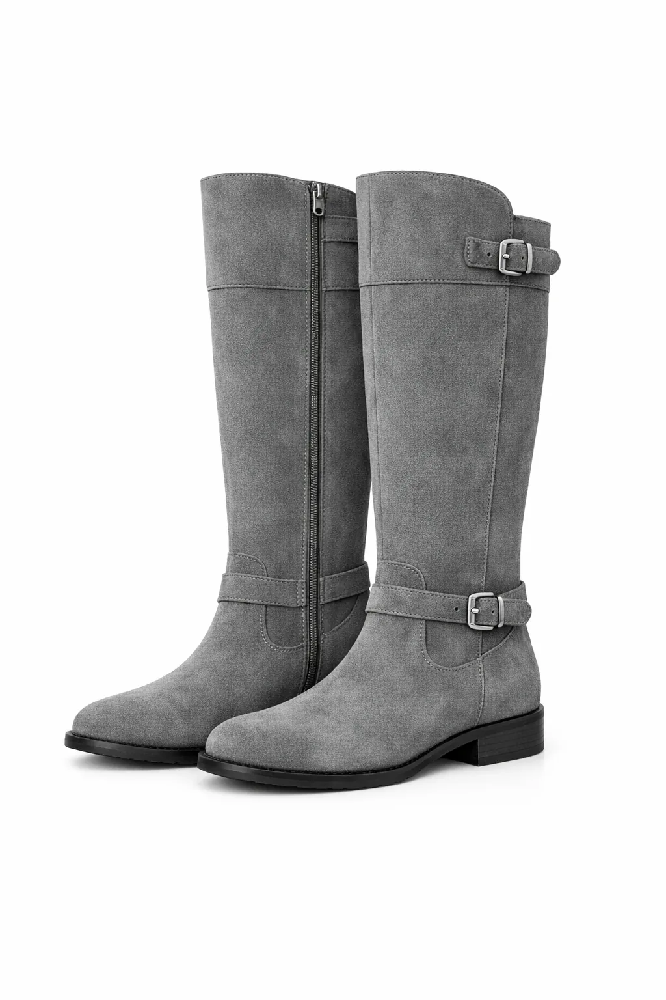
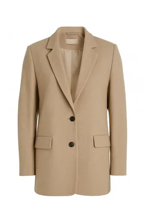
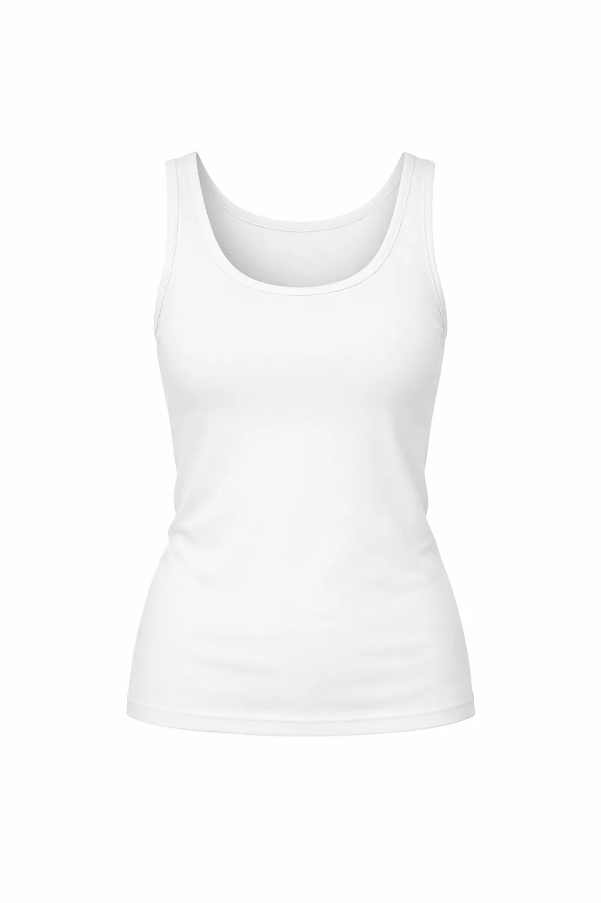
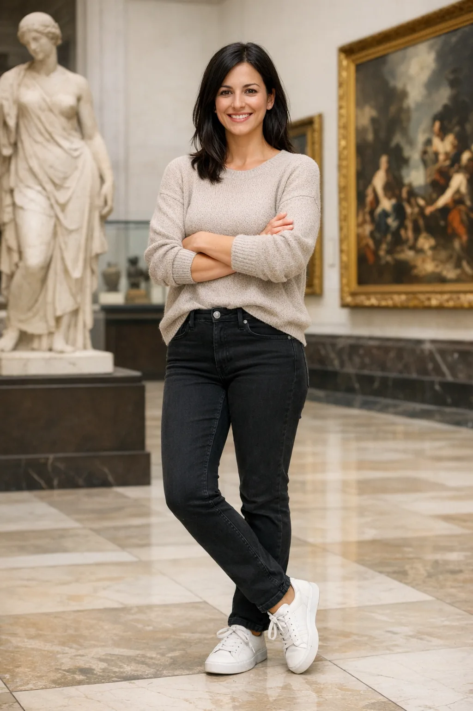

<!-- Generated by scripts/build_readme.py. Edit source data, locale catalogs and generator scripts. -->

# 保留人物身份换装

[← 返回全部案例](../../README.zh-CN.md#all-cases)

<a href="README.md"></a> <a href="README.zh-CN.md"></a>

**官方文档 · 仅核对来源；未独立复现**

在链接章节查看原始提示词、必需输入、参数与各版本输出。整理者未独立复现。

## 图片 / GIF


- [博物馆中的女子换上参考服装后的图像（GPT Image 2.6 Flare 输出）](https://developers.openai.com/images/platform/guides/image-prompting/outfit-gpt-image-2-6-flare.webp) · image
  - 署名：OpenAI, GPT Image 2.6 image prompting guide
  - 使用条件：source-attributed. 官方指南中的公开示例素材，原样存档并标注来源。未核实独立的转载许可证，不标为开放许可，仓库 MIT 协议不覆盖该素材。来源署名和仓库版权声明均不构成许可授权。
  - [来源 / 权利依据](https://developers.openai.com/api/docs/guides/image-prompting#preserve-identity-and-change-clothing)


- [博物馆中的女子换上参考服装后的图像（GPT Image 2.6 Sunburst 输出）](https://developers.openai.com/images/platform/guides/image-prompting/outfit-gpt-image-2-6-sunburst.webp) · image
  - 署名：OpenAI, GPT Image 2.6 image prompting guide
  - 使用条件：source-attributed. 官方指南中的公开示例素材，原样存档并标注来源。未核实独立的转载许可证，不标为开放许可，仓库 MIT 协议不覆盖该素材。来源署名和仓库版权声明均不构成许可授权。
  - [来源 / 权利依据](https://developers.openai.com/api/docs/guides/image-prompting#preserve-identity-and-change-clothing)


**参考 / 输入图，不是生成结果。**

- [参考输入图：灰色长靴服装参考](https://developers.openai.com/images/platform/guides/image-prompting/boots.webp) · image
  - 署名：OpenAI, GPT Image 2.6 image prompting guide
  - 使用条件：source-attributed. 官方指南中的公开示例素材，原样存档并标注来源。未核实独立的转载许可证，不标为开放许可，仓库 MIT 协议不覆盖该素材。来源署名和仓库版权声明均不构成许可授权。
  - [来源 / 权利依据](https://developers.openai.com/api/docs/guides/image-prompting#preserve-identity-and-change-clothing)


**参考 / 输入图，不是生成结果。**

- [参考输入图：米色西装外套服装参考](https://developers.openai.com/images/platform/guides/image-prompting/jacket.webp) · image
  - 署名：OpenAI, GPT Image 2.6 image prompting guide
  - 使用条件：source-attributed. 官方指南中的公开示例素材，原样存档并标注来源。未核实独立的转载许可证，不标为开放许可，仓库 MIT 协议不覆盖该素材。来源署名和仓库版权声明均不构成许可授权。
  - [来源 / 权利依据](https://developers.openai.com/api/docs/guides/image-prompting#preserve-identity-and-change-clothing)


**参考 / 输入图，不是生成结果。**

- [参考输入图：白色背心服装参考](https://developers.openai.com/images/platform/guides/image-prompting/tank-top.webp) · image
  - 署名：OpenAI, GPT Image 2.6 image prompting guide
  - 使用条件：source-attributed. 官方指南中的公开示例素材，原样存档并标注来源。未核实独立的转载许可证，不标为开放许可，仓库 MIT 协议不覆盖该素材。来源署名和仓库版权声明均不构成许可授权。
  - [来源 / 权利依据](https://developers.openai.com/api/docs/guides/image-prompting#preserve-identity-and-change-clothing)


**参考 / 输入图，不是生成结果。**

- [参考输入图：用作人物身份参考的博物馆女子照片](https://developers.openai.com/images/platform/guides/image-prompting/woman-in-museum.webp) · image
  - 署名：OpenAI, GPT Image 2.6 image prompting guide
  - 使用条件：source-attributed. 官方指南中的公开示例素材，原样存档并标注来源。未核实独立的转载许可证，不标为开放许可，仓库 MIT 协议不覆盖该素材。来源署名和仓库版权声明均不构成许可授权。
  - [来源 / 权利依据](https://developers.openai.com/api/docs/guides/image-prompting#preserve-identity-and-change-clothing)

## 原始提示词

```text
Edit the image to dress the woman using the provided clothing images. Do not change her face, facial features, skin tone, body shape, pose, or identity in any way. Preserve her exact likeness, expression, hairstyle, and proportions. Replace only the clothing, fitting the garments naturally to her existing pose and body geometry with realistic fabric behavior. Match lighting, shadows, and color temperature to the original photo so the outfit integrates photorealistically, without looking pasted on. Do not change the background, camera angle, framing, or image quality, and do not add accessories, text, logos, or watermarks.
```

[原提示词见来源](https://developers.openai.com/api/docs/guides/image-prompting#preserve-identity-and-change-clothing)

## 来源与核对信息

- ID: docs-outfit
- 作者：OpenAI
- [原始来源](https://developers.openai.com/api/docs/guides/image-prompting#preserve-identity-and-change-clothing)
- 模型：GPT Image 2.6
- 版本：Flare / Sunburst
- 依据：已逐项核对所引指南中输出的 GPT Image 2.6 标签。
- 收录：2026-11-05 (UTC)
- 来源核对：2026-11-05 (UTC)

标注来源不等于取得素材许可。仓库 MIT 协议不覆盖第三方输出；本地素材逐项记录来源与使用状态，source-attributed 不代表开放许可。
