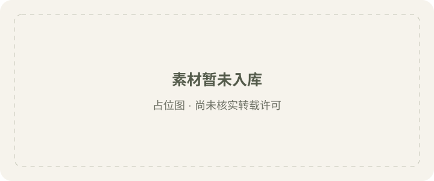

<!-- Generated by scripts/build_readme.py. Edit site.config.json, content/prompts.json and content/source-cases.json. -->

# 移除手持花朵

[← 返回全部案例](../../README.zh-CN.md#all-cases)

[English](README.md) · [简体中文](README.zh-CN.md)

**官方文档 · 仅核对来源；未独立复现**

在链接章节查看原始提示词、必需输入、参数与各版本输出。整理者未独立复现。

## 图片 / GIF

**占位：原始素材暂未入库，尚未核实转载许可。**

[到原始来源查看作品](https://developers.openai.com/api/docs/guides/image-prompting#remove-an-object)

## 原始提示词

[原提示词见来源](https://developers.openai.com/api/docs/guides/image-prompting#remove-an-object)

来源公开了真实提示词。本仓库链接原文，不伪造或转载完整长提示词；所需输入与参数请在原文查看。

## 来源与核对信息

- ID: docs-remove-flower
- 作者：OpenAI
- [原始来源](https://developers.openai.com/api/docs/guides/image-prompting#remove-an-object)
- 模型：GPT Image 2.6
- 版本：Flare / Sunburst
- 依据：已逐项核对所引指南中输出的 GPT Image 2.6 标签。
- 收录：2026-11-05 (UTC)
- 来源核对：2026-11-05 (UTC)

标注来源不等于取得素材许可。仓库 MIT 协议不覆盖第三方输出；本地素材逐项记录来源与使用状态，source-attributed 不代表开放许可。
