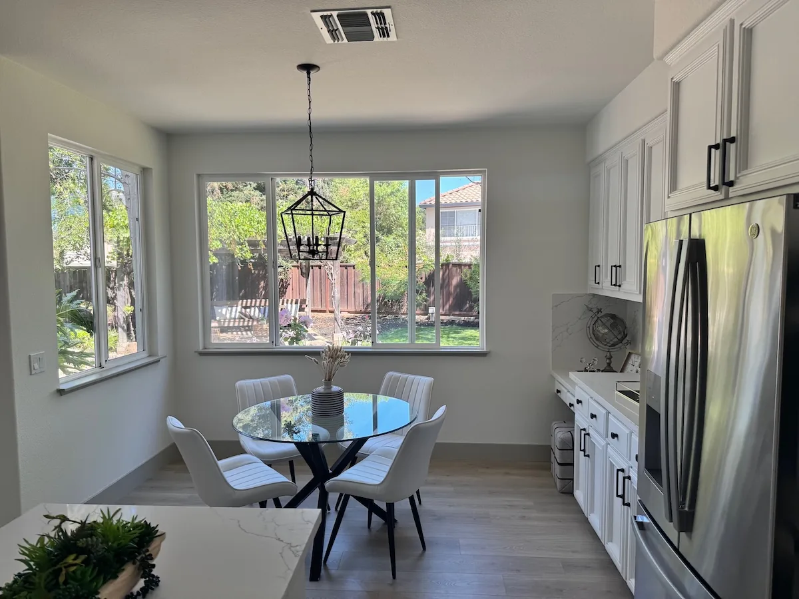

<!-- Generated by scripts/build_readme.py. Edit source data, locale catalogs and generator scripts. -->

# Replace chairs in an interior

[← Back to all cases](../../README.md#all-cases)

<a href="README.md"></a> <a href="README.zh-CN.md"></a>

**Official documentation · Source-only; not independently reproduced**

Open the linked section for the original prompt, required inputs, parameters and model outputs. Not independently reproduced.

## Images / GIFs


- [Kitchen with replacement wooden chairs — GPT Image 2.6 Flare (official model output)](https://developers.openai.com/images/platform/guides/image-prompting/kitchen-chairs-gpt-image-2-6-flare.webp) · image
  - Credit: OpenAI, GPT Image 2.6 image prompting guide
  - Reuse: source-attributed. Public example media from the official guide, archived unchanged with source attribution. No independent redistribution license was verified. This file is not labelled open-licensed, and the repository MIT license does not cover it. Source attribution and the repository copyright notice do not grant permission.
  - [Provenance / rights evidence](https://developers.openai.com/api/docs/guides/image-prompting#change-furniture-in-a-room)


- [Kitchen with replacement wooden chairs — GPT Image 2.6 Sunburst (official model output)](https://developers.openai.com/images/platform/guides/image-prompting/kitchen-chairs-gpt-image-2-6-sunburst.webp) · image
  - Credit: OpenAI, GPT Image 2.6 image prompting guide
  - Reuse: source-attributed. Public example media from the official guide, archived unchanged with source attribution. No independent redistribution license was verified. This file is not labelled open-licensed, and the repository MIT license does not cover it. Source attribution and the repository copyright notice do not grant permission.
  - [Provenance / rights evidence](https://developers.openai.com/api/docs/guides/image-prompting#change-furniture-in-a-room)


**Reference/input image, not a generated output.**

- [Reference input: Original kitchen with white chairs](https://developers.openai.com/images/platform/guides/image-prompting/kitchen.webp) · image
  - Credit: OpenAI, GPT Image 2.6 image prompting guide
  - Reuse: source-attributed. Public example media from the official guide, archived unchanged with source attribution. No independent redistribution license was verified. This file is not labelled open-licensed, and the repository MIT license does not cover it. Source attribution and the repository copyright notice do not grant permission.
  - [Provenance / rights evidence](https://developers.openai.com/api/docs/guides/image-prompting#change-furniture-in-a-room)

## Original prompt

```text
In this room photo, replace ONLY the white chairs with chairs made of wood.
Preserve camera angle, room lighting, floor shadows, and surrounding objects.
Keep all other aspects of the image unchanged.
Photorealistic contact shadows and fabric texture.
```

[Original prompt at source](https://developers.openai.com/api/docs/guides/image-prompting#change-furniture-in-a-room)

## Attribution and verification

- ID: docs-room-chairs
- Author: OpenAI
- [Original source](https://developers.openai.com/api/docs/guides/image-prompting#change-furniture-in-a-room)
- Model: GPT Image 2.6
- Variant: Flare / Sunburst
- Evidence: Each output is explicitly labelled GPT Image 2.6 in the cited guide.
- Collected: 2026-11-05 (UTC)
- Source checked: 2026-11-05 (UTC)

Attribution does not grant a media license. Repository MIT terms do not cover third-party outputs. Local files record provenance and reuse status; source-attributed does not mean open-licensed.
