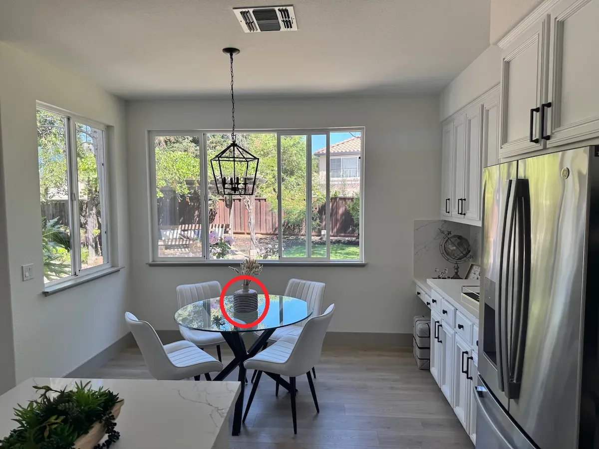

<!-- Generated by scripts/build_readme.py. Edit source data, locale catalogs and generator scripts. -->

# Recolor a marked vase

[← Back to all cases](../../README.md#all-cases)

 

**Official documentation · Source-only; not independently reproduced**

Open the linked section for the original prompt, required inputs, parameters and model outputs. Not independently reproduced.

## Images / GIFs

- [GPT Image 2.6 Flare output: Flare edit of the kitchen with a blue vase and dried stems on the table](https://developers.openai.com/images/platform/guides/image-prompting/markup-vase-gpt-image-2-6-flare.webp) · image
  - Credit: OpenAI, GPT Image 2.6 image prompting guide
  - Reuse: source-attributed. Public example media from the official guide, archived unchanged with source attribution. No independent redistribution license was verified. This file is not labelled open-licensed, and the repository MIT license does not cover it. Source attribution and the repository copyright notice do not grant permission.
  - [Provenance / rights evidence](https://developers.openai.com/api/docs/guides/image-prompting#guide-an-edit-with-markup)

- [GPT Image 2.6 Sunburst output: Sunburst edit of the kitchen with the same vase in cobalt blue and the red circle removed](https://developers.openai.com/images/platform/guides/image-prompting/markup-vase-gpt-image-2-6-sunburst.webp) · image
  - Credit: OpenAI, GPT Image 2.6 image prompting guide
  - Reuse: source-attributed. Public example media from the official guide, archived unchanged with source attribution. No independent redistribution license was verified. This file is not labelled open-licensed, and the repository MIT license does not cover it. Source attribution and the repository copyright notice do not grant permission.
  - [Provenance / rights evidence](https://developers.openai.com/api/docs/guides/image-prompting#guide-an-edit-with-markup)

**Reference/input image, not a generated output.**

- [Reference input: Kitchen photo with a red circle around the striped vase on the dining table](https://developers.openai.com/images/platform/guides/image-prompting/markup-vase-input-gpt-image-2-6.webp) · image
  - Credit: OpenAI, GPT Image 2.6 image prompting guide
  - Reuse: source-attributed. Public example media from the official guide, archived unchanged with source attribution. No independent redistribution license was verified. This file is not labelled open-licensed, and the repository MIT license does not cover it. Source attribution and the repository copyright notice do not grant permission.
  - [Provenance / rights evidence](https://developers.openai.com/api/docs/guides/image-prompting#guide-an-edit-with-markup)

## Original prompt

[Original prompt at source](https://developers.openai.com/api/docs/guides/image-prompting#guide-an-edit-with-markup)

The source publishes the actual prompt. This repository links to it rather than inventing or republishing the full text. Required inputs and parameters remain at the source.

## Attribution and verification

- ID: docs-vase-markup
- Author: OpenAI
- [Original source](https://developers.openai.com/api/docs/guides/image-prompting#guide-an-edit-with-markup)
- Model: GPT Image 2.6
- Variant: Flare / Sunburst
- Evidence: Each output is explicitly labelled GPT Image 2.6 in the cited guide.
- Collected: 2026-11-05 (UTC)
- Source checked: 2026-11-05 (UTC)

Attribution does not grant a media license. Repository MIT terms do not cover third-party outputs. Local files record provenance and reuse status; source-attributed does not mean open-licensed.
