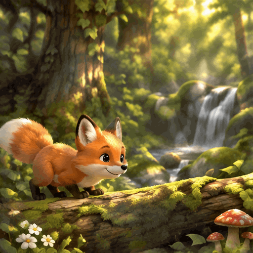
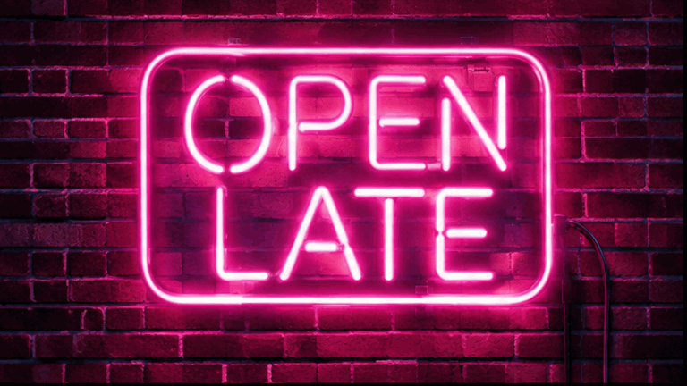
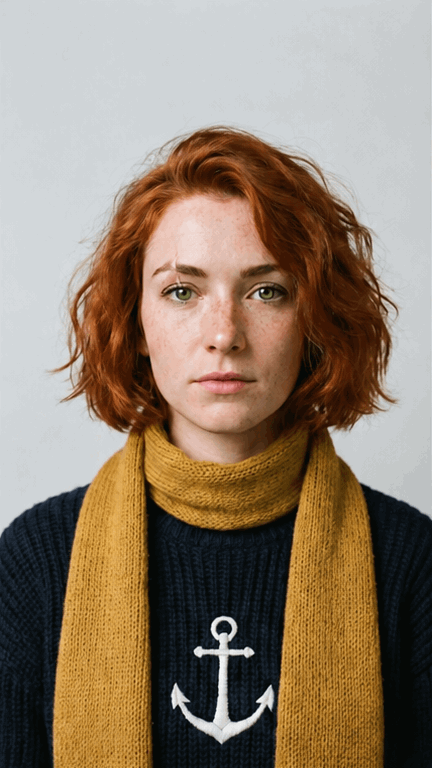

<!-- Generated by scripts/build_readme.py. Edit source data, locale catalogs and generator scripts. -->

# Flixly: six GIF generation and editing tests

[← Back to all cases](../../README.md#all-cases)

 

**Creator-reported model · Source-only; not independently reproduced**

The existing six-test collection remains one case, preserving its historical ID instead of adding six newly counted cases. Six original GIFs and source-linked prompts are included. The article attributes Mira to editing an earlier portrait; the exact input file is not established here and is not guessed or duplicated from another comparison. Provider editing/capability claims are not independently verified. All frames are retained, including output imperfections; no browser playback or generation was run.

## Images / GIFs

- [Sunburst fox hops across a forest log.](https://www.flixly.ai/blog-media/gpt-image-2-6-gif/fox.gif) · gif
  - Credit: Flixly Team
  - Reuse: source-attributed. Unchanged publisher-served bytes. No explicit redistribution licence verified. Public access and attribution do not establish permission; repository MIT does not cover this media.
  - [Provenance / rights evidence](https://www.flixly.ai/blog/gpt-image-2-6-gif-maker)

- [Sunburst MORNING RITUAL coffee cup with moving steam.](https://www.flixly.ai/blog-media/gpt-image-2-6-gif/coffee.gif) · gif
  - Credit: Flixly Team
  - Reuse: source-attributed. Unchanged publisher-served bytes. No explicit redistribution licence verified. Public access and attribution do not establish permission; repository MIT does not cover this media.
  - [Provenance / rights evidence](https://www.flixly.ai/blog/gpt-image-2-6-gif-maker)

- [Flare OPEN LATE neon sign dims and lights again.](https://www.flixly.ai/blog-media/gpt-image-2-6-gif/neon.gif) · gif
  - Credit: Flixly Team
  - Reuse: source-attributed. Unchanged publisher-served bytes. No explicit redistribution licence verified. Public access and attribution do not establish permission; repository MIT does not cover this media.
  - [Provenance / rights evidence](https://www.flixly.ai/blog/gpt-image-2-6-gif-maker)

- [Sunburst yellow cat winks with a thumbs-up gesture.](https://www.flixly.ai/blog-media/gpt-image-2-6-gif/sticker.gif) · gif
  - Credit: Flixly Team
  - Reuse: source-attributed. Unchanged publisher-served bytes. No explicit redistribution licence verified. Public access and attribution do not establish permission; repository MIT does not cover this media.
  - [Provenance / rights evidence](https://www.flixly.ai/blog/gpt-image-2-6-gif-maker)

- [Flare cabin candle flickers while snow falls outside.](https://www.flixly.ai/blog-media/gpt-image-2-6-gif/snow.gif) · gif
  - Credit: Flixly Team
  - Reuse: source-attributed. Unchanged publisher-served bytes. No explicit redistribution licence verified. Public access and attribution do not establish permission; repository MIT does not cover this media.
  - [Provenance / rights evidence](https://www.flixly.ai/blog/gpt-image-2-6-gif-maker)

- [Sunburst-attributed Mira portrait smiles, blinks and waves.](https://www.flixly.ai/blog-media/gpt-image-2-6-gif/mira.gif) · gif
  - Credit: Flixly Team
  - Reuse: source-attributed. Unchanged publisher-served bytes. No explicit redistribution licence verified. Public access and attribution do not establish permission; repository MIT does not cover this media.
  - [Provenance / rights evidence](https://www.flixly.ai/blog/gpt-image-2-6-gif-maker)

## Source-page and media access

- Checked: 2026-11-08 (UTC)
- Original page: Accessible. Known primary source page reopened to resolve this existing candidate; exact example labels, prompts and media URLs checked. No new case search.
- Media: Archived locally. Publisher-served files fetched successfully and preserved without modification. Formats, dimensions, hashes, full frame decoding and visual content were checked. Historical Opusly GIF hashes match; the nine other files were acquired now from already-known candidate pages.
- [Per-file attempts and results](../../docs/MODEL_HOLDS_RECOVERY_AUDIT_2026-11-08.md)

## Original prompt

[Original prompt at source](https://www.flixly.ai/blog/gpt-image-2-6-gif-maker)

The source publishes the actual prompt. This repository links to it rather than inventing or republishing the full text. Required inputs and parameters remain at the source.

## Attribution and verification

- ID: flixly-six-gif-tests
- Author: Flixly Team
- [Original source](https://www.flixly.ai/blog/gpt-image-2-6-gif-maker)
- Model: GPT Image 2.6
- Variant: Flare / Sunburst
- Evidence: The original article describes six GIF tests made on Flixly and labels each exact output by model. Fox, coffee, sticker and Mira are labelled Sunburst (Mira: Sunburst Edit); neon and snow are labelled Flare. Settings, first-result and unchanged-output statements are publisher claims, not independently reproduced API observations.
- Collected: 2026-11-06 (UTC)
- Source checked: 2026-11-08 (UTC)

Attribution does not grant a media license. Repository MIT terms do not cover third-party outputs. Local files record provenance and reuse status; source-attributed does not mean open-licensed.
