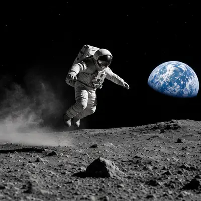
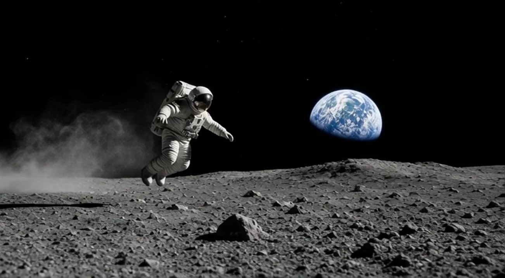

<!-- Generated by scripts/build_readme.py. Edit source data, locale catalogs and generator scripts. -->

# 月面跳跃：参考图转动画流程

[← 返回全部案例](../../README.zh-CN.md#all-cases)

 

**作者自报模型 · 仅核对来源；未独立复现**

案例依据平台自身署名，未进行独立生成复现。公开原始提示词仅链接至来源，不在此转载全文。 FrameMux 说明其流程是生成六帧精灵图，再由浏览器拼接循环。存档的动态文件是动画 WebP，不是模型原生输出的 GIF；每段为六帧，每帧 160 毫秒，总时长 960 毫秒。 来源将配套图片标为“Original”，因此作为参考输入保留。其文件名提到其他模型系列，但这不构成输入模型的独立验证；不将其归为 GPT Image 2.6 输出。

## 图片 / GIF

- [月面宇航员六帧动画，动画 WebP](https://framemux.com/examples/image-to-gif-astronaut.webp) · image
  - 署名：FrameMux
  - 使用条件：source-attributed. 公开来源素材原样保留并署名。未核实独立转载许可证；署名不构成授权，仓库 MIT 条款不覆盖此文件。
  - [来源 / 权利依据](https://framemux.com/models/gpt-image-2-6)

**参考 / 输入图，不是生成结果。**

- [宇航员参考输入；源文件名提到 Grok，不归为 GPT Image 2.6 输出](https://framemux.com/examples/grok-video-astronaut.webp) · image
  - 署名：FrameMux
  - 使用条件：source-attributed. 公开来源素材原样保留并署名。未核实独立转载许可证；署名不构成授权，仓库 MIT 条款不覆盖此文件。
  - [来源 / 权利依据](https://framemux.com/models/gpt-image-2-6)

## 原帖与素材获取状态

- 核对日期：2026-11-08 (UTC)
- 原帖：可打开. 复核已有原始页面、逐输出标签、准确素材地址（解析相对路径）与可用提示词链接。未搜索新案例。
- 素材：已存入仓库. 本地原始字节与记录的 SHA-256 和大小一致。全部图片及动画帧已解码、目视核验；无活动内容的 SVG 已检查结构并在本地渲染检查，不发布质检派生文件。
- [逐项尝试与结果](../../docs/FRAMEMUX_APIXO_BACKLOG_AUDIT_2026-11-08.md)

## 原始提示词

[原提示词见来源](https://framemux.com/models/gpt-image-2-6)

来源公开了真实提示词。本仓库链接原文，不伪造或转载完整长提示词；所需输入与参数请在原文查看。

## 来源与核对信息

- ID: framemux-moon-bounce
- 作者：FrameMux
- [原始来源](https://framemux.com/models/gpt-image-2-6)
- 模型：GPT Image 2.6
- 版本：Flare
- 依据：“月面跳跃”对应的每张图库卡片均带有“GPT Image 2.6”模型标签；同一页面明确将该 FrameMux 模型说明为 Flare 版本。这是平台自述，并非独立执行验证。
- 收录：2026-11-06 (UTC)
- 来源核对：2026-11-08 (UTC)

标注来源不等于取得素材许可。仓库 MIT 协议不覆盖第三方输出；本地素材逐项记录来源与使用状态，source-attributed 不代表开放许可。
