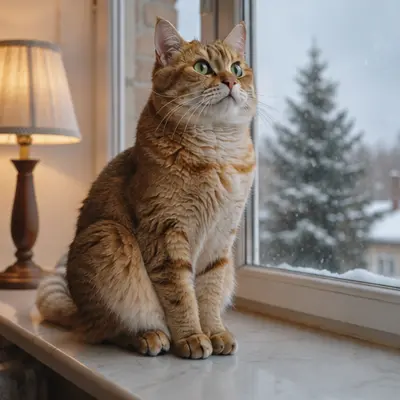
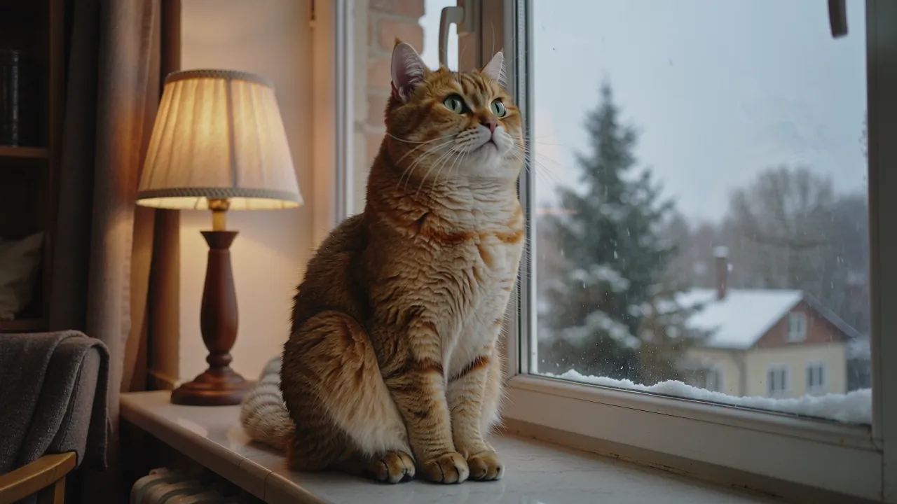

<!-- Generated by scripts/build_readme.py. Edit source data, locale catalogs and generator scripts. -->

# Window cat: reference-to-animation workflow

[← Back to all cases](../../README.md#all-cases)

 

**Creator-reported model · Source-only; not independently reproduced**

Platform-attributed example; no independent generation was performed. The public original prompt is linked at the source rather than republished here. FrameMux describes a six-frame sprite sheet assembled into a loop by the browser. Archived moving files are animated WebP, not native GIF output from the model. Each animation has six 160 ms frames (960 ms total). The source marks the companion as “Original”; it is a reference input. Its filename mentions another model family, which is not independent verification of that input’s model. It is not attributed to GPT Image 2.6.

## Images / GIFs

- [Six-frame window-cat animation, animated WebP](https://framemux.com/examples/image-to-gif-window-cat.webp) · image
  - Credit: FrameMux
  - Reuse: source-attributed. Original public-source media retained unchanged with attribution. No independent redistribution license has been verified. Attribution is not permission, and repository MIT terms do not cover this file.
  - [Provenance / rights evidence](https://framemux.com/models/gpt-image-2-6)

**Reference/input image, not a generated output.**

- [Window-cat reference input; source filename names Kling, not a GPT Image 2.6 output](https://framemux.com/examples/kling-2-6-cat.webp) · image
  - Credit: FrameMux
  - Reuse: source-attributed. Original public-source media retained unchanged with attribution. No independent redistribution license has been verified. Attribution is not permission, and repository MIT terms do not cover this file.
  - [Provenance / rights evidence](https://framemux.com/models/gpt-image-2-6)

## Source-page and media access

- Checked: 2026-11-08 (UTC)
- Original page: Accessible. Revisited the existing original page and verified output labels, exact asset URLs (resolving relative paths), and available prompt links. No new-case search.
- Media: Archived locally. Existing local original bytes match recorded SHA-256 and sizes. All image/animation frames were decoded and visually reviewed. The inert SVG was structurally checked and rendered locally for inspection; QA derivatives are not published.
- [Per-file attempts and results](../../docs/FRAMEMUX_APIXO_BACKLOG_AUDIT_2026-11-08.md)

## Original prompt

[Original prompt at source](https://framemux.com/models/gpt-image-2-6)

The source publishes the actual prompt. This repository links to it rather than inventing or republishing the full text. Required inputs and parameters remain at the source.

## Attribution and verification

- ID: framemux-window-cat
- Author: FrameMux
- [Original source](https://framemux.com/models/gpt-image-2-6)
- Model: GPT Image 2.6
- Variant: Flare
- Evidence: The individual “Window cat” gallery card carries the “GPT Image 2.6” model badge. The same page explicitly identifies this FrameMux model as the Flare version. This is a platform claim, not independently verified execution.
- Collected: 2026-11-06 (UTC)
- Source checked: 2026-11-08 (UTC)

Attribution does not grant a media license. Repository MIT terms do not cover third-party outputs. Local files record provenance and reuse status; source-attributed does not mean open-licensed.
