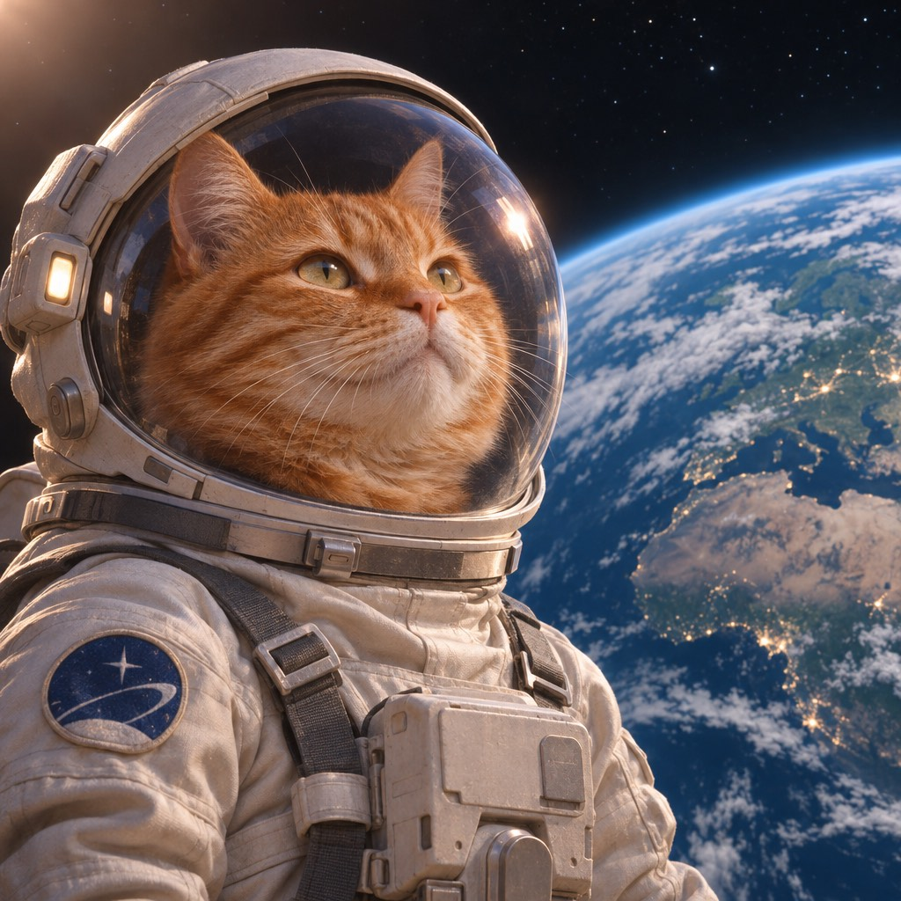
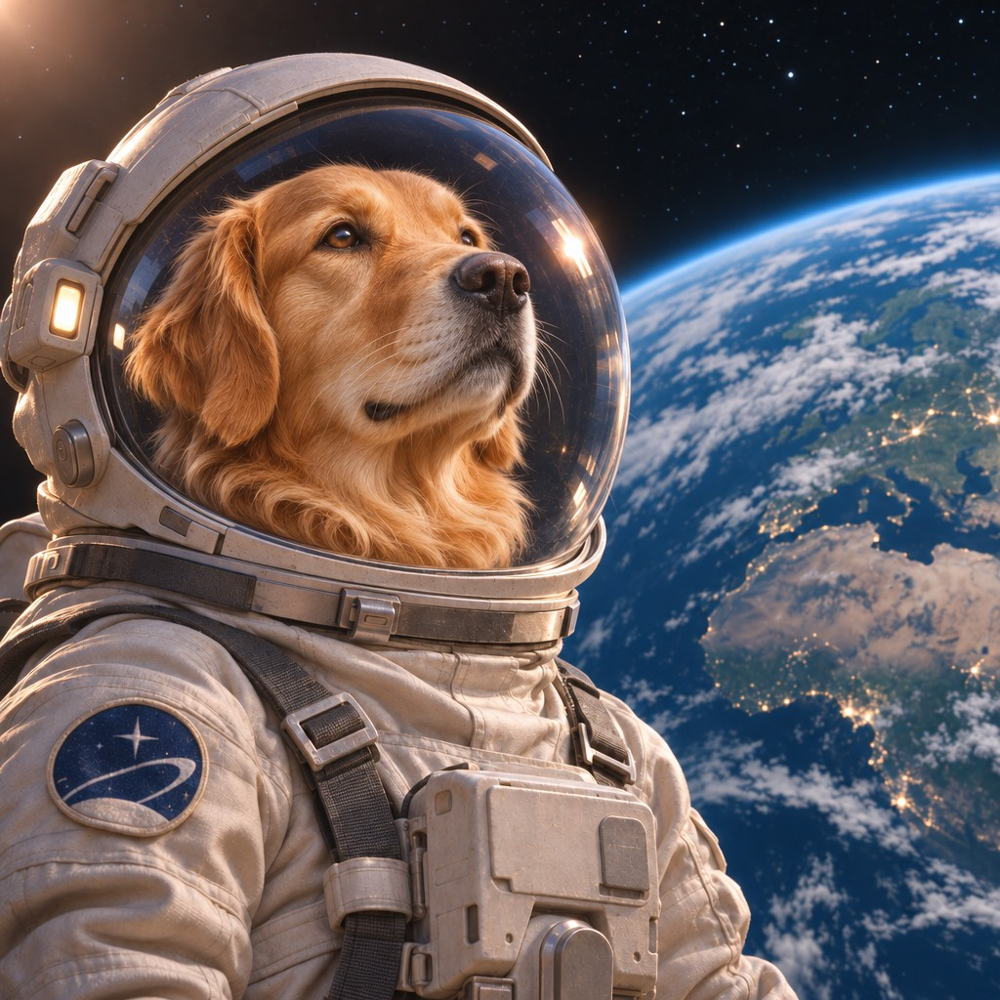
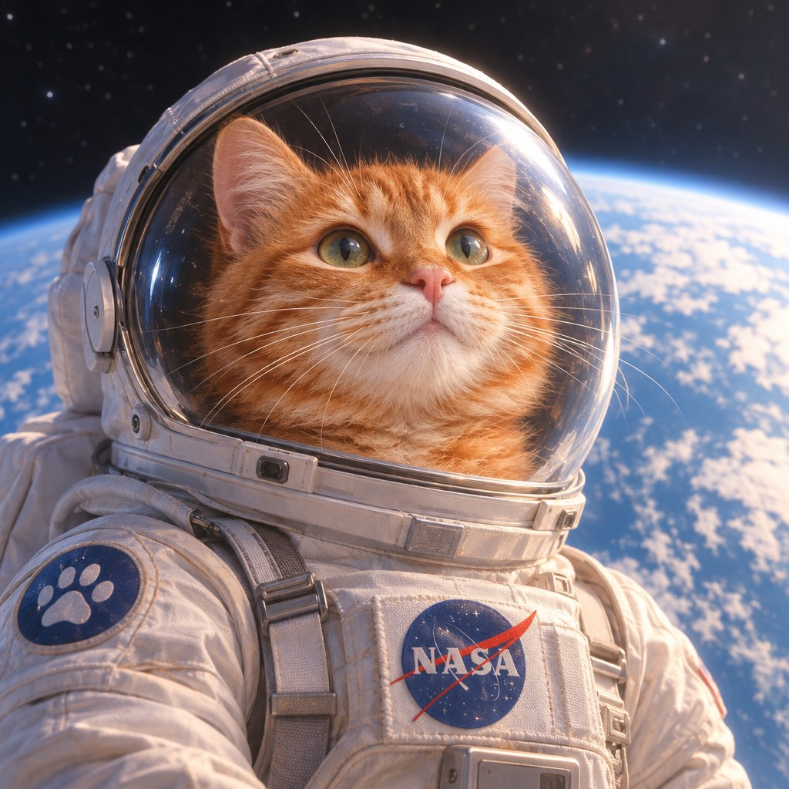
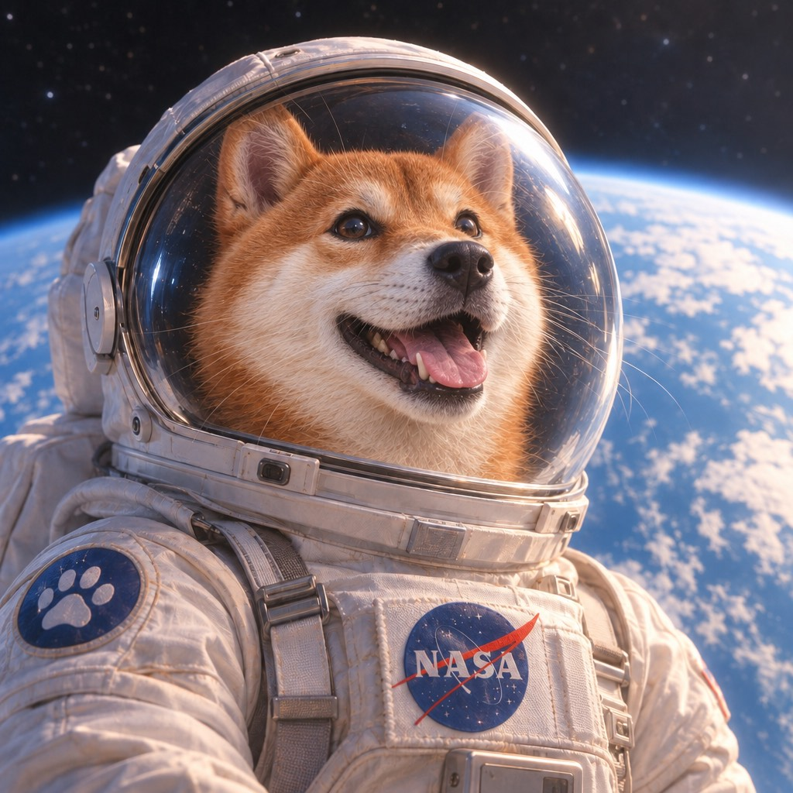

<!-- Generated by scripts/build_readme.py. Edit source data, locale catalogs and generator scripts. -->

# GEN202 astronaut cat-to-dog edit comparison

[← Back to all cases](../../README.md#all-cases)

 

**Creator-reported model · Source-only; not independently reproduced**

One workflow groups both labelled variants and their generated-still/edit pairs. The two original instructions are publicly displayed at source and linked, not reproduced here. All four retained files decode as distinct 1024 × 1024 JPEGs. The inspected images show separate cat astronauts and corresponding dog replacements. No pixel-preservation or runtime-log authenticity claim is made. Public-source archiving is source-attributed, not licensed or legally cleared.

## Images / GIFs

- [Sunburst cat astronaut](https://gen202.com/assets/sample-gpt-image-2-6-sunburst.jpg) · image
  - Credit: GEN202
  - Reuse: source-attributed. Unmodified public-source research copy. The reviewed GEN202 terms contain no explicit prohibition on archiving these public samples, but no redistribution licence was found. Customer-output rights do not license provider samples. Source-attributed only, not permission or legal clearance; excluded from this collection’s MIT licence.
  - [Provenance / rights evidence](https://gen202.ru/gpt-image-2-6/)

- [Sunburst dog edit](https://gen202.com/assets/sample-gpt-image-2-6-sunburst-edit.jpg) · image
  - Credit: GEN202
  - Reuse: source-attributed. Unmodified public-source research copy. The reviewed GEN202 terms contain no explicit prohibition on archiving these public samples, but no redistribution licence was found. Customer-output rights do not license provider samples. Source-attributed only, not permission or legal clearance; excluded from this collection’s MIT licence.
  - [Provenance / rights evidence](https://gen202.ru/gpt-image-2-6/)

- [Flare cat astronaut](https://gen202.com/assets/sample-gpt-image-2-6-flare.jpg) · image
  - Credit: GEN202
  - Reuse: source-attributed. Unmodified public-source research copy. The reviewed GEN202 terms contain no explicit prohibition on archiving these public samples, but no redistribution licence was found. Customer-output rights do not license provider samples. Source-attributed only, not permission or legal clearance; excluded from this collection’s MIT licence.
  - [Provenance / rights evidence](https://gen202.ru/gpt-image-2-6/)

- [Flare dog edit](https://gen202.com/assets/sample-gpt-image-2-6-flare-edit.jpg) · image
  - Credit: GEN202
  - Reuse: source-attributed. Unmodified public-source research copy. The reviewed GEN202 terms contain no explicit prohibition on archiving these public samples, but no redistribution licence was found. Customer-output rights do not license provider samples. Source-attributed only, not permission or legal clearance; excluded from this collection’s MIT licence.
  - [Provenance / rights evidence](https://gen202.ru/gpt-image-2-6/)

## Source-page and media access

- Checked: 2026-11-08 (UTC)
- Original page: Accessible. The already-known original provider page was read on 2026-11-08 to verify the existing local case. No new case search or generation was performed.
- Media: Archived locally. All retained original files were hash-checked, decoded and visually reviewed. No private QA derivative is published. The MaxVideoAI edit reference remains stored once in its generation case.
- [Per-file attempts and results](../../docs/DESIGNARENA_PROVIDERS_RECOVERY_AUDIT_2026-11-08.md)

## Original prompt

[Original prompt at source](https://gen202.ru/gpt-image-2-6/)

The source publishes the actual prompt. This repository links to it rather than inventing or republishing the full text. Required inputs and parameters remain at the source.

## Attribution and verification

- ID: gen202-astronaut-cat-dog-variant-workflow
- Author: GEN202 (provider; no individual creative byline verified)
- [Original source](https://gen202.ru/gpt-image-2-6/)
- Model: GPT Image 2.6
- Variant: Flare / Sunburst
- Evidence: The known primary page was reopened and its displayed sample JSON maps all four local filenames to GPT Image 2.6 Flare or Sunburst generation/edit variants. These are provider-reported examples. Repeated sample task IDs do not establish independent runtime logs.
- Collected: 2026-11-06 (UTC)
- Source checked: 2026-11-08 (UTC)

Attribution does not grant a media license. Repository MIT terms do not cover third-party outputs. Local files record provenance and reuse status; source-attributed does not mean open-licensed.
