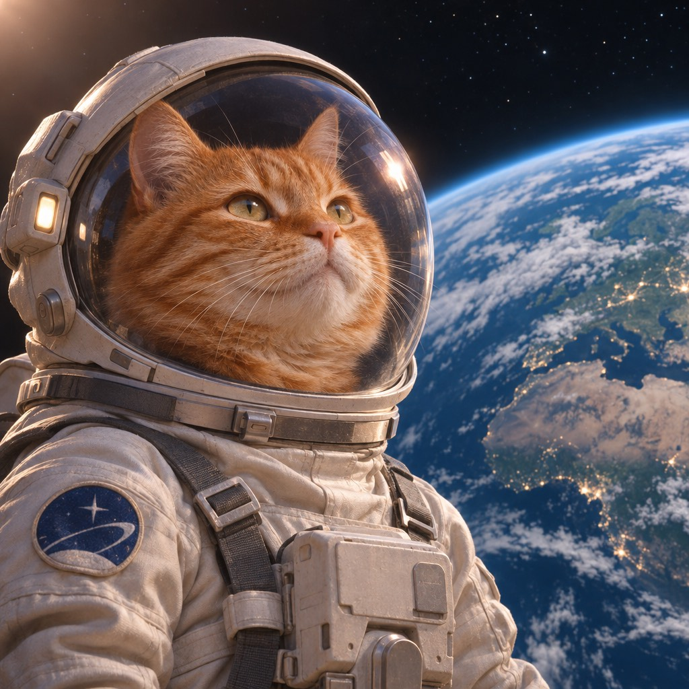
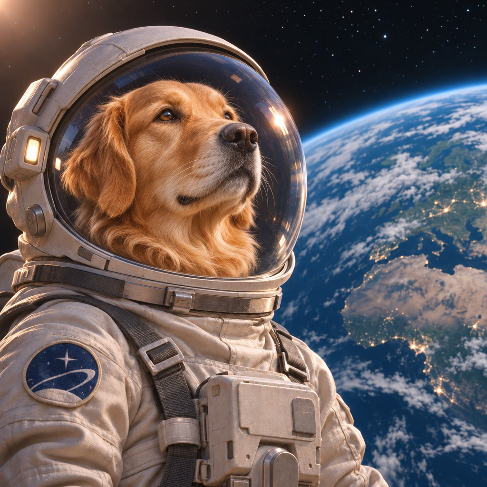
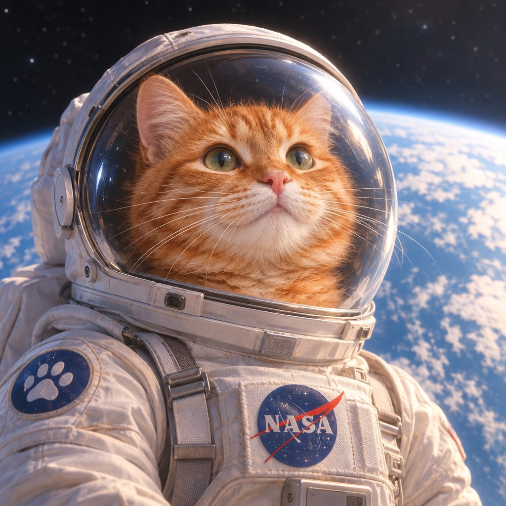
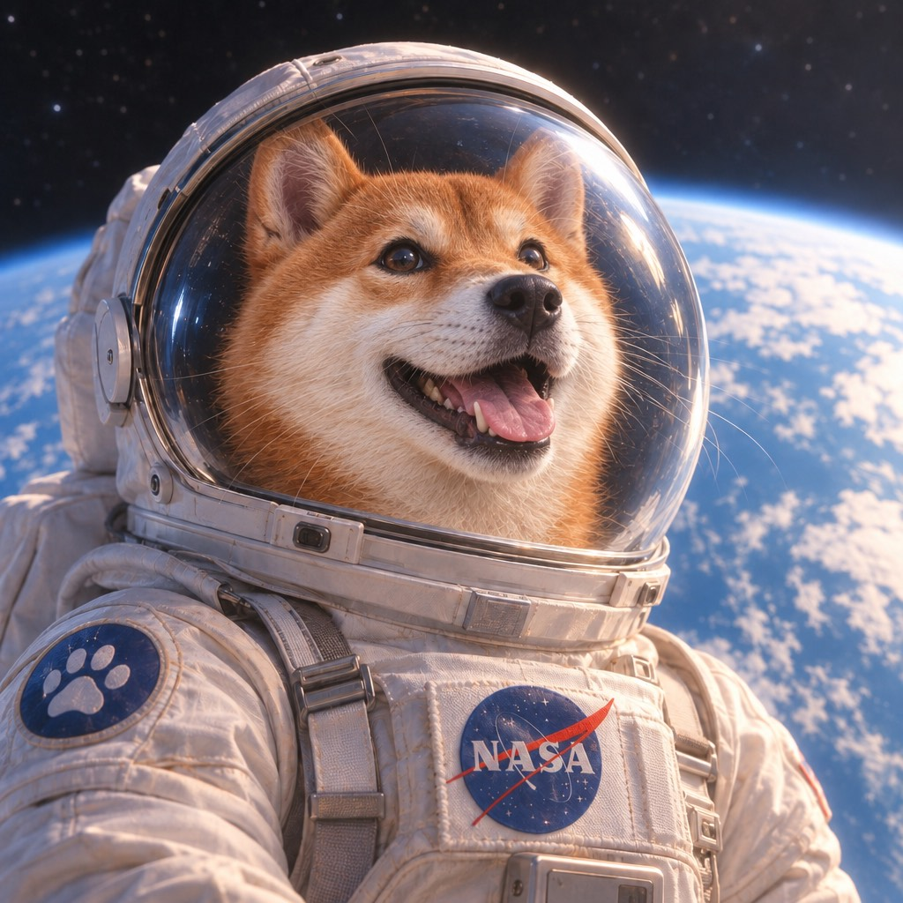

<!-- Generated by scripts/build_readme.py. Edit source data, locale catalogs and generator scripts. -->

# GEN202 宇航员猫改狗双版本对照

[← 返回全部案例](../../README.zh-CN.md#all-cases)

 

**作者自报模型 · 仅核对来源；未独立复现**

两种标注版本及各自静图、编辑图合为一个工作流。来源公开展示两条原始指令，此处仅链接，不复制。四个留存文件均解码为互异的 1024 × 1024 JPEG；所查图像为两组猫咪宇航员及对应狗狗替换图。不宣称其他像素保持不变或运行日志真实。公开来源存档仅表示署名，不表示许可或法律授权已确认。

## 图片 / GIF

- [Sunburst 猫咪宇航员](https://gen202.com/assets/sample-gpt-image-2-6-sunburst.jpg) · image
  - 署名：GEN202
  - 使用条件：source-attributed. 原样保留的公开来源研究副本。所查 GEN202 条款未明确禁止存档这些公开样本，但未发现转载许可。客户输出权利不赋予提供方样本许可。仅来源署名，不表示获得许可或法律授权，不适用合集 MIT 许可。
  - [来源 / 权利依据](https://gen202.ru/gpt-image-2-6/)

- [Sunburst 狗狗编辑结果](https://gen202.com/assets/sample-gpt-image-2-6-sunburst-edit.jpg) · image
  - 署名：GEN202
  - 使用条件：source-attributed. 原样保留的公开来源研究副本。所查 GEN202 条款未明确禁止存档这些公开样本，但未发现转载许可。客户输出权利不赋予提供方样本许可。仅来源署名，不表示获得许可或法律授权，不适用合集 MIT 许可。
  - [来源 / 权利依据](https://gen202.ru/gpt-image-2-6/)

- [Flare 猫咪宇航员](https://gen202.com/assets/sample-gpt-image-2-6-flare.jpg) · image
  - 署名：GEN202
  - 使用条件：source-attributed. 原样保留的公开来源研究副本。所查 GEN202 条款未明确禁止存档这些公开样本，但未发现转载许可。客户输出权利不赋予提供方样本许可。仅来源署名，不表示获得许可或法律授权，不适用合集 MIT 许可。
  - [来源 / 权利依据](https://gen202.ru/gpt-image-2-6/)

- [Flare 狗狗编辑结果](https://gen202.com/assets/sample-gpt-image-2-6-flare-edit.jpg) · image
  - 署名：GEN202
  - 使用条件：source-attributed. 原样保留的公开来源研究副本。所查 GEN202 条款未明确禁止存档这些公开样本，但未发现转载许可。客户输出权利不赋予提供方样本许可。仅来源署名，不表示获得许可或法律授权，不适用合集 MIT 许可。
  - [来源 / 权利依据](https://gen202.ru/gpt-image-2-6/)

## 原帖与素材获取状态

- 核对日期：2026-11-08 (UTC)
- 原帖：可打开. 2026-11-08打开已知服务商原页，为既有本地案例补证，未搜索新案例或执行生成。
- 素材：已存入仓库. 留存原文件均核对哈希、完整解码并目视审核，不发布私有质检派生图。MaxVideoAI编辑的共同输入仅在生成案例中保存一次。
- [逐项尝试与结果](../../docs/DESIGNARENA_PROVIDERS_RECOVERY_AUDIT_2026-11-08.md)

## 原始提示词

[原提示词见来源](https://gen202.ru/gpt-image-2-6/)

来源公开了真实提示词。本仓库链接原文，不伪造或转载完整长提示词；所需输入与参数请在原文查看。

## 来源与核对信息

- ID: gen202-astronaut-cat-dog-variant-workflow
- 作者：GEN202 (provider; no individual creative byline verified)
- [原始来源](https://gen202.ru/gpt-image-2-6/)
- 模型：GPT Image 2.6
- 版本：Flare / Sunburst
- 依据：重新检查已知原页，公开示例JSON将四个本地文件逐项对应至GPT Image 2.6 Flare或Sunburst生成及编辑版本。属于提供方自述，重复示例任务ID不能证明独立运行日志。
- 收录：2026-11-06 (UTC)
- 来源核对：2026-11-08 (UTC)

标注来源不等于取得素材许可。仓库 MIT 协议不覆盖第三方输出；本地素材逐项记录来源与使用状态，source-attributed 不代表开放许可。
