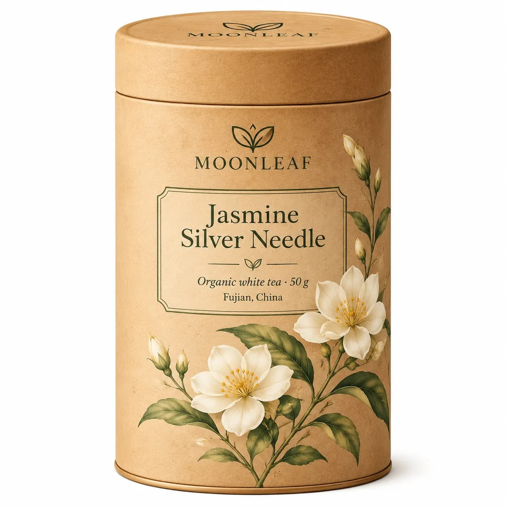
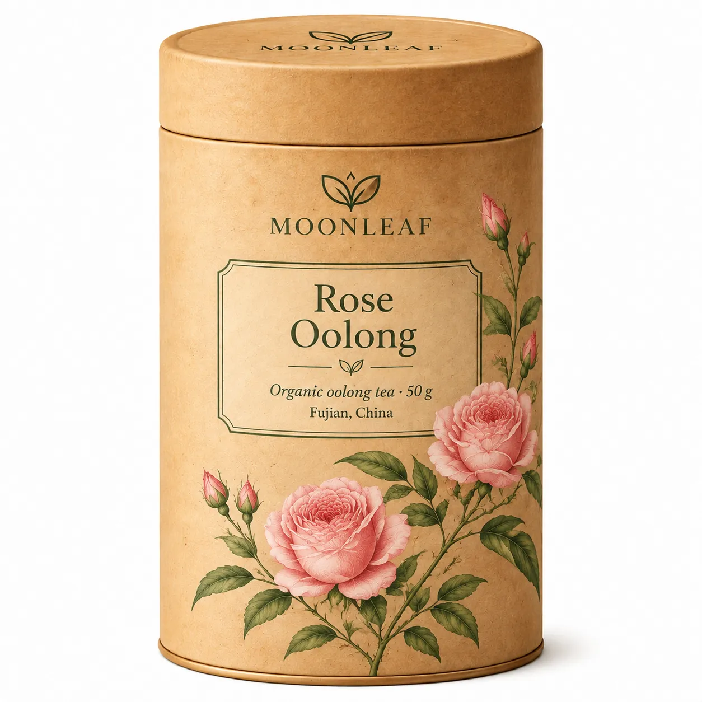

<!-- Generated by scripts/build_readme.py. Edit source data, locale catalogs and generator scripts. -->

# MOONLEAF 茶罐：茉莉到玫瑰的标签编辑

[← 返回全部案例](../../README.zh-CN.md#all-cases)

 

**作者自报模型 · 仅核对来源；未独立复现**

案例依据创作者或发布方自述，未经独立复现，也没有独立核验实际调用模型的运行日志。保留公开来源媒体的原始字节；来源署名不等于转载许可。 茉莉茶包装与玫瑰标签编辑归为同一工作流。模型页公开原始包装提示词及简短标签编辑指令，前一张结果随后作为后一张的输入。 Saver 是提供方的服务路由标签，不是经独立核实的另一官方 OpenAI 模型。

## 图片 / GIF

- [MOONLEAF 茶罐：茉莉到玫瑰的标签编辑](https://www.gptimagehub.com/_next/image?url=%2Fmodels%2Fgpt-image-2-6-sunburst-tea.webp&w=2048&q=75&dpl=dpl_7AcecpQN4dYqVme3P5wmTbzBjibd) · image
  - 署名：GPT Image Hub
  - 使用条件：source-attributed. 保留发布方提供的原始素材。2026-11-08从已知文件地址取得的字节与留存SHA-256及大小一致。未验证明确转载许可，公开可访问及署名不等于授权，仓库MIT不覆盖此素材。
  - [来源 / 权利依据](https://www.gptimagehub.com/models/gpt-image-2-6-sunburst-saver)

- [MOONLEAF 茶罐：茉莉到玫瑰的标签编辑](https://www.gptimagehub.com/_next/image?url=%2Fmodels%2Fgpt-image-2-6-sunburst-tea-edit.webp&w=2048&q=75&dpl=dpl_7AcecpQN4dYqVme3P5wmTbzBjibd) · image
  - 署名：GPT Image Hub
  - 使用条件：source-attributed. 保留发布方提供的原始素材。2026-11-08从已知文件地址取得的字节与留存SHA-256及大小一致。未验证明确转载许可，公开可访问及署名不等于授权，仓库MIT不覆盖此素材。
  - [来源 / 权利依据](https://www.gptimagehub.com/models/gpt-image-2-6-sunburst-saver)

## 原帖与素材获取状态

- 核对日期：2026-11-08 (UTC)
- 原帖：可打开. 仅重新打开已知来源与模型页面，为既有本地案例核对示例地址及模型标签。所有留存素材地址均成功取得文件，SHA-256及字节数与原件一致，未搜索新案例。
- 素材：已存入仓库. 保留原始字节；所有静图及GIF全部帧完整解码并目视核验。参考拼图不是生成输出，不发布质检派生图。
- [逐项尝试与结果](../../docs/302_GPTIMAGEHUB_RECOVERY_AUDIT_2026-11-08.md)

## 原始提示词

[原提示词见来源](https://www.gptimagehub.com/models/gpt-image-2-6-sunburst-saver)

来源公开了真实提示词。本仓库链接原文，不伪造或转载完整长提示词；所需输入与参数请在原文查看。

## 来源与核对信息

- ID: gptimagehub-moonleaf-tea-edit
- 作者：GPT Image Hub
- [原始来源](https://www.gptimagehub.com/models/gpt-image-2-6-sunburst-saver)
- 模型：GPT Image 2.6
- 版本：Sunburst
- 依据：对应 GPT Image Hub 模型页明确标注 Flare/Sunburst Saver 路由，并将这些逐项案例注明为 2026 年 11 月 5 日在平台生成或编辑。模型归因为发布方自述。
- 收录：2026-11-06 (UTC)
- 来源核对：2026-11-08 (UTC)

标注来源不等于取得素材许可。仓库 MIT 协议不覆盖第三方输出；本地素材逐项记录来源与使用状态，source-attributed 不代表开放许可。
