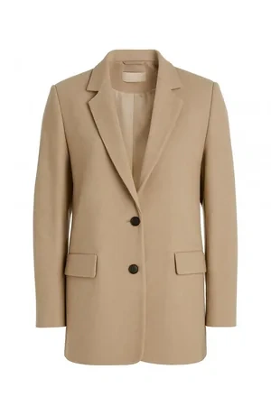
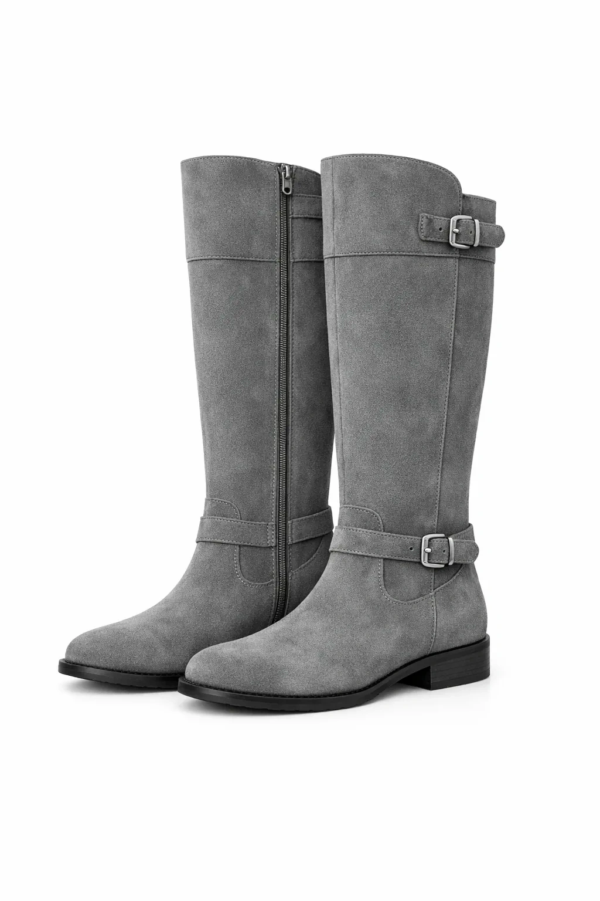
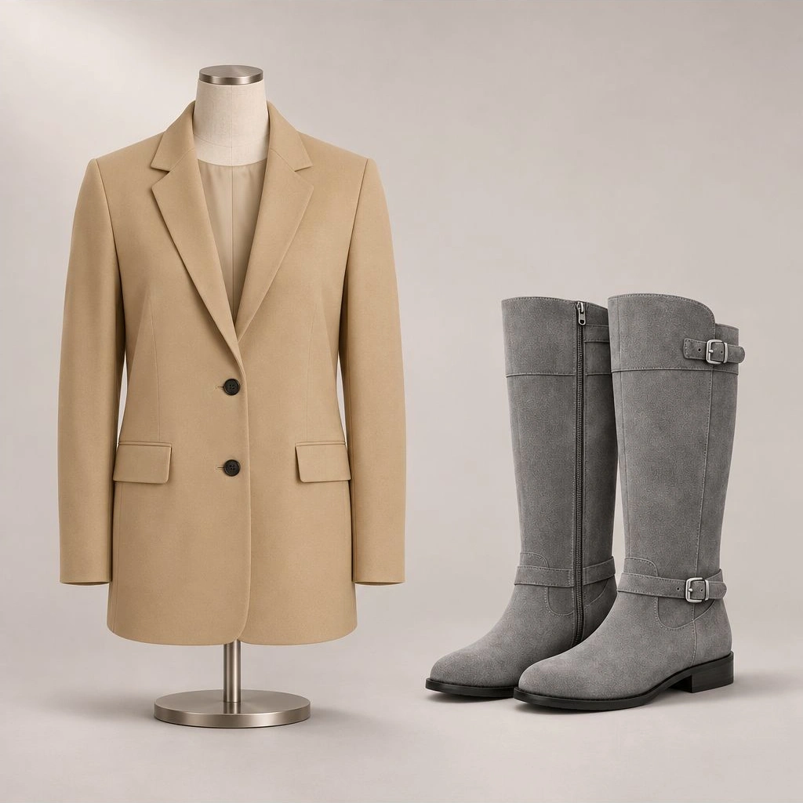

<!-- Generated by scripts/build_readme.py. Edit source data, locale catalogs and generator scripts. -->

# Blazer and boots reference composition

[← Back to all cases](../../README.md#all-cases)

 

**Creator-reported model · Source-only; not independently reproduced**

Two product references and one combined output retained. References are inputs, not claimed 2.6 outputs.

## Images / GIFs

**Reference/input image, not a generated output.**

- [Beige blazer reference.](https://docs.joinoasis.com/api/cms/asset/glossary%2Fassets%2F4da020cf-gpt-image-2-light-beige-blazer-buttons-pockets.webp) · image
  - Credit: Karthikeya Meesala / Oasis HQ
  - Reuse: source-attributed. Public article asset archived unchanged with attribution. No redistribution license was located; attribution is not permission or an open license. No explicit sample-archiving ban was found in the checked terms: https://docs.joinoasis.com/terms.
  - [Provenance / rights evidence](https://docs.joinoasis.com/blog/gpt-image-2-6-review)

**Reference/input image, not a generated output.**

- [Grey tall boots reference.](https://docs.joinoasis.com/api/cms/asset/glossary%2Fassets%2F91d2d89d-gpt-image-2-grey-knee-high-boots-buckle-zipper-closure.webp) · image
  - Credit: Karthikeya Meesala / Oasis HQ
  - Reuse: source-attributed. Public article asset archived unchanged with attribution. No redistribution license was located; attribution is not permission or an open license. No explicit sample-archiving ban was found in the checked terms: https://docs.joinoasis.com/terms.
  - [Provenance / rights evidence](https://docs.joinoasis.com/blog/gpt-image-2-6-review)

- [Blazer mannequin and boots shown together.](https://docs.joinoasis.com/api/cms/asset/glossary%2Fassets%2F0742a7f7-gpt-image-2-mannequin-displays-beige-blazer-grey-knee-high.webp) · image
  - Credit: Karthikeya Meesala / Oasis HQ
  - Reuse: source-attributed. Public article asset archived unchanged with attribution. No redistribution license was located; attribution is not permission or an open license. No explicit sample-archiving ban was found in the checked terms: https://docs.joinoasis.com/terms.
  - [Provenance / rights evidence](https://docs.joinoasis.com/blog/gpt-image-2-6-review)

## Original prompt

[Original prompt at source](https://docs.joinoasis.com/blog/gpt-image-2-6-review)

The source publishes the actual prompt. This repository links to it rather than inventing or republishing the full text. Required inputs and parameters remain at the source.

## Attribution and verification

- ID: joinoasis-blazer-boots-composition
- Author: Karthikeya Meesala / Oasis HQ
- [Original source](https://docs.joinoasis.com/blog/gpt-image-2-6-review)
- Model: GPT Image 2.6
- Variant: Sunburst
- Evidence: Karthikeya Meesala explicitly attributes these four tests to GPT Image 2.6 Sunburst. The article says both ChatGPT web and an explicitly selected Playground model; the execution route and actual served model are not independently verified.
- Collected: 2026-11-05 (UTC)
- Source checked: 2026-11-09 (UTC)

Attribution does not grant a media license. Repository MIT terms do not cover third-party outputs. Local files record provenance and reuse status; source-attributed does not mean open-licensed.
