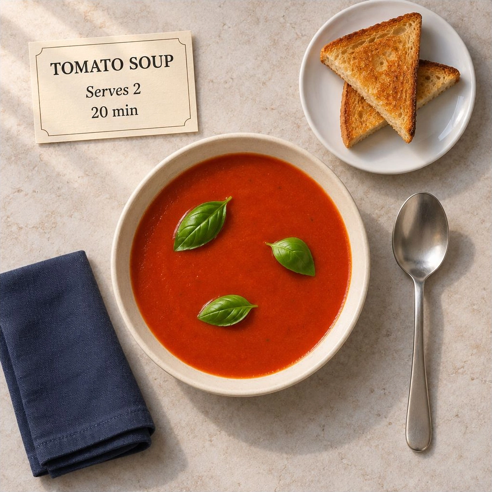

<!-- Generated by scripts/build_readme.py. Edit source data, locale catalogs and generator scripts. -->

# 汤品照片与食谱卡

[← 返回全部案例](../../README.zh-CN.md#all-cases)

 

**作者自报模型 · 仅核对来源；未独立复现**

可见食谱卡、三片罗勒叶、两块吐司和汤匙。尽管提示词要求所有物品完整入框，吐司盘仍触及上边缘，餐巾伸出左边缘。完整原始提示词见来源。

## 图片 / GIF

- [红色汤、吐司和印字食谱卡。](https://docs.joinoasis.com/api/cms/asset/glossary%2Fassets%2F1bbfe8a2-gpt-image-2-bowl-tomato-soup-basil-leaves-grilled-toast.webp) · image
  - 署名：Karthikeya Meesala / Oasis HQ
  - 使用条件：source-attributed. 公开文章素材按原字节暂存并署名。未找到转载许可证；署名不等于授权或开放许可。已查看条款，未发现针对样例存档的明确禁令：https://docs.joinoasis.com/terms。
  - [来源 / 权利依据](https://docs.joinoasis.com/blog/gpt-image-2-6-review)

## 原始提示词

[原提示词见来源](https://docs.joinoasis.com/blog/gpt-image-2-6-review)

来源公开了真实提示词。本仓库链接原文，不伪造或转载完整长提示词；所需输入与参数请在原文查看。

## 来源与核对信息

- ID: joinoasis-tomato-soup
- 作者：Karthikeya Meesala / Oasis HQ
- [原始来源](https://docs.joinoasis.com/blog/gpt-image-2-6-review)
- 模型：GPT Image 2.6
- 版本：Sunburst
- 依据：Karthikeya Meesala 明确将这四项测试归于 GPT Image 2.6 Sunburst。文章同时声称使用 ChatGPT 网页和在 Playground 明确选择模型，执行途径及实际调用模型未获独立验证。
- 收录：2026-11-05 (UTC)
- 来源核对：2026-11-09 (UTC)

标注来源不等于取得素材许可。仓库 MIT 协议不覆盖第三方输出；本地素材逐项记录来源与使用状态，source-attributed 不代表开放许可。
