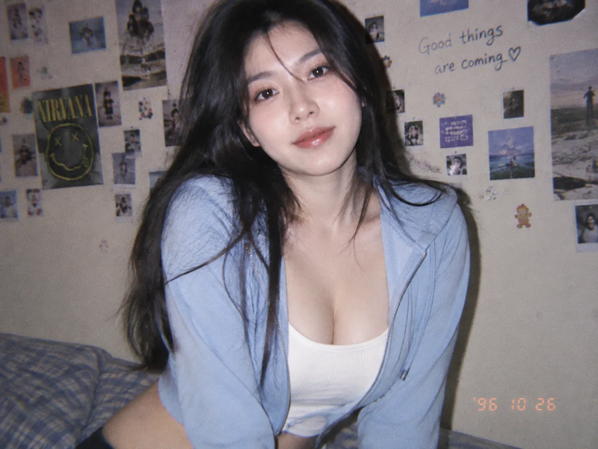

<!-- Generated by scripts/build_readme.py. Edit source data, locale catalogs and generator scripts. -->

# 1990s-style flash portrait

[← Back to all cases](../../README.md#all-cases)

 

**Creator-reported model · Source-only; not independently reproduced**

A dark-haired woman in a blue zip-up top sits in front of a wall of snapshots and handwritten notes. Original provider asset archived byte-for-byte. The static WebP was decoded and visually inspected. The full source prompt is shown on the provider page. The page broadly describes its stills as X posts, but this selected asset has a more specific embedded “Generated on Kavel” statement. Attribution follows that per-asset statement; the inconsistency remains a limitation. The prompt says “same unchanged face”, but Kavel describes this route as text-to-image and identifies no input file for its rerun. No reference was invented and reproducibility is not claimed. Offline recovery recheck on 2026-11-08 confirms retained source mapping and original file integrity, not backend execution or current availability.

## Images / GIFs

- [A dark-haired woman in a blue zip-up top sits in front of a wall of snapshots and handwritten notes.](https://cdn.kavel.ai/images/kavel/models/nineties-snapshot-portrait-ai-image.webp) · image
  - Credit: Kavel; prompt by @AIwithSarah_
  - Reuse: source-attributed. Public provider asset archived unmodified with source attribution. No redistribution license was located; attribution is not permission or an open license. Provider says it reran the prompt from @AIwithSarah_: https://x.com/AIwithSarah_/status/2118202866448077182. This is the provider output, not an archive of that creator’s output. Terms checked on 2026-11-05: https://www.kavel.ai/terms-of-service. Customer-output commercial-use statements do not license these site samples. The repository MIT license does not cover this third-party file.
  - [Provenance / rights evidence](https://www.kavel.ai/image/gpt-image-2-6)

## Source-page and media access

- Checked: 2026-11-05 (UTC)
- Original page: Accessible. Source access was recorded on 2026-11-05. Retained original source evidence was rechecked offline on 2026-11-08; no current availability claim is made.
- Media: Archived locally. The retained 2026-11-05 response manifest records ordinary HTTP 200 for these files. This audit verified unchanged bytes, MIME, hashes, all frames, pixels and metadata without new requests. GIF C2PA signatures were not cryptographically verified.
- [Per-file attempts and results](../../docs/KAVEL_YIR_RECOVERY_AUDIT_2026-11-08.md)

## Original prompt

[Original prompt at source](https://www.kavel.ai/image/gpt-image-2-6)

The source publishes the actual prompt. This repository links to it rather than inventing or republishing the full text. Required inputs and parameters remain at the source.

## Attribution and verification

- ID: kavel-90s-snapshot
- Author: Kavel
- [Original source](https://www.kavel.ai/image/gpt-image-2-6)
- Model: GPT Image 2.6
- Variant: Flare
- Evidence: For 1990s-style flash portrait, Kavel’s per-asset metadata names gpt-image-2.6-flare-c and the date 2026-11-05, and attributes generation to Kavel. This records the provider’s claim; it is not an independent reproduction or confirmation of an official API endpoint.
- Collected: 2026-11-05 (UTC)
- Source checked: 2026-11-08 (UTC)

Attribution does not grant a media license. Repository MIT terms do not cover third-party outputs. Local files record provenance and reuse status; source-attributed does not mean open-licensed.
