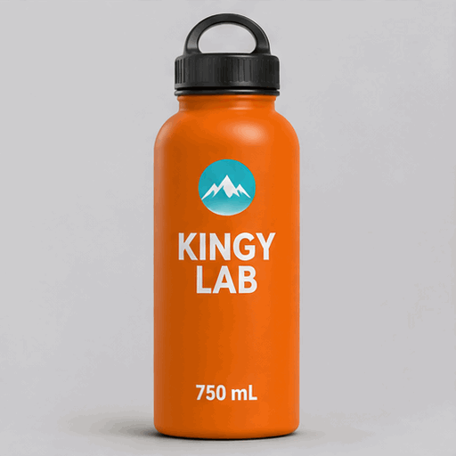

<!-- Generated by scripts/build_readme.py. Edit source data, locale catalogs and generator scripts. -->

# Rocking KINGY LAB bottle GIF

[← Back to all cases](../../README.md#all-cases)

 

**Creator-reported model · Source-only; not independently reproduced**

The original GIF89a file is 512 × 512, with 10 distinct decoded frames at 200 ms each, a two-second cycle and infinite looping. Normal browser playback showed upright, right-leaning and left-leaning poses; all ten decoded frames were inspected. Motion steps and the last-to-first pose transition are noticeable. A white mountain-like mark appears in the turquoise badge, documented by the source as unrequested. No 2.5 GIF or unknown-model ChatGPT-web output is included. No input image is claimed, and no generation was reproduced. The source advertises a ZIP containing exact prompts and receipts, but its contents have not been inspected. Full original-prompt availability is unverified; no claim is made that the prompt is definitely public or unpublished.

## Images / GIFs

- [Animated orange KINGY LAB 750 mL bottle rocking on a pale-gray background](https://kingy.ai/wp-content/uploads/2026/11/kingy-images26-test-26-T4.gif) · gif
  - Credit: Curtis Pyke / Kingy AI
  - Reuse: source-attributed. Unmodified public-source archival copy with source attribution. An explicit redistribution license was not found. Attribution, public availability and any site copyright notice do not grant permission; the repository MIT license does not cover this file.
  - [Provenance / rights evidence](https://kingy.ai/blog/chatgpt-gifs-images-2-6-vs-2-5-hands-on-test/)

## Source-page and media access

- Checked: 2026-11-05 (UTC)
- Original page: Accessible. The original public page opened normally without login; the individual image caption, exact media URL and methodology were rechecked in the browser.
- Media: Archived locally. The direct HTTP request returned 403, while the original page and exact media were normally accessible in the browser. The supported browser media downloader saved the file; magic bytes, MIME, full decode, dimensions, size and SHA-256 were checked. Image pixels were inspected. Browser playback was observed, and all ten decoded frames were inspected.
- [Per-file attempts and results](../../docs/KINGY_GIF_SOURCES_2026-11-06.md)

## Original prompt

**Prompt availability unverified**

Public availability of the original prompt has not been verified. The original source is credited below.

## Attribution and verification

- ID: kingy-sunburst-bottle-rocking
- Author: Curtis Pyke / Kingy AI
- [Original source](https://kingy.ai/blog/chatgpt-gifs-images-2-6-vs-2-5-hands-on-test/)
- Model: GPT Image 2.6
- Variant: Sunburst
- Evidence: The individual source caption reads “The native GIF returned by GPT Image 2.6 Sunburst.”. The methodology identifies the requested API model as gpt-image-2.6-sunburst. This is the source creator’s attribution, not an independently reproduced generation. The separate ChatGPT-web outputs have an undisclosed model and are excluded.
- Collected: 2026-11-05 (UTC)
- Source checked: 2026-11-05 (UTC)

Attribution does not grant a media license. Repository MIT terms do not cover third-party outputs. Local files record provenance and reuse status; source-attributed does not mean open-licensed.
