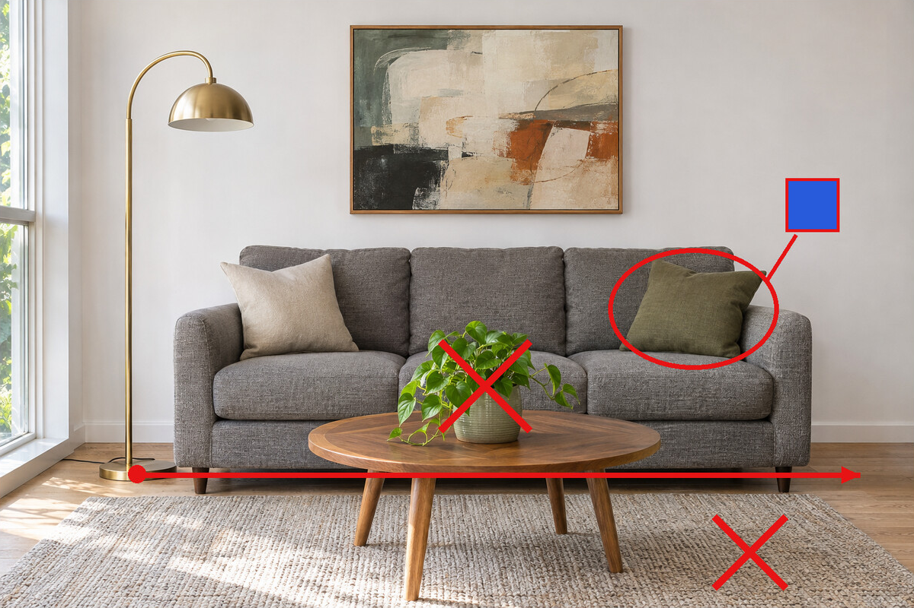

<!-- Generated by scripts/build_readme.py. Edit source data, locale catalogs and generator scripts. -->

# Living-room markup edit

[← Back to all cases](../../README.md#all-cases)

 

**Official launch demo · Source-only; not independently reproduced**

The fal tab shows the original markup edit prompt: blue cushion, removal of the plant/rug and moving the lamp to the right. Requires the marked input.

## Images / GIFs

**Reference/input image, not a generated output.**

- [Source image 1](https://images.ctfassets.net/kftzwdyauwt9/50IFJAzURDJeFT6j7jU9Cy/727871e6953a56bebb783f7c884f832f/images-2-6-fal-before.png) · image
  - Credit: OpenAI / original credited creator; see source
  - Reuse: source-attributed. Unmodified public-source archival copy for this educational collection. An explicit redistribution license was not located; source attribution and the repository copyright notice do not grant one. Excluded from the repository MIT license.
  - [Provenance / rights evidence](https://openai.com/index/introducing-images-2-6/#more-ways-to-create-and-edit-in-the-api)

- [Source image 2](https://images.ctfassets.net/kftzwdyauwt9/mOBUDnc6RlTLi1KU5S19r/2646cf2f1db9cfdf93250f201e8ab5de/images-2-6-fal-after.png) · image
  - Credit: OpenAI / original credited creator; see source
  - Reuse: source-attributed. Unmodified public-source archival copy for this educational collection. An explicit redistribution license was not located; source attribution and the repository copyright notice do not grant one. Excluded from the repository MIT license.
  - [Provenance / rights evidence](https://openai.com/index/introducing-images-2-6/#more-ways-to-create-and-edit-in-the-api)

## Original prompt

[Original prompt at source](https://openai.com/index/introducing-images-2-6/#more-ways-to-create-and-edit-in-the-api)

The source publishes the actual prompt. This repository links to it rather than inventing or republishing the full text. Required inputs and parameters remain at the source.

## Attribution and verification

- ID: launch-fal
- Author: fal
- [Original source](https://openai.com/index/introducing-images-2-6/#more-ways-to-create-and-edit-in-the-api)
- Model: GPT Image 2.6
- Variant: Flare
- Evidence: The launch page identifies this as an Images 2.6 demonstration.
- Collected: 2026-11-05 (UTC)
- Source checked: 2026-11-05 (UTC)

Attribution does not grant a media license. Repository MIT terms do not cover third-party outputs. Local files record provenance and reuse status; source-attributed does not mean open-licensed.
