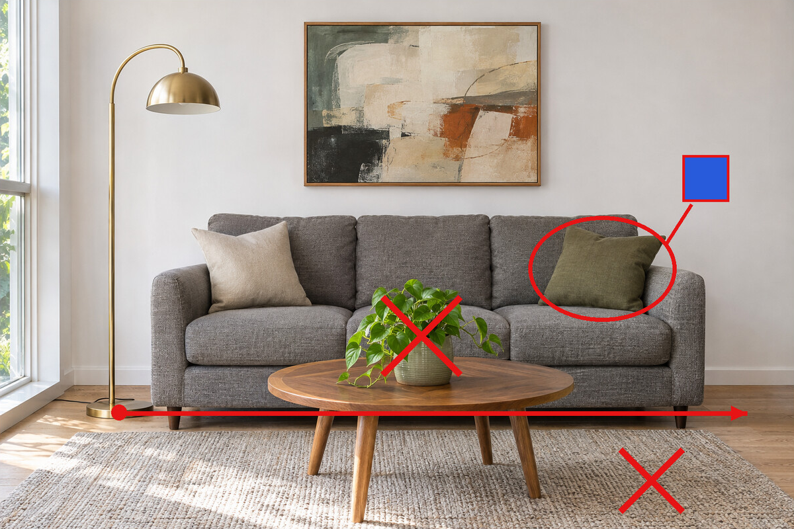

<!-- Generated by scripts/build_readme.py. Edit site.config.json, content/prompts.json and content/source-cases.json. -->

# 客厅标注编辑

[← 返回全部案例](../../README.zh-CN.md#all-cases)

[English](README.md) · [简体中文](README.zh-CN.md)

**官方发布演示 · 仅核对来源；未独立复现**

fal 标签展示原始标注编辑提示词：蓝色坐垫、移除植物与地毯、把灯移到右侧；需要原始标注输入图。

## 图片 / GIF

**参考 / 输入图，不是生成结果。**

- [编辑前](https://images.ctfassets.net/kftzwdyauwt9/50IFJAzURDJeFT6j7jU9Cy/727871e6953a56bebb783f7c884f832f/images-2-6-fal-before.png) · image
  - 署名：OpenAI / original credited creator; see source
  - 使用条件：source-attributed. 为本教育用途合集原样存档的公开来源文件。未找到明确转载许可证；署名及仓库版权声明不构成授权，亦不适用仓库 MIT 许可。
  - [来源 / 权利依据](https://openai.com/index/introducing-images-2-6/#more-ways-to-create-and-edit-in-the-api)

- [编辑后](https://images.ctfassets.net/kftzwdyauwt9/mOBUDnc6RlTLi1KU5S19r/2646cf2f1db9cfdf93250f201e8ab5de/images-2-6-fal-after.png) · image
  - 署名：OpenAI / original credited creator; see source
  - 使用条件：source-attributed. 为本教育用途合集原样存档的公开来源文件。未找到明确转载许可证；署名及仓库版权声明不构成授权，亦不适用仓库 MIT 许可。
  - [来源 / 权利依据](https://openai.com/index/introducing-images-2-6/#more-ways-to-create-and-edit-in-the-api)

## 原始提示词

[原提示词见来源](https://openai.com/index/introducing-images-2-6/#more-ways-to-create-and-edit-in-the-api)

来源公开了真实提示词。本仓库链接原文，不伪造或转载完整长提示词；所需输入与参数请在原文查看。

## 来源与核对信息

- ID: launch-fal
- 作者：fal
- [原始来源](https://openai.com/index/introducing-images-2-6/#more-ways-to-create-and-edit-in-the-api)
- 模型：GPT Image 2.6
- 版本：Flare
- 依据：发布页将此作品明确归为 Images 2.6 演示。
- 收录：2026-11-05 (UTC)
- 来源核对：2026-11-05 (UTC)

标注来源不等于取得素材许可。仓库 MIT 协议不覆盖第三方输出；本地素材逐项记录来源与使用状态，source-attributed 不代表开放许可。
