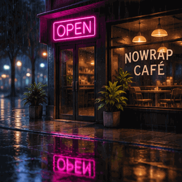
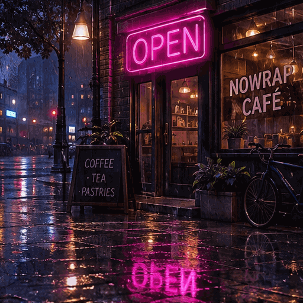
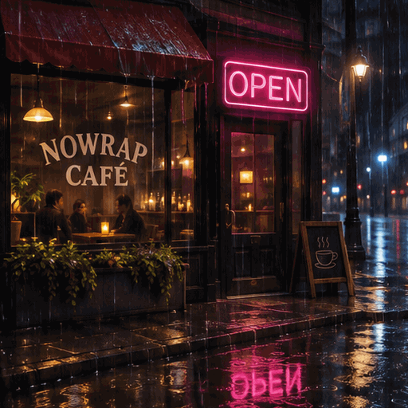
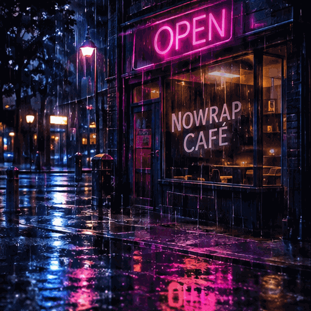
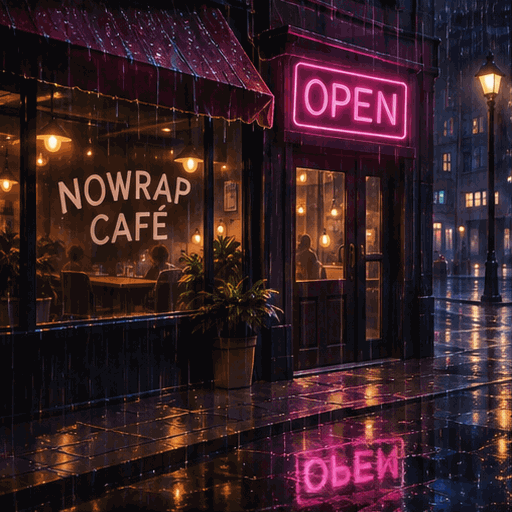

<!-- Generated by scripts/build_readme.py. Edit source data, locale catalogs and generator scripts. -->

# Café neon text comparison

[← Back to all cases](../../README.md#all-cases)

 

**Creator-reported model · Source-only; not independently reproduced**

Five outputs include low-complexity Flare/Sunburst variants. Source reports stable NOWRAP CAFÉ spelling, overlapping OPEN/LATE in default Flare, and partial letters in low-complexity Sunburst. Those visual failures remain in the files. One run per prompt/surface in a small publisher test, not a benchmark. Exact public instructions remain at source; no generations were run. App model must not be inferred from API labels. Offline recovery recheck on 2026-11-08 confirms retained source mapping and original file integrity, not backend execution or current availability.

## Images / GIFs

- [ChatGPT app (underlying variant unspecified): ChatGPT app GIF: a rainy café at night whose neon sign alternates between pink OPEN and blue LATE, with NOWRAP CAFÉ on the window](https://nowrap.ai/reviews/chatgpt-images-2-6/app-cafe-sign.gif) · gif
  - Credit: Nowrap
  - Reuse: source-attributed. Unmodified public-source archival copy. No explicit redistribution license verified. Attribution is not permission; repository MIT licensing does not cover this media.
  - [Provenance / rights evidence](https://nowrap.ai/tools/chatgpt-images-2-6)

- [API Flare: API Flare GIF: the café scene, where some frames show OPEN and LATE overlapping](https://nowrap.ai/reviews/chatgpt-images-2-6/api-flare-cafe-sign.gif) · gif
  - Credit: Nowrap
  - Reuse: source-attributed. Unmodified public-source archival copy. No explicit redistribution license verified. Attribution is not permission; repository MIT licensing does not cover this media.
  - [Provenance / rights evidence](https://nowrap.ai/tools/chatgpt-images-2-6)

- [API Sunburst: API Sunburst GIF: the café scene, with the sign fading between OPEN and LATE](https://nowrap.ai/reviews/chatgpt-images-2-6/api-sunburst-cafe-sign.gif) · gif
  - Credit: Nowrap
  - Reuse: source-attributed. Unmodified public-source archival copy. No explicit redistribution license verified. Attribution is not permission; repository MIT licensing does not cover this media.
  - [Provenance / rights evidence](https://nowrap.ai/tools/chatgpt-images-2-6)

- [API Flare: API Flare GIF at low complexity: the café sign alternating cleanly between OPEN and LATE; complexity low](https://nowrap.ai/reviews/chatgpt-images-2-6/api-flare-cafe-sign-complexity-low.gif) · gif
  - Credit: Nowrap
  - Reuse: source-attributed. Unmodified public-source archival copy. No explicit redistribution license verified. Attribution is not permission; repository MIT licensing does not cover this media.
  - [Provenance / rights evidence](https://nowrap.ai/tools/chatgpt-images-2-6)

- [API Sunburst: API Sunburst GIF at low complexity: the café sign flickering into partial words; complexity low](https://nowrap.ai/reviews/chatgpt-images-2-6/api-sunburst-cafe-sign-complexity-low.gif) · gif
  - Credit: Nowrap
  - Reuse: source-attributed. Unmodified public-source archival copy. No explicit redistribution license verified. Attribution is not permission; repository MIT licensing does not cover this media.
  - [Provenance / rights evidence](https://nowrap.ai/tools/chatgpt-images-2-6)

## Source-page and media access

- Checked: 2026-11-05 (UTC)
- Original page: Accessible. Historical source access is recorded for 2026-11-05. Retained original source evidence was rechecked offline on 2026-11-08; no current availability check was made.
- Media: Archived locally. Retained original bytes were rechecked by SHA-256, byte length and full decoding on 2026-11-08. Every GIF frame and each distinct MP4 frame was inspected as still frames; this is not new timed playback or an online access test.
- [Per-file attempts and results](../../docs/NOWRAP_CELLCOG_TOONDERLY_RECOVERY_AUDIT_2026-11-08.md)

## Original prompt

[Original prompt at source](https://nowrap.ai/tools/chatgpt-images-2-6)

The source publishes the actual prompt. This repository links to it rather than inventing or republishing the full text. Required inputs and parameters remain at the source.

## Attribution and verification

- ID: nowrap-cafe-sign-motion
- Author: Nowrap
- [Original source](https://nowrap.ai/tools/chatgpt-images-2-6)
- Model: GPT Image 2.6
- Variant: Flare / Sunburst
- Evidence: Nowrap’s November 5, 2026 hands-on test labels API outputs Flare and Sunburst. These known variants apply only to API media; the ChatGPT Plus app’s underlying variant is explicitly unknown. Publisher attribution, not independent generation verification.
- Collected: 2026-11-05 (UTC)
- Source checked: 2026-11-08 (UTC)

Attribution does not grant a media license. Repository MIT terms do not cover third-party outputs. Local files record provenance and reuse status; source-attributed does not mean open-licensed.
